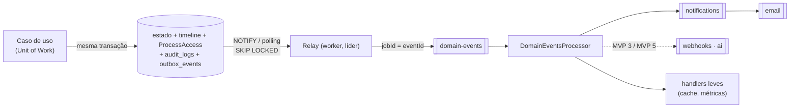

# ADR-004 — Eventos de domínio com Transactional Outbox e BullMQ

| Campo | Valor |
|---|---|
| **Status** | Aceito |
| **Data** | 2026-10-05 |
| **Decisores** | Arquiteto de software líder · Tech lead de backend · Engenharia de plataforma/SRE |
| **Decisões relacionadas** | DEC-041, DEC-050, DEC-052, DEC-058, DEC-085, DEC-160, DEC-161, DEC-162, DEC-163, DEC-164 |
| **Documentos** | [queues.md](../architecture/queues.md) · [events.md](../mvp-01/events.md) · [entities.md — `OutboxEvent`](../mvp-01/entities.md) · [ADR-001](adr-001-modular-monolith.md) |

## Contexto

- O ContrataFlow é um monólito modular ([ADR-001](adr-001-modular-monolith.md)): módulos só se comunicam por fachadas ou **eventos** (DEC-041). Tramitações, aprovações e documentos precisam disparar efeitos colaterais — notificações, e-mails, invalidação de cache, métricas de negócio e, nos próximos MVPs, webhooks, publicações, indexação e IA — **sem** executá-los dentro da transação da requisição e **sem** perdê-los.
- O problema clássico é a **escrita dupla**: confirmar a transação no PostgreSQL e publicar num broker não são atômicos. Publicar depois do commit perde eventos se o processo cair entre as duas operações; publicar antes cria eventos "fantasmas" de transações que sofreram rollback. Num sistema de contratações públicas, perder a notificação de uma aprovação pendente ou de um prazo vencido tem consequência administrativa.
- Requisitos: atomicidade com a mudança de estado; entrega *at-least-once*; ordem por agregado; retries com backoff; jobs agendados; dead letter; contexto de tenant, ator e trace em todo processamento assíncrono (DEC-164); observabilidade do atraso; operação simples para equipe pequena; portabilidade (DEC-058).
- Redis já faz parte da stack (sessões, cache, idempotência — DEC-050) e o volume do MVP 1 é modesto (estimativa de até ~100 mil eventos/dia).

## Decisão

1. **Envelope único** (DEC-160) e catálogo canônico em [events.md](../mvp-01/events.md); nomes especializados são o **mesmo** evento com routing key especializada (DEC-162 — ex.: `ProcessStageChanged` publicado com `process.stage_changed.forward`).
2. **Transactional Outbox:** o caso de uso grava o evento em `outbox_events` **na mesma transação** da mudança de estado (DEC-161), com `traceparent`, `correlationId`, `causationId` e `actor` em `metadata`, e emite `pg_notify('cf_outbox')` (entregue somente no commit).
3. **Handlers síncronos in-process**, na mesma transação, apenas para projeções que precisam ser atômicas: `TimelineProjector` e `ProcessAccessProjector`. A auditoria é escrita explicitamente pelo `AuditService`, não pelo outbox.
4. **Relay no worker** (DEC-052): líder único por *advisory lock*, lotes de 100 com `FOR UPDATE SKIP LOCKED` ordenados por `(occurred_at, id)`, `LISTEN/NOTIFY` para latência e *polling* como garantia; papel de banco `cf_relay`; publica na fila BullMQ `domain-events` com `jobId = eventId` e marca `PUBLISHED`. Eventos publicados são purgados após 7 dias (DEC-085).
5. **Fan-out por routing key:** o `DomainEventsProcessor` enfileira os consumidores (`notifications`, depois `email`; `webhooks` no MVP 3; `ai` no MVP 5) e executa handlers leves idempotentes (`PermissionCacheInvalidator`, `BusinessMetricsCollector`).
6. **BullMQ sobre Redis** para todas as filas (DEC-163): retries exponenciais com *jitter*, `dead-letter`, Job Schedulers para `deadlines`, `audit-seal` e `maintenance`.
7. **Entrega *at-least-once*** com consumidores idempotentes por `eventId` e chaves naturais (ex.: `UNIQUE (tenant_id, recipient_id, source_event_id, type)` em `notifications`).
8. **Versionamento:** `eventVersion` + *upcasters* (`packages/validation/src/events/upcasters.ts`); consumidores são implantados antes dos produtores de uma nova versão.

## Alternativas consideradas

| Alternativa | Prós | Contras | Motivo da decisão |
|---|---|---|---|
| **Publicar direto após o commit** (hook *after-commit*) | Simples; latência mínima | Queda entre commit e publicação perde o evento; publicar antes do commit gera eventos fantasmas; sem replay | **Rejeitada:** perda silenciosa de notificações de aprovação e prazo é inaceitável |
| **CDC com Debezium** (WAL do PostgreSQL) | Sem *polling*; ordem exata de commit; latência baixa; padrão *Outbox Event Router* | Kafka Connect/Debezium Server + broker; *replication slots* no RDS retêm WAL se o consumidor parar (risco de disco cheio); operação complexa para o volume atual | **Adiada:** caminho de evolução preservado — o Debezium pode ler a mesma `outbox_events` |
| **Kafka ou RabbitMQ** como broker | Kafka: retenção e replay, partições; RabbitMQ: *topic exchanges* compatíveis com routing keys | Infraestrutura crítica adicional (MSK/Amazon MQ); **o outbox continua necessário** para atomicidade; atrasos, retries por mensagem e agendamento exigem plugins/padrões que o BullMQ já oferece | **Rejeitada no MVP 1–3:** custo operacional sem ganho proporcional |
| **EventEmitter in-process apenas** (`@nestjs/event-emitter`) | Trivial; transacional para handlers síncronos | Sem durabilidade, sem retry, sem entrega ao worker; acopla a latência dos efeitos à requisição | **Usada só** para handlers síncronos (timeline, `ProcessAccess`) |
| **Serviços gerenciados** (SQS/SNS/EventBridge) | Duráveis, sem operação | Proprietários no caminho crítico (DEC-058); emulação local; o outbox continua necessário | **Rejeitada** por portabilidade |

## Consequências

**Positivas**
- Nenhum evento perdido ou fantasma: o fato e sua publicação compartilham a transação.
- Desacoplamento entre módulos e entre requisição e efeitos colaterais; falhas assíncronas não desfazem a ação do usuário (CA-T-07).
- Retries, DLQ, agendamento e *rate limiting* nativos; replay por janela de até 7 dias.
- Contexto de tenant, ator e trace propagado ponta a ponta (DEC-164); lag mensurável (SLO p95 < 5 s).
- Reaproveita o Redis da stack; ambiente local simples.

**Negativas**
- Latência adicional (sub-segundo) entre o fato e a reação.
- Escrita extra no banco (linhas do outbox, purga diária, autovacuum).
- *At-least-once* exige disciplina de idempotência em todo consumidor.
- Durabilidade do Redis é limitada (replicação assíncrona); a ordem só é garantida até a publicação — consumidores precisam tolerar ordem diferente.
- Relay único tem teto de vazão (estimado em ~1.000 eventos/s) antes de exigir particionamento.

## Riscos e mitigação

| Risco | Mitigação |
|---|---|
| Perda de jobs em failover do Redis | Outbox é a fonte da verdade; `cli outbox:replay` por janela; consumidores idempotentes |
| Crescimento de `outbox_events` | Purga diária (> 7 dias) por papel dedicado; índice parcial em `PENDING`; monitorar inchaço |
| Evento "venenoso" travando o lote | Tratamento por linha; `FAILED` após 10 tentativas com alerta crítico; republicação após correção |
| Consumidor não idempotente | Padrão obrigatório ([queues.md](../architecture/queues.md) §8) e teste de reentrega (mesmo evento entregue 2×) no CI |
| Dado sensível no payload | Schema Zod por evento; regra de events.md §1 (só IDs e mínimo necessário); revisão de contrato |
| Mudança incompatível de evento | `eventVersion`, *upcasters* e ordem de implantação |
| Relay como ponto único de falha | Réplicas em *standby* assumem a trava em ≤ 5 s; alerta de líder ausente |

## Critérios de revisão
- Lag p95 > 5 s sustentado com relay saudável, ou vazão > 1.000 eventos/s → relay particionado (16 partições por hash do agregado) ou CDC.
- Necessidade de replay de longo prazo, *event sourcing* ou *streaming* analítico (MVP 5) → avaliar Kafka/Kinesis com Debezium.
- Webhooks públicos em escala (MVP 3) exigindo ordem e replay por assinante → reavaliar o broker.
- Incidente real de perda por durabilidade do Redis → avaliar Amazon MemoryDB ou broker durável.

## Referências
- DEC-041, DEC-050, DEC-052, DEC-058, DEC-085, DEC-160, DEC-161, DEC-162, DEC-163, DEC-164 — [decisions.md](../architecture/decisions.md#8-eventos-filas-e-jobs).
- [queues.md](../architecture/queues.md) (§5 outbox, §7 fan-out, §8 idempotência), [observability.md](../architecture/observability.md) (SLO-11, RB-01), [events.md](../mvp-01/events.md), [entities.md](../mvp-01/entities.md) (`OutboxEvent`), [architecture.md](../architecture/architecture.md) §6.8.
- Chris Richardson, *Microservices Patterns* — *Transactional Outbox*; documentação do PostgreSQL (`SKIP LOCKED`, `LISTEN/NOTIFY`) e do BullMQ.
