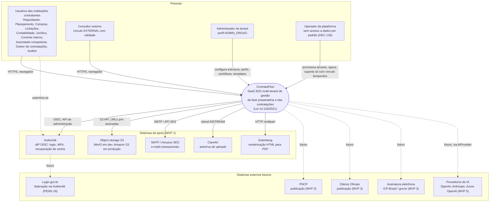
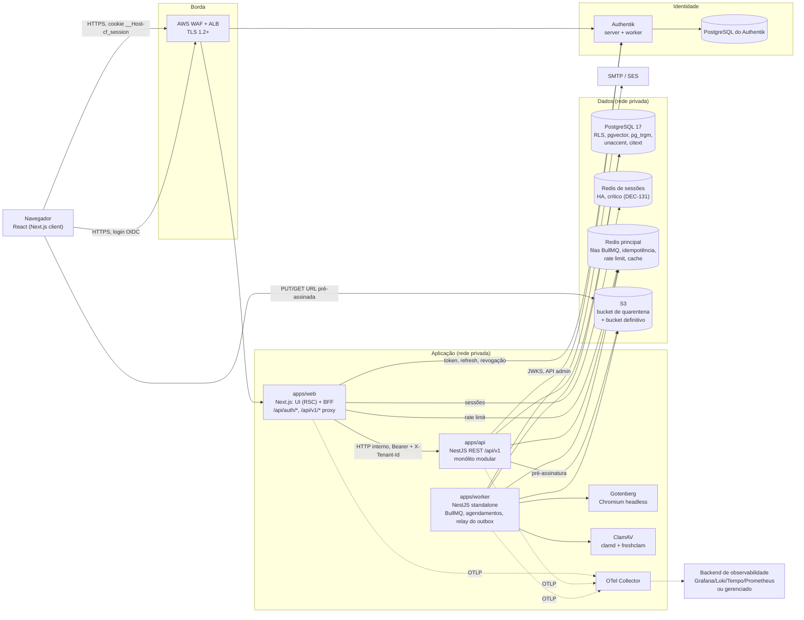
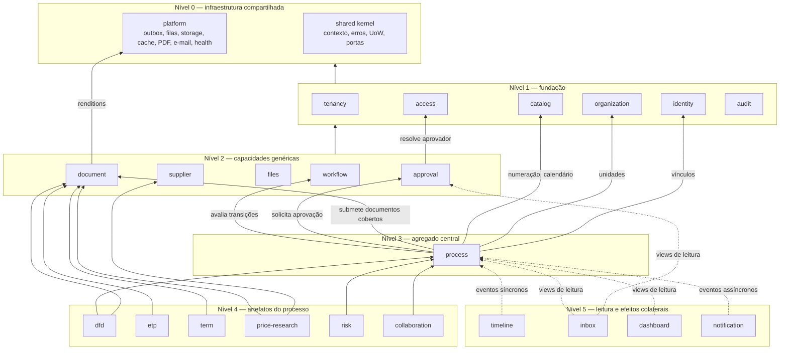
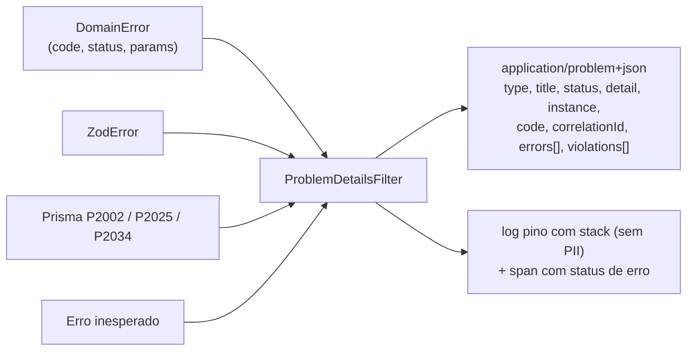
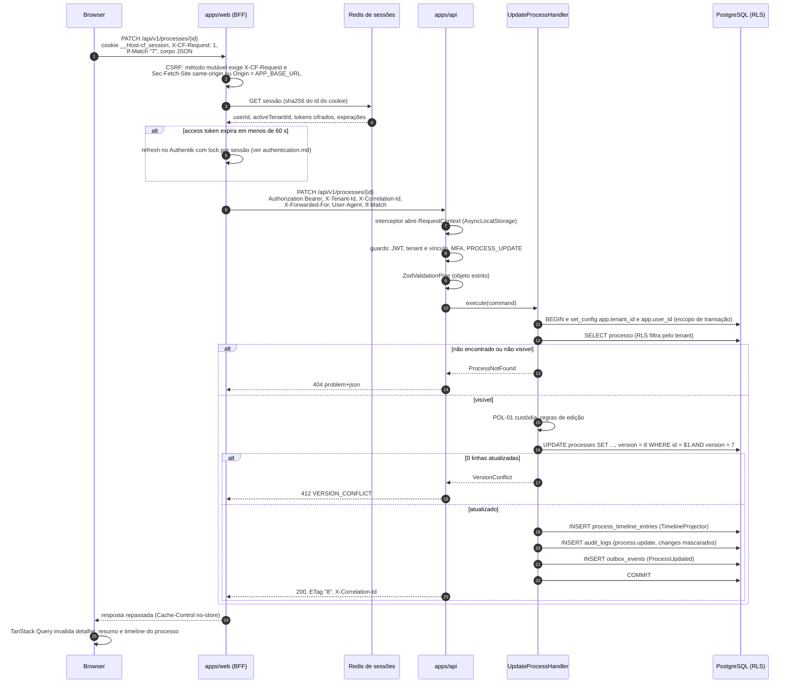
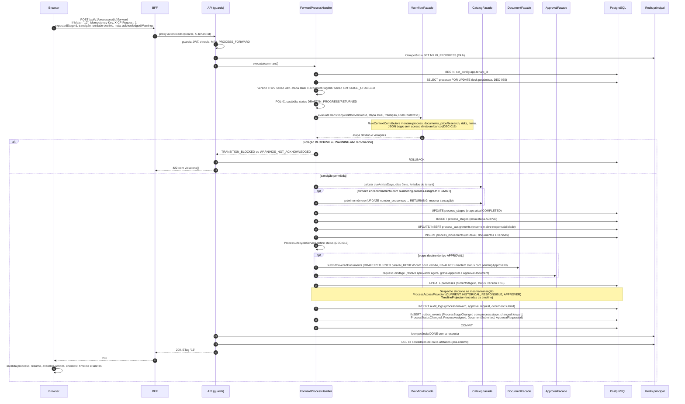
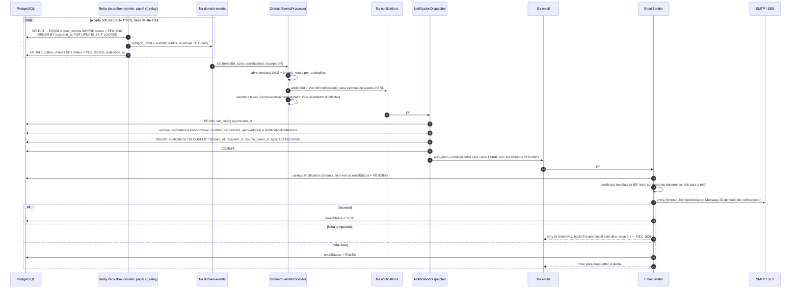
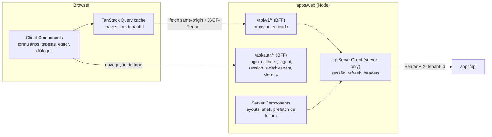
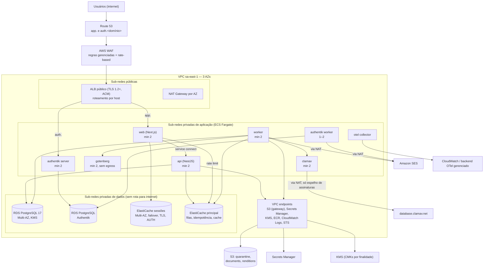

# Arquitetura do ContrataFlow

> **Status:** Aceita para especificação (fundação + MVP 1) · **Data:** 2026-10-05 · **Responsáveis:** Arquitetura/Tech Lead
> **Fonte canônica:** [`decisions.md`](decisions.md). Este documento detalha e operacionaliza as decisões; em caso de conflito, `decisions.md` prevalece.
> **Documentos relacionados:** [`domains.md`](domains.md) · [`multi-tenancy.md`](multi-tenancy.md) · [`security.md`](security.md) · [`authentication.md`](authentication.md) · [`storage.md`](storage.md) · [`queues.md`](queues.md) · [`observability.md`](observability.md) · [ADR-001](../adr/adr-001-modular-monolith.md) · [ADR-002](../adr/adr-002-multi-tenancy.md) · [ADR-003](../adr/adr-003-authentication.md)
>
> **Legenda:** itens marcados com **†** são nomes/valores **propostos por este documento** que ainda não constam em `decisions.md` nem nas fontes canônicas do MVP 1. Devem ser registrados (em `decisions.md`, `../mvp-01/api.md`, `../mvp-01/entities.md` ou `../mvp-01/events.md`) antes da implementação.

## Sumário

1. [Escopo](#1-escopo)
2. [Princípios arquiteturais](#2-princípios-arquiteturais)
3. [Visão C4](#3-visão-c4)
4. [Monorepo](#4-monorepo)
5. [Estrutura interna de um módulo](#5-estrutura-interna-de-um-módulo)
6. [Padrões transversais](#6-padrões-transversais)
7. [Fluxos principais (diagramas de sequência)](#7-fluxos-principais)
8. [Arquitetura do frontend](#8-arquitetura-do-frontend)
9. [Worker](#9-worker)
10. [Configuração](#10-configuração)
11. [Ambientes e topologia AWS](#11-ambientes-e-topologia-aws)
12. [Escalabilidade, disponibilidade e recuperação](#12-escalabilidade-disponibilidade-e-recuperação)
13. [Metas de performance (SLO) e capacidade](#13-metas-de-performance-slo-e-capacidade)
14. [Evolução da arquitetura](#14-evolução-da-arquitetura)

---

## 1. Escopo

Este documento descreve a arquitetura de software e de implantação do ContrataFlow: como o sistema se decompõe (contêineres, módulos, camadas), quais padrões todo código deve seguir, como os fluxos críticos acontecem de ponta a ponta e como o sistema é implantado, escalado e recuperado. Detalhes de domínio (bounded contexts e ERD) estão em [`domains.md`](domains.md); detalhes de storage, filas e observabilidade estão nos documentos próprios.

## 2. Princípios arquiteturais

| # | Princípio | O que significa na prática | Como é verificado |
|---|---|---|---|
| P1 | **Processo é o agregado central** (DEC-010) | Todo artefato de negócio tem `processId`; navegação, permissões de visibilidade e timeline giram em torno do `Process`. | Revisão de modelo; `processId NOT NULL` nas tabelas de artefatos. |
| P2 | **Monólito modular com fronteiras explícitas** (DEC-040, DEC-041, ADR-001) | Um deployable para a API e um para o worker; módulos com dono único de entidades; comunicação por fachada ou eventos. | `dependency-cruiser` no CI (§4.4). |
| P3 | **Isolamento de tenant em profundidade** (DEC-080 a DEC-082, ADR-002) | Quatro barreiras independentes: contexto obrigatório na aplicação, Prisma Client Extension, RLS no PostgreSQL e FKs compostas. Nenhuma barreira isolada é suficiente. | Suíte *tenant leak* obrigatória no CI ([`multi-tenancy.md`](multi-tenancy.md#14-testes-de-isolamento)). |
| P4 | **A API decide; a UI orienta** (DEC-134) | A UI esconde/desabilita ações; toda decisão de autorização é refeita na API, inclusive políticas contextuais (custódia, segregação de funções). | Testes de API para 403/404 em todo endpoint. |
| P5 | **Contrato único** (DEC-054, ADR-010) | Schemas Zod em `packages/validation` geram tipos, validação de front e back e OpenAPI 3.1. | Build falha se o OpenAPI gerado divergir do versionado. |
| P6 | **Evidência imutável** (DEC-017, DEC-025, DEC-084) | Versões de documento, tramitações e auditoria são *append-only*, com hash SHA-256 e selagem. | Triggers de imutabilidade; job `audit-seal`. |
| P7 | **Consistência forte dentro do monólito, eventual para efeitos colaterais** (DEC-041, DEC-161) | Mudanças de estado, timeline, `ProcessAccess`, auditoria e outbox na **mesma transação**; notificações, e-mails e PDFs assíncronos. | Testes de integração com falha injetada após commit. |
| P8 | **Regra legal é configuração, não código** (DEC-016) | Exigências da Lei 14.133 são regras JSON Logic semeadas e versionadas com o workflow. | Nenhum `if` de regra legal em casos de uso (revisão). |
| P9 | **Cloud-agnostic por protocolo** (DEC-058) | Dependências por PostgreSQL, Redis, S3 API, OIDC, SMTP, OTLP; serviços AWS atrás de adapters. | Ambiente local 100% em Docker Compose com as mesmas interfaces. |
| P10 | **Seguro e privado por padrão** (DEC-135 a DEC-140) | Tokens nunca no browser, menor privilégio em banco e nuvem, logs sem dados pessoais, criptografia de campos sensíveis. | Checklist de segurança no DoD ([`security.md`](security.md#25-definition-of-done-de-segurança-por-card)). |
| P11 | **Tudo correlacionável** (DEC-132, DEC-164) | `correlationId`, `tenantId` e `traceparent` atravessam BFF → API → banco → outbox → filas → e-mail. | Teste de rastreabilidade ponta a ponta em staging. |
| P12 | **Simplicidade evolutiva** | Nenhuma infraestrutura antes da necessidade medida: busca no PostgreSQL (DEC-057), filas no Redis (DEC-050), sem broker dedicado, sem microsserviços (ADR-001). | Critérios objetivos de evolução (§14.1). |

## 3. Visão C4

### 3.1 Nível 1 — Contexto



| Ator / sistema | Relação com o ContrataFlow | Observações |
|---|---|---|
| Usuários das instituições contratantes (tenants — DEC-012) | Operam processos conforme perfis (DEC-035) e escopos (DEC-134). | Uso majoritário em desktop; consulta, tarefas e aprovações também em mobile (DEC-183). |
| Consultor externo | Acesso por participação em processos (`CONSULTANT`, DEC-036) com vínculo `EXTERNAL` e validade. | Pode ter vínculos com vários tenants (DEC-012). |
| Administrador do tenant | Gerencia usuários, vínculos, perfis, estrutura, catálogos, workflows, templates e configurações do seu tenant. | Perfil `ADMIN_ORGAO` sempre com todas as permissões de administração (DEC-035). |
| Operador da plataforma | Provisiona/suspende tenants, opera infraestrutura, atende chamados. | Acesso a dados apenas via vínculo temporário auditado (DEC-139). |
| Authentik | Autenticação (quem é o usuário). O ContrataFlow faz a autorização (o que pode fazer). | [`authentication.md`](authentication.md). |
| Object storage | Binários: anexos, renditions PDF, exportações. | Buckets privados; [`storage.md`](storage.md). |
| SMTP/SES | E-mails transacionais (convites, notificações). | Abstração de envio (DEC-050). |
| ClamAV e Gotenberg | Serviços de apoio implantados e operados pela própria plataforma, sem acesso à internet. | Representados no contexto por serem fronteiras de confiança distintas (processam conteúdo não confiável). |

### 3.2 Nível 2 — Contêineres



| Contêiner | Tecnologia | Responsabilidade | Exposição | Escala |
|---|---|---|---|---|
| `apps/web` | Next.js (App Router), React | UI (Server e Client Components) e **BFF**: login OIDC, sessão, proteção CSRF, proxy autenticado para a API (DEC-053). | Pública via ALB (`app.<domínio>`†). | Horizontal, *stateless* (sessão no Redis). |
| `apps/api` | NestJS, Prisma | Casos de uso, autorização, persistência, auditoria, outbox. | **Somente rede privada** no MVP 1 (DEC-053). | Horizontal, *stateless*. |
| `apps/worker` | NestJS standalone, BullMQ | Consumidores de filas, jobs agendados, relay do outbox (DEC-052). | Nenhuma porta pública. | Horizontal por grupo de filas (§9). |
| PostgreSQL | PostgreSQL 17 (mín. 16) | Fonte da verdade; RLS por tenant; FTS; outbox. | Rede de dados privada. | Vertical + réplica de leitura futura. |
| Redis de sessões | Redis 7 / Valkey | Sessões do BFF e transações OIDC (DEC-131). **Dependência crítica**: indisponível → BFF responde 503. | Rede de dados privada; TLS + AUTH; acesso só do `web`. | Cluster próprio Multi-AZ com failover automático. |
| Redis principal | Redis 7 / Valkey | Filas BullMQ, idempotência (DEC-105), rate limit, locks, presença, cache. Não crítico para leitura/escrita síncrona (CA-T-07). | Rede de dados privada; TLS + AUTH. | Multi-AZ; cache migra para cluster próprio quando necessário (§6.12). |
| Object storage | S3 / MinIO | Binários com prefixo por tenant; quarentena de uploads (DEC-136). | Acesso apenas por URL pré-assinada. | Gerenciado. |
| Authentik | Authentik (server + worker) | IdP OIDC, MFA, recuperação de senha, ativação de conta. | Pública via ALB (`auth.<domínio>`†). | Horizontal (server); banco próprio. |
| Gotenberg | Gotenberg 8 (Chromium) | HTML → PDF (DEC-060). | Somente worker; **sem egress**. | Horizontal; CPU-bound. |
| ClamAV | clamd + freshclam | Varredura de uploads (DEC-136). | Somente worker; egress apenas para espelho de assinaturas. | Horizontal; memória ≥ 3 GB por instância. |
| OTel Collector | OpenTelemetry Collector | Recebe OTLP, aplica *redaction*/amostragem, exporta. | Somente rede privada. | Sidecar ou serviço dedicado ([`observability.md`](observability.md)). |

### 3.3 Nível 3 — Componentes da API (módulos)

Os módulos de DEC-040 são organizados em **níveis**. Um módulo só depende (via fachada) de módulos de nível **inferior**. Comunicação no sentido contrário usa **eventos de domínio** ou **portas** (interfaces declaradas no nível inferior e implementadas no superior — inversão de dependência). O grafo é acíclico e verificado no CI (§4.4).



**Portas (inversão de dependência) que mantêm o grafo acíclico:**

| Porta† | Declarada em | Implementada por | Uso |
|---|---|---|---|
| `ProcessAccessPort` | shared kernel | `process` | `document`, `files`, `approval` e `collaboration` verificam visibilidade (DEC-024) e custódia (DEC-023) sem importar `process`. |
| `ApprovalSubjectHandler` | `approval` | `process` (`PROCESS_STAGE`), `document` (`DOCUMENT`) | Ao decidir uma `Approval`, o módulo `approval` invoca o handler do `subjectType`, **na mesma transação**, para avançar a etapa ou mudar o status do documento (DEC-022). |
| `RuleContextContributor` | `workflow` | `process`, `dfd`, `etp`, `term`, `price-research`, `risk` | Cada módulo contribui com sua seção do `RuleContext v1` (DEC-016) sem que `workflow`/`process` dependam dos artefatos. |
| `NotificationRecipientResolver` | `notification` | `process`, `approval` | Resolução de destinatários a partir de eventos. |

**Leitura entre módulos.** Módulos de consulta (`inbox`, `dashboard`) não leem tabelas de outros módulos: leem **views SQL publicadas** pelo módulo dono (prefixo `v_`†, versionadas na migração do dono e tratadas como contrato público, ex.: `v_inbox_stage_items`†, `v_inbox_pending_approvals`†). Isso viabiliza a consulta da caixa de tarefas (DEC-026) com junções eficientes sem violar a propriedade de entidades (DEC-040).

## 4. Monorepo

pnpm workspaces + Turborepo (DEC-051). Versões exatas fixadas em US-077. Escopo de pacotes npm: `@contrataflow/*` (DEC-062). Versões, motivos e medições: [`docs/engineering/versions.md`](../engineering/versions.md); padrões de contribuição: [`CONTRIBUTING.md`](../../CONTRIBUTING.md).

### 4.1 Árvore de pastas

```
contrataflow/
├── apps/
│   ├── web/                          # Next.js — UI + BFF (DEC-053)
│   │   ├── src/app/
│   │   │   ├── (auth)/               # páginas públicas/de sessão: /entrar, /recuperar-senha, /selecionar-orgao, /convite/[token], /erro/*
│   │   │   ├── (app)/                # shell autenticado: /painel, /processos, /tarefas, /aprovacoes, /fornecedores, /notificacoes, /auditoria, /perfil
│   │   │   │   └── admin/            # /admin/* — administração do tenant (SCR-029…)
│   │   │   └── api/
│   │   │       ├── auth/[action]/route.ts      # login, callback, logout, session, switch-tenant, step-up
│   │   │       └── v1/[...path]/route.ts       # proxy autenticado para apps/api
│   │   ├── src/bff/                  # oidc-client, session-store, csrf, api-proxy, rate-limit (somente servidor)
│   │   ├── src/features/<área>/      # componentes, hooks, query keys e schemas de tela por área
│   │   ├── src/lib/                  # api-client, query-client, permissions, i18n, formatters
│   │   ├── messages/pt-BR/*.json     # next-intl
│   │   └── src/proxy.ts              # cabeçalhos de segurança/CSP nonce (middleware.ts em Next < 16)
│   ├── api/                          # NestJS — REST /api/v1
│   │   ├── src/main.ts               # bootstrap HTTP
│   │   ├── src/app.module.ts
│   │   ├── src/cli.ts                # comandos operacionais (provisionamento de tenant — US-099)
│   │   ├── src/shared/               # shared kernel: request-context, errors, uow, guards, decorators, ports
│   │   ├── src/modules/<módulo>/     # módulos de DEC-040 (estrutura no §5)
│   │   ├── prisma/schema.prisma      # schema único (fonte das migrações)
│   │   ├── prisma/migrations/        # migrações versionadas (inclui SQL bruto: RLS, triggers, partições, views v_*)
│   │   └── test/                     # integração (Testcontainers), contrato, tenant-leak
│   └── worker/                       # NestJS standalone — composition root do worker (DEC-052)
│       ├── src/main.ts               # bootstrap sem HTTP público (porta interna só p/ health/metrics)
│       ├── src/worker.module.ts      # importa módulos de apps/api (application + infrastructure)
│       ├── src/processors/<fila>.processor.ts
│       ├── src/schedulers/           # job schedulers (deadlines, audit-seal, maintenance)
│       └── src/outbox/relay.ts       # relay do outbox (papel cf_relay)
├── packages/
│   ├── ui/                 # design system: shadcn/ui + Radix + Tailwind (tokens, componentes, ícones)
│   ├── types/              # enums, permissões, eventos, códigos de erro, chaves de configuração, allowlist de upload
│   ├── validation/         # schemas Zod (DTOs, eventos, RuleContext, settings) + geração OpenAPI 3.1
│   ├── editor/             # extensões TipTap, schema ProseMirror, validador e serializador HTML (DEC-051, DEC-056)
│   ├── eslint-config/      # regras compartilhadas (inclui proibições de segurança — §4.4)
│   └── tsconfig/           # bases strict (node, next, library)
├── infra/
│   ├── docker/             # Dockerfiles multi-stage (web, api, worker), compose de dev
│   └── terraform/          # módulos e ambientes (dev, staging, production) — §11.4
├── tools/                  # scripts (seed, geração de OpenAPI, verificação de migrações)
├── docs/
├── docker-compose.yml      # postgres, redis, minio, authentik, gotenberg, clamav, mailpit, otel/grafana
├── turbo.json · pnpm-workspace.yaml · .dependency-cruiser.cjs · renovate.json5 · .gitleaks.toml
```

### 4.2 Responsabilidades

| Pacote/app | Responsabilidade | Não pode conter |
|---|---|---|
| `apps/web` | Renderização, navegação, estado de UI, BFF (sessão, tokens, CSRF, proxy). | Regra de negócio ou de autorização decisória; acesso a banco; segredos no bundle do cliente. |
| `apps/api` | Casos de uso, domínio, persistência, autorização, auditoria, outbox, OpenAPI. | Renderização de UI; chamadas a serviços externos dentro de transação. |
| `apps/worker` | Execução assíncrona: processors, schedulers, relay. Reutiliza `application`/`infrastructure` dos módulos da API. | Controllers HTTP; lógica de domínio própria (fica nos módulos). |
| `packages/types` | Constantes e tipos puros (sem runtime pesado). Fonte única de permissões (`permissions.ts`), eventos (`events.ts`), códigos de erro e registros (*settings*, allowlist). | Dependências de Node/browser específicas. |
| `packages/validation` | Schemas Zod de contrato (request/response, eventos, `RuleContext`, settings). | Regras dependentes de estado (DEC-054). |
| `packages/editor` | Schema TipTap/ProseMirror, validação de conteúdo, `generateHTML` no servidor. | Componentes React de página. |
| `packages/ui` | Componentes acessíveis, tokens, temas. | Chamadas de API, conhecimento de domínio. |

### 4.3 Regras de dependência

| De ↓ / Para → | `types` | `validation` | `editor` | `ui` | `apps/api` | `apps/web` | `apps/worker` |
|---|---|---|---|---|---|---|---|
| `packages/types` | — | ✘ | ✘ | ✘ | ✘ | ✘ | ✘ |
| `packages/validation` | ✔ | — | ✘ | ✘ | ✘ | ✘ | ✘ |
| `packages/editor` | ✔ | ✔ | — | ✘ | ✘ | ✘ | ✘ |
| `packages/ui` | ✔ | ✘ | ✘ | — | ✘ | ✘ | ✘ |
| `apps/web` | ✔ | ✔ | ✔ | ✔ | ✘ (só HTTP) | — | ✘ |
| `apps/api` | ✔ | ✔ | ✔ | ✘ | — | ✘ | ✘ |
| `apps/worker` | ✔ | ✔ | ✔ | ✘ | ✔ (somente `src/modules/*/{application,infrastructure,domain}`, `*.module.ts` e `src/shared`) | ✘ | — |

Regras adicionais dentro de `apps/api` (DEC-041):
1. `modules/<m>/domain/**` não importa `@nestjs/*`, `@prisma/*`, `ioredis`, SDKs de nuvem nem outro módulo.
2. Um módulo só importa de outro módulo o arquivo `application/<m>.facade.ts` (e tipos públicos em `application/dto/**`), respeitando os níveis do §3.3.
3. `presentation/**` só é importado pelo próprio módulo (o worker nunca carrega controllers).
4. Acesso a Prisma somente em `infrastructure/**` e no shared kernel (`shared/database/**`).
5. `SystemDbService` (papel de plataforma — [`multi-tenancy.md`](multi-tenancy.md#53-acesso-de-plataforma-systemprisma)) só pode ser importado por arquivos na allowlist (`modules/tenancy/application/provisioning/**`, `worker/src/outbox/**`, `worker/src/schedulers/**`).
6. Sem ciclos (`no-circular`), inclusive entre fachadas.

### 4.4 Verificação automática (dependency-cruiser + ESLint)

```js
// .dependency-cruiser.cjs (trecho ilustrativo)
module.exports = {
  forbidden: [
    { name: 'no-circular', severity: 'error', from: {}, to: { circular: true } },
    { name: 'domain-is-pure', severity: 'error',
      from: { path: '^apps/api/src/modules/[^/]+/domain/' },
      to: { path: '(@nestjs|@prisma|ioredis|bullmq|@aws-sdk|^apps/api/src/modules/[^/]+/(application|infrastructure|presentation))' } },
    { name: 'cross-module-only-via-facade', severity: 'error',
      from: { path: '^apps/api/src/modules/([^/]+)/' },
      to: { path: '^apps/api/src/modules/([^/]+)/', pathNot: ['^apps/api/src/modules/$1/',
            '^apps/api/src/modules/[^/]+/application/([^/]+\\.facade\\.ts|dto/)'] } },
    { name: 'worker-never-loads-presentation', severity: 'error',
      from: { path: '^apps/worker/' }, to: { path: '^apps/api/src/modules/[^/]+/presentation/' } },
    { name: 'system-prisma-allowlist', severity: 'error',
      from: { pathNot: '(modules/tenancy/application/provisioning|apps/worker/src/(outbox|schedulers))/' },
      to: { path: 'shared/database/system-prisma\\.service\\.ts$' } },
    { name: 'web-never-imports-api', severity: 'error',
      from: { path: '^apps/web/' }, to: { path: '^apps/(api|worker)/' } },
  ],
};
```

A matriz de níveis do §3.3 é gerada a partir de um arquivo `tools/module-levels.json`† e convertida em regras `forbidden` (módulo de nível *n* não importa fachada de nível > *n*). Complementos em ESLint (`packages/eslint-config`): proibição de `$queryRawUnsafe`/`$executeRawUnsafe`, `dangerouslySetInnerHTML` fora do componente de pré-visualização sanitizada, `console.*` (usar o logger), `process.env` fora do módulo de configuração, e `import 'server-only'` obrigatório em `apps/web/src/bff/**`.

### 4.5 Turborepo e pipeline de CI

```jsonc
// turbo.json (trecho ilustrativo — Turborepo 2.x usa "tasks")
{
  "tasks": {
    "db:generate":      { "inputs": ["prisma/schema.prisma"], "outputs": ["node_modules/.prisma/**"] },
    "openapi:generate": { "dependsOn": ["^build"], "outputs": ["openapi/**"] },
    "build":            { "dependsOn": ["^build", "db:generate"], "outputs": ["dist/**", ".next/**", "!.next/cache/**"] },
    "typecheck":        { "dependsOn": ["^build", "db:generate"] },
    "lint":             { "dependsOn": ["^build"] },
    "test":             { "dependsOn": ["^build"], "outputs": ["coverage/**"] },
    "test:integration": { "dependsOn": ["build"], "cache": false },
    "test:e2e":         { "dependsOn": ["build"], "cache": false },
    "test:tenant-leak": { "dependsOn": ["^build"], "cache": false },
    "test:authz":       { "dependsOn": ["^build"], "cache": false },
    "depcruise":        { "inputs": ["src/**", "../../.dependency-cruiser.cjs"] }
  }
}
```

Estágios do CI (GitHub Actions — DEC-061), todos obrigatórios para *merge* (detalhe em US-079; implementação em DEC-066):

| Estágio | Conteúdo | Falha bloqueia |
|---|---|---|
| 1. Higiene | `pnpm install --frozen-lockfile`, `gitleaks`, verificação de licenças | Sim |
| 2. Estático | `lint`, `typecheck`, `depcruise`, Semgrep/CodeQL ([`security.md`](security.md#20-sast-dast-e-testes-de-segurança)) | Sim |
| 3. Contrato | `openapi:generate` + diff com o versionado; *breaking changes* na v1 → falha (DEC-108) | Sim |
| 4. Testes | Unitários (Vitest) → integração com Testcontainers (PostgreSQL com RLS real, Redis, MinIO) → suíte **tenant leak** → testes de autorização gerados (permissions.md §10) | Sim |
| 5. Migrações | Aplicar migrações do zero e sobre *snapshot* da versão anterior; checagens de RLS/FK composta ([`multi-tenancy.md`](multi-tenancy.md#14-testes-de-isolamento)); lint de migração *expand/contract* | Sim |
| 6. Imagens | Build multi-stage, SBOM, scan de vulnerabilidades, assinatura ([`security.md`](security.md#19-dependências-e-cadeia-de-suprimentos)) | Sim (CVE crítica/alta com correção disponível) |
| 7. E2E | Playwright + axe-core contra o ambiente efêmero (Docker Compose, Authentik real) | Sim |
| 8. Pós-deploy (staging) | ZAP baseline, k6 *smoke*, verificação de *traces* | Alerta; bloqueia promoção para produção |

Implementação (DEC-066 · [`CONTRIBUTING.md`](../../CONTRIBUTING.md#pipeline-de-ci)): `.github/workflows/ci.yml` (1–7), `images.yml` (6, reutilizável) e `deploy-staging.yml` (6 com publicação → deploy → 8 → promoção). Depois da Higiene, 2–7 rodam em paralelo; os nomes dos jobs (`1. Higiene` … `7. E2E`, mais `2. Estático (CodeQL)`) são os *required checks* da *ruleset* da `main` (`.github/repository-settings.json`). PR só de `docs/**` pula 4–7 por condição de job (nunca `paths-ignore`, que deixaria os checks pendentes).

---

## 5. Estrutura interna de um módulo

Exemplo do módulo `process` (DEC-040, DEC-041). Outros módulos seguem a mesma forma, omitindo pastas vazias.

```
apps/api/src/modules/process/
├── domain/
│   ├── process.aggregate.ts              # raiz: invariantes de status (DEC-013), custódia, versão
│   ├── process-stage.entity.ts           # instância de etapa (ativa única no MVP 1 — DEC-014)
│   ├── process-assignment.entity.ts
│   ├── process-movement.entity.ts        # imutável
│   ├── value-objects/                    # ProcessCode, Money (decimal.js), DueDate, CustodyHolder
│   ├── services/
│   │   └── process-lifecycle.service.ts  # ProcessLifecycleService — única via de mudança de status (DEC-013)
│   ├── events/                           # ProcessCreated, ProcessStageChanged, ProcessStatusChanged… (classes de evento)
│   ├── errors/                           # NotProcessCustodianError, InvalidProcessStatusError, StageChangedError
│   └── ports/
│       └── process.repository.ts         # interface (sem Prisma)
├── application/
│   ├── process.facade.ts                 # API pública do módulo para outros módulos
│   ├── commands/
│   │   ├── create-process/               # create-process.command.ts, .handler.ts, .spec.ts
│   │   ├── forward-process/              # ForwardProcessHandler (fluxo do §7.2)
│   │   ├── return-process/
│   │   └── …                             # claim, assign, suspend, resume, cancel, complete, duplicate
│   ├── queries/
│   │   ├── list-processes/               # filtros, visibilidade (DEC-024), paginação (DEC-106)
│   │   ├── get-process-summary/          # painel situacional (DEC-180)
│   │   └── get-available-actions/
│   ├── policies/
│   │   ├── custody.policy.ts             # POL-01
│   │   ├── visibility.policy.ts          # DEC-024 (gera predicado SQL reutilizável)
│   │   └── process-access.port-impl.ts   # implementa ProcessAccessPort (§3.3)
│   ├── projectors/
│   │   └── process-access.projector.ts   # ProcessAccessProjector — handler síncrono (DEC-161)
│   ├── rule-context/
│   │   └── process.rule-context-contributor.ts
│   └── dto/                              # tipos públicos derivados de packages/validation
├── infrastructure/
│   ├── prisma-process.repository.ts      # implementa ProcessRepository; SELECT … FOR UPDATE (DEC-055)
│   ├── mappers/process.mapper.ts         # Prisma ↔ domínio ↔ DTO
│   └── sql/                              # consultas complexas parametrizadas ($queryRaw tagged)
├── presentation/
│   ├── processes.controller.ts           # /api/v1/processes… (DEC-100, DEC-102)
│   ├── process-items.controller.ts
│   ├── serializers/                      # ETag, mascaramento POL-09 via ConfidentialFieldsInterceptor
│   └── openapi/                          # metadados de documentação
└── process.module.ts
```

| Elemento | Regra |
|---|---|
| **Command** | Um caso de uso que altera estado. Recebe DTO validado, roda dentro de `UnitOfWork`, retorna DTO. Um handler por comando; nada de "service" genérico com dezenas de métodos. |
| **Query** | Somente leitura; pode retornar *read models* diretamente do Prisma/SQL (sem reidratar agregados). Aplica visibilidade no SQL, nunca filtrando em memória. |
| **Facade** | Superfície estável usada por outros módulos; métodos de intenção (`assertCanEditDocuments`, `getRuleContextSection`), nunca exposição de repositório. |
| **Policy** | Função pura sobre (contexto, recurso) → `Allow` \| `Deny(code)`; usada pelo guard de política e por `available-actions` (mesma lógica, sem divergência UI × API). |
| **Repository** | Interface no `domain`, implementação Prisma no `infrastructure`; recebe o `tx` da UoW; nunca abre transação própria. |
| **Mapper** | Única tradução entre persistência e domínio; impede que tipos Prisma vazem para `domain`/`presentation`. |
| **Domain event** | Registrado pelo agregado (`this.record(new ProcessStageChanged(...))`) e despachado pela UoW (§6.5). |

## 6. Padrões transversais

### 6.1 Contexto de requisição (AsyncLocalStorage)

Todo código de aplicação lê o contexto de um único `RequestContext` (DEC-132), propagado por `AsyncLocalStorage` — nunca por parâmetros "soltos" nem por variáveis globais.

```ts
// apps/api/src/shared/context/request-context.ts (ilustrativo)
export interface RequestContext {
  correlationId: string;          // X-Correlation-Id (gerado no BFF se ausente — api.md §1.1)
  traceparent?: string;           // W3C Trace Context
  actor: { type: ActorType; userId: string | null; membershipId: string | null };
  tenantId: string | null;        // null apenas em rotas sem tenant (/me/memberships, /platform/*, health)
  sessionIdHash?: string;         // SHA-256 do id de sessão do BFF (auditoria — AuditLog.sessionIdHash)
  authTime?: Date; amr?: string[]; // para POL-14
  ip: string; userAgent: string;  // IP real do cliente (X-Forwarded-For confiável — security.md §8)
  locale: 'pt-BR'; timezone: string; // fuso do tenant (DEC-003)
}
export const requestContext = new AsyncLocalStorage<RequestContext>();
```

- **API:** um interceptor raiz abre o contexto com `correlationId`, IP e user-agent; os guards (§6.2) completam `actor`, `tenantId` e dados de MFA.
- **Worker:** cada job abre o contexto a partir do envelope (`tenantId`, `actor`, `correlationId`, `traceparent` — DEC-164) antes do handler; job sem `tenantId` só em filas de plataforma ([`multi-tenancy.md`](multi-tenancy.md#9-filas-e-jobs)).
- O contexto alimenta: Prisma Client Extension (tenant), logs pino (campos `tenantId`, `userId`, `correlationId`), spans OpenTelemetry, auditoria e envelope de eventos.
- Leitura fora de contexto (`requestContext.getStore() === undefined`) em código tenant-scoped lança `TenantContextMissingError`† — falha fechada.

### 6.2 Pipeline de guards

A ordem é fixa e global; cada etapa curto-circuita com o erro canônico ([`../mvp-01/api.md`](../mvp-01/api.md#21-códigos-genéricos)):

| # | Guard† | Verifica | Falha |
|---|---|---|---|
| 1 | `AuthenticationGuard` | JWT do Authentik: assinatura (JWKS em cache), `iss`, `aud`, `exp`, `nbf`, tolerância de relógio; resolve `User` por `externalSubject` = `sub` e `User.status = ACTIVE` | 401 `UNAUTHENTICATED` |
| 2 | `TenantContextGuard` | `X-Tenant-Id` presente (rotas tenant-scoped); `TenantMembership` `ACTIVE` e não expirado; acesso conforme `Tenant.status` (DEC-132): `ACTIVE` → normal; `OFFBOARDING` → somente `GET` e exportações para vínculos com `ADMIN_ORGAO` ou `AUDITOR`; `PROVISIONING`, `SUSPENDED`, `DEACTIVATED` → negado a usuários (operadores da plataforma usam rotas `/platform/*`) | 403 `TENANT_SUSPENDED` · 403 `MEMBERSHIP_INACTIVE` |
| 3 | `MfaGuard` | POL-14: permissão `HIGH` exigida pela rota + `security.mfaPolicy` (`ADMINS`/`ALL`) → sessão com MFA (`amr`) | 403 `MFA_REQUIRED` (BFF dispara *step-up*) |
| 4 | `PermissionGuard` | `@RequirePermission(code)`: permissão efetiva em algum escopo (cache `cf:{env}:t:{tenantId}:access:eff:{membershipId}` — permissions.md §1.2) | 403 `PERMISSION_DENIED` |
| 5 | `PolicyGuard` | `@Policy(...)`: escopo que **cobre** o recurso + política contextual (POL-01…POL-16) avaliada com o recurso carregado | 404 (não visível) · 403 com `code` específico |

- Recurso de outro tenant ou não visível → **404**, nunca 403 (DEC-024); a verificação de visibilidade acontece antes da política.
- Toda negação grava `access.denied` (`AuditResult.DENIED`, `reasonCode`) com amostragem (permissions.md §1.2).
- Meta-teste: rota sem `@RequirePermission`/`@Policy` e fora da lista de rotas públicas/implícitas quebra o build (permissions.md §10).
- O rate limit (§6.13) roda logo após o guard 2, pois a chave é usuário + tenant; limites por IP ficam no WAF e no BFF.

### 6.3 Validação

- Schemas Zod de `packages/validation` aplicados por `ZodValidationPipe` em `body`, `query` e `params` (DEC-054); objetos em modo **estrito** (`.strict()`): campo desconhecido → 422 `VALIDATION_ERROR` (*whitelist* de campos, sem *mass assignment*).
- Limites: corpo ≤ 2 MB (seções ≤ 1 MB — DEC-056) → 413 `PAYLOAD_TOO_LARGE`; strings com `max` explícito; arrays com `max`; decimais como string validada (DEC-003); IDs como UUID.
- Regras dependentes de estado ficam em `application`/`domain` e produzem `BUSINESS_RULE_VIOLATION`, `TRANSITION_BLOCKED` etc. com `violations[]`.
- IDs referenciados no corpo inexistentes, de outro tenant ou fora do escopo → 422 `VALIDATION_ERROR` com `errors[].code = REFERENCE_NOT_FOUND` (api.md §1.5) — nunca revelar existência em outro tenant.

### 6.4 Tratamento de erros (RFC 9457)



| Origem | Mapeamento |
|---|---|
| `DomainError` (subclasses por código) | `status` e `code` da classe; `title`/`detail` pt-BR do catálogo de mensagens (DEC-001) |
| `ZodError` | 422 `VALIDATION_ERROR`, `errors[] = { field, code, message }` (api.md §2.1.1) |
| Prisma `P2002` (unicidade) | 409 com o código de domínio correspondente à constraint (ex.: `DUPLICATE_INTERNAL_CODE`); mapa constraint → código mantido no repositório |
| Prisma `P2034` / serialização / *deadlock* | Até 2 retentativas automáticas da UoW; depois 409 `CONFLICT` |
| RLS (`42501`) ou `TenantContextMissingError` | 500 `INTERNAL_ERROR` ao cliente + alerta de segurança (indica bug de isolamento, nunca comportamento esperado) |
| Timeout de banco/Redis/S3/Authentik | 503 `DEPENDENCY_UNAVAILABLE` + `Retry-After` |
| Qualquer outro | 500 `INTERNAL_ERROR`, sem stack nem mensagem interna na resposta |

O `correlationId` sempre volta no corpo e no header `X-Correlation-Id`; a UI o exibe copiável (DEC-181).

### 6.5 Unit of Work e transações com `app.tenant_id`

Toda operação de banco tenant-scoped ocorre **dentro de uma transação** que define o contexto de RLS com `set_config(..., true)` (escopo de transação — DEC-082). Comandos usam transação interativa; queries usam transação somente leitura (prepara o roteamento futuro para réplica).

```ts
// apps/api/src/shared/database/unit-of-work.ts (ilustrativo)
async run<T>(work: (tx: TenantTx) => Promise<T>, opts = { timeoutMs: 10_000 }): Promise<T> {
  const ctx = requireTenantContext();                         // lança se ausente
  return withRetry(() => this.prisma.$transaction(async (tx) => {
    await tx.$executeRaw`SELECT set_config('app.tenant_id', ${ctx.tenantId}, true),
                                set_config('app.user_id', ${ctx.actor.userId ?? ''}, true),
                                set_config('statement_timeout', '5000', true)`;
    const uow = new UowScope(tx);                             // coleta eventos e entradas de auditoria
    const result = await work(uow.tx);
    await this.dispatcher.dispatchSync(uow.events, uow.tx);   // TimelineProjector, ProcessAccessProjector
    await this.outbox.append(uow.events, uow.tx);             // outbox_events (DEC-161)
    await this.audit.flush(uow.auditEntries, uow.tx);         // AuditService (DEC-161)
    return result;
  }, { isolationLevel: 'ReadCommitted', maxWait: 2_000, timeout: opts.timeoutMs }), { retries: 2, on: ['P2034'] });
}
```

Regras: (1) **nada de I/O externo** (S3, Authentik, Gotenberg, e-mail, filas) dentro da transação — efeitos externos são enfileirados via outbox ou executados após o commit (*after-commit hooks*, ex.: enfileirar `file-scan`); (2) uma transação por requisição de comando; (3) `READ COMMITTED` + locks explícitos onde há disputa (DEC-055); (4) transações longas são proibidas (timeout 10 s; `statement_timeout` 5 s por instrução). Detalhes do isolamento em [`multi-tenancy.md`](multi-tenancy.md#5-isolamento-em-consultas).

### 6.6 Repositórios

- Interface no `domain` do módulo dono; implementação Prisma no `infrastructure` recebendo o `tx` da UoW.
- O repositório nunca recebe `tenantId` como parâmetro — vem do contexto (Prisma Client Extension) e é garantido pela RLS; consultas SQL brutas incluem `tenant_id = ${ctx.tenantId}` explicitamente mesmo assim (defesa em profundidade).
- Leituras de agregado para alteração usam `findForUpdate(id)` (`SELECT … FOR UPDATE`) quando o caso de uso exige exclusão mútua (tramitação, ciclo de vida, numeração — DEC-055).

### 6.7 Fachadas entre módulos

- Chamadas síncronas entre módulos usam somente `application/<m>.facade.ts`, **dentro da mesma UoW** do chamador (o `tx` é obtido do contexto da UoW, não passado manualmente).
- Fachadas expõem intenções e DTOs estáveis; nunca entidades de domínio nem tipos Prisma.
- Comunicação "para cima" nos níveis do §3.3 usa portas ou eventos.

### 6.8 Eventos de domínio e outbox

Resumo (detalhes em [`queues.md`](queues.md), [`../mvp-01/events.md`](../mvp-01/events.md) e ADR-004):
- Envelope de DEC-160; nomes canônicos e especializados de DEC-162 (ex.: `ProcessStageChanged` publicado com `process.stage_changed.forward`).
- Gravação em `outbox_events` na mesma transação (DEC-161). Handlers síncronos in-process: `TimelineProjector` e `ProcessAccessProjector`.
- Relay no worker (papel `cf_relay`, entities.md `OutboxEvent`) publica na fila `domain-events` com `jobId = eventId`; *fan-out* para `notifications`, `email` e consumidores leves (`PermissionCacheInvalidator`, `BusinessMetricsCollector`). Entrega *at-least-once*; consumidores idempotentes por `eventId`.
- Payloads nunca contêm valores sigilosos, conteúdo de documentos ou CPF (events.md §1).

### 6.9 Auditoria transacional

`AuditService.record({ action, category, result, entityType, entityId, processId, changes, metadata })` acumula entradas na UoW e as grava na mesma transação (DEC-161); falha de auditoria aborta o caso de uso. Negações (`DENIED`) e falhas (`FAILURE`) são gravadas em transação própria, pois a transação principal sofre rollback. Ações em [`../mvp-01/events.md` §7](../mvp-01/events.md#7-catálogo-de-ações-de-auditoria); imutabilidade, partição mensal e selagem (`AuditSeal`, hash encadeado) em ADR-009 e [`security.md`](security.md#13-auditoria).

### 6.10 Idempotência

Implementação de DEC-105 e api.md §1.3 por um interceptor nas rotas marcadas "Idem.":

| Passo | Ação |
|---|---|
| 1 | Chave Redis `cf:{env}:t:{tenantId}:idem:{sha256(userId + método + rota + Idempotency-Key)}`† |
| 2 | `SET NX` com estado `IN_PROGRESS` + hash do corpo (TTL 24 h). Já existe `IN_PROGRESS` → 409 `IDEMPOTENCY_IN_PROGRESS` |
| 3 | Existe `DONE` com mesmo hash de corpo → reproduz status, headers relevantes (`ETag`, `Location`) e corpo com `Idempotent-Replayed: true`; hash diferente → 422 `IDEMPOTENCY_KEY_REUSED` |
| 4 | Após o commit, grava `DONE` com a resposta (≤ 64 KB; respostas maiores guardam só status + `Location`); erro 4xx de validação libera a chave; erro 5xx libera a chave para nova tentativa |

### 6.11 Concorrência

- **Otimista** (DEC-055, DEC-104): `version` em agregados mutáveis; `GET` devolve `ETag: "<version>"`; mutações exigem `If-Match` → 412 `VERSION_CONFLICT` (com `currentVersion`) ou 428 `PRECONDITION_REQUIRED`. O `UPDATE … WHERE id = $1 AND version = $2` com contagem de linhas é a verificação definitiva (não basta comparar antes).
- **Seções de documento:** revisão por seção (`If-Match: "s<revision>"` → `SECTION_REVISION_CONFLICT`).
- **Pessimista pontual:** `SELECT … FOR UPDATE` no `Process` durante tramitação/ciclo de vida e na `NumberSequence` (DEC-028). Ordem de lock fixa (processo → etapa → documentos → aprovação) para evitar *deadlock*.
- **Disputa de etapa:** comandos de tramitação enviam `expectedStageId`; divergência → 409 `STAGE_CHANGED` (api.md §2.2).

### 6.12 Cache

| Dado | Chave (convenção de [`multi-tenancy.md`](multi-tenancy.md#7-cache)) | TTL | Invalidação |
|---|---|---|---|
| Permissões efetivas | `cf:{env}:t:{tenantId}:access:eff:{membershipId}` | 5 min | `PermissionCacheInvalidator` (eventos de permissions.md §1.2) + DEL síncrono pós-commit |
| Vínculo do usuário no tenant | `cf:{env}:t:{tenantId}:identity:membership:{userId}`† | 60 s | DEL pós-commit em `Membership*` |
| Estado do tenant | `cf:{env}:t:{tenantId}:tenancy:status`† | 60 s | DEL em `TenantActivated`/`TenantSuspended` |
| Settings e feature flags | `cf:{env}:t:{tenantId}:tenancy:settings:v{n}`† | 5 min | Incremento de `v{n}` em `TenantSettingsChanged` |
| Workflow publicado (definição imutável) | `cf:{env}:t:{tenantId}:workflow:version:{versionId}`† | 24 h | Não precisa (imutável) |
| Calendário de dias úteis | `cf:{env}:t:{tenantId}:catalog:holidays:{year}`† | 24 h | `HolidayChanged` |
| JWKS do Authentik | memória do processo | 10 min | Refresh forçado em `kid` desconhecido (no máximo 1× a cada 30 s) — RN-IAM-05 (US-087) |

Regras: acesso somente pelo wrapper `TenantCache`† (monta a chave a partir do contexto — o chamador não informa `tenantId`); **todo valor com TTL**; sem dados sigilosos em cache (orçamento sigiloso, CPF, conteúdo de documentos); sem agregados entre tenants; dados de autorização só no Redis (sem cache L1 em memória, para que a revogação seja imediata em todas as réplicas). **Topologia Redis (DEC-131):** (1) **Redis de sessões** — cluster próprio, Multi-AZ com failover automático, `noeviction`, usado só pelo BFF (`REDIS_SESSION_URL`†); (2) **Redis principal** — `noeviction` (exigência do BullMQ), atende filas, idempotência, rate limit, locks e cache (todo valor de cache com TTL); (3) o cache migra para cluster próprio (`allkeys-lru`, `REDIS_CACHE_URL`) quando passar de 40% da memória do principal ou houver pressão de memória. Em `local`/`dev` as três URLs podem apontar para a mesma instância (bancos lógicos distintos). Degradação de cada um no §12.3.

### 6.13 Rate limiting

Limites de [`../mvp-01/api.md` §1.6](../mvp-01/api.md#16-limites-rate-limiting) implementados com contadores atômicos no Redis (janela deslizante via script Lua), respostas 429 `RATE_LIMITED` com `RateLimit-Limit`, `RateLimit-Remaining`, `RateLimit-Reset` e `Retry-After`. Desenho completo (camadas WAF → BFF → API, NAT compartilhado de órgãos públicos, endpoints caros) em [`security.md`](security.md#6-rate-limiting).

## 7. Fluxos principais

### 7.1 Requisição síncrona (ex.: `PATCH /api/v1/processes/{id}` — PRC-05)



### 7.2 Tramitação — encaminhar processo (`POST /processes/{id}/forward` — PRC-19, US-047)



Pontos de atenção: a ordem de locks (processo → etapa → documentos → aprovação) é fixa; a resolução do aprovador ocorre **no momento da solicitação** e fica gravada (DEC-022); nenhuma chamada externa acontece na transação — notificações e e-mails saem pelo outbox (§7.3).

### 7.3 Fluxo assíncrono — outbox → `domain-events` → `notifications` → `email`



A falha de qualquer etapa assíncrona **não** desfaz a mudança de estado já confirmada: a notificação in-app e o e-mail são efeitos colaterais reprocessáveis (DLQ + reprocessamento por `PLATFORM_QUEUE_ADMIN`). Contrato de jobs, políticas de retry e métricas de fila em [`queues.md`](queues.md).

## 8. Arquitetura do frontend

### 8.1 Visão geral



- **Next.js App Router** com React Server Components. Toda chamada à API passa pelo `apiServerClient` (servidor), que lê a sessão do cookie, renova tokens e injeta `Authorization`, `X-Tenant-Id` e `X-Correlation-Id`. O browser nunca vê tokens (DEC-053).
- **Server Components** renderizam shell, layouts e a primeira dobra de páginas de leitura, fazendo *prefetch* no TanStack Query e entregando o estado via `HydrationBoundary` — o cliente continua com o mesmo cache.
- **Client Components** cuidam de interação (formulários, tabelas, editor, diálogos, autosave) e chamam `/api/v1/*` (same-origin).
- Sem *Server Actions* para comandos de negócio no MVP 1: todos os comandos usam `/api/v1/*`, mantendo um único caminho com CSRF, idempotência e `If-Match` (decisão desta especificação; evita uma segunda superfície de mutação).

### 8.2 Rotas e route groups

| Grupo | Layout | Rotas (features.md, Apêndice A) | Proteção |
|---|---|---|---|
| `(auth)` | Mínimo, sem shell | `/entrar` (SCR-001), `/recuperar-senha` (SCR-002), `/selecionar-orgao` (SCR-101), `/convite/[token]` (SCR-102), `/erro/*` (SCR-111) | Públicas ou exigem só sessão (sem tenant ativo) |
| `(app)` | Shell autenticado (menu, busca, notificações, seletor de instituição contratante — DEC-012) | `/painel`, `/processos`, `/processos/novo`, `/processos/[id]/…`, `/tarefas`, `/aprovacoes`, `/fornecedores`, `/notificacoes`, `/auditoria`, `/perfil` | Sessão + tenant ativo; menus por permissão (permissions.md §9) |
| `(app)/admin` | Shell + navegação de administração | `/admin/usuarios`, `/admin/perfis`, `/admin/estrutura`, `/admin/templates`, `/admin/workflows`, `/admin/tipos-documento`, `/admin/catalogos`, `/admin/calendario`, `/admin/configuracoes` | Idem + permissões administrativas por área |

O `layout.tsx` de `(app)` resolve a sessão no servidor: sem sessão → redireciona para `/api/auth/login?returnTo=…`; sem tenant ativo → `/selecionar-orgao`. A checagem de UI é conveniência; a API decide (P4).

### 8.3 Server × client components

| Regra | Motivo |
|---|---|
| Código em `src/bff/**` e `apiServerClient` importa `server-only` | Impede vazamento de segredos/tokens para o bundle do cliente |
| Variáveis expostas ao browser só com prefixo `NEXT_PUBLIC_` e lista fechada (nenhum segredo) | 12-factor + segurança |
| Server Components não fazem mutações nem leem dados sigilosos sem passar pela API | A API aplica POL-09 e visibilidade |
| `'use client'` só nas folhas interativas | Bundle menor, melhor TTI |
| Nenhuma página autenticada é cacheada (`dynamic = 'force-dynamic'`; respostas com `Cache-Control: private, no-store`) | Dados por usuário/tenant |

### 8.4 BFF

| Rota | Função | Detalhe |
|---|---|---|
| `GET /api/auth/login`, `GET /api/auth/callback`, `POST /api/auth/logout`, `GET /api/auth/session`, `POST /api/auth/switch-tenant`, `GET /api/auth/step-up` | Sessão OIDC (api.md §3.1) | [`authentication.md`](authentication.md) |
| `/api/v1/[...path]` | Proxy autenticado | Allowlist de headers de entrada (`Content-Type`, `If-Match`, `Idempotency-Key`, `Accept`) e de saída (`ETag`, `Location`, `Idempotent-Replayed`, `RateLimit-*`, `Retry-After`, `X-Correlation-Id`); remove `Cookie` e qualquer `Authorization` vindo do browser; CSRF em métodos mutáveis (DEC-135); timeout 30 s; corpo ≤ 2 MB; *streaming* da resposta (CSV de exportação); 401 da API após refresh malsucedido → sessão destruída e 401 `SESSION_EXPIRED` |

### 8.5 Dados com TanStack Query

**Convenção de query keys** — o primeiro segmento é sempre o tenant, para que nenhum dado sobreviva à troca de tenant ativo:

```ts
// apps/web/src/features/processes/process.keys.ts (ilustrativo)
export const processKeys = {
  all:       (t: string) => ['t', t, 'processes'] as const,
  lists:     (t: string) => [...processKeys.all(t), 'list'] as const,
  list:      (t: string, filters: ProcessListFilters) => [...processKeys.lists(t), filters] as const,
  detail:    (t: string, id: string) => [...processKeys.all(t), 'detail', id] as const,
  summary:   (t: string, id: string) => [...processKeys.detail(t, id), 'summary'] as const,
  actions:   (t: string, id: string) => [...processKeys.detail(t, id), 'available-actions'] as const,
  timeline:  (t: string, id: string) => [...processKeys.detail(t, id), 'timeline'] as const,
};
// Dados do usuário independentes de tenant: ['me'], ['me', 'memberships']
```

| Comando (sucesso) | Invalida |
|---|---|
| Editar processo (PRC-05) | `detail`, `summary`, `timeline`, `lists` |
| Encaminhar/devolver/assumir/atribuir (PRC-19…22) | `detail` (inclui summary, actions, checklist, timeline), `lists`, `['t', t, 'tasks']`, `['t', t, 'approvals']` |
| Decidir aprovação (APV-03) | aprovação, processo coberto, documentos cobertos, `tasks`, `approvals` |
| Salvar seção (DOC-05) | somente a seção (atualização local com a nova revisão) e `validation` do documento |
| Troca de tenant ativo (instituição) | `queryClient.clear()` (todo o cache) |

- `staleTime` padrão 30 s; listas 15 s; catálogos e settings 5 min; `refetchOnWindowFocus` só em caixa de tarefas, aprovações e contador de notificações.
- `ETag` é exposto pelo `apiClient` em `meta.etag` de cada resposta e reenviado como `If-Match` pela mutação correspondente; 412 abre o diálogo de conflito (DEC-182).
- `Idempotency-Key` é gerada **uma vez por intenção do usuário** (no clique) e reutilizada nas retentativas automáticas daquela mutação (DEC-105).
- Atualização otimista só para operações reversíveis e sem regra de negócio (marcar notificação como lida, seguir processo).
- **Várias abas:** a troca de tenant ativo publica uma mensagem em `BroadcastChannel('cf-session')`†; as outras abas limpam o cache e recarregam. O BFF devolve o `activeTenantId` em `GET /api/auth/session`, conferido no `focus` da janela.

### 8.6 Formulários

- React Hook Form + `zodResolver` com os **mesmos** schemas de `packages/validation` usados pela API (DEC-054); mensagens pt-BR via mapa de erros do Zod configurado com next-intl.
- Erros do servidor: `errors[]` → `setError(field)`; `violations[]` → checklist na própria tela (ex.: painel lateral de encaminhamento SCR-103, com reconhecimento de `WARNING` gerando `acknowledgedWarnings`).
- Wizards (Novo processo, DFD — DEC-181) mantêm estado por etapa e só enviam ao final (ou salvam rascunho via API, sem estado só no cliente).
- Autosave (DEC-182): debounce 1,5 s, indicador acessível (`aria-live="polite"`), contingência em IndexedDB **cifrada por sessão** e apagada no logout (adotado em US-086) ([`security.md`](security.md#9-validação-de-entrada-e-sanitização)).

### 8.7 Tabelas

TanStack Table em modo *server-side* (`manualPagination`, `manualSorting`, `manualFiltering`): estado de página, ordenação e filtros sincronizado com a URL (`?page=&pageSize=&sort=&status=`), refletindo exatamente os parâmetros de DEC-106; visibilidade e ordem de colunas persistidas em `SavedView`; virtualização apenas para listas longas em painéis (itens do processo, cotações). Exportação CSV sempre pela API (PRC-34), nunca gerada no browser a partir da página visível.

### 8.8 Editor rico

`packages/editor` exporta as extensões TipTap permitidas, o schema ProseMirror e o validador; o mesmo pacote é usado pelo editor (web), pela validação (API) e pelo HTML para PDF (worker) (DEC-051, DEC-056). Uma instância de editor por seção (`sectionKey`), carregada sob demanda (`next/dynamic`), com indicador de completude por seção; sem imagens embutidas (PEND-08); tabelas permitidas; colar de Word/HTML passa por normalização para o schema (nós desconhecidos descartados no cliente e rejeitados no servidor com `RICH_TEXT_INVALID`).

### 8.9 Design system (`packages/ui`)

shadcn/ui (componentes copiados e versionados no pacote) sobre Radix UI e Tailwind; tokens semânticos (cores, espaçamento, tipografia, densidade); tema por tenant restrito a `branding.primaryColor` com contraste validado (entities.md §6); ícones únicos; Storybook com testes de acessibilidade (axe) por componente. Componentes de domínio (ex.: `ProcessStatusBadge`) ficam em `apps/web/src/features/**`, não no pacote.

### 8.10 Internacionalização

next-intl com um único locale (`pt-BR`) e mensagens por *namespace* de feature (`messages/pt-BR/process.json`…); ICU para plural/gênero; datas formatadas no fuso do tenant (`Tenant.timezone` — DEC-003); valores monetários formatados a partir da **string** decimal da API (`Intl.NumberFormat` aceita string sem perda de precisão), nunca convertidos para `number` em cálculos; termos da Lei 14.133 com tooltip/glossário (DEC-184). Nenhum código técnico exibido ao usuário, exceto `correlationId` em erros.

### 8.11 Permissões na UI

- `GET /api/v1/me/permissions` (ME-03) alimenta `usePermission(code)`; ações sobre um processo usam `useProcessCapabilities(processId)` (PRC-08 `available-actions`, que já aplica escopo e políticas e devolve o motivo da indisponibilidade) — permissions.md §9.
- Componente declarativo `<Can permission="PROCESS_CREATE">` (adotado em US-086; variante `<Can action="forward" capabilities={…}>`† para capacidades contextuais) para ocultar (nunca possível) ou desabilitar com explicação (indisponível no contexto).
- A UI nunca reimplementa POL-xx: usa a resposta de `available-actions`/`meta.allowedActions`.

### 8.12 Erros e boundaries

| Situação | Tratamento |
|---|---|
| 401 `SESSION_EXPIRED`/`UNAUTHENTICATED` | Redireciona para `/api/auth/login?returnTo=<rota atual>`; rascunhos de autosave preservados localmente |
| 403 `MFA_REQUIRED` | Redireciona para `/api/auth/step-up?returnTo=…` (preserva a ação a repetir) |
| 403 `MEMBERSHIP_INACTIVE` / `TENANT_SUSPENDED` | `/selecionar-orgao` ou `/erro/sem-vinculo` (SCR-111) |
| 403 com `code` de política | Mensagem contextual (causa + ação de recuperação — DEC-181) |
| 404 | `not-found.tsx` do segmento ("Processo não encontrado ou sem acesso" — nunca distingue as duas causas) |
| 409/412 | Diálogo de conflito (recarregar, ver diferenças) |
| 422 | Erros de campo e checklist de violações |
| 429 | Aviso com tempo de espera (`Retry-After`) |
| 5xx/503 | `error.tsx` do segmento com `correlationId` copiável e botão "Tentar novamente"; `global-error.tsx` como última barreira |

### 8.13 Acessibilidade

WCAG 2.1 AA + eMAG 3.1 (DEC-183): primitives Radix (foco, teclado, ARIA), *skip links*, foco gerenciado após navegação e em diálogos, erros de formulário associados (`aria-describedby`), regiões `aria-live` para autosave e toasts, tabelas com cabeçalhos semânticos, contraste ≥ 4,5:1, alvo de toque ≥ 24 px; axe-core no Storybook e em cada teste Playwright (zero violações sérias/críticas como gate de CI).

## 9. Worker

`apps/worker` é o *composition root* assíncrono (DEC-052): importa os módulos da API (camadas `application`/`infrastructure`, nunca `presentation`) e registra processors, schedulers e o relay. Contrato de job (`JobMeta`/`JobData`), wrapper `runJob`, retries, DLQ e métricas: [`queues.md`](queues.md).

| Responsabilidade | Fila / componente (DEC-163) | Observações |
|---|---|---|
| Relay do outbox | `outbox/relay.ts` → `domain-events` | Papel de banco `cf_relay`; `FOR UPDATE SKIP LOCKED` permite N réplicas |
| *Fan-out* e handlers leves | `domain-events` | `DomainEventsProcessor`, `PermissionCacheInvalidator`, `BusinessMetricsCollector` |
| Notificações in-app | `notifications` | `NotificationDispatcher` |
| E-mail | `email` | `EmailSender` via abstração SMTP/SES |
| PDF | `document-render` | HTML do snapshot + layout → Gotenberg → SHA-256 → S3 → `DocumentRendition` (DEC-060) |
| Antivírus | `file-scan` | Tipo por *magic bytes*, ClamAV, SHA-256, promoção (DEC-136; [`storage.md`](storage.md#5-fluxo-de-upload-dec-136)) |
| Prazos | `deadlines` (15 min) | `tick` de plataforma → um job por tenant (DEC-031) |
| Selagem da auditoria | `audit-seal` (1 h) | Cadeia por tenant (ADR-009) |
| Manutenção | `maintenance` (diária) | Purga do outbox (7 dias), expiração de vínculos `EXTERNAL` (`MembershipExpired`), partições de auditoria, reconciliações |

**Perfis de implantação** (mesma imagem; variável `WORKER_QUEUES`): `worker-events` (`domain-events`, `notifications`, `email`), `worker-docs` (`document-render`, `file-scan`) e `worker-scheduler` (relay, agendados, coletor de métricas). No MVP 1 roda um perfil único com 2 réplicas; os perfis são separados quando uma classe de carga interferir em outra (ex.: rajada de PDFs atrasando notificações). Autoescala por idade do job mais antigo em espera; desligamento gracioso com `SHUTDOWN_GRACE_MS` inferior ao `stopTimeout` de 120 s do ECS (queues.md §14, §16).

---

## 10. Configuração

### 10.1 Princípios (12-factor)

- Configuração **somente** por variáveis de ambiente; nenhum arquivo de configuração por ambiente no repositório (exceto `.env.example` sem valores secretos).
- Cada app valida o ambiente com **Zod no boot** (`src/config/env.ts`) e **não sobe** com variável ausente/inválida (falha rápida, mensagem listando as chaves — sem imprimir valores). Segredos não têm valor padrão.
- O objeto de configuração é tipado e injetado (`ConfigService` do Nest / módulo `server-only` no web); `process.env` fora desse módulo é proibido por lint (§4.4).
- Segredos vêm do AWS Secrets Manager/SSM, injetados pelo ECS na task (`secrets` da task definition); rotação exige novo *deployment* (runbook em [`security.md`](security.md#14-gestão-de-segredos)).
- Configuração **de negócio** por tenant fica em `TenantSetting` (entities.md §6), nunca em variável de ambiente.

```ts
// apps/api/src/config/env.ts (ilustrativo)
export const envSchema = z.object({
  APP_ENV: z.enum(['local', 'dev', 'staging', 'production']),
  DATABASE_URL: z.string().url(),                 // papel cf_app
  DATABASE_URL_PLATFORM: z.string().url(),        // papel cf_platform (systemPrisma)
  REDIS_URL: z.string().url(),
  REDIS_CACHE_URL: z.string().url().optional(),   // padrão: REDIS_URL
  OIDC_ISSUER_URL: z.string().url(),
  OIDC_AUDIENCE: z.string().min(1).transform((v) => v.split(',')),
  OIDC_CLOCK_TOLERANCE_SECONDS: z.coerce.number().int().min(0).max(60).default(30),
  // …
}).strict();
```

### 10.2 Variáveis principais por app

| Variável | web | api | worker | Descrição |
|---|:-:|:-:|:-:|---|
| `APP_ENV`, `LOG_LEVEL` | ✔ | ✔ | ✔ | Ambiente lógico e nível de log |
| `APP_BASE_URL` | ✔ | ✔ | ✔ | URL pública da aplicação (CSP, Origin, links de e-mail) |
| `API_INTERNAL_URL` | ✔ | | | URL privada da API (Cloud Map / service connect) |
| `OIDC_ISSUER_URL` | ✔ | ✔ | | Issuer do provider Authentik (`…/application/o/<slug>/`) |
| `OIDC_CLIENT_ID`, `OIDC_CLIENT_SECRET` | ✔ | | | Cliente confidencial do BFF (DEC-130) — segredo |
| `OIDC_REDIRECT_URI`, `OIDC_POST_LOGOUT_REDIRECT_URI` | ✔ | | | Callback e retorno de logout |
| `OIDC_AUDIENCE`, `OIDC_CLOCK_TOLERANCE_SECONDS` | | ✔ | | Validação do JWT (DEC-132) |
| `SESSION_ENCRYPTION_KEY` | ✔ | | | Chave AES-256-GCM dos tokens no registro de sessão — segredo ([`authentication.md`](authentication.md)) |
| `AUTHENTIK_API_URL`, `AUTHENTIK_API_TOKEN` | | ✔ | ✔ | API de administração (convites, desativação) — segredo, token de conta de serviço com permissões mínimas |
| `DATABASE_URL` | | ✔ | ✔ | Papel `cf_app` (API) / `cf_worker` (worker) |
| `DATABASE_URL_PLATFORM` | | ✔ | ✔ | Papel `cf_platform` (`systemPrisma`) — usado só por código na allowlist |
| `DATABASE_URL_RELAY` | | | ✔ | Papel `cf_relay` (relay do outbox) |
| `DATABASE_POOL_SIZE` | | ✔ | ✔ | Conexões por réplica (orçamento no §12.1) |
| `REDIS_SESSION_URL`† | ✔ | | | Redis de sessões (crítico, HA — DEC-131) |
| `REDIS_URL`, `REDIS_CACHE_URL` | ✔ | ✔ | ✔ | Redis principal (filas, idempotência, rate limit, locks); cache opcional separado |
| `S3_*`, `UPLOADS_MAX_FILE_SIZE_MB_CEILING` | | ✔ | ✔ | Ver [`storage.md`](storage.md#22-configuração) |
| `KMS_APP_FIELDS_KEY_ID`, `BLIND_INDEX_KEY` | | ✔ | ✔ | Criptografia de campos e *blind index* (DEC-086) — segredo |
| `GOTENBERG_URL`, `CLAMAV_HOST`, `CLAMAV_PORT` | | | ✔ | Serviços internos |
| `EMAIL_TRANSPORT` (`smtp`\|`ses`), `SMTP_URL`, `SES_REGION`, `EMAIL_FROM` | | | ✔ | Envio de e-mail (Mailpit em dev) |
| `WORKER_QUEUES`, `WORKER_ADMIN_PORT`, `SHUTDOWN_GRACE_MS` | | | ✔ | Perfil do worker e Bull Board interno ([`queues.md`](queues.md)) |
| `OTEL_EXPORTER_OTLP_ENDPOINT`, `OTEL_SERVICE_NAME`, `OTEL_TRACES_SAMPLER_ARG` | ✔ | ✔ | ✔ | Telemetria ([`observability.md`](observability.md)) |
| `TRUSTED_PROXY_CIDRS` | ✔ | ✔ | | Origem confiável de `X-Forwarded-For` (ALB → web; web → api) |

Variáveis exclusivas de dev (ex.: `AUTHENTIK_BOOTSTRAP_*`, credenciais do MinIO) ficam em `.env` local, ignorado pelo git e verificado pelo `gitleaks`.

---

## 11. Ambientes e topologia AWS

### 11.1 Ambientes

| Ambiente | Propósito | Infra | Dados | Acesso |
|---|---|---|---|---|
| `local` | Desenvolvimento | Docker Compose: postgres, redis, minio, authentik (+ banco próprio), gotenberg, clamav, mailpit, otel-collector + grafana/loki/tempo/prometheus | Seeds sintéticos (2 tenants para testar isolamento) | Desenvolvedor |
| `dev` | Integração contínua da `main` | AWS, conta própria, *single-AZ*, instâncias mínimas | Sintéticos; recriáveis | Time |
| `staging` | Homologação, testes de carga/segurança, ensaio de release | AWS, conta própria, **igual à produção em topologia** (Multi-AZ), menor em tamanho | Sintéticos + massa de performance (100 mil processos/tenant); **nunca** dados reais de produção | Time + piloto (homologação) |
| `production` | Clientes | AWS, conta própria, `sa-east-1`, Multi-AZ | Reais | Somente pipeline; acesso humano *break-glass* auditado |

Contas AWS separadas por ambiente (AWS Organizations, SCPs que negam regiões fora de `sa-east-1` para serviços com dados, desativação de CloudTrail e acesso público a S3).

### 11.2 Topologia de produção



| Elemento | Decisão |
|---|---|
| Região | `sa-east-1` (São Paulo) para **todos** os dados, backups e logs — residência no Brasil ([`multi-tenancy.md`](multi-tenancy.md#135-residência-de-dados)) |
| Borda | ALB único com regras por host (`app.` → web; `auth.` → Authentik), WAF com AWS Managed Rules (Common, KnownBadInputs, IpReputation, SQLi) e regras *rate-based*; certificado ACM |
| Computação | ECS Fargate (Graviton/ARM64 quando as imagens permitirem), um serviço por contêiner; `readonlyRootFilesystem`, usuário não-root, sem privilégios; ECS Exec desabilitado por padrão (habilitado sob *break-glass* auditado) |
| API privada | Sem *target group* público; somente `web` e rede interna alcançam a API (DEC-053) |
| Dados | RDS PostgreSQL 17 Multi-AZ, `gp3`, criptografado com CMK, *Performance Insights*, parâmetros `rds.force_ssl = 1`; ElastiCache com criptografia em trânsito/repouso e AUTH/RBAC |
| Egress | Por NAT com *security groups* restritivos; Gotenberg **sem rota de saída**; ClamAV só para o espelho de assinaturas (ou espelho interno) |
| Segredos e chaves | Secrets Manager + KMS com CMKs por finalidade (`alias/contrataflow-{env}-storage`, `-rds`, `-app-fields`, `-secrets`, `-logs`)† |
| E-mail | SES em `sa-east-1` com DKIM/SPF/DMARC no domínio de envio; *configuration set* com eventos de *bounce/complaint* |

### 11.3 Infraestrutura como código

Terraform em `infra/terraform/` com **módulos** reutilizáveis (`network`, `ecs-service`, `rds-postgres`, `elasticache`, `s3-bucket`, `kms`, `waf`, `ses`, `observability`) e **raízes por ambiente** (`envs/dev`, `envs/staging`, `envs/production`), estado remoto em S3 com *lock* (DynamoDB ou *lockfile* nativo do S3, conforme a versão), `terraform plan` no PR e `apply` somente pelo pipeline com aprovação manual em produção. Checagens no CI: `terraform fmt/validate`, `tflint`, `checkov`/`trivy config` (bloqueia S3 público, SG `0.0.0.0/0` em portas de dados, RDS sem criptografia). Nada é criado manualmente no console (drift detectado por `plan` agendado).

### 11.4 Estratégia de deploy

| Item | Decisão |
|---|---|
| Artefatos | Imagens imutáveis por commit (`web`, `api`, `worker`), assinadas, promovidas sem rebuild de `dev` → `staging` → `production` |
| Estratégia | ECS *rolling update* com `minimumHealthyPercent = 100`, `maximumPercent = 200` e *deployment circuit breaker* com rollback automático; *health checks* `GET /health/ready` (HLT-02). *Blue/green* nativo do ECS avaliado para o `web` quando houver necessidade de *smoke test* antes da troca de tráfego |
| Ordem | 1) migração (*expand*) → 2) `api` e `worker` → 3) `web` → 4) migração (*contract*) **em release posterior** |
| Migrações | Task ECS *one-off* com o papel `cf_migrator` (`prisma migrate deploy` + SQL bruto), antes do rollout; falha aborta o deploy. Toda migração é compatível com a versão N-1 da aplicação (*expand/contract*): colunas novas *nullable* ou com default; renomear = adicionar + *backfill* em lote (job `maintenance`) + trocar leitura + remover depois; índices `CREATE INDEX CONCURRENTLY`; `ALTER` que reescreve tabela grande é proibido em horário comercial; `lock_timeout` curto nas migrações |
| Rollback | Imagem anterior (sempre compatível com o schema *expanded*); migrações não são revertidas — corrige-se para frente |
| Janela | Deploys em horário comercial com time de plantão; mudanças de schema de alto risco fora do horário de pico (09–12 h e 14–17 h, horário de Brasília) |
| Feature flags | `features.<flag>` por tenant (DEC-059) para ativar funcionalidades gradualmente, começando pelo tenant piloto |

---

## 12. Escalabilidade, disponibilidade e recuperação

### 12.1 Escalabilidade

| Camada | Estratégia | Gatilho de escala |
|---|---|---|
| `web`, `api` | *Stateless* (sessão no Redis, arquivos no S3); autoescala horizontal do ECS | CPU > 60% ou `ALBRequestCountPerTarget` acima do limite medido no k6 |
| `worker` | Réplicas por perfil (§9) | Idade do job mais antigo em espera (queues.md §16) |
| Gotenberg / ClamAV | Réplicas independentes, CPU-bound / memória-bound | Fila `document-render` / `file-scan` |
| PostgreSQL | Vertical primeiro; **réplica de leitura** quando leituras pesadas (dashboard, relatórios, exportações) passarem de 40% da CPU do primário. Queries que toleram atraso de replicação usam `uow.read({ replica: true })`†; nada que precise de *read-your-writes* vai para a réplica | CPU, IOPS, `Performance Insights` |
| Tabelas de alto volume | `audit_logs` particionada por mês (DEC-085); candidatas a particionamento por tempo quando passarem de ~100 milhões de linhas: `process_timeline_entries`, `notifications`, `outbox_events` (já purgada em 7 dias) | Tamanho e custo de *vacuum* |
| Conexões | Orçamento explícito (abaixo); pooler externo (PgBouncer em modo transação ou RDS Proxy) só quando o orçamento estourar — compatível porque o contexto de tenant usa `set_config(..., true)` por transação ([`multi-tenancy.md`](multi-tenancy.md#52-camada-2--row-level-security)) | Conexões > 70% de `max_connections` |

Orçamento de conexões (produção, máximo de autoescala): `api` 12 tasks × 15 = 180; `worker` 6 × 10 = 60; `cf_relay` 2 × 2 = 4; `cf_platform` 6 × 2 = 12; migração 2 → **≈ 260**, bem abaixo do `max_connections` de uma instância de 32 GB.

### 12.2 Alta disponibilidade

- Todos os serviços ECS com no mínimo 2 tasks distribuídas em AZs distintas; ALB *cross-zone*; Authentik com 2+ tasks do *server*.
- RDS Multi-AZ (failover automático, tipicamente 60–120 s; a aplicação reconecta com backoff e as UoWs em andamento falham com 503 e são reexecutáveis graças à idempotência).
- ElastiCache Multi-AZ com failover automático para os dois clusters; o de sessões é tratado como dependência crítica (DEC-131).
- *Health checks*: `GET /health/live` (processo vivo) e `GET /health/ready` (HLT-01/02). O *ready* da API verifica PostgreSQL; o do `web` verifica o Redis de sessões e a API; dependências não críticas **não** derrubam o *ready* (evita falha em cascata).
- Sem afinidade de sessão no ALB; *graceful shutdown* em todos os processos (drenagem de conexões HTTP, `worker.close()`).

### 12.3 Degradação por dependência (CA-T-07)

| Dependência indisponível | Comportamento |
|---|---|
| PostgreSQL | API responde 503 `DEPENDENCY_UNAVAILABLE` com `Retry-After`; nenhuma escrita parcial (transação única); UI preserva o que foi digitado e mostra `correlationId` |
| Redis de sessões | BFF responde 503 `DEPENDENCY_UNAVAILABLE` (não há como validar a sessão); páginas públicas seguem; usuários não são deslogados se o cluster voltar em segundos (sessões persistem na réplica) |
| Redis principal — idempotência | API processa o comando **sem** cache de idempotência: comandos sobre recursos versionados seguem protegidos por `If-Match`; criações por detecção de duplicidade (`POSSIBLE_DUPLICATE_PROCESS`) e unicidades; métrica e alerta |
| Redis principal — rate limit | *Fail-open* no BFF/API (o WAF continua limitando por IP), com alerta |
| Redis principal — cache | Leitura direta do banco (latência maior, mesma consistência) |
| Redis principal — filas | Ação principal concluída; eventos permanecem `PENDING` no outbox e enfileiramentos pós-commit são refeitos pelo reconciliador (`maintenance`); nada se perde |
| Authentik | Sessões existentes funcionam até o access token expirar e o refresh falhar; novos logins indisponíveis; mensagem específica na tela de login ([`authentication.md`](authentication.md#13-comportamento-sob-falha-do-authentik)) |
| Gotenberg | Renditions ficam `PENDING`/`PROCESSING` e são reprocessadas; aprovações e tramitações não dependem do PDF no MVP 1 |
| ClamAV | Anexos permanecem `UPLOADED`/`SCANNING`; **nunca** são liberados sem verificação (CA-T-07) |
| SMTP/SES | Notificação in-app segue; e-mails ficam em retry/DLQ e são reprocessados |
| S3 | Intenção de upload, download e PDF respondem 503; demais funcionalidades seguem |

### 12.4 Backup e recuperação de desastres

| Ativo | Mecanismo | Retenção |
|---|---|---|
| PostgreSQL (aplicação e Authentik) | Backups automáticos do RDS + PITR; *snapshot* diário copiado para **conta AWS de backup** separada (mesma região) via AWS Backup com *vault lock* (imutável) | PITR 35 dias; diários 35 dias; mensais 13 meses (sujeito a PEND-07) |
| S3 (`documents`, `renditions`) | Versionamento + replicação para bucket na conta de backup (mesma região), com Object Lock onde aplicável ([`storage.md`](storage.md#12-backup-replicação-retenção-e-exclusão)) | Conforme PEND-07 |
| Redis de sessões | Sem backup (dado efêmero): perda total = usuários fazem login novamente | — |
| Redis principal | Sem backup: o outbox é a fonte da verdade (replay por janela — queues.md §5.6) | — |
| Configuração/IaC | Git + estado Terraform versionado | Permanente |
| Segredos e chaves | Secrets Manager com réplica de configuração documentada; CMKs com política de exclusão de 30 dias e alarme | — |

**Objetivos propostos (RPO/RTO):**

| Cenário | RPO | RTO |
|---|---|---|
| Falha de uma AZ | 0 (replicação síncrona Multi-AZ) | ≤ 5 min |
| Erro humano / corrupção lógica | ≤ 5 min (PITR) | ≤ 2 h (restauração + validação) |
| Comprometimento da conta de produção | ≤ 24 h | ≤ 24 h (reconstrução por Terraform em conta limpa + restauração do cofre imutável) |
| Perda total da região `sa-east-1` | ≤ 24 h | ≤ 72 h — **depende de decisão pendente** sobre destino fora da região, já que a AWS tem uma única região no Brasil (outra nuvem com região no Brasil × outra região AWS com análise de transferência internacional — LGPD art. 33) |

Exercício de restauração **trimestral** em conta isolada (nunca em `staging` com dados reais), com verificação de integridade (contagens por tenant, `contentHash` de versões, cadeia `AuditSeal`) e registro do tempo obtido versus RTO.

---

## 13. Metas de performance (SLO) e capacidade

### 13.1 SLOs

| Indicador | Meta | Medição |
|---|---|---|
| Disponibilidade mensal (`web` + `api`, excluídas janelas anunciadas com 48 h) | 99,5% no MVP 1; 99,9% a partir do MVP 3 | Sondas sintéticas + taxa de 5xx no ALB |
| Leitura (GET de recurso) | p95 < 500 ms | Span do BFF (inclui API) |
| Escrita e comandos | p95 < 1 s | Idem |
| Lista de processos com 100 mil processos no tenant (filtros + visibilidade + paginação) | p95 < 800 ms | k6 em `staging` com massa de 100 mil processos |
| Painel situacional (`/processes/{id}/summary`) | p95 ≤ 800 ms (SLO-04; C2) | Idem |
| Autosave de seção | p95 ≤ 500 ms (SLO-06) | Idem |
| PDF (pedido → `READY`) | p95 < 30 s | Métrica da fila `document-render` |
| Varredura de anexo (confirmação → `AVAILABLE`, até 50 MB) | p95 < 60 s | Métrica da fila `file-scan` |
| Atraso do outbox (gravação → publicação) | p95 < 5 s | Métrica do relay |
| Notificação in-app após o fato | p95 < 30 s | `occurredAt` × `Notification.createdAt` |
| Taxa de erro 5xx | < 0,5% das requisições | ALB/OTel |

Política de *error budget*: esgotado o orçamento do mês, mudanças não emergenciais param até a causa ser corrigida. Detalhes de medição e alertas em [`observability.md`](observability.md).

### 13.2 Capacidade estimada (hipóteses a validar com k6 e com o piloto)

| Dimensão | Ano 1 | Ano 3 |
|---|---|---|
| Tenants | 300 | 1.000 |
| Usuários com vínculo ativo | 10 mil | 40 mil |
| Usuários simultâneos no pico | 1,5 mil | 6 mil |
| Requisições no pico (BFF) | ~300 req/s | ~1.200 req/s |
| Processos criados por ano (todos os tenants) | ~300 mil | ~1 milhão |
| Banco (dados + índices; auditoria é a maior tabela) | ~150 GB | ~600 GB |
| Objetos no S3 (anexos + PDFs) | ~6–8 TB | ~30 TB |

Dimensionamento inicial de produção: `web` 3 × (1 vCPU, 2 GB); `api` 4 × (1 vCPU, 2 GB) com autoescala até 12; `worker` 2 × (1 vCPU, 2 GB) até 6; Gotenberg 2 × (2 vCPU, 4 GB); ClamAV 2 × (1 vCPU, 4 GB); RDS `db.r7g.xlarge` Multi-AZ (4 vCPU, 32 GB, `gp3` 500 GB); ElastiCache sessões e principal `cache.r7g.large` Multi-AZ cada. Revisão de capacidade trimestral com base nas métricas reais.

---

## 14. Evolução da arquitetura

### 14.1 Critérios objetivos para extrair um módulo como serviço

Um módulo só é extraído quando **todas** as pré-condições valem e **pelo menos um** motivador é medido (ADR-001):

| Pré-condições (obrigatórias) | Motivadores (≥ 1, com evidência) |
|---|---|
| Comunica-se com os demais **apenas** por fachada e eventos versionados, sem *views* compartilhadas nem joins com tabelas de outros módulos | Perfil de carga distinto que obriga a escalar o monólito inteiro (ex.: `ai`, renderização) — custo > 30% acima do necessário |
| Possui suas tabelas sem FKs de/para outros módulos (exceto `tenants`/`users`) ou com plano de substituição por IDs | Requisito de isolamento de segurança/conformidade (ex.: `integration` com credenciais de terceiros, `public-api` exposta à internet) |
| Contrato de fachada estável há ≥ 2 releases e coberto por testes de contrato | Cadência de deploy ou disponibilidade diferente (SLO próprio) |
| Observabilidade e tenant context propagados pelo envelope (DEC-160, DEC-164) | Tecnologia diferente justificada (ex.: Python para modelos de IA) |
| Time dono definido e capaz de operar o serviço (plantão) | Conflitos de deploy recorrentes entre times (≥ 2 times no mesmo módulo) |

Caminho: *strangler* — a fachada vira cliente HTTP/gRPC, eventos passam a sair por um broker, as tabelas vão para schema próprio e depois para banco próprio, mantendo `tenant_id` e RLS.

### 14.2 Encaixe dos módulos futuros (DEC-040; product/roadmap.md)

| MVP | Módulos | Nível no grafo (§3.3) | Impacto arquitetural |
|---|---|---|---|
| 2 — Governança e Controle | `pca`, `budget`, `legal-review`, `internal-control`, `tender`, `sla`, `analytics`, `rules` | `pca`, `budget`, `rules` no nível 2; `legal-review`, `internal-control`, `tender` no nível 4; `sla`, `analytics` no nível 5 | Etapas paralelas e múltiplos aprovadores (PEND-13) mudam `ProcessStage`/`Approval`; `RuleContext` v2; `analytics` lê *views* e, se necessário, réplica de leitura |
| 3 — Integrações e Publicação | `publication`, `signature`, `integration`, `public-api`, `webhook` | Nível 4/5 | API pública exposta (CORS, OAuth client credentials, contas `SERVICE`), filas `webhooks`, segredos de integração criptografados (DEC-086), `PncpProvider` (DEC-001); `PUBLISHED` alcançável |
| 4 — Gestão Contratual | `contract` | Nível 4 (agregado `Contract` próprio, referencia `Process` e `Supplier`) | Novo agregado central da fase contratual; alertas agendados de vencimento |
| 5 — Inteligência e IA | `ai` | Nível 5 (consome eventos e fachadas de leitura) | Fila `ai`, `pgvector`, camada `AiProvider` (§14.3) |

### 14.3 Camada de IA (MVP 5)

```ts
// apps/api/src/modules/ai/domain/ports/ai-provider.ts (ilustrativo — detalhamento no MVP 5)
export interface AiProvider {
  readonly id: 'openai' | 'anthropic' | 'azure-openai';
  complete(req: { system: string; messages: AiMessage[]; maxTokens: number; temperature?: number;
                  responseSchema?: ZodTypeAny }, ctx: AiCallContext): Promise<AiCompletion>;
  embed(input: string[], ctx: AiCallContext): Promise<number[][]>;
}
// Adapters: OpenAiProvider, AnthropicProvider, AzureOpenAiProvider (nomes conforme DEC-001)
```

Princípios já fixados para o MVP 5: (1) habilitação por tenant (`features.<flag>` — DEC-059) e *opt-in* explícito do controlador (LGPD); (2) **minimização**: nunca enviar CPF, valores de orçamento sigiloso (POL-09) ou documentos `RESTRICTED` sem autorização; o contexto é montado pela mesma camada de autorização da API (o assistente só "vê" o que o usuário vê); (3) preferência por provedores/regiões com processamento no Brasil e cláusulas de não-treinamento; transferência internacional avaliada caso a caso (LGPD art. 33); (4) chamadas assíncronas pela fila `ai` com quotas de custo por tenant; (5) auditoria de cada uso (ação, modelo, hash do prompt e da resposta, tokens), sem armazenar conteúdo em logs; (6) embeddings em tabela com `tenant_id` + RLS (`pgvector`), nunca índice vetorial compartilhado entre tenants; (7) saídas da IA são sempre **sugestões** revisadas por humano — nunca decisões, aprovações ou alterações automáticas de documentos.

---

## Referências

- Decisões: DEC-010 a DEC-015, DEC-022 a DEC-026, DEC-040, DEC-041, DEC-050 a DEC-060, DEC-080 a DEC-086, DEC-100 a DEC-108, DEC-130 a DEC-140, DEC-160 a DEC-164, DEC-180 a DEC-184 ([`decisions.md`](decisions.md)).
- ADRs: [ADR-001](../adr/adr-001-modular-monolith.md), [ADR-002](../adr/adr-002-multi-tenancy.md), [ADR-003](../adr/adr-003-authentication.md), ADR-004 a ADR-011.
- MVP 1: [`entities.md`](../mvp-01/entities.md), [`permissions.md`](../mvp-01/permissions.md), [`api.md`](../mvp-01/api.md), [`events.md`](../mvp-01/events.md), [`features.md`](../mvp-01/features.md), [`acceptance-criteria.md`](../mvp-01/acceptance-criteria.md), [`delivery-plan.md`](../mvp-01/delivery-plan.md).
