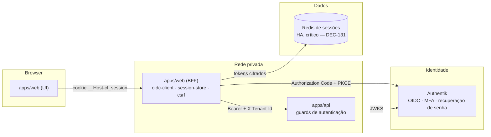

# Autenticação e sessão

> **Escopo:** autenticação de usuários do ContrataFlow via Authentik (OIDC), sessão do BFF em `apps/web`, validação de JWT e contexto de requisição na API, troca de tenant, MFA, convite de usuário, recuperação de senha e logout.
> **Status:** especificação da fundação + MVP 1.
> **Decisões de base:** DEC-012, DEC-053, DEC-130, DEC-131, DEC-132, DEC-133, DEC-135, DEC-138, DEC-139 ([decisions.md](decisions.md)).
> **Nomes canônicos:** [`entities.md`](../mvp-01/entities.md) (`User`, `TenantMembership`, `MembershipStatus`, chaves `security.*`), [`api.md`](../mvp-01/api.md) (rotas `/api/auth/*`, USR-13, códigos de erro), [`permissions.md`](../mvp-01/permissions.md) (POL-14, POL-15, POL-16).
> **Relacionados:** [security.md](security.md) (§3, §4, §7, §8, §22) · [architecture.md](architecture.md) (BFF, guards) · [multi-tenancy.md](multi-tenancy.md) · [observability.md](observability.md) · [ADR-003](../adr/adr-003-authentication.md).
>
> Itens marcados **(proposta)** não constam das fontes canônicas e devem ser registrados em `decisions.md`/`entities.md` antes da implementação.

Sumário: [1. Princípios](#1-visão-geral-e-princípios) · [2. Componentes](#2-componentes) · [3. Login OIDC](#3-login-oidc-authorization-code-com-pkce) · [4. Sessão no BFF](#4-sessão-no-bff) · [5. JWT e contexto](#5-validação-do-jwt-e-contexto-de-requisição-na-api-dec-132) · [6. Troca de tenant](#6-troca-de-tenant) · [7. Logout](#7-logout-e-expiração) · [8. Recuperação de senha](#8-recuperação-de-senha) · [9. MFA](#9-mfa-e-step-up) · [10. Convite](#10-convite-de-usuário-e-ativação-do-vínculo) · [11. CSRF e cabeçalhos](#11-csrf-e-cabeçalhos-de-segurança) · [12. Suporte da plataforma](#12-acesso-de-suporte-da-plataforma-dec-139) · [13. Observabilidade](#13-observabilidade) · [14. Falhas](#14-falhas-e-degradação) · [15. Rotas do BFF](#15-rotas-do-bff) · [16. Referências](#16-referências)

---

## 1. Visão geral e princípios

| # | Princípio | Consequência prática |
|---|---|---|
| P1 | Authentik autentica, o ContrataFlow autoriza | Login, MFA, recuperação de senha e federação futura (gov.br, Entra ID) são fluxos do Authentik; a aplicação nunca vê senha (DEC-130) |
| P2 | Tokens nunca chegam ao navegador | Access/refresh/id token ficam só no servidor do BFF; o browser recebe apenas um cookie de sessão opaco (DEC-053, DEC-131) |
| P3 | A API não confia no BFF, confia no JWT | Toda requisição é revalidada por assinatura JWKS, `iss`, `aud`, `exp`, `nbf`; o `X-Tenant-Id` é só um apontador resolvido contra o vínculo real (DEC-132) |
| P4 | Identidade global, acesso por vínculo | `User` é único por pessoa; `TenantMembership` concede acesso a um tenant específico, com status e validade próprios (DEC-012) |
| P5 | Sessão é infraestrutura crítica | O Redis de sessões roda separado do Redis de cache/filas, em HA; sua indisponibilidade derruba o BFF (503), não a consistência dos dados (DEC-131) |
| P6 | MFA proporcional ao risco | A política por tenant (`security.mfaPolicy`) decide se o segundo fator é opcional, obrigatório para permissões de risco alto ou obrigatório sempre (DEC-133, POL-14) |
| P7 | Nada sensível em log | Tokens, cookies, senhas e CPF nunca são logados; e-mails são mascarados (DEC-138) |
| P8 | Suporte da plataforma é excepcional e auditado | Operadores não têm acesso por padrão; quando concedido, é temporário, visível ao tenant e auditado (DEC-139) |
| P9 | Protocolo aberto, não o fornecedor | OIDC é padrão aberto (DEC-058): troca de Authentik por outro IdP OIDC não exige mudar o modelo de sessão do BFF nem o contrato da API |

## 2. Componentes



- **Authentik (IdP OIDC):** autentica usuários; hospeda login, recuperação de senha, MFA (TOTP/WebAuthn) e, no futuro, federação (gov.br, Entra ID do órgão), com identidade visual do ContrataFlow; publica JWKS; exposto via ALB em `auth.<domínio>`.
- **BFF (`apps/web`, Next.js):** único componente que fala OIDC; mantém `src/bff/` (`oidc-client`, `session-store`, `csrf`, `api-proxy`, `rate-limit`); expõe `/api/auth/*` e faz proxy autenticado de `/api/v1/*` para a API; nunca expõe tokens ao browser (DEC-053).
- **API (`apps/api`, NestJS):** não exposta à internet no MVP 1 (só rede privada); valida o JWT em toda requisição e resolve o contexto de tenant/ator (DEC-132).
- **Redis de sessões:** guarda o estado de sessão (tokens cifrados, `userId`, `activeTenantId`, expirações); dependência crítica, separada do Redis de filas/cache/idempotência (DEC-131).

## 3. Login OIDC (Authorization Code com PKCE)

```mermaid
sequenceDiagram
    autonumber
    participant B as Browser
    participant W as apps/web (BFF)
    participant R as Redis de sessões
    participant AT as Authentik
    participant A as apps/api

    B->>W: GET /api/auth/login?returnTo=...
    W->>W: gera state, nonce, code_verifier (CSPRNG); calcula code_challenge S256
    W->>R: grava cookie de transação cifrado (state, nonce, verifier, returnTo validado) — TTL 10 min
    W-->>B: 302 para Authentik /authorize (code_challenge, state, nonce)
    B->>AT: autentica (login, MFA se exigido, recuperação se solicitada)
    AT-->>B: 302 para /api/auth/callback?code=...&state=...
    B->>W: GET /api/auth/callback
    W->>W: valida state/nonce contra o cookie de transação
    W->>AT: POST /token (code + code_verifier)
    AT-->>W: access_token, refresh_token, id_token
    W->>W: valida id_token (JWKS, iss, aud, azp, exp, iat, nonce)
    W->>A: resolve vínculos utilizáveis (ME-01/ME-04)
    A-->>W: User.status, TenantMembership[] utilizáveis
    W->>R: cria sessão (userId, activeTenantId ou nenhum, tokens cifrados, expirações)
    W-->>B: Set-Cookie __Host-cf_session; 302 returnTo (ou seletor de instituição)
```

- Cliente **confidencial**; único fluxo habilitado é Authorization Code + PKCE `S256` (RN-IAM-01); implícito, híbrido e *password grant* desabilitados no Authentik; `code_challenge_method=plain` rejeitado.
- `state`/`nonce` (≥ 256 bits) e `code_verifier` (64 bytes base64url) por CSPRNG, uso único, válidos 10 min, no cookie de transação cifrado (AES-256-GCM; `HttpOnly`, `Secure`, `SameSite=Lax`); até 3 transações simultâneas por navegador (RN-IAM-02).
- `returnTo`: só caminho relativo validado (sem `//`, `/\`, esquema, host ou caracteres de controle); inválido cai em `/painel`, sem erro ao usuário (RN-IAM-03).
- `id_token`: assinatura via JWKS, algoritmos `RS256`/`ES256` (`none` rejeitado), `iss`, `aud`, `azp`, `exp`, `iat`, `nonce`; tolerância de relógio ≤ 60 s (RN-IAM-04).
- `User.status` deve ser `ACTIVE`; `BLOCKED`/`DEACTIVATED` impedem a sessão (RN-IAM-07).
- Seleção da instituição: 1 vínculo utilizável → automática; vários → instituição padrão do usuário, se utilizável, senão seletor (US-093); nenhum → sessão sem instituição ativa (RN-IAM-09).
- Login CSRF: impedido pelo `state` vinculado ao cookie de transação (security.md §7).
- Limite de 20 req/min por IP em `/api/auth/login` e `/api/auth/callback` → 429 `RATE_LIMITED` (RN-IAM-15).
- Auditoria `auth.session_start` (SECURITY) gravada na instituição que se torna ativa, com `sessionIdHash`, IP, user-agent e `metadata { selection, firstLogin, amr }` (RN-IAM-17). Mensagens não revelam se a conta existe (RN-IAM-18).

### 3.1 Implementação (US-087 · DEC-070)

- **Cookie de transação:** `__Host-cf_auth_tx`, cifrado com AES-256-GCM (subchave HKDF de `SESSION_ENCRYPTION_KEY`, AAD = nome do cookie), com a lista `{ state, nonce, codeVerifier, returnTo, stepUp, createdAt }` de até 3 transações (abas) de 10 min; cada transação é retirada no callback (uso único). O conjunto nunca passa de ~3,8 KB (as mais antigas saem primeiro).
- **Cliente OIDC** (`apps/web/src/bff/auth/oidc-provider.ts`): descoberta (`issuer` precisa ser o configurado), `authorization_endpoint` com `code_challenge_method=S256`, troca do código por `client_secret_basic` + `code_verifier`, `id_token` validado com `jose` (JWKS remoto com cache de 10 min e no máx. uma busca a cada 30 s). IdP fora do ar ou `temporarily_unavailable` → SCR-001 `motivo=indisponivel` mantendo o `returnTo`; demais recusas → `motivo=erro`. Step-up pede `max_age=0`. Logout RP-initiated com `client_id` + `post_logout_redirect_uri`, **sem** `id_token_hint` (o token nunca vai a uma URL do navegador).
- **Contrato BFF → API** — `POST /internal/session-events` (fora de `/api/v1` e do OpenAPI público; só na rede privada):
  - Cabeçalhos: `Authorization: Bearer <access token do usuário>`, `X-CF-Service-Token` (credencial de serviço do BFF, `INTERNAL_SERVICE_TOKEN`), `X-Correlation-Id`.
  - Corpo: `{ type: "SESSION_STARTED" | "TENANT_SWITCHED", sessionIdHash, tenantId?, membershipId?, setAsDefault?, selection?: "AUTO" | "DEFAULT" | "MANUAL", firstLogin?, fromTenantId?, ip, userAgent }` (schema `sessionEventRequestSchema` em `@contrataflow/validation`).
  - `SESSION_STARTED` sem `tenantId`: resolve o `User` pelo `sub` — vínculo do primeiro login (RN-IAM-06), `lastLoginAt` (RN-IAM-16) — e devolve os vínculos. Com `tenantId`: confere o vínculo (RN-IAM-08), registra `lastAccessAt` e grava `auth.session_start`. `TENANT_SWITCHED` (US-093 · §6) aceita o vínculo (`membershipId`, conferido contra os do usuário — de outra pessoa → 422 `REFERENCE_NOT_FOUND`) e grava `auth.tenant_switch`; para a instituição já ativa (`fromTenantId` = destino) não audita; `setAsDefault` grava `preferences.defaultTenantId`.
  - Resposta `200 { data: { user { id, displayName }, firstLogin, memberships[] (ME-04 + tenant.timezone), activeMembership { membershipId, tenantId, readOnly } | null, defaultTenantId, mfaRequired } }` — `mfaRequired = true` só na troca para instituição com `security.mfaPolicy = ALL` sem segundo fator na sessão (nada é gravado e `activeMembership` vem `null`); 401 token inválido; 403 `PERMISSION_DENIED` + `reason: USER_BLOCKED` (usuário bloqueado), `MEMBERSHIP_INACTIVE` (sem usuário ou sem vínculo — "sem vínculo") ou `TENANT_SUSPENDED`; 503 banco/JWKS indisponível.
- **Callback no BFF:** transação → troca do código → `SESSION_STARTED` → sessão nova no Redis (sem instituição) → seleção (1 vínculo utilizável → `AUTO`; vários → instituição padrão, se houver, `DEFAULT`; senão nenhuma) → ativação na API → cookie `__Host-cf_session` → `returnTo`, `/selecionar-orgao?returnTo=…` ou `/erro/sem-vinculo`. Bloqueado → `/erro/acesso-bloqueado`; API/banco fora → `/erro/manutencao?codigo=<correlationId>`; Redis de sessões fora → 503 `DEPENDENCY_UNAVAILABLE` sem cookie de sessão. Primeira escolha em SCR-101 (`POST /api/auth/switch-tenant` numa sessão sem instituição) grava `auth.session_start` com `selection = MANUAL`.
- **Limite de tentativas:** 20 req/min por IP (janela fixa) em `login`, `callback` e `step-up`, no Redis de sessões; sem IP conhecido (sem balanceador, só local) não limita; Redis do contador fora → falha aberta com `warn auth.rate_limit_degraded`.

## 4. Sessão no BFF

- **Cookie:** `__Host-cf_session`, opaco, `HttpOnly`, `Secure`, `SameSite=Lax`, `Path=/`; o prefixo `__Host-` impede que subdomínios o sobrescrevam (DEC-131, security.md §7).
- **Armazenamento:** o Redis de sessões guarda `userId`, `activeTenantId`/`membershipId`, tokens (access/refresh/id) cifrados e expirações; a chave é o hash SHA-256 do id do cookie — nunca o valor em claro. Layout (DEC-070): registro em `cf:{env}:sess:{sha256(sid)}` (TTL até o fim absoluto; tokens cifrados com AES-256-GCM e AAD = a própria chave) e índice por usuário em `cf:{env}:sess:user:{userId}` (sorted set por criação; acima de 10 sessões, as mais antigas são encerradas — RN-IAM-10). Sem `REDIS_SESSION_URL` (só `local`/`dev`/`test`) as sessões ficam na memória do processo.

| Configuração (`entities.md` §6) | Padrão | Faixa | Efeito |
|---|---|---|---|
| `security.sessionIdleMinutes` | 30 | 5–120 | Expiração por ociosidade (deslizante) |
| `security.sessionAbsoluteHours` | 12 | 1–24 | Expiração por duração absoluta (nunca estendida) |

- **Ociosidade (deslizante):** `idleExpiresAt = lastSeenAt + security.sessionIdleMinutes` da instituição ativa; só requisições iniciadas pelo usuário renovam — `GET /api/auth/session` em modo *keepalive* e sondagens de contador não renovam (RN-IAM-21).
- **Absoluta:** `absoluteExpiresAt = createdAt + security.sessionAbsoluteHours`; nunca estendida, nem por "Continuar conectado"; depois dela, só novo login (RN-IAM-22).
- **Avisos:** diálogo de ociosidade 2 min antes; aviso de término absoluto 5 min antes; `aria-live`, operáveis por teclado (RN-IAM-23).
- **Sessão vencida:** o BFF apaga os tokens, registra o motivo (`IDLE`/`ABSOLUTE`) e responde 401 `SESSION_EXPIRED`; o horário do fato é o limite calculado, não o da detecção (RN-IAM-24).
- **Renovação de tokens:** quando o access token vence em ≤ 60 s, renovação com trava por sessão (uma por vez; demais requisições esperam até 5 s); rotação do refresh token gravada atomicamente — o anterior deixa de ser aceito (RN-IAM-25). Falha definitiva (`invalid_grant`, token revogado/reutilizado) encerra a sessão (`REFRESH_FAILED` → 401 `SESSION_EXPIRED`); falha transitória segue com o token ainda válido; sem token válido → 503 `DEPENDENCY_UNAVAILABLE` com sessão preservada (RN-IAM-26).
- **Sincronização entre abas:** `BroadcastChannel` `cf-session` (`logout`, `expired`, `extended`) — logout em uma aba leva todas a SCR-001; expiração exibe o modal em todas (RN-IAM-29). Rascunhos locais (IndexedDB) sobrevivem à expiração por até 24 h, só para o mesmo usuário/instituição (RN-IAM-30).
- **Reautenticação:** após expiração, o login força `max_age=0` no Authentik; a sessão do próprio Authentik dura no máximo o teto absoluto da plataforma, para que a ociosidade não seja contornada (RN-IAM-32).
- **Varredura:** job a cada 1 min grava `auth.session_expired`/`auth.session_end`; registros de encerramento sem tokens ficam no máx. 24 h no Redis (RN-IAM-28).
- **Criptografia em repouso:** os tokens armazenados no Redis são cifrados (DEC-137), além da proteção de rede (TLS + AUTH) do próprio Redis de sessões.
- **Rastros de acesso:** `User.lastLoginAt` é atualizado na criação da sessão; `TenantMembership.lastAccessAt`, no máximo 1×/5 min por vínculo, para não gerar escrita excessiva (RN-IAM-16).

### 4.1 Implementação (US-088 · DEC-073)

- **Layout no Redis de sessões** (`sessionKeyspace` em `@contrataflow/types`; protocolo de encerramento em `@contrataflow/validation`, o mesmo no BFF, na API e no worker):
  - `cf:{env}:sess:{sha256(sid)}` — sessão viva (tokens cifrados), TTL = fim absoluto + 24 h, para a varredura auditar também as sessões nunca mais acessadas;
  - `…:end:{key}` — registro de encerramento **sem tokens** (`reason`, `occurredAt` = horário real do fato, tenant, usuário, IP e user-agent da requisição que encerrou), TTL 24 h;
  - `…:user:{userId}` (sorted set por criação — RN-IAM-10), `…:membership:{membershipId}` (conjunto das sessões cuja instituição ativa usa o vínculo — encerramento por vínculo), `…:expiry` (sorted set por prazo — fila da varredura), `…:lock:{key}` (trava de renovação) e `…:sweep:lock` (uma réplica por ciclo).
- **Encerramento** (`endSession`): `SET NX` do registro de encerramento (só um encerramento vence → auditoria única), `DEL` da sessão viva, saída dos índices e prazo vencido no `expiry`. Toda gravação de sessão viva usa `SET XX`: uma requisição em voo durante o logout não ressuscita a sessão. Sem script Lua (compatível com cluster).
- **Consulta da sessão:** vencida → encerrada na hora com o limite atingido (`IDLE`/`ABSOLUTE`) → 401 `SESSION_EXPIRED`; registro de encerramento `IDLE`/`ABSOLUTE`/`REFRESH_FAILED` → 401 `SESSION_EXPIRED` (o modal aparece em todas as abas); `MEMBERSHIP_*` → 403 `MEMBERSHIP_INACTIVE` (SCR-111 `/erro/vinculo-inativo`); `LOGOUT`/`SESSION_LIMIT` ou nada → 401 `UNAUTHENTICATED`. Toda resposta 401 `SESSION_EXPIRED` grava o cookie `__Host-cf_reauth=1` (24 h, sem dado pessoal): o próximo `/api/auth/login` neste navegador pede `max_age=0` + `prompt=login` ao Authentik, como também `?reauth=1` (modal "Entrar novamente" e layout); o callback apaga o cookie.
- **Ociosidade:** `GET /api/auth/session` sem parâmetro é sondagem (não renova); `?keepalive=true` ("Continuar conectado") renova, nunca além da absoluta. No proxy, `GET /notifications/unread-count` (NTF-02) e `GET /tasks/counters` (TSK-02) não renovam (`POLLING_ROUTES` em `apps/web/src/lib/session/polling.ts`, lista única do BFF e do cliente).
- **Limites por instituição:** a sessão guarda `idleMinutes`; ao ativar a instituição, `idleExpiresAt = lastSeenAt + idleMinutes` e `absoluteExpiresAt = createdAt + absoluteHours`, com faixa 5..120 min / 1..24 h (`resolveSessionPolicy`; fora da faixa → padrão). Enquanto a API não expõe `security.sessionIdleMinutes`/`sessionAbsoluteHours` (US-103), o BFF usa o padrão 30 min / 12 h; o contrato `DirectoryIdentity.active.sessionPolicy` já aceita os valores.
- **Renovação:** single-flight no processo + trava `SET NX PX 10000` entre réplicas; quem não obtém a trava relê a sessão a cada 100 ms por até 5 s e usa o token novo; esgotado o prazo, segue com o token ainda válido ou responde 503. `invalid_grant` → encerramento `REFRESH_FAILED`; falha transitória → `warn auth.refresh_failed` (`TRANSIENT`). 401 da API com o token recém-renovado → `REFRESH_FAILED`.
- **Logout:** revogação do refresh token (RFC 7009, `client_secret_basic`, 2 s, melhor esforço) → encerramento `LOGOUT` → cookie expirado → `{ data: { logoutUrl } }` = `end_session_endpoint?client_id=…&post_logout_redirect_uri=<app>/entrar?motivo=saiu` (registrado no Authentik como `logout`). **Sem `id_token_hint`** (DEC-070): o token não vai para a URL do navegador — em computador compartilhado ficaria no histórico; o endpoint é por aplicação, então o Authentik identifica o cliente. Revogação ou descoberta indisponíveis → logout local concluído e `logoutUrl` = `/entrar?motivo=saiu-parcial` (FA-06). Sem sessão → 200 com `/entrar?motivo=saiu`.
- **Varredura** (`RecordSessionEndingsCommand`, a cada 60 s **no processo da API** até o worker ter agendador — US-083, mesmo precedente do job de partições da auditoria): pega até 500 prazos vencidos; sessão viva vencida é encerrada com o horário do limite; registro de encerramento com instituição → `auth.session_end`/`auth.session_expired` pelo `AuditService` na transação do tenant da sessão (ator = dono da sessão, `sessionIdHash` = chave, `occurredAt` = horário real, `oncePerSession` evita duplicata se o Redis falhar depois do commit) e **só então** o registro sai do Redis. Sem instituição ativa (FA-07) → sem auditoria. Banco fora → o registro fica (até 24 h) e o ciclo para após 3 falhas seguidas; a próxima rodada grava com o horário original. Métrica `auth_sessions_expired_total{reason}` (API) e `auth_refresh_total{result}` (BFF).
- **Encerramento por vínculo (worker):** handler leve `SessionTerminationHandler` nas routing keys `membership.suspended|revoked|expired` (os eventos são registrados pela US-092); lê `…:membership:{membershipId}` e encerra só as sessões cuja instituição ativa é a do evento (`envelope.tenantId`), com `MEMBERSHIP_SUSPENDED|REVOKED|EXPIRED`; entradas velhas saem do índice sem encerrar nada. Idempotente por natureza (reentrega não acha mais sessões). Sem `REDIS_SESSION_URL` (só local/dev/test) o handler descarta o evento com `warn auth.session_termination_disabled`.
- **Interface:** `SessionWatcher` (contador local; confere o BFF antes de avisar e ao vencer), `IdleWarningDialog`, aviso de fim absoluto, `SessionExpiredModal` (bloqueante), banner de indisponibilidade (503 — nunca "sessão expirada") e `LogoutGuard` (confirma o "Sair" com rascunho não sincronizado). O cliente de API avisa o contador a cada ação atendida (sondagens não) e abre o modal no 401 `SESSION_EXPIRED`. Mensagens no `BroadcastChannel` levam a origem da aba e cada aba ignora as próprias (a aba que sai segue para o Authentik). Rascunhos locais em IndexedDB (`apps/web/src/lib/drafts/local-drafts.ts`): chave usuário + instituição + alvo, 24 h, apagados no logout e quando outro usuário entra no navegador; a oferta "Recuperamos alterações não salvas" no editor chega com o autosave (US-015).

## 5. Validação do JWT e contexto de requisição na API (DEC-132)

Pipeline de guards fixo e global (as etapas 4 e 5 — permissão e política — pertencem a `permissions.md`, fora do escopo deste documento):

| # | Guard | Verifica | Falha |
|---|---|---|---|
| 1 | `AuthenticationGuard` | Assinatura do JWT via JWKS em cache (10 min, renovação forçada em `kid` desconhecido, no máx. 1×/30 s), `iss`, `aud`, `exp`, `nbf`, tolerância ≤ 60 s; resolve `User` por `externalSubject = sub`, exige `User.status = ACTIVE` | 401 `UNAUTHENTICATED` |
| 2 | `TenantContextGuard` | `X-Tenant-Id` (definido pelo BFF a partir da sessão); `TenantMembership` `ACTIVE` e não expirado; acesso conforme `Tenant.status`: `ACTIVE` → normal; `OFFBOARDING` → somente leitura/exportação para `ADMIN_ORGAO`/`AUDITOR`; `PROVISIONING`, `SUSPENDED`, `DEACTIVATED` → negado a usuários (operadores usam `/platform/*`) | 403 `TENANT_SUSPENDED` / `MEMBERSHIP_INACTIVE` |
| 3 | `MfaGuard` | Ver §9 | 403 `MFA_REQUIRED` |

- **Implementação (US-087):** `JwksTokenVerifier` (`jose`) com cache próprio do JWKS — com o JWKS fora do ar, tokens de chave já conhecida continuam aceitos e `kid` desconhecido vira 503 `DEPENDENCY_UNAVAILABLE` + `error auth.jwks_refresh` (alerta). `User` e vínculo vêm do PostgreSQL pelo `PlatformTransaction` (`users` e `cf_user_memberships` — multi-tenancy.md §6); `TenantMembership.lastAccessAt` é gravado sem segurar a requisição. `OFFBOARDING`: só `GET`/`HEAD`/`OPTIONS` para quem tem `ADMIN_ORGAO`/`AUDITOR` (os perfis chegam com a US-096; até lá a lista de perfis do vínculo é vazia e a instituição em encerramento fica indisponível).
- Contexto propagado por `AsyncLocalStorage` (`RequestContext`): `correlationId`, `traceparent`, `actor { type, userId, membershipId }`, `tenantId`, `sessionIdHash` (SHA-256 do id de sessão do BFF — liga a auditoria da API à sessão sem expor o cookie), `authTime`, `amr` (POL-14), `ip`, `userAgent`, `locale`, `timezone`.
- Recurso de outro tenant ou não visível → 404, nunca 403 (DEC-024); a verificação de visibilidade acontece antes de qualquer política.
- **Proxy autenticado (`/api/v1/*`):** o BFF remove `Authorization`, `X-Tenant-Id`, `Cookie` e `X-Forwarded-*` recebidos do cliente e injeta `Authorization` (Bearer), `X-Tenant-Id` (da sessão) e `X-Correlation-Id` (gerado se ausente); a API nunca é exposta à internet (RN-IAM-13, DEC-053). Métodos mutáveis exigem `X-CF-Request: 1` e `Origin`/`Sec-Fetch-Site` da própria origem (RN-IAM-14, DEC-135).

## 6. Troca de tenant

- `POST /api/auth/switch-tenant` reaproveita a sessão existente (`sid`): só `activeTenantId`/`membershipId` são substituídos — sem novo cookie, sem PKCE/Authentik (RN-IAM-66).
- Só lista/aceita vínculos `usable`: `TenantMembership.status = ACTIVE`, não expirado, e `Tenant.status` que permita acesso (RN-IAM-65, DEC-132). Tenant em `OFFBOARDING` só é selecionável por `ADMIN_ORGAO`/`AUDITOR`, resultando em sessão `readOnly = true` (RN-IAM-67); `PROVISIONING`/`SUSPENDED`/`DEACTIVATED` nunca aparecem como `usable` para usuários comuns (RN-IAM-68).
- Se o tenant de destino exigir MFA (`security.mfaPolicy`) e a sessão não tiver o `amr` correspondente, a troca é suspensa até o *step-up* (§9) ser concluído (RN-IAM-69).
- Trocar para o tenant já ativo é *no-op* idempotente (RN-IAM-70). Toda troca efetiva gera auditoria `auth.tenant_switch` com `fromTenantId`/`toTenantId`, IP e user-agent (RN-IAM-71); o front invalida o cache de consultas do tenant anterior antes de buscar dados do novo, para impedir renderização cruzada (RN-IAM-72).

### 6.1 Contrato do BFF (US-093 · DEC-075)

- **Requisição:** `POST /api/auth/switch-tenant` com `X-CF-Request: 1` (CSRF — §5) e corpo `{ membershipId: uuid, setAsDefault?: boolean }` (`switchTenantRequestSchema` em `@contrataflow/validation`).
- **Sucesso:** `200 { data: ShellSession }` — a visão pública da sessão (`activeTenant`, `readOnly`, `memberships`, prazos), sem `Set-Cookie`. Para o vínculo já ativo, a mesma resposta sem chamar a API (com `setAsDefault`, a API só grava a instituição padrão).
- **Erros:** 400 `MALFORMED_REQUEST` (JSON ilegível); 422 `VALIDATION_ERROR` com `errors[{ field: "membershipId", code: "REQUIRED" | "REFERENCE_NOT_FOUND" }]` (ausente, malformado ou de outra pessoa) ou `INVALID_FORMAT` em campo desconhecido; 401 `UNAUTHENTICATED`/`SESSION_EXPIRED`; 403 `CSRF_REJECTED`, `MEMBERSHIP_INACTIVE`, `TENANT_SUSPENDED`, `PERMISSION_DENIED` (usuário bloqueado) ou `MFA_REQUIRED` com `stepUpUrl` (`/api/auth/step-up?returnTo=…`); 503 `DEPENDENCY_UNAVAILABLE` (API, banco ou Redis de sessões fora — a sessão fica na instituição anterior).
- **MFA do destino (RN-IAM-69):** com `mfaRequired` da API, o BFF guarda `pendingTenantSwitch { membershipId, tenantId, setAsDefault, requestedAt }` na sessão e responde 403 `MFA_REQUIRED`; o front navega ao `stepUpUrl`. No callback do *step-up* (mesmo `sub`), a troca pendente com menos de 10 min é refeita na API com o token novo: aceita → sessão na nova instituição e `returnTo`; recusada → pendência apagada e `/selecionar-orgao?motivo=troca-nao-concluida`.
- **Concorrência:** a gravação é atômica sobre o registro mais recente (`SessionStore.update`, *compare-and-set* por script Lua no Redis); trocas da mesma sessão no mesmo processo vão em fila — o segundo clique vira no-op.
- **Logs:** `info auth.tenant_switch` (`userId`, `fromTenantId`, `toTenantId`, `durationMs`) e `warn auth.tenant_switch_rejected` (`reason`: `MEMBERSHIP_INACTIVE`, `TENANT_SUSPENDED`, `MFA_REQUIRED`, `REFERENCE_NOT_FOUND`…); nunca cookie, tokens ou IP.

## 7. Logout e expiração

- `POST /api/auth/logout` encerra a sessão local (revoga o refresh token, troca o registro no Redis pelo de encerramento e expira o cookie) **e** inicia o *RP-initiated logout* no Authentik (DEC-131 · detalhes em §4.1): o navegador é redirecionado ao *end-session* do IdP, encerrando também a sessão global do Authentik na mesma operação — logout local e global não são rotas separadas. Exigido por `POST` para que logout forçado por terceiros não seja possível (security.md §7).
- **Encerramento por mudança de vínculo:** ao consumir `MembershipSuspended`, `MembershipRevoked` ou `MembershipExpired`, o worker encerra apenas as sessões cujo `activeTenantId` é o do evento, gravando `auth.session_end` com o motivo correspondente; sessões em outras instituições continuam. O efeito de acesso é imediato porque a API revalida o vínculo em toda requisição (DEC-132); o consumidor é idempotente por `eventId` (RN-IAM-27).
- **Auditoria:** `auth.session_end` para `LOGOUT`, `SESSION_LIMIT` e encerramentos por vínculo; `auth.session_expired` para `IDLE`, `ABSOLUTE` e `REFRESH_FAILED` (RN-IAM-28, ver §4).
- Logout explícito com rascunho não sincronizado exige confirmação; ao sair, o shell limpa o cache de consultas (TanStack Query), os rascunhos locais do usuário e o `sessionStorage` (RN-IAM-31).

## 8. Recuperação de senha

- `GET /api/auth/forgot-password` é rota **pública** do BFF que apenas redireciona (302) ao *flow* de recuperação do Authentik; não recebe nem repassa e-mail, senha ou identificador de usuário (RN-IAM-34, US-089).
- Fluxo inteiramente hospedado no Authentik, com identidade visual do ContrataFlow (DEC-130): o ContrataFlow apenas encaminha o usuário e o recebe de volta no login ao final. Nenhuma senha ou token de redefinição transita ou é persistido pela aplicação ou pela API.
- Mensagens genéricas quanto à existência da conta (RN-IAM-18/35); a página não exibe nome nem dado de nenhuma instituição (DEC-012).
- Política de senha (mínimo 12 caracteres, rejeita senhas presentes em bases de vazamentos conhecidos) é responsabilidade exclusiva da configuração do Authentik — o ContrataFlow não define, valida nem armazena senhas (RN-IAM-36).
- O link de redefinição é de uso único e sua posse não autentica no ContrataFlow — só permite trocar a senha no IdP (RN-IAM-37).
- Segue o limite de 20 req/min por IP de `/api/auth/*` e responde `Cache-Control: no-store` (RN-IAM-38).
- **Implementação (DEC-074):** o BFF monta `/if/flow/<OIDC_RECOVERY_FLOW_SLUG>/` (padrão `contrataflow-recovery`) na origem do emissor e confere a página do *flow* antes de redirecionar (2 s; sucesso vale 10 s); sem resposta 200, o navegador volta a SCR-002 (`/recuperar-senha?motivo=indisponivel`, com `returnTo`). O `returnTo` validado fica no cookie `__Host-cf_recovery_rt` (1 h) — ou, se a recuperação partiu do formulário do Authentik, vem da transação de login aberta — e é devolvido por `/entrar?motivo=senha-redefinida`.
- **No Authentik (blueprint `12-contrataflow-recovery.yaml`):** e-mail → link de uso único de 30 min (template pt-BR do ContrataFlow) → nova senha com a política `contrataflow-password-policy` → gravação. Na gravação, uma política de expressão encerra as sessões do usuário no IdP, revoga os refresh tokens (as sessões do ContrataFlow terminam na renovação seguinte — §4.1) e conclui o *flow* em `/entrar?motivo=senha-redefinida`, sem autenticar o usuário. O formulário de login e a marca apontam para o mesmo *flow*.

## 9. MFA e step-up

- **Fatores** no Authentik: TOTP e WebAuthn (chaves de segurança/passkeys); códigos de recuperação estáticos do Authentik como contingência; SMS não é aceito (DEC-133, security.md §4).
- **Política por tenant** `security.mfaPolicy`: `NONE` | `ADMINS` (padrão — obrigatório para quem tem permissão `HIGH`) | `ALL` (DEC-133, POL-14). Com `NONE`, o `amr` nunca é verificado; com `ADMINS`, só quando a permissão exercida tem `riskLevel = HIGH`; com `ALL`, toda requisição autenticada exige MFA desde o primeiro acesso (RN-IAM-39).
- **Verificação:** o claim `amr` (ou claim customizada via *property mapping*) é checado no pipeline de contexto a cada requisição sujeita à política vigente; ausência do fator → 403 `MFA_REQUIRED` + auditoria `auth.mfa_required` (RN-IAM-40).
- **Step-up:** `GET /api/auth/step-up` preserva `returnTo` (mesma validação do login, §3), força a etapa de MFA sem repetir a senha e, ao concluir, substitui o access/refresh token da sessão existente — sem novo login completo (RN-IAM-41). Segue o limite de 20 req/min por IP e responde `Cache-Control: no-store` (RN-IAM-45).
- Alterações em `security.mfaPolicy` (`TenantSettingsChanged`) invalidam o cache de permissões efetivas imediatamente; sessões abertas são avaliadas pela nova política na próxima requisição (RN-IAM-42).
- **Reset administrativo** (`USR-13` — `POST /users/{userId}/mfa-reset`): exige `USER_MANAGE`; não pode ser sobre o próprio vínculo do administrador (autoproteção, mesmo espírito de POL-16); remove os fatores no Authentik via API administrativa, forçando novo *enrollment*; gera auditoria `SECURITY` (RN-IAM-43). Quando o próprio administrador perde o fator e não há outro admin no tenant, a via é o acesso de suporte da plataforma mediante chamado e confirmação da instituição (§12) — nunca autoatendimento só com e-mail (security.md §4).
- Operadores da plataforma: MFA **sempre** obrigatório, preferencialmente WebAuthn (security.md §4).
- O ContrataFlow não armazena segredos de MFA; só lê, via `/me`, se a sessão comprova o fator — derivado do `amr`, sem detalhar o dispositivo (RN-IAM-44).

## 10. Convite de usuário e ativação do vínculo

- Convidar exige `USER_INVITE`; reaproveita o `User` global pelo `email` (único) ou cria um novo; se o `User` não tiver `authentikUserId`, a API o provisiona no Authentik via `AuthentikAdminClient` (sem senha — a pessoa a define no próprio Authentik) (RN-IAM-46).
- `TenantMembership.inviteTokenHash` é o SHA-256 de um token opaco gerado por CSPRNG, nunca persistido em claro; `inviteExpiresAt = now + 7 dias`, fixo no MVP 1 e não configurável por tenant (RN-IAM-47; `entities.md`).
- `MEMBERSHIP_ALREADY_EXISTS` (409) se já existir `TenantMembership` em `INVITED`, `ACTIVE` ou `SUSPENDED` para `(tenant, usuário/e-mail)`; reenvio (`USR-04`) substitui token e expiração sem criar novo vínculo; cancelamento (`USR-05`) só é permitido em `INVITED` (RN-IAM-48).
- Aceite (`USR-06`) exige usuário autenticado (login prévio no Authentik, inclusive definição de senha) cujo `User.email` corresponda ao do convite; valida `inviteTokenHash` e `inviteExpiresAt > now`; ativa o vínculo (`status = ACTIVE`, `activatedAt = now`) em transação única (RN-IAM-49).
- `INVITATION_EXPIRED` (410) quando `inviteExpiresAt ≤ now`; `INVITATION_INVALID` (404) quando o token não corresponde a nenhum hash pendente (inexistente, já aceito ou cancelado) — sem revelar qual causa se aplica (RN-IAM-50).
- Lotação (`MembershipDepartment`) e perfil inicial (`RoleAssignment`), quando informados no convite, são gravados junto com o `TenantMembership` em `INVITED`, mas só produzem efeito de acesso quando o vínculo estiver `ACTIVE` (RN-IAM-51).
- Convite para vínculo `EXTERNAL` exige `expiresAt` (≤ `security.externalMembershipMaxDays`, padrão 180 dias); para `INTERNAL`, `expiresAt` permanece nulo (RN-IAM-52).
- Reenvio (`USR-04`) limitado a 5 vezes por convite, com intervalo mínimo de 1 min entre tentativas (RN-IAM-53).

## 11. CSRF e cabeçalhos de segurança

Detalhado em [security.md §7](security.md#7-cors-e-csrf) e [§8](security.md#8-cabeçalhos-de-segurança-csp-e-ip-do-cliente) (DEC-135); resumo aplicado à autenticação:

- Cookie `SameSite=Lax` + header obrigatório `X-CF-Request: 1` em métodos mutáveis + `Sec-Fetch-Site: same-origin` (ou `Origin` = `APP_BASE_URL`) + prefixo `__Host-` (impede *cookie tossing* por subdomínio).
- Login CSRF coberto pelo `state` vinculado ao cookie de transação (§3); logout exigido por `POST` (§7).
- Falha de CSRF → 403 `CSRF_REJECTED` respondido pelo BFF (security.md §7).
- Respostas de `/api/auth/*` levam `Cache-Control: no-store` e os cabeçalhos de DEC-135 (CSP com nonce, HSTS, `X-Content-Type-Options`, `Referrer-Policy: strict-origin-when-cross-origin`, `Permissions-Policy`, `frame-ancestors 'none'`) (RN-IAM-19).
- O CSP único do BFF inclui `form-action` para `https://auth.<domínio>` porque o logout por formulário termina em redirecionamento ao *end-session* do Authentik (navegadores aplicam `form-action` a redirecionamentos).
- IP do cliente: o BFF confia apenas no último salto de `X-Forwarded-For` adicionado pelo ALB e o repassa à API; alimenta rate limit, sessão e `AuditLog.ip` (security.md §8).

## 12. Acesso de suporte da plataforma (DEC-139)

- Operadores da plataforma não têm acesso a dados de tenants por padrão.
- Operador com `PLATFORM_SUPPORT_ACCESS` (MFA obrigatório) registra o chamado e solicita acesso a um tenant; é criado vínculo `EXTERNAL` temporário (validade ≤ 72 h) com perfil restrito (padrão `SOMENTE_LEITURA`; perfis com permissão `HIGH` vedados por POL-15).
- Auditoria `support.access_grant` com o número do chamado, gravada **no tenant** com `actorType = PLATFORM_OPERATOR`, visível e notificada ao administrador da instituição; ações do operador carregam `actorType = PLATFORM_OPERATOR` (e `onBehalfOfUserId` quando aplicável).
- Expiração automática (job `maintenance`/`MembershipExpired`) ou revogação antecipada (`support.access_revoke`); sessões do operador nesse tenant são encerradas.
- Proposta†: configuração de tenant para exigir aprovação prévia do administrador antes da concessão.

## 13. Observabilidade

Eventos de auditoria `auth.*`:

| Evento | Quando | Campos principais |
|---|---|---|
| `auth.session_start` | Login concluído (§3) | `sessionIdHash`, IP, user-agent, `selection`, `firstLogin`, `amr` |
| `auth.session_end` | Logout, limite de sessões ou encerramento por vínculo (§7) | motivo (`LOGOUT`, `SESSION_LIMIT`, `MEMBERSHIP_*`) |
| `auth.session_expired` | Ociosidade, duração absoluta ou falha de renovação (§4) | motivo (`IDLE`, `ABSOLUTE`, `REFRESH_FAILED`) |
| `auth.mfa_required` | Ação exige MFA e a sessão não tem o `amr` (§9) | permissão exigida, `riskLevel` |
| `auth.tenant_switch` | Troca de instituição ativa (§6) | `fromTenantId`, `toTenantId`, `selection`, IP, user-agent |

- Suporte: `support.access_grant`, `support.access_revoke` (§12).
- `sessionIdHash` (SHA-256 do id de sessão do BFF) liga o `AuditLog` da API à sessão sem expor o cookie (`RequestContext`, §5).
- Logs seguros (DEC-138): proibido logar tokens, cookies, senhas ou CPF; e-mails mascarados (`j***@dominio.gov.br`); redação automática no pino (`redact`).

## 14. Falhas e degradação

- **Redis de sessões indisponível** → o BFF responde 503 `DEPENDENCY_UNAVAILABLE` (com `Retry-After`) em todas as rotas autenticadas e as páginas de `(app)` levam a SCR-111 "manutenção"; a interface mostra indisponibilidade (nunca "sessão expirada") e preserva rascunhos locais (RN-IAM-33, DEC-131). O cliente Redis não enfileira comandos por mais de 1 s.
- **Authentik indisponível na renovação de token:** falha transitória segue com o access token ainda válido; sem token válido → 503 `DEPENDENCY_UNAVAILABLE` com sessão preservada; falha definitiva (`invalid_grant`) encerra a sessão (RN-IAM-26).
- O Redis de sessões é logicamente — de preferência fisicamente — separado do Redis de cache/idempotência/filas: a degradação deste último não derruba sessões, só degrada cache e rate limit sem perder consistência (CA-T-07, DEC-131).
- JWKS: cache de 10 min na API, com renovação forçada ao ver `kid` desconhecido (limitada a 1×/30 s), para resistir à rotação de chaves no Authentik sem sobrecarregar o IdP (RN-IAM-05).

## 15. Rotas do BFF

Não fazem parte da API NestJS; implementadas em `apps/web/src/app/api/auth/[action]/route.ts` (api.md §3.1):

| Rota | Método | Descrição | Story |
|---|---|---|---|
| `/api/auth/login` | GET | Inicia o Authorization Code + PKCE; aceita `returnTo` | US-087 |
| `/api/auth/callback` | GET | Recebe o retorno do Authentik, troca `code` por tokens e cria a sessão | US-087 |
| `/api/auth/session` | GET | Consulta a sessão atual; suporta modo *keepalive* sem renovar ociosidade | US-087 / US-088 |
| `/api/auth/logout` | POST | Encerra a sessão local e inicia o *RP-initiated logout* no Authentik | US-088 |
| `/api/auth/switch-tenant` | POST | Troca a instituição ativa da sessão | US-093 |
| `/api/auth/step-up` | GET | Força reautenticação de MFA sem exigir novo login completo | US-090 |
| `/api/auth/forgot-password` | GET | Redireciona (302) ao *flow* de recuperação de senha do Authentik | US-089 |

## 16. Referências

- DEC-012, DEC-053, DEC-130, DEC-131, DEC-132, DEC-133, DEC-135, DEC-138, DEC-139 — [decisions.md](decisions.md).
- [security.md](security.md) §3 (autenticação), §4 (MFA), §7 (CORS/CSRF), §8 (cabeçalhos), §22 (suporte da plataforma).
- [architecture.md](architecture.md) §3.2 (componentes e containers), §4 (estrutura de `apps/web`), §6.1–6.2 (contexto de requisição e guards).
- [permissions.md](../mvp-01/permissions.md) POL-14 (MFA), POL-15 (externos), POL-16 (autoproteção).
- [entities.md](../mvp-01/entities.md) (`User`, `TenantMembership`, chaves `security.*` §6).
- [api.md](../mvp-01/api.md) §3.1 (rotas do BFF), USR-13 (reset de MFA), §2.1 (códigos de erro).
- US-087 a US-091, US-093 — `docs/backlog/story-087-oidc-login-bff.md` e seguintes.
- [ADR-003](../adr/adr-003-authentication.md).
