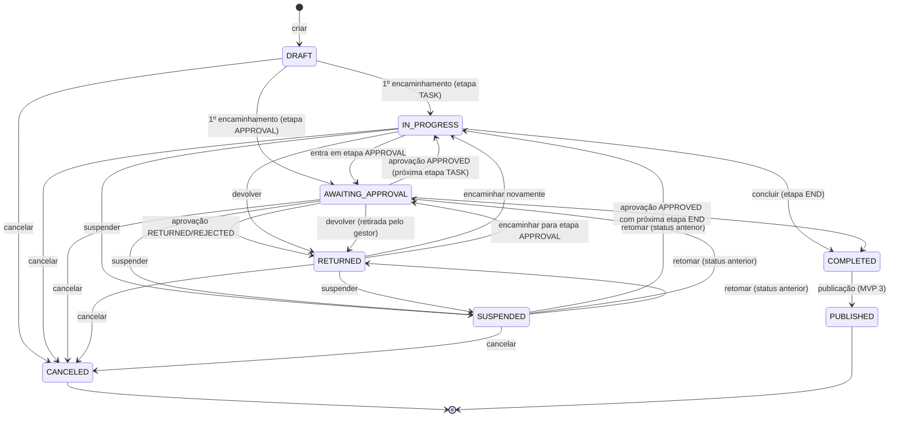

# Registro de Decisões (Decision Log)

> **Documento canônico.** Toda especificação (produto, arquitetura, MVPs, backlog) deve respeitar as decisões abaixo.
> Para mudar uma decisão: registre uma nova entrada que **substitui** a anterior (`Substitui: DEC-NNN`), atualize os documentos afetados e, se a decisão for estrutural, crie/atualize o ADR correspondente.
>
> **Status possíveis:** `Aceita` · `Proposta` (aceita para especificação, validar na implementação) · `Pendente` (requer decisão de produto/jurídico — ver seção 10).

Sumário: [1. Convenções](#1-convenções-gerais) · [2. Produto e domínio](#2-produto-e-domínio) · [3. Módulos](#3-módulos-bounded-contexts-e-propriedade-de-entidades) · [4. Arquitetura](#4-arquitetura-e-stack) · [5. Dados](#5-dados-e-persistência) · [6. API](#6-api) · [7. Segurança e identidade](#7-segurança-identidade-e-acesso) · [8. Eventos e filas](#8-eventos-filas-e-jobs) · [9. UX](#9-ux) · [10. Pendentes](#10-decisões-pendentes) · [11. ADRs](#11-índice-de-adrs)

---

## 1. Convenções gerais

### DEC-001 — Idioma e nomenclatura · `Aceita`
- Documentação, UI, mensagens (`title`/`detail` de erro), e-mails e notificações: **pt-BR**.
- Código e contratos técnicos: **inglês**.

| Elemento | Convenção | Exemplo |
|---|---|---|
| Modelo Prisma / entidade | PascalCase singular | `Process`, `TermOfReference`, `Dfd`, `Etp` |
| Tabela / coluna | snake_case (tabela no plural) | `processes`, `process_items.process_id` |
| Campo TS / JSON | camelCase | `estimatedValue`, `currentStageId` |
| Enum (valores) | SCREAMING_SNAKE_CASE | `IN_PROGRESS`, `AWAITING_APPROVAL` |
| Permissão | `RESOURCE_ACTION` | `PROCESS_CREATE`, `DFD_SUBMIT` |
| Evento de domínio | PascalCase no passado + routing key dot.case | `ProcessCreated` / `process.created` |
| Ação de auditoria | `resource.action` (dot.case) | `process.create`, `approval.decide` |
| Código de erro | SCREAMING_SNAKE_CASE | `PROCESS_NOT_FOUND`, `VERSION_CONFLICT` |
| Fila BullMQ | kebab-case | `document-render`, `email` |
| Chave de configuração | dot.camelCase | `numbering.process.mask` |
| Rota da API | `/api/v1/<recurso-plural-kebab>` | `/api/v1/price-research/{id}` |
| Rota web (Next.js) | pt-BR kebab-case | `/processos/[id]/pesquisa-precos/[researchId]` |
| Chave de seção de documento | SCREAMING_SNAKE_CASE | `NEED_DESCRIPTION`, `CONTRACTOR_OBLIGATIONS` |
| Código de catálogo | SCREAMING_SNAKE_CASE (estável) | `PREGAO`, `AQUISICAO_BENS` |

- Siglas de domínio brasileiras mantidas: DFD (`Dfd`), ETP (`Etp`), PCA (`Pca`), TR (`TermOfReference`; recurso `/terms`).
- Siglas em identificadores PascalCase/camelCase seguem a mesma regra (só a inicial maiúscula): `PncpProvider`, `AiProvider`, `CnpjValidator`. Exceção: nomes especializados de eventos pedidos pelo produto (`DFDCreated`, `ETPApproved` — DEC-162) e `PNCPProvider` citado no briefing, que será implementado como `PncpProvider`.

### DEC-002 — Identificadores · `Aceita`
- Chave primária: **UUIDv7** gerado pela aplicação (ordenável no tempo, boa localidade de índice). IDs nunca são sequenciais nem previsíveis.
- Identificadores de negócio (número, ano, código formatado) são **separados** da PK e gerados por sequência transacional (DEC-028).
- IDs de documentação: ver [`docs/README.md`](../README.md#22-identificadores-de-documentação).

### DEC-003 — Datas, dinheiro e números · `Aceita`
- Persistência em `timestamptz` (UTC). API em ISO 8601 UTC (`2026-10-05T14:30:00Z`). Datas sem hora em `YYYY-MM-DD` (`date`).
- Exibição no fuso do tenant (padrão `America/Sao_Paulo`; configurável — o Brasil tem múltiplos fusos).
- Valores monetários: `Decimal(18,2)`. Preço unitário: `Decimal(18,4)`. Quantidade: `Decimal(18,4)`. Percentual: `Decimal(9,4)`.
- Na API, decimais trafegam como **string** (`"12345.67"`). Cálculos com `decimal.js` (nunca `number`/float). Arredondamento padrão `ROUND_HALF_UP` para 2 casas em totais (alternativa ABNT NBR 5891 — PEND-05).

---

## 2. Produto e domínio

### DEC-010 — O Processo de Contratação é o agregado central · `Aceita`
Todo artefato de negócio — documentos, versões, aprovações, tramitações, comentários, anexos, prazos, riscos, pesquisas de preço, itens, timeline — possui `processId` obrigatório. Exceções (cadastros/configuração do tenant, sem processo): estrutura organizacional, usuários e perfis, catálogos, templates, workflows, fornecedores, configurações, calendário.

### DEC-011 — Tenant × Organization × Department · `Aceita`
| Conceito | Entidade | Exemplo | Observação |
|---|---|---|---|
| Cliente/conta do SaaS e fronteira de isolamento | `Tenant` | "Município de São José" | Faturamento, configurações, isolamento de dados |
| Órgão/entidade com CNPJ dentro do tenant | `Organization` | Prefeitura Municipal; Fundo Municipal de Saúde; SAAE (autarquia) | 1..N por tenant; base para numeração por órgão e para o PNCP (MVP 3) |
| Unidade administrativa em árvore | `Department` | Secretaria de Saúde → Departamento de Compras → Setor de Cotações | Tipo configurável (`SECRETARIAT`, `BOARD`, `DEPARTMENT`, `DIVISION`, `SECTOR`, `COMMITTEE`, `OTHER`); titular e substituto |

- "Secretaria solicitante" = `Department` do tipo `SECRETARIAT` (ou nó de nível 1); "setor solicitante" = `Department` na subárvore da secretaria (pode ser a própria). O rótulo "Secretaria" é configurável (`labels.secretariat`, ex.: "Diretoria" em câmaras).
- Câmara Municipal é, em regra, **outro tenant** (poder distinto), mesmo no mesmo município.

### DEC-012 — Identidade global + vínculo por tenant · `Aceita`
- `User` é a identidade global (mapeada ao `sub` do Authentik). Não contém dados de negócio do tenant.
- `TenantMembership` é o vínculo do usuário com um tenant (tipo `INTERNAL` servidor, `EXTERNAL` consultoria/terceiro, `SERVICE` conta de serviço — MVP 3), com status, cargo, matrícula, lotação (`MembershipDepartment`) e validade (obrigatória para `EXTERNAL`).
- Um usuário pode ter vínculos com vários tenants (ex.: consultoria externa) e escolhe o **tenant ativo** na sessão. Na interface o tenant é exibido como a **instituição contratante** (ex.: "Prefeitura de São José"); o termo "órgão/entidade" fica reservado a `Organization` (DEC-011).

### DEC-013 — Status macro do processo separado da etapa do workflow · `Aceita`
`ProcessStatus`: `DRAFT`, `IN_PROGRESS`, `AWAITING_APPROVAL`, `RETURNED`, `SUSPENDED`, `CANCELED`, `COMPLETED`, `PUBLISHED`.



Regras:
- O status só é alterado pelo serviço de ciclo de vida do processo (`ProcessLifecycleService`); nunca por `PATCH` direto.
- `PUBLISHED` existe no enum desde o MVP 1, mas só é alcançável no MVP 3 (PEND-16).
- `SUSPENDED` guarda `statusBeforeSuspension` e pausa prazos (DEC-031). Aprovações pendentes ficam congeladas.
- `CANCELED` e `PUBLISHED` são finais no MVP 1. Reabertura de `COMPLETED`/`CANCELED`: PEND-03.
- Rascunho sem número (quando a numeração ocorre na autuação — DEC-028) pode ser **descartado** (exclusão lógica), em vez de cancelado.

### DEC-014 — Motor de workflow próprio, declarativo e versionado · `Aceita` · [ADR-005](../adr/adr-005-workflow-engine.md)
- Definição: `Workflow` → `WorkflowVersion` (DRAFT → PUBLISHED → RETIRED; publicada é **imutável**) → `WorkflowStage` (tipos `START`, `TASK`, `APPROVAL`, `END`) → `WorkflowTransition` (ações `FORWARD`, `RETURN`, `APPROVE`, `REJECT`, `COMPLETE`) → `WorkflowRule`.
- Execução (runtime, no módulo `process`): `ProcessStage` (instância da etapa), `ProcessAssignment` (histórico de responsabilidade), `ProcessMovement` (registro imutável de tramitação).
- O processo **fixa a versão do workflow** na criação (`workflowVersionId`). Migração de processos em andamento para nova versão: fora do MVP 1 (postergado).
- Ações do usuário: **encaminhar** (`FORWARD`), **devolver** (`RETURN`), **aprovar** (`APPROVE`), **rejeitar/indeferir** (`REJECT`), **assumir** (`CLAIM`), **concluir** (`COMPLETE`), **cancelar** (`CANCEL`). Aprovar/rejeitar ocorrem por meio de `Approval`; assumir/cancelar/suspender/retomar/atribuir são ações de ciclo de vida, não transições do grafo.
- Um único `ProcessStage` ativo por processo no MVP 1 (sem paralelismo). Paralelismo: MVP 2+.

### DEC-015 — Workflow padrão semeado: "Fase preparatória — Lei 14.133/2021" · `Aceita`
| # | Chave | Nome | Tipo | Responsável padrão | Saída exige (regras padrão) |
|---|---|---|---|---|---|
| 1 | `ABERTURA` | Formalização da demanda | START | Setor solicitante (`REQUESTING_DEPARTMENT`) | DFD existente e completo |
| 2 | `APROVACAO_DFD` | Aprovação da demanda | APPROVAL | Titular da secretaria solicitante (`DEPARTMENT_HEAD`) | — (decisão) cobre documento `DFD` |
| 3 | `ESTUDOS_PRELIMINARES` | ETP e mapa de riscos | TASK | Escolhida no encaminhamento (`CHOSEN_ON_FORWARD`) | ETP completo (BLOCKING); Mapa de riscos existente (WARNING) |
| 4 | `PESQUISA_PRECOS` | Pesquisa de preços | TASK | Unidade fixa configurada (Compras) | Pesquisa de preços concluída |
| 5 | `TERMO_REFERENCIA` | Termo de Referência | TASK | Escolhida no encaminhamento | TR completo |
| 6 | `APROVACAO_AUTORIDADE` | Aprovação da autoridade competente | APPROVAL | Perfil `AUTORIDADE_COMPETENTE` cuja atribuição cubra a **secretaria solicitante** (ver DEC-022) | — (decisão) cobre `ETP`, `RISK_MAP`, `PRICE_RESEARCH`, `TR` |
| 7 | `CONCLUSAO` | Planejamento da contratação concluído | END | — | — |

Devoluções padrão: qualquer etapa pode devolver para etapas anteriores já percorridas (lista configurável por transição).

- **Nome da etapa final:** no MVP 1 o processo termina com o **planejamento concluído** (artefatos do art. 18 aprovados); o status `COMPLETED` significa isso. A "fase preparatória" só se completa no MVP 2, quando nova versão do workflow padrão inserir, entre as etapas 6 e 7: **Dotação** (compatibilidade orçamentária), **Minuta do edital**, **Jurídico** (art. 53) e **Controle Interno**; a etapa final passará a "Fase preparatória concluída".
- **Autoridade:** em entes descentralizados cada secretário é ordenador de despesa da própria pasta — atribuir `AUTORIDADE_COMPETENTE` aos secretários com escopo `DEPARTMENT` (sua secretaria) e ao chefe do Executivo com escopo `ORGANIZATION`. Quem preferir que só o titular da pasta decida configura a etapa como `DEPARTMENT_HEAD` da secretaria solicitante.
- **Segundo workflow semeado (contratação direta — art. 72):** "Contratação direta — Lei 14.133/2021, art. 72", aplicável quando a modalidade for `DISPENSA` ou `INEXIGIBILIDADE`: `ABERTURA` (DFD) → `APROVACAO_DFD` → `INSTRUCAO` (ETP/TR quando cabíveis, pesquisa de preços, justificativa da escolha do fornecedor e do preço em `NOTA_TECNICA`) → `AUTORIZACAO` (APPROVAL, autoridade competente; cobre os documentos da instrução) → `CONCLUSAO` (END). Regras: TR ou ETP exigidos como `WARNING` (art. 72, I — "se for o caso"); pesquisa de preços concluída `BLOCKING` (art. 72, II). No MVP 2 recebe parecer jurídico e compatibilidade orçamentária (art. 72, III e IV).

### DEC-016 — Regras parametrizáveis com JSON Logic · `Aceita` · [ADR-008](../adr/adr-008-configurable-rules.md)
- `WorkflowRule` (tipos `REQUIRED_DOCUMENT`, `REQUIRED_FIELD`, `REQUIRED_APPROVAL`, `CONDITION`), severidade `BLOCKING` | `WARNING`, mensagem ao usuário configurável.
- Condições em **JSON Logic** (`json-logic-js`), avaliadas sobre um **contexto de regras versionado** (`RuleContext v1`: `process.*`, `documents.<TYPE>.*`, `priceResearch.*`, `risks.*`, `items.*`, `now`). Nunca expor o banco diretamente; nunca executar código arbitrário.
- Aplicabilidade de workflow (`Workflow.applicabilityRule`) também em JSON Logic.
- Regras legais (ex.: elementos obrigatórios do ETP — art. 18, §§ 1º e 2º) são **configuração semeada**, não código.
- Avisos (`WARNING`) não impedem a ação, mas exigem reconhecimento explícito (`acknowledgedWarnings[]` no comando); os avisos reconhecidos ficam registrados com id e mensagem da regra em `ProcessMovement.metadata.warningsAcknowledged` e em `AuditLog.metadata` — evidência para o Controle Interno.

### DEC-017 — Modelo documental híbrido · `Aceita` · [ADR-006](../adr/adr-006-document-model.md)
- `Document` é o artefato genérico do processo (tipo, número, status, versão atual/aprovada, rascunho de trabalho).
- `DocumentType` (configurável por tenant) com `kind`: `STRUCTURED` (módulos tipados: DFD, ETP, TR, RISK_MAP, PRICE_RESEARCH), `FREE_TEXT` (template rico: despacho, ofício, nota técnica…), `UPLOADED` (arquivo externo).
- Documentos tipados têm uma **tabela de cabeçalho tipada 1:1** (`Dfd`, `Etp`, `TermOfReference`, `PriceResearch`) com os campos que o sistema precisa filtrar, calcular, validar, reportar ou integrar; **seções narrativas** vêm do template (`DocumentTemplateVersion.sections`) e ficam em `Document.draftContent` (TipTap JSON por `sectionKey`); **coleções** em tabelas tipadas (`DocumentItem`, `EtpAlternative`, `PriceItem`, `Quotation`, `Risk`…).
- `DocumentVersion` é um **snapshot imutável** (cabeçalho + seções + coleções) com `contentHash` SHA-256 do JSON canonicalizado (RFC 8785). Renderizações (PDF) ficam em `DocumentRendition` (`PREVIEW`, `CONTENT`, `APPROVAL_STAMPED`; `SIGNED` no MVP 3).
- Versões são criadas em: salvar versão manual, submissão para aprovação, importação, upload de nova versão e reabertura. Autosave **não** cria versão (atualiza o rascunho com controle de revisão).

### DEC-018 — Ciclo de vida único de documento · `Aceita`
`DocumentStatus`: `DRAFT` (Rascunho), `IN_REVIEW` (Em revisão), `RETURNED` (Devolvido), `FINALIZED` (Finalizado — concluído sem aprovação formal), `APPROVED` (Aprovado), `REJECTED` (Indeferido), `CANCELED` (Cancelado).

| De | Para | Gatilho |
|---|---|---|
| DRAFT/RETURNED | FINALIZED | **finalizar** (tipo com `requiresApproval = false`) → valida completude, cria versão, bloqueia edição |
| DRAFT/RETURNED | IN_REVIEW | **submeter** (tipo com `requiresApproval = true`) ou entrada do processo em etapa APPROVAL que cobre o tipo → valida completude, cria versão |
| IN_REVIEW | APPROVED | aprovação APPROVED (`approvedVersionId` = versão submetida) |
| IN_REVIEW | RETURNED | aprovação RETURNED (volta a ser editável pelo custodiante) |
| IN_REVIEW | REJECTED | aprovação REJECTED (só volta a DRAFT por reabertura) |
| IN_REVIEW | DRAFT | retirada da submissão (cancela a `Approval` pendente) |
| FINALIZED | APPROVED | aprovação APPROVED de etapa que cobre o documento (status não muda durante a análise; `pendingApprovalId` preenchido) |
| FINALIZED/APPROVED | RETURNED | aprovação RETURNED de etapa que cobre o documento |
| FINALIZED/APPROVED | REJECTED | aprovação REJECTED de etapa que cobre o documento |
| APPROVED/FINALIZED/REJECTED | DRAFT | **reabrir** (`DOCUMENT_REOPEN` + justificativa) → novo rascunho de trabalho a partir da última versão |
| DRAFT/RETURNED | CANCELED | cancelar documento (justificativa); final |

- Documento `APPROVED` coberto por nova aprovação de etapa (ex.: autoridade reaprova o ETP já aprovado pelo secretário) permanece `APPROVED`; a nova `Approval` fica registrada para a mesma versão.
- Nos tipos semeados (DFD, ETP, TR, RISK_MAP, PRICE_RESEARCH, despacho, ofício…) `requiresApproval = false`: a aprovação formal acontece nas etapas APPROVAL do workflow (DEC-015). `requiresApproval = true` é usado por tenants que queiram aprovação avulsa de um tipo.
- Regra `REQUIRED_DOCUMENT` aceita `minStatus`: `EXISTS` (qualquer não cancelado), `COMPLETE` (passa na validação de completude), `SUBMITTED` (IN_REVIEW, FINALIZED ou APPROVED), `FINAL` (FINALIZED ou APPROVED), `APPROVED`.
- `PriceResearch` **não** tem status próprio: usa o status do `Document` + `completedAt` (DEC-020). "Concluir pesquisa" = finalizar o documento.
- **Indicador "Em aprovação":** como um documento coberto por aprovação de etapa pode estar `IN_REVIEW` (submetido na entrada da etapa) ou `FINALIZED`/`APPROVED` (já concluído antes), a interface exibe o selo derivado **"Em aprovação"** sempre que `pendingApprovalId` estiver preenchido, independentemente do status — o status técnico continua disponível no detalhe.

### DEC-019 — Itens canônicos do processo · `Aceita`
- `ProcessItem` = identidade do item (nº sequencial, lote, natureza, descrição, unidade, código CATMAT/CATSER opcional) + **quantidade e preço de referência** (`referenceQuantity`, `referenceUnitPrice`) atualizados apenas quando um documento é aprovado ou a pesquisa é concluída (com `…SourceDocumentId`).
- `DocumentItem` = linha do item **em um documento** (DFD, ETP, TR): quantidade daquele documento, memória de cálculo (ETP), especificação e critérios de aceitação (TR).
- `PriceItem` = linha do item **na pesquisa de preços**.
- Isso viabiliza, sem duplicar o conceito de item, o aviso **determinístico** de quantidade divergente entre ETP e TR já no MVP 1 (US-039, `WARNING` com reconhecimento) e a validação cruzada ampliada do MVP 5.

### DEC-020 — Pesquisa de preços · `Aceita`
| Conceito pedido | Entidade | Observação |
|---|---|---|
| PesquisaPreco | `PriceResearch` | Cabeçalho tipado 1:1 com `Document` (tipo `PRICE_RESEARCH`); 1 não cancelada por processo no MVP 1 |
| PesquisaItem | `PriceItem` | Estatísticas persistidas por item |
| FontePesquisa | `PriceSource` (instância/evidência) + catálogo `PRICE_SOURCE_TYPE` (tipo) | Ex.: "Orçamento Empresa X de 10/09/2026", "Painel de Preços consultado em 12/09/2026 14:32" |
| Cotacao | `Quotation` | Preço de **um item** em **uma fonte**; `VALID` ou `EXCLUDED` (com motivo e justificativa) |
| Fornecedor | `Supplier` | Cadastro do tenant; CNPJ (inclusive alfanumérico, IN RFB 2.229/2024) ou CPF |

- Estatísticas por item sobre cotações válidas: quantidade, média, mediana, menor, maior, desvio-padrão amostral, coeficiente de variação; valor recomendado pelo método (`MEAN`, `MEDIAN`, `LOWEST`, `MANUAL` com justificativa); total = unitário × quantidade.
- Parâmetros (método padrão, mínimo de cotações = 3, validade da cotação direta = 180 dias, faixas de outlier) são configuráveis por tenant e **copiados como snapshot** na criação da pesquisa.
- Outliers são **sinalizados**, nunca excluídos automaticamente; exclusão exige justificativa e é auditada.
- **Padrão do produto (confirmado em 2026-10-07 — PEND-04 encerrada):** método `AUTO_CV` (média se CV ≤ 25%, mediana se CV > 25%); sinalização abaixo de 70% e acima de 130% da mediana das demais cotações; mínimo de 3 cotações (IN SEGES/ME 65/2021, art. 6º).

### DEC-021 — Riscos · `Aceita`
`Risk` (identificação e avaliação: título, descrição, categoria, fase, causa, consequência, probabilidade, impacto, pontuação, nível, responsável, status) + `RiskTreatment` (ações `PREVENTIVE`/`CONTINGENCY`, responsável, prazo, status). Riscos pertencem ao processo; o documento `RISK_MAP` é o artefato formal (versionado/aprovável) cujo snapshot inclui os riscos. Escalas e faixas de nível configuráveis por tenant (`risk.scale`, `risk.levelThresholds`); padrão confirmado em 2026-10-07 (PEND-15 encerrada): 5×5, faixas 1–4 Baixo, 5–9 Médio, 10–16 Alto, 17–25 Extremo.

### DEC-022 — Aprovação genérica · `Aceita`
- `Approval` com `subjectType` `PROCESS_STAGE` (etapa APPROVAL do workflow) ou `DOCUMENT` (submissão avulsa); `ApprovalDocument` lista as **versões exatas** de documentos cobertas.
- Decisões: `APPROVE` → `ApprovalStatus.APPROVED`; `RETURN` → `RETURNED`; `REJECT` → `REJECTED`. Também `CANCELED` (retirada/cancelamento do processo).
- Aprovador resolvido **no momento da solicitação** (`USER`, `ROLE`, `DEPARTMENT_HEAD`) e gravado; o substituto (`deputyUserId`) da unidade pode decidir quando `allowDeputy = true`.
- **Cobertura para `ROLE`:** são aprovadores os detentores do perfil cuja atribuição cubra a **unidade solicitante** do processo — escopo `TENANT`, `ORGANIZATION` = órgão do processo, ou `DEPARTMENT`/`OWN_DEPARTMENTS` contendo `requestingSecretariatId` ou `requestingDepartmentId`. As concessões de visibilidade `CURRENT`/`HISTORICAL` **não** dão competência para aprovar (evita que o secretário de uma pasta pela qual o processo apenas tramitou decida sobre ele).
- Política de decisão no MVP 1: `ANY` (um aprovador decide). Múltiplos aprovadores/sequenciais: MVP 2 (PEND-13).
- **Segregação de funções** (Lei 14.133, art. 7º, § 1º): por padrão o autor de um documento coberto não pode aprová-lo (`approval.preventSelfApproval = true`).

### DEC-023 — Princípio da custódia · `Aceita`
Só altera o processo (editar dados, editar documentos, encaminhar, devolver) quem está **com o processo**: o responsável atual ou, se não houver responsável atribuído, membro da unidade atual. Exceções: (a) gestores com `PROCESS_ASSIGN` no escopo podem atribuir/reatribuir; (b) participantes `COLLABORATOR`/`CONSULTANT` podem editar documentos em DRAFT/RETURNED do processo; (c) aprovadores decidem aprovações a eles atribuídas.

### DEC-024 — Visibilidade de processos · `Aceita`
Um usuário vê um processo se **qualquer** condição abaixo for verdadeira:
1. Tem `PROCESS_VIEW` com escopo `TENANT`.
2. Tem `PROCESS_VIEW` com escopo `ORGANIZATION` = órgão do processo.
3. Tem `PROCESS_VIEW` com escopo `DEPARTMENT` (com ou sem subárvore) ou `OWN_DEPARTMENTS` (lotações) e existe `ProcessAccess` do processo para alguma dessas unidades (motivos `REQUESTING`, `CURRENT`, `HISTORICAL`).
4. Existe `ProcessAccess` do processo para o próprio usuário (motivos `CREATOR`, `RESPONSIBLE`, `PARTICIPANT`, `APPROVER`).

`ProcessAccess` é mantido na mesma transação das mudanças (criação, tramitação, participantes, aprovações). Acesso histórico de unidades é mantido (`access.historicalDepartmentsCanView`, padrão `true`). Recurso de outro tenant **ou** não visível → **404**; visível mas ação não permitida → **403**.

### DEC-025 — Timeline × Auditoria · `Aceita`
| | Timeline (`ProcessTimelineEntry`) | Auditoria (`AuditLog`) |
|---|---|---|
| Propósito | Narrativa do processo para usuários | Registro de conformidade e segurança |
| Escopo | Somente eventos de processo, curados | Todas as ações relevantes (inclusive negadas, acessos, exportações, configuração) |
| Conteúdo | Mensagem + parâmetros com nomes congelados no tempo | Ator, IP, user-agent, diff antes/depois (com mascaramento), correlationId, resultado |
| Acesso | Quem vê o processo | `AUDIT_VIEW` |
| Escrita | Síncrona, mesma transação | Síncrona, mesma transação; append-only; selagem periódica |
| Retenção | Vida do processo | Política de retenção (PEND-07); partição mensal |

Não são conceitos duplicados: a timeline é uma projeção de leitura; a auditoria é evidência.

### DEC-026 — Caixa de tarefas como consulta · `Aceita`
Não existe entidade `Task` no MVP 1. A caixa é uma consulta sobre: `ProcessStage` ativo + `ProcessAssignment` ativo (meus / da minha unidade sem responsável / devolvidos / atrasados) ∪ `Approval` `PENDING` em que sou aprovador (direto, por perfil no escopo, titular ou substituto) ∪ `ProcessParticipant` ativo do usuário (visão "Acompanhando", qualquer `role` — US-056). Read model dedicado só se a performance exigir (débito técnico monitorado).

### DEC-027 — Catálogos parametrizáveis · `Aceita`
`CatalogItem` (por tenant) com `catalogType`: `CONTRACTING_TYPE`, `MODALITY`, `PROCESS_ORIGIN`, `UNIT_OF_MEASURE`, `RISK_CATEGORY`, `PRICE_SOURCE_TYPE`, `JUDGMENT_CRITERION`, `ATTACHMENT_CATEGORY`. O catálogo-base da plataforma é **copiado no provisionamento**; `code` é estável (usado em regras e integrações); itens de sistema (`isSystem`) podem ser renomeados/desativados, nunca excluídos; no MVP 1 os demais itens também não têm exclusão física — o ciclo de vida é ativar/desativar (referências em processos e documentos; US-104). Metadados por item em JSONB (ex.: código PNCP da modalidade, base legal, campos exigidos por tipo de fonte de preço).

### DEC-028 — Numeração · `Aceita`
- Máscara configurável por tipo (`numbering.process.mask`, `numbering.document.<TYPE>.mask`) com tokens `{seq:N}`, `{year}`, `{org}` (sigla do órgão), `{type}` (código do tipo). Padrões: processo `{seq:4}/{year}` (ex.: `0012/2026`); documento `{type} {seq:4}/{year}` (ex.: `DFD 0005/2026`).
- Escopo da sequência: tenant (padrão) ou órgão (`numbering.process.scope`); reinício anual.
- Gerada por `NumberSequence` com `UPDATE … SET last_value = last_value + 1 RETURNING` **na mesma transação** da criação (sem lacunas por rollback; seguro sob concorrência).
- Momento de atribuição do número do processo: `CREATE` (padrão, conforme exemplo de aceite do produto) ou `START` (na autuação/1º encaminhamento) — `numbering.process.assignOn`; padrão `CREATE` confirmado pelo produto em 2026-10-07 (PEND-01 encerrada).
- `internalCode` ("código interno") é opcional, informado pelo órgão (ex.: nº de protocolo legado/SEI), único por tenant quando preenchido.

### DEC-029 — PCA no MVP 1 · `Aceita`
Sem entidade PCA no MVP 1. `Process` e `Dfd` guardam a referência: `pcaStatus` (`PLANNED`, `NOT_PLANNED`, `NOT_APPLICABLE`), `pcaYear`, `pcaItemCode`, `pcaJustification` (obrigatória se `NOT_PLANNED`). O MVP 2 cria `Pca`/`PcaItem` e adiciona `pcaItemId` (FK) com migração que tenta resolver as referências existentes.

### DEC-030 — Sigilo do orçamento estimado · `Aceita`
Lei 14.133, art. 24: o orçamento estimado pode ser sigiloso. `Process.isBudgetConfidential` faz a API **mascarar** valores estimados (processo, itens, pesquisa, ETP, TR) para quem não tem `PROCESS_VIEW_CONFIDENTIAL_BUDGET` (resposta `null` + `masked: true`). Documentos com valores (pesquisa de preços) passam a `confidentiality = RESTRICTED`. Aplicado por política de serialização central — nunca por tela.

### DEC-031 — Prazos e calendário · `Aceita`
- SLA por etapa (`WorkflowStage.slaDays`, `slaType` `BUSINESS`|`CALENDAR`); prazo pode ser sobrescrito no encaminhamento quando a transição permitir.
- Dias úteis = segunda a sexta, exceto `Holiday` do tenant (nacionais semeados, inclusive móveis; estaduais/municipais cadastrados; pontos facultativos conforme `calendar.optionalHolidaysAreNonBusiness`).
- Suspensão pausa a contagem; ao retomar, `dueAt` é estendido pelo tempo pausado.
- Atraso: `now > dueAt` → `overdueSince` preenchido pelo job `deadlines`; alerta de vencimento próximo conforme `deadlines.warnBeforeBusinessDays` (padrão 2).
- `Process.targetDate` (prazo alvo) é informativo/planejamento; atraso do processo = `targetDate < hoje` e status não final.

### DEC-032 — Valor estimado do processo · `Aceita`
`Process.estimatedValue` é derivado por precedência de fonte: TR aprovado > pesquisa de preços concluída > ETP > DFD > manual. `estimatedValueSource` registra a origem. Edição manual só quando não houver fonte de maior precedência (senão, aviso).

### DEC-033 — Duplicação · `Aceita`
Duplicar processo copia metadados, itens, etiquetas e — opcionalmente — o conteúdo dos documentos estruturados como **novos rascunhos**. Nunca copia: número, aprovações, tramitações, timeline, comentários, auditoria, participantes. Anexos: opcional (cópia lógica referenciando o mesmo binário). Grava `duplicatedFromId`.

### DEC-034 — Exclusão e retenção · `Aceita`
Nada de processo é excluído fisicamente. Rascunho sem número pode ser descartado (exclusão lógica). Documento nunca submetido pode ser excluído logicamente; após submetido, só cancelado. Anexos: exclusão lógica com motivo; o binário é retido conforme política de retenção (PEND-07).

### DEC-035 — Personas → perfis padrão (role templates) · `Aceita`
Perfis semeados no provisionamento (editáveis pelo administrador do tenant, exceto `ADMIN_ORGAO`, que sempre tem todas as permissões de administração):

| Chave do perfil | Persona |
|---|---|
| `ADMIN_ORGAO` | Administrador do órgão |
| `GESTOR_CONTRATACOES` | Gestor de contratações |
| `REQUISITANTE` | Área requisitante |
| `PLANEJAMENTO` | Planejamento |
| `COMPRAS` | Compras |
| `LICITACOES` | Licitações |
| `CONTABILIDADE` | Contabilidade |
| `JURIDICO` | Jurídico / Procuradoria |
| `CONTROLE_INTERNO` | Controle Interno |
| `AUTORIDADE_COMPETENTE` | Autoridade competente |
| `FISCAL_CONTRATO` | Fiscal de contrato (permissões ampliadas no MVP 4) |
| `GESTOR_CONTRATO` | Gestor de contrato (permissões ampliadas no MVP 4) |
| `AUDITOR` | Auditor |
| `SOMENTE_LEITURA` | Usuário somente leitura |
| `CONSULTOR_EXTERNO` | Consultoria externa (acesso por participação em processos) |

Matriz completa em [`mvp-01/permissions.md`](../mvp-01/permissions.md).

### DEC-036 — Participantes do processo · `Aceita`
`ProcessParticipant` concede acesso explícito por processo a usuários ou unidades: `OBSERVER` (vê e recebe notificações; inclui "seguir processo"), `COLLABORATOR` (vê, comenta, edita documentos em rascunho, anexa), `CONSULTANT` (como colaborador, obrigatoriamente com `expiresAt`; padrão para vínculos `EXTERNAL`). Participantes nunca tramitam nem aprovam.

---

## 3. Módulos (bounded contexts) e propriedade de entidades

### DEC-040 — Lista de módulos do MVP 1 · `Aceita`
Cada entidade tem **um único módulo dono**. Outros módulos a acessam somente pela fachada (application service público) ou por eventos.

| Módulo (`apps/api/src/modules/…`) | Responsabilidade | Entidades (dono) |
|---|---|---|
| `tenancy` | Tenants, órgãos, configurações, provisionamento, contexto de tenant | `Tenant`, `Organization`, `TenantSetting` |
| `organization` | Estrutura organizacional | `Department` |
| `identity` | Usuários, vínculos, lotação, perfil do usuário, sessão/contexto | `User`, `TenantMembership`, `MembershipDepartment` |
| `access` | RBAC, escopos, políticas de autorização | `Permission`, `Role`, `RolePermission`, `RoleAssignment` |
| `catalog` | Catálogos, calendário, numeração | `CatalogItem`, `Holiday`, `NumberSequence` |
| `process` | Processo, itens, participantes, etiquetas, runtime da tramitação, visibilidade | `Process`, `ProcessItem`, `ProcessParticipant`, `Tag`, `ProcessTag`, `ProcessStage`, `ProcessAssignment`, `ProcessMovement`, `ProcessAccess`, `SavedView` |
| `workflow` | Definição e motor de workflow (avaliação de transições e regras) | `Workflow`, `WorkflowVersion`, `WorkflowStage`, `WorkflowTransition`, `WorkflowRule` |
| `approval` | Solicitação, resolução de aprovador e decisão | `Approval`, `ApprovalDocument` |
| `document` | Tipos, templates, documentos, versões, renderização, itens de documento | `DocumentType`, `DocumentTemplate`, `DocumentTemplateVersion`, `Document`, `DocumentVersion`, `DocumentRendition`, `DocumentItem` |
| `dfd` | DFD | `Dfd` |
| `etp` | ETP | `Etp`, `EtpAlternative` |
| `price-research` | Pesquisa de preços | `PriceResearch`, `PriceItem`, `PriceSource`, `Quotation` |
| `supplier` | Fornecedores (compartilhado com MVP 4) | `Supplier` |
| `risk` | Riscos | `Risk`, `RiskTreatment` |
| `term` | Termo de Referência | `TermOfReference` |
| `collaboration` | Comentários e menções | `Comment`, `Mention` |
| `files` | Anexos, upload, antivírus, download | `Attachment` |
| `timeline` | Timeline do processo | `ProcessTimelineEntry` |
| `inbox` | Caixa de tarefas (somente consultas) | — |
| `dashboard` | Indicadores operacionais (somente consultas) | — |
| `notification` | Notificações in-app e e-mail, preferências | `Notification`, `NotificationPreference` |
| `audit` | Trilha de auditoria e selagem | `AuditLog`, `AuditSeal` |
| `platform` (infra compartilhada) | Outbox, filas, storage, cache, PDF, e-mail, observabilidade, health | `OutboxEvent` |

Módulos futuros (reservados): `pca`, `budget`, `legal-review`, `internal-control`, `tender`, `sla`, `analytics`, `rules`, `publication`, `signature`, `integration`, `public-api`, `webhook`, `contract`, `ai`.

### DEC-041 — Camadas por módulo · `Aceita` · [ADR-001](../adr/adr-001-modular-monolith.md)
```
modules/<modulo>/
  domain/          # entidades, value objects, regras puras, eventos de domínio, interfaces de repositório
  application/     # casos de uso (commands/queries), DTOs, fachada pública do módulo, políticas
  infrastructure/  # repositórios Prisma, adapters (S3, Gotenberg, SMTP, Authentik), mapeadores
  presentation/    # controllers REST, guards, serialização, OpenAPI
  <modulo>.module.ts
```
- `domain` não depende de NestJS, Prisma ou qualquer infraestrutura.
- Dependências entre módulos somente via `application/<modulo>.facade.ts` ou eventos. Proibido importar `infrastructure`/`domain` de outro módulo (verificado por `dependency-cruiser` no CI).
- Operações que alteram mais de um agregado (ex.: tramitação + aprovação + documento) usam **uma transação** coordenada por um caso de uso (Unit of Work), aceitável no monólito modular.

---

## 4. Arquitetura e stack

### DEC-050 — Stack · `Aceita`
| Camada | Escolha |
|---|---|
| Runtime | Node.js LTS ativo (24.x na data desta especificação), TypeScript 5.x `strict` |
| Frontend | Next.js (App Router), React, Tailwind CSS, shadcn/ui, Radix UI, React Hook Form, Zod, TanStack Query, TanStack Table, TipTap, next-intl (pt-BR) |
| Backend | NestJS (REST), Zod (validação), OpenAPI gerado dos schemas |
| Banco | PostgreSQL 17 (mínimo 16) com `pgvector`, `pg_trgm`, `unaccent`, `citext` |
| ORM | Prisma (migrações versionadas; SQL bruto para RLS, `tsvector`, triggers e partições) |
| Cache/filas | Redis 7 (ou Valkey compatível) + BullMQ |
| Autenticação | Authentik (OIDC, Authorization Code + PKCE) |
| Storage | S3-compatible (MinIO em dev, Amazon S3 em produção) |
| PDF | Gotenberg (Chromium) |
| Antivírus | ClamAV (clamd) |
| E-mail | SMTP (Mailpit em dev) / Amazon SES em produção, via abstração |
| IA (MVP 5) | Camada própria `AiProvider` (OpenAI, Anthropic, Azure OpenAI) + pgvector |
| Observabilidade | pino, OpenTelemetry, Prometheus, Grafana, Loki, Tempo (dev); coletor OTel → backend gerenciado em produção |
| Testes | Vitest, Testcontainers, Supertest, Playwright, k6, axe-core, OWASP ZAP |
| Infra | Docker, Docker Compose (dev), AWS (ECS Fargate, RDS, ElastiCache, S3, ALB + WAF, SES, Secrets Manager, KMS), Terraform |

Versões exatas são fixadas no card de setup do monorepo (US-077).

### DEC-051 — Monorepo · `Aceita`
pnpm workspaces + Turborepo.
```
apps/
  web/        # Next.js (UI + BFF)
  api/        # NestJS (REST)
  worker/     # Node/NestJS standalone (filas, jobs agendados, relay do outbox)
packages/
  ui/              # design system (shadcn/ui + Radix + Tailwind)
  types/           # enums, constantes (permissões, eventos, códigos de erro), contratos de eventos
  validation/      # schemas Zod compartilhados (front e back), RuleContext
  editor/          # extensões TipTap + schema de conteúdo + serializador HTML (compartilhado web/worker)  ← adição proposta
  eslint-config/
  tsconfig/
```
`packages/editor` é adição justificada: o mesmo schema TipTap precisa existir no editor (web), na validação do backend (api) e na geração de HTML para PDF (worker).

### DEC-052 — Worker separado · `Aceita`
`apps/worker` reutiliza os módulos de domínio/aplicação e executa: consumidores BullMQ, jobs agendados, relay do outbox. Escala independente da API.

### DEC-053 — BFF no Next.js · `Aceita` · [ADR-003](../adr/adr-003-authentication.md)
Browser → `apps/web` (`/api/auth/*` para login/callback/logout/sessão; `/api/v1/*` proxy para a API) → `apps/api`. Tokens nunca chegam ao browser. A API NestJS não é exposta à internet no MVP 1 (somente rede privada); a API pública chega no MVP 3.

### DEC-054 — Validação e contrato · `Aceita` · [ADR-010](../adr/adr-010-shared-validation.md)
Schemas Zod em `packages/validation` são a fonte única: React Hook Form (`zodResolver`) no front, `ZodValidationPipe` no Nest, tipos inferidos (`z.infer`) e OpenAPI 3.1 gerado. Validação de regra de negócio (dependente de estado) fica na camada `application`/`domain`, não no schema.

### DEC-055 — Concorrência · `Aceita`
- Otimista: coluna `version` (int) em agregados mutáveis; API usa `ETag`/`If-Match` (DEC-104).
- Autosave por seção: revisão por seção dentro de `draftContent` (conflito só quando duas pessoas editam a **mesma** seção).
- Pessimista pontual: `SELECT … FOR UPDATE` no processo durante tramitação/ciclo de vida e na sequência de numeração.
- Presença ("Fulano está editando"): chave Redis com TTL e heartbeat (P2).

### DEC-056 — Rich text · `Aceita`
TipTap/ProseMirror JSON armazenado em JSONB. Backend valida contra o schema permitido de nós/marks (`packages/editor`), rejeita nós desconhecidos e limita tamanho (padrão 1 MB por seção). HTML é gerado **somente no servidor** com as mesmas extensões e sanitizado antes do PDF. Imagens embutidas: PEND-08. Tabelas: permitidas.

### DEC-057 — Busca · `Aceita`
PostgreSQL FTS (`portuguese` + `unaccent`) em coluna `search_vector` (tsvector gerado) + `pg_trgm` para número/código/título. Motor dedicado e busca semântica (pgvector) avaliados no MVP 5.

### DEC-058 — Infraestrutura cloud-agnostic · `Aceita`
Tudo em contêineres; dependências por protocolos abertos (PostgreSQL, Redis, S3 API, OIDC, SMTP, OTLP). AWS é a primeira nuvem; nenhum serviço proprietário no caminho crítico sem abstração.

### DEC-059 — Feature flags · `Aceita`
Flags por tenant em `TenantSetting` (`features.<nome>`), lidas por um `FeatureFlagService` com cache. Ferramenta dedicada (ex.: Unleash) avaliada quando houver necessidade de rollout percentual.

### DEC-060 — Geração de PDF · `Aceita` · [ADR-007](../adr/adr-007-pdf-generation.md)
Worker gera HTML a partir do snapshot da versão + layout do template, envia ao Gotenberg, calcula SHA-256 do PDF, armazena no S3 e registra `DocumentRendition`. Rascunhos geram `PREVIEW` com marca d'água "RASCUNHO" (expira em 24 h). PDF/A-2b: PEND-09.

### DEC-061 — CI/CD com GitHub Actions · `Aceita`
Código no GitHub e CI/CD com GitHub Actions: estágios obrigatórios para *merge*, proteção de branch e ambientes `staging`/`production` com aprovação ([architecture.md §4.5](architecture.md), US-079). Decidido em 2026-10-07 (PEND-10 encerrada).

### DEC-062 — Escopo dos pacotes internos e donos de código · `Aceita`
- Pacotes do workspace chamam-se `@contrataflow/<nome>`, são `"private": true` e nunca são publicados em registry (RN-FND-04). Confirma a proposta de [architecture.md §4](architecture.md#4-monorepo).
- O `.github/CODEOWNERS` usa os times `@contrataflow/{engineering,tech-lead,security,platform,frontend,design,product}` como **nomes provisórios** até a organização do GitHub ser criada (PEND-20).
- O CODEOWNERS exige a aprovação de **um** dos donos listados; a exigência de Tech Lead **e** segurança nas áreas sensíveis da US-077 é configurada na proteção de branch / *ruleset* da `main` (US-079). Registrado em 2026-10-07 (US-077).

### DEC-063 — Ferramentas complementares da stack · `Aceita` · complementa DEC-050 e DEC-054
- NestJS 11 com `@nestjs/platform-express` (Express 5) — compatível com Terminus, throttler, pino-http e instrumentação OTel.
- OpenAPI 3.1 gerado dos schemas Zod por `@asteasolutions/zod-to-openapi` 8.x.
- API e worker em ESM (`"type": "module"`, `NodeNext`, *subpath imports* `#config/*`, `#shared/*`, `#modules/*`); build e `dev` com SWC (`decoratorMetadata`), typecheck com `tsc --noEmit`, testes com Vitest + `unplugin-swc` (esbuild não emite metadados de decorators).
- Versões exatas no catálogo do pnpm; linhas, motivos e medições em [`docs/engineering/versions.md`](../engineering/versions.md). Registrado em 2026-10-07 (US-077).

### DEC-064 — Prisma 7 com *driver adapter* · `Aceita` · [ADR-012](../adr/adr-012-prisma-tenant-transaction.md)
- Prisma ORM 7.x com `@prisma/adapter-pg` + `pg` 8.x (fixados no catálogo: 7.10.0 / 8.23.1); o *fallback* para Prisma 6.x foi descartado.
- O *spike* RT-02 (RLS + contexto por transação + reuso de conexão do pool) foi feito na US-081 com Testcontainers e registrado no ADR-012. Proposta registrada em 2026-10-07 (US-077); aceita em 2026-10-14 (US-081).

### DEC-065 — Ambiente local com Docker Compose · `Aceita` · complementa DEC-050 e DEC-058
- **Imagens fixadas por *tag* exata + *digest*** em `infra/docker-compose.yml` e `infra/compose/*.yml` (Renovate `docker:pinDigests`); linhas e motivos em [`docs/engineering/versions.md`](../engineering/versions.md) §8.
- **MinIO:** a imagem oficial `minio/minio`/`minio/mc` deixou de ser distribuída no Docker Hub (acesso negado desde 2025). Em dev usamos o *build* comunitário `pgsty/minio`/`pgsty/mc` (mesmo código-fonte AGPL do MinIO, mesma API S3), fixado por *digest*. Como só usamos a API S3 (DEC-058), a troca por SeaweedFS/Garage continua possível sem tocar na aplicação (storage.md §11). Produção usa S3.
- **Portas publicadas só em `127.0.0.1`** (nada do ambiente local fica exposto na rede da estação); a porta interna nunca muda, só a publicada (`*_PORT` no `.env`).
- **Usuários de desenvolvimento no Authentik** por *blueprint* gerado a partir do *dataset* do seed (`tools/env/seed/dataset.ts` → `pnpm env:blueprint`), com senha lida do ambiente (`!Env`); um teste falha se o *blueprint* versionado divergir do *dataset*.
- **Seed provisório:** até existir o schema real (US-081, provisionamento da US-099), `pnpm env:seed` grava os tenants semeados no schema **`dev_seed`** do banco `contrataflow` — fora de `public`, para não colidir com as migrações do Prisma —, com os nomes de tabela/coluna de `entities.md`, `tenant_id` + RLS `ENABLE`/`FORCE` e a política de DEC-082. O destino do seed passa às tabelas reais quando elas existirem — a US-081 só criou `outbox_events`; `tenants`, `users`, vínculos e catálogos chegam com as stories de identidade, tenancy e provisionamento (US-087/US-099/US-100), que então removem o schema `dev_seed`. Registrado em 2026-10-07 (US-078); revisto em 2026-10-14 (US-081).

### DEC-066 — Implementação do pipeline de CI · `Aceita` · complementa DEC-061
- **Workflows:** `.github/workflows/ci.yml` (PR, estágios 1–7), `images.yml` (estágio 6 reutilizável por `workflow_call`) e `deploy-staging.yml` (pós-merge: 6 com publicação, deploy, 8 e promoção). Depois da Higiene, os estágios 2–7 rodam **em paralelo** (caminho crítico ≈ Higiene + o mais lento); a ordem obrigatória da RN-FND-24 vale **dentro** do estágio Testes.
- **Proteção da `main` por *ruleset*** (não pela proteção de branch clássica), descrita em `.github/repository-settings.json` e aplicada por `pnpm ci:github-settings --apply`: required checks com `integration_id` do GitHub Actions (status forjado não conta), só *squash*, CODEOWNERS, sem *bypass* (nem administradores), regra `code_scanning` (CodeQL alto+ bloqueia) e **revisores obrigatórios por caminho** gerados do CODEOWNERS — cumpre a exigência "Tech Lead **e** segurança" de DEC-062 (cada time listado aprova; `platform` é apoio quando `security` também é dono).
- **FA-05 por job, não por `paths-ignore`:** o job Higiene calcula se o PR só toca `docs/**` e os estágios 4–7 são pulados por `if:` (check *skipped* conta como aprovado). `paths-ignore` no workflow faria os required checks nunca reportarem e o PR ficaria bloqueado para sempre. O estágio 6 tem um check consolidador (`6. Imagens`) porque check de matriz pulado não serve de required check.
- **Estágio 2** = `2. Estático` (lint, tipos, depcruise, actionlint, Semgrep com regras próprias em `.semgrep/rules/` e testes `semgrep --test`) + `2. Estático (CodeQL)`. CodeQL e a regra `code_scanning` exigem *GitHub Code Security* habilitado em repositório privado.
- **Estágio 3:** diff de OpenAPI próprio (`tools/ci/lib/openapi-diff.ts`), com a direção requisição × resposta; enquanto a US-080 não gera `apps/api/openapi/api.v1.json`, o estágio passa com aviso. O contrato versionado também precisa estar em dia com a geração (`OPENAPI_OUTDATED`).
- **Estágio 4:** cobertura via lcov do Vitest da API (`test` com `--coverage`) e gate do código novo por módulo em `tools/ci/coverage-gate.ts`. Suíte *tenant leak* = tarefa `test:tenant-leak` do Turborepo; hoje roda no banco (catálogo RLS/FK/unicidade + leitura cruzada com papel sem BYPASSRLS sobre as migrações do PR e o seed A/B) e recebe as suítes HTTP das stories de negócio. Matriz de autorização = tarefa `test:authz` (sem implementação até as stories de `access`).
- **Estágio 5:** migrações aplicadas por `psql` num PostgreSQL efêmero (mesma imagem do Compose): do zero e sobre o *snapshot* = migrações da última tag `v*` (ou da base, sem release ainda) + as novas. Lint expand/contract (destrutiva só com `-- cf:contract DEC-NNN`), migração publicada imutável e RLS na mesma migração. *Snapshot* **sem massa de dados** até existir o seed real (US-081). Quando a US-081 adotar `prisma migrate deploy`, só o aplicador muda.
- **Estágio 6:** `infra/docker/prod.Dockerfile` (turbo prune → build → dependências de produção do zero → runtime `-slim` não-root, sem npm/corepack/yarn e com as correções de segurança do Debian aplicadas no build). Gate de CVE próprio sobre o JSON do Trivy (`--ignore-unfixed` não é usado: CVE sem correção é registrada) com exceções com prazo em `.github/ci-policy.yml`. PR: registry local efêmero e assinatura cosign com chave descartável (sem segredo, funciona em fork); pós-merge: ECR por OIDC, assinatura *keyless* + atestado do SBOM, verificação da assinatura antes do deploy.
- **Estágio 7:** Playwright + axe-core em `apps/web/test/e2e` contra o build de produção, com o Compose da US-078 (Authentik real) num projeto próprio por execução (`COMPOSE_PROJECT_NAME`, agora lido do `.env` pelos scripts `env:*`).
- **Estágio 8:** ZAP baseline (`.github/zap/rules.tsv`), k6 smoke (`.github/k6/smoke.js`, p95 < 500 ms) e trace com `traceparent` conhecido consultado no backend (API do Tempo); falha alerta `#cf-ci` e bloqueia o job de promoção (ambiente `production` com aprovação do Tech Lead). O workflow só roda com a variável `CF_STAGING_ENABLED=true` e para merges de *maintainer*.
- **Política versionada** em `.github/ci-policy.yml` (`ci.coverageThreshold`, `ci.coverageGateEnabled`, licenças e exceções, exceções de CVE): está sob CODEOWNERS de `.github/`, então a aprovação do PR é o registro da exceção. Licenças verificadas só no runtime de api/web/worker; exceções iniciais: `caniuse-lite` (CC-BY-4.0, dados) e o libvips do `sharp` (LGPL, linkagem dinâmica). Registrado em 2026-10-14 (US-079).

### DEC-067 — Repositório público e aprovação com mantenedor único · `Aceita` · flexibiliza DEC-062 e DEC-066 enquanto houver uma só pessoa mantenedora
- **Repositório público** na organização `contrataflow` do GitHub, por decisão do produto em 2026-10-14. No plano gratuito ficam disponíveis rulesets, CODEOWNERS e CodeQL, sem *GitHub Code Security*. Todo o conteúdo versionado e o histórico ficam públicos: nenhum segredo no repositório (DEC-137) e atenção a material de terceiros, como imagens de referência.
- **Mantenedor único:** o GitHub não deixa ninguém aprovar o próprio PR, e com uma só pessoa a aprovação obrigatória de CODEOWNERS (DEC-062/DEC-066) bloquearia todo merge. Enquanto for assim, a ruleset da `main` funciona assim:
  - não exige nenhuma aprovação;
  - não exige revisão de CODEOWNERS nem aprovação do último push;
  - não tem revisores obrigatórios por caminho (`teamReviewersFromCodeowners: false` em `.github/repository-settings.json`).
- **Continuam valendo:** os required checks 1–7 emitidos pelo GitHub Actions, a regra `code_scanning`, o histórico linear, o merge só por *squash* e a ausência de *bypass*.
- **Produção:** o ambiente `production` mantém a aprovação do time `tech-lead`, com `prevent_self_review: false`: a pessoa que mescla aprova a promoção. Para o `pnpm ci:github-settings -- --apply`, só o time `tech-lead` precisa existir.
- **Reverter quando** a segunda pessoa entrar nos times `tech-lead`/`security`:
  - `required_approving_review_count: 1`;
  - `require_code_owner_review: true`;
  - `require_last_push_approval: true`;
  - `teamReviewersFromCodeowners: true`;
  - `prevent_self_review: true`.

  Depois reaplicar com `pnpm ci:github-settings --apply`. `tools/test/ci-pipeline.test.ts` cobre os dois modos. Registrado em 2026-10-14 (US-079).

### DEC-068 — Entrega por lote: um commit por card e um PR por lote · `Aceita` · complementa DEC-066 e DEC-067
- **Contexto:** a `main` do GitHub só aceita PR (DEC-066/DEC-067). Os cards rodam em sequência, pelos workers do ddx, na mesma pasta e sobre a `main` local. Workers que terminavam sem commit misturavam o trabalho de uma story com o da seguinte.
- **Decisão do produto (2026-10-14):**
  - cada card termina com **um commit** na `main` local; as regras para os agentes ficam no `AGENTS.md`, fora do bloco do Turborepo;
  - o mantenedor promove um **lote** de cards, por exemplo uma sprint;
  - com a fila vazia, o piloto envia o lote para um branch `lote/<nome>` e abre o PR;
  - com o pipeline verde e o aval do mantenedor, o lote entra por **rebase**, ficando um commit por story na `main`;
  - por fim, o piloto realinha a `main` local com a do GitHub.
- **Métodos de merge:** a ruleset aceita `squash` nos PRs avulsos (o título do PR vira o commit) e `rebase` nos lotes (os commits dos cards entram como estão, já validados pelo commitlint no hook local). `required_linear_history` continua valendo.
- **Alternativa descartada:** um PR por card com merge automático. Exigiria e-mail verificado na conta do GitHub, branch por card nos workers e a fila parada até cada merge.
- Registrado em 2026-10-14 (US-079).

### DEC-069 — Implementação da persistência · `Aceita` · complementa DEC-064, DEC-082 e DEC-055 · [ADR-012](../adr/adr-012-prisma-tenant-transaction.md)
- **Acesso a dados:** provider global `TenantTransaction` (`apps/api/src/shared/database`) com `run` (comando) e `read` (consulta em transação somente leitura); cada chamada abre a transação com `set_config('app.tenant_id', …, true)` como primeira instrução. O `PrismaClient`, o *adapter* e o `pg` ficam só em `shared/database/**` (lint `contrataflow/no-prisma-client-outside-database`); os repositórios recebem o `tx` e importam tipos de `#shared/database/prisma.js`.
- **Papéis:** criados pela migração inicial em bloco idempotente e sem senha; em produção a infraestrutura cria os papéis de login (senha no Secrets Manager) e concede `CREATE` em `public` ao `cf_migrator` antes do primeiro deploy. Toda migração cria objetos depois de `SET ROLE cf_owner`; a checagem de catálogo do CI reprova objeto com outro dono no schema `public`.
- **Catálogo (V-02/V-03):** além de RLS, FK composta e unicidade, o CI reprova `tenant_id` nulo fora de `audit_logs`/`outbox_events` e tabela sem `tenant_id` fora de `tenants`/`users`/`permissions`/`_prisma_migrations` (lista fechada de DEC-080).
- **Lint de SQL (RN-FND-44):** `pnpm ci:sql-lint` (estágio `2. Estático`) e o lint das migrações novas (estágio `5. Migrações`) barram `set_config` cujo terceiro argumento não é o literal `true` e `SET [SESSION] app.*`, em migrações, no código e nos testes das apps e nos scripts de init do PostgreSQL.
- **Decimais (DEC-003):** o mapeador `toDbDecimal` **recusa** valor fora da escala ou da precisão da coluna (`DecimalScaleError`); arredondar é sempre explícito (`roundTo`, `ROUND_HALF_UP`). Leitura com `fromDbDecimal` (decimal.js 10.6.0).
- **Erros:** *deadlock*/serialização → até 2 retentativas da transação inteira; conexão/tempo de espera → `DatabaseUnavailableError` (503 `DEPENDENCY_UNAVAILABLE`, `Retry-After: 5`); `UPDATE` versionado com 0 linhas → `VersionConflictError` (412 `VERSION_CONFLICT`). Tempos: espera do pool 2 s, transação 10 s, `statement_timeout` 5 s (architecture.md §6.5).
- **Variáveis:** `DATABASE_URL` (papel `cf_app`, obrigatória) e `DATABASE_POOL_SIZE` (padrão 10) na API; `DATABASE_MIGRATION_URL` só para a CLI do Prisma (`prisma.config.ts`). Em dev, `pnpm db:migrate` aplica as migrações e define a senha local dos papéis. Registrado em 2026-10-14 (US-081).

### DEC-070 — Implementação do login OIDC e da sessão do BFF · `Aceita` · complementa DEC-130, DEC-131, DEC-132 e DEC-082
Fecha as lacunas 1–6 da US-087 (detalhes em [authentication.md](authentication.md) §3–§5):
- **Contrato BFF → API de sessão:** `POST /internal/session-events`, fora de `/api/v1` (o proxy do navegador só encaminha `/api/v1/*`), fora do OpenAPI público, com o access token do usuário **e** a credencial de serviço do BFF (`X-CF-Service-Token` = `INTERNAL_SERVICE_TOKEN`, comparada em tempo constante; sem ela configurada, a rota recusa tudo). `SESSION_STARTED` sem `tenantId` resolve a identidade (vínculo do `sub`, `lastLoginAt`, vínculos); com `tenantId` ativa a instituição e grava `auth.session_start`; `TENANT_SWITCHED` grava `auth.tenant_switch`. A rota valida o JWT mas aceita `sub` ainda não vinculado (`@AllowUnboundSubject()`). A seleção da instituição (RN-IAM-09) é do BFF.
- **Cookies e Redis de sessões:** transação de login em `__Host-cf_auth_tx` (AES-256-GCM, até 3 transações, 10 min); sessão em `cf:{env}:sess:{sha256(sid)}` com os tokens cifrados (AES-256-GCM, AAD = chave da sessão) e TTL até o fim absoluto; índice `cf:{env}:sess:user:{userId}` (sorted set) limita 10 sessões por usuário; limite de login por IP em `cf:{env}:rl:auth:{ip}:{janela}`. Uma chave mestra (`SESSION_ENCRYPTION_KEY`) gera subchaves por finalidade (HKDF-SHA256).
- **Leitura entre tenants:** função `cf_user_memberships(user_id)` `SECURITY DEFINER`, dona `cf_definer` (papel `NOLOGIN` com `BYPASSRLS`, sem outro privilégio), `search_path` fixo, colunas mínimas, e que só responde quando `p_user_id = app.user_id` da transação. A API acessa `users`/`tenants` e a função pelo `PlatformTransaction` (`shared/database/platform-transaction.ts` — sem `app.tenant_id`, então tabelas com RLS falham fechadas), cujo uso fica restrito por dependency-cruiser aos adaptadores de `identity`/`tenancy` (`platform-transaction-allowlist`). `tenants` nasce aqui (US-087) por precisar do status da instituição; a US-100 acrescenta o `SystemDbService` e as demais funções.
- **JWT:** API e BFF verificam com `jose` (RS256/ES256; `none`/HMAC recusados). A API mantém cache próprio do JWKS (10 min; `kid` desconhecido força 1 renovação a cada 30 s; JWKS fora do ar → chaves conhecidas continuam valendo e `kid` desconhecido vira 503 `DEPENDENCY_UNAVAILABLE` com alerta). `OIDC_FAKE_SIGNING_KEY` vira modo de identidade fake restrito a `local`/`dev`/`test`.
- **Erros:** usuário bloqueado → 403 `PERMISSION_DENIED` com extensão `reason: USER_BLOCKED` (o código `USER_BLOCKED` segue proposto); sem `User` correspondente ao `sub` → 403 `MEMBERSHIP_INACTIVE` ("sem vínculo"). Registrado em 2026-10-14 (US-087).

### DEC-071 — Implementação da auditoria transacional · `Aceita` · complementa DEC-025, DEC-084, DEC-138, DEC-161 e [ADR-009](../adr/adr-009-audit-trail.md)
Decisões de implementação da US-073 (detalhes em `apps/api/src/modules/audit/README.md`):
- **Onde fica:** o `AuditService` é do módulo `audit`, que é **global**; os demais módulos (inclusive os de nível 1, que pela DEC-040 não importam `audit`) e o pipeline HTTP injetam a porta `AUDIT_TRAIL` do shared kernel (`apps/api/src/shared/audit`). `record(tx, entry)` grava no `tx` do caso de uso; `recordStandalone(entry)` serve às ações cujo único efeito é a própria auditoria (acesso negado, início de sessão) e abre a transação do tenant do contexto — ou de plataforma, sem tenant. V-03 é verificado por registro das transações ativas da `TenantTransaction`/`PlatformTransaction` (o `tx` de transação encerrada também é recusado).
- **Catálogo e categoria:** `AUDIT_ACTIONS` (`packages/types/src/audit.ts`) espelha events.md §7 (teste compara com a tabela) e fixa a categoria de cada ação; o caso de uso não a informa.
- **`access.denied`:** gravado pelo filtro RFC 9457 para `PERMISSION_DENIED`, `MFA_REQUIRED`, `MEMBERSHIP_INACTIVE` e `TENANT_SUSPENDED`, com `reasonCode` = `ApiError.auditReasonCode` (a permissão ausente) ou o código do erro. Antes de o pipeline validar o tenant (sem vínculo, tenant suspenso, cabeçalho inválido), a negação vira **registro de plataforma** (`tenant_id` nulo, `metadata.requestedTenantId`): quem não tem vínculo não escreve na trilha de um tenant. Falha ao gravar a negação não muda a resposta (403) e fica em `error audit.write_failed`. 401 não é negação de autorização e não é gravado.
- **Banco:** `audit_logs` particionada por mês (RANGE em `occurred_at`, limites em UTC), sem `DEFAULT` em `id`/`occurred_at` (ambos entram no hash); trigger barra `UPDATE`/`DELETE`/`TRUNCATE`; `cf_app`/`cf_worker` só com `INSERT`/`SELECT`. RLS: `tenant_isolation` (SELECT, padrão estrito), `tenant_insert` e `platform_insert` (INSERT de `tenant_id` nulo só numa transação sem `app.tenant_id`); as de INSERT toleram `app.tenant_id` ausente (`NULLIF`) porque são avaliadas juntas. Sem leitura de registros de plataforma pela aplicação (o papel `cf_platform` chega com a US-100), por isso o INSERT é SQL bruto **sem RETURNING**.
- **Partições:** função `cf_audit_ensure_partitions(meses)` (`SECURITY DEFINER` da **dona da tabela, `cf_owner`** — só ela pode criar partições; `search_path` fixo, parâmetro limitado a 0..12, trava consultiva), que cria o mês corrente e os seguintes com RLS `ENABLE`+`FORCE` e as mesmas políticas. A migração já cria 3 meses; o job diário roda **na API** (agendador em processo, ao subir e a cada 24 h, idempotente entre réplicas) até o worker ter agendador (US-083). Partição ausente → INSERT falha (SQLSTATE 23514), a transação de negócio é desfeita, 503 `DEPENDENCY_UNAVAILABLE` e `error audit.partition_missing`.
- **Coalescência:** o estado (`scope`, `revision`, `size`) fica em `metadata.coalesce` do registro gravado e a decisão lê o último registro da chave no próprio `audit_logs`, dentro da transação — rollback nunca deixa uma janela "aberta" sem registro, e o autosave não depende do Redis. A amostragem de `access.denied` usa contadores Redis (`cf:{env}:t:{tenantId}:audit:ad:{hash}` / `cf:{env}:p:…`); Redis fora → grava tudo (`warn audit.sampling_unavailable`).
- **Contexto do cliente:** a API aceita `X-Forwarded-For` (último salto) e `X-CF-Session-Id-Hash` só de `TRUSTED_PROXY_CIDRS` (IPv4/IPv6); o BFF repassa o IP, o `User-Agent` do navegador e o hash da sessão em toda chamada à API (proxy, Server Components e `session-events`). O IP é normalizado como o `inet` o devolve (IPv4 mapeado → IPv4), para o `rowHash` ser recalculável com `host(ip)`.
- **Ator:** `actorName` = nome exibido do usuário (congelado na autenticação) ou, para `SYSTEM`, o nome do job (FA-01 prevalece sobre RN-AUD-02, que foi ajustada); usuário não identificado em negação grava `actorType = USER` com `actorUserId` nulo.
- **Meta-teste (RN-AUD-09):** `@ApiOperation({ auditActions })` (ou `auditExempt` justificado) vira `x-audit-actions`/`x-audit-exempt` no OpenAPI; `src/openapi/audit-coverage.spec.ts` varre todas as rotas mutáveis (inclusive internas) e também reprova handler mutável sem `@ApiOperation`.
- Registrado em 2026-10-14 (US-073).

### DEC-072 — Implementação do outbox transacional e do relay · `Aceita` · complementa DEC-052, DEC-085, DEC-160..164 e [ADR-004](../adr/adr-004-outbox-events.md)
Decisões de implementação da US-082 (guia de uso em `apps/api/src/modules/platform/README.md`; operação em [queues.md](queues.md) §5 e §7):
- **Definição de evento:** `defineDomainEvent({ eventType, eventVersion, aggregateType, payload, routingKey })` em `packages/validation/src/events` — `payload` é o schema Zod do evento e `routingKey` é fixa ou calculada do payload (DEC-162: o nome especializado é só a routing key, nunca outra linha). O registro `DOMAIN_EVENT_DEFINITIONS` espelha `DOMAIN_EVENT_NAMES` (`packages/types`) e todo nome tem decisão de roteamento no worker (V-03, testes nos dois pacotes). Payload limitado a 16 KB serializado.
- **Escrita (`OutboxWriter`):** porta `OUTBOX_WRITER` no shared kernel da API (`apps/api/src/shared/outbox`), implementada no módulo `platform`, que passa a ser **global**. `record(tx, Evento.of({ aggregateId, processId, payload }))` exige `tx` ativo da `TenantTransaction` (como o `AuditService`), monta o envelope a partir do `RequestContext` (`tenantId`, `actor`, `correlationId`; ator `ANONYMOUS` é recusado), valida envelope e payload antes do `INSERT` (erro = bug de programação → 500 `INTERNAL_ERROR`, transação desfeita) e grava `occurred_at = clock_timestamp()` (após o lock do agregado — queues.md §5.4) seguido de `pg_notify('cf_outbox', '')`. `traceparent`/`tracestate`, `actor`, `correlationId` e `causationId` vão em `metadata`. Eventos de plataforma (`tenant_id` nulo) não são graváveis pela aplicação enquanto não houver produtor (RLS os recusa).
- **Handlers síncronos:** registro `SYNC_EVENT_HANDLERS` (mesmo shared kernel) com lista fechada de nomes — `TimelineProjector` e `ProcessAccessProjector` (RN-FND-52); registrar outro nome falha na subida. Rodam logo depois do `INSERT`, no mesmo `tx` (RLS do tenant), e qualquer erro desfaz agregado, evento e projeções. As implementações concretas chegam com as stories donas (US-059 timeline; `ProcessAccess` com US-001/US-047).
- **Relay (worker, `apps/worker/src/outbox`):** papel `cf_relay` por `DATABASE_URL_RELAY`; o driver `pg` fica só em `apps/worker/src/shared/database` (mesma regra de lint da API). Líder único por `pg_try_advisory_lock(hashtextextended('cf:outbox-relay', 0))` numa conexão de sessão dedicada que também faz `LISTEN cf_outbox`; réplicas em espera tentam a cada 5 s; queda da conexão = perda da liderança (`warn outbox.relay_leader_lost`). Ciclo: transação em outra conexão, `SELECT … FOR UPDATE SKIP LOCKED` de até 100 linhas `PENDING` vencidas por `(occurred_at, id)`, validação por linha (envelope DEC-160 e 16 KB), `addBulk` na fila `domain-events` (`jobId = eventId`, prefixo BullMQ `cf:{env}:q`) e `UPDATE … PUBLISHED, published_at = now(), attempts + 1` no mesmo `COMMIT`. *Polling* de 500 ms ocioso; lote cheio repete sem espera. Falha de Redis ou PostgreSQL no ciclo → `ROLLBACK` e espera de 1 s dobrando até 30 s.
- **Linha inválida:** só ela recebe `attempts + 1`, `last_error` resumido (≤ 500 caracteres, sem payload) e `next_attempt_at` = backoff exponencial com *jitter* (base 5 s, teto 15 min — a fórmula de queues.md §10.1); na 10ª tentativa vira `FAILED` com `error outbox.relay_failed_permanently` e a métrica `cf_outbox_failed_total`.
- **Fan-out (`apps/worker/src/events`):** `DomainEventsProcessor` com a tabela de rotas de queues.md §7.2 (padrões com `*`), conjunto de filas-destino com `jobId = eventId` (hoje só `notifications`) e handlers leves *inline* — `PermissionCacheInvalidator` (`DEL cf:{env}:t:{tenantId}:access:eff:{membershipId}`, ou de todas as chaves do tenant por `SCAN` quando o payload não traz `membershipId`) e `BusinessMetricsCollector` (contador por `event_type`) — deduplicados por `SET NX EX 86400` em `cf:{env}:t:{tenantId}:evt:{consumer}:{eventId}`. O cliente Redis do worker fica em `apps/worker/src/shared/cache`. O consumo pleno com `runJob`, DLQ e Bull Board é da US-083.
- **Purga (DEC-085):** papel `cf_maintenance` (LOGIN, `BYPASSRLS`, só `SELECT`/`DELETE` em `outbox_events` — `cf_relay` continua sem `DELETE`), variável `DATABASE_URL_MAINTENANCE`; a rotina apaga `PUBLISHED` com `published_at` anterior a 7 dias em lotes de 5.000 e nunca toca `PENDING`/`FAILED`. O agendamento diário (`maintenance` → `outbox-purge`) é da US-083.
- **Observabilidade:** logs `outbox.relay_batch_published` (`batchSize`, `lagMsP95`), `outbox.relay_retry`, `outbox.relay_failed_permanently`, `outbox.relay_leader_acquired`/`outbox.relay_leader_lost` e `outbox.relay_cycle_failed`, sem payload. Métricas OpenTelemetry (no-op até a US-085 registrar o provedor): `cf_outbox_published_total`, `cf_outbox_publish_errors_total`, `cf_outbox_failed_total`, `cf_outbox_publish_lag_seconds`, `cf_outbox_batch_size`, `cf_outbox_batch_duration_seconds`, `cf_outbox_relay_leader` e, na API, `cf_outbox_recorded_total`. Os *gauges* que dependem de consulta ao banco (`cf_outbox_pending_events`, `cf_outbox_oldest_pending_age_seconds`, `cf_outbox_failed_events`) ficam com a US-085.
- Registrado em 2026-10-15 (US-082).

---

## 5. Dados e persistência

### DEC-080 — `tenant_id` obrigatório · `Aceita` · [ADR-002](../adr/adr-002-multi-tenancy.md)
Toda tabela de negócio tem `tenant_id uuid NOT NULL`. Tabelas de plataforma sem `tenant_id` (lista fechada): `tenants`, `users`, `permissions`, `_prisma_migrations`. `audit_logs` aceita `tenant_id` nulo **somente** para eventos de plataforma.

### DEC-081 — FKs compostas com tenant · `Aceita`
Tabelas de negócio expõem `UNIQUE (tenant_id, id)` e referenciam umas às outras por `(tenant_id, <fk>)`, impedindo no banco qualquer referência cruzada entre tenants.

### DEC-082 — Row-Level Security · `Aceita`
RLS `ENABLE` + `FORCE` em toda tabela com `tenant_id`; política `tenant_id = current_setting('app.tenant_id')::uuid`. O contexto é definido por transação (`set_config('app.tenant_id', …, true)`) pela extensão do Prisma. O papel da aplicação não é dono das tabelas e não tem `BYPASSRLS`; migrações e jobs de plataforma usam papéis separados e auditados. O acesso de plataforma (papel `cf_platform`) passa somente pelo `SystemDbService` (`systemPrisma` — multi-tenancy.md §5.3, US-100), com `reason` obrigatório de lista fechada: `TENANT_LIFECYCLE`, `TENANT_PROVISIONING`, `TENANT_ENUMERATION`, `USER_MEMBERSHIPS_LOOKUP`, `INVITATION_LOOKUP`, `PLATFORM_AUDIT`.

### DEC-083 — Colunas padrão · `Aceita`
`id`, `tenant_id`, `created_at`, `updated_at`, `created_by_id` (nullable para sistema), `updated_by_id`, `version` (agregados mutáveis), `deleted_at` (somente onde houver exclusão lógica). Unicidades em tabelas com exclusão lógica usam índices parciais `WHERE deleted_at IS NULL`.

### DEC-084 — Snapshots e hashes · `Aceita`
Snapshots (versões de documento, definição de workflow publicada, template publicado) são JSON canonicalizado (RFC 8785/JCS) com hash SHA-256 armazenado. Linhas de snapshot são imutáveis (trigger que bloqueia `UPDATE` de colunas de conteúdo).

### DEC-085 — Volume e retenção técnica · `Aceita`
`audit_logs` particionada por mês (`occurred_at`); `outbox_events` publicados purgados após 7 dias; notificações lidas arquivadas após 180 dias; renditions `PREVIEW` expiram em 24 h (lifecycle do bucket).

### DEC-086 — Dados pessoais sensíveis · `Aceita`
CPF e segredos de integração criptografados na aplicação (AES-256-GCM, chave via KMS — envelope encryption) com *blind index* HMAC para busca por igualdade.

---

## 6. API

### DEC-100 — Estilo · `Aceita`
REST JSON em `/api/v1`, camelCase, recursos no plural em inglês: `/processes`, `/dfds`, `/etps`, `/price-research`, `/risks`, `/terms`, `/workflows`, `/approvals`, `/documents`, `/attachments`, `/comments`, `/tasks`, `/timeline` (sub-recurso), `/dashboard`, `/users`, `/roles`, `/permissions`, `/organizations`, `/departments`, `/catalogs`, `/holidays`, `/settings`, `/templates`, `/document-types`, `/suppliers`, `/tags`, `/notifications`, `/audit`, `/me`. Reservados para MVPs futuros: `/legal-reviews`, `/publications`, `/contracts`, `/integrations`, `/pca`, `/webhooks`.

### DEC-101 — Artefatos do processo · `Aceita`
Criação e listagem aninhadas ao processo (`POST /processes/{processId}/dfds`, `GET /processes/{processId}/risks`); leitura/alteração pelo recurso direto (`GET /dfds/{id}`, `PATCH /risks/{id}`).

### DEC-102 — Comandos · `Aceita`
Ações de negócio como `POST` em sub-recurso verbal: `/processes/{id}/forward`, `/return`, `/claim`, `/assign`, `/suspend`, `/resume`, `/cancel`, `/complete`, `/duplicate`; `/documents/{id}/submit`, `/withdraw`, `/reopen`, `/cancel`, `/versions`; `/approvals/{id}/decide`; `/price-research/{id}/complete`; `/terms/{id}/import-etp`. Suporte de UI: `GET /processes/{id}/summary` (painel situacional) e `GET /processes/{id}/available-actions`.

### DEC-103 — Erros · `Aceita`
RFC 9457 (`application/problem+json`): `type`, `title` (pt-BR), `status`, `detail` (pt-BR), `instance`, **`code`** (estável), `errors[]` (`{ field, code, message }`), `correlationId`, e para regras `violations[]` (`{ ruleId, severity, message }`). Catálogo de códigos em [`mvp-01/api.md`](../mvp-01/api.md).

### DEC-104 — Concorrência na API · `Aceita`
`GET` de recurso mutável retorna `ETag: "<version>"`. `PATCH`, `PUT`, `DELETE` e comandos sobre recursos versionados exigem `If-Match`; divergência → **412** `VERSION_CONFLICT`; ausência → **428** `PRECONDITION_REQUIRED`.

### DEC-105 — Idempotência · `Aceita`
Header `Idempotency-Key` (UUID) aceito em todo `POST` de criação e comandos; registro em Redis por 24 h com escopo `tenant + usuário + método + rota`. Repetição com mesmo corpo → mesma resposta (header `Idempotent-Replayed: true`); mesmo key com corpo diferente → **422** `IDEMPOTENCY_KEY_REUSED`. Frontend envia sempre em criações e comandos.

### DEC-106 — Paginação e envelope · `Aceita`
- Listas: `?page=1&pageSize=20` (máx. 100) → `{ "data": [...], "meta": { "page", "pageSize", "totalItems", "totalPages" } }`.
- Feeds (timeline, auditoria, notificações, tramitações): `?cursor=<opaco>&limit=50` → `{ "data": [...], "meta": { "nextCursor", "hasMore" } }`.
- Recurso único: `{ "data": { … } }`.
- Ordenação `?sort=-updatedAt,code`; busca `?q=`; filtros por query string com múltiplos valores separados por vírgula.

### DEC-107 — Status HTTP · `Aceita`
200, 201 (+ `Location`), 202 (processamento assíncrono, ex.: PDF), 204, 400 (JSON malformado), 401, 403, 404, 409 (conflito de estado/duplicidade), 412, 413, 415, 422 (validação/regra de negócio), 428, 429, 500, 503.

### DEC-108 — Versionamento da API · `Aceita`
Mudanças aditivas na v1; quebra de contrato → `/api/v2`. Depreciação com headers `Deprecation` e `Sunset` e aviso de 6 meses.

---

## 7. Segurança, identidade e acesso

### DEC-130 — OIDC com Authentik · `Aceita` · [ADR-003](../adr/adr-003-authentication.md)
Authorization Code + PKCE (S256) com cliente **confidencial** no BFF; escopos `openid profile email offline_access`; `sub` configurado como UUID do usuário no Authentik. Login, recuperação de senha, MFA e federação (ex.: gov.br, Entra ID do órgão — futuro) são fluxos do Authentik com identidade visual do ContrataFlow.

### DEC-131 — Sessão · `Aceita`
Sessão no Redis (id opaco no cookie `__Host-cf_session`, `HttpOnly`, `Secure`, `SameSite=Lax`, `Path=/`). Tokens (access/refresh/id) ficam só no servidor; renovação transparente no BFF. Ociosidade padrão 30 min e duração absoluta 12 h (configuráveis por tenant dentro de limites da plataforma). Logout local + RP-initiated logout no Authentik.
- O Redis de sessões é **dependência crítica**: em produção, cluster com alta disponibilidade (Multi-AZ com failover automático) e separado logicamente — de preferência fisicamente — do Redis de cache, idempotência e filas, para que a degradação destes não derrube sessões. Indisponibilidade do Redis de sessões → BFF responde 503; indisponibilidade do cache/idempotência → a API degrada sem perder consistência (ver CA-T-07 em [`mvp-01/acceptance-criteria.md`](../mvp-01/acceptance-criteria.md)).

### DEC-132 — Contexto de requisição · `Aceita`
A API valida o JWT (assinatura via JWKS em cache, `iss`, `aud`, `exp`, `nbf`), resolve `User` pelo `sub` e o **tenant ativo** pelo header `X-Tenant-Id` definido pelo BFF a partir da sessão; exige `TenantMembership` `ACTIVE` e não expirado, e tenant `ACTIVE`.
- **Tenant fora de `ACTIVE`:** `PROVISIONING` e `SUSPENDED` → somente operadores da plataforma (`TENANT_SUSPENDED` para usuários); `OFFBOARDING` → **somente leitura e exportação** para vínculos com `ADMIN_ORGAO` ou `AUDITOR` durante o prazo de encerramento (guarda obrigatória de documentos públicos), com todos os comandos bloqueados; `DEACTIVATED` → sem acesso. O contexto (`tenantId`, `userId`, `membershipId`, `correlationId`, IP, user-agent) é propagado por `AsyncLocalStorage`.

### DEC-133 — MFA · `Aceita`
MFA no Authentik (TOTP e WebAuthn). Política por tenant `security.mfaPolicy`: `NONE` | `ADMINS` (padrão: obrigatório para quem tem permissões de risco alto) | `ALL`. A API verifica a claim de método de autenticação (`amr`, ou claim customizada via *property mapping*) e responde **403** `MFA_REQUIRED` para disparar *step-up* no BFF.

### DEC-134 — RBAC granular com escopo · `Aceita`
- `Permission`: catálogo global definido em código (`packages/types`) e sincronizado por migração; cada permissão tem `riskLevel` (`LOW`, `MEDIUM`, `HIGH`).
- `Role` por tenant; `RolePermission`; `RoleAssignment` (vínculo × perfil × escopo `TENANT`|`ORGANIZATION`|`DEPARTMENT`|`OWN_DEPARTMENTS`, `includeSubtree`, `validFrom`, `validUntil`).
- Políticas contextuais em código (custódia DEC-023, segregação DEC-022, estado do recurso).
- Permissões efetivas por vínculo em cache Redis (5 min), invalidadas pelos eventos `RoleUpdated`, `RoleAssigned`, `RoleRevoked`, `MembershipUpdated`.
- Frontend apenas **esconde/desabilita**; a API sempre decide.

### DEC-135 — CSRF, CORS e cabeçalhos · `Aceita`
Cookie `SameSite=Lax` + header obrigatório `X-CF-Request: 1` + verificação de `Origin`/`Sec-Fetch-Site` no BFF para métodos mutáveis. API sem CORS no MVP 1 (não exposta a browsers). Web com CSP estrita (nonce), HSTS, `X-Content-Type-Options`, `Referrer-Policy: strict-origin-when-cross-origin`, `Permissions-Policy`, `frame-ancestors 'none'`.

### DEC-136 — Upload seguro · `Aceita`
Fluxo: `POST /attachments` (intenção) → URL pré-assinada `PUT` para bucket de **quarentena** (5 min) → `POST /attachments/{id}/confirm` → job `file-scan` (verificação de *magic bytes* × allowlist, ClamAV, SHA-256) → promoção ao bucket definitivo (`AVAILABLE`) ou `INFECTED`/`REJECTED`. Limite padrão 50 MB por arquivo (configurável até o teto da plataforma). Download por URL pré-assinada `GET` de 5 min com `Content-Disposition: attachment` e registro de auditoria.

### DEC-137 — Criptografia e segredos · `Aceita`
TLS 1.2+ em todo tráfego; criptografia em repouso (RDS, S3 SSE-KMS, ElastiCache); campos sensíveis com criptografia de aplicação (DEC-086). Segredos em AWS Secrets Manager/SSM (produção) e `.env` apenas local; nada em repositório (verificação `gitleaks` no CI); rotação documentada.

### DEC-138 — Logs seguros · `Aceita`
Proibido logar tokens, cookies, senhas, CPF, conteúdo de documentos, corpo de requisição de upload. E-mails mascarados (`j***@dominio.gov.br`). Redação automática configurada no pino (`redact`).

### DEC-139 — Acesso de suporte da plataforma · `Aceita`
Operadores da plataforma não têm acesso a dados de tenants por padrão. Acesso de suporte = vínculo temporário (`EXTERNAL`, validade ≤ 72 h) concedido mediante registro do chamado, com auditoria `actorType = PLATFORM_OPERATOR` visível ao administrador do tenant.

### DEC-140 — LGPD · `Aceita`
Bases legais: art. 7º, II e III, e art. 23 da LGPD (execução de políticas públicas/obrigação legal). Minimização de dados pessoais, inventário de dados em `security.md`, atendimento a titulares via administrador do tenant (controlador) com apoio da plataforma (operadora). Retenção conforme tabela de temporalidade do órgão (PEND-07).

### DEC-141 — Domínio único da aplicação · `Aceita`
A aplicação web e o BFF respondem em **um único domínio por ambiente**, com seleção de órgão/instituição após o login (DEC-012); não há subdomínio por tenant no MVP 1. Motivos: identidade global com vínculos em vários tenants e troca sem novo login (US-093), cookie `__Host-` (DEC-131), um único endereço de retorno no Authentik e um único certificado. Domínio próprio por tenant pode ser avaliado como recurso comercial a partir do MVP 2 (os slugs reservados da US-099 já o preveem). Decidido em 2026-10-07 (PEND-06 encerrada).

---

## 8. Eventos, filas e jobs

### DEC-160 — Envelope de evento · `Aceita` · [ADR-004](../adr/adr-004-outbox-events.md)
```json
{
  "eventId": "uuidv7",
  "eventType": "ProcessForwarded",
  "routingKey": "process.forwarded",
  "eventVersion": 1,
  "occurredAt": "2026-10-05T14:30:00Z",
  "tenantId": "uuid",
  "aggregateType": "Process",
  "aggregateId": "uuid",
  "processId": "uuid|null",
  "actor": { "type": "USER|SYSTEM|PLATFORM_OPERATOR|INTEGRATION", "userId": "uuid|null", "membershipId": "uuid|null" },
  "correlationId": "string",
  "causationId": "uuid|null",
  "payload": { }
}
```

### DEC-161 — Entrega · `Aceita`
- Escrita do evento em `outbox_events` **na mesma transação** da mudança de estado.
- Handlers **síncronos in-process** (mesma transação): timeline e `ProcessAccess`.
- Handlers **assíncronos** via relay do outbox → fila `domain-events` → fan-out para filas consumidoras (`notifications`, `email`, `search-index` futuro, `webhooks` MVP 3, `ai` MVP 5). Entrega *at-least-once*; consumidores idempotentes por `eventId`.
- A auditoria é escrita explicitamente pelo caso de uso (via `AuditService`) na mesma transação — não depende do outbox.

### DEC-162 — Eventos genéricos de documento + nomes especializados · `Aceita`
O ciclo de vida de documentos emite eventos genéricos (`DocumentCreated`, `DocumentSubmitted`, `DocumentFinalized`, `DocumentApproved`, `DocumentReturned`, `DocumentRejected`, `DocumentReopened`, `DocumentCanceled`, `DocumentVersionCreated`) com `documentTypeCode` e, quando o módulo tipado quiser, um `typedSummary` (ex.: total da pesquisa, alternativa recomendada). Os nomes especializados pedidos pelo produto **não são mensagens separadas**: são o mesmo evento publicado com routing key especializada, permitindo assinatura por tipo sem duplicar fatos:

| Nome especializado | Evento genérico | Routing key |
|---|---|---|
| `DFDCreated` | `DocumentCreated` (DFD) | `document.created.dfd` |
| `DFDApproved` | `DocumentApproved` (DFD) | `document.approved.dfd` |
| `ETPCreated` | `DocumentCreated` (ETP) | `document.created.etp` |
| `ETPApproved` | `DocumentApproved` (ETP) | `document.approved.etp` |
| `PriceResearchCompleted` | `DocumentFinalized` (PRICE_RESEARCH) | `document.finalized.price_research` |
| `TermCompleted` | `DocumentFinalized` (TR) | `document.finalized.tr` |

Eventos de fatos exclusivos de um módulo (fora do ciclo de vida do documento) são próprios: `QuotationExcluded`, `QuotationRestored`, `RiskCreated`, `RiskAssessed`, `RiskTreatmentChanged`, `EtpAlternativeRecommended`, `TermImportedFromEtp`, `PriceResearchRecalculated`.

O mesmo padrão vale para o processo: `ProcessStageChanged` (com `cause`) é o fato canônico de mudança de etapa e `ProcessForwarded` (`process.stage_changed.forward`) e `ProcessReturned` (`process.stage_changed.return`) são seus nomes especializados; `ProcessStatusChanged` é o fato canônico de mudança de status e `ProcessSuspended`, `ProcessResumed`, `ProcessCanceled`, `ProcessCompleted` são especializações. Catálogo completo em [`mvp-01/events.md`](../mvp-01/events.md).

### DEC-163 — Filas do MVP 1 · `Aceita`
`domain-events`, `notifications`, `email`, `document-render`, `file-scan`, `deadlines` (agendada, 15 min), `audit-seal` (agendada, 1 h), `maintenance` (agendada, diária). Política padrão: 5 tentativas, backoff exponencial com jitter (base 5 s), `removeOnComplete` com retenção de 24 h, falhas finais movidas para `dead-letter` com alerta. Detalhes em [`queues.md`](queues.md).

### DEC-164 — Contexto de tenant em jobs · `Aceita`
Todo job carrega `tenantId`, `actor`, `correlationId` e `traceparent`. O worker abre o contexto (AsyncLocalStorage + `app.tenant_id` no banco) antes do handler; job sem `tenantId` só é aceito em filas de plataforma explicitamente marcadas.

---

## 9. UX

### DEC-180 — Painel situacional do processo · `Aceita`
O topo do detalhe do processo responde, sem cliques: (1) onde está (etapa + unidade + status), (2) quem é o responsável, (3) o que está faltando (checklist de regras da etapa), (4) próximo passo (ação primária + orientação da etapa), (5) se está atrasado (prazo da etapa e prazo alvo), (6) documentos existentes (status/versão), (7) aprovações pendentes. Fonte: `GET /processes/{id}/summary`.

### DEC-181 — Padrões de interação · `Aceita`
Wizards para criação (Novo processo, DFD); editor por seções com navegação lateral e indicador de completude (ETP, TR); progressive disclosure (campos avançados recolhidos, ações secundárias em menu "Mais"); skeleton loading; empty states com chamada para ação; mensagens de erro com causa, ação de recuperação e `correlationId` copiável.

### DEC-182 — Autosave · `Aceita`
Debounce de 1,5 s após digitação e ao perder foco; indicador "Salvando…/Salvo às HH:mm/Erro ao salvar"; conflito → diálogo com "Ver diferenças", "Manter a minha versão" (sobrescreve com nova revisão) e "Descartar a minha e recarregar". Rascunho local (IndexedDB) como contingência offline curta.

### DEC-183 — Acessibilidade e responsividade · `Aceita`
WCAG 2.1 AA e eMAG 3.1. Navegação completa por teclado, foco visível, contraste mínimo 4,5:1. Consulta, caixa de tarefas, notificações e aprovações plenamente utilizáveis em mobile (≥ 360 px); edição de documentos é *desktop-first* (em mobile: leitura e comentários).

### DEC-184 — Linguagem · `Aceita`
Linguagem simples; termos da Lei 14.133 com tooltip e link para o glossário; nunca exibir códigos técnicos ao usuário (exceto `correlationId` em erros).

---

## 10. Decisões pendentes

Itens que exigem decisão de produto, jurídico ou cliente-piloto. A especificação adota o **padrão indicado** até a decisão.

| ID | Tema | Padrão adotado na especificação | Quem decide |
|---|---|---|---|
| PEND-02 | Consequência do indeferimento (`REJECT`) | Processo volta à etapa de origem com status `RETURNED`; documento `REJECTED`; sugere cancelamento | Produto + jurídico |
| PEND-03 | Reabertura de processo `COMPLETED`/`CANCELED` | Não permitida no MVP 1 | Produto |
| PEND-05 | Arredondamento | `ROUND_HALF_UP`, 2 casas em totais | Contabilidade |
| PEND-07 | Retenção/temporalidade e eliminação (LGPD × arquivo público) | Sem eliminação automática no MVP 1 | Jurídico |
| PEND-08 | Imagens embutidas no editor rico | Não permitidas no MVP 1 (usar anexos) | Produto |
| PEND-09 | PDF/A-2b para arquivamento | PDF comum no MVP 1; PDF/A avaliado no MVP 3 (assinatura) | Produto |
| PEND-11 | Comentários restritos por unidade | Não no MVP 1 | Produto |
| PEND-12 | Edição colaborativa em tempo real | Não no MVP 1 (presença + bloqueio otimista por seção) | Produto |
| PEND-13 | Aprovação com múltiplos aprovadores (todos/sequencial) | Não no MVP 1 (`ANY`) | Produto |
| PEND-14 | Semântica de "origem" e "código interno" | Origem = catálogo `PROCESS_ORIGIN`; canal técnico em `creationChannel`; código interno = nº externo opcional | Produto |
| PEND-16 | Registro manual de publicação no MVP 1 | Não; `PUBLISHED` só no MVP 3 | Produto |
| PEND-17 | Planos comerciais e limites por tenant (usuários, storage) | Limites técnicos padrão sem cobrança (storage: proposta de 50 GB por tenant, avisos em 80%/95% — storage.md §8; erro `STORAGE_QUOTA_EXCEEDED`) | Comercial |
| PEND-18 | Login gov.br via Authentik | Fora do MVP 1 | Produto |
| PEND-19 | Prioridade do processo após a aprovação do DFD | `Process.priority` passa a `Dfd.priority` na aprovação (RN-DFD-66, US-017); ajustes posteriores por US-005 | Produto |
| PEND-20 | Organização e times do GitHub (CODEOWNERS, proteção de branch) | Times provisórios de DEC-062 (`@contrataflow/tech-lead`, `security`, `platform`, `frontend`, `design`, `product`, `engineering`) | Tech Lead |

**Decididas em 2026-10-07 (sprint 0 — padrão confirmado pelo produto):** PEND-01 → DEC-028 · PEND-04 → DEC-020 · PEND-06 → DEC-141 · PEND-10 → DEC-061 · PEND-15 → DEC-021.


---

## 11. Índice de ADRs

| ADR | Título | Status |
|---|---|---|
| [ADR-001](../adr/adr-001-modular-monolith.md) | Monólito modular com DDD pragmático | Aceito |
| [ADR-002](../adr/adr-002-multi-tenancy.md) | Multi-tenancy: banco e schema compartilhados com `tenant_id`, RLS e FKs compostas | Aceito |
| [ADR-003](../adr/adr-003-authentication.md) | Autenticação com Authentik (OIDC + PKCE) e BFF no Next.js | Aceito |
| [ADR-004](../adr/adr-004-outbox-events.md) | Eventos de domínio com Transactional Outbox e BullMQ | Aceito |
| [ADR-005](../adr/adr-005-workflow-engine.md) | Motor de workflow próprio, declarativo e versionado | Aceito |
| [ADR-006](../adr/adr-006-document-model.md) | Modelo documental híbrido com versões imutáveis | Aceito |
| [ADR-007](../adr/adr-007-pdf-generation.md) | Geração de PDF com Gotenberg e hash SHA-256 | Aceito |
| [ADR-008](../adr/adr-008-configurable-rules.md) | Regras parametrizáveis com JSON Logic | Aceito |
| [ADR-009](../adr/adr-009-audit-trail.md) | Auditoria transacional append-only com selagem periódica | Aceito |
| [ADR-010](../adr/adr-010-shared-validation.md) | Validação compartilhada com Zod e contrato OpenAPI gerado | Aceito |
| [ADR-011](../adr/adr-011-identifiers-numbering.md) | UUIDv7 e numeração de negócio por sequência transacional | Aceito |
| [ADR-012](../adr/adr-012-prisma-tenant-transaction.md) | Prisma 7 com *driver adapter* e contexto de tenant por transação | Aceito |
