# Domínios, bounded contexts e modelo conceitual

> **Status:** Aceita para especificação — fundação e MVP 1 detalhados; MVPs 2 a 5 em nível conceitual · **Data:** 2026-10-06 · **Responsáveis:** Arquitetura/Tech Lead
> **Fontes canônicas:** [`decisions.md`](decisions.md) (em especial DEC-010 a DEC-041) e [`../mvp-01/entities.md`](../mvp-01/entities.md) prevalecem sobre este documento; eventos em [`../mvp-01/events.md`](../mvp-01/events.md); autorização em [`../mvp-01/permissions.md`](../mvp-01/permissions.md); erros em [`../mvp-01/api.md`](../mvp-01/api.md). Este documento **não cria** entidades, campos, enums, eventos nem permissões: ele organiza o domínio em subdomínios, contextos, agregados, relações e regras de evolução.
> **Relacionados:** [`architecture.md`](architecture.md) (níveis de módulos, portas e padrões transversais) · [`storage.md`](storage.md) · [`../mvp-01/features.md`](../mvp-01/features.md) · [`../product/terminology.md`](../product/terminology.md) · [`../product/roadmap.md`](../product/roadmap.md)
>
> **Legenda:** **†** = nome proposto (classe, porta, operação de fachada, value object ou regra) que ainda não consta das fontes canônicas — deve ser registrado antes da implementação. **DOM-NN** = lacuna ou inconsistência registrada na [§13](#13-lacunas-e-propostas). Siglas de relação entre contextos: **U/D** upstream/downstream · **SK** shared kernel · **C/S** customer/supplier · **CF** conformist · **ACL** anti-corruption layer · **OHS/PL** open host service / published language.

**Sumário:** [1. Visão de domínio](#1-visão-de-domínio) · [2. Bounded contexts × módulos](#2-bounded-contexts--módulos) · [3. Mapa de contextos](#3-mapa-de-contextos) · [4. Agregados e invariantes](#4-agregados-e-invariantes) · [5. Serviços](#5-serviços-de-domínio-e-de-aplicação) · [6. Linguagem ubíqua](#6-linguagem-ubíqua-resumo) · [7. ERD conceitual](#7-erd-conceitual--todos-os-mvps) · [8. Correspondência de entidades](#8-correspondência-entidades-pedidas--modelo-canônico) · [9. Conceitos parecidos](#9-conceitos-que-parecem-iguais-mas-não-são) · [10. Ciclos de vida](#10-ciclos-de-vida) · [11. Evolução por MVP](#11-evolução-por-mvp) · [12. Regras de dependência e de evolução](#12-regras-de-dependência-e-de-evolução) · [13. Lacunas e propostas](#13-lacunas-e-propostas)

---

## 1. Visão de domínio

### 1.1 O domínio

O ContrataFlow apoia a **instrução, a decisão e — a partir do MVP 3 — a publicação e a execução das contratações públicas** sob a Lei 14.133/2021. O fio condutor é o **processo de contratação**: tudo o que acontece com uma contratação acontece — e fica registrado — dentro do processo (DEC-010). As exceções sem `processId` são cadastros e configuração do tenant: estrutura organizacional, usuários e perfis, catálogos, templates, workflows, fornecedores, configurações e calendário.

### 1.2 Subdomínios e classificação

| # | Subdomínio | Tipo | Por quê | Contextos (módulos — DEC-040) | MVP |
|---|---|---|---|---|---|
| 1 | Processo de contratação e tramitação | **Core** | É o diferencial declarado: processo como núcleo, custódia (DEC-023), painel situacional (DEC-180), prazos por etapa (DEC-031), visibilidade por concessões (DEC-024) e aprovação com segregação de funções (art. 7º, § 1º). Protocolo e BPM genéricos não modelam custódia, itens e prazos da NLLC; as regras evoluem com cada regulamento local. | `process`, `approval` | 1 |
| 2 | Documentos de planejamento (DFD, ETP, TR e o mapa de riscos como artefato) e modelo documental | **Core** | "Conformidade defensável": elementos legais (art. 6º, XX e XXIII; art. 18, §§ 1º e 2º), versões imutáveis com hash, aprovação vinculada à versão exata; documentos estruturados alimentam itens e valor estimado (DEC-017, DEC-019, DEC-032). | `document` (ciclo de vida e versões), `dfd`, `etp`, `term` | 1 |
| 3 | Pesquisa de preços | **Core** | Etapa mais longa e mais exposta a questionamento (hipótese H4); art. 23 e IN SEGES/ME 65/2021: fontes tipificadas com evidência, estatísticas, valores atípicos sinalizados, exclusões justificadas e parâmetros congelados por pesquisa (DEC-020). | `price-research` | 1 |
| 4 | Riscos | **Core** (menor complexidade) | Elemento da fase preparatória (art. 18, X) e insumo do Controle Interno; escalas configuráveis; o registro continua nas fases de seleção e de gestão contratual (`RiskPhase`). | `risk` | 1 |
| 5 | Workflow e regras | **Core** | Cada ente regulamenta etapas, alçadas e exigências; regra legal é configuração (DEC-016, princípio 17); a versão publicada é imutável e fixada no processo (DEC-014). Sem isso o produto não se adapta aos regulamentos de cada ente. | `workflow` (MVP 2: `rules`, `sla`) | 1 |
| 6 | Identidade e acesso | Suporte | Específico do setor (RBAC com escopo ligado à árvore organizacional, participação por processo, políticas de custódia e segregação), mas não diferencia; a autenticação em si é genérica (Authentik). | `identity`, `access` | 1 |
| 7 | Tenancy e estrutura organizacional | Suporte | Instituição contratante × órgão × unidade (DEC-011, DEC-012) é modelagem própria do setor público, porém estável e sem vantagem competitiva. | `tenancy`, `organization` | 1 |
| 8 | Catálogos, calendário e numeração | Suporte | Parâmetros do ente (modalidades, unidades de medida, tipos de fonte de preço, feriados, máscaras) consumidos pelo core; regras simples e estáveis. | `catalog` | 1 |
| 9 | Templates de documentos | Suporte | Mecanismo de modelos versionados (seções, layout, variáveis, mapeamentos de importação) que viabiliza o core documental. O conteúdo normativo semeado é ativo de produto (curadoria), não código. | `document` (parte de templates) | 1 |
| 10 | Colaboração e anexos | Suporte | Comentários, menções e anexos com verificação; regras próprias (edição em 15 min, moderação, quarentena) sem diferencial. | `collaboration`, `files` | 1 |
| 11 | Fornecedores | Suporte | Cadastro do tenant (CNPJ alfanumérico, CPF criptografado) compartilhado entre a pesquisa (MVP 1) e os contratos (MVP 4). | `supplier` | 1 |
| 12 | Notificações | Suporte | Derivadas de eventos, com regras de destinatário e preferências; o envio é genérico. | `notification` | 1 |
| 13 | Auditoria e timeline | Suporte | Requisitos críticos de conformidade (append-only, selagem) e de transparência para usuários, mas são registros e projeções sobre o core (DEC-025). | `audit`, `timeline` | 1 |
| 14 | Consultas operacionais | Suporte | Caixa de tarefas e dashboard são leituras sobre o core (DEC-026), sem entidades próprias. | `inbox`, `dashboard` | 1 |
| 15 | Mensageria e jobs (outbox, filas, agendamento) | Genérico | Padrões de mercado (Transactional Outbox, BullMQ). | `platform` | 1 |
| 16 | Armazenamento de objetos | Genérico | API S3 (DEC-058); detalhes em [storage.md](storage.md). | `platform` | 1 |
| 17 | E-mail | Genérico | SMTP / Amazon SES por abstração. | `platform` (transporte) + `notification` (conteúdo) | 1 |
| 18 | Geração de PDF | Genérico | Gotenberg (DEC-060). | `platform` (renderizador) + `document` (o que renderizar) | 1 |
| 19 | Antivírus | Genérico | ClamAV (DEC-136). | `files` (adapter) | 1 |
| 20 | Observabilidade | Genérico | pino, OpenTelemetry, Prometheus (DEC-050). | `platform` | 1 |
| 21 | Autenticação (provedor de identidade) | Genérico | Authentik: OIDC, MFA, recuperação de senha (DEC-130). | `identity` (adapter no BFF/API) | 1 |
| 22 | Provedores de assinatura eletrônica e de modelos de IA | Genérico | Contratados e integrados atrás de ACL (`AiProvider` — DEC-050). | `signature` (MVP 3), `ai` (MVP 5) | 3, 5 |

**Consequências da classificação:**
- **Core:** modelo rico (agregados, value objects, serviços de domínio puros), `domain/` sem dependência de framework ou infraestrutura (DEC-041), cobertura alta de testes de domínio e decisões registradas antes de mudar regras.
- **Suporte:** modelos simples, invariantes explícitas, reaproveitamento dos padrões do core; sem investimento em sofisticação.
- **Genérico:** nunca modelado no domínio; sempre atrás de porta + adapter (ACL), trocável sem tocar regras (DEC-058).

### 1.3 "Agregado central" estratégico × agregados táticos

A DEC-010 chama o processo de **agregado central** no sentido estratégico: toda informação de negócio pendura-se no processo por `processId`, e a navegação, a visibilidade e a timeline giram em torno dele. Taticamente, porém, **o processo não é uma fronteira transacional única**: `Document`, `Approval`, `Risk`, `PriceResearch` e os demais artefatos são agregados próprios, em contextos próprios (DEC-040), que referenciam o processo por identidade. A consistência entre eles é garantida pelo caso de uso que os coordena em **uma** transação (DEC-041; regras na [§4.4](#44-transações-que-alteram-mais-de-um-agregado-dec-041)).

### 1.4 Princípios de modelagem

| # | Princípio | Base |
|---|---|---|
| PD-1 | Cada entidade tem **um único contexto dono**; os demais a acessam por fachada (`application/<modulo>.facade.ts`) ou por eventos. | DEC-040, DEC-041 |
| PD-2 | Dependências só "para baixo" nos níveis de módulos; o sentido contrário usa eventos ou portas declaradas no nível inferior. | [architecture.md §3.3](architecture.md#33-nível-3--componentes-da-api-módulos) |
| PD-3 | Consistência forte dentro do monólito (mesma transação para estado, timeline, `ProcessAccess`, auditoria e outbox); efeitos colaterais externos são assíncronos. | DEC-041, DEC-161 |
| PD-4 | Evidência é imutável: versões, definições publicadas, tramitações e auditoria nunca são reescritas. | DEC-084, DEC-025 |
| PD-5 | Regra legal e parâmetros do ente são configuração (regras JSON Logic, catálogos, `TenantSetting`), nunca código. | DEC-016, DEC-027 |
| PD-6 | **Não duplicar conceitos entre módulos**: um conceito, um dono, um nome ([§9](#9-conceitos-que-parecem-iguais-mas-não-são)). | DEC-019, DEC-020, DEC-025 |
| PD-7 | Nomes técnicos seguem a DEC-001; todo nome citado em card, tela ou teste existe nas fontes canônicas. | [README](../README.md#18-fontes-canônicas-em-caso-de-conflito-estas-prevalecem) |

---

## 2. Bounded contexts × módulos

### 2.1 Visão geral

Os níveis são os de [architecture.md §3.3](architecture.md#33-nível-3--componentes-da-api-módulos) (N0 infraestrutura compartilhada → N5 leitura e efeitos colaterais); a ordem **dentro** de cada nível é refinada na [§12.2](#122-níveis-e-ordem-dentro-do-nível) (DOM-03).

| Contexto (módulo) | Subdomínio | Nível | Entidades donas (DEC-040) | Responsabilidade |
|---|---|---|---|---|
| `platform` | Genéricos | N0 | `OutboxEvent` | Outbox e relay, filas e jobs, storage, cache, PDF, transporte de e-mail, observabilidade, health, idempotência |
| `tenancy` | Tenancy e estrutura | N1 | `Tenant`, `Organization`, `TenantSetting` | Tenants, órgãos, configurações tipadas, feature flags, provisionamento, contexto de tenant |
| `organization` | Tenancy e estrutura | N1 | `Department` | Árvore de unidades, titular e substituto |
| `identity` | Identidade e acesso | N1 | `User`, `TenantMembership`, `MembershipDepartment` | Identidade global, vínculos, lotações, convites, tenant ativo |
| `access` | Identidade e acesso | N1 | `Permission`, `Role`, `RolePermission`, `RoleAssignment` | RBAC com escopo e vigência, permissões efetivas, decisão de autorização |
| `catalog` | Catálogos, calendário e numeração | N1 | `CatalogItem`, `Holiday`, `NumberSequence` | Catálogos, dias úteis, numeração transacional |
| `audit` | Auditoria e timeline | N1 | `AuditLog`, `AuditSeal` | Trilha append-only, consulta, exportação, selagem |
| `workflow` | Workflow e regras | N2 | `Workflow`, `WorkflowVersion`, `WorkflowStage`, `WorkflowTransition`, `WorkflowRule` | Definição versionada, aplicabilidade e motor de avaliação |
| `approval` | Processo e tramitação | N2 | `Approval`, `ApprovalDocument` | Solicitação, resolução do aprovador, decisão, segregação de funções |
| `files` | Colaboração e anexos | N2 | `Attachment` | Upload seguro, verificação, download auditado, exclusão e cópia lógicas |
| `supplier` | Fornecedores | N2 | `Supplier` | Cadastro de fornecedores (compartilhado com o MVP 4) |
| `document` | Documentos (core) + Templates (suporte) | N2 | `DocumentType`, `DocumentTemplate`, `DocumentTemplateVersion`, `Document`, `DocumentVersion`, `DocumentRendition`, `DocumentItem` | Ciclo de vida único, rascunho por seção, versões, renditions, itens de documento, templates |
| `process` | Processo e tramitação | N3 | `Process`, `ProcessItem`, `ProcessParticipant`, `Tag`, `ProcessTag`, `ProcessStage`, `ProcessAssignment`, `ProcessMovement`, `ProcessAccess`, `SavedView` | Processo, itens canônicos, runtime da tramitação, ciclo de vida, prazos, visibilidade |
| `dfd` | Documentos de planejamento | N4 | `Dfd` | DFD e propagação dos seus dados ao processo |
| `etp` | Documentos de planejamento | N4 | `Etp`, `EtpAlternative` | ETP e alternativas de solução |
| `price-research` | Pesquisa de preços | N4 | `PriceResearch`, `PriceItem`, `PriceSource`, `Quotation` | Pesquisa de preços completa |
| `risk` | Riscos | N4 | `Risk`, `RiskTreatment` | Registro de riscos e conteúdo do documento `RISK_MAP` |
| `term` | Documentos de planejamento | N4 | `TermOfReference` | TR e importação do ETP |
| `collaboration` | Colaboração e anexos | N4 | `Comment`, `Mention` | Comentários e menções |
| `timeline` | Auditoria e timeline | N5 | `ProcessTimelineEntry` | Narrativa do processo (projeção síncrona) |
| `inbox` | Consultas operacionais | N5 | — | Caixa de tarefas (consulta — DEC-026) |
| `dashboard` | Consultas operacionais | N5 | — | Indicadores operacionais (consulta) |
| `notification` | Notificações | N5 | `Notification`, `NotificationPreference` | Notificações in-app e por e-mail, preferências |

Total: 23 módulos e **58 entidades** do MVP 1, cada uma com um único dono.

### 2.2 Fichas dos contextos

Convenções: a fachada é o application service público do módulo; nomes de operação com † são propostas. "Publica" e "Consome" usam os nomes de [events.md](../mvp-01/events.md#4-catálogo-de-eventos). As portas estão consolidadas na [§12.3](#123-portas-de-extensão-inversão-de-dependência).

#### `platform` — infraestrutura compartilhada (genérico · N0)
- **Responsabilidade:** escrever eventos no outbox na transação do caso de uso e publicá-los pelo relay; filas, retries e dead-letter (DEC-163); storage S3; cache; renderização HTML → PDF; transporte de e-mail; observabilidade; idempotência (DEC-105).
- **Entidades:** `OutboxEvent`.
- **Serviços expostos:** `OutboxWriter`, `IdempotencyService`, `StorageService` ([storage.md §2](storage.md#2-abstração-storageservice)), `PdfRenderer`†, `EmailTransport`†, `BusinessMetricsCollector` (dono assumido — DOM-20).
- **Depende de:** apenas do kernel. Nenhuma regra de negócio.

#### `tenancy` — tenants, órgãos e configuração (suporte · N1)
- **Responsabilidade:** ciclo de vida do tenant (a "instituição contratante" da interface — DEC-012), órgãos/entidades com CNPJ, registro tipado de configurações (entities.md §6), feature flags (DEC-059), provisionamento e contexto de tenant (DEC-132).
- **Entidades:** `Tenant` (plataforma), `Organization`, `TenantSetting`.
- **Fachada:** `TenantContextService.current()`; `TenancyFacade`† — `getOrganization`, `assertOrganizationActive`, `getSetting(key)` (valor tipado pelo registro); `FeatureFlagService.isEnabled(flag)`; rotas de plataforma `provision`, `activate`, `suspend`.
- **Portas:** declara `TenantProvisioningStep`† (implementada por `catalog`, `access`, `workflow`, `document` — DOM-13); usa `AttachmentLookupPort`† do kernel para o logotipo do órgão (DOM-14).
- **Publica:** `TenantProvisioned`, `TenantActivated`, `TenantSuspended`, `TenantSettingsChanged`, `OrganizationCreated`, `OrganizationUpdated`.
- **Consome:** —.
- **Depende de:** N0.

#### `organization` — estrutura organizacional (suporte · N1)
- **Responsabilidade:** árvore de unidades por órgão (tipo configurável, sigla, titular, substituto, caminho materializado), movimentação de subárvore, desativação.
- **Entidades:** `Department`.
- **Fachada:** `DepartmentFacade` — `get`, `assertActive`, `assertInSubtree` (US-001), `getHeadAndDeputy`†, `resolveSecretariat`†, `listSubtreeIds`†.
- **Portas:** declara `DepartmentHeadEligibilityPort`† (implementada por `identity`: o titular/substituto precisa de vínculo ativo elegível).
- **Publica:** `DepartmentCreated`, `DepartmentUpdated`, `DepartmentMoved`, `DepartmentDeactivated`.
- **Depende de:** `tenancy`, N0.

#### `identity` — usuários e vínculos (suporte · N1)
- **Responsabilidade:** identidade global mapeada ao `sub` do Authentik (DEC-012), vínculos por tenant (`INTERNAL`, `EXTERNAL`, `SERVICE`), lotações, convites, tenant ativo na sessão, perfil do usuário.
- **Entidades:** `User` (plataforma), `TenantMembership`, `MembershipDepartment`.
- **Fachada:** `MembershipFacade`† — `getActive(userId)`, `assertActive(membershipId)`, `getDepartments(membershipId)`, `isAllocatedIn(userId, departmentId)`, `lookup(query)` (seletores), `getDisplayName(userId)` (nomes congelados na timeline e na auditoria).
- **Portas:** implementa `DepartmentHeadEligibilityPort`†; declara `LastAdminGuardPort`† (implementada por `access` — POL-12).
- **ACL:** adapter OIDC/Authentik (claims `sub`, `email`, `amr`) e API do Authentik (`authentikUserId`) — [§3.4](#34-camadas-anticorrupção-acl).
- **Publica:** `UserInvited` (`membership.invited`), `MembershipActivated`, `MembershipUpdated`, `MembershipSuspended`, `MembershipReactivated`, `MembershipRevoked`, `MembershipExpired`.
- **Consome:** —. O e-mail de convite é transacional (fila `email`), não uma `Notification` (events.md §4.6).
- **Depende de:** `organization`, `tenancy`, N0.

#### `access` — RBAC e autorização (suporte · N1)
- **Responsabilidade:** catálogo de permissões, perfis por tenant, atribuições com escopo e vigência, permissões efetivas em cache, decisão de autorização (RBAC + escopo + participação + MFA), políticas de administração (POL-12 a POL-16).
- **Entidades:** `Permission` (plataforma), `Role`, `RolePermission`, `RoleAssignment`.
- **Fachada:** `AuthorizationService` — `assertCan(permission, resource)` (US-001), `can`, `getEffectivePermissions(membershipId)`†, `findRoleHoldersCovering(roleId, unitRef)`† (resolução de aprovador `ROLE` pela unidade solicitante — DEC-022), `requiresMfa(permission)`†.
- **Portas:** usa `ProcessAccessPort` (kernel) para decidir se um escopo cobre um processo (permissions.md §1.1) e para a participação (§4); implementa `LastAdminGuardPort`†.
- **Publica:** `RoleCreated`, `RoleUpdated`, `RoleAssigned`, `RoleRevoked`.
- **Consome (assíncrono):** `role.*`, `membership.*`, `department.moved` — `PermissionCacheInvalidator`.
- **Depende de:** `identity`, `organization`, `tenancy`, N0.

#### `catalog` — catálogos, calendário e numeração (suporte · N1)
- **Responsabilidade:** itens de catálogo por tipo (DEC-027), feriados e dias úteis (DEC-031), sequências de numeração sem lacunas (DEC-028).
- **Entidades:** `CatalogItem`, `Holiday`, `NumberSequence`.
- **Fachada:** `CatalogFacade` — `assertActive(type, id)` (US-001), `getByCode`†, `getMetadata`†; `NumberingFacade` — `next(sequenceKey)` (US-001), `format(mask, tokens)`†; `BusinessCalendarFacade` — `isBusinessDay`†, `addBusinessDays`†, `endOfBusinessDay`†, `businessDaysBetween`†.
- **Portas:** implementa `TenantProvisioningStep`† (catálogo-base e feriados nacionais).
- **Publica:** `CatalogItemChanged`, `HolidayChanged`.
- **Depende de:** `tenancy` (máscaras, escopo de numeração, fuso, `calendar.*`), N0.

#### `audit` — trilha de auditoria (suporte · N1)
- **Responsabilidade:** registro append-only escrito explicitamente pelo caso de uso na mesma transação (DEC-161), consulta e exportação (US-075), selagem periódica (US-074).
- **Entidades:** `AuditLog`, `AuditSeal`.
- **Fachada:** `AuditService.record(...)` (todos os módulos, síncrono); `AuditQueryFacade`† (API própria).
- **Publica:** — (ações de auditoria não são eventos de domínio). Job `audit-seal`.
- **Depende de:** apenas N0 (ator, IP e `correlationId` vêm do contexto de requisição do kernel).

#### `workflow` — definição e motor (core · N2)
- **Responsabilidade:** definição versionada (workflow → versão → etapas → transições → regras), aplicabilidade em JSON Logic, motor (ações disponíveis, avaliação de regras, destino e prazo), publicação com snapshot e hash; semeia o fluxo padrão e o de contratação direta (DEC-015).
- **Entidades:** `Workflow`, `WorkflowVersion`, `WorkflowStage`, `WorkflowTransition`, `WorkflowRule`.
- **Fachada:** `WorkflowFacade` — `resolveApplicable(RuleContext.process)`, `getInitialStage`, `computeStageDueAt` (US-001), `getAvailableActions`†, `evaluateTransition`†, `evaluateStageExit`†, `resolveDestination`†, `getStageDefinition`†.
- **Portas:** declara `RuleContextContributor` (architecture.md); implementa `TenantProvisioningStep`†.
- **Publica:** `WorkflowCreated`, `WorkflowVersionPublished`, `WorkflowVersionRetired`, `WorkflowDefaultChanged`.
- **Depende de:** `catalog` (calendário), `organization` (unidade fixa), `access` (perfil aprovador), `tenancy`, N0.

#### `approval` — aprovações (core · N2)
- **Responsabilidade:** solicitação, resolução e gravação do aprovador no momento da solicitação (DEC-022), decisão (aprovar, devolver, indeferir), retirada, redirecionamento e segregação de funções.
- **Entidades:** `Approval`, `ApprovalDocument`.
- **Fachada:** `ApprovalFacade`† — `request({ subject, documentVersionIds, approverSpec, dueAt })`, `cancelPending(subject, reason)`, `getPending(subject)`, `getOutcomes(processId)` (insumo de `REQUIRED_APPROVAL` — DOM-16). Comandos próprios: decidir, retirar, redirecionar.
- **Portas:** declara `ApprovalSubjectHandler` (architecture.md) — implementada por `process` (`PROCESS_STAGE`) e por `document` (`DOCUMENT`).
- **Publica:** `ApprovalRequested`, `ApprovalCompleted`, `ApprovalReturned`, `ApprovalRejected`, `ApprovalCanceled`, `ApprovalReassigned`.
- **Depende de:** `access` (detentores de perfil cuja atribuição cobre a unidade solicitante), `organization` (titular e substituto), `identity`, `tenancy` (`approval.preventSelfApproval`), N0.

#### `files` — anexos (suporte · N2)
- **Responsabilidade:** intenção de upload, URL pré-assinada, confirmação, verificação (tipo, ClamAV, SHA-256), promoção, download auditado, exclusão lógica e cópia lógica (DEC-136, [storage.md](storage.md)).
- **Entidades:** `Attachment`.
- **Fachada:** `AttachmentFacade`† — `assertAvailable(id, target)`, `createLogicalCopy(id, newTarget)`, `listByTarget`.
- **Portas:** usa `ProcessAccessPort`; declara `AttachmentTargetResolver`† (implementada pelo dono de cada `targetType` — DOM-14); implementa `AttachmentLookupPort`† (kernel).
- **Publica:** `AttachmentUploaded`, `AttachmentRejected`, `AttachmentDeleted`. Job `file-scan`.
- **Depende de:** `catalog` (`ATTACHMENT_CATEGORY`), `tenancy` (`uploads.*`), `platform` (storage), N0.

#### `supplier` — fornecedores (suporte · N2)
- **Responsabilidade:** cadastro do tenant com CNPJ (inclusive alfanumérico), CPF criptografado ou documento estrangeiro.
- **Entidades:** `Supplier`.
- **Fachada:** `SupplierFacade`† — `get`, `assertActive`, `findByDocument(type, number)` (blind index), `quickCreate` (cadastro rápido na pesquisa).
- **Portas:** declara `SupplierUsagePort`† (verificação de uso antes de excluir; implementada por `price-research` e, no MVP 4, `contract`).
- **Publica:** `SupplierCreated`, `SupplierUpdated`.
- **Depende de:** `tenancy`, N0.

#### `document` — documentos e templates (core + suporte · N2, acima de `approval` e `files`)
- **Responsabilidade:** tipos de documento, templates versionados, documentos do processo, ciclo de vida único (DEC-018), rascunho com revisão por seção, validação de completude, versões imutáveis com hash (DEC-084), renditions em PDF (DEC-060), itens de documento (DEC-019).
- **Entidades:** `DocumentType`, `DocumentTemplate`, `DocumentTemplateVersion`, `Document`, `DocumentVersion`, `DocumentRendition`, `DocumentItem`.
- **Fachada:** `DocumentTypeFacade` (US-061, núcleo antecipado) — `listAll`, `listActive`, `getByCode`, `getById`, `assertCreatable(documentTypeId)`, `seedDefaults(tx)` (usada pelo `TenantProvisioningStep` — US-110/US-099) e `invalidate()`, com cache por tenant `cf:{env}:t:{tenantId}:document:types` (TTL 10 min, invalidado por `DocumentTypeChanged`); `DocumentFacade`† — `create`, `getProcessSummary(processId)` (painel e `RuleContext`), `submitForStageApproval(processId, typeCodes, approvalId)`, `applyApprovalOutcome(approvalId, decision)`, `finalize`, `getVersionSnapshot(versionId)` (importações ETP ← DFD e TR ← ETP), `hasItemReferences(processItemId)`, `duplicateAsDraft(documentId, targetProcessId)`, `requestRendition(versionId, kind)`; MVP 3: `registerSignedRendition`†.
- **Portas:** declara `TypedDocumentModule`† (implementada por `dfd`, `etp`, `term`, `price-research`, `risk`) e `DocumentTypeUsageProvider` (no shared kernel — `workflow` está no mesmo nível e consome tipos de `document`; `workflow` a implementa e se registra no `DocumentTypeUsageRegistry`, que `document` consulta antes de desativar um tipo — US-061 · RN-DOC-09); implementa `ApprovalSubjectHandler` (`DOCUMENT`), `TenantProvisioningStep`† (tipos semeados e biblioteca de templates — US-110) e `AttachmentTargetResolver`† (`DOCUMENT`, `DOCUMENT_VERSION`, `TEMPLATE_VERSION`).
- **Publica:** `DocumentCreated`, `DocumentVersionCreated`, `DocumentSubmitted`, `DocumentFinalized`, `DocumentApproved`, `DocumentReturned`, `DocumentRejected`, `DocumentWithdrawn`, `DocumentReopened`, `DocumentCanceled` (routing key `document.<fato>.<tipo>` — DEC-162), `DocumentRenditionReady`, `DocumentRenditionFailed`, `TemplateVersionPublished`, `TemplateVersionRetired`, `DocumentTypeChanged`. Job `document-render`.
- **Depende de:** `approval` (aprovação avulsa), `files` (versões `UPLOADED`, logotipo do layout), `catalog` (numeração), `access`, `tenancy`, `platform` (PDF, storage); `ProcessAccessPort` para custódia, visibilidade e tipos permitidos na etapa (POL-02).

#### `process` — processo e tramitação (core · N3)
- **Responsabilidade:** dados do processo, itens canônicos, participantes, etiquetas, sigilo (DEC-030), valor estimado derivado (DEC-032), runtime da tramitação (etapas, responsabilidade, movimentos), ciclo de vida (DEC-013), prazos da etapa (DEC-031), visibilidade (`ProcessAccess`), visões salvas e duplicação (DEC-033).
- **Entidades:** `Process`, `ProcessItem`, `ProcessParticipant`, `Tag`, `ProcessTag`, `ProcessStage`, `ProcessAssignment`, `ProcessMovement`, `ProcessAccess`, `SavedView`.
- **Fachada:** `ProcessFacade`† — `get(processId)` (resumo para outros contextos), `assertEditable(processId, actor)` (POL-01/POL-02), `getItems`, `applyReferenceValues({ processId, sourceDocumentId, quantities?, unitPrices? })` (DEC-019), `proposeEstimatedValue({ processId, source, value, sourceDocumentId })` (DEC-032), `getStakeholders(processId)`; MVP 3: `markPublished`†. Comandos próprios: criar, editar, itens, etiquetas, encaminhar, devolver, assumir, atribuir, suspender, retomar, cancelar, concluir, duplicar, participantes e sigilo.
- **Portas:** implementa `ProcessAccessPort` (kernel), `ApprovalSubjectHandler` (`PROCESS_STAGE`), `RuleContextContributor` (`process.*`, `stage.*` e a parte genérica de `documents.*`) e `AttachmentTargetResolver`† (`PROCESS`, `MOVEMENT`); declara `ProcessItemUsagePort`† e `ProcessDuplicationParticipant`†.
- **Publica:** `ProcessCreated`, `ProcessUpdated`, `ProcessNumberAssigned`, `ProcessItemsChanged`, `ProcessAssigned`, `ProcessStageChanged` (especializações `ProcessForwarded`, `ProcessReturned`), `ProcessStatusChanged` (especializações `ProcessSuspended`, `ProcessResumed`, `ProcessCanceled`, `ProcessCompleted`), `ProcessDuplicated`, `ProcessDraftDiscarded`, `ProcessParticipantAdded`, `ProcessParticipantRemoved`, `ProcessConfidentialityChanged`, `ProcessStageDueSoon`, `ProcessStageOverdue`. Job `deadlines`.
- **Consome (síncrono):** `ProcessAccessProjector` — eventos marcados "A" em events.md (`ProcessCreated`, `ProcessAssigned`, `ProcessStageChanged`, `ProcessParticipantAdded`, `ProcessParticipantRemoved`, `ApprovalRequested`, `ApprovalReassigned`).
- **Depende de:** `workflow`, `approval`, `document`, `files`, `catalog`, `organization`, `identity`, `access`, `tenancy`, `audit`, N0.

#### `dfd` — Documento de Formalização da Demanda (core · N4)
- **Responsabilidade:** cabeçalho tipado do DFD (setor, responsável, datas, prioridade, estimativa preliminar, situação no PCA), wizard em passos e propagação dos dados ao processo na decisão (US-017).
- **Entidades:** `Dfd`.
- **Fachada:** `DfdFacade`† — `getByProcess`.
- **Portas:** implementa `TypedDocumentModule` (`DFD`), `RuleContextContributor` (`documents.DFD.isComplete`), `ProcessDuplicationParticipant`†.
- **Publica:** nenhum evento próprio; usa `DocumentCreated`/`DocumentApproved` com os nomes especializados `DFDCreated`/`DFDApproved` (DEC-162).
- **Depende de:** `process`, `document`, `catalog`, `organization`, N0.

#### `etp` — Estudo Técnico Preliminar (core · N4, acima de `price-research`)
- **Responsabilidade:** cabeçalho tipado (parcelamento, conclusão, estimativa, vínculo com a pesquisa), alternativas de solução e importação do DFD.
- **Entidades:** `Etp`, `EtpAlternative`.
- **Fachada:** `EtpFacade`† — `getByProcess`, `getRecommendedAlternative`.
- **Portas:** `TypedDocumentModule` (`ETP`), `RuleContextContributor`, `ProcessDuplicationParticipant`†.
- **Publica:** `EtpAlternativeRecommended` (e os nomes especializados `ETPCreated`, `ETPApproved`).
- **Depende de:** `process`, `document` (snapshot da versão do DFD), `price-research` (somente leitura — DOM-03), N0.

#### `price-research` — pesquisa de preços (core · N4)
- **Responsabilidade:** parâmetros congelados, itens, fontes e evidências, cotações, estatísticas, valores atípicos e alertas, exclusão e restauração justificadas, mapa comparativo, conclusão (= finalizar o documento), importação por planilha.
- **Entidades:** `PriceResearch`, `PriceItem`, `PriceSource`, `Quotation`.
- **Fachada:** `PriceResearchFacade`† — `getSummary(priceResearchId)` (total, itens, alertas; respeita o sigilo).
- **Portas:** `TypedDocumentModule` (`PRICE_RESEARCH`), `RuleContextContributor` (`priceResearch.*`), `ProcessItemUsagePort`†, `SupplierUsagePort`†, `AttachmentTargetResolver`† (`PRICE_SOURCE`), `ProcessDuplicationParticipant`†.
- **Publica:** `PriceResearchRecalculated`, `QuotationExcluded`, `QuotationRestored` (e o nome especializado `PriceResearchCompleted`).
- **Depende de:** `process`, `document`, `supplier`, `catalog` (`PRICE_SOURCE_TYPE`), `files` (evidências), `tenancy` (`priceResearch.*`), N0.

#### `risk` — riscos (core · N4)
- **Responsabilidade:** registro de riscos do processo (P × I, nível, residual, responsável, situação), tratamentos, matriz e conteúdo do documento `RISK_MAP` (que não tem cabeçalho tipado).
- **Entidades:** `Risk`, `RiskTreatment`.
- **Fachada:** `RiskFacade`† — `getSummary(processId)` (contagens de `RuleContext.risks`).
- **Portas:** `TypedDocumentModule` (`RISK_MAP` — coleção `risks` do snapshot), `RuleContextContributor` (`risks.*`), `AttachmentTargetResolver`† (`RISK`), `ProcessDuplicationParticipant`†.
- **Publica:** `RiskCreated`, `RiskAssessed`, `RiskTreatmentChanged`, `RiskDeleted`.
- **Depende de:** `process`, `document`, `catalog` (`RISK_CATEGORY`), `tenancy` (`risk.*`), N0.

#### `term` — Termo de Referência (core · N4, acima de `price-research`)
- **Responsabilidade:** cabeçalho tipado do TR (objeto, vigência, prazos, pagamento, garantias, critério de julgamento, adjudicação, estimativa), especificação e critérios de aceitação por item (`DocumentItem`), importação do ETP.
- **Entidades:** `TermOfReference`.
- **Fachada:** `TermFacade`† — `getByProcess`.
- **Portas:** `TypedDocumentModule` (`TR`), `RuleContextContributor`, `ProcessDuplicationParticipant`†.
- **Publica:** `TermImportedFromEtp` (e o nome especializado `TermCompleted`).
- **Depende de:** `process`, `document` (snapshot da versão do ETP e `importMappings`), `price-research` (somente leitura), `catalog` (`JUDGMENT_CRITERION`), N0.

#### `collaboration` — comentários e menções (suporte · N4)
- **Responsabilidade:** comentários no processo e em documentos (âncora por seção), respostas em um nível, menções a usuários e unidades, moderação.
- **Entidades:** `Comment`, `Mention`.
- **Fachada:** nenhuma operação exposta a outros contextos no MVP 1 (somente API própria).
- **Portas:** implementa `AttachmentTargetResolver`† (`COMMENT`).
- **Publica:** `CommentCreated`, `CommentUpdated`, `CommentDeleted`, `UserMentioned`.
- **Depende de:** `process` (visibilidade e participação), `identity`, `organization`, N0.

#### `timeline` — timeline do processo (suporte · N5)
- **Responsabilidade:** narrativa curada do processo com nomes congelados no tempo (DEC-025).
- **Entidades:** `ProcessTimelineEntry`.
- **Fachada:** `TimelineFacade`† — `list(processId, cursor)` (somente leitura).
- **Consome (síncrono, na transação do produtor):** eventos de [events.md §5](../mvp-01/events.md#5-projeção-na-timeline) via `TimelineProjector`.
- **Depende de:** leitura de `identity`, `organization`, `workflow`, `document` (para congelar nomes), N0.

#### `inbox` e `dashboard` — consultas (suporte · N5)
- **Responsabilidade:** caixa de tarefas (DEC-026) e indicadores operacionais por perfil (US-076). Sem entidades.
- **Leitura:** views publicadas pelos donos (`v_`† — architecture.md §3.3); nunca tabelas de outros módulos.
- **Depende de:** `process`, `approval`, `document` (views/fachadas), `access`.

#### `notification` — notificações (suporte · N5)
- **Responsabilidade:** notificações derivadas de eventos ([events.md §6](../mvp-01/events.md#6-notificações-derivadas-de-eventos)), destinatários, agrupamento, preferências e e-mail.
- **Entidades:** `Notification`, `NotificationPreference`.
- **Fachada:** `NotificationFacade`† — preferências e leitura (API própria).
- **Consome (assíncrono):** `NotificationDispatcher` e `EmailSender`.
- **Depende de:** `process` e `approval` (destinatários, por fachada — DOM-04), `identity`, `organization`, `access`, `platform` (transporte de e-mail), N0.

---

## 3. Mapa de contextos

### 3.1 Diagrama

Seta = dependência (o contexto de origem é *downstream* e depende do de destino, *upstream*), como em architecture.md §3.3. Linha grossa = ACL; tracejada = linguagem publicada (eventos/views) ou shared kernel.

```mermaid
flowchart TB
    subgraph EXT1["Sistemas externos — MVP 1"]
        AUTHK["Authentik<br/>OIDC e MFA"]:::ext
        MAIL["SMTP / Amazon SES"]:::ext
        OBJ["S3 / MinIO"]:::ext
        GOTB["Gotenberg"]:::ext
        CLAV["ClamAV"]:::ext
    end

    subgraph SUP["Suporte"]
        TEN["tenancy · organization"]:::sup
        IAM["identity · access"]:::sup
        CAT["catalog"]:::sup
        SUPL["supplier"]:::sup
        FIL["files"]:::sup
        COL["collaboration"]:::sup
        AUD["audit"]:::sup
        READ["timeline · inbox · dashboard"]:::sup
        NTF["notification"]:::sup
    end

    subgraph CORE["Core"]
        PROC["process"]:::core
        WF["workflow"]:::core
        APR["approval"]:::core
        DOC["document"]:::core
        TYP["dfd · etp · term"]:::core
        PRR["price-research"]:::core
        RSK["risk"]:::core
    end

    subgraph GEN["Genérico"]
        PLT["platform<br/>outbox, filas, storage, PDF, e-mail, cache, observabilidade"]:::gen
    end

    SK[["Shared kernel<br/>packages/types · packages/validation · packages/editor<br/>kernel da API: contexto, UoW, portas, VOs comuns"]]:::sk

    subgraph FUT["Contextos futuros"]
        PUB["publication · signature · integration<br/>public-api · webhook — MVP 3"]:::fut
        AIC["ai — MVP 5"]:::fut
    end

    subgraph EXT2["Sistemas externos — MVPs 3 e 5"]
        PNCP["PNCP"]:::ext2
        DIO["Diários oficiais e portal do ente"]:::ext2
        SIGN["Provedores de assinatura"]:::ext2
        AIP["Provedores de IA"]:::ext2
        LEG["Sistemas contábeis e de protocolo"]:::ext2
        CLI["Clientes da API pública e de webhooks"]:::ext2
    end

    PROC -->|"C/S"| WF
    PROC -->|"C/S"| APR
    PROC -->|"C/S"| DOC
    TYP -->|"CF ciclo de vida"| DOC
    PRR -->|"CF ciclo de vida"| DOC
    RSK -->|"CF RISK_MAP"| DOC
    TYP -->|"C/S"| PROC
    PRR -->|"C/S"| PROC
    RSK -->|"C/S"| PROC
    COL -->|"C/S"| PROC
    TYP -->|"C/S leitura"| PRR
    PRR -->|"C/S"| SUPL
    APR -->|"C/S resolve aprovador"| IAM
    PROC -->|"C/S numeração e calendário"| CAT
    PROC -->|"CF RBAC"| IAM
    PROC -->|"CF contexto de tenant"| TEN
    PROC -->|"C/S AuditService"| AUD
    IAM -->|"C/S"| TEN
    DOC -->|"C/S anexos"| FIL
    READ -.->|"PL eventos e views"| PROC
    NTF -.->|"PL eventos"| PROC
    NTF -->|"C/S envio"| PLT
    DOC -->|"C/S renditions"| PLT
    FIL -->|"C/S storage"| PLT
    PROC -.->|"SK"| SK
    DOC -.->|"SK"| SK
    IAM -.->|"SK"| SK
    IAM ==>|"ACL OIDC"| AUTHK
    PLT ==>|"ACL EmailTransport"| MAIL
    PLT ==>|"ACL StorageService"| OBJ
    PLT ==>|"ACL PdfRenderer"| GOTB
    FIL ==>|"ACL scanner"| CLAV
    PUB -->|"C/S"| PROC
    PUB -->|"C/S"| DOC
    PUB ==>|"ACL PublicationProvider"| PNCP
    PUB ==>|"ACL PublicationProvider"| DIO
    PUB ==>|"ACL SignatureProvider"| SIGN
    PUB ==>|"ACL adapters"| LEG
    CLI -->|"OHS e PL"| PUB
    AIC ==>|"ACL AiProvider"| AIP
    AIC -.->|"PL eventos"| DOC
    AIC -->|"C/S somente leitura"| PROC

    classDef core fill:#DBEAFE,stroke:#1D4ED8,color:#0F172A
    classDef sup fill:#DCFCE7,stroke:#15803D,color:#0F172A
    classDef gen fill:#F3F4F6,stroke:#6B7280,color:#111827
    classDef sk fill:#FEF9C3,stroke:#A16207,color:#111827
    classDef ext fill:#FFFFFF,stroke:#6B7280,color:#111827,stroke-dasharray: 5 5
    classDef ext2 fill:#FFEDD5,stroke:#C2410C,color:#111827,stroke-dasharray: 5 5
    classDef fut fill:#FCE7F3,stroke:#BE185D,color:#0F172A
```

### 3.2 Relações entre contextos

| # | Upstream (fornece) | Downstream (consome) | Padrão | Mecanismo | Observação |
|---|---|---|---|---|---|
| 1 | Shared kernel | Todos os contextos internos | SK | `packages/types`, `packages/validation`, `packages/editor`, kernel da API | Governança na [§3.3](#33-shared-kernel) |
| 2 | `tenancy` | Todos | CF | `TenantContextService`, `TenancyFacade`†, `FeatureFlagService` | Contexto de tenant e chaves de configuração são adotados como estão; nenhum contexto reinterpreta chave de outro |
| 3 | `access` | Todos os contextos com comandos | CF | `AuthorizationService`; catálogo `RESOURCE_ACTION` em `packages/types` | Contextos registram permissões no catálogo; não criam modelos paralelos de autorização. Políticas contextuais (custódia, estado) ficam no dono do recurso ([§5](#5-serviços-de-domínio-e-de-aplicação)) |
| 4 | `organization` | `identity`, `access`, `approval`, `workflow`, `process` | C/S | `DepartmentFacade` | Árvore, titular e substituto |
| 5 | `identity` | `access`, `approval`, `process`, `collaboration`, `notification`, `timeline` | C/S | `MembershipFacade`† | Vínculo ativo, lotações, nomes para congelamento |
| 6 | `catalog` | `process`, `workflow`, `document`, `price-research`, `risk`, `term`, `files` | C/S | `CatalogFacade`, `NumberingFacade`, `BusinessCalendarFacade` | Os `code` de catálogo são linguagem publicada para regras e integrações (DEC-027) |
| 7 | `workflow` | `process` | C/S | `WorkflowFacade` + porta `RuleContextContributor` | O `RuleContext` versionado é o contrato entre os dois |
| 8 | `approval` | `process`, `document` | C/S | `ApprovalFacade`† + porta `ApprovalSubjectHandler` | `approval` não conhece o efeito da decisão: delega ao dono do sujeito |
| 9 | `document` | `dfd`, `etp`, `term`, `price-research`, `risk` | CF | `DocumentFacade`† + porta `TypedDocumentModule`† | Módulos tipados adotam o ciclo de vida único (DEC-018), os eventos genéricos (DEC-162) e o formato `violations[]` (api.md §2.1.2) sem traduzi-los |
| 10 | `document` | `process` | C/S | `DocumentFacade`† | Cobertura de documentos nas etapas `APPROVAL` |
| 11 | `process` | `dfd`, `etp`, `term`, `price-research`, `risk`, `collaboration`, `timeline`, `inbox`, `dashboard`, `notification` | C/S | `ProcessFacade`†, views `v_`† | Leitura do processo, custódia, itens, efeitos de documentos |
| 12 | `process` (via kernel) | `document`, `files`, `approval`, `collaboration`, `access` | C/S por porta | `ProcessAccessPort` (kernel) | Visibilidade, custódia e participação sem dependência ascendente |
| 13 | `supplier` | `price-research` (MVP 4: `contract`) | C/S | `SupplierFacade`† + `SupplierUsagePort`† | Um único conceito de fornecedor |
| 14 | `price-research` | `etp`, `term` | C/S (somente leitura) | `PriceResearchFacade`† | Resumo da pesquisa; nunca escrita (DOM-03) |
| 15 | Produtores de eventos (`process`, `approval`, `document`, tipados, `collaboration`, `files`, configuração) | `timeline`, `notification`, `access` (cache), `platform` (métricas); MVP 3: `webhook`; MVP 5: `ai` | PL + CF | Envelope DEC-160, catálogo de events.md, schemas em `packages/validation` | Consumidores conformam-se ao catálogo; idempotência por `eventId` |
| 16 | `platform` | Todos | Serviço interno genérico | `OutboxWriter`, `IdempotencyService`, `StorageService`, `PdfRenderer`†, `EmailTransport`† | Sem regra de negócio |
| 17 | `audit` | Todos (escrevem por ele) | C/S | `AuditService` (síncrono) | O formato da trilha é definido por `audit`; o contexto fornece ação, entidade e diff |
| 18 | Authentik | `identity` (e BFF) | ACL | Adapter OIDC + API do Authentik | [§3.4](#34-camadas-anticorrupção-acl) |
| 19 | S3/MinIO, Gotenberg, SMTP/SES | `platform` | ACL | `StorageService`, `PdfRenderer`†, `EmailTransport`† | |
| 20 | ClamAV | `files` | ACL | `MalwareScanner`† | |
| 21 | PNCP, diários oficiais, portal do ente | `publication` (MVP 3) | ACL | `PublicationProvider` (`PNCPProvider`, `DiarioOficialProvider`, `PortalMunicipalProvider`) | |
| 22 | Provedores de assinatura | `signature` (MVP 3) | ACL | `SignatureProvider`† | |
| 23 | Sistemas contábeis e de protocolo | `integration` (MVP 3) | ACL | Adapters de integração | Segredos criptografados (DEC-086) |
| 24 | Provedores de IA | `ai` (MVP 5) | ACL | `AiProvider` (DEC-050) | |
| 25 | `public-api` e `webhook` (MVP 3) | Clientes externos | OHS + PL | API v1 (DEC-108); webhooks com subconjunto de eventos versionado à parte (events.md §8) | |

### 3.3 Shared kernel

| Artefato | Conteúdo | Regra de evolução |
|---|---|---|
| `packages/types` | Enums canônicos; constantes de permissões (`PERMISSIONS`); registro de eventos (`events.ts`); códigos de erro; registros `NotificationType` e `TimelineEntryType` | Fonte única; o CI valida que todo `eventType` emitido está registrado (events.md §8) e que as permissões estão sincronizadas por migração (DEC-134) |
| `packages/validation` | Schemas Zod de DTOs, `RuleContext`, `DraftContent`, `DocumentSnapshot`, `SectionDefinition`, `LayoutDefinition`, `workflowRuleConfigSchema`, `approvalPolicy`, payloads de eventos e upcasters | Mudanças aditivas; quebra de contrato = nova versão (`RuleContext` v2, `eventVersion + 1`, `schemaVersion + 1`) |
| `packages/editor` | Schema TipTap, extensões e serializador HTML | Mesmo schema no web, na API e no worker (DEC-051, DEC-056) |
| Kernel da API (N0) | `RequestContext`/contexto de tenant (AsyncLocalStorage), `TenantTransaction`/Unit of Work, erros RFC 9457, portas transversais (`ProcessAccessPort`, `AttachmentLookupPort`†), VOs comuns ([§4.1](#41-value-objects)), `ContentHasher`† (JCS + SHA-256), `DomainEventDispatcher`† | Nada específico de um único contexto; alteração revisada pelos donos dos contextos afetados |

Regras de governança do kernel:
1. Só entra no kernel o que é **estável e compartilhado por mais de um contexto**; cálculos de um contexto (ex.: `PriceStatisticsCalculator`) ficam no dono.
2. O kernel não depende de nenhum módulo; módulos dependem do kernel.
3. Toda mudança incompatível exige registro em `decisions.md` e versionamento explícito (contexto de regras, evento, snapshot).

### 3.4 Camadas anticorrupção (ACL)

| Sistema externo | MVP | Contexto | Porta/adapter | O que a ACL traduz e protege |
|---|---|---|---|---|
| Authentik | 1 | `identity` (BFF + API) | Adapter OIDC; cliente da API do Authentik | Mapeia `sub` → `User.externalSubject` e `amr` → MFA satisfeito (DEC-133); tokens nunca entram no domínio (DEC-131). Grupos do Authentik **não** são fonte de perfis: autorização é `Role`/`RoleAssignment` (DEC-134) |
| S3 / MinIO | 1 | `platform` | `StorageService` | Buckets, chaves `tenants/{tenantId}/…`, URLs pré-assinadas; o domínio só conhece metadados (`Attachment`, `DocumentRendition`) |
| Gotenberg | 1 | `platform` (`document` decide o conteúdo) | `PdfRenderer`† | Recebe HTML gerado do snapshot da versão; nunca vê o modelo de domínio |
| ClamAV | 1 | `files` | `MalwareScanner`† | Resultado traduzido em `AttachmentStatus` e `scanResult` |
| SMTP / Amazon SES | 1 | `platform` (`notification` decide o conteúdo) | `EmailTransport`† | Entrega e status (`EmailDeliveryStatus`) |
| PNCP, diários oficiais, portal | 3 | `publication` | `PublicationProvider` | Converte `Publication` + versão + CNPJ do `Organization` + `CatalogItem.metadata.pncpCodes` no formato de cada canal; recibos e identificadores externos ficam em `PublicationAttempt`, nunca em `Process` |
| Provedores de assinatura | 3 | `signature` | `SignatureProvider`† | Gera `DocumentRendition` `SIGNED`; níveis de assinatura (Lei 14.063/2020) como configuração |
| Sistemas contábeis e de protocolo | 3 | `integration` | Adapters | Retries, idempotência, credenciais criptografadas (DEC-086) |
| Provedores de IA | 5 | `ai` | `AiProvider` (DEC-050) | Prompts versionados; contexto filtrado por autorização e sigilo (DEC-030); resultado registrado em `AIAnalysis` |

---

## 4. Agregados e invariantes

### 4.1 Value objects

| Value object | Onde vive | Regras | Base |
|---|---|---|---|
| `Money` | Kernel | `Decimal(18,2)` com `decimal.js`; string na API; arredondamento `ROUND_HALF_UP` (PEND-05); mascarável quando sigiloso | DEC-003, DEC-030 |
| `UnitPrice`† · `Quantity`† · `Percentage`† | Kernel | `Decimal(18,4)` (preço unitário, com 2 ou 4 casas exibidas por pesquisa) · `Decimal(18,4)`, `> 0` · `Decimal(9,4)` | DEC-003 |
| `Cnpj` | Kernel | 14 posições sem máscara, maiúsculas, formato alfanumérico (IN RFB 2.229/2024), DV calculado com ASCII − 48 | entities.md §1.2 |
| `Cpf`† | Kernel | 11 dígitos + DV; persistido criptografado (AES-256-GCM) com blind index HMAC; exibido mascarado | DEC-086 |
| `Email`† · `Phone`† · `ZipCode`† · `StateCode`† · `HexColor`† | Kernel | Formatos de entities.md §1.2 | entities.md §1.2 |
| `ContentHash`† | Kernel | SHA-256 hexadecimal minúsculo do JSON canonicalizado (RFC 8785) ou do arquivo | DEC-084 |
| Identificadores tipados† | Kernel | UUIDv7 gerado pela aplicação, um tipo por entidade (`ProcessId`, `DocumentId`…) | DEC-002 |
| `PcaReference` | Kernel (DOM-22) | `pcaStatus` + `pcaYear` (obrigatório se `PLANNED`) + `pcaItemCode` + `pcaJustification` (obrigatória se `NOT_PLANNED`, ≥ 20 caracteres); no MVP 2 ganha `pcaItemId` | DEC-029 |
| `BusinessDayDuration`† | Kernel (cálculo no `BusinessCalendar`) | Quantidade de dias (1..365) + `DayCountType` (`BUSINESS`, `CALENDAR`) | DEC-031 |
| `Validity`† | Kernel | `validFrom`/`validUntil` (fim > início); usado em atribuições, vínculos externos e participações | DEC-134, DEC-036 |
| `ProcessCode` | `process` | Formatado pela máscara; `number` e `code` nulos ou preenchidos juntos; único no tenant; imutável após atribuído | DEC-028 |
| `EstimatedValue`† | `process` | `Money` + `EstimatedValueSource`; precedência TR > pesquisa > ETP > DFD > manual | DEC-032 |
| `StageDeadline`† | `process` | `dueAt` no fim do dia útil (fuso do tenant), `pausedAt`, `pausedTotalSeconds`, sobrescrita com motivo | DEC-031 |
| `MovementDocumentRef` | `process` | Snapshot dos documentos encaminhados (entities.md §5.6) | DEC-014 |
| `Principal`† | `process`, `collaboration` | Usuário **ou** unidade, nunca ambos | entities.md (`ProcessParticipant`, `ProcessAccess`, `Mention`) |
| `Scope`† | `access` | `ScopeType` + órgão/unidade coerentes + `includeSubtree` | DEC-134 |
| `ApproverSpec`† | Kernel (`approvalPolicy`) | Tipo de aprovador + alvo + resolução de unidade + `allowDeputy` + SLA; usado por `WorkflowStage` e `DocumentType.approvalPolicy` | DEC-022, entities.md §5.7 |
| `RuleContext` (v1) | Kernel (`packages/validation`) | Contrato versionado das regras; só caminhos do schema em `REQUIRED_FIELD` e `CONDITION` | DEC-016, entities.md §5.4 |
| `SequenceKey`† · `NumberingMask`† | `catalog` | Chave por escopo e exercício; tokens `{seq:N}`, `{year}`, `{org}`, `{type}` | DEC-028 |
| `DocumentCode`† | `document` | Máscara do tipo (padrão `{type} {seq:4}/{year}`); único no tenant | DEC-028 |
| `DraftContent` · `SectionContent` | `document` | Estado por seção (`EMPTY`, `FILLED`, `NOT_APPLICABLE` com justificativa ≥ 20) e `revision` por seção | entities.md §5.3.1, DEC-055 |
| `DocumentSnapshot` | `document` | `schemaVersion: 1`; cabeçalho, seções e coleções | entities.md §5.3.2 |
| `SectionDefinition` · `LayoutDefinition` | `document` | Seções e layout do template | entities.md §5.1, §5.2 |
| `PriceResearchParameters`† | `price-research` | Cópia dos parâmetros do tenant na criação | DEC-020 |
| `PriceStatistics`† | `price-research` | n, média, mediana, mínimo, máximo, desvio-padrão amostral, CV, método efetivo, valor recomendado, total, alertas | DEC-020 |
| `RiskScore`† · `RiskScale`† | `risk` | Probabilidade e impacto em `1..max`; pontuação = P × I; nível pelas faixas contíguas vigentes, gravadas em `scaleSnapshot` | DEC-021 |

### 4.2 Agregados por contexto

Convenções: **raiz** em negrito; "internas" são entidades sem identidade fora do agregado; "projeção" e "registro" não são agregados (não têm comportamento de negócio, apenas regras de escrita).

#### `process`
- **`Process`** — internas: `ProcessStage`, `ProcessAssignment`, `ProcessMovement` (somente acréscimo), `ProcessTag`. VOs: `ProcessCode`, `PcaReference`, `EstimatedValue`, `StageDeadline`, `MovementDocumentRef`.
  1. `status` só muda pelo `ProcessLifecycleService` (DEC-013); `SUSPENDED` ⇒ `statusBeforeSuspension`; `CANCELED` ⇒ motivo ≥ 20 caracteres; `CANCELED` e `PUBLISHED` são finais; `COMPLETED` não reabre (PEND-03).
  2. Exatamente uma `ProcessStage` `ACTIVE` e uma `ProcessAssignment` ativa (DEC-014); `currentStageId`, `currentWorkflowStageId`, `currentDepartmentId`, `currentResponsibleId`, `currentStageDueAt` e `overdueSince` espelham a etapa e a responsabilidade ativas na mesma transação.
  3. `ProcessMovement.sequence` contínua; movimento imutável; comentário obrigatório em `RETURN`, `REJECT`, `CANCEL`, `SUSPEND` e quando a transição exigir; avisos reconhecidos gravados em `metadata.warningsAcknowledged` (DEC-016).
  4. `workflowVersionId` imutável; `organizationId` e `requestingSecretariatId` imutáveis após `DRAFT`; setor solicitante na subárvore da secretaria.
  5. Numeração e `PcaReference` conforme DEC-028 e DEC-029; `estimatedValue ≥ 0` derivado por precedência (DEC-032).
  6. No máximo 10 etiquetas; alterações exigem custódia e status editável (POL-01), salvo ações de gestão (POL-05 a POL-08).
  - **Concorrência:** `version` + `If-Match`; `SELECT … FOR UPDATE` na tramitação e no ciclo de vida (DEC-055); `expectedStageId` nos comandos → `STAGE_CHANGED` (api.md §2.2). O repositório carrega só a etapa e a responsabilidade ativas; movimentos são apenas acrescentados.
- **`ProcessItem`** (raiz subordinada ao processo): `sequence` única entre itens não excluídos; `catalogCode` exige `catalogSystem`; `referenceQuantity > 0`; valores de referência só mudam por documento aprovado/finalizado ou pesquisa concluída, sempre com `…SourceDocumentId` (DEC-019, DOM-06); item referenciado por `DocumentItem` ou `PriceItem` não é excluído (`DocumentFacade.hasItemReferences` + `ProcessItemUsagePort`†). Raiz própria para concorrência fina por item; o caso de uso "gerenciar itens" (US-006) coordena o conjunto e emite um único `ProcessItemsChanged`.
- **`ProcessParticipant`**: exatamente um principal; `CONSULTANT` ⇒ usuário com vínculo `EXTERNAL` ativo e `expiresAt` ≤ validade do vínculo (POL-10); única ativa por principal; revogação ou expiração revoga a concessão em `ProcessAccess` na mesma transação.
- **`Tag`** (cadastro do tenant): nome único sem diferenciar maiúsculas; cor da paleta; inativa não é aplicável.
- **`SavedView`**: nome único por dono e escopo (`PROCESS_LIST`, `INBOX`).
- **`ProcessAccess`** — projeção transacional: mantida apenas pelo `ProcessAccessProjector`; principal coerente; concessão ativa única por (principal, motivo); `CURRENT` vira `HISTORICAL` quando o processo deixa a unidade; revogações com `revokedAt` (DEC-024). Visibilidade **não** confere competência para aprovar (DEC-022).

#### `workflow`
- **`Workflow`**: `key` imutável e única; no máximo um `isDefault` por tenant; `applicabilityRule` válida sobre `RuleContext.process`; `currentPublishedVersionId` aponta para versão `PUBLISHED` do próprio workflow; inativo não se aplica a novos processos.
- **`WorkflowVersion`** — internas: `WorkflowStage`, `WorkflowTransition`, `WorkflowRule`.
  1. Um único `DRAFT` por workflow; só `DRAFT` é editável (trigger nas demais — DEC-084).
  2. Publicação exige: `initialStageId` do tipo `START`; etapas `APPROVAL` com `approverType`; `FIXED` com unidade; transições sem laço e únicas por (origem, destino, ação); `RETURN`/`REJECT` com comentário; `config` válido por tipo de regra; caminhos de `REQUIRED_FIELD`/`CONDITION` existentes no `RuleContext`; `changeNotes` a partir da v2; perfil aprovador com `APPROVAL_DECIDE` e `PROCESS_VIEW`† (DOM-24).
  3. Publicar grava `definitionSnapshot` canônico e `definitionHash` e atualiza `Workflow.currentPublishedVersionId` na mesma transação (dois agregados do mesmo contexto).

#### `approval`
- **`Approval`** — internas: `ApprovalDocument`. VOs: `ApproverSpec`†, `ApprovalSubject`† (`PROCESS_STAGE` + etapa ou `DOCUMENT` + documento).
  1. Sujeito coerente com `subjectType`; no máximo uma `PENDING` por etapa e por documento.
  2. Aprovador resolvido e **gravado** na solicitação; para `ROLE`, apenas detentores cuja atribuição cubra a unidade solicitante (DEC-022); muda somente por redirecionamento (DOM-10).
  3. Decide apenas o designado com `APPROVAL_DECIDE` (POL-03); substituto só com `allowDeputy`; segregação de funções (`approval.preventSelfApproval`); nenhuma decisão com processo `SUSPENDED`.
  4. `decisionComment` ≥ 10 caracteres em `RETURN`/`REJECT`; estados finais imutáveis; `ApprovalDocument` congela as versões exatas cobertas; política `ANY` (PEND-13).

#### `document`
- **`DocumentType`**: `code` imutável e único; `STRUCTURED` ⇔ `systemModule`; `requiresApproval` ⇒ `approvalPolicy`; tipos de sistema não excluíveis; tipos estruturados com `allowMultiplePerProcess = false`.
- **`DocumentTemplate`**: nome único por tipo; `currentPublishedVersionId` publicado.
- **`DocumentTemplateVersion`**: um `DRAFT` por template; versão publicada imutável com `contentHash`; chaves de seção únicas; somente variáveis conhecidas (entities.md §5.2); `importMappings` válidos.
- **`Document`** — internas: `DocumentItem`. VOs: `DocumentCode`, `DraftContent`.
  1. Transições conforme DEC-018 ([§10.2](#102-documento-dec-018)); selo "Em aprovação" derivado de `pendingApprovalId` (DEC-018), nunca um status.
  2. Rascunho e itens editáveis só em `DRAFT`/`RETURNED`, com POL-02; conflito por seção pela `revision`.
  3. Finalizar ou submeter exige completude: regras genéricas do template (`SECTION_REQUIRED`, `SECTION_JUSTIFICATION_REQUIRED`, `SECTION_TOO_SHORT`, `FIELD_REQUIRED`, `ITEMS_REQUIRED`) + regras do módulo tipado (`DFD_*`, `ETP_*`, `PRICE_*`, `RISK_*`, `TR_*`), no formato único `violations[]` (api.md §2.1.2).
  4. Um documento ativo por tipo singleton e processo (`singletonKey`); `code` único; `approvedVersionId` = versão submetida/coberta aprovada.
  5. Reabrir exige justificativa e cria rascunho a partir da última versão; cancelar só de `DRAFT`/`RETURNED`, com motivo; exclusão lógica só se nunca submetido (DEC-034).
  6. `confidentiality = RESTRICTED` quando o processo tem orçamento sigiloso e o documento contém valores (DEC-030).
- **`DocumentVersion`** (raiz imutável, criada pelo `Document` na mesma transação): `versionNumber` contínuo; `contentHash` = SHA-256 do JCS do snapshot (ou do arquivo); nunca atualizada (trigger).
- **`DocumentRendition`**: `PENDING → PROCESSING → READY` ou `FAILED`; `PREVIEW` expira em 24 h; um `CONTENT` por versão; um `APPROVAL_STAMPED` por (versão, aprovação); `sha256` do PDF.

#### Cabeçalhos tipados (`dfd`, `etp`, `term`, `price-research`)
Regras comuns: relação 1:1 com `Document` (`documentId` único), criada na mesma transação do documento; editável só enquanto o documento está `DRAFT`/`RETURNED`, com bloqueio da linha do documento (DOM-05); **nunca** guarda status; contribui com validação de completude e com o snapshot pela porta `TypedDocumentModule`†.
- **`Dfd`**: regras de PCA (`PcaReference`); `expectedDate ≥ requestDate`; valores padrão copiados do processo na criação; a propagação de volta ao processo ocorre na decisão (US-017), por `ProcessFacade`.
- **`Etp`** — internas: `EtpAlternative`. No máximo uma alternativa `RECOMMENDED`, com `recommendedAlternativeId` coerente; justificativa para `RECOMMENDED`/`DISCARDED`; nomes únicos; para finalizar, `parcelingDecision` preenchida e `conclusion ≠ PENDING`; `estimatedValueSource ∈ {MANUAL, PRICE_RESEARCH}`; importação do DFD referencia a versão usada.
- **`TermOfReference`**: `executionDeadline` exige tipo de contagem; garantia contratual entre 0 e 10 %; vigência 1..120 meses; pagamento 1..90 dias; importação do ETP registra a versão usada e o autor.
- **`PriceResearch`** — internas: `PriceItem`, `PriceSource`, `Quotation`.
  1. Parâmetros copiados na criação (DEC-020); estatísticas apenas sobre cotações `VALID`; valores atípicos sinalizados, nunca excluídos automaticamente.
  2. Exclusão de cotação com motivo + justificativa ≥ 20 caracteres, reversível e auditada; uma cotação por (item, fonte); `unitPrice > 0`.
  3. Fonte cumpre os campos exigidos pelo tipo (`requiredFields`) e a validade (`maxAgeDays`) define `isExpired`; `MANUAL` exige preço e justificativa.
  4. Totais desnormalizados (`totalEstimatedValue`, `itemsCount`, `itemsWithAlertsCount`) recalculados na mesma transação de qualquer alteração.
  5. Concluir exige, por item, o mínimo de cotações válidas ou `belowMinimumJustification` (`PRICE_RESEARCH_INCOMPLETE`); sem status próprio: conclusão = finalização do `Document` + `completedAt` (DEC-018).
  - **Concorrência:** `version` por entidade interna para edição concorrente de itens diferentes; recálculo de totais sob bloqueio curto da linha `price_research`†.

#### `risk`
- **`Risk`** — internas: `RiskTreatment`. `code` sequencial e único no processo; `score = probability × impact` (check); P e I em `1..scale.max`; `level` recalculado a cada avaliação pelas faixas vigentes, gravadas em `scaleSnapshot`; residual opcional e coerente; tratamento `DONE` ⇒ `completedAt`. Relação com o documento `RISK_MAP`: DOM-11.

#### `supplier`
- **`Supplier`**: documento válido por tipo; único por (tipo, blind index) entre não excluídos; CPF só criptografado e mascarado; exclusão lógica apenas sem uso (`SupplierUsagePort`†), senão desativação.

#### `collaboration`
- **`Comment`** — internas: `Mention`. Alvo coerente (`DOCUMENT` ⇒ `documentId`); resposta em um nível; edição só pelo autor em até 15 min; exclusão por moderação com motivo; corpo no schema restrito; menções criadas com o comentário, um alvo por menção, sem duplicidade.

#### `files`
- **`Attachment`**: máquina de estados de [storage.md §5](storage.md#5-fluxo-de-upload-dec-136) ([§10.6](#106-anexo-attachmentstatus)); `processId` obrigatório exceto `TENANT_ASSET`/`TEMPLATE_VERSION`; tamanho e extensão dentro dos limites; só `AVAILABLE` é baixável; exclusão lógica com motivo, binário retido (DEC-034, PEND-07); cópia lógica referencia o mesmo binário.

#### `identity`
- **`User`** (plataforma): e-mail, `externalSubject`, `authentikUserId` e `cpfHash` únicos; nome social prevalece na exibição; `BLOCKED` é bloqueio de plataforma.
- **`TenantMembership`** — internas: `MembershipDepartment`. Um vínculo por (tenant, usuário); `EXTERNAL` exige `expiresAt` ≤ `security.externalMembershipMaxDays`; exatamente uma lotação principal quando houver lotação; lotação só em unidade ativa; `REVOKED` ⇒ `revokedAt`; POL-12 (último administrador) e POL-16 (autoproteção).

#### `access`
- **`Role`** — internas: `RolePermission`. `key` imutável e única; perfis de sistema não excluíveis; `ADMIN_ORGAO` (`isProtected`) mantém todas as permissões de administração; inativo não concede; `allowExternalAssignment` ligado em perfil com permissão `HIGH` exige MFA e gera auditoria `SECURITY`; POL-13 ao incluir permissões.
- **`RoleAssignment`**: escopo coerente com os alvos (check); vigência válida; única ativa por (vínculo, perfil, escopo); vínculos `EXTERNAL` só recebem perfis com `allowExternalAssignment = true` (POL-15); POL-13 (anti-escalonamento); POL-12 na revogação.
- **`Permission`** (plataforma): catálogo global, imutável pela aplicação, sincronizado por migração.

#### `catalog`
- **`CatalogItem`**: `code` imutável e único por (tenant, tipo); itens de sistema não excluíveis; pai do mesmo `catalogType`; `metadata` válido pelo schema do tipo (entities.md §5.9); inativo some das novas seleções sem quebrar referências.
- **`Holiday`**: único por (data, nome); recorrentes gerados pelo job `maintenance`.
- **`NumberSequence`**: incremento atômico (`UPDATE … RETURNING`) na transação do chamador, sem lacunas por rollback; linha criada sob demanda.

#### `organization`
- **`Department`**: sem ciclos (`path`); pai do mesmo órgão; titular ≠ substituto, ambos elegíveis (`DepartmentHeadEligibilityPort`†); sigla única por órgão e nome único entre irmãos; mover recalcula `path`/`depth` da subárvore na mesma transação (vários agregados do mesmo tipo — exceção aceita); inativa não recebe processos nem lotações.

#### `tenancy`
- **`Tenant`** (plataforma): `slug` único e imutável após a ativação; só `ACTIVE` atende usuários (DEC-132); `SUSPENDED` exige motivo; `primaryOrganizationId` é órgão do próprio tenant.
- **`Organization`**: CNPJ válido e único no tenant; `shortName` único (token `{org}`); inativo não recebe novos processos.
- **`TenantSetting`** (uma raiz por chave): chave registrada e valor válido pelo schema da chave; restrições entre chaves (ex.: `risk.levelThresholds` contíguas cobrindo `1..max²` de `risk.scale`) verificadas pelo serviço de aplicação na mesma transação; toda alteração auditada (`settings.update`).

#### `notification`
- **`Notification`**: idempotente por (destinatário, `sourceEventId`, tipo); sem dados sigilosos; nunca para o próprio ator; `emailStatus` só avança a partir de `PENDING`.
- **`NotificationPreference`**: única por (usuário, tipo, canal); tipos obrigatórios não desativáveis.

#### Registros append-only (`audit`, `timeline`, `platform`)
- **`AuditLog`**: o papel da aplicação só insere e lê; `rowHash` do registro canônico; campos sensíveis mascarados; particionado por mês. **`AuditSeal`**: `digest` sobre os `rowHash` do período e `chainHash` encadeado.
- **`ProcessTimelineEntry`**: imutável; idempotente por (`sourceEventId`, `type`); nomes congelados; visibilidade `BUDGET_RESTRICTED` quando há valores sigilosos.
- **`OutboxEvent`**: gravado na transação da mudança; publicado pelo relay (papel `cf_relay`); purgado 7 dias após publicado (DEC-085).

### 4.3 Limites de consistência e concorrência

| Mecanismo | Onde | Base |
|---|---|---|
| Concorrência otimista (`version`, `ETag`/`If-Match` → 412) | Todos os agregados mutáveis | DEC-055, DEC-104 |
| Revisão por seção no rascunho | `Document.draftContent` | DEC-055, DEC-182 |
| Bloqueio pessimista da linha do processo | Tramitação e ciclo de vida | DEC-055 |
| Bloqueio da linha da sequência | Numeração de processos e documentos | DEC-028 |
| Bloqueio da linha do documento ao gravar dados do snapshot† | Cabeçalhos tipados, coleções, `DocumentItem`, riscos do `RISK_MAP` | DOM-05 |
| Índices únicos parciais como guardiões de cardinalidade | Uma etapa ativa; uma responsabilidade ativa; uma aprovação pendente por sujeito; um documento singleton por tipo; uma alternativa recomendada; um rascunho de versão; um workflow padrão | entities.md §4 |
| Idempotência na borda | Criações e comandos | DEC-105 |

### 4.4 Transações que alteram mais de um agregado (DEC-041)

**Regras:**
1. **Um caso de uso, uma transação, um coordenador.** O handler de aplicação do contexto que recebe a intenção do usuário abre a `TenantTransaction` (`app.tenant_id`) e é o único que faz commit (padrão `TransactionalCommandHandler` da US-001).
2. Outros agregados só mudam por **fachada** (níveis inferiores) ou **porta** (níveis superiores) que participam da mesma transação — nunca por repositório de outro módulo, SQL direto ou handler de evento ad hoc.
3. Cada agregado valida as **próprias** invariantes; o coordenador não força estado alheio (ex.: `process` chama `DocumentFacade.submitForStageApproval`; não grava `documents.status`).
4. **Unit of Work com mapa de identidade†:** cada agregado é carregado uma vez por transação; chamadas reentrantes (`approval` → `process` → `document` → módulo tipado → `process`) reutilizam a mesma instância (DOM-23).
5. **Ordem de bloqueio†** (prevenção de deadlock): `processes` → `process_stages`/`process_assignments` → `approvals` → `documents` (por `id` crescente) → cabeçalhos e coleções tipadas → `number_sequences` por último (DOM-23).
6. Cada agregado grava os **próprios** eventos no outbox na mesma transação (DEC-161), com o mesmo `correlationId` e `causationId` encadeado (ex.: `DocumentApproved.causationId` = `eventId` de `ApprovalCompleted`).
7. Dentro da transação só reagem os projetores síncronos (`TimelineProjector`, `ProcessAccessProjector`) e a auditoria explícita (`AuditService`); qualquer outra reação a evento é assíncrona (DEC-161).
8. **Nenhum I/O externo na transação** (HTTP, S3, SMTP, Gotenberg, ClamAV, IA); efeitos externos saem pelo outbox e pelas filas após o commit.
9. Transações curtas (meta p95 < 600 ms — US-001); lotes grandes (mover subárvore extensa, importar planilha de cotações) têm limite e, acima dele, viram job com relatório.
10. Falha em qualquer passo desfaz tudo, inclusive o incremento de sequência (RN-PROC-15); a API responde com o erro do agregado que recusou (RFC 9457, `violations[]` quando for regra ou completude).

**Casos de uso multiagregado do MVP 1:**

| Caso de uso (story) | Coordenador | Agregados alterados na mesma transação | Colaboração |
|---|---|---|---|
| Criar processo (US-001) | `process` | `Process` (+ etapa, responsabilidade, movimento), `NumberSequence`; projeções e auditoria | `WorkflowFacade.resolveApplicable`, `getInitialStage`, `computeStageDueAt`; `NumberingFacade.next` |
| Encaminhar para etapa `TASK` (US-047) | `process` | `Process` (saída e entrada de etapa, responsabilidade, movimento); `NumberSequence` se `assignOn = START` | `WorkflowFacade` avalia regras (`TRANSITION_BLOCKED`, `WARNINGS_NOT_ACKNOWLEDGED`), destino e prazo |
| Encaminhar para etapa `APPROVAL` (US-047 + US-051) | `process` | `Process`, `Approval` (+ `ApprovalDocument`), `Document`s cobertos (`DRAFT`/`RETURNED` → `IN_REVIEW` com nova `DocumentVersion`; `FINALIZED`/`APPROVED` recebem `pendingApprovalId`); concessão `APPROVER` | `ApprovalFacade.request`, `DocumentFacade.submitForStageApproval` — o exemplo "tramitação + aprovação + documento" da DEC-041 |
| Decidir aprovação (US-052) | `approval` | `Approval`; via `ApprovalSubjectHandler`: `Process` (próxima etapa ou devolução `RETURNED` — PEND-02), `Document`s (`APPROVED`/`RETURNED`/`REJECTED`, `approvedVersionId`), `ProcessItem` e `Process.estimatedValue` (efeitos tipados — DOM-06) | Diagrama abaixo |
| Retirar ou redirecionar aprovação (US-053) | `approval` (avulsa) ou `process` (retirada de etapa = devolver) | `Approval` (`CANCELED` ou redirecionada), `Document` (`IN_REVIEW` → `DRAFT`), `Process` (`AWAITING_APPROVAL` → `RETURNED`) | DOM-10 |
| Cancelar processo (US-009) | `process` (`ProcessLifecycleService`) | `Process` (etapa `CANCELED`, responsabilidade encerrada), `Approval`s pendentes (`CANCELED`, `PROCESS_CANCELED` — POL-06), documentos sob aprovação (DOM-07) | `ApprovalFacade.cancelPending` |
| Suspender e retomar (US-008) | `process` | `Process` e etapa (pausa e extensão do prazo); prazo das aprovações (DOM-08) | `BusinessCalendarFacade` |
| Concluir processo (US-010) | `process` | `Process` (`COMPLETED`, etapa `END` — DOM-09) | `WorkflowFacade` (transição `COMPLETE` e regras) |
| Finalizar documento / concluir pesquisa (US-065, US-032) | Módulo tipado (ou `document` para `FREE_TEXT`/`UPLOADED`) | `Document` (`FINALIZED` + `DocumentVersion`), cabeçalho tipado (`PriceResearch.completedAt`), `ProcessItem.referenceUnitPrice`, `Process.estimatedValue` | `DocumentFacade.finalize`; `ProcessFacade.applyReferenceValues`, `proposeEstimatedValue` |
| Criar documento estruturado (US-014, US-019, US-024, US-035, US-036) | Módulo tipado | `Document` (+ número), cabeçalho tipado, `DocumentItem`s a partir dos `ProcessItem`s | `DocumentFacade.create`, `NumberingFacade` |
| Importar ETP para o TR (US-037) | `term` | `TermOfReference`, seções do rascunho do TR, `DocumentItem`s do TR | `DocumentFacade.getVersionSnapshot` (versão do ETP) + `importMappings` — nunca o rascunho vivo do ETP |
| Duplicar processo (US-011) | `process` | Novo `Process` (+ etapa, responsabilidade, movimento), `ProcessItem`s, etiquetas; opcionalmente documentos, cabeçalhos e coleções como rascunhos e anexos (cópia lógica) | `ProcessDuplicationParticipant`†, `DocumentFacade.duplicateAsDraft`, `AttachmentFacade.createLogicalCopy` (DOM-15) |
| Mover unidade (US-102) | `organization` | Vários `Department` (subárvore) | `DepartmentMoved` invalida o cache de permissões (assíncrono) |
| Publicar versão de workflow (US-045) | `workflow` | `WorkflowVersion` e `Workflow` | — |
| Provisionar tenant (US-099) | `tenancy` | `Tenant`, `Organization`, `TenantSetting`s + sementes de `catalog`, `access`, `workflow` (fluxo padrão e de contratação direta — DEC-015) e `document` | `TenantProvisioningStep`† (DOM-13) |

**Exemplo — decidir aprovação de etapa (DEC-041):**

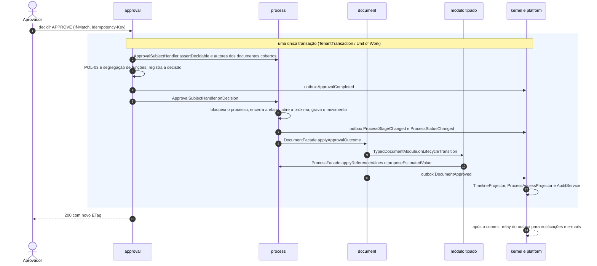

---

## 5. Serviços de domínio e de aplicação

| Serviço | Contexto | Tipo | Responsabilidade | Base |
|---|---|---|---|---|
| `ProcessLifecycleService` | `process` | Domínio (orquestrado pela aplicação) | Único ponto de mudança de `ProcessStatus`: valida transições, `statusBeforeSuspension`, motivos; pausa e retomada de prazos; emite `ProcessStatusChanged` e especializações | DEC-013 |
| `CustodyPolicy`† | `process` | Domínio | POL-01 e partes da POL-02; exposta aos demais contextos pelo `ProcessAccessPort` | DEC-023 |
| `EstimatedValuePolicy`† | `process` | Domínio | Precedência TR > pesquisa > ETP > DFD > manual; recusa edição manual com fonte de maior precedência | DEC-032 |
| `ReferenceValuesPolicy`† | `process` | Domínio | Atualiza `referenceQuantity`/`referenceUnitPrice` com documento de origem e precedência | DEC-019, DOM-06 |
| `StageDeadlineCalculator`† | `process` | Domínio | `dueAt` por SLA (snapshot), sobrescrita, pausa e extensão, "vence em breve" e atraso (job `deadlines`) | DEC-031 |
| `ProcessAccessProjector` | `process` | Projeção síncrona | Concessões `ProcessAccess` conforme permissions.md §5 | DEC-024, DEC-161 |
| `WorkflowEngine`† | `workflow` | Domínio (puro) | A partir da versão fixada, da etapa atual, do `RuleContext` e dos resultados de aprovação: ações disponíveis com motivos, violações `WORKFLOW_RULE` (`BLOCKING`/`WARNING`), destino (unidade e responsável por `DepartmentResolution`/`StageAssignmentPolicy`) e SLA. Não persiste nada | DEC-014, DEC-016 |
| `RuleEvaluator`† | `workflow` | Domínio | JSON Logic (`json-logic-js`) e tipos `REQUIRED_DOCUMENT` (com `minStatus`), `REQUIRED_FIELD`, `REQUIRED_APPROVAL`, `CONDITION`; nunca acessa o banco | DEC-016, DEC-018 |
| `RuleContextBuilder`† | `workflow` | Aplicação | Monta o `RuleContext` v1 a partir dos `RuleContextContributor` | DEC-016 |
| `WorkflowApplicabilityResolver` | `workflow` | Domínio | `WorkflowFacade.resolveApplicable`: prioridade, regra de aplicabilidade e padrão; `NO_APPLICABLE_WORKFLOW` | DEC-014, US-001 |
| `WorkflowPublicationValidator`† | `workflow` | Domínio | Validações de publicação, snapshot e hash | DEC-084 |
| `ApproverResolver`† | `approval` | Domínio | Resolve e grava o aprovador na solicitação: `USER`; `ROLE` = detentores cuja atribuição cubra a unidade solicitante; `DEPARTMENT_HEAD` = titular (e substituto) da unidade resolvida | DEC-022 |
| `SegregationOfDutiesPolicy`† | `approval` | Domínio | POL-03: autor de documento coberto ou da versão analisada não decide | DEC-022 |
| `DocumentLifecycleService`† | `document` | Domínio + aplicação | Transições da DEC-018; cria versões; mantém `pendingApprovalId`/`approvedVersionId`; emite eventos genéricos com routing key por tipo e `typedSummary` | DEC-017, DEC-018, DEC-162 |
| `DocumentCompletenessValidator`† | `document` (+ tipados) | Domínio | Completude do template + validador do módulo tipado → `violations[]` | api.md §2.1.2 |
| `DocumentSnapshotBuilder`† | `document` (+ tipados) | Domínio | Cabeçalho, seções e coleções → JSON canônico → `contentHash` | DEC-084 |
| `TemplateVariableResolver`† | `document` | Domínio | Resolve `{{…}}` no servidor; variável desconhecida bloqueia a publicação | entities.md §5.2 |
| `DocumentRenderService`† | `document` | Job (`document-render`) | HTML do snapshot (+ layout) → `PdfRenderer` → SHA-256 → storage → `DocumentRendition` | DEC-060 |
| `PriceStatisticsCalculator`† | `price-research` | Domínio (puro) | n, média, mediana, mínimo, máximo, desvio-padrão amostral, CV; método efetivo (`AUTO_CV`, sobrescrita, `MANUAL`); valor recomendado; total; valores atípicos pela mediana das demais; alertas (`BELOW_MINIMUM_QUOTES`, `HIGH_CV`, `HAS_OUTLIERS`, `EXPIRED_QUOTES`, `NO_VALID_QUOTES`) | DEC-020 |
| `QuotationValidityPolicy`† | `price-research` | Domínio | Campos exigidos e validade por tipo de fonte (metadados de `PRICE_SOURCE_TYPE`) | DEC-020, DEC-027 |
| `EtpToTermImporter`† | `term` | Aplicação | Importação TR ← ETP pelos `importMappings` da versão do template | US-037 |
| `RiskLevelCalculator`† | `risk` | Domínio (puro) | Pontuação P × I e nível pelas faixas vigentes; risco residual | DEC-021 |
| `BusinessCalendar`† | `catalog` | Domínio | Dias úteis (segunda a sexta, exceto feriados ativos; pontos facultativos conforme configuração), soma de dias úteis, fim do dia útil no fuso do tenant | DEC-031 |
| `NumberingService`† | `catalog` | Domínio + aplicação | `next(sequenceKey)` com `UPDATE … RETURNING` na transação do chamador; formatação da máscara; escopo tenant ou órgão; reinício anual | DEC-028 |
| `DepartmentTreeService`† | `organization` | Domínio | Caminho materializado, prevenção de ciclos, consultas de subárvore | entities.md (`Department`) |
| `AuthorizationService` | `access` | Aplicação | `assertCan(permission, resource)`: vínculo ativo, MFA (POL-14), permissões efetivas, cobertura de escopo (permissions.md §1.1), participação (§4); registra `access.denied`. Políticas contextuais ficam no dono do recurso | DEC-134 |
| `EffectivePermissionsCalculator`† | `access` | Domínio + cache | Pares (permissão, escopo) das atribuições válidas; cache Redis de 5 min | permissions.md §1.2 |
| `PermissionCacheInvalidator` | `access` | Consumidor assíncrono | Invalida o cache em `role.*`, `membership.*`, `department.moved` | events.md §3 |
| `MembershipLifecycleService`† | `identity` | Domínio | Convite, ativação, suspensão, revogação, expiração | DEC-012 |
| `TenantProvisioningService`† | `tenancy` | Aplicação | Orquestra o provisionamento pelos `TenantProvisioningStep`† | US-099, DOM-13 |
| `TenantContextService` · `FeatureFlagService` | `tenancy` | Aplicação | Tenant ativo e flags por tenant | entities.md, DEC-059 |
| `TimelineProjector` | `timeline` | Projeção síncrona | Evento → `ProcessTimelineEntry` com nomes congelados, visibilidade e idempotência | DEC-025, events.md §5 |
| `NotificationDispatcher` · `EmailSender` | `notification` | Consumidores assíncronos | Destinatários e agrupamento; envio de e-mail das notificações `PENDING` | events.md §6 |
| `AuditService` | `audit` | Aplicação (síncrono) | Registro explícito por ação na transação do caso de uso, com mascaramento e `rowHash` | DEC-161, ADR-009 |
| `AuditSealer`† | `audit` | Job (`audit-seal`) | Selagem horária (`digest`, `chainHash`) | DEC-163 |
| `FileScanService`† | `files` | Job (`file-scan`) | *Magic bytes*, antivírus, SHA-256, promoção | DEC-136 |
| `ConfidentialFieldsInterceptor` | Kernel/apresentação | Transversal | Mascaramento central de valores sigilosos (POL-09) em API, PDFs, exportações, timeline e notificações | DEC-030 |
| `OutboxWriter` · relay · `IdempotencyService` · `StorageService` · `BusinessMetricsCollector` | `platform` | Transversal | Outbox, publicação, idempotência, storage, métricas de negócio | DEC-105, DEC-161 |

---

## 6. Linguagem ubíqua (resumo)

Glossário completo, rótulos de enums e guia de linguagem: **[terminology.md](../product/terminology.md)**. Termos essenciais por contexto:

| Termo de negócio (pt-BR) | Identificador técnico | Contexto |
|---|---|---|
| Instituição contratante (tenant) | `Tenant` | `tenancy` |
| Órgão/entidade | `Organization` | `tenancy` |
| Unidade (secretaria, setor) | `Department` | `organization` |
| Usuário · vínculo · lotação | `User` · `TenantMembership` · `MembershipDepartment` | `identity` |
| Perfil · permissão · atribuição com escopo | `Role` · `Permission` · `RoleAssignment` | `access` |
| Catálogo · feriado · numeração · configuração | `CatalogItem` · `Holiday` · `NumberSequence` · `TenantSetting` | `catalog`, `tenancy` |
| Processo de contratação · situação do processo | `Process` · `ProcessStatus` | `process` |
| Item da contratação | `ProcessItem` | `process` |
| Etapa (passagem) · responsabilidade · tramitação | `ProcessStage` · `ProcessAssignment` · `ProcessMovement` | `process` |
| Acesso ao processo · participante · custódia | `ProcessAccess` · `ProcessParticipant` · POL-01 | `process` |
| Encaminhar · devolver · assumir · atribuir · suspender · retomar · cancelar · concluir | `FORWARD` · `RETURN` · `CLAIM` · `ASSIGN` · `SUSPEND` · `RESUME` · `CANCEL` · `COMPLETE` | `process` |
| Caixa de tarefas · painel situacional | módulo `inbox` · `GET /processes/{id}/summary` | `inbox`, `process` |
| Workflow (fluxo) · versão · etapa do workflow · transição · regra · contexto de regras | `Workflow` · `WorkflowVersion` · `WorkflowStage` · `WorkflowTransition` · `WorkflowRule` · `RuleContext` | `workflow` |
| Aprovação · documento coberto · aprovar, devolver, indeferir | `Approval` · `ApprovalDocument` · `APPROVE`, `RETURN`, `REJECT` | `approval` |
| Segregação de funções | `approval.preventSelfApproval` | `approval` |
| Documento · tipo · template · versão · renderização (PDF) · item do documento | `Document` · `DocumentType` · `DocumentTemplate`/`DocumentTemplateVersion` · `DocumentVersion` · `DocumentRendition` · `DocumentItem` | `document` |
| Rascunho de trabalho · finalizar · submeter · reabrir · selo "Em aprovação" | `Document.draftContent` · `FINALIZED` · submit · reopen · `pendingApprovalId` | `document` |
| DFD · ETP · alternativa de solução · TR | `Dfd` · `Etp` · `EtpAlternative` · `TermOfReference` | `dfd`, `etp`, `term` |
| Pesquisa de preços · item da pesquisa · fonte (evidência) · tipo de fonte · cotação · fornecedor | `PriceResearch` · `PriceItem` · `PriceSource` · `PRICE_SOURCE_TYPE` · `Quotation` · `Supplier` | `price-research`, `supplier` |
| Desconsiderar cotação · valor atípico | `QuotationStatus.EXCLUDED` · `OutlierFlag` | `price-research` |
| Risco · tratamento · mapa de riscos | `Risk` · `RiskTreatment` · documento `RISK_MAP` | `risk` |
| Comentário · menção · anexo | `Comment` · `Mention` · `Attachment` | `collaboration`, `files` |
| Timeline · notificação · trilha de auditoria · selagem · evento de domínio | `ProcessTimelineEntry` · `Notification` · `AuditLog` · `AuditSeal` · envelope DEC-160/`OutboxEvent` | `timeline`, `notification`, `audit`, `platform` |
| PCA · item do PCA · dotação · análise jurídica (futuros) | `Pca` · `PcaItem` · `BudgetAllocation` · `LegalReview` | MVP 2 |
| Publicação · contrato · análise de IA (futuros) | `Publication` · `Contract` · `AIAnalysis` (DOM-01) | MVPs 3, 4, 5 |

Regras de uso (resumo de terminology.md §16): "encaminhar" é a ação e "tramitação" o histórico; "indeferir" corresponde a `REJECT`; "finalizar" vale para documentos e "concluir" para o processo (exceção: "Concluir pesquisa"); "desconsiderar", nunca "excluir", cotação; "instituição contratante" para o tenant e "órgão/entidade" só para `Organization` (DEC-012); a interface nunca exibe identificadores técnicos (DEC-184).

---

## 7. ERD conceitual — todos os MVPs

**Leitura dos diagramas:**
- Nomes em SCREAMING_SNAKE do nome canônico (`PROCESS_ITEM` = `ProcessItem`), como em entities.md §3.
- **Sem sufixo = MVP 1** (entities.md §4). **Sufixo `_MVPn`** = entidade reservada do MVP n, com definição preliminar e relações previstas em [entities.md §8](../mvp-01/entities.md#8-entidades-de-mvps-futuros-reservadas) — a confirmar no gate do MVP.
- Linha **cheia** = relação dentro do mesmo contexto; linha **tracejada** = referência entre contextos (por identidade, FK composta com `tenant_id` — DEC-081).
- Cada diagrama mostra uma área; entidades de outras áreas aparecem apenas como referência.

### 7.1 Tenancy, estrutura, identidade e acesso

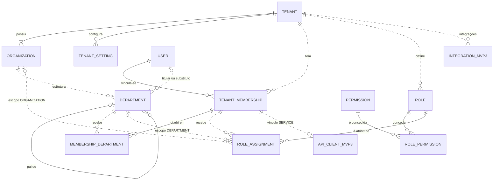

### 7.2 Catálogos, calendário e numeração

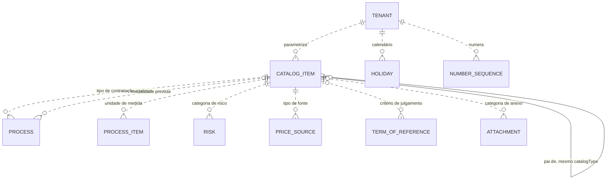

`NUMBER_SEQUENCE` não tem FK para processos ou documentos: a ligação é a `sequenceKey` (escopo, tipo e exercício — DEC-028).

### 7.3 Processo, tramitação e aprovação

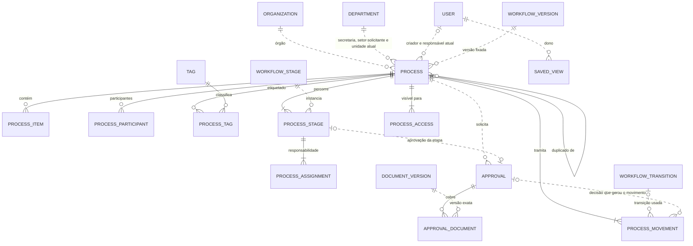

Principais de `PROCESS_PARTICIPANT` e `PROCESS_ACCESS`: um `User` **ou** um `Department` (exatamente um). No MVP 2 entram `PCA_ITEM_MVP2`, `BUDGET_ALLOCATION_MVP2`, `LEGAL_REVIEW_MVP2`, `INTERNAL_CONTROL_REVIEW_MVP2` e `TENDER_MVP2` ligados a `PROCESS` ([§7.8](#78-mvp-2--governança-e-controle)).

### 7.4 Workflow (definição)

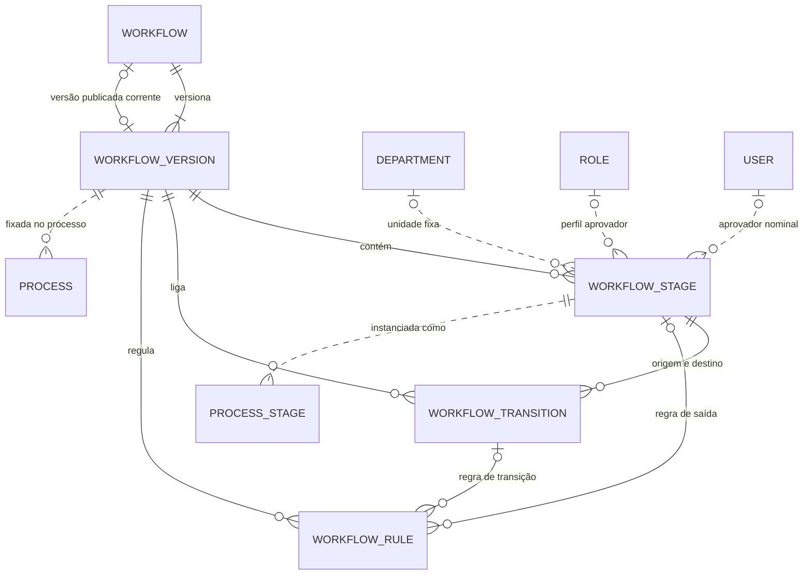

### 7.5 Documentos e artefatos tipados

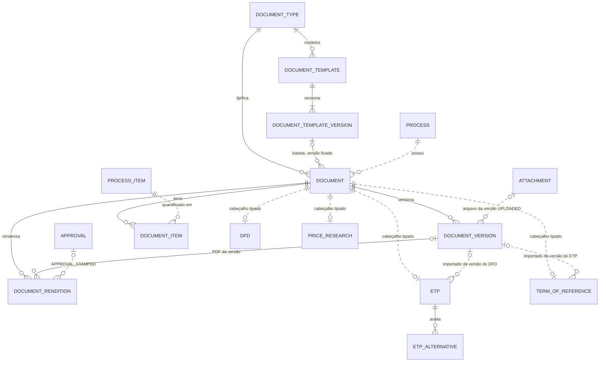

O documento `RISK_MAP` não tem cabeçalho tipado: seu snapshot inclui os `RISK`/`RISK_TREATMENT` do processo ([§7.6](#76-pesquisa-de-preços-fornecedores-e-riscos)). No MVP 3, `SIGNATURE_REQUEST_MVP3` e `PUBLICATION_MVP3` referenciam `DOCUMENT_VERSION` ([§7.9](#79-mvp-3--integrações-publicação-e-assinatura)).

### 7.6 Pesquisa de preços, fornecedores e riscos

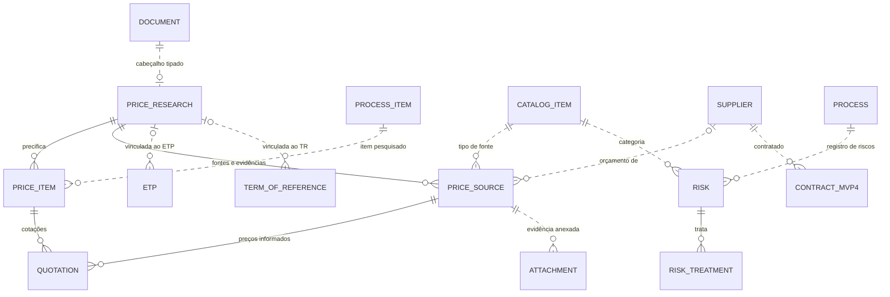

### 7.7 Colaboração, arquivos, timeline, notificações, auditoria e outbox

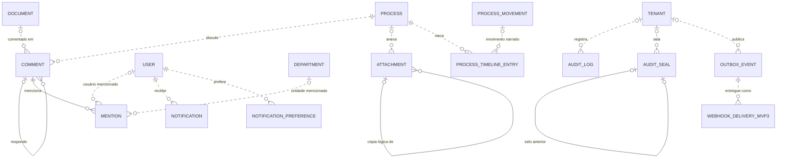

`Attachment` usa alvo polimórfico (`targetType` + `targetId`): `PROCESS`, `DOCUMENT`, `DOCUMENT_VERSION`, `PRICE_SOURCE`, `COMMENT`, `MOVEMENT`, `RISK`, `TENANT_ASSET`, `TEMPLATE_VERSION`. `ProcessTimelineEntry.sourceEventId` e `Notification.sourceEventId` são referências lógicas ao evento (sem FK — o outbox é purgado em 7 dias).

### 7.8 MVP 2 — Governança e controle

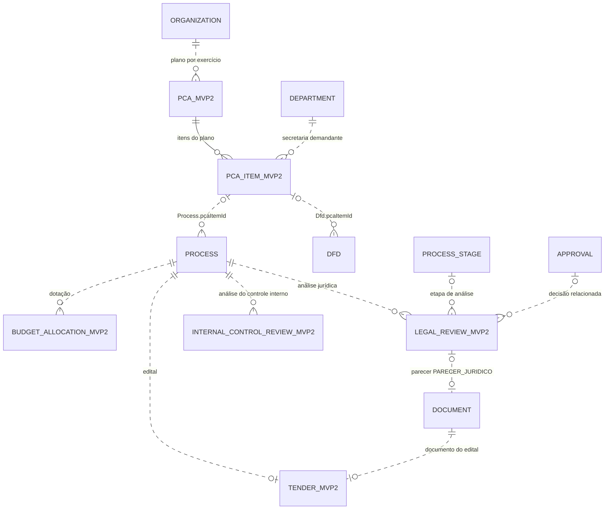

### 7.9 MVP 3 — Integrações, publicação e assinatura

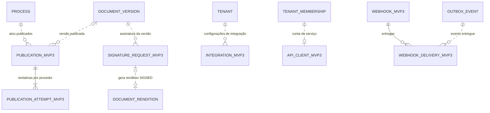

### 7.10 MVP 4 — Gestão contratual

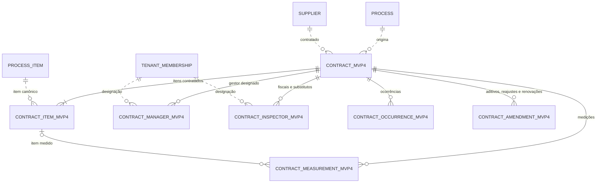

`ContractManager`/`ContractInspector` referenciam `User`/`TenantMembership` (entities.md §8); a escolha entre os dois fica para o gate do MVP 4.

### 7.11 MVP 5 — Inteligência

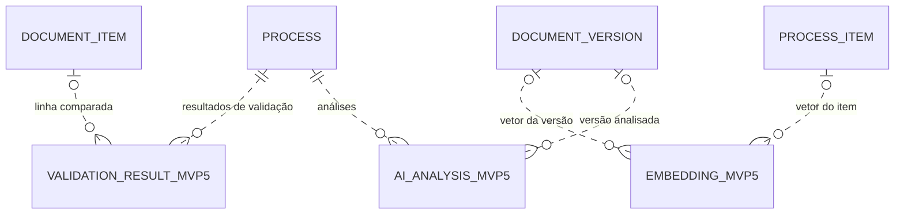

### 7.12 Inventário das entidades nos diagramas

| Área | MVP 1 (entities.md §4) | MVPs futuros (entities.md §8) |
|---|---|---|
| 7.1 | `Tenant`, `Organization`, `TenantSetting`, `Department`, `User`, `TenantMembership`, `MembershipDepartment`, `Permission`, `Role`, `RolePermission`, `RoleAssignment` | `Integration` (3), `ApiClient` (3) |
| 7.2 | `CatalogItem`, `Holiday`, `NumberSequence` | — |
| 7.3 | `Process`, `ProcessItem`, `ProcessParticipant`, `Tag`, `ProcessTag`, `ProcessStage`, `ProcessAssignment`, `ProcessMovement`, `ProcessAccess`, `SavedView`, `Approval`, `ApprovalDocument` | — |
| 7.4 | `Workflow`, `WorkflowVersion`, `WorkflowStage`, `WorkflowTransition`, `WorkflowRule` | — |
| 7.5 | `DocumentType`, `DocumentTemplate`, `DocumentTemplateVersion`, `Document`, `DocumentVersion`, `DocumentRendition`, `DocumentItem`, `Dfd`, `Etp`, `EtpAlternative`, `TermOfReference` | — |
| 7.6 | `PriceResearch`, `PriceItem`, `PriceSource`, `Quotation`, `Supplier`, `Risk`, `RiskTreatment` | — |
| 7.7 | `Comment`, `Mention`, `Attachment`, `ProcessTimelineEntry`, `Notification`, `NotificationPreference`, `AuditLog`, `AuditSeal`, `OutboxEvent` | — |
| 7.8 | — | `Pca`, `PcaItem`, `BudgetAllocation`, `LegalReview`, `InternalControlReview`, `Tender` |
| 7.9 | — | `Publication`, `PublicationAttempt`, `SignatureRequest`, `Integration`, `Webhook`, `WebhookDelivery`, `ApiClient` |
| 7.10 | — | `Contract`, `ContractItem`, `ContractManager`, `ContractInspector`, `ContractMeasurement`, `ContractOccurrence`, `ContractAmendment` |
| 7.11 | — | `AIAnalysis`, `ValidationResult`, `Embedding` |

Total: **58** entidades do MVP 1 + **23** reservadas = 81.

---

## 8. Correspondência: entidades pedidas × modelo canônico

### 8.1 Lista do cliente → modelo canônico

| Entidade pedida | Entidade canônica | Contexto | MVP | Observação |
|---|---|---|---|---|
| Tenant | `Tenant` | `tenancy` | 1 | Tabela de plataforma; fronteira de isolamento; na interface, "instituição contratante" (DEC-012) |
| Organization | `Organization` | `tenancy` | 1 | Órgão/entidade com CNPJ; 1..N por tenant (DEC-011) |
| Department | `Department` | `organization` | 1 | Árvore; "secretaria" é um `Department` do tipo `SECRETARIAT` |
| User | `User` | `identity` | 1 | Identidade global; dados do tenant ficam no vínculo |
| Role | `Role` | `access` | 1 | Por tenant; 15 perfis padrão (DEC-035) |
| Permission | `Permission` | `access` | 1 | Catálogo global em código, sincronizado por migração |
| Process | `Process` | `process` | 1 | Agregado central (DEC-010) |
| ProcessStage | `ProcessStage` | `process` | 1 | Passagem do processo por uma `WorkflowStage` |
| ProcessAssignment | `ProcessAssignment` | `process` | 1 | Histórico de responsabilidade |
| DFD | `Dfd` | `dfd` | 1 | Cabeçalho tipado 1:1 de `Document` tipo `DFD` (sigla mantida — DEC-001) |
| ETP | `Etp` | `etp` | 1 | Cabeçalho tipado 1:1 de `Document` tipo `ETP` |
| ETPAlternative | `EtpAlternative` | `etp` | 1 | Interna ao agregado `Etp` |
| PriceResearch | `PriceResearch` | `price-research` | 1 | Cabeçalho tipado; sem status próprio |
| PriceItem | `PriceItem` | `price-research` | 1 | Estatísticas persistidas por item |
| Quotation | `Quotation` | `price-research` | 1 | Preço de um item em uma fonte |
| Supplier | `Supplier` | `supplier` | 1 | Compartilhado com o MVP 4 |
| Risk | `Risk` | `risk` | 1 | Pertence ao processo; `RISK_MAP` é o documento |
| RiskTreatment | `RiskTreatment` | `risk` | 1 | Interna ao agregado `Risk` |
| TermOfReference | `TermOfReference` | `term` | 1 | Tipo `TR`, rota `/terms` |
| Document | `Document` | `document` | 1 | Artefato genérico do processo |
| DocumentVersion | `DocumentVersion` | `document` | 1 | Snapshot imutável com hash |
| Approval | `Approval` | `approval` | 1 | Genérica: `PROCESS_STAGE` ou `DOCUMENT` |
| Workflow · WorkflowVersion · WorkflowStage · WorkflowTransition · WorkflowRule | mesmos nomes | `workflow` | 1 | Definição versionada (DEC-014) |
| Comment · Mention | `Comment` · `Mention` | `collaboration` | 1 | |
| Attachment | `Attachment` | `files` | 1 | Upload seguro (DEC-136) |
| Notification | `Notification` | `notification` | 1 | Derivada de evento |
| AuditLog | `AuditLog` | `audit` | 1 | Append-only, selado |
| PCA | `Pca` | `pca` | 2 | No MVP 1, só campos de referência (DEC-029) |
| PCAItem | `PcaItem` | `pca` | 2 | Status em `PcaItemStatus` (entities.md §9) |
| BudgetAllocation | `BudgetAllocation` | `budget` | 2 | |
| LegalReview | `LegalReview` | `legal-review` | 2 | Parecer = `Document` tipo `PARECER_JURIDICO` |
| Publication · PublicationAttempt | `Publication` · `PublicationAttempt` | `publication` | 3 | |
| Integration | `Integration` | `integration` | 3 | Credenciais criptografadas |
| Webhook | `Webhook` | `webhook` | 3 | |
| Contract | `Contract` | `contract` | 4 | |
| ContractManager · ContractInspector · ContractMeasurement · ContractOccurrence · ContractAmendment | mesmos nomes | `contract` | 4 | |
| AIAnalysis | `AIAnalysis` | `ai` | 5 | Nome de entities.md §8; normalização para `AiAnalysis` em discussão (DOM-01) |
| ValidationResult | `ValidationResult` | `ai` | 5 | |
| PesquisaPreco | `PriceResearch` | `price-research` | 1 | DEC-020 |
| PesquisaItem | `PriceItem` | `price-research` | 1 | DEC-020 |
| Cotacao | `Quotation` | `price-research` | 1 | DEC-020 |
| Fornecedor | `Supplier` | `supplier` | 1 | DEC-020 |
| FontePesquisa | `PriceSource` (instância/evidência) + catálogo `PRICE_SOURCE_TYPE` (tipo) | `price-research` + `catalog` | 1 | DEC-020; um conceito dividido em evidência e classificação ([§9](#9-conceitos-que-parecem-iguais-mas-não-são)) |

### 8.2 Entidades acrescentadas pelo modelo (MVP 1)

| Entidade | Contexto | Motivo | Base |
|---|---|---|---|
| `TenantMembership` | `identity` | Separar identidade global de vínculo por tenant (situação, cargo, validade, consultorias em vários tenants) | DEC-012 |
| `MembershipDepartment` | `identity` | Lotação em 1 unidade principal + N adicionais; base do escopo `OWN_DEPARTMENTS` e da custódia por unidade | DEC-012, DEC-023 |
| `RoleAssignment` | `access` | Perfil atribuído com escopo e vigência | DEC-134 |
| `RolePermission` | `access` | Associação N:N perfil × permissão | DEC-134 |
| `TenantSetting` | `tenancy` | Configuração tipada por chave e feature flags | DEC-059, entities.md §6 |
| `CatalogItem` | `catalog` | Listas parametrizáveis com `code` estável e metadados (base legal, códigos PNCP) | DEC-027 |
| `Holiday` | `catalog` | Dias úteis por tenant | DEC-031 |
| `NumberSequence` | `catalog` | Numeração sem lacunas e segura sob concorrência | DEC-028 |
| `ProcessItem` | `process` | Identidade canônica do item, sem duplicação entre documentos | DEC-019 |
| `ProcessMovement` | `process` | Registro imutável de cada tramitação (origem, destino, ator, comentário, prazo, documentos) | DEC-014 |
| `ProcessAccess` | `process` | Índice de visibilidade mantido na transação | DEC-024 |
| `ProcessParticipant` | `process` | Acesso explícito por processo (observador, colaborador, consultor) | DEC-036 |
| `Tag` · `ProcessTag` | `process` | Etiquetas do tenant | DEC-040 |
| `SavedView` | `process` | Visões salvas da lista e da caixa | DEC-040 |
| `DocumentType` | `document` | Tipos configuráveis com natureza (`STRUCTURED`, `FREE_TEXT`, `UPLOADED`) | DEC-017 |
| `DocumentTemplate` · `DocumentTemplateVersion` | `document` | Templates versionados; versão publicada imutável | DEC-017, DEC-084 |
| `DocumentRendition` | `document` | PDF com hash por versão, separado do conteúdo | DEC-017, DEC-060 |
| `DocumentItem` | `document` | Linha do item em cada documento (quantidade, memória de cálculo, especificação) | DEC-019 |
| `ApprovalDocument` | `approval` | Versões exatas cobertas pela decisão | DEC-022 |
| `PriceSource` | `price-research` | Evidência datada da fonte de preço | DEC-020 |
| `ProcessTimelineEntry` | `timeline` | Narrativa do processo distinta da auditoria | DEC-025 |
| `AuditSeal` | `audit` | Selagem encadeada da trilha | DEC-025, ADR-009 |
| `NotificationPreference` | `notification` | Preferências por tipo e canal | DEC-040 |
| `OutboxEvent` | `platform` | Eventos na mesma transação da mudança | DEC-161 |

### 8.3 Entidades futuras acrescentadas (entities.md §8, não pedidas)

| Entidade | MVP | Motivo |
|---|---|---|
| `InternalControlReview` | 2 | Manifestação do Controle Interno com estrutura própria (checklist, achados) |
| `Tender` | 2 | Edital ligado 1:1 ao processo e a um `Document` |
| `SignatureRequest` | 3 | Assinatura de versões, gerando rendition `SIGNED` |
| `WebhookDelivery` | 3 | Cada entrega de webhook (idempotência, retries, painel) |
| `ApiClient` | 3 | Cliente da API pública ligado a vínculo `SERVICE` |
| `ContractItem` | 4 | Itens contratados ligados ao `ProcessItem` canônico |
| `Embedding` | 5 | Vetores (pgvector) de versões e itens para similaridade |

### 8.4 Conceitos sem entidade própria

| Conceito | Como é representado | Base |
|---|---|---|
| Tarefa (caixa de tarefas) | Consulta sobre etapa ativa + responsabilidade ativa + aprovações pendentes | DEC-026 |
| PCA no MVP 1 | `PcaReference` em `Process` e `Dfd` | DEC-029 |
| Mapa de riscos | Documento `RISK_MAP` sem cabeçalho; conteúdo = riscos do processo | DEC-021 |
| Secretaria solicitante | `Department` (tipo `SECRETARIAT` ou nível 1) | DEC-011 |
| "Em aprovação" | Selo derivado de `pendingApprovalId` | DEC-018 |
| Conta de serviço | `TenantMembership` do tipo `SERVICE` (MVP 3) | DEC-012 |

---

## 9. Conceitos que parecem iguais, mas não são

| # | Conceito A | Conceito B | O que os diferencia | Regra anti-duplicação |
|---|---|---|---|---|
| 1 | Timeline (`ProcessTimelineEntry`) | Auditoria (`AuditLog`) | Narrativa curada para quem vê o processo, com nomes congelados × evidência de conformidade e segurança de todas as ações (inclusive negadas, acessos, exportações, configuração), com IP, diff mascarado e selagem (DEC-025) | A timeline não é prova e a auditoria não alimenta a tela do processo; ambas nascem do mesmo fato, na mesma transação, por caminhos distintos (`TimelineProjector` × `AuditService`) |
| 2 | `Approval` | `ProcessStage` de etapa `APPROVAL` | A etapa é **posição** (onde o processo está, unidade com custódia, prazo, passagem); a aprovação é o **ato decisório** (quem decide, sobre quais versões, decisão e motivação). Há `Approval` sem etapa (`DOCUMENT`) | Custódia da etapa (pode devolver/retirar — POL-01) ≠ designação do aprovador (pode decidir — POL-03); `AWAITING_APPROVAL` decorre da etapa; `REQUIRED_APPROVAL` consulta a aprovação da última passagem |
| 3 | `ProcessItem` | `DocumentItem` · `PriceItem` | Identidade canônica do item + valores de referência × linha do item em um documento (quantidade daquele documento, memória de cálculo, especificação) × linha do item na pesquisa (quantidade pesquisada, estatísticas) (DEC-019) | Descrição, unidade, natureza e código CATMAT/CATSER só em `ProcessItem`; documentos e pesquisa referenciam `processItemId` — por isso a divergência ETP × TR é detectável (MVP 5) |
| 4 | `PriceSource` | Catálogo `PRICE_SOURCE_TYPE` | Evidência concreta e datada × classificação parametrizável com base legal, campos exigidos e validade (DEC-020, DEC-027) | Regras por tipo ficam nos metadados do catálogo; nenhum enum paralelo de tipos de fonte |
| 5 | Status do `Document` | Status do `Process` · etapa do workflow | Três eixos ortogonais: maturidade do artefato (DEC-018), situação macro (DEC-013), posição no fluxo (`ProcessStage`/`WorkflowStage`). Ex.: processo `AWAITING_APPROVAL` em `APROVACAO_AUTORIDADE`, ETP `FINALIZED` e TR `IN_REVIEW`, ambos com o selo "Em aprovação" | Nenhum eixo é copiado do outro; `PriceResearch` não tem status (usa o do `Document` + `completedAt`); "Em aprovação" é derivado de `pendingApprovalId` (DEC-018), não um status |
| 6 | `Tenant` | `Organization` · `Department` | Instituição contratante e fronteira de isolamento × órgão/entidade com CNPJ (numeração por órgão, PNCP) × unidade administrativa em árvore (DEC-011, DEC-012) | `tenant_id` é isolamento; `organizationId` é negócio; secretaria é `Department`, nunca entidade nova; câmara é outro tenant |
| 7 | `Role` (perfil) | `ParticipantRole` | Conjunto configurável de permissões atribuído a um vínculo com escopo e vigência × papel fixo de acesso explícito a **um** processo (permissions.md §4) | Participação nunca dá tramitação, aprovação ou orçamento sigiloso; não criar perfis "por processo" nem participantes com permissões configuráveis |
| 8 | `Notification` | Evento de domínio | Fato imutável para máquinas (outbox, envelope DEC-160) × mensagem a uma pessoa, derivada de um fato, com canal, leitura e preferência | Um evento gera 0..N notificações; nem todo evento notifica; nenhuma notificação sem `sourceEventId`; e-mail transacional a quem ainda não é membro (convite) não é `Notification` |
| 9 | `Comment` | `ProcessMovement.comment` (e demais motivações) | Discussão colaborativa (editável por 15 min, moderável, com respostas e menções) × motivação do ato, parte imutável do registro (obrigatória em devolução, indeferimento, cancelamento e suspensão) | Motivações ficam no próprio ato (`ProcessMovement.comment`, `Approval.decisionComment`, `cancellationReason`, `reopenReason`, `exclusionJustification`); nunca registrá-las como `Comment` |
| 10 | `Document` genérico | Cabeçalhos tipados (`Dfd`, `Etp`, `TermOfReference`, `PriceResearch`) | Tipo, número, status, versões, rascunho de seções e sigilo × campos que o sistema precisa filtrar, calcular, validar, reportar ou integrar (DEC-017) | Status, número e versão só no `Document`; dado tipado só no cabeçalho; narrativa só nas seções do template; `RISK_MAP` sem cabeçalho |
| 11 | `WorkflowTransition` (definição) | `ProcessMovement` (execução) | Aresta do grafo de uma versão publicada, imutável × registro imutável do que aconteceu (ator, IP, comentário, prazo, documentos, decisão) | `ProcessMovement.workflowTransitionId` aponta a definição quando há; ações fora do grafo (`CREATE`, `CLAIM`, `ASSIGN`, `SUSPEND`, `RESUME`, `CANCEL`) não têm transição |
| 12 | `ProcessAssignment` | `ProcessStage.assigneeId` (e `Process.currentResponsibleId`) | Histórico de responsabilidade (quem, desde quando, por quê) × desnormalização do responsável atual para leitura | Fonte da verdade = `ProcessAssignment` ativo; as colunas são caches gravados na mesma transação; o KPI de tempo sem responsável lê o histórico |
| 13 | `Process.estimatedValue` | Valores dos artefatos (`Dfd.estimatedValue`, `Etp.estimatedTotalValue`, `PriceResearch.totalEstimatedValue`, `TermOfReference.estimatedTotalValue`) | Resumo derivado por precedência × valor afirmado em cada artefato | Só `ProcessFacade.proposeEstimatedValue`† altera o valor do processo (DEC-032); mascaramento central (DEC-030) |
| 14 | `Risk` (registro vivo) | Documento `RISK_MAP` · matriz de alocação de riscos (art. 22) | Riscos do processo ao longo das fases × artefato formal versionado, cujo snapshot contém os riscos × cláusula do edital/contrato (MVPs 2 e 4) | Um único cadastro de riscos; o documento é a foto; a matriz contratual será conceito próprio (terminology.md §16) |
| 15 | `DocumentVersion` | `DocumentRendition` | Snapshot do conteúdo (JSON canônico + hash) × PDF gerado a partir de uma versão (bytes + SHA-256): `CONTENT`, `APPROVAL_STAMPED`, `PREVIEW`, `SIGNED` | Aprovação e publicação referenciam a versão; a rendition é regenerável do snapshot (exceto `SIGNED`) |
| 16 | `Attachment` | `Document` `UPLOADED` | Arquivo-evidência ligado a um alvo, sem ciclo de aprovação × documento formal do processo (tipo, número, status, versões), cujo binário de cada versão é um `Attachment` | O que precisa ser numerado ou aprovado é documento `UPLOADED`; evidência é anexo |
| 17 | `ProcessParticipant` | `ProcessAccess` | Concessão explícita gerenciada por pessoas (papel, validade) × índice derivado de visibilidade por todos os motivos | `ProcessAccess` só é escrito pelo projetor; participação gera a concessão `PARTICIPANT` |
| 18 | Visibilidade (`ProcessAccess` `CURRENT`/`HISTORICAL`) | Competência para aprovar | Ver o processo por ele ter passado pela unidade × ter atribuição cujo escopo cobre a unidade solicitante (DEC-022) | `ApproverResolver` nunca usa `ProcessAccess` para resolver aprovador `ROLE` |
| 19 | `User` | `TenantMembership` | Identidade global (login) × vínculo com um tenant (situação, cargo, lotação, validade) | Nenhum dado de tenant em `User`; perfis e lotações pendem do vínculo |
| 20 | `PcaStatus` | `PcaPlanStatus` · `PcaItemStatus` (MVP 2) | Situação do processo/DFD em relação ao PCA × ciclo de vida do plano e dos itens | Enums distintos já reservados (entities.md §9) |
| 21 | `LegalReview` · `InternalControlReview` (MVP 2) | `Approval` | Análise com situações próprias (diligência, favorável com ressalvas) e parecer × ato decisório | Proposta em DOM-17 |

---

## 10. Ciclos de vida

### 10.1 Processo (DEC-013)

Reproduzido de DEC-013 (em caso de divergência, prevalece a DEC-013):

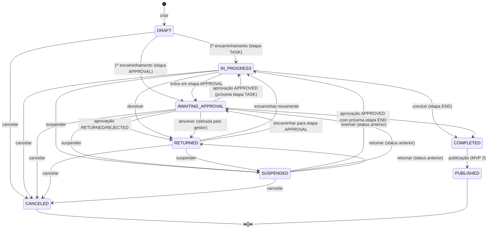

| Transição | Coordenador | Eventos principais |
|---|---|---|
| Criar | `process` (US-001) | `ProcessCreated` |
| Encaminhar / 1º encaminhamento | `process` + `workflow` (+ `approval` e `document` se a etapa for `APPROVAL`) | `ProcessStageChanged` (`FORWARD`), `ProcessStatusChanged`, `ProcessNumberAssigned` (se `START`), `ApprovalRequested`, `DocumentSubmitted` |
| Decisão de aprovação | `approval` → `process` (porta) | `ApprovalCompleted`/`Returned`/`Rejected`, `ProcessStageChanged` (`APPROVAL_*`), `ProcessStatusChanged`, `DocumentApproved`/`Returned`/`Rejected` |
| Devolver | `process` | `ProcessStageChanged` (`RETURN`), `ProcessStatusChanged`; `ApprovalCanceled` na retirada pelo gestor |
| Suspender / retomar / cancelar | `process` (`ProcessLifecycleService`) | `ProcessStatusChanged` (`suspended`, `resumed`, `canceled`); `ApprovalCanceled` (`PROCESS_CANCELED`) |
| Concluir | `process` + `workflow` | `ProcessStageChanged` (`COMPLETE`), `ProcessStatusChanged` (`completed`) |
| Publicar (MVP 3) | `publication` → `ProcessFacade.markPublished`† | `ProcessStatusChanged` (`published`) |
| Descartar rascunho sem número (DEC-013, DEC-034) | `process` | `ProcessDraftDiscarded` |

No MVP 1, `COMPLETED` significa **planejamento da contratação concluído** — etapa final `CONCLUSAO` do fluxo padrão e do fluxo de contratação direta (DEC-015).

### 10.2 Documento (DEC-018)

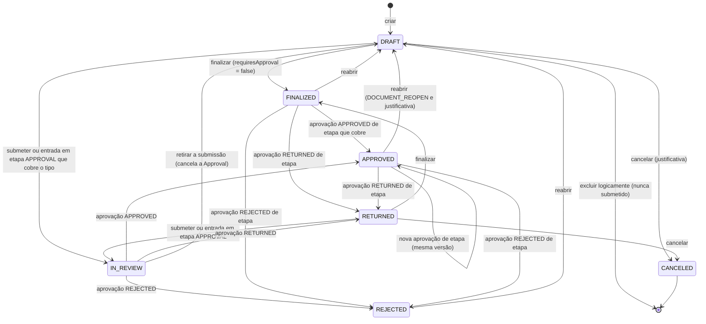

- Finalizar, submeter e reabrir criam `DocumentVersion`; autosave nunca cria versão (DEC-017).
- Enquanto `pendingApprovalId` estiver preenchido, a interface exibe o selo **"Em aprovação"**, qualquer que seja o status (DEC-018).
- "Concluir pesquisa" = finalizar o documento `PRICE_RESEARCH` (+ `completedAt`).

### 10.3 Aprovação (`ApprovalStatus`)

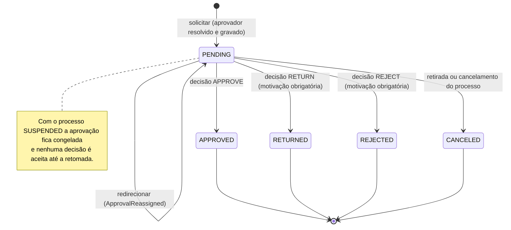

A forma do redirecionamento (na própria aprovação ou cancelando e recriando) é a DOM-10.

### 10.4 Etapa do processo (`ProcessStageStatus`)

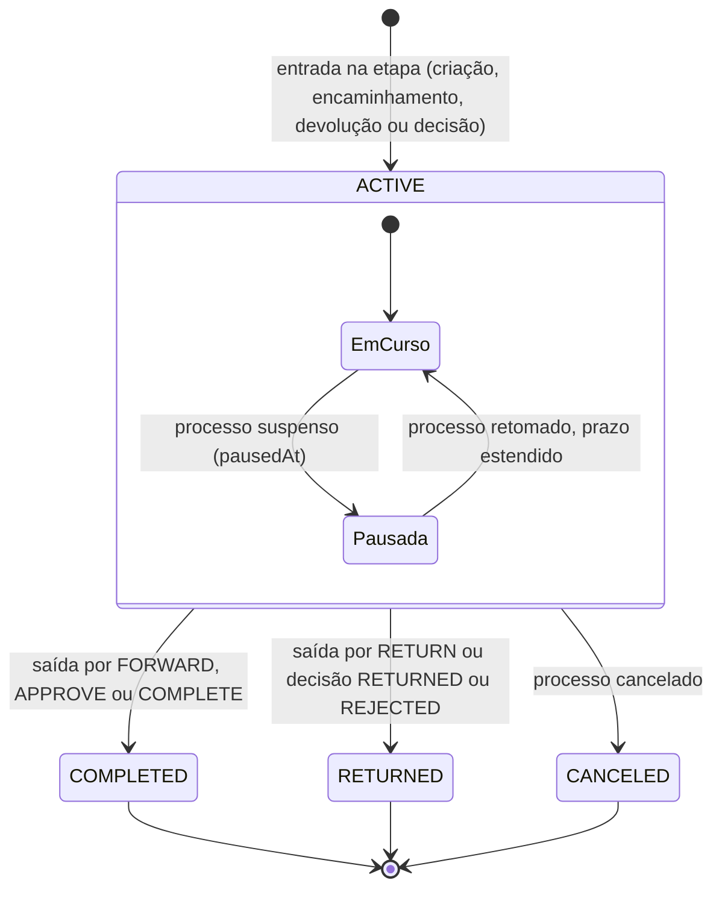

Cada passagem cria uma nova `ProcessStage` (`sequence`); o atraso é a marca `overdueSince` (job `deadlines`), não um estado. Tratamento da etapa `END`: DOM-09.

### 10.5 Vínculo (`MembershipStatus`)

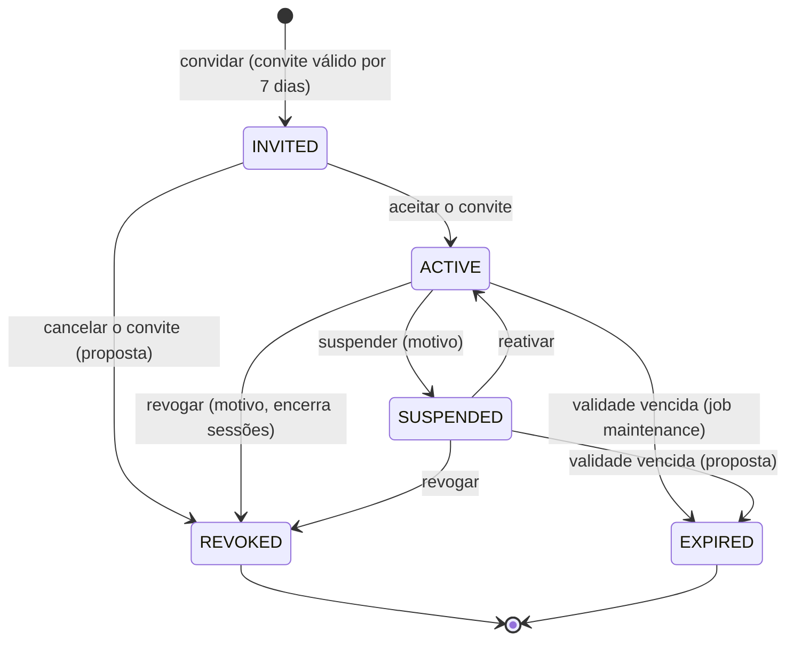

Expiração do convite e reingresso após `REVOKED`/`EXPIRED`: DOM-12.

### 10.6 Anexo (`AttachmentStatus`)

Conforme [storage.md §5](storage.md#5-fluxo-de-upload-dec-136):

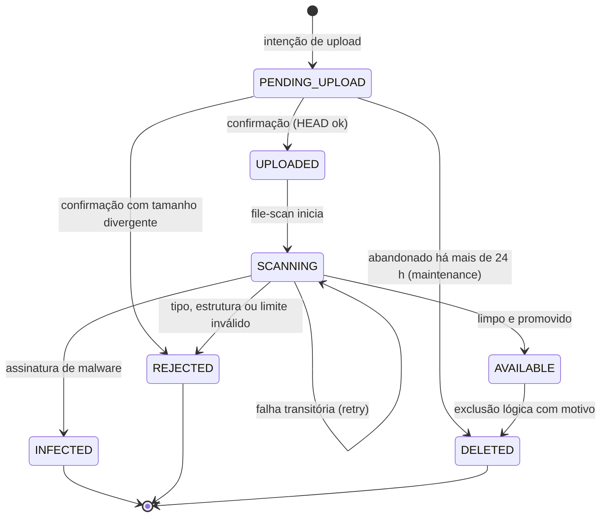

### 10.7 Versão de workflow e de template (`WorkflowVersionStatus`, `TemplateVersionStatus`)

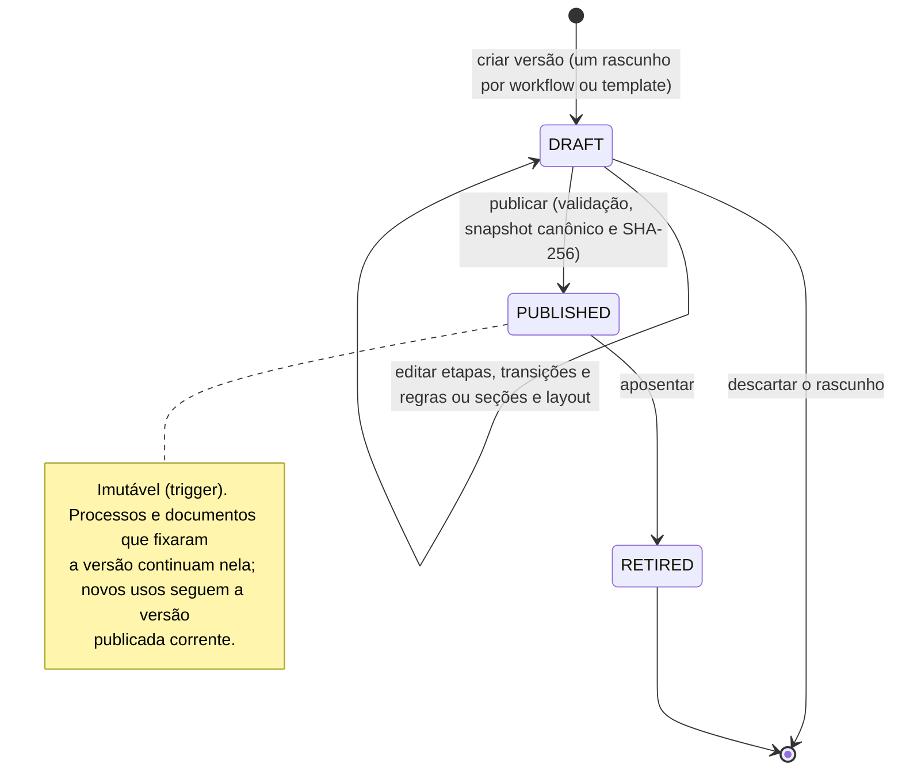

---

## 11. Evolução por MVP

Cada MVP só é detalhado após o gate do [roadmap §2](../product/roadmap.md#2-governança-do-roadmap-um-mvp-detalhado-por-vez). As classificações e os níveis abaixo são **preliminares**.

### 11.1 Mapa de evolução dos contextos

Seta = dependência nova introduzida pelo MVP.

```mermaid
flowchart BT
    subgraph M1["MVP 1"]
        PROC1["process"]
        DOC1["document"]
        WF1["workflow"]
        APR1["approval"]
        TYP1["dfd · etp · term · price-research · risk"]
        SUP1["supplier"]
        BASE1["tenancy · organization · identity · access · catalog"]
        EVT1["eventos de domínio (outbox)"]
    end
    subgraph M2["MVP 2"]
        PCA2["pca"]
        RUL2["rules · sla"]
        ART2["budget · legal-review · internal-control · tender"]
        ANA2["analytics"]
    end
    subgraph M3["MVP 3"]
        INT3["integration"]
        SIG3["signature"]
        PUB3["publication"]
        API3["public-api · webhook"]
    end
    subgraph M4["MVP 4"]
        CON4["contract"]
    end
    subgraph M5["MVP 5"]
        AI5["ai"]
    end
    PROC1 -->|"Process.pcaItemId"| PCA2
    TYP1 -->|"Dfd.pcaItemId"| PCA2
    PCA2 --> BASE1
    WF1 -->|"biblioteca de regras"| RUL2
    PROC1 -->|"políticas de prazo"| RUL2
    ART2 --> PROC1
    ART2 --> DOC1
    ART2 -->|"etapas e decisões"| APR1
    ANA2 -.->|"eventos e views"| EVT1
    SIG3 --> DOC1
    PUB3 --> PROC1
    PUB3 --> DOC1
    PUB3 --> INT3
    API3 -.->|"eventos publicáveis"| EVT1
    API3 --> BASE1
    CON4 --> PROC1
    CON4 --> SUP1
    CON4 --> DOC1
    CON4 -->|"contratos e aditivos"| PUB3
    AI5 -.->|"eventos (fila ai)"| EVT1
    AI5 -->|"somente leitura"| DOC1
    AI5 -->|"RuleContextContributor"| WF1
```

### 11.2 MVP 2 — Governança e controle

| Contexto | Classificação | Nível† | Entidades | Consome do MVP 1 |
|---|---|---|---|---|
| `pca` | Core | N2 (abaixo de `process` e `dfd`, que passam a referenciá-lo) | `Pca`, `PcaItem` (status `PcaPlanStatus`, `PcaItemStatus`) | `DepartmentFacade`, `TenancyFacade`; eventos `process.created`, `process.status_changed.*`, `document.approved.dfd` (acompanhamento da execução, assíncrono). Não chama `process` |
| `budget` | Suporte | N4 | `BudgetAllocation` | `ProcessFacade`, `DocumentFacade` (valor do TR aprovado), `RuleContextContributor` (`budget.*`), `StageLifecycleListener`† |
| `legal-review` | Core | N4 | `LegalReview` (+ documento `PARECER_JURIDICO`) | `ProcessFacade`, `DocumentFacade` (versões analisadas), `ApprovalFacade`, `StageLifecycleListener`†, `RuleContextContributor` (`legalReview.*`) |
| `internal-control` | Core | N4 | `InternalControlReview` | Idem `legal-review`; `RiskFacade` (visão de riscos) |
| `tender` | Core | N4 | `Tender` (cabeçalho tipado do edital — proposta) | `DocumentFacade.getVersionSnapshot` (TR aprovado), `ProcessFacade.getItems`, `TypedDocumentModule`† |
| `sla` | Suporte | N2 | A definir no gate | `BusinessCalendarFacade`; eventos `process.stage_changed.*`, `process.status_changed.suspended`/`resumed` |
| `rules` | Core | N2 (abaixo de `workflow`) | A definir no gate | `RuleContext` v2; evolução de `WorkflowRule` |
| `analytics` | Suporte | N5 | Modelos de leitura | Eventos `process.*`, `approval.*`, `document.*`; views `v_`† |

Pontos de atenção: nova versão do fluxo padrão com **Dotação, Minuta do edital, Jurídico e Controle Interno** entre as etapas 6 e 7, e etapa final renomeada para "Fase preparatória concluída" (DEC-015); o fluxo de contratação direta recebe parecer jurídico e compatibilidade orçamentária (art. 72, III e IV). Etapas paralelas mudam a invariante "uma etapa ativa" (`Process.currentStageId`, caixa de tarefas, painel, `ProcessAccess`) — exigem ADR. Múltiplos aprovadores mudam `ApproverResolver` (lista) e o momento de chamar `ApprovalSubjectHandler` (só quando a política for satisfeita).

### 11.3 MVP 3 — Integrações e publicação

| Contexto | Classificação | Nível† | Entidades | Consome do MVP 1 |
|---|---|---|---|---|
| `integration` | Genérico / suporte | N2 | `Integration` | `tenancy`; segredos criptografados (DEC-086) |
| `signature` | Genérico (provedor) + suporte | N3 | `SignatureRequest` | `DocumentFacade` (versão e `registerSignedRendition`†), `ProcessAccessPort`, `RenditionKind.SIGNED` |
| `publication` | Suporte | N4 | `Publication`, `PublicationAttempt` | `ProcessFacade.markPublished`† (`COMPLETED → PUBLISHED` pelo `ProcessLifecycleService`), `DocumentFacade` (versões e renditions com hash), `TenancyFacade` (CNPJ do órgão), `CatalogFacade` (`pncpCodes`), `IntegrationFacade`†, evento `process.status_changed.completed` |
| `webhook` | Genérico / suporte | N5 | `Webhook`, `WebhookDelivery` | `OutboxEvent` pela fila `webhooks` (DEC-161); subconjunto publicável do catálogo de eventos (events.md §8) |
| `public-api` | Suporte (OHS) | Borda (acima de N5) | `ApiClient` | Fachadas dos contextos expostos; vínculos `SERVICE` (DEC-012); `AuthorizationService`; ator `INTEGRATION` (DEC-160) |

### 11.4 MVP 4 — Gestão contratual

| Contexto | Classificação | Nível† | Entidades | Consome do MVP 1 (e anteriores) |
|---|---|---|---|---|
| `contract` | Core | N4 (acima de `publication`) | `Contract`, `ContractItem`, `ContractManager`, `ContractInspector`, `ContractMeasurement`, `ContractOccurrence`, `ContractAmendment` | `ProcessFacade` (itens e processo concluído/publicado), `SupplierFacade` + `SupplierUsagePort`†, `DocumentFacade` (TR aprovado: modelos de gestão e fiscalização), `PublicationFacade`† (contratos e aditivos — art. 94), `BusinessCalendarFacade` e job `deadlines` (vencimentos), duplicação de processo (renovação — DEC-033), `RiskFacade` (riscos da fase `CONTRACT_MANAGEMENT`), perfis `FISCAL_CONTRATO`/`GESTOR_CONTRATO` |

Depende da decisão sobre o registro do resultado da seleção (lacuna L-01 do roadmap) para preencher `ContractItem` sem redigitação.

### 11.5 MVP 5 — Inteligência

| Contexto | Classificação | Nível† | Entidades | Consome do MVP 1 (e anteriores) |
|---|---|---|---|---|
| `ai` | Core (capacidade) + genérico (provedor) | N5 | `AIAnalysis`, `ValidationResult`, `Embedding` | `DocumentVersionCreated` (reindexação), eventos de tramitação (saúde e previsão de atraso), `DocumentFacade` (snapshots e `DocumentItem`), fachadas tipadas (campos tipados), `RuleContextContributor` (resultados de validação), `AuthorizationService` e política de serialização (sigilo — DEC-030), `SectionDefinition.aiHints`, pgvector |

Salvaguarda arquitetural do princípio 16: `ai` só tem acesso a fachadas de **leitura**; nenhuma operação de comando de `process`, `approval`, `publication` ou `signature` é visível a ele (regra de dependency-cruiser†).

### 11.6 Migrações previstas (entities.md §9) — validação de dependências e impactos

| MVP | Migração | Contextos | Dependência introduzida | Impacto no MVP 1 | Validação |
|---|---|---|---|---|---|
| 2 | Criar `pcas`, `pca_items`; adicionar `process.pca_item_id` e `dfd.pca_item_id` (nulos); job de reconciliação por `pcaYear` + `pcaItemCode`; enums novos `PcaPlanStatus`/`PcaItemStatus` | `pca`, `process`, `dfd` | `process` → `pca`, `dfd` → `pca` (fachada `PcaFacade.resolveItem`†) | `PcaReference` ganha `pcaItemId` (aditivo); campos textuais mantidos como histórico | `pca` em N2, abaixo dos que o referenciam ✔; FK composta e RLS ✔; reconciliação auditada como ação de plataforma |
| 2 | Nova versão do fluxo padrão (Dotação, Minuta do edital, Jurídico, Controle Interno) | `workflow`, `budget`, `tender`, `legal-review`, `internal-control` | Módulos novos acoplados às etapas por `StageLifecycleListener`† | Nenhum: processos em andamento seguem a versão fixada (DEC-014) | Versões publicadas imutáveis ✔; adoção oferecida aos tenants customizados |
| 2 | `Approval.decisionPolicy` (`ANY`/`ALL`/`SEQUENTIAL`), padrão `ANY` | `approval`, `process`, `document` | — | Compatível | `ApproverResolver` passa a resolver lista; caixa de tarefas considera múltiplos aprovadores ✔ |
| 3 | Habilitar `COMPLETED → PUBLISHED`; usar `RenditionKind.SIGNED`; usar `MembershipType.SERVICE` | `process`, `publication`, `signature`, `document`, `identity`, `public-api` | `publication` → `process`; `signature` → `document`; `public-api` → `identity` | Enums já existem | Direções descendentes ✔; novas operações `markPublished`† e `registerSignedRendition`† nas fachadas |
| 4 | `Supplier` ganha vínculos com `Contract`; `ProcessItem` → `ContractItem` | `contract`, `supplier`, `process` | `contract` → `supplier`, `process`, `document`, `publication` | Nenhum | `SupplierUsagePort`† passa a ter dois implementadores ✔ |
| 5 | Extensão `vector` já instalada; tabelas de embeddings; `SectionDefinition.aiHints` em uso | `ai`, `document` | `ai` → leituras de `document` e módulos tipados | Nenhum | Embeddings com `tenant_id` e RLS; índices por tenant ✔ |

**Invariantes do MVP 1 que a evolução não pode quebrar** sem nova decisão: processo fixado à versão do workflow; snapshots publicados imutáveis; ciclo de vida único de documento; `ProcessItem` como única identidade de item; `Supplier` como único cadastro de fornecedor; compatibilidade de eventos por `eventVersion`; `RuleContext` versionado; isolamento por tenant em toda tabela nova (DEC-080 a DEC-083).

---

## 12. Regras de dependência e de evolução

### 12.1 Regras de dependência

| # | Regra | Base |
|---|---|---|
| D1 | Toda entidade tem um único contexto dono; só o dono escreve nela. | DEC-040 |
| D2 | Entre módulos, só fachada (`application/<modulo>.facade.ts`) ou evento; proibido importar `domain/` ou `infrastructure/` de outro módulo (dependency-cruiser no CI). | DEC-041 |
| D3 | Fachadas só são chamadas de níveis superiores para inferiores; o sentido contrário usa eventos ou portas declaradas no nível inferior ([§12.3](#123-portas-de-extensão-inversão-de-dependência)). | architecture.md §3.3 |
| D4 | Nenhum módulo lê tabela de outro; consultas transversais usam views `v_`† publicadas e versionadas pelo dono. FKs compostas entre módulos existem para integridade, mas a validação de negócio passa pela fachada do dono. | DEC-040, DEC-081 |
| D5 | O kernel é mínimo, estável e aditivo ([§3.3](#33-shared-kernel)). | DEC-051, DEC-054 |
| D6 | Transações multiagregado só pelas regras da [§4.4](#44-transações-que-alteram-mais-de-um-agregado-dec-041). | DEC-041 |
| D7 | Sistema externo só por ACL (porta no domínio/aplicação, adapter em `infrastructure/`); modelos externos nunca entram no domínio. | DEC-041, DEC-058 |
| D8 | Eventos são produzidos só pelo dono do agregado e registrados em events.md antes de produzidos; consumidores idempotentes; payload sem dados sigilosos. | DEC-160 a DEC-162 |
| D9 | Contextos de consulta (`inbox`, `dashboard`, `analytics`) e de efeitos (`timeline`, `notification`, `webhook`, `ai`) não executam comandos de outros contextos. | DEC-026, princípio 16 |
| D10 | Regra legal ou parâmetro do ente nunca vira `if` em código: vira regra, catálogo ou configuração. | DEC-016, DEC-027 |
| D11 | Módulos tipados não dependem uns dos outros para escrita; importações entre documentos leem o snapshot da `DocumentVersion` de origem. Leitura de resumo da pesquisa por `etp`/`term` é a única dependência intranível (DOM-03). | DEC-017, DEC-019 |

### 12.2 Níveis e ordem dentro do nível

Refinamento proposto de architecture.md §3.3 (DOM-03): dentro de um nível, um módulo só depende de módulos listados **antes** dele na mesma linha de ordem.

| Nível | Ordem interna proposta† | Dependências intranível permitidas |
|---|---|---|
| N0 | kernel → `platform` | `platform` usa o kernel |
| N1 | `tenancy` → `catalog`, `organization` → `identity` → `access`; `audit` independente | `catalog` e `organization` → `tenancy`; `identity` → `organization`; `access` → `identity`, `organization` |
| N2 | `workflow`, `approval`, `files`, `supplier` → `document` | `document` → `approval` (aprovação avulsa, `ApprovalSubjectHandler`) e `files` (versões `UPLOADED`, logotipo) |
| N3 | `process` | — |
| N4 | `price-research`, `risk`, `dfd`, `collaboration` → `etp`, `term` | `etp`, `term` → `price-research` (somente leitura) |
| N5 | `timeline`, `inbox`, `dashboard`, `notification` | Nenhuma |

### 12.3 Portas de extensão (inversão de dependência)

| Porta | Declarada em | Implementada por | Uso |
|---|---|---|---|
| `ProcessAccessPort` | Kernel | `process` | Visibilidade, custódia, participação e tipos de documento permitidos na etapa, sem dependência ascendente (architecture.md) |
| `ApprovalSubjectHandler` | `approval` | `process` (`PROCESS_STAGE`), `document` (`DOCUMENT`) | `assertDecidable`†, `getCoveredAuthors`†, `onDecision`†, `onCanceled`† na transação da decisão (architecture.md) |
| `RuleContextContributor` | `workflow` | `process`, `dfd`, `etp`, `term`, `price-research`, `risk` (MVP 2+: `budget`, `legal-review`, `internal-control`; MVP 5: `ai`) | Cada módulo contribui com sua parte do `RuleContext` (architecture.md) |
| `NotificationRecipientResolver` | `notification` (architecture.md) | `process`, `approval` | Direção invertida — ver DOM-04 |
| `TypedDocumentModule`† | `document` | `dfd`, `etp`, `term`, `price-research`, `risk` (MVP 2: `tender`) | `validateCompleteness` (→ `violations[]`), `buildHeaderSnapshot`, `buildCollectionsSnapshot`, `typedSummary`, `onLifecycleTransition`, `duplicateInto` |
| `ProcessItemUsagePort`† | `process` | `price-research` | Impedir exclusão de item usado na pesquisa |
| `ProcessDuplicationParticipant`† | `process` | Módulos tipados | Copiar conteúdo estruturado como rascunho (DEC-033, DOM-15) |
| `SupplierUsagePort`† | `supplier` | `price-research` (MVP 4: `contract`) | Impedir exclusão de fornecedor em uso |
| `AttachmentTargetResolver`† | `files` | Donos de cada `targetType` (`process`, `document`, `price-research`, `collaboration`, `risk`, `tenancy`) | Validar alvo, processo e editabilidade do alvo (DOM-14) |
| `AttachmentLookupPort`† | Kernel | `files` | Referências de níveis inferiores a anexos (logotipo do órgão — DOM-14) |
| `TenantProvisioningStep`† | `tenancy` | `catalog`, `access`, `workflow`, `document` | Sementes do provisionamento (DOM-13) |
| `DepartmentHeadEligibilityPort`† | `organization` | `identity` | Elegibilidade de titular e substituto |
| `LastAdminGuardPort`† | `identity` | `access` | POL-12 ao suspender ou revogar vínculo |
| `StageLifecycleListener`† (MVP 2) | `process` | `budget`, `legal-review`, `internal-control`, `tender` | Criar e encerrar artefatos atrelados a etapas na mesma transação da tramitação |

### 12.4 Como adicionar um módulo (bounded context)

1. Confirmar o nome entre os reservados da DEC-040 ou registrar nova decisão; classificar o subdomínio ([§1.2](#12-subdomínios-e-classificação)) e definir o nível e a ordem intranível ([§12.2](#122-níveis-e-ordem-dentro-do-nível)).
2. Listar entidades com dono único; toda tabela segue DEC-080 a DEC-083 (`tenant_id`, FKs compostas, RLS, colunas padrão) e entra em entities.md antes do código.
3. Definir agregados, invariantes e VOs ([§4](#4-agregados-e-invariantes)); reutilizar conceitos existentes em vez de duplicá-los ([§9](#9-conceitos-que-parecem-iguais-mas-não-são)).
4. Publicar a fachada; declarar ou implementar portas; nunca importar `domain/`/`infrastructure/` alheios.
5. Registrar eventos (events.md + `packages/types` + schemas), permissões (permissions.md + `packages/types`, sincronizadas por migração), ações de auditoria, tipos de timeline e de notificação.
6. Se contribuir com regras, implementar `RuleContextContributor` e versionar o `RuleContext` quando surgirem caminhos novos.
7. Atualizar as regras do dependency-cruiser, este documento (contextos, mapa, ERD), terminology.md e, se estrutural, um ADR.
8. Planejar sementes incrementais por tenant (respeitando customizações) e incluir o módulo nas suítes de isolamento entre tenants e de matriz de permissões.

### 12.5 Como adicionar um tipo de documento estruturado

1. Registrar decisão e acrescentar o valor ao enum `SystemDocumentModule` (enum PostgreSQL — migração).
2. Criar o módulo tipado (N4): cabeçalho 1:1 com `Document` (`documentId` único, `processId`), coleções em tabelas tipadas e itens em `DocumentItem` quando houver itens.
3. Implementar `TypedDocumentModule`† — completude com códigos prefixados (`<TIPO>_*`, api.md §2.1.2), snapshot (`header` e `collections`), `typedSummary`, efeitos de ciclo de vida e duplicação. **Nunca** reimplementar status, versões ou numeração.
4. Semear `DocumentType` (`STRUCTURED`, `systemModule`, `allowMultiplePerProcess = false`, máscara, `requiresApproval = false`) e template v1 com seções, orientação e base legal.
5. Criar as permissões `<TIPO>_CREATE`, `<TIPO>_UPDATE`, `<TIPO>_SUBMIT` e atualizar os perfis padrão.
6. Eventos: reutilizar os genéricos `Document*` com routing key `document.<fato>.<tipo>`; eventos próprios só para fatos fora do ciclo de vida (DEC-162).
7. `RuleContext`: `documents.<TIPO>.*` aparece automaticamente; namespace próprio exige nova versão do contexto.
8. Se o tipo afirmar valor estimado, atualizar a precedência da DEC-032 por nova decisão; se acrescentar coleção ao snapshot, aplicar a regra de evolução do `schemaVersion` (DOM-21).

Tipos `FREE_TEXT` e `UPLOADED` são **configuração** (US-061, US-107): não exigem código nem módulo.

### 12.6 Como adicionar um tipo de regra

1. Preferir `CONDITION` (JSON Logic) com novos caminhos no `RuleContext` antes de criar um tipo.
2. Se indispensável: decisão registrada; valor novo no enum `RuleType` (migração); variante em `workflowRuleConfigSchema`; avaliador no `RuleEvaluator`† (`workflow`), sem acesso ao banco e sem código arbitrário.
3. Validação na publicação da versão, editor de regras (SCR-035) e mensagem configurável; violações no formato `violations[]` com `code = "WORKFLOW_RULE"`.
4. Versões publicadas não mudam (imutabilidade); a regra nova vale para novas versões.

### 12.7 Como adicionar um evento

1. Nome no passado em PascalCase; decidir entre **fato canônico novo** e **especialização por routing key** de um fato existente (DEC-162).
2. Produzido apenas pelo dono do agregado, no outbox, na transação da mudança.
3. Registrar em events.md, em `packages/types/src/events.ts` e no schema Zod do payload **antes** de produzir (o CI valida).
4. Payload mínimo, sem dados sigilosos; `eventVersion` 1; campo opcional novo mantém a versão; mudança incompatível = nova versão com upcaster (events.md §8).
5. Consumidor síncrono só se for projeção de timeline ou de acesso (DEC-161); os demais assíncronos e idempotentes por `eventId`.
6. Atualizar os registros `TimelineEntryType`/`NotificationType` quando aplicável; exposição como webhook (MVP 3) exige contrato público versionado à parte.

### 12.8 Como acrescentar entidade ou campo a um contexto existente

- Confirmar o dono e o agregado; preferir campo tipado quando o dado for filtrado, calculado, validado, reportado ou integrado (DEC-017).
- Verificar impactos: snapshot do documento (`schemaVersion`), `RuleContext` (nova versão se exposto), sigilo (lista de campos mascarados — DEC-030), mascaramento na auditoria, busca (`search_vector`), timeline e duplicação (DEC-033).
- Migração aditiva (expandir e depois contrair); seeds respeitam customizações.

### 12.9 Anti-padrões proibidos

- Ler ou escrever tabela de outro módulo; criar evento para "furar" a fronteira dentro da transação.
- Alterar `Process.status` ou `Document.status` por `PATCH` ou fora dos serviços de ciclo de vida.
- Guardar status em cabeçalho tipado; duplicar descrição, unidade ou quantidade de item fora de `ProcessItem`/`DocumentItem`/`PriceItem`.
- Criar entidade `Task` (DEC-026) ou entidade "secretaria".
- Fazer chamada HTTP, S3, SMTP, PDF, antivírus ou IA dentro da transação.
- Codificar regra legal em `if`; incluir dado sigiloso em evento, notificação ou log.
- Módulo tipado escrevendo em outro módulo tipado; IA executando tramitação, aprovação, publicação ou assinatura.

---

## 13. Lacunas e propostas

| ID | Lacuna ou inconsistência | Fontes | Proposta | Onde registrar |
|---|---|---|---|---|
| DOM-01 | Nome da entidade de IA: `AIAnalysis` (entities.md §8, mvp-05/README, queues.md) × `AiAnalysis` (terminology.md §15, roadmap.md, product-overview.md). A DEC-001 trata siglas como palavras (`Dfd`, `Pca`) e a DEC-050 usa `AiProvider`. Este documento segue entities.md. | entities.md §8; terminology.md | Adotar `AiAnalysis` por decisão e corrigir entities.md §8 no gate do MVP 5 (ou o inverso, alinhando os documentos de produto) | decisions.md, entities.md |
| DOM-02 | O exemplo de envelope da DEC-160 usa `eventType` `ProcessForwarded` com routing key `process.forwarded`, mas pela DEC-162 e events.md o fato é `ProcessStageChanged` e a routing key especializada é `process.stage_changed.forward`; terminology.md §11 repete o exemplo. | DEC-160, DEC-162, events.md §4.1 | Corrigir o exemplo (eventType `ProcessStageChanged`, routing key `process.stage_changed.forward`) e a terminologia | decisions.md, terminology.md |
| DOM-03 | architecture.md §3.3 não define dependências **dentro** do nível, necessárias na prática (`organization`/`catalog` → `tenancy`; `identity` → `organization`; `access` → `identity`; `document` → `approval`, `files`; `etp`/`term` → `price-research`). | architecture.md §3.3 | Adotar a ordem intranível da [§12.2](#122-níveis-e-ordem-dentro-do-nível) e refleti-la no dependency-cruiser | architecture.md |
| DOM-04 | `NotificationRecipientResolver` é declarada em `notification` (N5) e implementada por `process`/`approval` (N2/N3), o que inverte a regra "porta declarada no nível inferior". | architecture.md §3.3 | Dispensar a porta: `notification` resolve destinatários chamando fachadas inferiores (`ProcessFacade.getStakeholders`†, `ApprovalFacade`†) | architecture.md |
| DOM-05 | Corrida entre edição de dados que compõem o snapshot (cabeçalho tipado, coleções, `DocumentItem`, riscos do `RISK_MAP`) e finalizar/submeter: com `READ COMMITTED`, uma edição pode ser gravada após o snapshot. A DEC-055 só prevê bloqueio do processo e da sequência. | DEC-055 | Toda escrita em dado do snapshot bloqueia a linha do `Document` (`FOR UPDATE`) e valida o status na mesma transação | decisions.md (complemento da DEC-055) |
| DOM-06 | Efeitos tipados (valores de referência do `ProcessItem`, `Process.estimatedValue`, propagação do DFD) não têm mecanismo definido; a DEC-161 restringe handlers síncronos a timeline e `ProcessAccess`. Falta precedência para `referenceQuantity` (DFD × ETP × TR) e há divergência "aprovado" (DEC-019) × "aprovado/finalizado" (entities.md, `ProcessItem.referenceQuantity`). | DEC-019, DEC-032, DEC-161 | Executar pelo caso de uso via `TypedDocumentModule.onLifecycleTransition`† → `ProcessFacade` (não é handler de evento); atualizar na primeira de finalização ou aprovação, respeitando a precedência TR > ETP > DFD | decisions.md (DEC-019) |
| DOM-07 | Cancelar o processo cancela as aprovações pendentes (POL-06), mas a DEC-018 não define o efeito sobre documentos `IN_REVIEW` e `pendingApprovalId`. | DEC-018, POL-06 | Aplicar o efeito da retirada (`IN_REVIEW → DRAFT`, limpar `pendingApprovalId`, `DocumentWithdrawn` com causa do cancelamento); documentos ficam somente leitura com o processo final | decisions.md (DEC-018) |
| DOM-08 | A suspensão pausa prazos (DEC-031), mas não está definido se `Approval.dueAt` é estendido na retomada. | DEC-031, entities.md (`Approval.dueAt`) | Estender `Approval.dueAt` pelo tempo pausado, na mesma transação da retomada | decisions.md (DEC-031) |
| DOM-09 | Não está definido se a instância da etapa `END` fica `ACTIVE` (aparecendo em consultas de etapa ativa) ou nasce `COMPLETED`. | DEC-013, DEC-014, DEC-026 | Criar a instância `END` já `COMPLETED` (`enteredAt = exitedAt`), encerrar a responsabilidade e manter `currentStageId` apontando para ela | decisions.md (DEC-014) |
| DOM-10 | Redirecionamento de aprovação aparece como `ApprovalReassigned` (alteração na própria aprovação) e como `ApprovalCanceled` com motivo `REASSIGNED` (cancelar e recriar). | events.md §4.2 | Redirecionar na própria `Approval` (aprovador anterior preservado na auditoria e no payload) e restringir ou remover o motivo `REASSIGNED` | events.md |
| DOM-11 | Edição de `Risk` com o `RISK_MAP` finalizado ou aprovado não está definida (registro vivo × foto). | DEC-021 | Permitir com `RISK_MANAGE` e custódia; exibir "mapa desatualizado" (comparação com a última versão); nova versão formal por reabertura | decisions.md (DEC-021) |
| DOM-12 | Ciclo do vínculo: não há transição para convite vencido; reingresso após `REVOKED`/`EXPIRED` esbarra no único `(tenant_id, user_id)`. | entities.md (`TenantMembership`) | Convite vencido mantém `INVITED` e pode ser reenviado; reingresso reutiliza o vínculo (`REVOKED`/`EXPIRED → INVITED`), com histórico na auditoria | entities.md, decisions.md |
| DOM-13 | O provisionamento (`tenancy`, N1) semeia catálogos, perfis, dois workflows (DEC-015) e templates de módulos de nível superior. | US-099, DEC-015 | Porta `TenantProvisioningStep`† executada em ordem; o tenant só sai de `PROVISIONING` quando todos os passos concluem | architecture.md |
| DOM-14 | Referências ascendentes a anexos (`Organization.logoAttachmentId`, `branding.logoAttachmentId`) e validação de alvo polimórfico de `Attachment` (donos em vários níveis). | entities.md (`Organization`, `Attachment`) | `AttachmentLookupPort`† no kernel e `AttachmentTargetResolver`† em `files` | architecture.md |
| DOM-15 | A duplicação (DEC-033) copia conteúdo estruturado, mas `process` não pode chamar módulos tipados; não está definido se fontes e cotações (evidências datadas) são copiadas. | DEC-033 | Porta `ProcessDuplicationParticipant`†; copiar itens, parâmetros e seções da pesquisa, mas **não** fontes nem cotações | decisions.md (DEC-033) |
| DOM-16 | `RuleContext`: a DEC-016 lista `items.*` e não `stage.*`; entities.md §5.4 tem `stage` e não `items` (itens resumidos em `process.itemsCount`/`hasLots`). `REQUIRED_APPROVAL` não tem dados no `RuleContext` v1. | DEC-016, entities.md §5.4 | Alinhar o texto da DEC-016 ao schema de entities.md; fornecer ao motor, fora do JSON Logic, os resultados de aprovação por etapa (`ApprovalFacade.getOutcomes`†) | decisions.md (DEC-016) |
| DOM-17 | Risco de duplicar "decisão" entre `LegalReview`/`InternalControlReview` (MVP 2) e `Approval`. | entities.md §8 | `LegalReview` = análise com situações próprias e parecer; a decisão formal continua em `Approval`; o avanço é condicionado por regra (`legalReview.outcome` no `RuleContext` v2) | Gate do MVP 2 |
| DOM-18 | roadmap.md diverge de entities.md §8: liga `Integration` a `TenantMembership` (entities.md: `ApiClient`), acrescenta `Publication` → `Organization` e `ValidationResult` → `DocumentVersion`, omite `SignatureRequest`, `WebhookDelivery`, `ApiClient`, `ContractItem`, `Embedding`, e trata `InternalControlReview`/`Tender` como "a definir". | roadmap.md §4.5, §11.2; entities.md §8 | Alinhar o roadmap a entities.md (ou registrar as mudanças em entities.md) | roadmap.md |
| DOM-19 | Não está definido quem dispara a rendition `APPROVAL_STAMPED` (sob demanda ou automaticamente após a decisão). | DEC-017, US-067 | Sob demanda e automática para os documentos cobertos após `ApprovalCompleted` (consumidor assíncrono de `document`) | US-067, events.md |
| DOM-20 | O dono do `BusinessMetricsCollector` não está definido. | events.md §3 | `platform` (observabilidade) | events.md |
| DOM-21 | Evolução de `DocumentSnapshot.schemaVersion` não especificada. | entities.md §5.3.2 | Campos e coleções opcionais novos mantêm v1; mudança incompatível = v2 com leitor compatível; versões antigas nunca são reescritas | entities.md |
| DOM-22 | `PcaReference` é usado por `process` e `dfd`, mas a US-001 o descreve como VO do domínio de `process` (o `dfd` não pode importar o domínio de `process`). | US-001, DEC-029, DEC-041 | VO no kernel (com schema em `packages/validation`), reexportado pelo domínio de `process` | US-001 |
| DOM-23 | Regras de Unit of Work não definidas: mapa de identidade, reentrância via fachada e ordem de bloqueio para evitar deadlocks. | DEC-041, DEC-055 | Adotar as regras 4 e 5 da [§4.4](#44-transações-que-alteram-mais-de-um-agregado-dec-041) | decisions.md, architecture.md |
| DOM-24 | Um perfil aprovador (`ROLE`) sem `APPROVAL_DECIDE` ou `PROCESS_VIEW` produz aprovações que ninguém consegue ver ou decidir. | DEC-022, POL-03 | Validar na publicação do workflow (e na alteração do perfil) que o perfil aprovador tem as duas permissões | US-044, US-045 |
