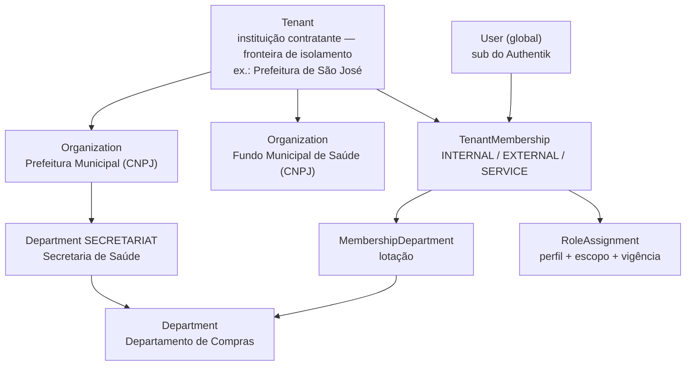
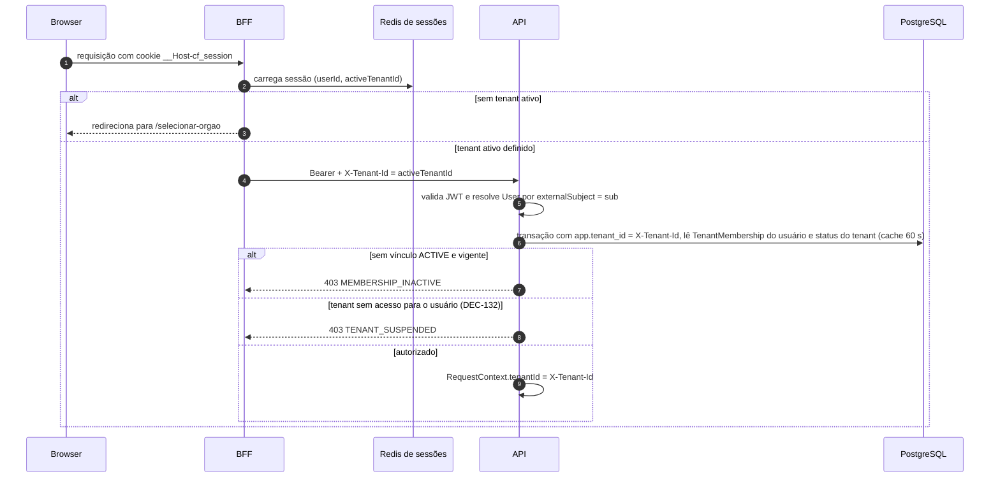

# Multi-tenancy

> **Status:** Aceita para especificação · **Data:** 2026-10-05 · **ADR:** [ADR-002](../adr/adr-002-multi-tenancy.md)
> **Decisões-base:** DEC-011, DEC-012, DEC-080 a DEC-083, DEC-132, DEC-134, DEC-139, DEC-164 e a implementação da US-100 em DEC-076 ([`decisions.md`](decisions.md)). Guia de uso para desenvolvedores: [`../engineering/data-access.md`](../engineering/data-access.md).
> **Relacionados:** [`architecture.md`](architecture.md) · [`security.md`](security.md) · [`authentication.md`](authentication.md) · [`storage.md`](storage.md) · [`queues.md`](queues.md) · [`observability.md`](observability.md) · [`../mvp-01/entities.md`](../mvp-01/entities.md) · [`../mvp-01/acceptance-criteria.md`](../mvp-01/acceptance-criteria.md) (CA-T-01)
>
> **Legenda:** **†** = nome/valor proposto por este documento, ainda não registrado nas fontes canônicas.

## 1. Estratégia e justificativa

**Banco compartilhado + schema compartilhado + `tenant_id` em toda tabela de negócio** (DEC-080), com isolamento garantido em **quatro barreiras independentes** (§3).

| Alternativa | Prós | Contras | Decisão |
|---|---|---|---|
| **Shared DB + shared schema + `tenant_id`** | Um schema, uma migração, custo marginal por tenant ≈ 0; operação simples para centenas de órgãos pequenos; consultas de plataforma possíveis; provisionamento em segundos | Risco de vazamento por bug → exige defesa em profundidade; *noisy neighbor*; restauração de um único tenant é trabalhosa | **Adotada** (ADR-002) |
| Schema por tenant | Isolamento lógico mais forte; restauração por schema | Centenas de schemas × N tabelas: migrações lentas e frágeis, catálogo do PostgreSQL inchado, pool de conexões por `search_path`, Prisma sem suporte nativo | Rejeitada |
| Banco por tenant | Isolamento físico, backup/restore por cliente, residência por cliente | Custo e operação proporcionais ao número de tenants (centenas de RDS), migrações orquestradas, consultas de plataforma impossíveis | Rejeitada para o padrão |
| **Híbrido "silo" (futuro)** | Clientes enterprise (capital, estado) com banco dedicado e chave KMS própria, mesmo código e schema | Roteamento de conexão por tenant; tooling de migração para N bancos | **Opção futura** — viável porque o código nunca faz junções entre tenants e todo acesso passa pelo contexto (§5) |

Restrições de projeto que mantêm o silo possível: nenhuma consulta de negócio entre tenants; tabelas de plataforma (`tenants`, `users`, `permissions`) acessadas por fachadas do `tenancy`/`identity`/`access`; conexões obtidas por um provedor que no futuro pode resolver o banco pelo `tenantId`.

## 2. Hierarquia e vínculos



- `Tenant` = cliente do SaaS e **fronteira de isolamento**; na interface é a **instituição contratante** (DEC-012). `Organization` = órgão/entidade com CNPJ dentro do tenant (DEC-011). Uma Câmara Municipal é, em regra, outro tenant.
- `User` é global, sem dados de negócio; `TenantMembership` é o vínculo por tenant (status `INVITED`, `ACTIVE`, `SUSPENDED`, `REVOKED`, `EXPIRED`; `expiresAt` obrigatório para `EXTERNAL`).
- Um usuário pode ter vínculos com vários tenants e escolhe o **tenant ativo** na sessão; dados de dois tenants nunca são exibidos juntos.

## 3. Barreiras de isolamento

| # | Barreira | Onde | Falha que ela cobre |
|---|---|---|---|
| 1 | Contexto obrigatório + Prisma Client Extension (injeção de `tenantId`) | Aplicação | Esquecimento de filtro em consultas Prisma |
| 2 | RLS `ENABLE` + `FORCE` com `app.tenant_id` por transação | PostgreSQL | Bug na aplicação, SQL bruto sem filtro, extensão contornada |
| 3 | FKs compostas `(tenant_id, fk)` | PostgreSQL | Referência cruzada entre tenants em escrita |
| 4 | Unicidades com `tenant_id` | PostgreSQL | Colisão/enumeração entre tenants (ex.: número do processo) |

Complementos fora do banco: chaves de cache derivadas do contexto (§7), prefixo de storage verificado (§8), contexto obrigatório em jobs (§9) e suíte *tenant leak* no CI (§14).

## 4. Resolução do tenant por requisição



- O `X-Tenant-Id` **não é fronteira de confiança**: vem do BFF, mas a API sempre revalida o vínculo do usuário do JWT naquele tenant. Um header forjado para um tenant sem vínculo resulta em 403 `MEMBERSHIP_INACTIVE` (CA-T-01), idêntico ao de um tenant inexistente (o vínculo é conferido **antes** do status — RN-TEN-20). Cabeçalho ausente ou malformado em rota de tenant → 400 `MALFORMED_REQUEST` com `errors[{ field: "X-Tenant-Id" }]` (RN-TEN-19); o BFF refaz a seleção de instituição.
- **Contexto aberto (US-100):** `tenantId`, `userId`, `membershipId`, ator, `correlationId`, `requestId` e `accessMode` (`FULL` ou `READ_EXPORT`) no `RequestContext` (AsyncLocalStorage — `TenantContext.getOrThrow()` em `apps/api/src/shared/tenancy`). O tenant é **imutável** durante a requisição ou o job (`TenantContextImmutableError`); só um contexto filho de job ou um caso de uso `PLATFORM` age sobre um tenant alvo.
- **Status do tenant:** `TenantStatusCache` (`cf:{env}:p:tenant-status:{tenantId}`, 30 s, inclusive para tenant inexistente), invalidado pela fachada do `tenancy` quando a US-099 mudar o status; Redis fora → leitura no banco com `warn tenant.status_cache_unavailable`.
- **Acesso conforme o status do tenant (DEC-132):**

| `TenantStatus` | Usuários do tenant | Operadores da plataforma |
|---|---|---|
| `PROVISIONING` | Negado (`TENANT_SUSPENDED`) | Rotas `/platform/*` |
| `ACTIVE` | Normal | Somente via vínculo de suporte (DEC-139) |
| `SUSPENDED` | Negado (`TENANT_SUSPENDED`) | Rotas `/platform/*` |
| `OFFBOARDING` | **Somente leitura e exportação** para vínculos com `ADMIN_ORGAO` ou `AUDITOR`; todos os comandos bloqueados (`TENANT_SUSPENDED`) | Rotas `/platform/*` |
| `DEACTIVATED` | Sem acesso | Rotas `/platform/*` |

- **Troca de tenant ativo** (`POST /api/auth/switch-tenant` — [`authentication.md`](authentication.md#9-troca-de-tenant-ativo)): a API revalida o vínculo no banco (`POST /internal/session-events`, `TENANT_SWITCHED`), o BFF atualiza `activeTenantId`/`membershipId` na mesma sessão — sem novo id de sessão nem cookie (RN-IAM-66 · DEC-075) — e o frontend descarta todo o cache (chaves de query começam pelo tenant — [`architecture.md`](architecture.md#85-dados-com-tanstack-query)).
- **Toda rota declara o escopo** com `@TenantScope(...)` (meta-teste `src/openapi/tenant-isolation-coverage.spec.ts`; sem declaração, vale `TENANT` em tempo de execução): `TENANT` (padrão de negócio, exige `X-Tenant-Id`), `PLATFORM` (`/platform/*` — US-099), `NONE` (`/health/*`, `/metrics`) e `CROSS_TENANT_LOOKUP` (ME-04, aceite de convite USR-06 e o início de sessão do BFF — só por funções `SECURITY DEFINER`, §6). Rotas sem tenant usam o `PlatformTransaction` (sem `app.tenant_id`: tabelas com RLS falham fechadas) ou o `SystemDbService` (`app.tenant_id` = UUID nulo `00000000-0000-0000-0000-000000000000`, que não corresponde a nenhum tenant).
- **`OFFBOARDING` (RN-TEN-37):** com `accessMode = READ_EXPORT`, só `GET` e as rotas marcadas `@OffboardingExport()` (no MVP 1: DOC-20, DOC-21, DOC-23, ATT-05, AUD-03, PRS-22 e PRC-34) passam; os demais comandos → 403 `TENANT_SUSPENDED`.

## 5. Isolamento em consultas

### 5.1 Camada 1 — Contexto obrigatório e Prisma Client Extension

```ts
// apps/api/src/shared/database/tenant-isolation.extension.ts (resumo da implementação — US-100)
// TENANT_SCOPED_MODELS / PLATFORM_MODELS: listas versionadas em tenant-models.ts, conferidas com
// schema.prisma pelo CI (modelo novo com tenantId fora da lista reprova o build).

export const tenantExtension = Prisma.defineExtension({
  name: 'tenant-isolation',
  query: {
    $allModels: {
      async $allOperations({ model, operation, args, query }) {
        if (PLATFORM_MODELS.has(model)) return query(args);
        if (!TENANT_MODELS.has(model)) throw new UnregisteredModelError(model);       // falha fechada
        const tenantId = requestContext.getStore()?.tenantId;
        if (!tenantId) throw new TenantContextMissingError(model, operation);
        if (['create', 'createMany', 'createManyAndReturn', 'upsert'].includes(operation)) {
          args = injectTenantIntoData(args, tenantId, operation);                       // sobrescreve, nunca confia no chamador
        }
        if (hasWhere(operation)) args.where = { ...args.where, tenantId };              // find*, update*, delete*, count, aggregate, groupBy
        return query(args);
      },
    },
  },
});
```

Regras (implementação da US-100 · DEC-076): (1) o tenant vem do **escopo da transação** aberto pela `TenantTransaction` (o do `set_config`), não da requisição — assim um caso de uso de plataforma usa `runForTenant(tenantId, …)`; (2) `tenantId` informado pelo chamador **diferente** do da transação (nos dados, no filtro ou num `update`) é `TenantIsolationViolationError`, nunca sobrescrito em silêncio — o tipo do Prisma exige `tenantId` nas criações, então o repositório passa o do contexto e a extensão confere; (3) modelo de tenant fora de transação `TENANT` → `TenantContextMissingError` antes do banco; (4) *nested writes* (`create` aninhado) não recebem injeção: use escalares compostos (`tenantId` + FK) — a RLS (`WITH CHECK`) e as FKs compostas barram qualquer escape; (5) modelo fora das duas listas falha fechado; (6) SQL bruto só dentro de transação (FA-04); (7) a extensão é aplicada ao cliente da UoW antes da `TenantTransaction` ([`architecture.md`](architecture.md#65-unit-of-work-e-transações-com-apptenant_id)); não existe cliente de dados de tenant sem ela.

### 5.2 Camada 2 — Row-Level Security

```sql
-- Padrão aplicado por migração a TODA tabela com tenant_id (DEC-082) — desde a US-100 por
-- SELECT cf_apply_tenant_rls('processes'); (ENABLE + FORCE + política, idempotente). A política vale
-- para todos os papéis sem BYPASSRLS (cf_app, cf_worker, cf_platform e o dono sob FORCE).
ALTER TABLE processes ENABLE ROW LEVEL SECURITY;
ALTER TABLE processes FORCE ROW LEVEL SECURITY;          -- vale inclusive para o dono da tabela
CREATE POLICY tenant_isolation ON processes
  USING      (tenant_id = current_setting('app.tenant_id')::uuid)
  WITH CHECK (tenant_id = current_setting('app.tenant_id')::uuid);

-- Exceção controlada: o usuário lê os próprios vínculos em todos os tenants (ME-04, seleção de tenant)
CREATE POLICY memberships_self_select ON tenant_memberships FOR SELECT
  USING (user_id = NULLIF(current_setting('app.user_id', true), '')::uuid);

-- Privilégios: sem DELETE onde só há exclusão lógica (DEC-034); auditoria append-only
GRANT SELECT, INSERT, UPDATE ON processes TO cf_app, cf_worker;
GRANT SELECT, INSERT ON audit_logs TO cf_app, cf_worker;
```

- **Contexto por transação** (implementação: `TenantTransaction`, US-081 · ADR-012): a UoW executa `SELECT set_config('app.tenant_id', $1, true)` (terceiro argumento `true` = escopo da transação). Sem contexto, `current_setting('app.tenant_id')` gera erro (variável inexistente) ou falha no *cast* de string vazia — a consulta **falha fechada**, nunca retorna dados de outro tenant.
- Toda leitura também roda em transação (somente leitura), pois `set_config(..., true)` só vale dentro dela.
- **Papéis de banco:**

| Papel | LOGIN | Dono | `BYPASSRLS` | Uso |
|---|---|---|---|---|
| `cf_owner` | Não | Sim (schema e tabelas) | Não (e `FORCE` o submete à RLS) | Dono dos objetos; usado só via `SET ROLE` pelo migrador |
| `cf_migrator` | Sim | Membro de `cf_owner` | Não | `prisma migrate deploy` e SQL bruto de migração (task de deploy) |
| `cf_app` | Sim | Não | Não | API (`apps/api`) |
| `cf_worker` | Sim | Não | Não | Handlers do worker (com contexto de tenant por job) |
| `cf_relay` | Sim | Não | **Sim**, mas com `SELECT`/`UPDATE` **somente** em `outbox_events` | Relay do outbox (entities.md `OutboxEvent`) |
| `cf_maintenance` | Sim | Não | **Sim**, mas com `SELECT`/`DELETE` **somente** em `outbox_events` | Purga dos eventos publicados há mais de 7 dias (DEC-085, DEC-072) |
| `cf_platform` | Sim | Não | Não | `SystemDbService` (§5.3, US-100): `SELECT`/`INSERT`/`UPDATE` em `tenants`; em `audit_logs`, políticas `TO cf_platform` só para registros de plataforma (`tenant_id IS NULL`) ou de `actor_type = PLATFORM_OPERATOR`; em `outbox_events`, só o agregado `Tenant`; `EXECUTE` em `cf_find_invitation` e `cf_user_memberships`; nenhuma tabela de negócio |
| `cf_definer` | Não | Só das funções `SECURITY DEFINER` | **Sim** | Dono das funções de leitura entre tenants com colunas mínimas (`cf_user_memberships` — US-087, DEC-070; `cf_find_invitation` — US-100); `SELECT` só em `tenants` e `tenant_memberships`; ninguém faz login com ele |
| `cf_readonly_report` | Sim | Não | Não | `SELECT` apenas em *views* `report_*`†, sempre com contexto de tenant (exportações pesadas; réplica futura) |
| `cf_purge`† | Sim (desabilitado por padrão) | Não | Não | Expurgo físico no *offboarding* (§13.3), habilitado só durante o runbook com dupla aprovação |

- **Tabelas particionadas** (`audit_logs`): privilégios concedidos só na tabela-mãe (acesso direto a partições negado) e RLS também habilitada em cada partição criada pelo job `maintenance` (`audit-partitions-ensure`).
- **Pooling:** PgBouncer em modo transação (ou RDS Proxy) é compatível porque o contexto é por transação. É proibido `SET`/`set_config(..., false)` de sessão (vazaria contexto entre clientes do pool) — verificado por lint de SQL (`pnpm ci:sql-lint`, DEC-069) e por teste que reutiliza a mesma conexão para dois tenants (`apps/api/test/database/tenant-isolation.spec.ts`). O comportamento de *pinning* do RDS Proxy com `set_config` deve ser validado antes de adotá-lo.
- **Performance:** todo índice de tabela de negócio começa por `tenant_id`; o predicado da política é *stable* e usa esses índices. Para planos estáveis, a forma `(SELECT current_setting('app.tenant_id')::uuid)` é equivalente e avaliada uma vez por consulta.

### 5.3 Acesso de plataforma (`systemPrisma`)

**`PlatformTransaction` (US-087 · DEC-070):** transação do mesmo pool do `cf_app` **sem** `app.tenant_id` (só `app.user_id` e `statement_timeout`), para `users`, `tenants` (leitura) e as funções de leitura entre tenants; qualquer consulta a tabela com RLS dentro dela falha fechada. Uso restrito por dependency-cruiser (`platform-transaction-allowlist`) aos adaptadores de `identity`/`tenancy` do pipeline de autenticação e do início de sessão; não substitui o `SystemDbService`.

`SystemDbService` (`apps/api/src/shared/database/system-db.service.ts`, US-100 · DEC-076) é um segundo `PrismaClient` conectado com `cf_platform` (`DATABASE_URL_PLATFORM`, obrigatória fora de local/dev/test), **sem** a extensão de tenant, usado somente por: provisionamento e mudança de status de tenants (`/platform/tenants`, CLI de US-099), *ticks* de jobs de plataforma que listam tenants (`deadlines`, `audit-seal`, `maintenance` — queues.md §9.3), auditoria de plataforma e as funções entre tenants. Regras: importação restrita por `dependency-cruiser` (`system-prisma-allowlist`: `infrastructure` de `tenancy`/`identity`/`audit`, schedulers do worker, testes de banco); toda chamada exige um `reason` da lista fechada (`TENANT_LIFECYCLE`, `TENANT_PROVISIONING`, `TENANT_ENUMERATION`, `USER_MEMBERSHIPS_LOOKUP`, `INVITATION_LOOKUP`, `PLATFORM_AUDIT`) e gera log `info system_db.call` (`reason`, `caller`, `outcome`, `durationMs`) e a métrica `cf_system_db_calls_total{reason,outcome}`; toda transação define `app.tenant_id` = UUID nulo; ações com efeito em um tenant são auditadas no próprio tenant com `actorType = SYSTEM` ou `PLATFORM_OPERATOR`. Trabalho sobre dados de um tenant **sempre** reabre uma UoW com o contexto daquele tenant (`TenantTransaction.runForTenant`, só para atores `SYSTEM`/`PLATFORM_OPERATOR` fora de contexto de tenant — RN-TEN-21). Até a US-099 ligar a variável em todos os ambientes, a leitura de vínculos do login (`cf_user_memberships`) e a gravação da auditoria de plataforma seguem no `PlatformTransaction` do `cf_app` (US-087/US-073).

### 5.4 Camada 3 — FKs compostas

```prisma
model Process {
  id       String         @id @db.Uuid
  tenantId String         @map("tenant_id") @db.Uuid
  stages   ProcessStage[]
  @@unique([tenantId, id])                       // alvo das FKs compostas (DEC-081)
  @@index([tenantId, status, updatedAt(sort: Desc)])
  @@map("processes")
}

model ProcessStage {
  id        String  @id @db.Uuid
  tenantId  String  @map("tenant_id") @db.Uuid
  processId String  @map("process_id") @db.Uuid
  process   Process @relation(fields: [tenantId, processId], references: [tenantId, id], onDelete: Restrict)
  @@unique([tenantId, id])
  @@index([tenantId, processId])
  @@map("process_stages")
}
```

- FK para `users`/`permissions` (plataforma) é simples (entities.md §1.1).
- Relações opcionais compostas usam `onDelete: Restrict` (um `SetNull` tentaria anular também `tenant_id`, que é obrigatório).
- Uma linha do tenant A referenciando um id do tenant B falha no banco, mesmo que a aplicação erre — e a API responde 422 `REFERENCE_NOT_FOUND` antes disso (api.md §1.5).

### 5.5 Camada 4 — Unicidades com `tenant_id`

Toda unicidade de negócio inclui `tenant_id` (ex.: `(tenant_id, internal_code) WHERE internal_code IS NOT NULL AND deleted_at IS NULL`; `(tenant_id, cnpj)` em `organizations`; `(tenant_id, key)` em `tenant_settings`). Exceções são globais por natureza e ficam em tabelas de plataforma (`tenants.slug`, `users.email`, `users.external_subject`). Unicidade global em tabela de negócio é proibida: além de impedir que dois tenants usem o mesmo valor, permitiria **enumeração** (o erro de duplicidade revelaria a existência do valor em outro tenant).

### 5.6 Regras para SQL bruto

1. Somente `$queryRaw`/`$executeRaw` com *tagged template* (parametrizado); `$queryRawUnsafe`/`$executeRawUnsafe` proibidos por lint.
2. Somente em `infrastructure/**`, sempre com o `tx` da UoW (contexto de RLS ativo).
3. Filtro explícito `tenant_id = ${ctx.tenantId}` em toda tabela de negócio, mesmo com RLS (defesa em profundidade e melhor uso de índices).
4. Junções entre tabelas de negócio incluem `tenant_id` na condição (`ON a.tenant_id = b.tenant_id AND …`).
5. Identificadores dinâmicos (ordenação) só a partir de allowlist (`Prisma.sql` com mapeamento fixo), nunca interpolados.
6. Revisão obrigatória por um segundo par em PRs com SQL bruto (CODEOWNERS de `**/infrastructure/sql/**`).

## 6. Tabelas de plataforma e exceções

| Tabela | `tenant_id` | RLS | Acesso |
|---|---|---|---|
| `tenants` | — | Não | `cf_app`/`cf_worker`: `SELECT` só das colunas não sensíveis (sem `plan`, `suspension_reason`, `suspended_at`, `deactivated_at`, `offboarding_started_at` — US-100); escrita só `cf_platform` |
| `users` | — | Não | `cf_app`: leitura/escrita apenas pelo módulo `identity`; dados expostos a um tenant somente para usuários com vínculo nele (entities.md `User`) |
| `tenant_memberships` (vínculos do próprio usuário em todos os tenants) | Sim | Sim | Só pela função `cf_user_memberships(user_id)` (`SECURITY DEFINER`, dona `cf_definer`, `search_path` fixo): devolve vínculo + nome, status e fuso da instituição **apenas** quando `user_id = app.user_id` da transação; `EXECUTE` para `cf_app`/`cf_worker` (ME-04, início de sessão, troca de instituição — US-087) |
| `tenant_memberships` (convite por token, USR-06) | Sim | Sim | Só pela função `cf_find_invitation(token_hash)` (`SECURITY DEFINER`, dona `cf_definer`): vínculo, tenant (nome e status), usuário, status e validade do convite; hash em formato fixo (SHA-256 hexadecimal), com unicidade **global** por desenho (`tenant_memberships_invite_token_hash_key`, sem `tenant_id` — exceção fechada do catálogo, §14); `EXECUTE` só para `cf_platform` (`INVITATION_LOOKUP` — US-091) |
| `permissions` | — | Não | Catálogo global somente leitura (sincronizado por migração) |
| `audit_logs` | Nulo só para eventos de plataforma (DEC-080) | Sim | Registros de plataforma (e ações de `PLATFORM_OPERATOR`) visíveis apenas a `cf_platform` (políticas `platform_role_*`) |
| `outbox_events` | Nulo só para eventos de plataforma | Sim | Aplicação insere no próprio tenant; `cf_platform` só eventos do agregado `Tenant`; `cf_relay` lê/atualiza todos |
| `_prisma_migrations` | — | Não | Somente `cf_migrator` |

## 7. Cache

- **Convenção de chaves:** `cf:{env}:t:{tenantId}:{módulo}:{chave}` para dados de tenant (ex.: `cf:prod:t:0192…:access:eff:{membershipId}` — permissions.md §1.2); `cf:{env}:p:{módulo}:{chave}` para dados de plataforma (ex.: `cf:prod:p:tenant-status:{tenantId}`); no Redis de sessões (DEC-070): `cf:{env}:sess:{sha256(sid)}` (registro), `cf:{env}:sess:user:{userId}` (índice por usuário) e `cf:{env}:rl:auth:{ip}:{janela}` (limite de login por IP).
- **`TenantCache` / `PlatformCache`** (`apps/api/src/shared/cache`, US-100): montam a chave a partir do `RequestContext` (o chamador não informa `tenantId`; sem contexto → `TenantContextMissingError`), exigem TTL (1 s a 7 dias), serializam em JSON e validam a leitura com schema Zod (valor inválido = ausência); `getOrSet` degrada para o carregamento com o Redis fora (`warn cache.unavailable`). Chave já com escopo (`cf:…`, `t:…`) é violação (`barrier = cache`). O cliente Redis só existe no módulo `platform` (`CACHE_STORE`) — lint `contrataflow/no-direct-redis` e dependency-cruiser.

```ts
// uso (ilustrativo)
const perms = await tenantCache.getOrSet('access', `eff:${membershipId}`, () => loadEffective(membershipId), { ttlSeconds: 300 });
// chave resultante: cf:prod:t:<tenantId do contexto>:access:eff:<membershipId>
```

- **Invalidação:** DEL de chave explícita (permissões, vínculo) **síncrona após o commit** + evento (`PermissionCacheInvalidator`); namespaces versionados (`…:settings:v{n}`) para invalidar conjuntos sem `SCAN`; `KEYS` proibido; `SCAN` por prefixo de tenant apenas em manutenção/*offboarding*.
- **Proibido:** agregados entre tenants em cache, valores sigilosos (POL-09), CPF, conteúdo de documentos, respostas inteiras de listas com dados de mais de um escopo de visibilidade sem incluir o usuário na chave.

## 8. Storage

Detalhes em [`storage.md`](storage.md#13-isolamento-por-tenant). Resumo:
- Toda chave começa com `tenants/{tenantId}/` e é construída só no servidor (`StorageKeyBuilder`, com o tenant do contexto e segmentos validados); o `StorageService` (`apps/api/src/shared/storage`, US-100) recusa chave fora do tenant do contexto **antes** de assinar URL ou tocar no bucket (`TenantIsolationViolationError`, `barrier = storage`, + alerta) e limita a URL a 300 s; o adaptador S3/MinIO é da US-068.
- Buckets privados (Block Public Access), sem listagem para clientes; URLs pré-assinadas de 300 s emitidas **somente após** autorização e visibilidade (anexo de outro tenant → 404) e auditoria do download.
- Metadados do objeto incluem `cf-tenant-id` para verificação cruzada.
- **Opção enterprise:** CMK do KMS por tenant (SSE-KMS por objeto com a chave do tenant e *data keys* da criptografia de campos derivadas por tenant), permitindo revogação/rotação por cliente. Exclusão criptográfica (*crypto-shredding*) só após decisão de retenção (PEND-07), pois os documentos são registros públicos.

## 9. Filas e jobs

- **Contrato:** todo job carrega `meta.tenantId`, `actor`, `correlationId`, `traceparent` (DEC-164; `JobMeta` em [`queues.md`](queues.md#3-contrato-comum-de-job-dec-164)); o produtor injeta a partir do contexto, nunca manualmente (`buildJobMeta` em `apps/api/src/shared/jobs` — US-100); job de fila de tenant sem tenant no contexto é recusado **na origem**.
- **Consumo:** a base `TenantJob` (US-100; o `runJob` da US-083 a envolve com timeout, DLQ e métricas) valida `meta` e `payload`, aplica a lista de plataforma (queues.md §9.3), conclui sem efeito quando o tenant não está `ACTIVE` (RN-TEN-12), restaura tenant, ator, correlação e trace e só então chama o handler — cujas transações usam o tenant do job; job sem `tenantId` fora da lista → `error security.tenant_context_missing` (`barrier = job`).
- **Payload:** apenas IDs e metadados (≤ 16 KB); o handler relê os dados no contexto do tenant — se o recurso não existir naquele tenant, o job termina sem efeito.
- **Jobs de plataforma iteram tenants explicitamente:** o `tick` (contexto de plataforma) lista tenants elegíveis por `systemPrisma` e enfileira **um job por tenant**; cada um roda isolado, com falha que não afeta os demais.
- **Fairness e *noisy neighbor*** (queues.md §13): limites da API por usuário + tenant e por tenant (api.md §1.6); semáforo de concorrência por tenant e por fila (`cf:{env}:t:{tenantId}:sem:{fila}`); prioridades (interativo > automático > lote); operações em lote fatiadas; reagendamento sem consumir tentativa. Tenant ruidoso identificado por log com `tenantId` (nunca label de métrica).

## 10. Auditoria

- Todo `AuditLog` carrega `tenantId`; nulo **apenas** para eventos de plataforma (DEC-080), visíveis só ao papel de plataforma.
- Ações de operadores da plataforma em um tenant são gravadas **no tenant** com `actorType = PLATFORM_OPERATOR` e ficam visíveis ao administrador da instituição (DEC-139); concessão e revogação do acesso de suporte geram `support.access_grant`/`support.access_revoke`.
- A selagem (`AuditSeal`) é **por tenant** (cadeia própria) mais uma cadeia de plataforma, permitindo entregar a um cliente a prova de integridade da sua trilha sem expor outros tenants (ADR-009).

## 11. Integrações (MVP 3)

- Credenciais de integração **por tenant**, cifradas na aplicação (AES-256-GCM com envelope KMS — DEC-086) com dado associado (AAD) contendo `tenantId` e id do registro — um segredo copiado para outro tenant não decifra.
- Chamadas de saída executam em job com contexto do tenant; URLs configuráveis pelo tenant passam por proteção contra SSRF (somente HTTPS, resolução DNS validada contra faixas privadas/metadados, sem redirecionamentos para outros hosts).
- Webhooks (`webhook`): assinatura HMAC por assinatura de webhook, segredo por tenant, payload derivado do envelope sem dados sigilosos; entregas e DLQ isoladas por tenant.
- Entradas externas (callbacks de assinatura, PNCP) resolvem o tenant por **token opaco do endpoint** registrado no tenant — nunca por campo do payload.
- Contas `SERVICE` pertencem a um único tenant; o tenant da requisição é o do vínculo da conta, não um header livre.

## 12. Observabilidade

- `tenantId` em todo log estruturado (campo pino) e como atributo de span (`cf.tenant.id` no span HTTP e no de job); `userId` e `correlationId` idem — permite investigar um tenant sem acessar o banco.
- **Eventos de isolamento (US-100):** `tenant.context_opened` (`debug` em produção), `warn tenant.access_denied` (`reason`, `userId`, rota — sem o tenant pedido por quem não tem vínculo), `warn tenant.status_cache_unavailable`, `error security.tenant_context_missing` e `error security.tenant_isolation_violation` (`barrier` = `prisma_extension` · `rls` · `storage` · `cache` · `job` · `context`, sem dados de negócio), `info system_db.call`. Métricas: `cf_tenant_isolation_violations_total{barrier}`, `cf_tenant_context_missing_total{barrier}`, `cf_tenant_context_overhead_seconds{scope}` (meta p95 ≤ 2 ms) e `cf_system_db_calls_total{reason,outcome}` — alerta A19 e runbook RB-10 ([observability.md](observability.md)).
- **Nunca** como label de métrica Prometheus (cardinalidade de centenas/milhares de tenants × séries); no Loki, `tenantId` é campo do JSON/metadado estruturado, não label de *stream*.
- Visões por tenant (ex.: tenant ruidoso, uso de storage) vêm de consultas em logs/traces e de relatórios de uso calculados no banco ([`observability.md`](observability.md)).

## 13. Ciclo de vida do tenant, limites e residência

### 13.1 Provisionamento

Por `POST /platform/tenants` (PLT-01, `PLATFORM_TENANT_MANAGE`, operador com MFA) ou pela CLI `pnpm cf tenant:provision` (US-099 · DEC-078 · runbook RB-12), com os mesmos casos de uso. Checklist de etapas idempotentes, **cada uma na sua transação** — falha preserva o que foi feito e a reexecução com o mesmo slug, CNPJ e e-mail continua de onde parou:

| Etapa | Ação | Garantia |
|---|---|---|
| `tenancy.tenantRecord` | Criar `Tenant` (`PROVISIONING`) com a impressão do pedido (`provisioning_fingerprint`) | `SystemDbService`; índice único do slug decide corridas; slug em uso → 409, auditado na plataforma |
| `tenancy.primaryOrganization`, `tenancy.settings` | `Organization` principal (criada na `TenantTransaction` do tenant novo e apontada por `tenants.primary_organization_id` num `UPDATE` do `cf_platform`, protegido pela FK composta `(id, primary_organization_id) → organizations(tenant_id, id)` — sem função `cf_set_primary_organization`, que ficou dispensada) e todas as chaves de `TenantSetting` | Seeders de US-101/US-103; órgão idempotente por CNPJ, auditando `organization.create` (`SYSTEM`) sem publicar `OrganizationCreated`; `tenancy.settings` grava só as chaves ainda sem linha (versão 1, padrão do registro), sem auditoria nem evento, e é reaplicável a tenants existentes (`tenant:seed`) |
| Seeders dos módulos donos | entities.md §7, em ordem topológica de `dependsOn`: catálogos (`catalog.items`, US-104: 84 itens de sistema com `metadata`, gravados só quando o `(catálogo, código)` ainda não existe), perfis de DEC-035, tipos de documento, templates, workflows (DEC-015), feriados (`catalog.holidays`, US-106: nacionais, Sexta-feira Santa e pontos facultativos do ano corrente — no fuso do tenant — e do seguinte, `isSystem` e recorrentes, gravados só quando o `(data, nome)` ainda não existe) | `TenantTransaction` do tenant novo como ator `SYSTEM`; idempotentes pela chave natural; `verify()` calcula o checklist |
| `identity.firstAdmin` | Reutilizar/criar o `User` pelo e-mail e o vínculo `INTERNAL` `INVITED` (+ `ADMIN_ORGAO` no escopo `TENANT` com a US-096) — garante POL-12 | Nunca cria vínculo para o operador (DEC-139) |
| `tenancy.complete` | Auditoria `tenant.provision` (versões dos seeders) + `TenantProvisioned` | Uma transação, uma única vez por tenant |
| Ativação | `ACTIVE`, `activatedAt`, `TenantActivated` (ou PLT-04 depois, com checklist completo); convite enviado após o commit; `slug` torna-se imutável (trigger) | Auditoria `tenant.activate` (`PLATFORM_OPERATOR`, no tenant) |

Transições de status (RN-TEN-09 · DEC-078): `PROVISIONING → ACTIVE`; `ACTIVE → SUSPENDED`; `SUSPENDED → ACTIVE`; `ACTIVE|SUSPENDED → OFFBOARDING`; `OFFBOARDING → ACTIVE` (reversão); `OFFBOARDING|PROVISIONING → DEACTIVATED` (final). Qualquer outra → 409 `INVALID_STATE`.

### 13.2 Suspensão

PLT-05 com `suspensionReason` obrigatório → `SUSPENDED`, `TenantSuspended`. Efeitos: requisições de usuários → 403 `TENANT_SUSPENDED` (o BFF limpa o tenant ativo da sessão e leva à seleção); jobs não essenciais do tenant (notificações, e-mails, renderizações) são concluídos sem efeito e registrados; jobs essenciais continuam (`audit-seal`, `maintenance`). Reativação por PLT-04.

### 13.3 *Offboarding* e desativação

1. **`OFFBOARDING`** (prazo contratual de encerramento, sugerido 90 dias†): somente leitura e exportação para vínculos `ADMIN_ORGAO`/`AUDITOR` (DEC-132) — guarda obrigatória de documentos públicos.
2. **Exportação completa** entregue à instituição: dados por entidade (JSON/CSV), PDFs das versões, anexos, trilha de auditoria com selos e instruções de verificação, e manifesto com SHA-256 de cada arquivo; disponibilizada por URL pré-assinada, auditada.
3. **`DEACTIVATED`**: sem acesso de usuários; sessões removidas; integrações desligadas.
4. **Expurgo físico** somente após confirmação jurídica/contratual (PEND-07 — documentos públicos têm temporalidade legal): runbook com papel `cf_purge`†, dupla aprovação, exclusão em lotes por tabela, prefixo `tenants/{tenantId}/` no S3 (incluindo versões), chaves `cf:{env}:t:{tenantId}:*` no Redis e, se houver, agendamento de exclusão da CMK do tenant; backups expiram pelo ciclo de retenção. Emissão de termo de eliminação ao controlador.

> No MVP 1 o encerramento e a desativação ficam só na CLI (`tenant:offboard`, `tenant:deactivate --confirm-slug`), com a auditoria `tenant.deactivate` (`metadata.toStatus`) e os eventos `TenantOffboarded`/`TenantDeactivated`; PLT-06/PLT-07 (api/15-platform-health.md) ficam para o backoffice do MVP 2.

### 13.4 Limites e quotas (PEND-17)

Enquanto PEND-17 não é decidida, valem **limites técnicos da plataforma**, sem cobrança, configuráveis somente por operadores (não pelo administrador do tenant):

| Limite | Padrão | Fonte |
|---|---|---|
| Requisições por usuário + tenant / por tenant | 600 leituras e 120 escritas por min / 6.000 por min | api.md §1.6 |
| Tamanho de arquivo | 50 MB (teto 100 MB) | `uploads.maxFileSizeMb` |
| Armazenamento por tenant | 50 GB, avisos em 80% e 95% (proposta de storage.md §8) | Plataforma |
| Vínculos ativos por tenant | 2.000† | Plataforma |
| Concorrência de jobs por tenant | `document-render` 2, `file-scan` 3, `email` 3, `notifications` 5 (proposta de queues.md §13) | Plataforma |
| Exportações | Limite de linhas por exportação (`EXPORT_TOO_LARGE`) | api.md §2.2 |

`Tenant.plan` (padrão `STANDARD`) é o ponto de extensão para planos comerciais.

### 13.5 Residência de dados

Todos os dados de clientes — banco, backups, objetos, filas, sessões, logs e *traces* — ficam na AWS `sa-east-1` (São Paulo); cópias de backup em outra conta **na mesma região**. Serviços auxiliares seguem a mesma regra: Authentik e seu banco na mesma VPC, SES em `sa-east-1`, backend de observabilidade com armazenamento no Brasil ou auto-hospedado. Qualquer processamento fora do Brasil (DR regional, provedores de IA no MVP 5) exige decisão registrada e análise de transferência internacional (LGPD art. 33) — ver [`architecture.md`](architecture.md#124-backup-e-recuperação-de-desastres).

## 14. Testes de isolamento

Suíte **obrigatória no CI** (bloqueia *merge*), implementando CA-T-01:

| Suíte | Como | Esperado |
|---|---|---|
| *Tenant leak* HTTP | `apps/api/test/tenant-leak` (US-100): Testcontainers; tenants A e B com marcadores `LEAK-A`/`LEAK-B`; usuário só em A, outro em A e B. Para **cada operação classificada** no manifesto `src/openapi/tenant-leak.manifest.ts`, substitui parâmetros de caminho e referências do corpo por IDs de B | `GET`/`PATCH`/`PUT`/`DELETE`/comandos → 404 (`NOT_FOUND`/`<RESOURCE>_NOT_FOUND`); IDs de B no corpo → 422 `REFERENCE_NOT_FOUND`; nenhum efeito em B (auditoria, outbox e tabelas de B inalteradas) |
| Detecção de vazamento | Todos os IDs, números e títulos de B registrados como "canários"; toda resposta de A (listas, buscas, contadores, dashboard, autocomplete, exportações CSV) é varrida | Nenhum canário de B |
| Cabeçalho forjado | Usuário de A com `X-Tenant-Id` de B | 403 `MEMBERSHIP_INACTIVE` |
| Cobertura | Meta-testes (`src/openapi/tenant-isolation-coverage.spec.ts`) comparam as operações com o manifesto (coberta ou isenta com motivo) e exigem `@TenantScope` em toda rota | Operação nova sem caso ou rota sem escopo → build falha |
| Concorrência | Pool de 2 conexões, 500 requisições alternando A e B | Cada resposta só com o próprio tenant; conexões devolvidas sem `app.tenant_id` |
| Desempenho | `apps/api/test/database/context-overhead.perf.ts` (US-100): 200 transações como `cf_app`, medidas pela métrica `cf_tenant_context_overhead_seconds`; suíte de performance `pnpm --filter @contrataflow/api test:perf` (`vitest.perf.config.ts`, sequencial), medida no endurecimento e fora do CI do PR (DEC-087) | p95 do `set_config` do contexto ≤ 2 ms |
| RLS direto no banco | Conexão como `cf_app`/`cf_worker` | Sem contexto → erro; contexto A lendo B → 0 linhas; `INSERT`/`UPDATE` com `tenant_id` de B → violação de política; SQL bruto idem; mesma conexão reutilizada para A e depois B sem vazamento de contexto |
| Catálogo | Consultas a `pg_class`/`pg_constraint`/`pg_index` (tarefa turbo `test:tenant-leak`: `tools/ci/tenant-leak.ts` e `apps/api/test/database/tenancy-foundation.spec.ts`) | Toda tabela com `tenant_id` com RLS `ENABLE`+`FORCE` e política; toda FK entre tabelas de negócio **começa** por `tenant_id`; toda tabela de negócio tem `UNIQUE (tenant_id, id)`; toda unicidade de negócio inclui `tenant_id`. Exceções em lista fechada (`tools/ci/lib/migrations.ts`, DEC-080/DEC-081): `process_tags` (associação sem `id`, PK `(tenant_id, process_id, tag_id)`, que nenhuma FK referencia) e o índice global do token de convite (§6) |
| Cache | Mesmo recurso lógico em A e B | Chaves distintas; invalidação em A não afeta B |
| Storage | Download/confirmação de anexo de B por usuário de A; chave fora do prefixo | 404; `TenantIsolationViolation` |
| Filas | Job sem `tenantId` em fila de tenant; job de A com ID de B | Rejeitado; sem efeito |
| Frontend (Playwright) | Troca de tenant ativo com dados em cache; duas abas | Nenhum dado do tenant anterior exibido |

```sql
-- Verificação de catálogo: deve retornar 0 linhas
SELECT c.relname
FROM pg_class c
JOIN pg_namespace n ON n.oid = c.relnamespace AND n.nspname = 'public'
JOIN pg_attribute a ON a.attrelid = c.oid AND a.attname = 'tenant_id' AND NOT a.attisdropped
WHERE c.relkind IN ('r', 'p')
  AND (NOT c.relrowsecurity OR NOT c.relforcerowsecurity
       OR NOT EXISTS (SELECT 1 FROM pg_policies p WHERE p.tablename = c.relname AND p.policyname = 'tenant_isolation'));
```

## 15. Checklist para novos módulos e tabelas

- [ ] Tabela de negócio com `tenant_id uuid NOT NULL` e colunas padrão (DEC-083); `@@unique([tenantId, id])`.
- [ ] RLS `ENABLE` + `FORCE` + política `tenant_isolation` na mesma migração que cria a tabela; privilégios mínimos por papel (sem `DELETE` se só houver exclusão lógica).
- [ ] FKs compostas `(tenant_id, …)`; `onDelete: Restrict` por padrão.
- [ ] Unicidades e índices iniciando por `tenant_id`; índices parciais com `deleted_at IS NULL` quando houver exclusão lógica.
- [ ] Modelo reconhecido pela Prisma Client Extension (gerado do DMMF) — nenhuma entrada manual.
- [ ] SQL bruto conforme §5.6; nenhuma junção sem `tenant_id`.
- [ ] Chaves de cache via `TenantCache`; chaves de storage via `StorageKeyBuilder`; jobs via `JobProducer`.
- [ ] Payloads de eventos/jobs sem dados sigilosos ou pessoais.
- [ ] Casos novos na suíte *tenant leak* (o meta-teste acusa se faltar) e nos testes de RLS.
- [ ] Partições (se houver) com RLS e privilégios só na tabela-mãe.
- [ ] Revisão de segurança do PR marcada no checklist de DoD ([`security.md`](security.md#25-definition-of-done-de-segurança-por-card)).

## 16. Riscos e mitigação

| Risco | Prob. | Impacto | Mitigação |
|---|---|---|---|
| Tabela nova sem RLS | Média | Crítico | Checagem de catálogo no CI (§14); migração-modelo; revisão |
| SQL bruto sem filtro ou com interpolação | Média | Crítico | RLS + lint + CODEOWNERS (§5.6) |
| Uso indevido de `systemPrisma`/papel com `BYPASSRLS` | Baixa | Crítico | Allowlist no dependency-cruiser; `cf_relay` restrito a uma tabela; `cf_platform` sem `BYPASSRLS`; logs `system_db.call`; revisão trimestral de papéis |
| Contexto de sessão vazando pelo pool | Baixa | Crítico | Apenas `set_config(..., true)` em transação; teste de reutilização de conexão |
| Chave de cache sem tenant | Média | Alto | `TenantCache` obrigatório; lint contra uso direto do cliente Redis fora de `platform` |
| Job processado sem contexto | Baixa | Alto | `runJob` com validação de `meta`; lista fechada de jobs de plataforma |
| *Noisy neighbor* (lotes, PDFs, uploads) | Alta | Médio | Limites por tenant, semáforos, prioridades (§9, §13.4) |
| Usuário com vínculos em vários tenants vê dados misturados no cliente | Média | Alto | Chaves de query com tenant, `queryClient.clear()`, `BroadcastChannel` entre abas, teste E2E |
| Restauração de um único tenant a partir de backup compartilhado | Média | Médio | Ferramenta de exportação/importação lógica por tenant; PITR em instância isolada + extração por `tenant_id` |
| Pressão por customizações que quebram o schema único | Média | Médio | Configuração (settings, catálogos, regras JSON Logic, templates) em vez de *forks*; silo futuro com o mesmo schema |
| Cliente enterprise exige isolamento físico | Baixa | Médio | Opção silo (§1) com custo repassado |

## Referências

DEC-011, DEC-012, DEC-024, DEC-034, DEC-076, DEC-080 a DEC-086, DEC-131, DEC-132, DEC-134, DEC-139, DEC-140, DEC-160, DEC-164; PEND-07, PEND-17; [ADR-002](../adr/adr-002-multi-tenancy.md); [`../mvp-01/entities.md`](../mvp-01/entities.md); [`../mvp-01/permissions.md`](../mvp-01/permissions.md); [`../mvp-01/api.md`](../mvp-01/api.md); [`../mvp-01/acceptance-criteria.md`](../mvp-01/acceptance-criteria.md) (CA-T-01, CA-T-07).
