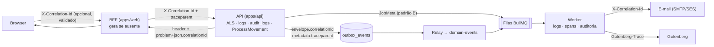
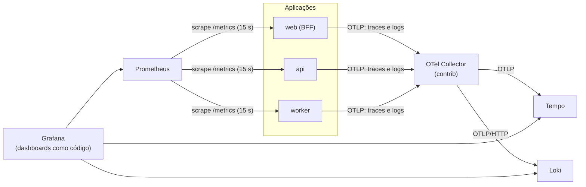

# Observabilidade

> **Escopo:** SLOs, logs estruturados, correlação, tracing distribuído, métricas, health checks, monitoramento de jobs e integrações, dashboards, alertas, stack (dev e produção) e runbooks do ContrataFlow.
> **Status:** especificação da fundação + MVP 1 (US-085 — health checks, métricas e dashboards técnicos).
> **Decisões de base:** DEC-050 (stack), DEC-058 (cloud agnostic), DEC-103 (`correlationId` em erros), DEC-132 (contexto de requisição), DEC-138 (logs seguros), DEC-139 (suporte), DEC-160/DEC-164 (correlação em eventos e jobs), DEC-181/DEC-184 (`correlationId` visível ao usuário) — [decisions.md](decisions.md).
> **Nomes canônicos:** [`api.md`](../mvp-01/api.md) (HLT-01 a HLT-03, `X-Correlation-Id`, códigos de erro), [`events.md`](../mvp-01/events.md) (`BusinessMetricsCollector`, ações de auditoria), [`permissions.md`](../mvp-01/permissions.md) (permissões e políticas `POL-*`).
> **Relacionados:** [queues.md](queues.md) · [storage.md](storage.md) · [architecture.md](architecture.md) · [security.md](security.md) · [authentication.md](authentication.md) · [multi-tenancy.md](multi-tenancy.md) · [ADR-009](../adr/adr-009-audit-trail.md).
>
> Itens marcados **(proposta)** não constam das fontes canônicas e devem ser registrados em `decisions.md` antes da implementação.

Sumário: [1. SLOs](#1-objetivos-e-slos) · [2. Logs](#2-logs-estruturados) · [3. Correlação](#3-correlationid-e-identificadores-de-rastreio) · [4. Tracing](#4-tracing-distribuído) · [5. Métricas](#5-métricas) · [6. Health checks](#6-health-checks) · [7. Jobs](#7-jobs-retries-e-dead-letter) · [8. Integrações](#8-falhas-de-integração) · [9. Dashboards](#9-dashboards-técnicos) · [10. Alertas](#10-alertas) · [11. Stack](#11-stack-de-observabilidade) · [12. Runbooks](#12-runbooks-iniciais) · [13. Auditoria × logs](#13-auditoria--logs) · [14. Checklist](#14-checklist-de-observabilidade-por-card) · [15. Referências](#15-referências)

---

## 1. Objetivos e SLOs

**Objetivos:** (1) detectar falhas antes do usuário; (2) responder "o que aconteceu com esta requisição/processo?" em minutos, a partir do `correlationId` mostrado na tela; (3) medir a experiência contra metas explícitas (SLOs) e usar o orçamento de erro para priorizar confiabilidade; (4) fazer tudo isso **sem** expor dados pessoais ou de negócio (DEC-138, LGPD).

### 1.1 SLOs do MVP 1
As metas consolidam a proposta do produto ([product-overview.md](../product/product-overview.md), C1–C3) e as estendem por classe de endpoint e para os fluxos assíncronos. Janela de medição: mês civil.

| # | SLI (o que se mede) | Fonte | SLO |
|---|---|---|---|
| SLO-01 | **Disponibilidade:** proporção de requisições válidas a `/api/v1/*` (via BFF) sem resposta 5xx, excluídas janelas programadas | Métrica HTTP do BFF + *probe* sintético externo a cada 1 min | **≥ 99,5%** (≈ 3 h 39 min de orçamento/mês); ≥ 99,9% a partir do MVP 3 |
| SLO-02 | Latência — leitura de recurso e listas paginadas (`GET /processes/{id}`, `GET /processes`, `GET /tasks`) | `http.server.request.duration` da API | p95 ≤ **500 ms** · p99 ≤ 1,2 s |
| SLO-03 | Latência — busca textual (`?q=`) | idem | p95 ≤ 800 ms |
| SLO-04 | Latência — painel situacional (`GET /processes/{id}/summary`) | idem | p95 ≤ **800 ms** |
| SLO-05 | Latência — comandos (`/forward`, `/return`, `/decide`, `/submit`, `/finalize`…) | idem | p95 ≤ **1 s** · p99 ≤ 2,5 s |
| SLO-06 | Latência — escritas simples e autosave de seção (`PATCH`, `PUT …/sections/{key}`) | idem | p95 ≤ 500 ms |
| SLO-07 | Latência — dashboard operacional (`/dashboard/*`) | idem | p95 ≤ 1,5 s |
| SLO-08 | Latência — intenção/confirmação de upload e URLs de download | idem | p95 ≤ 500 ms |
| SLO-09 | **PDF `PREVIEW`** — do pedido (202) ao `READY` | `DocumentRendition` (`readyAt − requestedAt`) | p95 ≤ **15 s**; falhas < 0,5% |
| SLO-10 | **PDF `CONTENT`/`APPROVAL_STAMPED`** (assíncrono, sem usuário aguardando) | idem | p95 ≤ **30 s**; falhas < 0,5% |
| SLO-11 | **Lag do outbox** — `published_at − occurred_at` | `cf_outbox_publish_lag_seconds` | p95 < **5 s** · p99 < 30 s |
| SLO-12 | Notificação in-app — do evento à linha em `notifications` | `occurredAt` × `Notification.createdAt` | p95 < 10 s |
| SLO-13 | E-mail — do evento ao aceite do provedor | `occurredAt` × `emailSentAt` | p95 < 2 min |
| SLO-14 | Verificação de upload — do confirm ao `AVAILABLE` (≤ 50 MB) | `uploadedAt` × `scannedAt` | p95 < 60 s |
| SLO-15 | Detecção de atraso — de `dueAt` ao `overdueSince` materializado | job `deadlines` | 100% em ≤ 20 min |

- Exportações (`/audit/export`, mapas comparativos) e downloads ficam fora dos SLOs de latência (streaming; medidos apenas para capacidade).
- `PREVIEW` herda a meta de 15 s do produto (C3) por ser interativa; renditions formais têm meta de 30 s porque são geradas em segundo plano — **(proposta)** de refinamento de C3.

### 1.2 Orçamento de erro e alertas por taxa de queima
- Orçamento SLO-01 = 0,5% das requisições do mês. Alertas multi-janela (Google SRE Workbook): **crítico** se a taxa de queima ≥ 14,4× em 1 h **e** em 5 min (2% do orçamento em 1 h); **alto** se ≥ 6× em 6 h e em 30 min; **ticket** se ≥ 1× em 3 dias e em 6 h.
- **Política:** orçamento esgotado no mês → congelamento de deploys não corretivos até recuperação e priorização de itens de confiabilidade no próximo sprint; consumo > 50% na primeira quinzena → revisão na reunião semanal de operação.

---

## 2. Logs estruturados

### 2.1 Biblioteca e formato
- **pino** em todos os processos Node: `nestjs-pino` na API e no worker; pino nos *route handlers* do BFF (runtime Node do Next.js). Saída **JSON em stdout** (12-factor); o transporte para o backend é responsabilidade da plataforma (§11).
- Timestamp ISO 8601 UTC, nível como texto, uma linha por evento, `event` com nome estável (`http.request.completed`, `job.completed`, `outbox.relay.batch`, `security.malware_detected`).
- **Implementação (US-084):** o pacote `packages/observability` (`@contrataflow/observability`) concentra o que web, api e worker compartilham — `createLogger` (pino com os campos de §2.2 e a redação de §2.4), `correlationId` (§3), `withSpan`/propagação W3C (§4) e o bootstrap do SDK (`createTelemetrySdk`). Na API, `ObservabilityModule` (`apps/api/src/shared/observability/`, no *shared kernel* porque o middleware de contexto e o filtro RFC 9457 o usam) liga o pino ao Nest via `nestjs-pino`; o `pino-http` só cria o logger da requisição com o `requestId`, e o `http.request.completed` é do `RequestContextMiddleware` (template da rota, `statusCode`, `durationMs`, `reason` nos 4xx; `error` nos 5xx). Linhas sem `event` (mensagens internas do Nest) saem com `event: "app.log"`; o formato legado `"evento chave=valor"` (US-080/US-081) é convertido em campos.

### 2.2 Campos obrigatórios

| Campo | Exemplo | Quando |
|---|---|---|
| `time` | `2026-10-05T14:30:00.123Z` | Sempre |
| `level` | `info` | Sempre |
| `msg` | `request completed` | Sempre (inglês técnico, curto) |
| `event` | `http.request.completed` | Sempre (nome estável para consultas e alertas) |
| `service` | `web` · `api` · `worker` | Sempre |
| `env` | `dev` · `staging` · `prod` | Sempre |
| `version` | `1.4.2+g3f9c2ab` | Sempre (versão + commit) |
| `correlationId` | UUIDv7 ou valor validado do cliente | Sempre que houver contexto |
| `requestId` | UUIDv7 por salto HTTP | Requisições HTTP |
| `traceId` · `spanId` | W3C | Sempre que houver span ativo (injetados pela instrumentação pino do OTel) |
| `tenantId` · `userId` · `membershipId` | UUID | Quando autenticado / contexto de tenant |
| `method` · `route` · `statusCode` · `durationMs` | `POST` · `/api/v1/processes/:id/forward` · `200` · `184` | Fim de requisição (`route` é o **template**, nunca a URL real) |
| `queue` · `jobName` · `jobId` · `attempt` | `file-scan` · `scan` · `0193…` · `2` | Worker |
| `err` | `{ type, message, code, stack }` | Erros (`stack` só em `error`/`fatal`) |

```json
{
  "time": "2026-10-05T14:30:00.123Z", "level": "info", "msg": "request completed",
  "event": "http.request.completed", "service": "api", "env": "prod", "version": "1.4.2+g3f9c2ab",
  "correlationId": "01927f1a-6c1e-7c8b-9a2e-3f6d2b1c0a11", "requestId": "01927f1a-7d00-7a10-8b55-0c2e9f1d3a42",
  "traceId": "4bf92f3577b34da6a3ce929d0e0e4736", "spanId": "00f067aa0ba902b7",
  "tenantId": "0192…", "userId": "0192…", "membershipId": "0192…",
  "method": "POST", "route": "/api/v1/processes/:id/forward", "statusCode": 200, "durationMs": 184
}
```

### 2.3 Níveis

| Nível | Uso | Exemplos |
|---|---|---|
| `fatal` | O processo não pode continuar e vai encerrar | Falha de bootstrap, configuração inválida, perda de conexão irrecuperável |
| `error` | Falha que exige atenção: 5xx, job em falha final, violação de invariante, evento de segurança grave | `INTERNAL_ERROR`, cópia para DLQ, violação da guarda de tenant |
| `warn` | Degradação ou anomalia recuperável | Retry de job, breaker aberto, dependência lenta, malware detectado, 403 em rajada |
| `info` | Fatos operacionais normais | Requisição concluída, job concluído, lote do relay, scheduler executado |
| `debug` | Diagnóstico detalhado | Decisões de roteamento, consultas a cache — **desligado em produção** |
| `trace` | Nunca em produção | — |

4xx de validação são `info` (comportamento esperado do cliente); 401/403/404 entram em `info` com `reason` e alimentam métricas de segurança.

### 2.4 Redação e dados proibidos (DEC-138)
Proibido logar: tokens, cookies, senhas, `Authorization`, CPF, conteúdo de documentos (`draftContent`, seções, snapshots), corpos de requisição e de upload, **URLs pré-assinadas** (credenciais ao portador), **nomes de arquivo** (podem conter dados pessoais), valores de orçamento sigiloso (POL-09), segredos de integração. E-mails sempre mascarados (`j***@dominio.gov.br`).

Implementado em `packages/observability/src/redaction.ts` em duas camadas, aplicadas a todo objeto logado (inclusive aninhado e nos *bindings* de `child()`): **por nome de campo** (`SENSITIVE_KEYS`, comparados sem caixa nem separadores; e-mail mascarado) e **por padrão de texto** em qualquer string, inclusive `msg` e mensagens de erro (JWT, `Bearer`/`Basic`, CPF formatado, URL pré-assinada, e-mail). O bloco abaixo é o desenho original, mantido como referência:

```ts
// apps/api/src/modules/platform/observability/logger.module.ts (ilustrativo — ver texto acima)
LoggerModule.forRoot({
  pinoHttp: {
    level: process.env.LOG_LEVEL ?? 'info',
    timestamp: pino.stdTimeFunctions.isoTime,
    formatters: { level: (label) => ({ level: label }) },
    base: { service: 'api', env: process.env.APP_ENV, version: process.env.APP_VERSION },
    genReqId: () => uuidv7(),                                   // requestId por salto
    customProps: () => requestContext.logFields(),              // correlationId, tenantId, userId…
    autoLogging: { ignore: (req) => req.url?.startsWith('/health') || req.url === '/metrics' },
    serializers: { req: safeRequestSerializer, res: safeResponseSerializer }, // allowlist de headers, sem corpo
    redact: {
      paths: [
        'req.headers.authorization', 'req.headers.cookie', 'res.headers["set-cookie"]',
        '*.password', '*.token', '*.accessToken', '*.refreshToken', '*.idToken', '*.secret',
        '*.cpf', '*.content', '*.draftContent', '*.body', '*.url', '*.fileName', '*.email',
      ],
      censor: (value, path) => (path.at(-1) === 'email' ? maskEmail(String(value)) : '[REDACTED]'),
    },
  },
});
```

- Serializadores por **allowlist**: da requisição só saem método, rota (template), chaves de query (sem valores), `user-agent` e IP (para segurança — dado pessoal tratado como tal).
- Defesa em profundidade: o OTel Collector aplica `redaction` (padrões de CPF, JWT, e-mail) antes de exportar (§11).
- Teste automatizado: cada novo campo sensível em DTO tem teste garantindo que não aparece em log.

### 2.5 Amostragem e volume
- Logs de requisição `info`: 100% no MVP 1 (volume pequeno); `/health/*` e `/metrics` não são logados.
- `debug` sob demanda **(proposta)**: ativação temporária (TTL ≤ 1 h) por `correlationId` ou `tenantId` via flag operacional, auditada.
- *Rate limit* de logs repetitivos (`warn` idêntico: no máximo 1/min por chave, com contador de suprimidos).

### 2.6 Retenção
| Tipo | Retenção | Observação |
|---|---|---|
| Logs de aplicação (pesquisáveis) | 30 dias | Diagnóstico |
| Registros de acesso HTTP (data/hora, IP, rota, usuário) | ≥ 6 meses, em armazenamento frio | Marco Civil da Internet (Lei 12.965/2014, art. 15) — validar com o jurídico |
| Logs de segurança (autenticação, negações, malware, operações de plataforma) | 1 ano **(proposta)** | Investigação de incidentes |

Logs **não** são trilha de auditoria (§13, [ADR-009](../adr/adr-009-audit-trail.md)).

---

## 3. `correlationId` e identificadores de rastreio

| Identificador | Escopo | Gerado por | Onde aparece |
|---|---|---|---|
| `correlationId` | Fluxo de negócio inteiro — atravessa HTTP, outbox, filas, retries e e-mails | BFF (se ausente) | `X-Correlation-Id` (api.md §1.1), corpo de erro (DEC-103), logs, `AuditLog.correlationId`, `ProcessMovement.correlationId`, envelope (DEC-160), `JobMeta` (DEC-164), e-mails, `Gotenberg-Trace` |
| `requestId` | Um salto HTTP (BFF e API têm o seu) | Cada serviço | Logs, `AuditLog.requestId` |
| `traceId` / `spanId` | Trace técnico (pode ser amostrado) | SDK OpenTelemetry | Logs, backend de traces |
| `causationId` | Encadeamento evento → job → evento | Outbox / worker | Envelope, `JobMeta`, logs |
| `eventId` | Um fato de domínio | `OutboxService` | Envelope, `sourceEventId` (timeline, notificações) |

**Regras:**
- O BFF aceita `X-Correlation-Id` do browser **somente** se casar `^[A-Za-z0-9._:-]{8,64}$`; caso contrário descarta o valor recebido (evita *log injection*) e gera um UUIDv7. O cliente de API do frontend gera um id por ação do usuário e o reutiliza nas re-tentativas da mesma ação (ex.: autosave).
- A API sempre recebe o id do BFF (gera um se faltar, para chamadores internos — com a mesma regra de validação do BFF) e o devolve no header de **toda** resposta e no `problem+json`.
- A UI mostra o `correlationId` copiável em mensagens de erro ("Código para o suporte") e nenhum outro detalhe técnico (DEC-181, DEC-184).
- Assíncrono: copiado para o envelope do evento e para `JobMeta`; jobs filhos herdam; e-mails levam `X-Correlation-Id` como header técnico; o Gotenberg recebe `Gotenberg-Trace: <correlationId>`; integrações do MVP 3 enviam `X-Correlation-Id` quando o provedor aceitar.
- **Atendimento:** usuário informa o código → operador busca nos logs (`{service=~"web|api|worker"} | json | correlationId="…"`) → segue o `traceId` até o trace → o administrador do órgão consulta a auditoria por `correlationId` (`AUDIT_VIEW`); a plataforma só acessa dados do tenant pelo fluxo de DEC-139.



---

## 4. Tracing distribuído

### 4.1 SDK e instrumentações
OpenTelemetry Node SDK (`@opentelemetry/sdk-node`) carregado **antes** do código da aplicação (`node --import ./dist/otel.js` na API e no worker, que também registra o *hook* ESM `@opentelemetry/instrumentation/hook.mjs`; `instrumentation.ts` no Next.js, onde o próprio Next abre o span raiz). Falha de exportação nunca chega à requisição: o exportador registra `warn` `tracing.export_failed` (no máximo 1/min, com a contagem de lotes suprimidos). Sem `OTEL_EXPORTER_OTLP_ENDPOINT` — permitido só fora de staging/produção — o SDK não sobe e sai `warn` `tracing.disabled`. Atributos de recurso: `service.name` (`contrataflow-web`, `contrataflow-api`, `contrataflow-worker`), `service.version`, `deployment.environment.name`, `service.instance.id`, `cloud.region`.

| Instrumentação | Pacote | Configuração obrigatória |
|---|---|---|
| HTTP servidor/cliente | `@opentelemetry/instrumentation-http` | Ignora `/health/*` e `/metrics`; não captura headers (exceto `x-correlation-id`) |
| `fetch` (undici, Node 24) | `@opentelemetry/instrumentation-undici` | Propaga `traceparent` BFF → API |
| NestJS | `@opentelemetry/instrumentation-nestjs-core` | Spans de controller/handler |
| Prisma | `@prisma/instrumentation` | Spans de consulta sem parâmetros |
| Driver PostgreSQL | `@opentelemetry/instrumentation-pg` | Quando o *driver adapter* `pg` estiver em uso (US-077); sem valores |
| ioredis | `@opentelemetry/instrumentation-ioredis` | `dbStatementSerializer` devolve **só o nome do comando** — chaves de sessão são credenciais |
| AWS SDK | `@opentelemetry/instrumentation-aws-sdk` | S3, KMS, SES; sem payload — entra com a primeira story que usar o AWS SDK (ainda não é dependência) |
| pino | `mixin` do logger de `packages/observability` (US-084) | Injeta `traceId`/`spanId` do span ativo nos logs; substitui a `instrumentation-pino`, que depende de *monkey-patch* do módulo e também enviaria logs pelo SDK (aqui os logs saem só por stdout) |
| BullMQ | Propagação explícita via `JobMeta.traceparent` ([queues.md](queues.md) §9) | Spans `PRODUCER` (`<fila> publish`) e `CONSUMER` (`<fila> process`) |

### 4.2 Propagação
- **W3C Trace Context** (`traceparent`, `tracestate`); *baggage* não é usado (risco de vazar dados).
- **Browser → BFF:** sem instrumentação de browser no MVP 1; o BFF abre o span raiz. Web Vitals/RUM: avaliar no MVP 2.
- **BFF → API:** `traceparent` pelo `fetch` instrumentado.
- **API → outbox → filas:** o `traceparent` do span ativo vai para `outbox_events.metadata`; o relay cria `outbox.publish` como filho desse contexto; o `DomainEventsProcessor` e os consumidores continuam pelo `JobMeta`. Jobs do padrão B recebem o contexto no enfileiramento.
- **Worker → dependências:** spans de cliente para S3, Gotenberg, clamd e SMTP/SES.
- Uma tramitação, a notificação e o e-mail resultantes formam **um** trace navegável (pai-filho). Cadeias muito longas (MVP 3: webhooks com retries por horas) usarão *span links* em vez de pai-filho.

### 4.3 Spans de negócio (manuais)

| Span | Onde | Atributos permitidos |
|---|---|---|
| `process.forward` · `process.return` · `approval.decide` | API (caso de uso) | `cf.process.id`, `cf.stage.from`, `cf.stage.to` (chaves), `cf.rules.evaluated`, `cf.rules.blocking_failed`, `cf.rules.warnings_acknowledged` |
| `workflow.rules.evaluate` | Módulo `workflow` | `cf.workflow.version_id`, `cf.rules.count`, `cf.rule_context.version` |
| `price_research.statistics.compute` | Módulo `price-research` | `cf.price_research.id`, `cf.items.count`, `cf.quotations.count` |
| `numbering.next` | Módulo `catalog` | `cf.sequence.kind` (`PROCESS`/`DOCUMENT`) — contenção de lock da `NumberSequence` |
| `document.render` → `render.html.build`, `render.gotenberg.convert`, `render.storage.put` | Worker | `cf.rendition.id`, `cf.rendition.kind`, `cf.document.type`, `cf.pdf.pages`, `cf.pdf.bytes` |
| `file.scan` → `scan.type_detect`, `scan.clamav`, `scan.promote` | Worker | `cf.attachment.id`, `cf.file.bytes`, `cf.scan.result` |
| `outbox.relay.batch` · `outbox.publish` | Worker | `cf.batch.size`, `messaging.message.id` |
| `audit.seal` | Worker | `cf.audit.period_start`, `cf.audit.records` |

**Política de atributos:** permitidos UUIDs (inclusive `cf.tenant.id` e `enduser.id`, pseudônimos), códigos técnicos, enums, contagens e durações. **Proibidos:** nomes, e-mails, CPF, IP (fica só em logs de acesso e auditoria), conteúdo de documentos, valores (sigilosos ou não), nomes de arquivo, URLs pré-assinadas, tokens e parâmetros SQL.

### 4.4 Amostragem
- SDK com `ParentBased(AlwaysOn)`: todos os spans chegam ao Collector (tráfego interno).
- **Tail sampling** no Collector *gateway*: 100% dos traces com erro, com duração > 2 s (HTTP) ou falha de job, e com `cf.critical = true` (tramitação, aprovação, selagem); 10% dos demais em produção; 100% em dev e homologação. Com mais de uma instância de gateway, exportador `loadbalancing` por `traceID` (todos os spans de um trace no mesmo coletor).
- *Exemplars* nos histogramas de latência ligam métricas a traces.

---

## 5. Métricas

### 5.1 Convenções
- OpenTelemetry Metrics SDK com exposição em formato Prometheus em `/metrics` (HLT-03), **somente em porta interna**, na API, no worker e no BFF; coletado pelo Collector/Prometheus a cada 15 s.
- Nomes: convenções semânticas do OpenTelemetry quando existirem (`http.server.request.duration` → `http_server_request_duration_seconds`); métricas próprias com prefixo `cf_` e sufixo de unidade.
- **Labels só de conjuntos fechados:** template de rota, método, status, fila, job, resultado, classe de erro, dependência, provedor, permissão (catálogo fechado), tipo de documento de sistema (demais → `OTHER`). **Nunca** `tenantId`, `userId`, `processId`, `eventId`, e-mail ou caminho bruto.
- Buckets alinhados aos SLOs: HTTP `[0.05, 0.1, 0.25, 0.5, 0.8, 1, 1.5, 2.5, 5, 10]` s; PDF `[1, 2.5, 5, 10, 15, 20, 30, 45, 60]` s.

### 5.2 Catálogo

| Grupo | Métricas | Labels |
|---|---|---|
| HTTP (RED) — API e BFF | `http_server_request_duration_seconds` (taxa = contagem; erros = status) | `service`, `http_request_method`, `http_route`, `http_response_status_code` |
| Classes de SLO | *Recording rules* `cf:slo_latency_p95` | `class` (`read`, `search`, `summary`, `command`, `write`, `dashboard`, `upload`) — mapa rota → classe em código |
| BFF → API | `http_client_request_duration_seconds` | `http_response_status_code` |
| Runtime Node (USE) | `nodejs_eventloop_delay_*`, CPU, memória residente, heap V8, duração de GC | `service` |
| Infraestrutura | ECS (CPU/memória por serviço), ALB (5xx, latência, alvos saudáveis), RDS (CPU, conexões, IOPS, réplica), ElastiCache (memória, *evictions*, CPU) | Via CloudWatch/exporters |
| Pool do banco | `db_client_connections_usage{state}`, `db_client_connections_pending_requests`, tempo de espera por conexão | `pool_name` |
| Banco | Duração por operação do Prisma; top N de `pg_stat_statements`; *deadlocks*; falhas de serialização; transações longas | `db_operation_name`, `db_collection_name` |
| Filas e outbox | [queues.md](queues.md) §5.7 e §15.2 | — |
| Renderização | `cf_render_duration_seconds`, `cf_render_failures_total`, `cf_gotenberg_request_duration_seconds` | `kind`, `outcome` / `error_code` |
| Upload, scan e storage | [storage.md](storage.md) §14 | — |
| Autenticação | `cf_auth_logins_total{result}` (`success`, `failure`, `canceled`), `cf_auth_mfa_stepup_total{result}`, `cf_auth_session_expired_total{reason}` (`idle`, `absolute`), `cf_auth_refresh_total{result}`, `cf_auth_token_rejections_total{reason}` (`expired`, `signature`, `audience`, `issuer`, `not_before`), `cf_auth_jwks_refresh_total{result}`, `cf_auth_logouts_total{type}` | Conforme indicado |
| Autorização | `cf_authz_denials_total{permission, policy, reason}` (`missing_permission`, `scope`, `policy`, `mfa_required`, `tenant_inactive`, `membership_inactive`); `cf_authz_not_visible_total{resource}` (404 por visibilidade — DEC-024) | Conforme indicado |
| Proteções HTTP | `cf_rate_limited_total{class}`, `cf_csrf_rejections_total{reason}`, `cf_idempotency_replays_total`, `cf_idempotency_conflicts_total{code}` | Conforme indicado |
| Negócio | `cf_processes_created_total{creation_channel}`, `cf_process_movements_total{action}`, `cf_process_status_changes_total{to_status}`, `cf_approvals_decided_total{decision}`, `cf_documents_finalized_total{document_type}`, `cf_documents_approved_total{document_type}`, `cf_price_research_completed_total`, `cf_stage_overdue_total`, `cf_notifications_created_total{type, channel}`, `cf_emails_sent_total{result}` | Emitidas pelo `BusinessMetricsCollector` (events.md §3), deduplicadas por `eventId` |
| Redis (DEC-131) | Disponibilidade, memória, *evictions*, latência de comandos | `redis_instance` (`sessions`, `queues`, `cache`) |

### 5.3 Uso por tenant sem `tenantId` como label
Label de tenant multiplicaria séries (tenants × rotas × status), elevaria custo e exporia a atividade de cada órgão em painéis compartilhados. Para investigação e uso por tenant:
- **Logs:** agregações LogQL, ex.: `sum by (tenantId) (count_over_time({service="api"} | json | event="http.request.completed" [1h]))`.
- **Traces:** busca pelo atributo `cf.tenant.id`.
- **Relatórios SQL** em réplica de leitura (processos, documentos, uso de storage), mensais **(proposta)**, para operação da plataforma e limites técnicos (PEND-17).

---

## 6. Health checks

### 6.1 Endpoints e semântica
`/health/live` (HLT-01) e `/health/ready` (HLT-02), fora de `/api/v1`, em **api**, **worker** (porta interna de administração) e **web** (BFF). Acessíveis apenas pela rede interna e pelo health check do ALB; no web, regras do listener/WAF bloqueiam `/health/*` vindo da internet.

| Endpoint | Pergunta | Verifica | Falha provoca |
|---|---|---|---|
| `/health/live` | O processo está vivo? | Processo respondendo e *event loop* sem travamento (atraso < 2 s); **nenhuma** dependência | Reinício do contêiner |
| `/health/ready` | Esta instância pode receber tráfego/trabalho? | Dependências **críticas** da aplicação; degradáveis aparecem como `warn` | Retirada do balanceador (api/web) ou alerta (worker) |
| *Startup* | Terminou de iniciar? | Conexões abertas, JWKS carregado ao menos uma vez (api/web), OTel inicializado | Readiness só fica `pass` depois disso |

### 6.2 Dependências por aplicação (alinhado a CA-T-07 e DEC-131)

| Dependência | api | worker | web (BFF) | Verificação | Efeito da indisponibilidade |
|---|---|---|---|---|---|
| PostgreSQL | **Crítica** | **Crítica** | — | `SELECT 1` (timeout 1 s) | 503 `DEPENDENCY_UNAVAILABLE` + `Retry-After`; nenhum estado parcial |
| Redis de sessões (DEC-131) | — | — | **Crítica** | `PING` (500 ms) | BFF responde 503 (CA-T-07) |
| Redis de filas, idempotência e cache | Degradável | **Crítica** | Degradável | `PING` | A API conclui a ação; trabalho assíncrono fica pendente e é processado depois, sem duplicidade (CA-T-07) |
| S3 | Degradável | Degradável | — | `HeadBucket` (cache 30 s) | Upload/download → 503 apenas nessas rotas; scan/render aguardam |
| JWKS do Authentik | Crítica só no *startup*; depois degradável enquanto o cache vale | — | Degradável (discovery/JWKS em cache) | Idade do cache e resultado do último *refresh* | Tokens válidos continuam aceitos; novos logins falham se o Authentik cair (RB-04) |
| Gotenberg | — | Degradável | — | `GET /health` | Renderização pausada pelo breaker |
| ClamAV | — | Degradável | — | `PING` | Scan pausado; nenhum arquivo liberado |
| SMTP/SES | — | Degradável | — | Conexão/cota (cache 60 s) | E-mails ficam `PENDING` |
| API (vista pelo BFF) | — | — | Degradável | `/health/live` da API | Evita falha em cascata |

**Por que S3 e demais são degradáveis na readiness:** readiness responde se *esta instância* pode atender, não se *tudo* está bem. Retirar todas as instâncias do balanceador por causa de uma dependência compartilhada tornaria o sistema inteiro indisponível (e o ALB abriria o tráfego para todas de qualquer forma) — com o S3 fora, consultar e tramitar processos continua possível.

### 6.3 Formato da resposta
`application/health+json` (rascunho IETF *Health Check Response Format*); HTTP 200 para `pass`/`warn`, 503 para `fail`; resultado em cache por 5 s para não sobrecarregar dependências.

```json
{
  "status": "warn",
  "serviceId": "api",
  "version": "1.4.2",
  "releaseId": "3f9c2ab",
  "checks": {
    "postgresql:responseTime": [{ "status": "pass", "observedValue": 3, "observedUnit": "ms", "time": "2026-10-05T14:30:00Z" }],
    "redis-queues:responseTime": [{ "status": "pass", "observedValue": 1, "observedUnit": "ms" }],
    "s3:connection": [{ "status": "pass" }],
    "authentik-jwks:cacheAge": [{ "status": "warn", "observedValue": 3600, "observedUnit": "s", "output": "refresh falhou; usando chaves em cache" }]
  }
}
```

`output` nunca contém nomes de host, stack, credenciais ou dados de tenant; o detalhe completo vai para o log.

---

## 7. Jobs, retries e dead letter

O desenho está em [queues.md](queues.md); aqui, o que observar:

| Aspecto | Sinal | Por que importa |
|---|---|---|
| Atraso | `cf_queue_oldest_waiting_age_seconds` por fila; lag do outbox | Primeiro sintoma de worker parado ou subdimensionado |
| Vazão e falha | `cf_jobs_processed_total{outcome}`, `cf_job_retries_total{error_class}` | Retries em alta antecedem DLQ |
| Duração | `cf_job_duration_seconds` p95 por fila/job | Regressões e dependências lentas |
| DLQ | `cf_dead_letter_jobs{source_queue}` | Toda entrada é trabalho não realizado |
| Dependências | `cf_circuit_breaker_state{dependency}` | Fila pausada de propósito × fila travada |
| Agendados | `cf_scheduler_last_success_timestamp_seconds` | Scheduler parado não gera erro — só silêncio |
| Reconciliador | `cf_reconciler_requeued_total{kind}` **(proposta)** | Valor recorrente indica falha entre commit e enfileiramento |
| Sintomas para o usuário | `cf_attachments_stuck`, renditions `PENDING` antigas, `emailStatus = PENDING` antigo | Traduzem a saúde das filas em impacto real |

---

## 8. Falhas de integração

Preparação para o MVP 3 (PNCP, Diário Oficial, assinatura eletrônica, webhooks), já aplicada às dependências do MVP 1 (Authentik, S3, KMS, Gotenberg, ClamAV, SMTP/SES).

| `error_class` | Exemplos | Tratamento ([queues.md](queues.md) §10) |
|---|---|---|
| `TIMEOUT` · `CONNECTION` · `SERVER_ERROR` | Tempo esgotado, reset, 5xx | Transitório: retry com backoff |
| `RATE_LIMITED` | 429, *throttling* | Transitório respeitando `Retry-After` |
| `CLIENT_ERROR` | 4xx por entrada inválida | Permanente: DLQ e correção |
| `AUTH_ERROR` | 401/403 por credencial ou configuração | Permanente; credencial do tenant → aviso ao administrador do órgão, não ao plantão (exceto se for global) |
| `INVALID_RESPONSE` | Resposta fora do contrato | Permanente + alerta (mudança no provedor) |
| `CIRCUIT_OPEN` | Breaker aberto | Pausa sem consumir tentativas |

- **Métricas:** `cf_integration_requests_total{provider, operation, outcome, error_class}`, `cf_integration_request_duration_seconds{provider, operation}`, `cf_integration_retries_total{provider}`, `cf_circuit_breaker_state{dependency}`. Provedores do MVP 1: `authentik`, `s3`, `kms`, `gotenberg`, `clamav`, `smtp`/`ses`; MVP 3: `pncp`, `diario-oficial`, provedor de assinatura e `webhook` (agregado, sem label por assinatura).
- **Logs:** `integration.request.failed` com `provider`, `operation`, `errorClass`, `httpStatus`, `durationMs`, `attempt`, `correlationId` e `tenantId` (quando a credencial é do tenant) — nunca corpo de requisição/resposta nem credenciais.
- **Circuit breaker:** por provedor; no MVP 3, por (provedor, tenant) para credenciais de tenant, de modo que a credencial inválida de um órgão não bloqueie os demais; meia-abertura após 30 s; alerta se aberto por mais de 5 min.
- **MVP 3:** SLO por provedor (sucesso ≥ 99%, excluídas indisponibilidades declaradas do provedor) e severidade **alta** para publicações com prazo legal paradas na DLQ.

---

## 9. Dashboards técnicos

Dashboards como código (`infra/observability/grafana/dashboards/*.json`), provisionados em todos os ambientes, com anotações de deploy.

| # | Dashboard | Painéis |
|---|---|---|
| D1 | **Visão geral da API** | SLI de disponibilidade e orçamento de erro restante; taxa de queima; requisições/s por classe; 5xx e 4xx por rota; latência p50/p95/p99 por classe × meta; top 10 rotas lentas; latência BFF × API; 429 por classe; tarefas saudáveis no ALB |
| D2 | **Banco de dados** | Conexões (usadas/ociosas/pendentes) e espera do pool; duração por operação/modelo; top consultas (`pg_stat_statements`); *deadlocks* e falhas de serialização; transações longas e `idle in transaction`; CPU, IOPS, armazenamento livre; atraso de réplica; contenção em `numbering.next` |
| D3 | **Filas e Outbox** | Lag p95 e item mais antigo do outbox; pendentes/`FAILED`; líder do relay; por fila: espera, ativos, atrasados, falhas, item mais antigo, vazão, duração p95, retries por classe; DLQ por fila de origem; breakers; última execução dos schedulers; Redis de filas (memória, *evictions*) |
| D4 | **Documentos, PDF e Uploads** | Pedidos de renderização por tipo; duração p50/p95 (`PREVIEW` × `CONTENT`) × SLO; falhas por `errorCode`; saúde e latência do Gotenberg; intenções, confirmações e scans; resultados (limpo/infectado/rejeitado); anexos presos; ClamAV (disponibilidade, idade da base); latência e erros do S3; bytes enviados |
| D5 | **Autenticação e Segurança** | Logins (sucesso/falha), step-up de MFA, expirações de sessão (ociosa/absoluta), falhas de refresh, tokens rejeitados por motivo, refresh do JWKS; negações por permissão/política (top 10); 404 por visibilidade; 429; rejeições de CSRF; bloqueios do WAF; malware detectado; violações de isolamento; ações de operadores da plataforma; Redis de sessões (disponibilidade, memória) |
| D6 | **Negócio operacional** | Processos criados/dia; tramitações/dia por ação; aprovações por decisão; documentos finalizados/aprovados por tipo; pesquisas concluídas; etapas atrasadas/dia; notificações e e-mails (enviados, falhas) |
| D7 | **Por tenant (investigação)** | Variável `tenantId` sobre Loki/Tempo (sem métricas por tenant): volume e erros, rotas mais lentas, jobs e falhas por fila, itens na DLQ, erros recentes com `correlationId`, busca de traces por `cf.tenant.id`, uso de storage (logs do `maintenance`). Acesso restrito a operadores da plataforma, auditado; só metadados técnicos (DEC-139) |

---

## 10. Alertas

**Severidades e canais:** **Crítico** → plantão 24×7 (ferramenta de *on-call* a definir: PagerDuty, Opsgenie ou Grafana OnCall); **Alto** → plantão no horário estendido (07h–22h) e chat; **Médio** → chat `#cf-alertas` + ticket; **Informativo** → chat. Eventos de segurança também vão para `#cf-seguranca`. Todo alerta tem dono, runbook e teste em homologação; alertas que acordam pessoas são de **sintoma** (SLO); causas viram tickets. Regras de inibição evitam cascata (ex.: PostgreSQL fora inibe alertas de fila).

| # | Alerta | Condição | Severidade | Canal | Runbook |
|---|---|---|---|---|---|
| A01 | Queima rápida do SLO de disponibilidade | Taxa de queima ≥ 14,4× em 1 h **e** 5 min | Crítico | Plantão | RB-06 *(a criar)* |
| A02 | Queima lenta do SLO de disponibilidade | ≥ 6× em 6 h e 30 min | Alto | Plantão | RB-06 |
| A03 | Latência acima do SLO | p95 da classe > meta por 15 min | Médio | `#cf-alertas` | RB-06 |
| A04 | Readiness falhando | < 50% das tarefas prontas por 3 min | Crítico | Plantão | RB-06 |
| A05 | Lag do outbox | Item pendente mais antigo > 30 s por 5 min (Alto) · > 5 min (Crítico) | Alto · Crítico | Plantão | [RB-01](#rb-01--lag-do-outbox) |
| A06 | Eventos do outbox em `FAILED` | `cf_outbox_failed_events > 0` | Crítico | Plantão | RB-01 |
| A07 | Relay sem líder ou com dois | `sum(cf_outbox_relay_leader) != 1` por 2 min | Alto | Plantão | RB-01 |
| A08 | DLQ recebeu jobs | Aumento de `cf_dead_letter_jobs` (> 10 em 15 min: Alto) | Médio · Alto | `#cf-alertas` | [RB-02](#rb-02--dlq-crescente) |
| A09 | Fila parada | Item mais antigo acima do limite da fila ([queues.md](queues.md) §15.3) | Alto | Plantão | RB-02 |
| A10 | Scheduler parado | `time() − cf_scheduler_last_success_timestamp_seconds` acima do limite | Alto | Plantão | RB-02 |
| A11 | Falha de renderização | Falhas > 2% em 30 min ou breaker do Gotenberg aberto > 5 min | Alto | Plantão | [RB-03](#rb-03--falha-de-renderização) |
| A12 | PDF lento | p95 > 30 s por 30 min | Médio | `#cf-alertas` | RB-03 |
| A13 | Authentik indisponível | *Probe* sintético de login/discovery falha 3× seguidas ou refresh do JWKS falha por > 5 min | Crítico | Plantão | [RB-04](#rb-04--authentik-indisponível) |
| A14 | Falhas de login anômalas | Taxa de falhas > 3× a linha de base em 15 min | Alto | `#cf-seguranca` | RB-04 |
| A15 | ClamAV indisponível | `cf_clamav_up == 0` por 5 min ou breaker aberto | Alto | Plantão | [RB-05](#rb-05--clamav-indisponível) |
| A16 | Base de assinaturas desatualizada | `cf_clamav_signature_age_seconds > 86400` | Médio | `#cf-alertas` | RB-05 |
| A17 | Anexo preso na verificação | `cf_attachments_stuck > 0` por 30 min | Alto | Plantão | RB-05 |
| A18 | Malware detectado | Aumento de `cf_file_scan_results_total{result="infected"}` | Informativo | `#cf-seguranca` | — |
| A19 | Violação de isolamento | Aumento de `cf_tenant_isolation_violations_total{barrier}` (extensão do Prisma, RLS, storage, cache, job, contexto) ou de `cf_tenant_context_missing_total` (US-100) | Crítico | Plantão + `#cf-seguranca` | [RB-10](#rb-10--suspeita-de-vazamento-entre-tenants) |
| A20 | Falha de fixidez | `cf_storage_fixity_failures_total > 0` | Crítico | `#cf-seguranca` | [security.md](security.md) |
| A21 | Selagem de auditoria | Sem selo há > 3 h (Alto) · verificação falhou (Crítico) | Alto · Crítico | Plantão + `#cf-seguranca` | RB-09 *(a criar)* |
| A22 | Banco saturado | Conexões > 85% ou espera no pool por 5 min; CPU > 80% por 15 min; réplica > 30 s | Alto | Plantão | RB-07 *(a criar)* |
| A23 | Redis de sessões indisponível (DEC-131) | `PING` falha por 1 min (BFF em 503) | Crítico | Plantão | RB-08 *(a criar)* |
| A24 | Redis de filas sob pressão | Indisponível por 1 min (Alto); memória > 80% (Alto); *evictions* > 0 (Crítico) | Alto · Crítico | Plantão | RB-08 |
| A25 | E-mail falhando | Falha > 5% em 15 min ou breaker SMTP/SES aberto | Médio | `#cf-alertas` | RB-02 |
| A26 | Negações de autorização anômalas | `cf_authz_denials_total` > 5× a linha de base | Médio | `#cf-seguranca` | [security.md](security.md) |
| A27 | Certificados e segredos | Certificado TLS vence em < 21 dias; rotação de segredo atrasada | Médio | `#cf-alertas` | — |

---

## 11. Stack de observabilidade

### 11.1 Desenvolvimento (Docker Compose — US-078)



```yaml
# infra/observability/otelcol.yaml (ilustrativo)
receivers:
  otlp: { protocols: { grpc: {}, http: {} } }
processors:
  memory_limiter: { check_interval: 1s, limit_percentage: 80, spike_limit_percentage: 20 }
  redaction:                       # defesa em profundidade (DEC-138)
    allow_all_keys: true
    blocked_values:
      - '\b\d{3}\.?\d{3}\.?\d{3}-?\d{2}\b'                       # CPF
      - 'eyJ[A-Za-z0-9_-]+\.[A-Za-z0-9_-]+\.[A-Za-z0-9_-]+'      # JWT
  batch: {}
exporters:
  otlp/tempo: { endpoint: tempo:4317, tls: { insecure: true } }
  otlphttp/loki: { endpoint: http://loki:3100/otlp }
service:
  pipelines:
    traces: { receivers: [otlp], processors: [memory_limiter, redaction, batch], exporters: [otlp/tempo] }
    logs:   { receivers: [otlp], processors: [memory_limiter, redaction, batch], exporters: [otlphttp/loki] }
```

- As aplicações recebem `OTEL_EXPORTER_OTLP_ENDPOINT=http://otel-collector:4318`, `OTEL_SERVICE_NAME` e `OTEL_RESOURCE_ATTRIBUTES=deployment.environment.name=dev`. Logs também saem em stdout (`docker compose logs`).
- Grafana com *datasources* e dashboards provisionados de `infra/observability/grafana/` (os mesmos JSON de produção); amostragem 100%; retenção curta (24–72 h).

### 11.2 Produção (AWS primeiro, cloud agnostic — DEC-058)
- **OTel Collector *gateway*** como serviço ECS (2 tarefas, sub-redes privadas): recebe OTLP das aplicações, aplica `memory_limiter`, `redaction`, `tail_sampling` (§4.4) e `batch`, coleta `/metrics` (receptor Prometheus) e exporta por OTLP ao backend escolhido. Trocar de backend = trocar a configuração do Collector, sem tocar nas aplicações.
- **Logs:** stdout JSON → FireLens (Fluent Bit) → backend; CloudWatch Logs (30 dias) como base mínima; registros de acesso exportados para S3 com retenção ≥ 6 meses (§2.6).

| Opção | Traces | Métricas | Logs | Prós | Contras |
|---|---|---|---|---|---|
| A — LGTM gerenciado (ex.: Grafana Cloud) | Tempo | Mimir (PromQL) | Loki | Mesma stack do dev; dashboards portáveis; OTLP nativo | Telemetria fora da AWS — exige verificação de residência de dados; custo por volume |
| B — AWS nativo via ADOT | X-Ray / CloudWatch | CloudWatch | CloudWatch Logs | Integração com IAM; dados em `sa-east-1` | Dashboards e consultas menos portáveis; custo de ingestão de logs |
| C — **Híbrido aberto na AWS (recomendado)** | Tempo autogerenciado ou X-Ray | Amazon Managed Service for Prometheus | CloudWatch Logs ou Loki | PromQL e Grafana (Amazon Managed Grafana) portáveis; dados na AWS | Mais componentes para operar |

- **Residência de dados:** logs e traces contêm IP e identificadores (dados pessoais — LGPD). Preferir backend na região `sa-east-1` (verificar disponibilidade de cada serviço gerenciado) ou formalizar a base para transferência internacional (art. 33) e o acordo de tratamento com o fornecedor.

---

## 12. Runbooks iniciais

Estrutura padrão: alertas → impacto → diagnóstico → mitigação → validação → pós-incidente. Reservados (a criar): RB-06 indisponibilidade/5xx da API, RB-07 banco saturado, RB-08 Redis (sessões e filas), RB-09 selagem de auditoria. O RB-11 é o guia de operação das filas (Bull Board e CLI) usado pelos demais.

### RB-01 — Lag do outbox
- **Alertas:** A05, A06, A07.
- **Impacto:** notificações, e-mails e invalidações de cache atrasados. O estado de negócio está íntegro (eventos persistidos).
- **Diagnóstico:**
  1. D3 (Filas e Outbox): item mais antigo, pendentes, erros de publicação, líder.
  2. `sum(cf_outbox_relay_leader)`: 0 → nenhum relay ativo (worker-scheduler parado? trava presa?); 2 → falha de eleição.
  3. Erros com `reason = redis` → Redis de filas indisponível (A24).
  4. Banco (papel somente leitura): `SELECT status, count(*), min(occurred_at) FROM outbox_events GROUP BY status;` · trava do relay: `SELECT pid, granted FROM pg_locks WHERE locktype = 'advisory';` · transações longas: `pg_stat_activity` com `state = 'idle in transaction'`.
  5. Linhas venenosas: `SELECT id, event_type, attempts, last_error FROM outbox_events WHERE status = 'PENDING' AND attempts > 0 ORDER BY occurred_at LIMIT 20;`
- **Mitigação:** reiniciar as tarefas do worker que hospedam o relay; sessão zumbi com a trava → `pg_terminate_backend(pid)`; restaurar o Redis; linha venenosa → corrigir a causa e `cli outbox:republish --id … --ticket …`.
- **Validação:** lag p95 < 5 s; pendentes caindo; `FAILED` = 0.
- **Pós-incidente:** se houve failover do Redis, executar `cli outbox:replay` dos últimos 15 min; revisar tamanho de lote e capacidade; post-mortem se o lag passou de 15 min.

### RB-02 — DLQ crescente
- **Alertas:** A08, A09, A10, A25.
- **Impacto:** trabalho não realizado (notificação, e-mail, PDF, scan, selo) para os jobs afetados.
- **Diagnóstico:** `cli dlq:list --since 1h` agrupando por fila de origem e `error.class`; correlacionar com anotações de deploy (bug), com breakers/dependências (transitório esgotado) e com concentração por tenant (`--tenant`: dado problemático ou vizinho ruidoso); abrir o trace pelo `correlationId` do registro.
- **Mitigação:** remover a causa (rollback do deploy, restaurar a dependência, corrigir dado com o órgão via DEC-139); depois `cli dlq:retry --queue <fila> --since <ts> --dry-run` e execução com ticket. Descartar apenas com justificativa.
- **Validação:** DLQ estável; jobs reprocessados concluídos (consumidores idempotentes tornam o retry seguro).
- **Pós-incidente:** classe de erro permanente recorrente vira validação/teste; ajustar classificação se transitórios estiverem sendo tratados como permanentes (ou vice-versa).

### RB-03 — Falha de renderização
- **Alertas:** A11, A12; usuários recebem `DOCUMENT_RENDER_FAILED`.
- **Diagnóstico:** saúde do Gotenberg (`GET /health`), CPU/memória (Chromium degradado), estado do breaker; distribuição de `errorCode` em `DocumentRendition`; logs do Gotenberg filtrados por `Gotenberg-Trace` (= `correlationId`); spans `render.gotenberg.convert` (timeouts); mudança recente de template (`TemplateVersionPublished`) ou de `packages/editor`. Reproduzir com o snapshot exige acesso de suporte (DEC-139) — preferir caso sintético equivalente.
- **Mitigação:** escalar ou reiniciar réplicas do Gotenberg; reduzir a concorrência de `document-render`; rollback do código ou da versão do template (pelo administrador do órgão); `PREVIEW` pode ser pedido de novo pelo usuário.
- **Validação:** falhas < 0,5%; p95 dentro do SLO; DLQ de `document-render` reprocessada.
- **Pós-incidente:** incluir o caso na suíte de regressão de PDFs (comparação visual/estrutural).

### RB-04 — Authentik indisponível
- **Alertas:** A13 (e A14 para falhas anômalas de login).
- **Impacto:** novos logins e renovações falham; tokens de acesso válidos continuam aceitos pela API (JWKS em cache) até expirarem — a degradação cresce em minutos.
- **Diagnóstico:** saúde do servidor e do worker do Authentik e de suas dependências (PostgreSQL, Redis próprios); DNS e certificado; `cf_auth_jwks_refresh_total{result="failure"}` e `cf_auth_refresh_total{result="failure"}`; logs do Authentik.
- **Mitigação:** restaurar o Authentik (reinício, escala, banco); **não** limpar o cache de JWKS; comunicar na página de status. Nunca contornar autenticação ou MFA.
- **Variante segurança (A14):** pico de falhas pode ser *credential stuffing* — verificar WAF, políticas de reputação do Authentik e limite de 20 req/min por IP no BFF (api.md §1.6); acionar `#cf-seguranca`.
- **Validação:** *probe* sintético de login passa; falhas de refresh voltam à linha de base.
- **Pós-incidente:** revisar a alta disponibilidade do Authentik (≥ 2 réplicas do servidor, worker dedicado, backups) — ver [authentication.md](authentication.md).

### RB-05 — ClamAV indisponível
- **Alertas:** A15, A16, A17.
- **Impacto:** novos anexos ficam em "Verificando arquivo…"; nenhum é liberado sem verificação; sem perda de dados.
- **Diagnóstico:** `PING` nos clamd; memória (OOM durante a recarga da base); logs do freshclam (o CDN do ClamAV limita downloads excessivos — usar espelho privado); `cf_circuit_breaker_state{dependency="clamav"}`.
- **Mitigação:** reiniciar/escalar clamd; aumentar memória ou desativar `ConcurrentDatabaseReload` (a recarga bloqueia o scan por instantes, mas reduz o pico de memória); espelho privado de assinaturas. **Nunca** desligar o scan nem marcar anexos como `AVAILABLE` manualmente.
- **Validação:** breaker fechado; fila `file-scan` drenando; `cf_attachments_stuck` = 0 (o reconciliador reenfileira órfãos).
- **Pós-incidente:** indisponibilidade > 24 h gera rejeições `UPLOAD_EXPIRED` — avisar os usuários afetados para reenviar; revisar capacidade.

### RB-11 — Operação das filas (Bull Board e CLI de reprocessamento)
Entregável da US-083 ([queues.md](queues.md) §5.6, §11, §12 e §15.1). Para o time de suporte e plantão de plataforma.
- **Quem pode:** operador de plataforma (`User.isPlatformOperator`) com `PLATFORM_QUEUE_ADMIN` (*claim* `cf_platform_permissions` do cliente OIDC de operação) **e** MFA na sessão. Sem permissão → 403 `PERMISSION_DENIED`; sem MFA → 403 `MFA_REQUIRED` (refazer o login com segundo fator). Toda entrada, negada ou concedida, fica em `queue_dashboard.access`.
- **Bull Board (inspeção, somente leitura):** porta interna `WORKER_ADMIN_PORT` do worker, alcançada por VPN ou *port forwarding* (SSM) — nunca pela internet. Envie o *access token* do cliente de operação em `Authorization: Bearer …` (ou no cookie `cf_ops_token`). Caminho: `/queues`; saúde: `/health`. Botões de retry/limpeza não funcionam de propósito (405): toda mutação é pela CLI.
- **Ler um job sem expor dado de negócio:** payloads só têm IDs; o `correlationId` do `meta` abre o *trace* e os logs. Examinar dado do órgão segue o fluxo de suporte de DEC-139.
- **CLI** (no contêiner do worker, com `CF_OPS_TOKEN` = *access token* do operador; saída JSON para colar no ticket):
  - `node dist/cli.js dlq:list [--queue <fila>] [--tenant <id>] [--since 1h|ISO]` — fila de origem, classe do erro, tentativas, idade.
  - `node dist/cli.js dlq:show <id>` — detalhe com redação de campos sensíveis (`id` = `<fila>.<jobId>`).
  - `node dist/cli.js dlq:retry <id> --ticket <ref> --reason <texto>` — reenfileira na fila de origem com `jobId = <jobId>.r<n>` (auditoria `dead_letter.retry`).
  - `node dist/cli.js dlq:retry --queue <fila> --since <ts> --ticket <ref> --reason <texto> --dry-run` — confira a lista e rode de novo sem `--dry-run` (um registro de auditoria por job).
  - `node dist/cli.js dlq:discard <id> --ticket <ref> --reason <texto>` — só com justificativa (auditoria `dead_letter.discard`).
  - `node dist/cli.js outbox:republish --id <eventId> --ticket <ref> --reason <texto>` — evento `FAILED` corrigido volta a `PENDING` (exige `DATABASE_URL_RELAY`; auditoria `outbox.republish`).
- **Antes de reprocessar:** remova a causa (RB-02); handlers são idempotentes, então o retry é seguro. Breaker aberto (`cf_circuit_breaker_state = 2`): os jobs da fila ficam em `delayed` e voltam sozinhos a cada 30 s — não reprocesse, restaure a dependência (RB-03, RB-05).
- **Schedulers:** `deadlines-tick` (15 min, UTC), `audit-seal-tick` (min. 5 de cada hora, UTC) e `maintenance-daily` (03:00 America/Sao_Paulo) são recriados no bootstrap de toda réplica; não os edite pelo Redis. Execução `skipped` (`cf_scheduled_job_skipped_total`) significa outra réplica com a trava — normal se esporádico. Alerta `worker.scheduler_missed_sla` (deadlines > 45 min, audit-seal > 3 h, maintenance > 26 h): verifique se há réplica do worker no ar e se a trava consultiva está presa (`SELECT pid FROM pg_locks WHERE locktype = 'advisory'`).

### RB-10 — Suspeita de vazamento entre tenants
Entregável da US-100 (DEC-076 · [multi-tenancy.md](multi-tenancy.md) §12/§14 · [security.md](security.md)). Vale para alerta automático **e** para relato de usuário, órgão ou auditor ("vi dado de outra instituição").
- **Alertas:** A19 (`cf_tenant_isolation_violations_total` ou `cf_tenant_context_missing_total` > 0; logs `error security.tenant_isolation_violation` / `security.tenant_context_missing`, com `barrier`, `model`/`operation` e `correlationId`).
- **Impacto:** potencialmente crítico (RSK-06, KPI C5 = 0 incidentes). Violação detectada por barreira = a defesa funcionou e a operação foi abortada (500 ao cliente, nada gravado); relato de dado visível de outro tenant = possível exposição real.
1. **Abrir incidente S1** (resposta em 1 h, contorno em 4 h — product-overview §11.4) em `#cf-seguranca`, com um responsável pela coordenação e outro pela comunicação.
2. **Conter:** bloquear a rota ou funcionalidade afetada por *deploy* de bloqueio (rota fora do ar com 503 é preferível a qualquer exposição) e, se necessário, suspender os tenants envolvidos (PLT-05 · `TENANT_SUSPENDED`). Nunca desligar barreiras (RLS, extensão, guardas) para "destravar" usuários.
3. **Preservar evidências** antes de qualquer correção: logs e *traces* pelo `correlationId` dos alertas (Loki/Tempo), trilha de auditoria selada dos tenants envolvidos (`audit_logs` + `AuditSeal`), versão implantada e anotações de deploy. Exportar para o cofre do incidente com SHA-256.
4. **Delimitar o escopo** por `tenantId` de origem e de destino, rota/operação (`operationId`), período (primeiro e último `correlationId`) e registros expostos — consultas só com o papel de plataforma e no tenant envolvido (DEC-139); nenhum dado de um tenant é mostrado a outro durante a análise.
5. **Corrigir e provar:** reproduzir o caso na suíte "tenant leak" (`apps/api/test/tenant-leak` — fixture de B no manifesto da operação) **antes** do *fix*; o PR do *fix* traz o teste vermelho → verde e passa pela revisão de segurança. Reabrir a rota só com o teste no CI.
6. **Comunicar (LGPD):** como operadora, comunicar **imediatamente** as instituições afetadas (controladoras) com o escopo apurado e apoiá-las na comunicação à ANPD e aos titulares (Resolução CD/ANPD nº 15/2024 — prazo de 3 dias úteis para o controlador). Registrar data e hora de cada comunicação.
7. **Pós-incidente:** *postmortem* sem culpados em até 5 dias úteis, com ações preventivas (nova verificação de catálogo, regra de lint, caso na suíte, revisão das barreiras — ADR-002 "Critérios de revisão").
- **Validação:** métricas de violação zeradas por 24 h após o *fix*; suíte "tenant leak" verde com o caso reproduzido; instituições comunicadas.
- **Exercício de mesa:** ensaio semestral com um caso sintético (ex.: rota nova sem `@TenantScope` que escapou da revisão), cronometrando os passos 1–4.

---

## 13. Auditoria × logs

| | Logs técnicos | Auditoria (`AuditLog`) |
|---|---|---|
| Propósito | Diagnóstico e operação | Evidência de conformidade e segurança (DEC-025) |
| Público | Engenharia/SRE da plataforma | Administrador do órgão e auditores (`AUDIT_VIEW`), controle interno e externo |
| Escrita | Assíncrona, melhor esforço, amostrável | Síncrona, na transação do caso de uso; falha aborta a operação (DEC-161) |
| Conteúdo | Eventos técnicos, erros, durações, IDs | Ator, ação `resource.action`, resultado, entidade, diff mascarado, IP, user-agent, `correlationId`, avisos reconhecidos (DEC-016) |
| Imutabilidade | Nenhuma garantia; não é prova | Append-only, `rowHash` por registro e selagem horária encadeada ([ADR-009](../adr/adr-009-audit-trail.md)) |
| Retenção | §2.6 | PEND-07 |
| Isolamento | Plataforma (tenant não acessa) | Por tenant (RLS) |
| Ligação | `correlationId`, `traceId` | `correlationId`, `requestId` |

Regras: nunca usar logs como auditoria; nunca copiar para logs o conteúdo exclusivo da auditoria (diffs); o `correlationId` liga os dois numa investigação.

---

## 14. Checklist de observabilidade por card

Parte da *Definition of Done* de toda story com código (seção de requisitos não funcionais do card):

- [ ] **Logs:** eventos relevantes com os campos obrigatórios (§2.2), nível adequado e `event` estável; nenhum dado proibido (DEC-138); teste de redação para campo sensível novo.
- [ ] **Correlação:** `correlationId` e `traceparent` propagados em toda chamada nova (HTTP, job, e-mail, integração).
- [ ] **Tracing:** operação de negócio nova ou cara com span manual e atributos permitidos (§4.3).
- [ ] **Métricas:** rota nova coberta pela RED automática e mapeada para uma classe de SLO; fluxo assíncrono novo com métricas; labels de cardinalidade fechada, sem `tenantId`.
- [ ] **Erros:** códigos novos no catálogo de [api.md](../mvp-01/api.md) e visíveis nas métricas de erro.
- [ ] **Health:** dependência nova classificada como crítica ou degradável em `/health/ready` (§6.2), coerente com CA-T-07.
- [ ] **Filas:** fila nova com dono, contrato, política, idempotência, métricas, alertas e runbook ([queues.md](queues.md) §2).
- [ ] **Alertas e runbooks:** modo de falha novo com alerta e runbook — ou justificativa registrada para não ter.
- [ ] **Dashboards:** painéis atualizados como código.
- [ ] **Auditoria:** ações em [events.md](../mvp-01/events.md) §7 (separadas dos logs).
- [ ] **Desempenho:** impacto no SLO avaliado; teste k6 quando a rota pertence a classe com SLO.
- [ ] **Isolamento:** cenário "tenant incorreto" não vaza dados em logs, erros ou métricas.

---

## 15. Referências
- Decisões: DEC-050, DEC-058, DEC-060, DEC-085, DEC-103, DEC-131, DEC-132, DEC-136, DEC-138, DEC-139, DEC-160 a DEC-164, DEC-181, DEC-184 — [decisions.md](decisions.md).
- Fontes canônicas: [api.md](../mvp-01/api.md) (§1.1, §1.6, §2, §3.15), [events.md](../mvp-01/events.md) (§3, §7), [permissions.md](../mvp-01/permissions.md) (§8), [acceptance-criteria.md](../mvp-01/acceptance-criteria.md) (CA-T-07), [product-overview.md](../product/product-overview.md) (C1–C3).
- Arquitetura: [queues.md](queues.md), [storage.md](storage.md), [architecture.md](architecture.md), [security.md](security.md), [authentication.md](authentication.md), [ADR-004](../adr/adr-004-outbox-events.md), [ADR-007](../adr/adr-007-pdf-generation.md), [ADR-009](../adr/adr-009-audit-trail.md).
- Stories: US-078, US-085.
- Externas: OpenTelemetry (SDK Node, convenções semânticas HTTP/DB/mensageria, Collector contrib: `tail_sampling`, `redaction`, `loadbalancing`); W3C Trace Context; Google SRE Workbook (alertas por taxa de queima); rascunho IETF *Health Check Response Format for HTTP APIs*; Lei 12.965/2014 (Marco Civil da Internet), art. 15; LGPD, art. 33.
