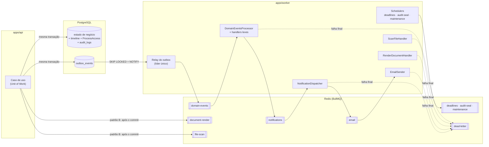
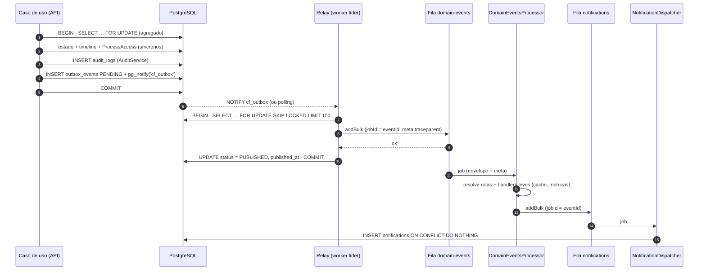

# Filas, eventos e jobs

> **Escopo:** processamento assíncrono do ContrataFlow — outbox transacional, fan-out de eventos de domínio, filas BullMQ, jobs agendados, retries, dead letter e operação.
> **Status:** especificação da fundação + MVP 1, com preparação para MVP 3 e MVP 5.
> **Decisões de base:** DEC-052, DEC-055, DEC-085, DEC-105, DEC-134, DEC-160, DEC-161, DEC-162, DEC-163, DEC-164 ([decisions.md](decisions.md#8-eventos-filas-e-jobs)) · [ADR-004](../adr/adr-004-outbox-events.md).
> **Nomes canônicos:** [`events.md`](../mvp-01/events.md) (eventos, routing keys, consumidores, notificações, ações de auditoria), [`entities.md`](../mvp-01/entities.md) (`OutboxEvent`, `Notification`, `DocumentRendition`, `Attachment`, `ProcessStage`, `AuditLog`, `AuditSeal`), [`permissions.md`](../mvp-01/permissions.md) §8 (`PLATFORM_QUEUE_ADMIN`).
> **Relacionados:** [storage.md](storage.md) · [observability.md](observability.md) · [multi-tenancy.md](multi-tenancy.md) · [security.md](security.md) · [ADR-007](../adr/adr-007-pdf-generation.md) · [ADR-009](../adr/adr-009-audit-trail.md).
>
> Itens marcados **(proposta)** não constam das fontes canônicas e devem ser registrados em `decisions.md`/`entities.md`/`events.md` antes da implementação.

Sumário: [1. Visão geral](#1-visão-geral) · [2. Política padrão](#2-política-padrão-e-convenções) · [3. Contrato de job](#3-contrato-comum-de-job-dec-164) · [4. Catálogo de filas](#4-catálogo-de-filas) · [5. Outbox](#5-outbox-transacional) · [6. Envelope e versões](#6-envelope-e-versionamento-de-eventos) · [7. Fan-out](#7-fan-out-de-domain-events) · [8. Idempotência](#8-idempotência-de-consumidores) · [9. Contexto em jobs](#9-contexto-de-tenant-ator-e-trace-em-jobs) · [10. Retries](#10-retries-e-classificação-de-erros) · [11. Dead letter](#11-dead-letter) · [12. Agendados](#12-jobs-agendados) · [13. Fairness](#13-fairness-e-noisy-neighbor) · [14. Shutdown](#14-shutdown-gracioso) · [15. Observabilidade](#15-observabilidade) · [16. Capacidade](#16-capacidade-e-escala) · [17. MVPs futuros](#17-preparação-para-mvp-3-e-mvp-5) · [18. Referências](#18-referências)

---

## 1. Visão geral

- **BullMQ sobre Redis 7/Valkey** (DEC-050). A API (`apps/api`) **produz** jobs; o worker (`apps/worker`, DEC-052) **consome** filas, executa jobs agendados e o **relay do outbox**. O worker reutiliza os módulos de domínio/aplicação e escala independentemente da API.
- **Eventos de domínio nunca são publicados diretamente no Redis pela transação de negócio**: são gravados em `outbox_events` na mesma transação (DEC-161) e publicados pelo relay.



### 1.1 Dois padrões de enfileiramento

| Padrão | Quando usar | Garantia | Exemplos |
|---|---|---|---|
| **A — Evento de domínio via outbox** | Reação de **outros** módulos a um fato | Atomicidade com a mudança (mesma transação); *at-least-once* | `ProcessStageChanged` → notificações; `RoleAssigned` → invalidação de cache |
| **B — Trabalho técnico com estado persistido** | Trabalho do **próprio** módulo sobre uma linha que registra o pedido | A linha (`PENDING`/`UPLOADED`) é o registro durável; enfileiramento após o commit com `jobId` = id da linha; **reconciliador** reenfileira órfãos | `DocumentRendition` → `document-render`; `Attachment` → `file-scan`; `Notification.emailStatus = PENDING` → `email` |

No padrão B, a própria linha de estado funciona como "outbox do trabalho": se o processo cair entre o commit e o `add`, nada se perde — o reconciliador (§4.8) encontra a linha pendente e reenfileira. É proibido enfileirar trabalho **antes** do commit (o job poderia rodar sobre dados que ainda não existem ou que sofreram rollback).

### 1.2 Requisitos do Redis para filas
- **Instâncias separadas (DEC-131):** o **Redis de sessões** do BFF é dependência crítica, em cluster próprio de alta disponibilidade, e **não** hospeda filas. As filas BullMQ ficam no **Redis de filas**, que no MVP 1 também atende idempotência (DEC-105), rate limit e cache — todo valor de cache com TTL; o cache migra para cluster próprio (`allkeys-lru`, `REDIS_CACHE_URL`) quando passar de 40% da memória ou houver pressão ([architecture.md](architecture.md) §6.12). Assim, a degradação das filas ou do cache não derruba sessões (CA-T-07).
- **`maxmemory-policy noeviction`** no Redis de filas (exigência do BullMQ) e no de sessões: despejo de chaves corromperia filas ou derrubaria sessões.
- **Redis de filas indisponível não interrompe a API** (CA-T-07): eventos continuam gravados no outbox (o relay publica quando o Redis voltar) e trabalhos do padrão B ficam com estado pendente até o reconciliador reenfileirá-los — sem duplicidade e sem liberar arquivo sem antivírus.
- **Produção:** ElastiCache (Redis OSS/Valkey) Multi-AZ com failover automático, criptografia em trânsito e em repouso (DEC-137), AUTH/RBAC por usuário. A replicação é assíncrona: um failover pode perder os últimos jobs aceitos. Mitigação: o outbox é a fonte da verdade e há **replay por janela de tempo** (§5.6) com consumidores idempotentes.
- **Conexões ioredis:** `maxRetriesPerRequest: null` nas conexões de Worker (bloqueantes), `enableReadyCheck`, reconexão com backoff; prefixo BullMQ `cf:{env}:q` (com *hash tag* `{cf:{env}:q}` se o cluster mode for habilitado), coerente com o padrão de chaves `cf:{env}:…` de [permissions.md](../mvp-01/permissions.md) §1.2.
- **Nomes:** filas em kebab-case (DEC-001); nomes de job em kebab-case dentro da fila (`render`, `scan`, `tick`, `scan-tenant`).

---

## 2. Política padrão e convenções

| Item | Padrão (DEC-163) | Observação |
|---|---|---|
| Tentativas | 5 | Sobrescrito por fila quando justificado (§4) |
| Backoff | Exponencial com *jitter*, base 5 s, teto 15 min | Estratégia própria `cf-exponential-jitter` (§10) |
| `removeOnComplete` | `{ age: 86400 }` (24 h) | Mantém o `jobId` para deduplicação durante 24 h |
| `removeOnFail` | `{ age: 604800 }` (7 dias) **(proposta)** | Inspeção no Bull Board; cópia permanente na `dead-letter` |
| Falha final | Cópia para `dead-letter` + alerta | §11 |
| *Stalled* | `stalledInterval` 30 s, `maxStalledCount` 1 | Job que derruba o worker duas vezes falha (proteção contra *poison job*) |
| `lockDuration` | 30 s (renovado automaticamente) | O *event loop* não pode ficar bloqueado por mais que isso |
| Payload | ≤ 16 KB; **somente IDs e metadados** | Nunca dados pessoais, conteúdo de documento, valores sigilosos (POL-09) ou segredos — o Redis e o Bull Board não são repositórios de dados de negócio |

```ts
// packages/… ou apps/worker/src/queues/defaults.ts (ilustrativo)
export const defaultJobOptions: JobsOptions = {
  attempts: 5,
  backoff: { type: 'cf-exponential-jitter', delay: 5_000 },
  removeOnComplete: { age: 24 * 3600 },
  removeOnFail: { age: 7 * 24 * 3600 },
};
```

Toda fila tem: **dono** (módulo), **contrato de payload** (Zod em `packages/validation`), **política** (tentativas, timeout, concorrência), **regra de idempotência**, **métricas** e **alertas**. Fila nova sem esses itens não passa em revisão (checklist em [observability.md](observability.md)).

---

## 3. Contrato comum de job (DEC-164)

Todo job carrega `meta` + `payload`:

```ts
// packages/types/src/jobs.ts (ilustrativo)
export interface JobMeta {
  schemaVersion: 1;
  tenantId: string | null;      // null só em jobs de plataforma explicitamente marcados (§9.3)
  actor: {
    type: 'USER' | 'SYSTEM' | 'PLATFORM_OPERATOR' | 'INTEGRATION';   // ActorType
    userId: string | null;
    membershipId: string | null;
  };
  correlationId: string;        // propagado desde o BFF (X-Correlation-Id)
  causationId: string | null;   // eventId que originou o job, quando houver
  traceparent: string;          // W3C Trace Context
  tracestate?: string;
  enqueuedAt: string;           // ISO 8601 UTC
}

export interface JobData<P> { meta: JobMeta; payload: P; }
```

- O produtor **nunca** monta `meta` à mão: `JobProducer.enqueue(queue, name, payload, opts)` lê o contexto da requisição/job atual (AsyncLocalStorage — DEC-132) e injeta o trace (`propagation.inject`).
- O consumidor valida `meta` e `payload` com Zod antes de qualquer efeito; payload inválido é erro **permanente** (`UnrecoverableError`).
- Detalhes do wrapper de execução em §9.

---

## 4. Catálogo de filas

Concorrência é **por réplica do worker**; limites por tenant em §13; timeouts aplicados pelo wrapper (§9.2).

| Fila | Tipo | Produtor | Consumidor | Conc. | Rate limit | Tentativas · base | Timeout | Idempotência | Alerta principal |
|---|---|---|---|---|---|---|---|---|---|
| `domain-events` | Evento (padrão A) | Relay do outbox | `DomainEventsProcessor` + handlers leves | 20 | — | 5 · 5 s | 10 s | `jobId = eventId`; filhos com `jobId = eventId` | Job mais antigo em espera > 30 s |
| `notifications` | Evento (fan-out) | `DomainEventsProcessor` | `NotificationDispatcher` | 10 | — | 5 · 5 s | 30 s | UNIQUE `(tenant_id, recipient_id, source_event_id, type)` | Espera > 60 s |
| `email` | Trabalho (padrão B) | `NotificationDispatcher`; casos de uso com e-mail transacional (convite) | `EmailSender` | 5 | 10 envios/s global | 5 · 5 s + pausa por breaker | 30 s | `jobId = notificationId`; só envia se `emailStatus = PENDING` | Falha > 5% em 15 min |
| `document-render` | Trabalho (padrão B) | Módulo `document` (DOC-20, DOC-21) | `RenderDocumentHandler` | 4 | 2 simultâneos por tenant | 5 · 5 s | 60 s | `jobId = renditionId`; transição condicional de `RenditionStatus` | p95 acima do SLO; falhas |
| `file-scan` | Trabalho (padrão B) | Módulo `files` (ATT-03) | `ScanFileHandler` | 4 | 3 simultâneos por tenant | 5 · 5 s + pausa por breaker | 90 s | `jobId = attachmentId`; transição condicional de `AttachmentStatus` | Anexo preso > 30 min |
| `deadlines` | Agendada (15 min) | Scheduler `deadlines-tick` | `DeadlineScanner` | 5 | — | 5 · 5 s | 5 min | `UPDATE` condicionais em `ProcessStage` | Scheduler sem sucesso > 45 min |
| `audit-seal` | Agendada (1 h) | Scheduler `audit-seal-tick` | `AuditSealer` | 2 | — | 5 · 5 s | 10 min | UNIQUE `(tenant_id, period_start)` em `audit_seals` | Selo atrasado > 3 h; verificação falhou |
| `maintenance` | Agendada (diária) | Scheduler `maintenance-daily` | `MaintenanceRunner` | 2 | — | 5 · 5 s | 30 min | Operações condicionais/idempotentes | Execução ausente > 26 h |
| `dead-letter` | Plataforma | Wrapper do worker (falha final) | — (ferramenta operacional) | — | — | — | — | `jobId = <fila>.<jobId>` | Qualquer job (> 0) |

Os nomes de consumidores `NotificationDispatcher`, `EmailSender`, `PermissionCacheInvalidator` e `BusinessMetricsCollector` são canônicos (events.md §3); os demais são **(proposta)** de nomenclatura.

### 4.1 `domain-events`
- **Produtor:** relay do outbox (§5). **Consumidor:** `DomainEventsProcessor`, que resolve as rotas (§7), enfileira os filhos e executa *handlers leves* idempotentes no próprio job: `PermissionCacheInvalidator` (`role.*`, `membership.*`, `department.moved` — DEL de chave Redis), `BusinessMetricsCollector` (`process.*`, `document.*`, `approval.*` — deduplicação por `eventId` em Redis por 24 h) e os invalidadores de cache de configuração dos eventos marcados **C** em events.md (`workflow.*`, `template.*`, `document_type.changed`, `catalog.*`, `tenant.*`, `organization.*`, `department.*`).
- **Payload:** `JobData<{ envelope: DomainEventEnvelope }>` (envelope de DEC-160; `meta.traceparent` vem de `outbox_events.metadata`).
- **Regra:** o router não contém lógica de negócio; se um handler leve passar a exigir I/O pesado, ele vira fila própria.

### 4.2 `notifications`
- **Consumidor:** `NotificationDispatcher` (módulo `notification`). Assina os eventos de events.md §6.
- **Payload:** `JobData<{ envelope: DomainEventEnvelope }>`, `jobId = eventId`.
- **Passos:** (1) resolve destinatários pelas regras de events.md §6 — nunca o próprio ator, no máximo 50 por perfil/unidade, somente quem vê o processo (DEC-024); (2) aplica `NotificationPreference` (tipos obrigatórios não podem ser desligados) e `notifications.emailEnabled`; (3) agrupa notificações iguais em 5 min (`type` + `processId` + destinatário); (4) `INSERT … ON CONFLICT (tenant_id, recipient_id, source_event_id, type) DO NOTHING`; (5) define `emailStatus` (`PENDING`, `SKIPPED` ou `NOT_APPLICABLE`); (6) **após o commit**, enfileira `email` com `jobId = notificationId` para cada `PENDING`.
- **Conteúdo:** `title`/`body` em pt-BR, sem dados sigilosos (POL-09), `link` relativo (`/processos/{id}`).

### 4.3 `email`
- **Produtores:** `NotificationDispatcher` e casos de uso com e-mail transacional (convite de usuário — `UserInvited`, USR-03/USR-04). **Consumidor:** `EmailSender` via abstração `MailProvider` (SMTP/Mailpit em dev, Amazon SES em produção — DEC-050).
- **Payload:** `JobData<{ kind: 'NOTIFICATION'; notificationId: string } | { kind: 'INVITATION'; membershipId: string }>`. O endereço é resolvido no envio (minimização). **Segredos não trafegam no payload:** o link de convite é gerado pelo `EmailSender` no momento do envio, que grava apenas o hash do token **(proposta)**.
- **Idempotência:** só envia se `Notification.emailStatus = 'PENDING'` (events.md §3); após aceite do provedor grava `SENT` + `emailSentAt`. Risco residual aceito: e-mail duplicado se o worker cair entre o aceite e a gravação.
- **Erros:** SMTP 4xx (421/450/451/452), *throttling* do SES e falhas de rede → transitórios (política padrão de DEC-163); provedor fora do ar → breaker e pausa da fila sem consumir tentativas (§10.3). A re-tentativa de entrega ao servidor do destinatário (ex.: *greylisting*) é feita pelo próprio provedor (SES/relay SMTP), não pela fila. Tentativas esgotadas → `emailStatus = FAILED` + cópia na DLQ + alerta. SMTP 5xx (550/553), `MessageRejected` e endereço inválido → **falha de entrega tratada**: `emailStatus = FAILED` + `emailError` sanitizado e job concluído **sem** DLQ (resultado de negócio, não falha técnica).
- **Cabeçalhos técnicos:** `Message-ID` derivado do `notificationId` (rastreio e deduplicação), `X-Correlation-Id`, `X-CF-Notification-Id`, `Auto-Submitted: auto-generated` (RFC 3834, evita respostas automáticas em laço).
- **Rate limit:** `limiter: { max: EMAIL_RATE_PER_SECOND, duration: 1000 }` (padrão 10/s), alinhado à cota de envio do provedor.

### 4.4 `document-render`
- **Produtor (padrão B):** o módulo `document` cria `DocumentRendition` (`PENDING`, `requestedById`, `requestedAt`) na mesma transação do pedido — DOC-20 (`PREVIEW` do rascunho), DOC-21 (`CONTENT`/`APPROVAL_STAMPED` de uma versão) — e enfileira após o commit com `jobId = renditionId`. Auditoria `document.render_request`. **(proposta)** gerar `CONTENT` automaticamente na finalização/submissão, para o aprovador já encontrar o PDF — decidir em US-067.
- **Payload:** `JobData<{ renditionId: string; documentId: string; kind: RenditionKind; documentVersionId?: string; draftRevision?: number; approvalId?: string }>`.
- **Consumidor:** `RenderDocumentHandler` — `UPDATE … SET status = 'PROCESSING', started_at = now(), attempts = attempts + 1 WHERE id = $1 AND status IN ('PENDING','PROCESSING')`; carrega o snapshot (`DocumentVersion.content`) ou o rascunho (`PREVIEW`); gera HTML com `packages/editor` + `LayoutDefinition`; chama o Gotenberg; grava o PDF no S3 ([storage.md](storage.md) §10); `READY` + `DocumentRenditionReady`. Detalhes em [ADR-007](../adr/adr-007-pdf-generation.md).
- **Prioridade:** `PREVIEW` = 1 (usuário esperando), `CONTENT`/`APPROVAL_STAMPED` = 5, re-renderização em lote = 10.
- **Erros:** Gotenberg 5xx/503, timeout e conexão → transitórios; breaker aberto → pausa sem consumir tentativas (§10.3). Snapshot ausente, template inválido ou 4xx do Gotenberg → permanentes. Ao esgotar ou falhar permanentemente: `FAILED` + `errorCode` + `errorMessage` sanitizada + `DocumentRenditionFailed` (notificação `DOCUMENT_RENDER_FAILED` a quem pediu) + cópia na DLQ (falha técnica a investigar).
- **SLO:** `PREVIEW` p95 ≤ 15 s; `CONTENT`/`APPROVAL_STAMPED` p95 ≤ 30 s, do pedido ao `READY` ([observability.md](observability.md)).

### 4.5 `file-scan`
- **Produtor (padrão B):** módulo `files` no confirm (ATT-03), `jobId = attachmentId`. **Payload:** `JobData<{ attachmentId: string }>`.
- **Consumidor:** `ScanFileHandler` — fluxo completo em [storage.md](storage.md) §5: trava de estado condicional, stream único (tipo + SHA-256 + ClamAV), promoção, `AttachmentUploaded`/`AttachmentRejected`.
- **Disponibilidade do ClamAV:** breaker com *health check* `PING`/`PONG`; aberto → *rate limit* manual da fila (§10.3), anexos permanecem `UPLOADED`/`SCANNING` e **nunca** são liberados sem scan.
- Timeout de 90 s (100 MB em clamd leva poucos segundos; a folga cobre a leitura do S3) e menor que o `stopTimeout` do contêiner (§14).

### 4.6 `deadlines` (a cada 15 min)
- **Scheduler** `deadlines-tick` (`*/15 * * * *`, UTC) gera o job de plataforma `tick`, que lista tenants `ACTIVE` (tabela de plataforma `tenants`) e enfileira um `scan-tenant` por tenant com `jobId = deadlines.{tenantId}.{slot}` (slot = início do intervalo de 15 min em epoch).
- **`scan-tenant`** (`DeadlineScanner`, US-055/US-114), no contexto do tenant (RLS):
  1. **Atraso:** `ProcessStage` `ACTIVE`, sem pausa (`pausedAt IS NULL` — suspensão pausa prazos, DEC-031), `dueAt < now()` e `overdueSince IS NULL` → `UPDATE … SET overdue_since = due_at, overdue_notified_at = now() WHERE id = $1 AND overdue_since IS NULL` → se atualizou: `ProcessStageOverdue` + timeline `STAGE_OVERDUE` (síncrona).
  2. **Vencimento próximo:** `dueAt` dentro de `deadlines.warnBeforeBusinessDays` dias úteis (calendário `Holiday` e fuso do tenant) e `dueSoonNotifiedAt IS NULL` → `UPDATE` condicional + `ProcessStageDueSoon`.
- **Idempotência e *catch-up*:** as consultas são por estado, não por janela de tempo — ticks perdidos são compensados no seguinte; reexecução não duplica eventos (`UPDATE … WHERE … IS NULL`). Trava `pg_try_advisory_xact_lock` por tenant evita sobreposição.

### 4.7 `audit-seal` (a cada 1 h)
- **Scheduler** `audit-seal-tick` (`5 * * * *`, UTC — minuto 5 dá margem). O `tick` enfileira `seal-tenant` por tenant (`jobId = audit-seal.{tenantId}.{periodStart}`) e um `seal-platform` (registros com `tenant_id` nulo, papel de plataforma — entities.md, `AuditLog` RLS).
- **`AuditSealer`**, sob trava por tenant, sela **em ordem** cada período horário fechado ainda não selado (`periodEnd ≤ now() − 10 min`): `digest` = SHA-256 sobre os `rowHash` do período ordenados por `(occurred_at, id)`; `chainHash` = SHA-256(`chainHash` anterior ∥ `digest`); `INSERT` em `audit_seals` (UNIQUE `(tenant_id, period_start)` → idempotente) + auditoria `audit.seal` (`SYSTEM`). Períodos vazios também são selados (`recordCount = 0`) para manter a cadeia contínua. Fundamentos em [ADR-009](../adr/adr-009-audit-trail.md).

### 4.8 `maintenance` (diária, 03:00 America/Sao_Paulo)
O scheduler `maintenance-daily` gera `daily`, que enfileira jobs de plataforma e um `tenant-housekeeping` por tenant `ACTIVE`/`SUSPENDED`.

| Job | Escopo | Papel de banco | O que faz | Base |
|---|---|---|---|---|
| `outbox-purge` | Plataforma | `cf_maintenance` (DEC-072): `SELECT`/`DELETE` só em `outbox_events` | Remove `PUBLISHED` com `published_at` > 7 dias, em lotes de 5.000 | DEC-085 |
| `processed-events-purge` | Plataforma | `cf_maintenance` | Remove registros de idempotência > 30 dias (§8) | — |
| `audit-partitions-ensure` | Plataforma | Papel de migração | Garante partições mensais de `audit_logs` para os próximos 3 meses | DEC-085 |
| `uploads-expire` | Tenant | Aplicação | `PENDING_UPLOAD` > 24 h → `DELETED` (sistema) | DEC-136 |
| `previews-expire` | Tenant | Aplicação | `PREVIEW` com `expiresAt` vencido → `EXPIRED` | DEC-060, DEC-085 |
| `notifications-archive` | Tenant | Aplicação | Notificações lidas há > 180 dias → `archivedAt` | DEC-085 |
| `memberships-expire` | Tenant | Aplicação | Vínculos `EXTERNAL` vencidos → `EXPIRED` + `MembershipExpired` + auditoria `membership.expire` + invalidação de cache e encerramento de sessões | DEC-012, DEC-139, POL-15 |
| `participants-expire` | Tenant | Aplicação | `CONSULTANT` com `expiresAt` vencido → remoção + `ProcessAccess.revokedAt` na mesma transação + `ProcessParticipantRemoved` (`reason = EXPIRED`) + auditoria `process.participant_remove` | DEC-024, DEC-036 |
| `storage-usage-reconcile` | Tenant | Aplicação | Recalcula o uso de storage (quota — PEND-17) | [storage.md](storage.md) §8 |
| `storage-fixity-sample` | Tenant | Aplicação | Amostra de verificação de fixidez | [storage.md](storage.md) §9.2 |

- **Expiração não é controle de acesso:** a autorização verifica validade em toda requisição (DEC-132: vínculo `ACTIVE` e não expirado; participação com `expiresAt`). O job apenas materializa o estado, emite eventos e notifica.
- **Reconciliador (proposta — acréscimo a DEC-163):** scheduler `maintenance-reconcile` a cada 15 min com o job `reconcile`, que reenfileira trabalhos do padrão B sem job ativo: `Attachment` `UPLOADED`/`SCANNING` há > 15 min; `DocumentRendition` `PENDING`/`PROCESSING` há > 10 min (índice `(status, requested_at)`); `Notification.emailStatus = PENDING` há > 15 min (índice parcial em `email_status`). Usa `queue.getJob(id)`: ausente → `add`; `failed` → não reenfileira (já está na DLQ); demais estados → nada a fazer.

### 4.9 `dead-letter`
Fila de **estacionamento**, sem consumidor automático. Contrato e operação em §11.

---

## 5. Outbox transacional

### 5.1 Tabela
`OutboxEvent` (`outbox_events`, módulo `platform`) está definida em [entities.md](../mvp-01/entities.md) §4.10: `id` (= `eventId`), `tenantId` (nulo só para eventos de plataforma), `eventType`, `routingKey`, `eventVersion`, `aggregateType`, `aggregateId`, `processId`, `payload`, `metadata` (`actor`, `correlationId`, `causationId`, `traceparent`), `occurredAt`, `status` (`PENDING`, `PUBLISHED`, `FAILED`), `attempts`, `nextAttemptAt`, `publishedAt`, `lastError`; índice parcial `(status, occurred_at) WHERE status = 'PENDING'`. A aplicação só insere no próprio tenant; o relay usa o papel `cf_relay` (`SELECT`/`UPDATE` apenas nesta tabela, com `BYPASSRLS`).

Ajustes adotados na US-082 (DEC-072):
- Gravar `occurred_at` com `clock_timestamp()` no `INSERT` (após o lock do agregado), em vez do *default* `now()` — `now()` é o instante de **início** da transação e pode inverter a ordem entre duas transações concorrentes sobre o mesmo agregado.
- Papel `cf_maintenance` com `SELECT`/`DELETE` apenas em `outbox_events` (e `processed_events`, quando existir) para a purga de 7 dias, já que `cf_relay` não tem `DELETE`.

### 5.2 Escrita (mesma transação)

```ts
// application/forward-process.use-case.ts (ilustrativo)
await uow.run(async (tx) => {
  const process = await processes.lockForUpdate(tx, processId);       // SELECT … FOR UPDATE (DEC-055)
  const result = workflowEngine.forward(process, command);            // regras puras (ADR-005)
  await processes.applyMovement(tx, result);                          // ProcessMovement, ProcessStage, ProcessAssignment
  // handlers síncronos (DEC-161): TimelineProjector e ProcessAccessProjector rodam aqui, na mesma tx
  await audit.record(tx, { action: 'process.forward', /* … */ });     // auditoria explícita (DEC-161)
  await outbox.append(tx, ProcessStageChanged.of(result));            // routingKey process.stage_changed.forward
});
```

`OutboxService.append` monta o envelope (DEC-160): `eventId` UUIDv7, `tenantId`/`actor`/`correlationId` do contexto, `causationId` (quando o caso de uso roda dentro de um job originado por evento) e `traceparent` do span atual em `metadata`; valida o payload com o schema Zod do evento (`packages/validation/src/events/*`); insere a linha e executa `SELECT pg_notify('cf_outbox', '')`. O `NOTIFY` é transacional: só é entregue se a transação fizer commit.

### 5.3 Relay



- **Líder único:** cada réplica do worker tenta `pg_try_advisory_lock(<chave 'outbox-relay'>)` numa conexão de sessão dedicada; quem obtém é o líder, as demais tentam a cada 5 s (*hot standby*). A queda do líder libera a trava com a sessão.
- **Gatilho:** `LISTEN cf_outbox` na mesma conexão dedicada (fora de *pooler* em modo transação) acorda o laço imediatamente; *polling* de segurança a cada 500 ms ocioso; com lote cheio, o laço repete sem espera. `LISTEN/NOTIFY` é **otimização de latência** — a correção depende só do *polling*.
- **Lote:**

```sql
BEGIN;
SELECT id, tenant_id, event_type, routing_key, event_version, aggregate_type,
       aggregate_id, process_id, payload, metadata, occurred_at, attempts
  FROM outbox_events
 WHERE status = 'PENDING'
   AND (next_attempt_at IS NULL OR next_attempt_at <= now())
 ORDER BY occurred_at, id
 LIMIT 100
   FOR UPDATE SKIP LOCKED;
-- validação por linha; queue.addBulk(...) com jobId = id (MULTI/EXEC atômico)
UPDATE outbox_events
   SET status = 'PUBLISHED', published_at = now(), attempts = attempts + 1
 WHERE id = ANY($1::uuid[]);
COMMIT;
```

- **`SKIP LOCKED`** protege a sobreposição durante a troca de líder e a ferramenta de reprocessamento, e prepara a evolução para múltiplos relays (§5.4).
- **At-least-once:** queda entre o `addBulk` e o `COMMIT` republica o lote; a deduplicação por `jobId` (enquanto o job existir, 24 h) e a idempotência dos consumidores (§8) absorvem a repetição.

### 5.4 Ordenação por agregado
1. Transações sobre o mesmo agregado são serializadas pelo `SELECT … FOR UPDATE` (DEC-055); com `occurred_at = clock_timestamp()` gravado após o lock, a ordem de `(occurred_at, id)` reflete a ordem real dos fatos do agregado.
2. Um único relay ativo publica em ordem; o `addBulk` é atômico — se falhar, nenhum evento do lote é publicado e a ordem se preserva na próxima tentativa.
3. **Depois do Redis não há ordem garantida:** consumidores processam em paralelo. Todo consumidor deve ser tolerante à ordem — reler o estado atual quando a decisão depender dele, comparar `occurredAt` ou a versão do agregado e nunca assumir que A chega antes de B.
4. **Evolução (se > ~1.000 eventos/s):** 16 partições lógicas (`hashtext(aggregate_id::text) & 15`) com uma *advisory lock* por partição; cada relay assume um subconjunto, preservando a ordem por agregado com paralelismo.

### 5.5 Falhas e eventos "venenosos"
| Falha | Comportamento |
|---|---|
| Redis indisponível | `ROLLBACK` (linhas continuam `PENDING`, travas liberadas); laço com backoff até 30 s; métrica de erro e alerta pelo lag |
| PostgreSQL indisponível | Laço com backoff; nada a perder (o evento está no banco ou não existe) |
| Linha inválida (payload fora do schema, acima de 16 KB) | Só aquela linha: `attempts + 1`, `next_attempt_at` com backoff, `last_error`; o restante do lote segue. Após 10 tentativas → `FAILED` + alerta **crítico** (consumidores não receberão o fato até correção e republicação) |
| Queda do líder | Outra réplica assume a trava em ≤ 5 s; o lote em andamento sofre *rollback* |

### 5.6 Reprocessamento e replay
- CLI do worker (requer `PLATFORM_QUEUE_ADMIN` + MFA; auditoria `outbox.republish` **(proposta)**, `actorType = PLATFORM_OPERATOR`):
  - `cli outbox:republish --id <eventId> --ticket <ref>` — evento `FAILED` corrigido volta a `PENDING`.
  - `cli outbox:replay --from <ts> --to <ts> [--routing-key 'process.*'] [--tenant <id>] --ticket <ref> [--dry-run]` — republica eventos já `PUBLISHED` de uma janela, com `jobId = <eventId>.replay-<n>` (contorna a deduplicação de 24 h do BullMQ; os consumidores continuam deduplicando por `eventId`).
- **Uso típico do replay:** após failover do Redis (perda dos últimos jobs aceitos), republicar os últimos 15 min; após correção de bug em consumidor, republicar a janela afetada. Limite natural: purga do outbox em 7 dias (DEC-085).

### 5.7 Métricas do outbox
| Métrica | Tipo | Uso |
|---|---|---|
| `cf_outbox_pending_events` | gauge | Volume aguardando publicação |
| `cf_outbox_oldest_pending_age_seconds` | gauge | **Lag** — alerta |
| `cf_outbox_publish_lag_seconds` | histogram | `published_at − occurred_at`; SLO p95 < 5 s |
| `cf_outbox_published_total` | counter (`event_type`) | Vazão por tipo (registro fechado em `packages/types`) |
| `cf_outbox_publish_errors_total` | counter (`reason`) | Falhas de publicação |
| `cf_outbox_failed_events` | gauge | Linhas `FAILED` (deve ser 0) |
| `cf_outbox_relay_leader` | gauge | 1 na réplica líder (soma deve ser 1) |
| `cf_outbox_batch_size` · `cf_outbox_batch_duration_seconds` | histogram | Dimensionamento do lote |

---

## 6. Envelope e versionamento de eventos

### 6.1 Envelope
O envelope é o de DEC-160 (exemplo completo em [events.md](../mvp-01/events.md) §2). Tipos em `packages/types/src/events.ts`; schemas Zod dos payloads em `packages/validation/src/events/*`.

```ts
export interface DomainEventEnvelope<P = unknown> {
  eventId: string;            // UUIDv7 (= outbox_events.id)
  eventType: string;          // 'ProcessStageChanged'
  routingKey: string;         // 'process.stage_changed.forward'
  eventVersion: number;       // inicia em 1
  occurredAt: string;         // ISO 8601 UTC
  tenantId: string | null;
  aggregateType: string;
  aggregateId: string;
  processId: string | null;
  actor: { type: ActorType; userId: string | null; membershipId: string | null };
  correlationId: string;
  causationId: string | null;
  payload: P;                 // IDs e mínimo necessário; nunca dado sigiloso (events.md §1)
}
```

`traceparent` é metadado técnico: fica em `outbox_events.metadata` e vai para `JobMeta`, não para o envelope de domínio.

### 6.2 Regras de versionamento (events.md §8)
- Campo novo **opcional** → mesma versão. Remoção, renomeação ou mudança de semântica → `eventVersion + 1`.
- Produtores publicam só a versão mais nova; consumidores convertem versões antigas por **upcasters** encadeados (`packages/validation/src/events/upcasters.ts`) e trabalham sempre com a versão corrente.
- **Ordem de implantação:** primeiro consumidores que entendem v1 e v2, depois produtores de v2. Consumidor que recebe versão **maior** que a conhecida trata como erro transitório (aguarda o deploy), nunca descarta.
- **Prazo dos upcasters:** mantidos por no mínimo 90 dias após a nova versão **(proposta)** — cobre outbox (7 dias), `dead-letter` (30 dias) e janelas de replay.
- O CI garante que todo `eventType` emitido existe no registro e tem decisão de roteamento explícita (§7.4).

```ts
// packages/validation/src/events/upcasters.ts (ilustrativo)
type Upcaster = (e: DomainEventEnvelope) => DomainEventEnvelope;
export const upcasters: Record<string, Record<number, Upcaster>> = {
  // ProcessStageChanged: { 1: (e) => ({ ...e, eventVersion: 2, payload: migrateV1toV2(e.payload) }) },
};
export function upcast(e: DomainEventEnvelope, current: number): DomainEventEnvelope {
  let out = e;
  while (out.eventVersion < current) out = upcasters[out.eventType][out.eventVersion](out);
  return out;
}
```

---

## 7. Fan-out de `domain-events`

### 7.1 Semântica dos padrões
Routing keys seguem events.md §1: `<agregado>.<fato>[.<especialização>]` em snake_case. Nos padrões de assinatura, `*` **no meio** casa exatamente um segmento e `*` **no fim** casa um ou mais segmentos — assim `process.*` cobre `process.created` e `process.stage_changed.forward`, e `document.approved.*` cobre todas as aprovações de documento, como usado em events.md.

Nomes especializados (DEC-162) **não** são mensagens extras: `DFDApproved` é o `DocumentApproved` com routing key `document.approved.dfd`; `PriceResearchCompleted` é o `DocumentFinalized` com `document.finalized.price_research`; `ProcessForwarded` é o `ProcessStageChanged` com `process.stage_changed.forward`. Assinar o nome especializado = assinar a routing key especializada.

### 7.2 Rotas do MVP 1

| Padrão(ões) | Destino | Consumidor | Fonte |
|---|---|---|---|
| `process.stage_changed.*`, `process.assigned`, `process.status_changed.*`, `process.stage_due_soon`, `process.stage_overdue`, `process.participant_added`, `approval.requested`, `approval.completed`, `approval.returned`, `approval.rejected`, `approval.reassigned`, `comment.created`, `comment.user_mentioned`, `attachment.rejected`, `document.rendition_failed`, `role.assigned`, `role.revoked` | fila `notifications` | `NotificationDispatcher` | events.md §6 |
| `role.*`, `membership.*`, `department.moved` | *inline* | `PermissionCacheInvalidator` | events.md §3; permissions.md §1.2 |
| `workflow.*`, `template.*`, `document_type.changed`, `catalog.*`, `tenant.*`, `organization.*`, `department.*` | *inline* | Invalidadores de cache de configuração (`ConfigCacheInvalidator` **(proposta)**) | legenda **C** de events.md §4 |
| `process.*`, `document.*`, `approval.*` | *inline* | `BusinessMetricsCollector` | events.md §3 |
| subconjunto público (contratos estáveis) | fila `webhooks` | `WebhookDispatcher` (MVP 3) | DEC-161; events.md §8 |
| a definir | `search-index` (futuro), `ai` (MVP 5) | — | DEC-161 |

`UserInvited` não tem consumidor assíncrono: o e-mail de convite é enfileirado em `email` pelo próprio caso de uso (events.md §4.6), no padrão B.

### 7.3 Comportamento do router
- Calcula o **conjunto** de filas-destino (cada fila recebe no máximo um job por evento, mesmo que várias rotas casem) e enfileira com `addBulk` atômico e `jobId = eventId` — o `jobId` é único **por fila**.
- Executa os handlers *inline* (idempotentes por natureza) e conclui.
- Reexecução (retry do job do router) é segura: filhos já criados são deduplicados pelo `jobId`; invalidações e contadores são idempotentes.

```ts
// apps/worker/src/events/routes.ts (ilustrativo)
export const routes: Route[] = [
  { match: ['process.stage_changed.*', 'process.assigned', 'approval.requested' /* … */], queue: 'notifications' },
  { match: ['role.*', 'membership.*', 'department.moved'], inline: PermissionCacheInvalidator },
  { match: ['process.*', 'document.*', 'approval.*'], inline: BusinessMetricsCollector },
];
```

### 7.4 Governança
- Rotas ficam em código, revisadas como contrato. Teste de CI: todo `eventType` do registro tem decisão de roteamento explícita (inclusive "sem consumidor assíncrono"), e todo padrão casa ao menos uma routing key existente — evita eventos esquecidos e assinaturas mortas.
- Filtros por assinante (ex.: assinaturas de webhook por tenant no MVP 3) rodam **no consumidor**, não no router, que permanece estático.

---

## 8. Idempotência de consumidores

Entrega *at-least-once* (DEC-161) exige que todo consumidor produza o mesmo efeito se receber o mesmo `eventId` duas vezes.

| Camada | Mecanismo | Alcance |
|---|---|---|
| 1. Fila | `jobId` determinístico (`eventId`, `notificationId`, `renditionId`, `attachmentId`) | Deduplica enquanto o job existir (24 h após concluir) — otimização, não garantia |
| 2. Chave natural | UNIQUE `notifications (tenant_id, recipient_id, source_event_id, type)`; UNIQUE `process_timeline_entries (tenant_id, source_event_id, type)`; `UPDATE … WHERE overdue_since IS NULL`; transições condicionais de `RenditionStatus`/`AttachmentStatus`; `emailStatus = PENDING` | Garantia forte, sem tabela extra |
| 3. `processed_events` **(proposta)** | `(tenant_id, consumer, event_id)` PK + `processed_at`, inserido **na mesma transação** do efeito; RLS normal; purga > 30 dias | Consumidores sem chave natural (ex.: `search-index` futuro) |
| 4. Redis `SET NX EX 86400` | `cf:{env}:t:{tenantId}:evt:{consumer}:{eventId}` | Efeitos baratos e não transacionais (`BusinessMetricsCollector`, events.md §3) |
| 5. Efeito externo | Máquina de estados no registro (`emailStatus`) e aceitação de duplicata rara; webhooks (MVP 3) com `X-CF-Event-Id` para deduplicação no receptor | E-mail, integrações |

```ts
// Consumidor idempotente com efeito no banco (ilustrativo)
await uow.run(async (tx) => {
  const inserted = await tx.$executeRaw`
    INSERT INTO processed_events (tenant_id, consumer, event_id, processed_at)
    VALUES (${ctx.tenantId}::uuid, 'SearchIndexer', ${envelope.eventId}::uuid, now())
    ON CONFLICT DO NOTHING`;
  if (inserted === 0) return;        // já processado: sai sem efeito
  await applyEffect(tx, envelope);   // efeito e marca na MESMA transação
});
```

---

## 9. Contexto de tenant, ator e trace em jobs

### 9.1 Produção

```ts
// modules/platform/queue/job-producer.ts (ilustrativo)
async enqueue<P>(queue: QueueName, name: string, payload: P, opts?: JobsOptions) {
  const ctx = requestContext.get();                    // AsyncLocalStorage (DEC-132)
  const carrier: Record<string, string> = {};
  propagation.inject(context.active(), carrier);       // traceparent / tracestate (W3C)
  const meta: JobMeta = {
    schemaVersion: 1,
    tenantId: ctx.tenantId,
    actor: ctx.actor,
    correlationId: ctx.correlationId,
    causationId: ctx.causationId ?? null,
    traceparent: carrier.traceparent,
    tracestate: carrier.tracestate,
    enqueuedAt: new Date().toISOString(),
  };
  return this.queues[queue].add(name, { meta, payload }, opts);
}
```

O relay do outbox monta `meta` a partir das colunas do evento (`tenantId`) e de `metadata` (`actor`, `correlationId`, `causationId`, `traceparent`), com `causationId` dos jobs filhos = `eventId`.

### 9.2 Wrapper de consumo (`runJob`)
1. **Validação** Zod de `meta` e `payload`; inválido → `UnrecoverableError`.
2. **Tenant:** `tenantId` nulo só para pares fila/job da lista fechada (§9.3); fora dela → `UnrecoverableError('TENANT_CONTEXT_REQUIRED')` + alerta de segurança. Tenant não `ACTIVE`: jobs de negócio concluem sem efeito (log `info`); `tenant-housekeeping` também roda para `SUSPENDED`.
3. **Trace:** `propagation.extract` do `traceparent`; span `CONSUMER` `"<fila> process"`, filho do produtor, com `messaging.system = bullmq`, `messaging.destination.name`, `messaging.message.id` (= `jobId`), `cf.tenant.id`, `cf.correlation_id`.
4. **Contexto:** AsyncLocalStorage com `tenantId`, `actor`, `correlationId`, `causationId`, `queue`, `jobId`; a extensão do Prisma executa `set_config('app.tenant_id', …, true)` em cada transação (DEC-082) — RLS vale no worker exatamente como na API.
5. **Logger filho** (pino) com `queue`, `jobName`, `jobId`, `attempt`, `tenantId`, `correlationId`, `traceId`.
6. **Timeout:** `AbortController` com o timeout da fila; o sinal é repassado a `fetch`/SDKs; estouro → `JobTimeoutError` (transitório).
7. **Métricas:** espera (`processedOn − timestamp`), duração e resultado.
8. **Erros:** classificação (§10) e cópia para a `dead-letter` na falha final (§11).

Efeitos gravados pelo worker usam `actorType = SYSTEM` (ex.: `attachment.scan_result`, `audit.seal`); o ator original de `meta.actor` é preservado em `metadata.requestedBy` da auditoria **(proposta)**.

### 9.3 Jobs de plataforma (aceitam `tenantId` nulo — lista fechada)

| Fila | Jobs |
|---|---|
| `deadlines` | `tick` |
| `audit-seal` | `tick`, `seal-platform` |
| `maintenance` | `daily`, `reconcile`, `outbox-purge`, `processed-events-purge`, `audit-partitions-ensure` |
| `domain-events` | Eventos registrados como de plataforma em `packages/types` (`OutboxEvent.tenantId` nulo) |
| `dead-letter` | Herda o `meta` do job original |

---

## 10. Retries e classificação de erros

### 10.1 Backoff

```ts
// apps/worker/src/queues/backoff.ts (ilustrativo) — new Worker(name, fn, { settings: { backoffStrategy } })
export function backoffStrategy(attemptsMade: number, type?: string, _err?: Error, job?: Job): number {
  if (type !== 'cf-exponential-jitter') return 0;
  const base = Number((job?.opts.backoff as BackoffOptions | undefined)?.delay ?? 5_000);
  const exp = Math.min(15 * 60_000, base * 2 ** (attemptsMade - 1));
  return Math.round(exp / 2 + Math.random() * (exp / 2));          // equal jitter
}
```

Com base 5 s e 5 tentativas, as esperas ficam em ≈ 2,5–5 s, 5–10 s, 10–20 s e 20–40 s: falhas transitórias curtas se resolvem em até ~75 s. **Quedas de dependência não consomem essas tentativas** (§10.3) — por isso nenhuma fila do MVP 1 precisa sobrescrever o padrão de DEC-163.

### 10.2 Classificação

| Classe | Exemplos | Tratamento |
|---|---|---|
| Transitório | Timeout; `ECONNRESET`; HTTP 5xx/429 de dependência; Redis ou PostgreSQL indisponíveis; `40001` (*serialization failure*), `40P01` (*deadlock*), `55P03` (*lock not available*); conflito de versão otimista | Retry com backoff |
| Dependência fora (breaker aberto) | ClamAV, Gotenberg, SMTP/SES | Pausa da fila **sem consumir tentativa** (§10.3) |
| Permanente | `meta`/payload inválidos; `eventType` desconhecido; entidade inexistente no tenant; 4xx de dependência por entrada inválida; invariante violada | `UnrecoverableError` → falha final imediata → DLQ |
| Permanente de segurança | Job sem tenant fora da lista (§9.3); `42501` (privilégio/RLS); violação da guarda de tenant do storage | `UnrecoverableError` + alerta de segurança |
| Duplicidade esperada | `23505` na chave de idempotência | Sucesso (o efeito já existe) |
| Resultado de negócio | E-mail com endereço inválido; arquivo infectado ou rejeitado | Conclui o job registrando o resultado; sem DLQ |
| Versão de evento maior que a conhecida | Consumidor antigo durante deploy | Transitório (aguarda o deploy — §6.2) |
| Desconhecido | `TypeError`, exceção não mapeada | Transitório até esgotar → DLQ com stack |

### 10.3 Pausa por dependência indisponível (circuit breaker)
Cada dependência externa do worker tem um breaker (5 falhas de conexão seguidas abrem o circuito; meia-abertura após 30 s, uma tentativa por vez). Com o breaker aberto, o `runJob` adia o job por 30 s sem gastar a tentativa; os demais jobs da fila encontram o mesmo breaker aberto e também são adiados na hora, sem chamar a dependência — na prática, a fila fica parada até a meia-abertura:

```ts
if (error instanceof DependencyUnavailableError) {   // breaker aberto
  await job.moveToDelayed(Date.now() + 30_000, token); // volta em 30 s
  throw new DelayedError();                            // sem consumir tentativa
}
```

**Por que não `rateLimit` + `RateLimitError` (US-083):** no BullMQ 5.81, com concorrência > 1, o job devolvido pelo *rate limit* manual é retomado para `active` por outro *slot* e fica parado até o fim da pausa sem renovar a trava; com pausa ≥ `lockDuration` (30 s) a trava expira (`Missing lock … moveToFinished`) e, com `maxStalledCount: 1`, o job viraria um falso *poison job*. O adiamento por job não tem esse efeito.

Métrica `cf_circuit_breaker_state{dependency}` (0 fechado, 1 meia-aberto, 2 aberto); breaker aberto por mais de 5 min dispara alerta e runbook ([observability.md](observability.md)).

---

## 11. Dead letter

### 11.1 Mecanismo
O BullMQ não tem DLQ nativa. O wrapper (§9.2), ao detectar falha final — erro permanente ou `job.attemptsMade + 1 >= job.opts.attempts` —, grava a cópia na fila `dead-letter` **antes** de relançar o erro, com `jobId = <fila>.<jobId>` (idempotente se o worker cair no meio). Depois o BullMQ marca o job original como `failed` (retido 7 dias para inspeção).

```ts
export interface DeadLetterRecord {
  meta: JobMeta;                               // tenant, ator e correlação do job original
  source: { queue: string; jobName: string; jobId: string; attemptsMade: number;
            firstEnqueuedAt: string; failedAt: string };
  data: unknown;                               // dados originais (somente IDs — §2)
  error: { class: 'TRANSIENT_EXHAUSTED' | 'PERMANENT' | 'TIMEOUT' | 'SECURITY';
           name: string; code?: string; message: string;   // mensagem sanitizada (DEC-138)
           stack?: string };                   // truncada em 4 KB
}
```

Retenção de 30 dias **(proposta)**; antes de remover, o `maintenance` registra um resumo estruturado (`dead_letter.expired`) nos logs.

### 11.2 Operação

| Comando (CLI do worker) | Efeito |
|---|---|
| `cli dlq:list [--queue] [--since] [--tenant]` | Lista resumida (fila, erro, tentativas, idade) |
| `cli dlq:show <id>` | Detalhe com redação de campos sensíveis |
| `cli dlq:retry <id> --ticket <ref> --reason <texto>` | Reenfileira `data` na fila original com `jobId = <jobIdOriginal>.r<n>`, preservando `meta` (novo `traceparent` com *link* para o original) |
| `cli dlq:retry --queue <fila> --since <ts> --ticket <ref> --dry-run` | Reprocessamento em massa após incidente |
| `cli dlq:discard <id> --ticket <ref> --reason <texto>` | Descarta com justificativa |

- Exige `PLATFORM_QUEUE_ADMIN` com MFA ([permissions.md](../mvp-01/permissions.md) §8). Toda ação gera auditoria `dead_letter.retry`/`dead_letter.discard` **(proposta para events.md §7)** com `actorType = PLATFORM_OPERATOR`, `tenantId` do job (visível ao administrador do tenant — DEC-139), ticket e motivo em `metadata`.
- A DLQ não expõe dados de negócio (payloads só com IDs); examinar conteúdo do tenant exige o fluxo de suporte de DEC-139.
- **Alerta:** qualquer job novo na DLQ, agrupado por fila de origem (runbook "DLQ crescente" em [observability.md](observability.md)).

---

## 12. Jobs agendados

| Scheduler | Fila | Padrão (cron) | Fuso | Job gerado | Trava |
|---|---|---|---|---|---|
| `deadlines-tick` | `deadlines` | `*/15 * * * *` | UTC | `tick` → `scan-tenant` por tenant | `jobId` por slot + *advisory lock* por tenant |
| `audit-seal-tick` | `audit-seal` | `5 * * * *` | UTC | `tick` → `seal-tenant` por tenant + `seal-platform` | *Advisory lock* por tenant (cadeia sequencial) |
| `maintenance-daily` | `maintenance` | `0 3 * * *` | America/Sao_Paulo | `daily` → jobs da §4.8 | *Advisory lock* por job |
| `maintenance-reconcile` **(proposta)** | `maintenance` | `*/15 * * * *` | UTC | `reconcile` | *Advisory lock* |

```ts
// apps/worker/src/schedulers.ts (ilustrativo; Job Schedulers — BullMQ ≥ 5.16)
await queues.deadlines.upsertJobScheduler(
  'deadlines-tick',
  { pattern: '*/15 * * * *', tz: 'UTC' },
  { name: 'tick', data: platformJobData() },
);
```

- O *upsert* roda no bootstrap de toda réplica e é idempotente; o BullMQ gera **um** job por iteração mesmo com N réplicas.
- **Sem *catch-up*:** iterações perdidas (worker fora do ar) não são reexecutadas; por isso os handlers são **baseados em estado** (todos os prazos vencidos, todos os períodos fechados sem selo, todos os itens elegíveis), não em janela de tempo.
- **Sem sobreposição:** se a execução anterior ainda roda, a nova não obtém a trava e conclui como `skipped` (`cf_scheduled_job_skipped_total`).
- **Vivacidade:** `cf_scheduler_last_success_timestamp_seconds{scheduler}` com alerta quando envelhece (deadlines > 45 min, audit-seal > 3 h, maintenance > 26 h).

---

## 13. Fairness e noisy neighbor

Um tenant que envia 500 anexos ou pede 300 PDFs não pode atrasar os demais.

1. **Primeira barreira — limites da API** (api.md §1.6): renderização/exportação 20/min e intenções de upload 60/min por usuário + tenant; global 6.000/min por tenant.
2. **Concorrência por tenant e por fila** (semáforo Redis com *lease*) **(proposta)**: `document-render` 2, `file-scan` 3, `email` 3, `notifications` 5 — configuráveis por variável de ambiente.
3. **Reagendamento sem custo:** acima do limite, o job volta para *delayed* com 2–5 s de espera aleatória, sem consumir tentativa.
4. **Prioridades:** interativo (`PREVIEW`) = 1; automático = 5; lote = 10.
5. **Fan-out por tenant nos agendados:** cada tenant é uma unidade de trabalho limitada; falha em um tenant não bloqueia os outros.
6. **Operações em lote fatiadas** (ex.: re-renderizar 500 documentos = 500 jobs de prioridade 10).
7. **Alternativa avaliada:** *Groups* do BullMQ Pro (rodízio e limites por grupo) — licença comercial; considerar se o semáforo ficar insuficiente.

```ts
// Semáforo por tenant (ilustrativo) — processador recebe (job, token)
const key = `cf:${env}:t:${job.data.meta.tenantId}:sem:${queueName}`;
if (!(await semaphore.tryAcquire(key, { limit: perTenantLimit[queueName], leaseMs: timeoutMs + 10_000, holder: job.id }))) {
  await job.moveToDelayed(Date.now() + 2_000 + Math.random() * 3_000, token);
  throw new DelayedError();                 // reagenda sem consumir tentativa
}
try { return await handler(job); } finally { await semaphore.release(key, job.id); }
```

Visibilidade: `cf_tenant_semaphore_delays_total{queue}` (sem label de tenant) e log `job.delayed_by_tenant_limit` com `tenantId` para identificar o tenant ruidoso.

---

## 14. Shutdown gracioso

Ao receber `SIGTERM` (deploy, *scale-in*):
1. `/health/ready` do worker passa a 503.
2. **Relay:** encerra o laço, conclui (commit ou rollback) o lote em andamento, libera a *advisory lock* e fecha a conexão `LISTEN` — outra réplica assume em ≤ 5 s.
3. **Consumidores:** `await Promise.all(workers.map((w) => w.close()))` — param de buscar jobs e aguardam os ativos, com limite `SHUTDOWN_GRACE_MS = 100_000`, abaixo do `stopTimeout` de 120 s do ECS (máximo no Fargate).
4. Jobs não concluídos no prazo são detectados como *stalled* e retomados por outra réplica — por isso **todo handler é idempotente**. Jobs longos (`maintenance`) trabalham em lotes e checam a flag de encerramento entre lotes.
5. Fecha conexões de filas e do banco; faz *flush* dos exportadores OpenTelemetry e do pino; sai com código 0.

Regras complementares: timeouts de jobs interativos (≤ 90 s) cabem na janela de encerramento; trabalho de CPU não pode bloquear o *event loop* por mais que o `lockDuration` (30 s), senão a renovação da trava falha e o job é dado como *stalled* indevidamente — use streams e, se necessário, *worker threads*; deploys em *rolling update* com 100% de capacidade mínima.

---

## 15. Observabilidade

### 15.1 Bull Board
- `@bull-board/api` + adaptador HTTP montados no worker em porta interna (`WORKER_ADMIN_PORT`), **nunca** expostos à internet (sub-rede privada; acesso por VPN ou *port forwarding* via SSM).
- Autenticação de plataforma: login OIDC no Authentik com cliente dedicado de operação; exige `User.isPlatformOperator` com `PLATFORM_QUEUE_ADMIN` e MFA ([permissions.md](../mvp-01/permissions.md) §8). Acesso registrado em auditoria de plataforma (`queue_dashboard.access`, concedido ou negado — events.md §7).
- **Verificação adotada no MVP 1 (US-083):** o painel e a CLI recebem o *access token* do cliente de operação (`Authorization: Bearer`, ou cookie `cf_ops_token` no navegador; na CLI, `CF_OPS_TOKEN`), validado pelo JWKS do emissor (`iss`, `aud` = `WORKER_ADMIN_OIDC_AUDIENCE`, `exp`, RS256/ES256). `PLATFORM_QUEUE_ADMIN` vem da *claim* `cf_platform_permissions` (grupo do Authentik mapeado no cliente de operação); `isPlatformOperator` é relido em `users` (`external_subject = sub`, `status = ACTIVE`); MFA pelo `amr` (RFC 8176). Sem permissão → 403 `PERMISSION_DENIED`; sem MFA → 403 `MFA_REQUIRED`. O fluxo de login interativo (*authorization code*) no próprio painel fica para o endurecimento.
- Adaptadores em `readOnlyMode: true`: mutações (retry, descarte, limpeza) só pela CLI auditada (§11.2).

### 15.2 Métricas

| Métrica | Tipo | Labels |
|---|---|---|
| `cf_queue_jobs` | gauge | `queue`, `state` (`waiting`, `active`, `delayed`, `prioritized`, `failed`) |
| `cf_queue_oldest_waiting_age_seconds` | gauge | `queue` |
| `cf_job_wait_seconds` | histogram | `queue` |
| `cf_job_duration_seconds` | histogram | `queue`, `job_name`, `outcome` |
| `cf_jobs_processed_total` | counter | `queue`, `job_name`, `outcome` (`completed`, `failed`, `retried`, `skipped`, `delayed`) |
| `cf_job_retries_total` | counter | `queue`, `error_class` |
| `cf_dead_letter_jobs` | gauge | `source_queue` |
| `cf_circuit_breaker_state` | gauge | `dependency` |
| `cf_scheduler_last_success_timestamp_seconds` | gauge | `scheduler` |
| `cf_scheduled_job_skipped_total` · `cf_tenant_semaphore_delays_total` | counter | `scheduler` / `queue` |
| Outbox (§5.7) | — | — |
| Redis: memória usada × `maxmemory`, `evicted_keys` (deve ser 0), clientes, atraso de replicação, disponibilidade | gauge/counter | `redis_instance` (`queues`, `sessions`, `cache` quando existir) |

Contagens por estado vêm de `queue.getJobCounts()` a cada 15 s, coletadas **somente pela réplica líder do relay** (evita N× carga no Redis) e expostas em `/metrics` do worker.

### 15.3 Alertas (resumo — condições, severidades e runbooks em [observability.md](observability.md))

| Alvo | Condição | Severidade |
|---|---|---|
| Outbox | Lag > 30 s por 5 min / > 5 min | Alto / Crítico |
| Outbox | `cf_outbox_failed_events` > 0; soma de `cf_outbox_relay_leader` ≠ 1 por 2 min | Crítico / Alto |
| `domain-events` | Job mais antigo em espera > 30 s por 5 min | Alto |
| `notifications` · `email` | Espera > 60 s / > 5 min; falha de e-mail > 5% em 15 min | Médio |
| `document-render` | p95 acima do SLO por 30 min; falha > 2% em 30 min | Médio · Alto |
| `file-scan` | Anexo preso > 30 min; breaker do ClamAV aberto > 5 min | Alto |
| Agendadas | Scheduler sem sucesso além do limite (§12); verificação de selo falhou | Alto · Crítico |
| `dead-letter` | Qualquer novo job; > 10 em 15 min | Médio · Alto |
| Redis de filas | Indisponível > 1 min; `evicted_keys` > 0; memória > 80% | Alto · Crítico · Alto |
| Redis de sessões (DEC-131) | Indisponível (BFF responde 503); memória > 80% | Crítico · Alto |

---

## 16. Capacidade e escala

**Hipóteses de dimensionamento** (validar com k6 antes do go-live): piloto com ~20 tenants e ~2.000 usuários; ~100 mil eventos/dia com pico de 30 eventos/s; ~2 mil PDFs e ~3 mil uploads por dia.

| Componente | Réplicas iniciais | Recursos por réplica | Observação |
|---|---|---|---|
| `apps/worker` | 2 (HA) | 1 vCPU · 2 GB | Todas as filas no MVP 1 |
| Gotenberg | 2 | 1 vCPU · 2 GB | Conversões efetivamente serializadas por processo Chromium; escala horizontal |
| ClamAV (clamd) | 2 | 1 vCPU · 4 GB | Base de assinaturas em memória; a recarga pode dobrar o uso temporariamente |
| Redis de filas | Primário + réplica (Multi-AZ) | 2–4 GB | Memória ≈ jobs retidos × tamanho médio (ex.: 300 mil jobs/24 h × 2 KB ≈ 600 MB) + idempotência + cache |
| Redis de sessões (DEC-131) | Primário + réplica (Multi-AZ) | 1–2 GB | Somente sessões do BFF; dependência crítica |

- **Escala horizontal:** concorrência efetiva = réplicas × concorrência por fila, limitada pela capacidade do Gotenberg/ClamAV e pelo pool de conexões do banco (concorrência por réplica ≤ tamanho do pool; somar API + worker abaixo do limite do RDS ou usar RDS Proxy).
- **Perfis de worker** (mesma imagem, variável `WORKER_QUEUES`): `worker-events` (`domain-events`, `notifications`, `email`), `worker-docs` (`document-render`, `file-scan`), `worker-scheduler` (relay, `deadlines`, `audit-seal`, `maintenance`, coletor de métricas). No MVP 1 um perfil único; separar quando uma classe interferir na outra (ex.: rajada de PDFs atrasando notificações).
- **Autoescala:** *target tracking* do ECS sobre `cf_queue_oldest_waiting_age_seconds` (ou jobs em espera por réplica) publicada no CloudWatch; mínimo 2, máximo 6 para `worker-docs`; Gotenberg e ClamAV acompanham.
- O relay não escala horizontalmente até a partição descrita em §5.4.

---

## 17. Preparação para MVP 3 e MVP 5

| Fila | MVP | Situação | Propósito | Padrões obrigatórios |
|---|---|---|---|---|
| `webhooks` | 3 | Prevista (DEC-161) | Entregar eventos públicos a assinantes (`Webhook`/`WebhookDelivery`) | `jobId = deliveryId`; assinatura HMAC-SHA256 (`X-CF-Signature`) com `X-CF-Timestamp` (anti-replay) e `X-CF-Event-Id`; retry exponencial por até 24 h; concorrência 1 por assinatura (ordem); desativação após N falhas consecutivas com aviso; proteção contra SSRF (egress por proxy, bloqueio de IPs privados e de metadados) |
| `publications` | 3 | **(proposta)** | Publicar atos no PNCP e no Diário Oficial via `PublicationProvider` (`Publication`, `PublicationAttempt`) | Idempotência por (`publicationId`, provedor); como provedores podem não aceitar chave de idempotência, **consultar antes de reenviar** (reconciliação por identificador remoto/hash); rate limit por provedor; breaker por provedor e por (provedor, tenant) para credenciais inválidas; prioridade por prazo legal |
| `signatures` | 3 | **(proposta)**, nome a definir | Solicitações e callbacks de assinatura eletrônica (`SignatureRequest` → rendition `SIGNED`) | Callback validado vira evento via outbox; nunca efeito direto |
| `search-index` | futuro | Prevista (DEC-161) | Indexação dedicada | `processed_events` + verificação de versão do agregado |
| `ai` | 5 | Prevista (DEC-161) | Análises e embeddings (`AIAnalysis`, `Embedding`) | Orçamento de tokens/custo por tenant; limiter por provedor (RPM/TPM); timeouts longos; prioridade baixa; minimização de dados pessoais; prompt e modelo versionados |

Padrão comum de integrações: cliente com política `cockatiel` (timeout → retry com *jitter* → circuit breaker → *bulkhead*), classificação de erros da §10.2, métricas por provedor ([observability.md](observability.md) §8) e credenciais por tenant criptografadas (DEC-086), carregadas na execução a partir do ID da integração — nunca no payload do job.

---

## 18. Referências
- Decisões: DEC-050, DEC-052, DEC-055, DEC-080, DEC-082, DEC-085, DEC-105, DEC-131, DEC-134, DEC-136, DEC-138, DEC-139, DEC-160 a DEC-164 — [decisions.md](decisions.md).
- Fontes canônicas: [events.md](../mvp-01/events.md) (§1–§8), [entities.md](../mvp-01/entities.md) (§4.4, §4.7, §4.9, §4.10, §6), [permissions.md](../mvp-01/permissions.md) (§1.2, §8), [api.md](../mvp-01/api.md) (§1.6, ATT-03, DOC-20/21).
- ADRs: [ADR-004](../adr/adr-004-outbox-events.md), [ADR-007](../adr/adr-007-pdf-generation.md), [ADR-009](../adr/adr-009-audit-trail.md).
- Arquitetura: [storage.md](storage.md), [observability.md](observability.md), [multi-tenancy.md](multi-tenancy.md), [security.md](security.md).
- Stories: US-055, US-067, US-068, US-074, US-085, US-111, US-114.
- Externas: documentação do BullMQ (Job Schedulers, rate limiting manual, `DelayedError`, `UnrecoverableError`); W3C Trace Context; OpenTelemetry Semantic Conventions para mensageria; PostgreSQL (`FOR UPDATE SKIP LOCKED`, `LISTEN/NOTIFY`, *advisory locks*).

