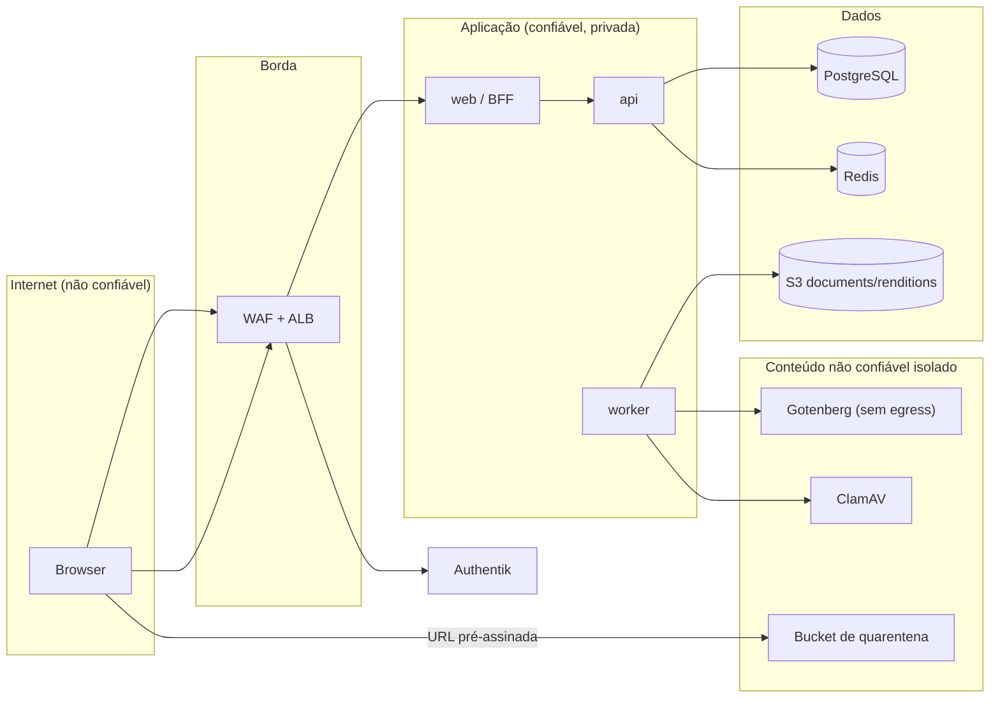

# Segurança

> **Status:** Aceita para especificação · **Data:** 2026-10-05 · **Responsáveis:** Arquitetura/Tech Lead + Segurança
> **Decisões-base:** DEC-130 a DEC-140, DEC-056, DEC-080 a DEC-086, DEC-103 a DEC-105 ([`decisions.md`](decisions.md)).
> **Relacionados:** [`authentication.md`](authentication.md) · [`multi-tenancy.md`](multi-tenancy.md) · [`storage.md`](storage.md) · [`queues.md`](queues.md) · [`observability.md`](observability.md) · [`architecture.md`](architecture.md) · [`../mvp-01/permissions.md`](../mvp-01/permissions.md) · [`../mvp-01/api.md`](../mvp-01/api.md) · ADR-009 (auditoria)
>
> **Legenda:** **†** = nome/valor proposto por este documento, ainda não registrado nas fontes canônicas.

## 1. Escopo e alvo

- **Alvo de verificação:** OWASP ASVS 5.0 **nível 2** para `web` (BFF) e `api`; itens de nível 3 adotados onde o risco justifica (gestão de sessão, controle de acesso multi-tenant, integridade da auditoria).
- **Contexto regulatório:** LGPD (Lei 13.709/2018), Lei 14.133/2021 (segregação de funções, sigilo do orçamento — art. 24), Lei de Acesso à Informação (Lei 12.527/2011) e arquivos públicos (Lei 8.159/1991).
- **Ativos críticos:** (1) isolamento entre tenants; (2) integridade de documentos aprovados, tramitações e auditoria (valor probatório); (3) sigilo do orçamento estimado (POL-09); (4) dados pessoais (CPF de fornecedores PF e usuários); (5) credenciais (sessões, tokens, segredos de integração).

## 2. Modelo de ameaças (STRIDE)



| Componente | Ameaças principais | Mitigações | Ref. |
|---|---|---|---|
| Browser / UI | **S** sequestro de sessão; **T** XSS via conteúdo rico; **I** dados em cache local; **E** ações escondidas na UI chamadas diretamente | Tokens nunca no browser; cookie `__Host-` `HttpOnly`; CSP com nonce; TipTap validado e HTML só no servidor; rascunhos locais cifrados e apagados no logout; a API decide toda autorização | §7, §8, §9 |
| BFF (`web`) | **S** CSRF, *login CSRF*, fixação de sessão; **I** vazamento de tokens/segredos no bundle; **D** força bruta e *credential stuffing* | `SameSite=Lax` + `X-CF-Request` + `Origin`/`Sec-Fetch-Site`; `state`/`nonce`/PKCE com transação ligada ao browser; rotação do id de sessão; `server-only`; rate limit por IP | §6, §7, [`authentication.md`](authentication.md) |
| API | **E** IDOR/BOLA entre tenants e dentro do tenant; **T** *mass assignment*; **R** ações sem trilha; **D** consultas caras | Pipeline de guards + políticas; 404 para não visível; Zod estrito; auditoria transacional; limites por usuário/tenant; `statement_timeout` | §5, §9, §13, [`architecture.md`](architecture.md#62-pipeline-de-guards) |
| Worker | **E** job sem contexto processando outro tenant; **T** payload adulterado no Redis | `runJob` valida `meta`/payload com Zod; payload só com IDs; contexto de tenant obrigatório | [`queues.md`](queues.md) |
| PostgreSQL | **I** vazamento entre tenants; **T** alteração de evidências; **E** papel com privilégio excessivo | RLS `FORCE` + FKs compostas; triggers de imutabilidade; papéis mínimos (sem `BYPASSRLS`, exceto `cf_relay` restrito); TLS obrigatório | [`multi-tenancy.md`](multi-tenancy.md) |
| Redis (sessões e principal) | **S** roubo de sessão a partir de dump; **D** perda de sessões; **T** jobs forjados | Id de sessão armazenado como hash; tokens cifrados no registro; TLS + AUTH/RBAC; rede privada; HA (DEC-131) | §11, [`authentication.md`](authentication.md) |
| S3 | **I** objeto público ou URL vazada; **T** sobrescrita de evidência | Block Public Access; URLs de 300 s após autorização; versionamento/Object Lock; prefixo por tenant verificado | §10, [`storage.md`](storage.md) |
| Authentik | **S** *phishing*/credenciais fracas; **E** conta administrativa do IdP comprometida | MFA (TOTP/WebAuthn); política de senha e reputação; admin do Authentik só com MFA e rede restrita; token de API com permissões mínimas | §4, [`authentication.md`](authentication.md) |
| Gotenberg | **I** SSRF a partir de HTML renderizado (metadados da task, rede interna); **D** documentos gigantes | HTML sanitizado sem recursos externos; *deny list* do Chromium; JavaScript desabilitado; **sem egress**; timeouts e limites de tamanho | §9 |
| ClamAV / uploads | **T** malware, *zip bomb*, polyglot; **D** arquivos que estouram limites | Allowlist por *magic bytes*; quarentena; `AlertExceedsMax`; nunca liberar sem varredura | §10 |
| CI/CD e dependências | **T** pacote comprometido, ação de CI maliciosa, imagem adulterada | Lockfile, atraso mínimo de versão, SBOM, assinatura e verificação de imagens, actions fixadas por SHA, OIDC para a AWS | §19 |
| Operadores da plataforma | **E/I** acesso indevido a dados de clientes | Sem acesso por padrão; vínculo temporário auditado e visível ao cliente (DEC-139); MFA obrigatório | §22 |

## 3. Autenticação (resumo)

Authentik autentica; o ContrataFlow autoriza. Authorization Code + PKCE (S256) com cliente **confidencial** no BFF, escopos `openid profile email offline_access`, `sub` = UUID do usuário no Authentik (DEC-130); sessão opaca no Redis com cookie `__Host-cf_session` (DEC-131); a API valida o JWT e o vínculo a cada requisição (DEC-132). Fluxos, configuração do Authentik, sessão, convite e falhas: [`authentication.md`](authentication.md).

## 4. MFA

- Fatores no Authentik: **TOTP** e **WebAuthn** (chaves de segurança/passkeys); códigos de recuperação estáticos do Authentik como contingência. SMS não é aceito.
- Política por tenant `security.mfaPolicy` (`NONE` | `ADMINS` padrão | `ALL`) — DEC-133, POL-14: a API exige sessão com MFA (claim `amr`) para ações que requerem permissão `HIGH` (sob `ADMINS`) ou para qualquer ação (sob `ALL`); senão 403 `MFA_REQUIRED`, que dispara *step-up* no BFF ([`authentication.md`](authentication.md#8-step-up-de-mfa)).
- Operadores da plataforma: MFA **sempre** obrigatório (permissions.md §8), preferencialmente WebAuthn.
- Redefinição de MFA perdido: feita pelo administrador do tenant com `USER_MANAGE` (`USR-13`, US-090), nunca sobre o próprio vínculo (POL-16) e nunca por autoatendimento só com e-mail; auditada (`membership.mfa_reset`). Quando o próprio administrador perde o fator e não há outro administrador, o operador da plataforma atua mediante chamado e acesso de suporte (DEC-139).

## 5. Autorização e menor privilégio

- **Modelo** (permissions.md §1): autenticado ∧ tenant com acesso conforme status (DEC-132) ∧ vínculo `ACTIVE` vigente ∧ MFA quando exigido ∧ permissão com escopo que cobre o recurso (ou participação) ∧ política contextual. Permissões com `riskLevel` (DEC-134); perfis por tenant; atribuições com escopo e vigência.
- **Políticas contextuais** em código: custódia (POL-01, DEC-023), edição de documento (POL-02), decisão de aprovação e segregação de funções (POL-03, DEC-022), anti-bloqueio (POL-12), anti-escalonamento (POL-13), externos (POL-15: vínculos `EXTERNAL` só recebem perfis com `Role.allowExternalAssignment = true`), autoproteção (POL-16).
- **Visibilidade** (DEC-024): recurso de outro tenant ou não visível → 404; visível sem permissão → 403 com `code` específico.
- **Frontend apenas esconde/desabilita** (DEC-134); toda decisão é refeita na API; `available-actions` usa a mesma implementação das políticas.
- **Menor privilégio por camada:**

| Camada | Aplicação |
|---|---|
| Banco | Papéis `cf_app`, `cf_worker`, `cf_relay`, `cf_platform`, `cf_migrator` com privilégios por tabela; sem `DELETE` onde só há exclusão lógica; auditoria só `INSERT`/`SELECT` ([`multi-tenancy.md`](multi-tenancy.md#52-camada-2--row-level-security)) |
| AWS IAM | Um *task role* por serviço; API: assinar PUT na quarentena e GET em `documents`/`renditions`; worker: ler quarentena, gravar `documents`/`renditions`; ninguém com `s3:*`; KMS restrito por `kms:ViaService` ([`storage.md`](storage.md#31-políticas-comuns-produção)) |
| Authentik | Token de API do ContrataFlow em conta de serviço com permissões apenas sobre usuários do *path* `contrataflow/` (criar, desativar, gerar link de recuperação) |
| Pessoas | Acesso a produção só por pipeline; *break-glass* com MFA, aprovação e gravação de sessão; revisão trimestral de acessos |

## 6. Rate limiting

| Camada | Chave | Limite padrão | Observação |
|---|---|---|---|
| WAF (regra *rate-based*) | IP | 3.000 req/5 min em geral; 300 req/5 min em `/api/auth/*`† | Generoso: **órgãos públicos costumam sair para a internet por um único IP (NAT)** — milhares de servidores podem compartilhar o mesmo endereço; a contenção fina é por usuário |
| BFF — autenticação | IP (último IP adicionado pelo ALB em `X-Forwarded-For`) | 20 req/min (api.md §1.6) | `login`, `callback`, `step-up` |
| API — leitura | usuário + tenant | 600 req/min | api.md §1.6 |
| API — escrita/comandos | usuário + tenant | 120 req/min | |
| API — autosave | usuário + documento | 60 req/min | |
| API — exportações e renderização | usuário + tenant | 20 req/min | Endpoints caros |
| API — intenção de upload | usuário + tenant | 60 req/min | |
| API — global | tenant | 6.000 req/min | Protege os demais tenants (*noisy neighbor*) |
| Authentik | IP + usuário | Política de reputação e limite de tentativas na etapa de senha | Bloqueio progressivo; alerta em pico de falhas |

Implementação: contadores atômicos no Redis principal (janela deslizante por script Lua), chave `cf:{env}:t:{tenantId}:rl:{classe}:{userId}`† (e `cf:{env}:p:rl:auth:{ip}`† no BFF). Respostas 429 `RATE_LIMITED` com `RateLimit-Limit`, `RateLimit-Remaining`, `RateLimit-Reset` e `Retry-After`. Se o Redis principal estiver indisponível, o limite falha **aberto** (o WAF continua ativo) com alerta — disponibilidade acima de precisão de contagem (CA-T-07).

## 7. CORS e CSRF

**CORS (DEC-135):** a API não é exposta a browsers no MVP 1 → nenhum cabeçalho CORS. O BFF é *same-origin* com a UI → também não responde a *preflight* de outras origens; requisições cross-origin com cabeçalhos customizados são barradas pelo próprio browser. O bucket `renditions` tem CORS restrito à origem da aplicação para o visualizador pdf.js ([`storage.md`](storage.md)). MVP 3 (API pública): clientes servidor-a-servidor, CORS apenas se houver caso de uso de browser, com allowlist por cliente.

**CSRF (DEC-135)** — necessário porque o BFF autentica por **cookie**, enviado automaticamente pelo browser:

| Controle | Por quê |
|---|---|
| Cookie `SameSite=Lax` | Bloqueia o envio do cookie em `POST` cross-site; mantém o cookie na navegação de topo vinda do Authentik (necessária no *callback*) |
| Header obrigatório `X-CF-Request: 1` em métodos mutáveis | Formulários e requisições "simples" cross-origin não conseguem adicionar headers sem *preflight* — e o *preflight* não é autorizado |
| `Sec-Fetch-Site: same-origin` (ou `Origin` = `APP_BASE_URL` quando ausente) | Cobre ataques **same-site** cross-origin (ex.: subdomínio comprometido), contra os quais `SameSite` não protege |
| Prefixo `__Host-` | Impede que subdomínios definam/sobrescrevam o cookie (*cookie tossing*) |
| `GET` nunca altera estado | `Lax` envia cookies em navegação de topo `GET` |
| *Login CSRF* | `state` vinculado ao browser por cookie de transação de curta duração ([`authentication.md`](authentication.md#4-login-authorization-code--pkce)) |
| Logout por `POST` | Logout forçado por terceiros não é possível |

Falha → 403 `PERMISSION_DENIED` com registro `access.denied` (`reasonCode = CSRF`†).

## 8. Cabeçalhos de segurança, CSP e IP do cliente

| Cabeçalho | Valor |
|---|---|
| `Strict-Transport-Security` | `max-age=63072000; includeSubDomains; preload` |
| `Content-Security-Policy` | ver abaixo (nonce por requisição gerado no `proxy.ts`) |
| `X-Content-Type-Options` | `nosniff` |
| `Referrer-Policy` | `strict-origin-when-cross-origin` |
| `Permissions-Policy` | `camera=(), microphone=(), geolocation=(), payment=(), usb=(), interest-cohort=()` |
| `X-Frame-Options` | `DENY` (legado; `frame-ancestors 'none'` é o controle principal) |
| `Cross-Origin-Opener-Policy` | `same-origin` |
| `Cache-Control` | `private, no-store` em páginas autenticadas e em `/api/*` |

```
Content-Security-Policy:
  default-src 'self';
  script-src 'self' 'nonce-{nonce}' 'strict-dynamic';
  style-src 'self' 'unsafe-inline';
  img-src 'self' data: blob:;
  font-src 'self';
  connect-src 'self' https://<bucket-quarentena>.s3.sa-east-1.amazonaws.com https://<bucket-renditions>.s3.sa-east-1.amazonaws.com;
  frame-src 'none'; frame-ancestors 'none'; object-src 'none'; base-uri 'none';
  form-action 'self' https://auth.<domínio>;
  upgrade-insecure-requests;
  report-to csp-endpoint
```

Notas: `connect-src` inclui os buckets porque o upload (PUT) e o pdf.js (GET) falam direto com o S3; `form-action` inclui o Authentik porque o logout por formulário termina em redirecionamento para o *end-session* (navegadores aplicam `form-action` a redirecionamentos); `style-src 'unsafe-inline'` é aceito porque componentes Radix e o SSR emitem atributos `style` (risco baixo; scripts continuam estritos) — reavaliar com `style-src-attr`. Violações reportadas a um endpoint interno e monitoradas.

**IP do cliente:** o ALB acrescenta o IP real ao fim de `X-Forwarded-For`; o BFF confia apenas no último salto adicionado pelo ALB (`TRUSTED_PROXY_CIDRS`) e o repassa à API, que confia em `X-Forwarded-For` somente quando a conexão vem do `web`. O IP alimenta rate limit, sessão e `AuditLog.ip`.

## 9. Validação de entrada e sanitização

| Tema | Regra |
|---|---|
| Schema | Zod em todo `body`/`query`/`params` (DEC-054), objetos estritos (campo desconhecido → 422), tipos e formatos fortes (UUID, ISO 8601, decimal como string, CNPJ alfanumérico/CPF com DV) |
| Tamanho | Corpo ≤ 2 MB; seção rica ≤ 1 MB (DEC-056) → 413 `PAYLOAD_TOO_LARGE`; strings, arrays e profundidade de JSON limitados por schema |
| Referências | IDs no corpo validados no escopo do usuário → 422 `REFERENCE_NOT_FOUND` (sem revelar existência em outro tenant) |
| Rich text (TipTap JSON) | Validado contra o schema de `packages/editor`: `Node.fromJSON` + `check()`, allowlist de nós/marks/atributos, links apenas `https:`/`mailto:`, sem imagens (PEND-08), profundidade e tamanho máximos → senão 422 `RICH_TEXT_INVALID` |
| HTML | Gerado **somente no servidor** com as mesmas extensões (`generateHTML`) e sanitizado (DOMPurify com allowlist) antes do PDF; nenhum HTML de usuário é inserido no DOM do cliente; `dangerouslySetInnerHTML` proibido por lint (exceto componente de pré-visualização que recebe HTML já sanitizado pelo servidor) |
| Gotenberg | HTML autocontido (CSS e fontes embutidos); Chromium com JavaScript desabilitado e *deny list* para `file:`/rede; contêiner sem egress (bloqueia SSRF ao endpoint de metadados da task) |
| Saída | React escapa por padrão; mensagens de erro nunca ecoam entrada bruta; JSON com `Content-Type: application/json` e `nosniff` |
| Nomes de arquivo | Normalização NFC, remoção de controle/separadores de caminho/caracteres reservados, ≤ 255 bytes; chave de storage gerada pelo servidor; download com `filename` ASCII + `filename*` UTF-8 (RFC 6266/8187) |
| CSV/planilhas exportados | Células iniciadas por `=`, `+`, `-`, `@`, TAB ou CR recebem prefixo `'` (*CSV/formula injection*); UTF-8 com BOM; separador `;` (Excel pt-BR) |
| Busca | `?q=` parametrizado (FTS/`pg_trgm`), mínimo 2 caracteres, tamanho máximo; nunca concatenado em SQL |
| Regras JSON Logic | Operações em allowlist sobre o `RuleContext` (DEC-016); sem acesso a banco nem execução de código |
| Rascunhos locais (IndexedDB) | Cifrados com chave AES-GCM não extraível gerada por sessão; apagados no logout e na troca de tenant (destruição da chave); TTL 24 h; nunca para documentos `RESTRICTED` |

## 10. Upload seguro (DEC-136)

Fluxo e parâmetros completos em [`storage.md`](storage.md#5-fluxo-de-upload-dec-136) (§5 a §8). Controles:

1. **Intenção** (`POST /attachments`): autorização sobre o alvo; extensão em `uploads.allowedExtensions` (subconjunto da allowlist da plataforma: `pdf, docx, xlsx, odt, ods, csv, txt, png, jpg, jpeg`); MIME declarado coerente; tamanho ≤ `uploads.maxFileSizeMb` (teto 100 MB) → 415 `FILE_TYPE_NOT_ALLOWED` / 413 `FILE_TOO_LARGE`.
2. **URL pré-assinada `PUT` de 300 s** para o bucket de **quarentena**, com `Content-Type` e `Content-Length` **assinados** (o S3 rejeita tamanho/tipo divergente); chave gerada pelo servidor, sem nome de arquivo.
3. **Confirmação** (`POST /attachments/{id}/confirm`) só pelo autor do upload; `HEAD` confere existência e tamanho.
4. **Varredura** (fila `file-scan`): tipo real por *magic bytes* × allowlist × extensão; checagens estruturais (macros em OOXML/ODF, PDF criptografado, dimensões de imagem, razão de compressão); ClamAV com `StreamMaxLength` acima do teto e `AlertExceedsMax`/`AlertEncrypted`/`AlertOLE2Macros` ativos; SHA-256 no mesmo *stream*; assinaturas atualizadas (sem promoção se a base estiver desatualizada).
5. **Promoção** ao bucket `documents` → `AVAILABLE`; ou `INFECTED`/`REJECTED` com `reasonCode`, notificação ao autor e evento de segurança. Nada é servido a partir da quarentena.
6. **Download** por URL pré-assinada `GET` de 300 s com `Content-Disposition: attachment`, `Content-Type` = MIME detectado e `Cache-Control: private, no-store`, após autorização e auditoria `attachment.download`.
7. **Sem execução**: arquivos nunca são abertos/convertidos no servidor além da inspeção estrutural; PDFs do usuário não passam pelo Gotenberg.

## 11. Criptografia

| Camada | Controle |
|---|---|
| Em trânsito | TLS 1.2+ (política ELB `TLS13-1-2`); HSTS; TLS obrigatório no RDS (`rds.force_ssl`) e no ElastiCache; S3 nega requisições sem TLS (`aws:SecureTransport`); SMTP com STARTTLS obrigatório |
| Em repouso | RDS, snapshots e réplicas com CMK; S3 SSE-KMS com *bucket key*; ElastiCache com criptografia em repouso; logs com CMK |
| Aplicação (DEC-086) | CPF (`User.cpfEncrypted`, CPF de `Supplier` PF) e segredos de integração: **AES-256-GCM** com *envelope encryption* (DEK gerada pelo KMS, cifrada pela CMK `app-fields`, mantida em memória por tempo limitado); formato versionado `v1:{keyId}:{iv}:{ciphertext}:{tag}`†; **AAD** = `tenantId|tabela|coluna|id` (impede mover cifrado entre linhas/tenants) |
| *Blind index* | `HMAC-SHA256(valor normalizado, chave)` em coluna própria (ex.: `User.cpfHash`) para busca por igualdade; chave fora do banco (Secrets Manager). Como CPF tem baixa entropia, o índice só protege enquanto a chave for secreta — a chave é tratada como segredo crítico e rotacionada com recálculo em lote |
| Gestão de chaves | CMKs por finalidade e ambiente (`alias/contrataflow-{env}-storage`, `-rds`, `-app-fields`, `-secrets`, `-logs`)†; rotação automática anual; políticas de chave por *task role*; uso registrado no CloudTrail; exclusão com janela de 30 dias e alarme |

## 12. Hash de documentos e integridade

| Artefato | Hash | Quando | Verificação |
|---|---|---|---|
| `DocumentVersion` | `contentHash` = SHA-256 do snapshot em JSON canônico **RFC 8785 (JCS)** (DEC-017, DEC-084) | Criação da versão (imutável por trigger) | Recalcular a partir do snapshot e comparar; exibido na tela de versões |
| Renditions PDF | SHA-256 do binário (DEC-060) | Geração pelo worker | Comparar com o objeto no S3 (checksum SHA-256 do S3) |
| Anexos | `Attachment.sha256` | Varredura | Idem; deduplicação por hash dentro do tenant |
| Workflow e template publicados | Hash do snapshot canônico (`definitionHash`, `contentHash`) | Publicação | Recalcular |
| Auditoria | `rowHash` por registro + `AuditSeal` horário por tenant: `digest` = SHA-256 dos `rowHash` ordenados; `chainHash` = SHA-256(`chainHash` anterior ∥ `digest`) | Job `audit-seal` | `POST /audit/seals/verify` (AUD-05) recalcula a cadeia |

Um job do `maintenance` verifica por amostragem a integridade de versões, renditions e selos e alerta em divergência. O PDF aprovado guarda também o hash da versão de origem no carimbo (`APPROVAL_STAMPED`), permitindo verificação independente.

## 13. Auditoria

Resumo (detalhes em ADR-009 e [`../mvp-01/events.md` §7](../mvp-01/events.md#7-catálogo-de-ações-de-auditoria)): escrita pelo `AuditService` **na mesma transação** do caso de uso (DEC-161); *append-only* (trigger + privilégios `INSERT`/`SELECT`); particionada por mês; selagem horária encadeada; leitura com `AUDIT_VIEW` e exportação com `AUDIT_EXPORT` (ambas auditadas). Eventos de segurança obrigatórios: `auth.session_start`, `auth.session_end`, `auth.session_expired`, `auth.mfa_required`, `auth.tenant_switch`, `access.denied` (amostrado), `membership.*`, `role.*`, `settings.update`, `support.access_grant`/`support.access_revoke`, `attachment.download`, `process.confidential_view`, exportações. `changes` mascara campos sensíveis; conteúdo rico é registrado como hash + tamanho.

## 14. Gestão de segredos

| Segredo | Onde fica | Rotação |
|---|---|---|
| Senhas dos papéis de banco | Secrets Manager (rotação gerenciada do RDS, estratégia de usuários alternados) — ou autenticação IAM do RDS como evolução | 90 dias |
| `OIDC_CLIENT_SECRET` (BFF) | Secrets Manager | 180 dias, coordenada com o Authentik (janela curta; refresh falha durante a troca e as sessões reautenticam) |
| `SESSION_ENCRYPTION_KEY` | Secrets Manager | Anual; suporte a duas chaves (atual + anterior) durante a transição |
| `AUTHENTIK_API_TOKEN` | Secrets Manager | 90 dias (token com expiração no Authentik) |
| Chaves de app (`BLIND_INDEX_KEY`; DEKs) | Secrets Manager / KMS | Blind index: sob incidente ou anual, com recálculo; DEKs: por versão de chave |
| Segredos do Authentik (`AUTHENTIK_SECRET_KEY`, banco) | Secrets Manager | Conforme documentação da versão fixada |
| Credenciais SMTP/SES | Papel IAM (SES via API) — sem segredo estático em produção | — |

Regras: nada em repositório (`gitleaks` em *pre-commit* e no CI + *push protection* do GitHub); `.env` só local; nenhum segredo com prefixo `NEXT_PUBLIC_`; segredos injetados pelo ECS na inicialização da task (rotação = novo *deployment*, documentado em runbook); CI acessa a AWS por OIDC (sem chaves de longa duração); vazamento confirmado → rotação imediata + revisão de logs de uso.

## 15. Logs seguros (DEC-138)

- **Proibido registrar:** tokens (access/refresh/id), cookies e `Set-Cookie`, `Authorization`, senhas, códigos de autorização e `code_verifier`, segredos, CPF, conteúdo de documentos e seções ricas, corpo de upload, valores de orçamento sigiloso, links de convite/recuperação, URLs pré-assinadas completas (contêm assinatura).
- **Padrão *allowlist*:** logs registram campos explicitamente escolhidos (`tenantId`, `userId`, `membershipId`, `correlationId`, rota, status, duração, `code`); corpo de requisição/resposta **nunca** é logado.
- **Redação automática** no pino como segunda barreira:

```ts
// packages de logger (ilustrativo)
pino({
  redact: {
    paths: ['req.headers.authorization', 'req.headers.cookie', 'res.headers["set-cookie"]',
            '*.password', '*.accessToken', '*.refreshToken', '*.idToken', '*.token', '*.clientSecret',
            '*.cpf', '*.cpfEncrypted', '*.draftContent', '*.content', '*.code_verifier', '*.url'],
    censor: '[REDACTED]',
  },
});
```

- E-mails mascarados (`j***@dominio.gov.br`) por função utilitária única; IP completo apenas na auditoria (não nos logs de aplicação).
- O OTel Collector aplica o mesmo filtro em atributos de spans; acesso a logs restrito ao time de operação, com retenção de 90 dias em produção (logs não são auditoria).

## 16. Isolamento de tenant (resumo)

Quatro barreiras independentes — contexto obrigatório + Prisma Client Extension, RLS `FORCE` por transação, FKs compostas e unicidades com `tenant_id` — mais isolamento em cache, storage, filas, auditoria, integrações e observabilidade, verificadas pela suíte *tenant leak* (CA-T-01). Detalhes: [`multi-tenancy.md`](multi-tenancy.md).

## 17. Segurança de infraestrutura e contêineres

- **Rede:** ALB e NAT nas sub-redes públicas; aplicação e dados em sub-redes privadas; dados sem rota para a internet; *security groups* por serviço com origem por SG (nunca `0.0.0.0/0` em portas de dados); API sem *target group* público; VPC endpoints para S3, Secrets Manager, KMS, ECR, CloudWatch Logs e STS.
- **WAF:** AWS Managed Rules (Common, KnownBadInputs, AmazonIpReputationList, SQLi), regras *rate-based* (§6), tamanho máximo de corpo coerente com a API; regras de geolocalização e de IPs anônimos em modo de contagem até decisão de produto (servidores podem usar VPN).
- **Contêineres:** imagens mínimas (distroless ou `-slim`), usuário não-root, `readonlyRootFilesystem`, sem capacidades extras, *health checks*, sem SSH; ECS Exec desabilitado por padrão (habilitação *break-glass* auditada).
- **Metadados:** IMDSv2 obrigatório em qualquer instância EC2 (não há EC2 no desenho base); Gotenberg sem egress impede alcançar o endpoint de credenciais da task.
- **Detecção e conformidade:** CloudTrail (organização, imutável), GuardDuty, Security Hub (CIS/AWS FSBP), AWS Config, alertas de mudança em IAM/SG/KMS.
- **Authentik:** interface administrativa acessível só a administradores com MFA (e, preferencialmente, por allowlist de IP/VPN); versão fixada e atualizada a cada *release* de segurança.

## 18. Backups

Backups do RDS (aplicação e Authentik) e do S3 criptografados com CMK, copiados para **conta AWS de backup separada** na mesma região com AWS Backup *vault lock* (imutável, resistente a ransomware e a comprometimento da conta de produção); restauração testada trimestralmente em conta isolada; acesso aos backups restrito e auditado. RPO/RTO em [`architecture.md`](architecture.md#124-backup-e-recuperação-de-desastres).

## 19. Dependências e cadeia de suprimentos

| Controle | Implementação |
|---|---|
| Reprodutibilidade | `pnpm-lock.yaml` obrigatório; `pnpm install --frozen-lockfile` no CI; versões exatas de runtime e imagens base por *digest* |
| Scripts de instalação | Bloqueados por padrão (pnpm 10); allowlist em `onlyBuiltDependencies` (ex.: Prisma, bibliotecas nativas) |
| Pacotes recém-publicados | `minimumReleaseAge` (ex.: 3 dias) contra pacotes comprometidos; exceções revisadas |
| Atualizações | Renovate semanal agrupado; PRs de segurança imediatos; *automerge* só para *patch* de dependências de desenvolvimento com CI verde |
| Vulnerabilidades | `pnpm audit --audit-level high` + scanner de imagens (Trivy/Grype) — bloqueia CVE crítica/alta com correção disponível; exceções com prazo registrado |
| SBOM | CycloneDX gerado por imagem (Syft) e anexado ao *release* |
| Assinatura | Imagens assinadas (cosign/Sigstore ou AWS Signer) e verificadas no pipeline de deploy antes do `UpdateService` |
| CI | GitHub Actions fixadas por SHA; permissões mínimas do `GITHUB_TOKEN`; OIDC para a AWS; ambientes protegidos com aprovação para produção; *branch protection* + CODEOWNERS |
| Licenças | Verificação de licenças (bloqueia AGPL/SSPL em dependências de runtime sem aprovação) |

## 20. SAST, DAST e testes de segurança

| Tipo | Ferramenta / prática | Quando |
|---|---|---|
| SAST | CodeQL (JS/TS) + Semgrep com regras próprias: `$queryRawUnsafe`, `dangerouslySetInnerHTML`, `systemPrisma` fora da allowlist, `process.env` fora da configuração, log de objetos de requisição, `Math.random` para segredos | Todo PR (bloqueia) |
| Segredos | gitleaks + *push protection* | *Pre-commit* e PR |
| IaC | checkov / `trivy config`, `tflint` | PR de infraestrutura |
| Autorização | Matriz gerada rotas × perfis × escopos e um teste por política (permissions.md §10) | Todo PR |
| Isolamento | Suíte *tenant leak* + testes de RLS ([`multi-tenancy.md`](multi-tenancy.md#14-testes-de-isolamento)) | Todo PR |
| Validação de conteúdo | Testes de propriedade (*fuzzing*) do validador TipTap e do sanitizador HTML com cargas XSS conhecidas | Todo PR |
| DAST | OWASP ZAP *baseline* (passivo) a cada deploy em `staging`; *full scan* autenticado semanal | Pós-deploy / agendado |
| Pentest | Externo, caixa-cinza (§23) | Antes do go-live e anualmente |

## 21. LGPD

**Papéis:** cada **instituição contratante (tenant) é controladora** dos dados pessoais tratados nos seus processos; o **ContrataFlow é operador** (trata por conta e conforme instruções do controlador, em contrato com cláusulas de proteção de dados). O ContrataFlow é controlador apenas dos dados dos próprios operadores da plataforma e de contatos comerciais. Suboperadores (AWS, provedor de e-mail, observabilidade) listados em anexo contratual.

**Bases legais (DEC-140):** execução de políticas públicas e cumprimento de obrigação legal — art. 7º, II e III, e art. 23 (tratamento pelo poder público).

**Inventário de dados pessoais (MVP 1):**

| Entidade | Dados pessoais | Titulares | Finalidade | Proteções |
|---|---|---|---|---|
| `User` | Nome civil e social, e-mail, telefone, CPF (opcional, cifrado + *blind index*), último login, preferências | Servidores, consultores, operadores | Identificação, autenticação, notificação | Mínimo necessário; CPF cifrado (DEC-086); nome social exibido quando presente |
| `TenantMembership` + `MembershipDepartment` | Cargo, matrícula, lotação, tipo de vínculo, validade, datas de convite/ativação/revogação | Servidores, consultores | Autorização e responsabilização | Visível apenas no tenant; histórico preservado |
| `Supplier` (pessoa física) | Nome, CPF (cifrado), e-mail, telefone, endereço | Fornecedores PF | Pesquisa de preços (Lei 14.133, art. 23) | CPF cifrado; dados de contato só para quem vê o processo |
| `Comment`/`Mention` | Texto livre (pode conter dados pessoais), autor, menções | Usuários e terceiros citados | Colaboração no processo | Exclusão lógica; moderação (`COMMENT_MODERATE`) |
| `Attachment`, `Document` (conteúdo) | Dados pessoais eventualmente presentes (currículos, atestados, propostas, fotos com EXIF) | Terceiros diversos | Instrução do processo | Acesso por visibilidade do processo; aviso de EXIF na UI; downloads auditados |
| `AuditLog` | Ator, IP, user-agent, hash da sessão, alterações mascaradas | Usuários | Segurança, responsabilização, conformidade | Imutável; acesso `AUDIT_VIEW` |
| `Notification` | Destinatário, conteúdo resumido | Usuários | Comunicação | Arquivamento após 180 dias (DEC-085) |
| Sessão (Redis) | `userId`, IP, user-agent | Usuários | Segurança da sessão | Expira (ociosidade/absoluta); sem backup |

**Direitos dos titulares (art. 18):** solicitações são recebidas e decididas pelo **controlador** (administrador da instituição/encarregado do órgão); a plataforma fornece meios: exportação dos dados do titular no tenant, correção pelo próprio usuário (`/perfil`) ou pelo administrador, anonimização/bloqueio quando cabível. Eliminação é limitada pelo dever de guarda de documentos públicos e pela temporalidade do órgão (PEND-07); a negativa fundamentada é registrada.

**Encarregado (DPO):** cada controlador indica o seu; o ContrataFlow mantém encarregado próprio para a operação e canal publicado (página de privacidade). Recomenda-se Relatório de Impacto (RIPD) por cliente-piloto.

**Incidentes:** o operador comunica o controlador **sem demora indevida** (prazo contratual proposto: até 24 h† após a confirmação), com natureza, dados e titulares afetados, medidas e riscos; o controlador comunica a ANPD e os titulares no prazo regulamentar (Resolução CD/ANPD nº 15/2024 — 3 dias úteis). Evidências preservadas (§24).

**Minimização e retenção:** coletar só o necessário (CPF de usuário é opcional); retenção conforme a tabela de temporalidade do órgão — sem eliminação automática no MVP 1 (PEND-07).

## 22. Acesso de suporte da plataforma (DEC-139)

1. Operador com `PLATFORM_SUPPORT_ACCESS` (MFA obrigatório) registra o chamado e solicita acesso a um tenant.
2. É criado um vínculo **`EXTERNAL` temporário** (validade ≤ 72 h) com perfil restrito (padrão `SOMENTE_LEITURA`; perfis com permissões `HIGH` vedados por POL-15).
3. Auditoria `support.access_grant` com o número do chamado, gravada **no tenant** com `actorType = PLATFORM_OPERATOR`, visível ao administrador da instituição, que é notificado imediatamente; ações do operador carregam `actorType = PLATFORM_OPERATOR` (e `onBehalfOfUserId` quando aplicável).
4. Expiração automática (job `maintenance`/`MembershipExpired`) ou revogação antecipada (`support.access_revoke`); sessões do operador nesse tenant são encerradas.
5. Proposta†: configuração de tenant para exigir **aprovação prévia** do administrador da instituição antes da concessão.

## 23. Gestão de vulnerabilidades e pentest

| Severidade (CVSS) | Prazo de correção em produção |
|---|---|
| Crítica | 72 h (mitigação imediata se não houver correção) |
| Alta | 14 dias |
| Média | 60 dias |
| Baixa | Próximo ciclo planejado |

- **Pentest externo antes do go-live** do MVP 1 (caixa-cinza, com contas em dois tenants), com foco em: isolamento entre tenants, controle de acesso (IDOR/BOLA, escalonamento de perfis), sessão e OIDC, upload, conteúdo rico/XSS, geração de PDF (SSRF), exportações e sigilo do orçamento. Críticas e altas corrigidas e **retestadas** antes do go-live; repetição anual e após mudanças estruturais (ex.: API pública no MVP 3).
- Canal de divulgação responsável (`/.well-known/security.txt`) e registro de vulnerabilidades com responsável e prazo.

## 24. Resposta a incidentes (resumo)

| Fase | Ações |
|---|---|
| Detecção | Alertas (GuardDuty, WAF, `TenantIsolationViolation`, picos de `access.denied`, malware, falhas de login), relatos de clientes |
| Triagem | Severidade SEV1–SEV4; SEV1 = vazamento entre tenants, comprometimento de credenciais ou indisponibilidade total |
| Contenção | Revogar sessões/tokens, suspender contas ou tenant afetado, bloquear IPs no WAF, rotacionar segredos, isolar tasks |
| Preservação | *Snapshots* do banco, exportação de logs/auditoria/CloudTrail com hash, linha do tempo |
| Comunicação | Controladores afetados no prazo contratual (§21); página de status; comunicação à ANPD pelo controlador |
| Recuperação e lições | Correção, verificação, *postmortem* sem culpados em até 5 dias úteis, ações com dono e prazo |

Runbooks por cenário e plantão: [`observability.md`](observability.md).

## 25. Definition of Done de segurança por card

- [ ] Endpoint com `@RequirePermission`/`@Policy` corretos (ou listado como implícito/público) e testes de 401, 403 (com `code`) e 404 para recurso não visível.
- [ ] Caso adicionado/atualizado na suíte *tenant leak* (IDs de outro tenant → 404; referência no corpo → 422 `REFERENCE_NOT_FOUND`).
- [ ] Schema Zod estrito com limites de tamanho; regras de negócio com `violations[]`.
- [ ] Ação de auditoria do catálogo (events.md §7) gravada na mesma transação; negações registradas.
- [ ] Sem dados pessoais, tokens, conteúdo de documento ou valor sigiloso em logs, eventos, jobs ou mensagens de erro.
- [ ] Valores sigilosos passam pelo `ConfidentialFieldsInterceptor` (POL-09) também em exportações, PDFs e notificações.
- [ ] Mutações com `If-Match`; criações/comandos com `Idempotency-Key` quando o catálogo indicar.
- [ ] Classe de rate limit definida para o endpoint.
- [ ] Novas tabelas conforme o checklist de [`multi-tenancy.md`](multi-tenancy.md#15-checklist-para-novos-módulos-e-tabelas).
- [ ] Conteúdo rico/arquivos/URLs externas tratados conforme §9 e §10.
- [ ] Dependência nova revisada (licença, manutenção, `pnpm audit`).
- [ ] Segredos novos registrados no inventário (§14) e fora do repositório.
- [ ] Mudança de superfície (nova integração, rota pública, novo tipo de arquivo) com nota de ameaças atualizada neste documento.
- [ ] SAST e DAST sem achados novos de severidade alta.

## Referências

DEC-022 a DEC-024, DEC-030, DEC-034, DEC-054, DEC-056, DEC-060, DEC-080 a DEC-086, DEC-103 a DEC-105, DEC-130 a DEC-140, DEC-161; PEND-07, PEND-08, PEND-18; [ADR-002](../adr/adr-002-multi-tenancy.md), [ADR-003](../adr/adr-003-authentication.md), ADR-009; [`../mvp-01/permissions.md`](../mvp-01/permissions.md); [`../mvp-01/api.md`](../mvp-01/api.md); [`../mvp-01/events.md`](../mvp-01/events.md); [`../mvp-01/acceptance-criteria.md`](../mvp-01/acceptance-criteria.md); OWASP ASVS 5.0; RFC 8785; RFC 9457; Resolução CD/ANPD nº 15/2024.
