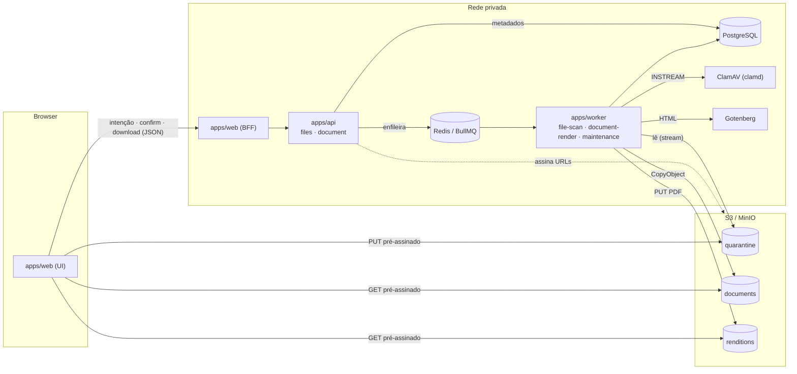
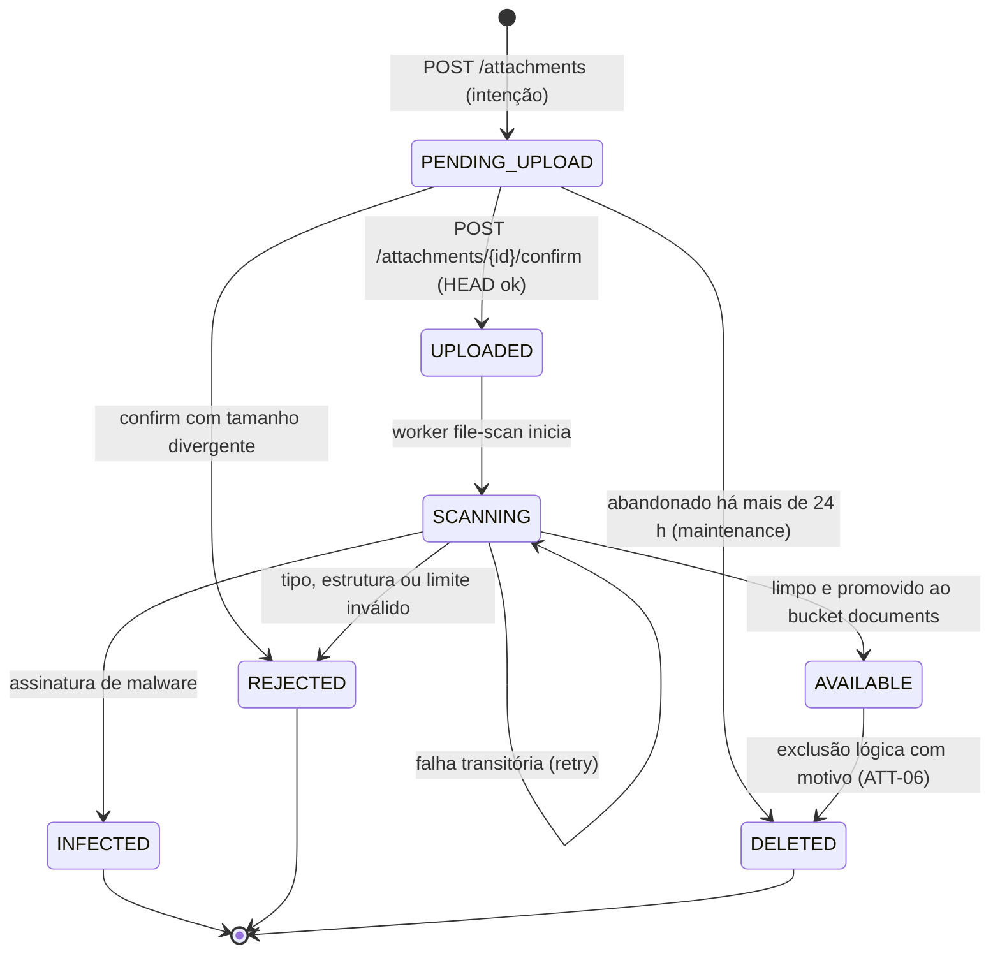
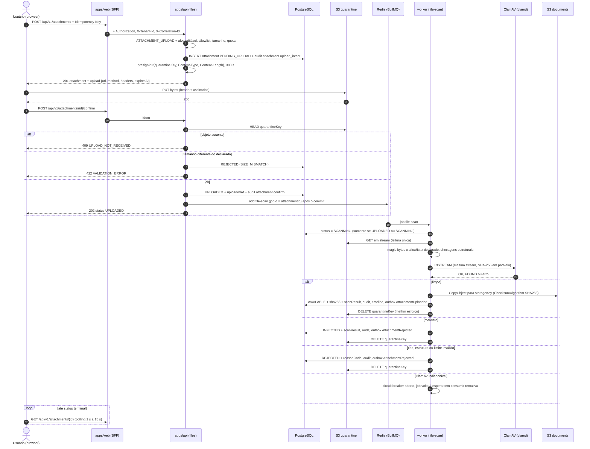

# Armazenamento de arquivos (Storage)

> **Escopo:** binários do ContrataFlow — anexos, ativos do tenant (logo/timbre), renditions de PDF e pré-visualizações — sobre API S3 (MinIO em dev, Amazon S3 em produção).
> **Status:** especificação da fundação + MVP 1.
> **Decisões de base:** DEC-033, DEC-034, DEC-058, DEC-060, DEC-085, DEC-136, DEC-137, DEC-138 · PEND-07, PEND-08, PEND-09, PEND-17 ([decisions.md](decisions.md)).
> **Nomes canônicos:** [`entities.md`](../mvp-01/entities.md) (`Attachment`, `DocumentRendition`, `AttachmentStatus`, `AttachmentTargetType`, `RenditionKind`, `RenditionStatus`, chaves `uploads.*`), [`api.md`](../mvp-01/api.md) (ATT-01…06, DOC-20…23, códigos de erro), [`events.md`](../mvp-01/events.md) (`AttachmentUploaded`, `AttachmentRejected`, `AttachmentDeleted`, ações `attachment.*`).
> **Relacionados:** [queues.md](queues.md) (`file-scan`, `document-render`, `maintenance`) · [observability.md](observability.md) · [security.md](security.md) · [multi-tenancy.md](multi-tenancy.md) · [ADR-006](../adr/adr-006-document-model.md) · [ADR-007](../adr/adr-007-pdf-generation.md) · [ADR-009](../adr/adr-009-audit-trail.md).
>
> Itens marcados **(proposta)** não constam das fontes canônicas e devem ser registrados em `decisions.md`/`entities.md` antes da implementação.

Sumário: [1. Princípios](#1-visão-geral-e-princípios) · [2. StorageService](#2-abstração-storageservice) · [3. Buckets](#3-buckets-e-políticas) · [4. Chaves](#4-layout-de-chaves) · [5. Upload](#5-fluxo-de-upload-dec-136) · [6. Download](#6-download) · [7. Allowlist](#7-allowlist-de-tipos) · [8. Limites](#8-limites-e-quotas) · [9. Integridade](#9-deduplicação-integridade-e-imutabilidade) · [10. Renditions](#10-renditions-de-pdf) · [11. Dev](#11-ambiente-de-desenvolvimento-minio-no-docker-compose) · [12. Backup e retenção](#12-backup-replicação-retenção-e-exclusão) · [13. Isolamento](#13-isolamento-por-tenant) · [14. Observabilidade](#14-observabilidade) · [15. Falhas](#15-falhas-e-recuperação) · [16. Referências](#16-referências)

---

## 1. Visão geral e princípios

| # | Princípio | Consequência prática |
|---|---|---|
| P1 | Binário fora do banco | PostgreSQL guarda metadados (`Attachment`, `DocumentRendition`); os bytes ficam no S3 |
| P2 | O banco decide a autorização | A chave do objeto **não** é credencial nem autorização: todo acesso passa pela API, que aplica DEC-024 e POL-09 e só então assina uma URL |
| P3 | Nada é liberado sem scan | Somente o handler da fila `file-scan` leva um anexo a `AVAILABLE`, e apenas após resultado limpo |
| P4 | Conteúdo não confiável isolado | Uploads entram no bucket de quarentena, que nunca é legível por URL de download |
| P5 | Escrita única (*write-once*) | Chaves definitivas não são sobrescritas pela aplicação; o versionamento do bucket protege contra erro humano |
| P6 | Tenant no caminho **e** na verificação | Toda chave começa com `tenants/{tenantId}/`; o adapter recusa chave fora do tenant do contexto (DEC-132, DEC-164) |
| P7 | Acesso direto e efêmero | O browser envia e baixa direto do S3 por URL pré-assinada de no máximo 5 min; a API nunca trafega o binário |
| P8 | Exclusão lógica | Nada de processo é apagado fisicamente no MVP 1 (DEC-034, PEND-07) |
| P9 | Portabilidade | Somente API S3 padrão (DEC-058); recursos específicos da AWS (Object Lock, CRR, classes de armazenamento) ficam na infraestrutura e são opcionais |



---

## 2. Abstração `StorageService`

Localização: `apps/api/src/modules/platform/storage/` (módulo `platform`, DEC-040), reutilizada pelo worker (DEC-052). Domínio e aplicação dependem apenas da porta; a implementação fica em `infrastructure` (DEC-041).

```ts
// modules/platform/storage/storage.port.ts (ilustrativo)
export type BucketClass = 'quarantine' | 'documents' | 'renditions';

export interface ObjectRef {
  bucket: BucketClass;   // classe lógica; o nome físico vem da configuração do ambiente
  key: string;           // sempre "tenants/{tenantId}/..." (validado pelo adapter)
  versionId?: string;    // fixa a versão exata do objeto (buckets versionados)
}

export interface PresignedRequest {
  url: string;                       // credencial ao portador: NUNCA logar
  method: 'PUT' | 'GET';
  headers: Record<string, string>;   // headers que o cliente DEVE enviar (assinados)
  expiresAt: Date;
}

export interface ObjectHead {
  sizeBytes: number;
  contentType?: string;
  etag: string;
  versionId?: string;
  lastModified: Date;
  checksumSha256?: string;           // base64, quando o objeto possui checksum adicional
  metadata: Record<string, string>;
}

export interface StorageService {
  presignPut(input: {
    ref: ObjectRef; contentType: string; contentLength: number;
    checksumSha256?: string; expiresInSeconds?: number;   // padrão = máximo = 300
  }): Promise<PresignedRequest>;

  presignGet(input: {
    ref: ObjectRef; downloadFileName: string; contentType: string;
    expiresInSeconds?: number;                             // padrão = máximo = 300
  }): Promise<PresignedRequest>;                           // sempre Content-Disposition: attachment

  head(ref: ObjectRef): Promise<ObjectHead | null>;        // null = inexistente

  copy(input: {                                            // cópia server-side com checksum SHA-256
    source: ObjectRef; target: ObjectRef;
    metadata: Record<string, string>; tags?: Record<string, string>;
  }): Promise<ObjectRef>;

  openReadStream(ref: ObjectRef, range?: { start: number; end: number }): Promise<NodeJS.ReadableStream>;

  putStream(input: {                                       // SHA-256 e tamanho calculados em trânsito
    ref: ObjectRef; body: NodeJS.ReadableStream; contentType: string;
    metadata: Record<string, string>; tags?: Record<string, string>;
  }): Promise<{ ref: ObjectRef; sha256: string; sizeBytes: number }>;

  markDeleted(ref: ObjectRef, input: { reason: string; deletedAt: Date }): Promise<void>; // só etiqueta
  purge(ref: ObjectRef): Promise<void>;                    // físico: apenas quarentena e PREVIEW
}
```

Regras obrigatórias da implementação:
- **Guarda de tenant:** toda operação valida `ref.key.startsWith(\`tenants/${ctx.tenantId}/\`)` contra o tenant do contexto (AsyncLocalStorage). Violação = erro de programação (`TenantIsolationViolation`): log `error`, métrica `cf_storage_tenant_guard_violations_total` e alerta de segurança. Chaves são construídas **somente** pelo `StorageKeyBuilder` no servidor; nenhuma chave vem do cliente.
- **Expiração máxima de 300 s** em URLs (DEC-136); valores maiores são recusados.
- **URLs pré-assinadas são credenciais ao portador:** nunca são logadas, persistidas, enviadas por e-mail nem incluídas em notificações (e-mails apontam para a aplicação).
- `purge` recusa `documents` e qualquer rendition que não seja `PREVIEW`; eliminação de evidência só por processo futuro de temporalidade (PEND-07).
- Erros do SDK são traduzidos para `StorageUnavailableError` (transitório → retry no worker ou **503** `DEPENDENCY_UNAVAILABLE` na API) ou `StorageObjectNotFoundError`.
- Toda operação gera span `storage.<operação>` com atributo `cf.bucket_class`; a chave completa só aparece em logs de nível `debug` (contém IDs, nunca nomes de arquivo).

### 2.1 Implementações

| Implementação | Uso | Observações |
|---|---|---|
| `S3StorageService` | Produção (Amazon S3) e dev/teste (MinIO) | AWS SDK v3 (`@aws-sdk/client-s3`, `@aws-sdk/s3-request-presigner`); credenciais pela cadeia padrão (task role no ECS); nunca chaves estáticas em produção |
| `InMemoryStorageService` | Testes unitários | Bootstrap falha se usada fora de `NODE_ENV=test` |

Testes de integração usam MinIO via Testcontainers, com a mesma implementação de produção.

### 2.2 Configuração

| Variável | Dev (Compose) | Produção (AWS) |
|---|---|---|
| `S3_ENDPOINT` | `http://minio:9000` | vazio (endpoint regional) |
| `S3_PUBLIC_ENDPOINT` | `http://localhost:9000` | vazio |
| `S3_REGION` | `us-east-1` | `sa-east-1` (dados no Brasil) |
| `S3_FORCE_PATH_STYLE` | `true` | `false` |
| `S3_BUCKET_DOCUMENTS` · `S3_BUCKET_QUARANTINE` · `S3_BUCKET_RENDITIONS` | `contrataflow-dev-…` | `contrataflow-prod-…` |
| `S3_KMS_KEY_ID` | — (sem SSE-KMS em dev, ver §11) | alias/ARN da CMK do ambiente |
| `UPLOADS_MAX_FILE_SIZE_MB_CEILING` | `100` | `100` (teto da plataforma; entities.md §6) |

> **Armadilha do MinIO em Docker:** a assinatura SigV4 inclui o host. Uma URL assinada para `http://minio:9000` não funciona no browser. Por isso há **dois clientes S3**: um interno (`S3_ENDPOINT`) para operações server-side e outro, usado apenas para pré-assinar, com `S3_PUBLIC_ENDPOINT`.

```ts
// Pré-assinatura de PUT com Content-Type e Content-Length assinados (ilustrativo)
const command = new PutObjectCommand({
  Bucket: buckets.quarantine,
  Key: ref.key,
  ContentType: contentType,
  ContentLength: contentLength,
  ...(checksumSha256 && { ChecksumSHA256: checksumSha256 }),
});
const url = await getSignedUrl(presignClient, command, {
  expiresIn: 300,
  signableHeaders: new Set(['content-type', 'content-length']),
});
// O browser deve enviar exatamente esses headers; tamanho ou tipo divergente → 403 do S3.
```

Como DEC-136 fixa `PUT` (e não `POST` com *policy* `content-length-range`), o limite de tamanho é garantido por **assinar o `Content-Length` declarado** e reverificado no `confirm` (`HEAD`) e no scan (§5).

---

## 3. Buckets e políticas

| Bucket | Conteúdo | Versionamento | Object Lock | Lifecycle | Escrita / leitura |
|---|---|---|---|---|---|
| `contrataflow-{env}-quarantine` | Uploads ainda não verificados (anexos e ativos) | Não | Não | Expira 1 dia após a criação; *multipart* incompleto abortado em 1 dia | Browser (PUT pré-assinado) · worker lê e apaga · API assina PUT e faz `HEAD` |
| `contrataflow-{env}-documents` | Anexos aprovados no scan e ativos do tenant (logo, timbre) | Sim | Não | Classes frias por idade; versões não correntes expiram em 90 dias | Worker (`CopyObject`) · API assina GET |
| `contrataflow-{env}-renditions` | PDFs `CONTENT`, `APPROVAL_STAMPED`, `SIGNED` (MVP 3) e `PREVIEW` | Sim | Habilitado no bucket; retenção por objeto (§9.3) | `PREVIEW` (por tag) expira em 1 dia; demais em classes frias | Worker (PUT) · API assina GET |

**Por que três buckets (e não prefixos em um só):**
1. **Isolamento de conteúdo não confiável** — a política da quarentena nega `GetObject` ao papel da API: nem um bug no código de download consegue entregar arquivo não verificado.
2. **Ciclos de vida distintos** — a quarentena é efêmera e sem versionamento; `documents` e `renditions` são evidência.
3. **Object Lock** precisa estar habilitado no bucket (no MinIO, somente na criação); confiná-lo aos PDFs oficiais evita impor WORM a anexos, cuja retenção depende de PEND-07.
4. **Políticas de backup/replicação e custo por classe** — renditions são regeneráveis a partir do snapshot imutável (ADR-006), mas as de versões aprovadas são evidência; separar permite métricas, custos e replicação distintos.
5. **IAM simples e auditável** — permissões por bucket, sem condições frágeis por prefixo.

Descartado: bucket único com prefixos — filtros de lifecycle por prefixo são literais e não casam `tenants/*/previews/`; versionamento e Object Lock ficariam globais.

### 3.1 Políticas comuns (produção)
- **Block Public Access** (as 4 opções) na conta e em cada bucket; Object Ownership `BucketOwnerEnforced` (ACLs desativadas).
- Negar requisições sem TLS (`aws:SecureTransport = false`) e com TLS < 1.2 (`s3:TlsVersion`) — DEC-137.
- **SSE-KMS por padrão** com CMK por ambiente (`alias/contrataflow-{env}-storage`) e **S3 Bucket Key** (reduz chamadas ao KMS). A política da chave restringe o uso a `kms:ViaService = s3.<região>.amazonaws.com` e aos papéis da API e do worker. Como a criptografia é padrão do bucket, o browser não envia headers de SSE no PUT pré-assinado; o papel que assina precisa de `kms:GenerateDataKey` (PUT) e `kms:Decrypt` (GET).
- Negar `PutObject` que especifique chave KMS diferente da CMK do ambiente.
- **Papel da API:** `s3:PutObject` na quarentena (necessário para assinar o PUT), `s3:GetObject` em `documents`/`renditions` (para assinar GET) e `s3:ListBucket` na quarentena com condição `s3:prefix` iniciando em `tenants/` (sem ele, `HEAD` de objeto inexistente retorna 403 em vez de 404). **Sem** `GetObject` na quarentena e **sem** `DeleteObject` em `documents`/`renditions`.
- **Papel do worker:** `GetObject`/`DeleteObject` na quarentena; `PutObject`, `PutObjectTagging`, `GetObject` em `documents`/`renditions`; `PutObjectLegalHold`/`PutObjectRetention` em `renditions`. Sem `DeleteObject` em `documents`.
- **Break-glass:** papel separado para restauração e correções, com MFA, aprovação dupla e uso auditado (CloudTrail).
- **CloudTrail data events** em `documents` e `renditions`; logs de acesso em bucket de logs separado (sensível: as chaves contêm IDs de tenant e processo).
- **CORS:** quarentena aceita `PUT` da origem da aplicação (headers `content-type`, `content-length`, `x-amz-checksum-sha256`); `renditions` aceita `GET` da origem (pré-visualização com pdf.js); `documents` sem CORS (download é navegação). A CSP do web inclui o endpoint S3 em `connect-src` (DEC-135).

### 3.2 Regras de lifecycle

| Bucket | Regra | Filtro | Ação |
|---|---|---|---|
| quarantine | `expire-unscanned` | todos os objetos | Expira 1 dia após a criação; aborta *multipart* incompleto em 1 dia |
| renditions | `expire-previews` | tag `cf-retention=ephemeral` | Expira em 1 dia; versões não correntes em 1 dia; remove *delete markers* órfãos |
| documents | `tiering` | objetos > 128 KB | Standard → Standard-IA aos **90 dias** → Glacier Instant Retrieval aos **365 dias** |
| renditions | `tiering` | tag `cf-retention=evidence` e > 128 KB | Idem |
| documents | `noncurrent-cleanup` | todos | Versões não correntes expiram em 90 dias (janela de recuperação) |

- **Tags, não prefixos:** o layout começa por `tenants/{tenantId}/`, então só tags permitem regras transversais a todos os tenants. O worker grava `cf-retention=ephemeral` em `PREVIEW` e `cf-retention=evidence` nas demais renditions.
- **Precisão do lifecycle:** o S3 arredonda a expiração para a meia-noite UTC e a remoção é assíncrona — um objeto "de 24 h" pode existir por até ~48 h. Por isso a regra de negócio é aplicada na aplicação: `DocumentRendition.expiresAt` (+24 h) é verificado antes de assinar qualquer GET, e o job `maintenance` marca `PREVIEW` vencidas como `EXPIRED` (DEC-085).
- **Classes frias:** só classes de acesso imediato (Standard-IA e Glacier **Instant** Retrieval), para que URLs pré-assinadas continuem funcionando sem *restore*. Glacier Flexible/Deep Archive ficam proibidas. O filtro "> 128 KB" evita a cobrança mínima por objeto pequeno; os limiares de 90/365 dias são **(proposta)** a recalibrar com S3 Storage Lens após 6 meses de uso. Alternativa equivalente: S3 Intelligent-Tiering sem os níveis *archive*.
- **Renditions de evidência não expiram versões não correntes:** a versão do PDF referenciada por `DocumentRendition` precisa permanecer recuperável mesmo após uma re-renderização excepcional (§10).

---

## 4. Layout de chaves

| Bucket | Padrão de chave | Uso |
|---|---|---|
| quarantine | `tenants/{tenantId}/uploads/{attachmentId}` | Upload em verificação (`Attachment.quarantineKey`). Sem nome de arquivo: conteúdo ainda não confiável |
| documents | `tenants/{tenantId}/processes/{processId}/attachments/{attachmentId}/{nome-sanitizado}` | Anexos com `processId` (todos os `AttachmentTargetType` de processo: `PROCESS`, `DOCUMENT`, `DOCUMENT_VERSION`, `PRICE_SOURCE`, `COMMENT`, `MOVEMENT`, `RISK`) — `Attachment.storageKey` |
| documents | `tenants/{tenantId}/assets/{attachmentId}/{nome-sanitizado}` | Ativos sem processo: `TENANT_ASSET` (logo, timbre, brasão — `branding.logoAttachmentId`, `LayoutDefinition.logo`) e `TEMPLATE_VERSION` |
| renditions | `tenants/{tenantId}/processes/{processId}/documents/{documentId}/versions/{versionNumber}/renditions/content.pdf` | `CONTENT` (uma por versão — *unique* em entities.md) |
| renditions | `…/versions/{versionNumber}/renditions/approval-stamped-{approvalId}.pdf` | `APPROVAL_STAMPED` (uma por versão × aprovação; a mesma versão pode ser aprovada mais de uma vez — DEC-018) |
| renditions | `…/versions/{versionNumber}/renditions/signed-{signatureRequestId}.pdf` | `SIGNED` (MVP 3) |
| renditions | `tenants/{tenantId}/previews/{documentId}/{renditionId}.pdf` | `PREVIEW` de rascunho (por `draftRevision`), tag `cf-retention=ephemeral` |
| renditions | `tenants/{tenantId}/template-previews/{templateVersionId}/{renditionId}.pdf` | `PREVIEW` de template (US-109; estado efêmero em Redis, sem linha em `document_renditions`), tag `cf-retention=ephemeral` |
| — | `tenants/{tenantId}/exports/{exportId}/…` | Reservado: exportações e dossiê do processo (futuro) |

O segmento `{kind}` das renditions é o valor de `RenditionKind` em minúsculas kebab-case, com sufixo discriminador quando o tipo admite mais de uma instância por versão.

**Regras:**
- **Calculada no servidor, na intenção.** `Attachment.storageKey` é obrigatório (entities.md), então a chave definitiva é calculada na intenção; o objeto só passa a existir nela após a promoção (§5).
- **Nome sanitizado:** normalização NFKD, remoção de diacríticos, minúsculas, todo caractere fora de `[a-z0-9._-]` vira `-`, hífens repetidos colapsados, sem `-`/`.` nas pontas, base truncada em 80 caracteres e **extensão canônica do tipo** (nunca a digitada pelo usuário). Ex.: `Orçamento Empresa X (v2).PDF` → `orcamento-empresa-x-v2.pdf`; resultado vazio → `arquivo.<ext>`. O nome original (sanitizado para exibição) fica em `Attachment.fileName` e é usado no `Content-Disposition` do download.
- **Nomes de arquivo podem conter dados pessoais:** nunca aparecem em logs, métricas, metadados do objeto ou na quarentena; o segmento na chave definitiva é reduzido e os logs de acesso do S3 são tratados como sensíveis.
- **Cópia lógica (DEC-033):** a duplicação de processo cria novo `Attachment` com `sourceAttachmentId` e **o mesmo `storageKey`** do original — a chave pode apontar para o caminho de outro processo do mesmo tenant. É esperado: a chave é endereço físico, não vínculo de autorização (P2).
- **Por que o tenant primeiro:** inventário e custo por tenant (S3 Inventory/Storage Lens por prefixo), exportação e *offboarding* por prefixo, guarda de isolamento trivial e distribuição natural de carga entre prefixos (o S3 escala a taxa de requisições por prefixo).
- **Metadados do objeto** (`x-amz-meta-*`): `cf-tenant-id`, `cf-attachment-id` ou `cf-rendition-id`, `cf-sha256` (hex), `cf-schema=1` — nunca nome de arquivo nem dado pessoal. **Tags:** `cf-retention` (`ephemeral`/`evidence`); `cf-deleted=true` e `cf-deleted-at` na exclusão lógica.

---

## 5. Fluxo de upload (DEC-136)

### 5.1 Estados do `Attachment`



- **Invariante P3** — **(proposta)** de `CHECK` em `attachments`: `status <> 'AVAILABLE' OR (sha256 IS NOT NULL AND scanned_at IS NOT NULL AND detected_mime_type IS NOT NULL)`. Só o caso de uso `CompleteFileScan` (worker) escreve `AVAILABLE`.
- Uploads abandonados (`PENDING_UPLOAD` há mais de 24 h) passam a `DELETED` com `deletionReason = "Upload não concluído"` e ator `SYSTEM` — convenção **(proposta)**; o objeto, se existir, já terá sido removido pelo lifecycle da quarentena.

### 5.2 Sequência completa



### 5.3 Detalhes por etapa

**1. Intenção (ATT-02 `POST /attachments`)**
- Autorização: `ATTACHMENT_UPLOAD` + alvo editável (POL-01/POL-02 conforme o alvo; participantes `COLLABORATOR`/`CONSULTANT` incluídos — DEC-036). Processo de outro tenant ou invisível → **404**.
- Validações: extensão em `uploads.allowedExtensions` (subconjunto da allowlist da plataforma, §7) e MIME declarado coerente → senão **415** `FILE_TYPE_NOT_ALLOWED`; `sizeBytes` ≤ `uploads.maxFileSizeMb` (≤ teto de 100 MB) → senão **413** `FILE_TOO_LARGE`; arquivo vazio → **422** `VALIDATION_ERROR`; quota do tenant (§8); *rate limit* de 60 intenções/min por usuário + tenant (api.md §1.6).
- `Idempotency-Key` (DEC-105): a repetição devolve a mesma resposta. Se a URL já expirou, o cliente cria **nova** intenção; a abandonada é limpa pelo `maintenance`.
- Campo opcional **(proposta)** `checksumSha256` (base64, calculado no browser): quando presente, é assinado como `x-amz-checksum-sha256` e o S3 rejeita bytes corrompidos em trânsito. O hash autoritativo continua sendo o calculado no scan.

**2. Upload direto** — PUT com os headers devolvidos; progresso via `XMLHttpRequest.upload.onprogress`. A validade de 300 s é verificada no início da requisição, de modo que uploads lentos iniciados no prazo concluem. Sem *multipart* no MVP 1 (teto de 100 MB).

**3. Confirmação (ATT-03 `POST /attachments/{id}/confirm`)** — somente o próprio `uploadedById`. `HEAD` na quarentena: ausente → **409** `UPLOAD_NOT_RECEIVED`; tamanho divergente (só possível por adulteração, pois o `Content-Length` é assinado) → `REJECTED`. Sucesso → `UPLOADED` + `uploadedAt`, auditoria `attachment.confirm` e enfileiramento de `file-scan` **após o commit** com `jobId = attachmentId`. Se o enfileiramento falhar, o anexo continua `UPLOADED` e o reconciliador o reenfileira ([queues.md](queues.md)). Confirmar de novo um anexo já `UPLOADED`/`SCANNING`/`AVAILABLE` devolve o estado atual, sem efeito colateral.

**4. Scan (fila `file-scan`)** — idempotente e com leitura única do objeto:
1. **Trava de estado:** `UPDATE … SET status = 'SCANNING' WHERE id = $1 AND status IN ('UPLOADED','SCANNING') RETURNING …`. Nenhuma linha (já terminal ou excluído) → job concluído sem efeito.
2. **Stream único** do objeto da quarentena dividido (*tee*) entre: buffer dos primeiros 8 KB para detecção de tipo (`file-type`), `crypto.createHash('sha256')` e o comando `INSTREAM` do clamd (TCP 3310). Falha na checagem de tipo aborta o stream.
3. **Tipo:** detectado ∈ allowlist da plataforma ∩ `uploads.allowedExtensions`, coerente com extensão e MIME declarados (senão `TYPE_MISMATCH`/`TYPE_NOT_ALLOWED`) + checagens estruturais da §7.
4. **ClamAV** (`clamd.conf`): `StreamMaxLength 110M` (o padrão de 25 MB cortaria arquivos válidos), `MaxFileSize`/`MaxScanSize` ≥ teto, `AlertExceedsMax yes` (arquivo além dos limites **nunca** é "limpo por omissão"), `AlertEncrypted yes`, `AlertOLE2Macros yes`, `AlertBrokenExecutables yes`. `OK` → limpo; `FOUND` → `INFECTED`, exceto heurísticas de política (`Heuristics.Encrypted.*` → `REJECTED`/`ENCRYPTED_CONTENT`; `Heuristics.Limits.Exceeded` → `REJECTED`/`SCAN_LIMITS_EXCEEDED`; macros OLE2 → `REJECTED`/`MACRO_CONTENT`). `scanResult` registra motor, versão do motor, versão da base de assinaturas (comando `VERSION`), assinatura e `reasonCode`.
5. **Promoção:** `CopyObject` quarentena → `documents` (`storageKey`) com `ChecksumAlgorithm: SHA256` e metadados `cf-*`; opcionalmente `HEAD` com `ChecksumMode: ENABLED` para conferir o checksum do S3 com o do stream.
6. **Transação única:** `AVAILABLE` + `sha256` + `detectedMimeType` + `scanResult` + `scannedAt`; auditoria `attachment.scan_result` (`SYSTEM`); timeline `ATTACHMENT_ADDED` (síncrona); outbox `AttachmentUploaded` (payload de events.md §4.4).
7. **Limpeza:** `DELETE` do objeto na quarentena (melhor esforço; o lifecycle de 1 dia cobre falhas).

**Rejeições** geram `AttachmentRejected` (`status` `INFECTED`/`REJECTED` + `reasonCode`) → notificação obrigatória `ATTACHMENT_REJECTED` a quem enviou (events.md §6). `INFECTED` também gera log de segurança (`warn`, evento `security.malware_detected`) e alerta informativo (§14). Valores de `reasonCode` **(proposta)**: `MALWARE_DETECTED`, `TYPE_NOT_ALLOWED`, `TYPE_MISMATCH`, `SIZE_MISMATCH`, `EMPTY_FILE`, `ENCRYPTED_CONTENT`, `MACRO_CONTENT`, `SCAN_LIMITS_EXCEEDED`, `MALFORMED_FILE`, `UPLOAD_EXPIRED`.

---

## 6. Download

Endpoints: ATT-05 `GET /attachments/{id}/download` e DOC-23 `GET /document-renditions/{renditionId}/download` → `200 { "data": { "url", "expiresAt" } }`.

| # | Passo | Regra |
|---|---|---|
| 1 | Autorização | Processo visível (DEC-024), senão **404**. Renditions de documento `RESTRICTED` exigem POL-09 (permissions.md §5). Anexos cujo alvo pertence a documento `RESTRICTED` (ex.: evidência de `PriceSource` em pesquisa sigilosa) herdam a exigência de POL-09 (ratificado em permissions.md, POL-09) |
| 2 | Estado | Anexo `AVAILABLE`, senão **409** `ATTACHMENT_NOT_AVAILABLE`; rendition `READY` e com `expiresAt` não vencido, senão **409** `RENDITION_NOT_READY` (o cliente solicita nova pré-visualização) |
| 3 | Auditoria | `attachment.download` / `document.download` (`EXPORT`) gravada **antes** de devolver a URL; falha ao auditar → **503**, nunca URL sem trilha |
| 4 | Assinatura | `presignGet` por 300 s com `ResponseContentDisposition: attachment; filename="<ascii>"; filename*=UTF-8''<percent-encoded>` (RFC 6266/RFC 8187), `ResponseContentType` = `detectedMimeType` (nunca o declarado), `ResponseCacheControl: private, no-store` e `VersionId` quando conhecido |
| 5 | Entrega | O frontend navega até a URL (download). A pré-visualização de PDFs na aplicação usa pdf.js com `fetch` (CORS do bucket `renditions`) |

Por que sempre `attachment`: evita renderização *inline* de conteúdo de terceiros na origem do S3 (PDFs com JavaScript em visualizadores do browser, *MIME sniffing*) — e o S3 não permite acrescentar `X-Content-Type-Options` às respostas.

---

## 7. Allowlist de tipos

A allowlist da **plataforma** no MVP 1 é exatamente o padrão de `uploads.allowedExtensions` (entities.md §6): `pdf, docx, xlsx, odt, ods, csv, txt, png, jpg, jpeg`. O tenant só pode **restringir** (subconjunto), nunca ampliar. O registro técnico (extensão → MIME canônico → detector → checagens) fica em `packages/types` e é usado pela API (intenção) e pelo worker (scan).

| Tipo | Ext. | MIME canônico | Assinatura | Por que entra | Checagens adicionais |
|---|---|---|---|---|---|
| PDF | `pdf` | `application/pdf` | `%PDF-` nos primeiros 1.024 bytes | Formato dos documentos oficiais, propostas, certidões e documentos assinados (ICP-Brasil/PAdES) | PDF criptografado → `REJECTED` (`ENCRYPTED_CONTENT`): não pode ser verificado. O arquivo **nunca** é modificado (preserva assinaturas) |
| DOCX | `docx` | `application/vnd.openxmlformats-officedocument.wordprocessingml.document` | ZIP (`50 4B 03 04`) + `[Content_Types].xml` + `word/document.xml` | Minutas e textos editáveis recebidos de outras áreas | `vbaProject.bin` ou *content-type* de macro → `MACRO_CONTENT`; limites de entradas e de razão de compressão do contêiner |
| XLSX | `xlsx` | `application/vnd.openxmlformats-officedocument.spreadsheetml.sheet` | ZIP + `xl/workbook.xml` | Planilhas de quantitativos, memórias de cálculo, propostas de fornecedores | Idem DOCX |
| ODT | `odt` | `application/vnd.oasis.opendocument.text` | ZIP com 1ª entrada `mimetype` igual ao MIME | ODF é padrão de interoperabilidade de governo (e-PING) e muito usado em prefeituras (LibreOffice) | Macros (`Basic/` no `manifest.xml`) → `MACRO_CONTENT` |
| ODS | `ods` | `application/vnd.oasis.opendocument.spreadsheet` | Idem | Planilhas em LibreOffice | Idem |
| PNG | `png` | `image/png` | `89 50 4E 47 0D 0A 1A 0A` | Capturas de tela como evidência de pesquisa de preços (sítio eletrônico, Painel de Preços) | Dimensão máxima 12.000 × 12.000 px (*decompression bomb*) |
| JPEG | `jpg`, `jpeg` | `image/jpeg` | `FF D8 FF` | Fotos de vistoria, levantamentos e documentos digitalizados | Idem; EXIF pode conter geolocalização — aviso na UI (LGPD) |
| CSV | `csv` | `text/csv` | — (validado como texto) | Exportações do Painel de Preços e de sistemas legados | UTF-8 ou Windows-1252 válido, sem byte NUL, linha ≤ 1 MB. Risco de *CSV injection* ao abrir em planilha: o sistema nunca interpreta o arquivo e o download é sempre `attachment` |
| TXT | `txt` | `text/plain` | — (validado como texto) | Notas e registros de consulta | Mesmas regras de texto |

**Fora da allowlist no MVP 1:**

| Tipo | Motivo | Orientação ao usuário | Reavaliar |
|---|---|---|---|
| ZIP, RAR, 7z, TAR, GZ | Conteúdo interno escapa da allowlist; *zip bombs*; aninhamento; sem pré-visualização; evidência deixa de ser individual | Enviar os arquivos separadamente | Se o piloto demonstrar necessidade, só com inspeção de entradas (cada uma contra a allowlist, sem aninhamento nem criptografia, ≤ 1.000 entradas, razão de compressão ≤ 100:1) |
| DOC, XLS, PPT (OLE2 legado) | Principal vetor histórico de macros maliciosas | Salvar como DOCX/XLSX/ODT/PDF | MVP 2, com rejeição de macros, se houver demanda |
| DOCM, XLSM, PPTM | Macros por definição | — | Não |
| PPTX, ODP | Pouco usados na fase preparatória | Converter para PDF | Sob demanda |
| RTF | Histórico de exploits (ex.: CVE-2017-11882) | PDF ou DOCX | Não |
| HTML, XML, JSON, SVG | Conteúdo ativo (SVG executa JavaScript) | PDF | XML de NF-e no MVP 4, com validação de schema |
| EML, MSG | HTML e anexos embutidos | "Imprimir como PDF" o e-mail de pedido de cotação | Sob demanda |
| P7S, P7M (CAdES) | Assinatura destacada; tratada com a assinatura eletrônica | PDF assinado (PAdES) | MVP 3 |
| TIFF, HEIC, WEBP, GIF, BMP | Sem pré-visualização universal; baixo valor | PNG, JPEG ou PDF | Sob demanda |
| DWG, DXF, IFC | Formatos de projeto pesados, sem checagem estrutural | PDF das pranchas | Quando houver projetos de engenharia (MVP 2+) |
| Executáveis e scripts | Malware | — | Nunca |

---

## 8. Limites e quotas

| Limite | Valor padrão | Onde se configura | Onde é aplicado |
|---|---|---|---|
| Tamanho por arquivo | 50 MB | `uploads.maxFileSizeMb` (tenant) | Intenção (**413** `FILE_TOO_LARGE`), `Content-Length` assinado, `HEAD` no confirm, scan |
| Teto da plataforma | 100 MB | `UPLOADS_MAX_FILE_SIZE_MB_CEILING` | Validação da chave do tenant; `StreamMaxLength` do clamd |
| Validade das URLs | 300 s | fixo (DEC-136) | `StorageService` |
| Intenções de upload | 60/min por usuário + tenant | api.md §1.6 | API (**429** `RATE_LIMITED`) |
| Anexos por alvo | 200 **(proposta)** | variável de ambiente | Intenção (**422** `VALIDATION_ERROR`) |
| Armazenamento por tenant (PEND-17) | 50 GB, avisos em 80% e 95% **(proposta)** | limite técnico da plataforma por tenant | Intenção (**422** `STORAGE_QUOTA_EXCEEDED` — registrado em api.md §2.2; valor do limite em PEND-17; antes: código ausente de api.md) |

- **Medição do uso:** soma de `sizeBytes` dos anexos `AVAILABLE` e `DELETED` (binário retido — PEND-07) + renditions não efêmeras; consulta agregada por `(tenant_id, status)` com cache Redis de 10 min (`cf:{env}:t:{tenantId}:files:usage`) e reconciliação diária no `maintenance`.
- **Renditions nunca são bloqueadas por quota** (geradas pelo sistema; bloquear quebraria aprovações), mas contam no uso.
- Ao cruzar 80%/95%: log `storage.quota_threshold_reached` com `tenantId` (sem label de tenant em métrica — [observability.md](observability.md)) e aviso ao administrador do órgão.

---

## 9. Deduplicação, integridade e imutabilidade

### 9.1 Deduplicação por SHA-256
- **Sem deduplicação física entre tenants**, por quatro motivos: (a) cada tenant é controlador dos seus dados (LGPD) e a fronteira de isolamento é o tenant (DEC-011); (b) deduplicação cruzada cria canal lateral que revela a existência de um arquivo em outro tenant; (c) inviabilizaria chaves de criptografia por tenant no futuro (BYOK, *crypto-shredding*); (d) retenção por tenant (PEND-07) exigiria contagem de referências entre tenants.
- **Dentro do tenant, detecção — não deduplicação.** Com o índice `(tenant_id, sha256)` a API sinaliza duplicatas **(proposta:** `meta.duplicates` em ATT-04) **somente** em processos que o usuário pode ver (DEC-024), evitando oráculo de existência. Exemplo de UX: "Este arquivo já foi anexado em 12/09/2026 por Fulano (Pesquisa de preços)". O único compartilhamento físico é a cópia lógica da duplicação de processo (DEC-033).

### 9.2 Integridade
- **Três hashes com papéis distintos:** `Attachment.sha256` (arquivo enviado, calculado pelo servidor no scan — autoritativo); `DocumentRendition.sha256` (PDF gerado, calculado em trânsito); `DocumentVersion.contentHash` (SHA-256 do snapshot canonicalizado — identifica o **conteúdo** da versão, ADR-006). Todos em hex minúsculo (entities.md §1.2).
- **Checksum no próprio objeto:** cópias e uploads com `ChecksumAlgorithm: SHA256` fazem o S3 armazenar o SHA-256 do objeto inteiro (upload em parte única); `HeadObject` com `ChecksumMode: ENABLED` permite verificar sem baixar.
- **Verificação de fixidez** no `maintenance`: diariamente, amostra por bucket (0,1% ou no mínimo 100 objetos) comparando hash do banco × checksum do S3; semanalmente, amostra menor com download e recálculo. Divergência → incidente de segurança SEV-2 (corrupção ou adulteração) e métrica `cf_storage_fixity_failures_total`.
- **Verificação por terceiros:** o rodapé do PDF exibe `{{document.hash}}` (`LayoutDefinition.showDocumentHashInFooter`), permitindo conferir que um impresso corresponde a uma versão. Endpoint público de verificação: MVP 3.

### 9.3 Object Lock/WORM para renditions de versões aprovadas — **decisão em aberto**

| Opção | Proteção | Reversível? | Risco |
|---|---|---|---|
| **Legal Hold** (sem prazo) | Impede excluir/sobrescrever aquela versão do objeto até remoção explícita | Sim, por quem tem `s3:PutObjectLegalHold` | Depende da governança de IAM |
| Retenção modo *Governance* (N anos) | Idem, por prazo | Sim, com `s3:BypassGovernanceRetention` | Idem |
| Retenção modo *Compliance* (N anos) | Ninguém, nem a conta raiz, remove antes do prazo | **Não** | Prazo errado é irreversível; conflito com eliminação legal (PEND-07) |

**Recomendação:** no MVP 1, o worker aplica **Legal Hold** às renditions `CONTENT`/`APPROVAL_STAMPED` quando a versão fica `FINALIZED`/`APPROVED` (permissão apenas no papel do worker e no break-glass); migrar para retenção *Compliance* depois que PEND-07 definir a temporalidade. O bucket não tem retenção padrão — `PREVIEW` continua expirando normalmente. Anexos (`documents`) não usam WORM no MVP 1: ficam protegidos por versionamento, ausência de `DeleteObject` nos papéis e exclusão apenas lógica. Registrar a decisão em `decisions.md`.

---

## 10. Renditions de PDF

A geração está em [ADR-007](../adr/adr-007-pdf-generation.md) e na fila `document-render` ([queues.md](queues.md)); aqui ficam as regras de armazenamento.

- O worker grava o PDF com `putStream` (SHA-256, tamanho e `pageCount` calculados em trânsito) e só então atualiza `DocumentRendition` para `READY` (`storageKey`, `sha256`, `sizeBytes`, `pageCount`, `readyAt`) e publica `DocumentRenditionReady`.
- Tags: `cf-retention=evidence` (`CONTENT`, `APPROVAL_STAMPED`, `SIGNED`) ou `ephemeral` (`PREVIEW`).
- `PREVIEW`: `expiresAt = readyAt + 24 h` (DEC-060); **(proposta)** reutilizar a `PREVIEW` `READY` ainda válida para o mesmo `(documentId, draftRevision, templateVersionId)` em vez de renderizar de novo.
- Renditions de evidência são de escrita única. Re-renderização de `CONTENT` (ex.: correção de bug do renderizador) é operação excepcional da plataforma, auditada; gera nova versão S3 na mesma chave e a anterior continua recuperável (sem expiração de versões não correntes + Legal Hold). **(proposta)** coluna `storageVersionId` em `DocumentRendition` para fixar os bytes exatos; até lá, a integridade é garantida pela comparação com `sha256`.
- O Gotenberg **não** tem credenciais de storage: o worker lê os ativos (logo/timbre) do S3 e os envia embutidos na requisição multipart.
- PDF/A-2b: PEND-09; `SIGNED`: MVP 3.

---

## 11. Ambiente de desenvolvimento (MinIO no Docker Compose)

Trecho ilustrativo (versões de imagem fixadas em US-078):

```yaml
services:
  minio:
    image: minio/minio:${MINIO_IMAGE_TAG}
    command: server /data --console-address ":9001"
    environment:
      MINIO_ROOT_USER: ${MINIO_ROOT_USER}            # somente no .env local (DEC-137)
      MINIO_ROOT_PASSWORD: ${MINIO_ROOT_PASSWORD}
      MINIO_API_CORS_ALLOW_ORIGIN: http://localhost:3000
    ports: ["9000:9000", "9001:9001"]                # API S3 e console
    volumes: ["minio-data:/data"]
    healthcheck:
      test: ["CMD", "mc", "ready", "local"]
      interval: 5s
      retries: 20

  minio-init:                                        # bootstrap idempotente; termina após configurar
    image: minio/mc:${MC_IMAGE_TAG}
    depends_on:
      minio: { condition: service_healthy }
    env_file: .env
    entrypoint: ["/bin/sh", "/scripts/minio-bootstrap.sh"]
    volumes:
      - ./infra/minio/minio-bootstrap.sh:/scripts/minio-bootstrap.sh:ro
      - ./infra/minio/contrataflow-app-policy.json:/policies/contrataflow-app.json:ro

  clamav:
    image: clamav/clamav:stable                      # clamd + freshclam; 1º start baixa a base (~1–2 min, ~3 GB RAM)
    ports: ["3310:3310"]
    volumes: ["./infra/clamav/clamd.conf:/etc/clamav/clamd.conf:ro", "clamav-db:/var/lib/clamav"]
```

```sh
# infra/minio/minio-bootstrap.sh (ilustrativo)
mc alias set local http://minio:9000 "$MINIO_ROOT_USER" "$MINIO_ROOT_PASSWORD"
mc mb --ignore-existing local/contrataflow-dev-quarantine
mc mb --ignore-existing local/contrataflow-dev-documents
mc mb --ignore-existing --with-lock local/contrataflow-dev-renditions   # Object Lock só na criação (implica versionamento)
mc version enable local/contrataflow-dev-documents
mc ilm rule add --expire-days 1 local/contrataflow-dev-quarantine
mc ilm rule add --expire-days 1 --tags "cf-retention=ephemeral" local/contrataflow-dev-renditions
mc ilm rule add --noncurrent-expire-days 90 local/contrataflow-dev-documents
# usuário da aplicação com política restrita aos três buckets (espelha o menor privilégio da produção)
mc admin user add local "$S3_ACCESS_KEY_ID" "$S3_SECRET_ACCESS_KEY"
mc admin policy create local contrataflow-app /policies/contrataflow-app.json
mc admin policy attach local contrataflow-app --user "$S3_ACCESS_KEY_ID"
```

- **Credenciais de dev** só no `.env` local (o repositório traz `.env.example` com placeholders; `gitleaks` no CI). A aplicação usa o usuário `contrataflow-app`, nunca o root.
- **Diferenças conhecidas em relação à produção:** sem SSE-KMS (o MinIO exige KES), CORS global via `MINIO_API_CORS_ALLOW_ORIGIN`, sem Bucket Key, classes de armazenamento e CloudTrail. O código não depende de headers de criptografia (criptografia padrão do bucket em produção), então o caminho é o mesmo; a validação de KMS acontece em homologação na AWS.
- **ClamAV em dev é obrigatório** (US-078). Testes de scan geram a string de teste EICAR em tempo de execução — nunca versionada, pois antivírus locais colocariam arquivos do repositório em quarentena. `FakeScanner` só existe em testes unitários e o bootstrap falha se for configurado com `NODE_ENV=production`.
- **Risco (materializado):** a imagem oficial `minio/minio`/`minio/mc` deixou de ser distribuída no Docker Hub. O Compose da US-078 usa o *build* comunitário `pgsty/minio`/`pgsty/mc` fixado por *digest* (DEC-065); se ele também parar, as alternativas S3-compatíveis mapeadas para dev (ex.: SeaweedFS, Garage) continuam viáveis porque só usamos a API S3 (DEC-058). O bootstrap real está em `infra/minio/minio-bootstrap.sh`.

---

## 12. Backup, replicação, retenção e exclusão

### 12.1 Backup e recuperação
- A durabilidade do S3 protege contra falha de hardware, não contra erro lógico ou ataque. As defesas são: versionamento (`documents`, `renditions`), ausência de `DeleteObject` nos papéis da aplicação, retenção de 90 dias das versões não correntes, Legal Hold nas renditions de evidência e, em produção, **AWS Backup para S3** (backup contínuo com PITR de até 35 dias + snapshots periódicos) em cofre com *vault lock* numa **conta separada** (proteção contra comprometimento da conta e *ransomware*).
- **Consistência banco × storage:** como objetos de `documents`/`renditions` nunca são sobrescritos nem apagados fisicamente, restaurar o PostgreSQL (PITR do RDS) para qualquer instante continua encontrando todos os binários referenciados. Objetos criados após o ponto de restauração viram órfãos inofensivos, detectados pelo relatório de reconciliação do `maintenance`.
- Metas **(proposta)**: perda de binários confirmados = zero; RTO ≤ 4 h para restaurar os objetos de um tenant a partir de versões ou backup. Alinhar com a estratégia de DR do banco em [architecture.md](architecture.md).

### 12.2 Replicação entre regiões (opcional)
- O S3 Standard já replica entre ≥ 3 zonas de disponibilidade da região. CRR para outra região serve apenas a DR regional; se habilitada, replica somente `documents` e renditions com tag `evidence` (nunca quarentena ou `PREVIEW`), com CMK própria na região de destino e Replication Time Control se for exigido RPO de 15 min.
- **Residência de dados:** só há uma região AWS no Brasil (`sa-east-1`). Replicar para fora do país é transferência internacional (LGPD, art. 33) e pode conflitar com cláusulas de contratos públicos. **Padrão do MVP 1: sem CRR**; habilitar só após parecer jurídico. Alternativa sem transferência: backup em outra conta na mesma região.

### 12.3 Retenção e exclusão lógica × física

| Situação | Banco | Objeto | Responsável |
|---|---|---|---|
| Upload abandonado (> 24 h) | `DELETED` (sistema) | Removido pelo lifecycle da quarentena | `maintenance` |
| Anexo `INFECTED`/`REJECTED` | Registro mantido (evidência do bloqueio) | Apagado da quarentena | worker |
| Exclusão de anexo (ATT-06) | `DELETED` + `deletedAt` + `deletionReason`; evento `AttachmentDeleted` | **Mantido**; tags `cf-deleted`; download negado (**409** `ATTACHMENT_NOT_AVAILABLE`) | Usuário (DEC-034) |
| `PREVIEW` vencida | `EXPIRED` | Removida pelo lifecycle | `maintenance` + S3 |
| Rendition de evidência | Permanente | Permanente (Legal Hold) | — |
| Eliminação por temporalidade | — | **Não existe no MVP 1** (PEND-07) | Futuro: aprovação dupla, termo de eliminação, auditoria e remoção de versões, réplicas e backups |
| Encerramento de tenant (`OFFBOARDING`) | — | Exportação (manifesto + arquivos + hashes) e eliminação conforme contrato | Futuro card de plataforma |

---

## 13. Isolamento por tenant

| Camada | Mecanismo |
|---|---|
| Autorização | Toda URL é emitida pela API depois de RLS (DEC-082), visibilidade (DEC-024) e POL-09 |
| Chave | Prefixo `tenants/{tenantId}/` construído no servidor |
| Adapter | Guarda compara o prefixo com o tenant do contexto — também no worker, que abre o contexto do job (DEC-164) |
| URL | Pré-assinada **por objeto**, 300 s, nunca para prefixo ou listagem |
| Listagem | A API não expõe listagem de bucket; `ListBucket` apenas na quarentena e restrito a `tenants/` |
| Deduplicação | Nenhuma entre tenants (§9.1) |
| Metadados | `cf-tenant-id` em cada objeto, para auditoria e conciliação |
| Testes | Cenário "tenant incorreto" nos critérios de aceite (README §2.3): ID de anexo/rendition de outro tenant → **404**; teste unitário da guarda; teste de integração com MinIO |
| Futuro | CMK por tenant (BYOK) para órgãos que exigirem — viabilizada pelo prefixo por tenant |

---

## 14. Observabilidade

Sem `tenantId` como label (cardinalidade — [observability.md](observability.md)); investigação por tenant via logs e traces.

| Métrica | Tipo | Labels |
|---|---|---|
| `cf_upload_intents_total` | counter | `result` (`created`, `type_not_allowed`, `too_large`, `quota_exceeded`) |
| `cf_upload_confirmations_total` | counter | `result` (`uploaded`, `not_received`, `size_mismatch`) |
| `cf_file_scan_duration_seconds` | histogram | `result` |
| `cf_file_scan_results_total` | counter | `result` (`clean`, `infected`, `rejected`, `error`), `reason_code` |
| `cf_file_scan_bytes_total` | counter | — |
| `cf_attachments_stuck` | gauge | `status` (`UPLOADED`, `SCANNING` há mais de 15 min) |
| `cf_clamav_up` · `cf_clamav_signature_age_seconds` | gauge | — |
| `cf_storage_operation_duration_seconds` | histogram | `operation`, `bucket_class`, `outcome` |
| `cf_storage_presign_total` | counter | `operation`, `bucket_class` |
| `cf_storage_fixity_failures_total` · `cf_storage_tenant_guard_violations_total` | counter | `bucket_class` / — |

- **Logs:** `file.upload_intent.created`, `file.scan.completed` (`attachmentId`, `result`, `reasonCode`, `durationMs`, `sizeBytes`, `detectedMimeType`) e `security.malware_detected` (`warn`, com assinatura). Nunca nome de arquivo nem URL pré-assinada (DEC-138).
- **Alertas** (detalhes e runbooks em [observability.md](observability.md)): ClamAV indisponível > 5 min (alto); idade da base de assinaturas > 24 h (médio); `cf_attachments_stuck` > 0 por 30 min (alto); taxa de erro do scan > 5% em 15 min (médio); `infected` > 0 (informativo, canal de segurança); falha de fixidez ou violação da guarda de tenant (crítico, segurança).

---

## 15. Falhas e recuperação

| Falha | Comportamento | Recuperação |
|---|---|---|
| ClamAV indisponível | Circuit breaker abre; `file-scan` pausa o consumo **sem consumir tentativas**; anexos ficam `UPLOADED`/`SCANNING` — **nunca** `AVAILABLE`; a UI mostra "Verificando arquivo…" | Breaker fecha e os jobs retomam; o reconciliador reenfileira órfãos; runbook em observability.md |
| Base de assinaturas desatualizada | Scan continua com a base anterior + alerta | Corrigir o freshclam; opcionalmente re-scan dos anexos do período (job manual auditado) |
| S3 indisponível na intenção ou no download | **503** `DEPENDENCY_UNAVAILABLE` com `Retry-After` | Automática |
| S3 indisponível no scan ou na renderização | Erro transitório → retry com backoff | Automática; DLQ se persistir |
| Falha entre `CopyObject` e o `UPDATE` | Status permanece `SCANNING`; o retry repete a cópia (mesmo destino, idempotente) e o `UPDATE` condicional | Automática |
| Worker encerrado durante o scan | Job *stalled* volta à fila | Automática (BullMQ) |
| Enfileiramento falha após o confirm | Anexo `UPLOADED` sem job | Reconciliador ([queues.md](queues.md)) |
| URL expirada antes do PUT | S3 responde 403 | Cliente cria nova intenção |
| Confirm sem objeto | **409** `UPLOAD_NOT_RECEIVED` | Refazer o PUT (se a URL vale) ou nova intenção |
| Objeto expirou na quarentena antes do scan (fila parada > 24 h) | Scan encontra 404 → `REJECTED` (`UPLOAD_EXPIRED` **(proposta)**) + notificação | Usuário reenvia |
| KMS com *throttling* | Erro transitório | Retry; Bucket Key reduz chamadas |
| clamd sem memória / reinício | Health check falha; breaker abre | Orquestrador reinicia; dimensionar ≥ 3 GB por réplica |

**Garantia:** em nenhuma falha um anexo é liberado sem scan — o único caminho para `AVAILABLE` é um resultado `OK` do clamd no mesmo job que validou o tipo e calculou o hash do mesmo stream.

---

## 16. Referências
- Decisões: DEC-033, DEC-034, DEC-058, DEC-060, DEC-082, DEC-085, DEC-136, DEC-137, DEC-138; pendências PEND-07, PEND-08, PEND-09, PEND-17 — [decisions.md](decisions.md).
- Fontes canônicas: [entities.md](../mvp-01/entities.md) (§4.7, §4.9, §6), [api.md](../mvp-01/api.md) (§1.6, §2.2, §3.3, §3.12), [events.md](../mvp-01/events.md) (§4.4, §6, §7), [permissions.md](../mvp-01/permissions.md) (POL-01, POL-02, POL-09).
- Arquitetura: [queues.md](queues.md), [observability.md](observability.md), [security.md](security.md), [multi-tenancy.md](multi-tenancy.md), [ADR-006](../adr/adr-006-document-model.md), [ADR-007](../adr/adr-007-pdf-generation.md), [ADR-009](../adr/adr-009-audit-trail.md).
- Stories: US-064, US-067, US-068, US-069, US-078, US-109.
- Externas: RFC 6266 e RFC 8187 (`Content-Disposition`); documentação do Amazon S3 (Object Lock, lifecycle, checksums adicionais, presigned URLs); documentação do ClamAV (`clamd.conf`, `INSTREAM`).
