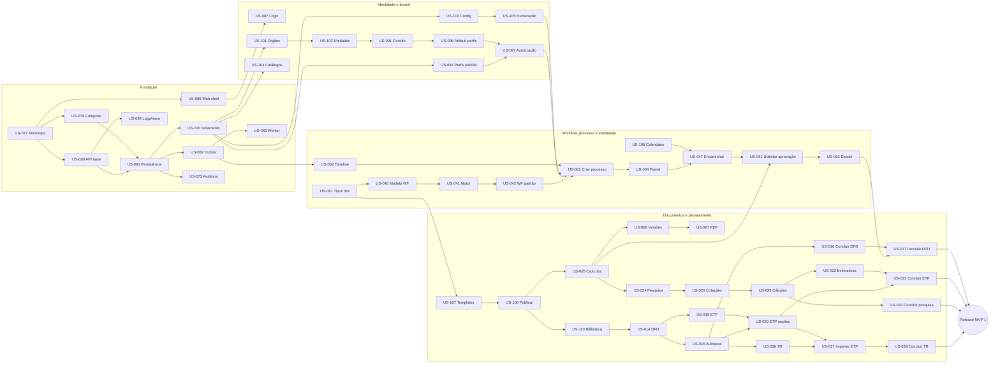

# MVP 1 — Plano de Entrega e Sequência de Implementação

> Backlog priorizado, dependências, ordem recomendada, estimativas e a **proposta de sequência de implementação do MVP 1**.
> Fonte dos itens: [features.md](features.md). Riscos e decisões: [risks-and-decisions.md](risks-and-decisions.md). Release: [release-checklist.md](release-checklist.md).

Sumário: [1. Premissas](#1-premissas-de-planejamento) · [2. Estimativas](#2-estimativas-consolidadas) · [3. Backlog priorizado](#3-backlog-priorizado) · [4. Dependências e caminho crítico](#4-dependências-e-caminho-crítico) · [5. Sequência de implementação](#5-proposta-de-sequência-de-implementação) · [6. Marcos](#6-marcos-e-entregas-incrementais) · [7. Trilhas paralelas](#7-trilhas-paralelas-e-alocação) · [8. Cenários de capacidade](#8-cenários-de-capacidade) · [9. Postergados](#9-itens-postergados)

---

## 1. Premissas de planejamento

| Premissa | Valor adotado |
|---|---|
| Sprint | 2 semanas |
| Escala de pontos | XS = 1 · S = 2 · M = 5 · L = 8 · XL = 13 (≈ 1 dia-dev por ponto) |
| Squad de referência | 6 desenvolvedores (3 back/full-stack, 2 front-end, 1 plataforma/DevOps-dev), 1 QA/SDET, 1 designer de produto (UX/UI), 1 PO, 1 Tech Lead (50% codificando) |
| Velocidade estimada | 25–30 pts nas sprints 1–2 (ramp-up); **40–45 pts** a partir da sprint 3 |
| Sprint 0 | 2 semanas de preparação (contas de nuvem, Authentik, design system inicial, decisões pendentes críticas) |
| Definição de pronto | [release-checklist.md §1](release-checklist.md) e DoD de cada card |
| Cliente-piloto | 1 prefeitura de porte médio para validação contínua a partir do marco M3 |

Decisões de sprint 0 (bloqueavam a implementação) **fechadas em 2026-10-07** com os padrões adotados: PEND-01 → DEC-028 (numeração na criação), PEND-04 → DEC-020 (método `AUTO_CV`, faixas 70%/130%), PEND-06 → DEC-141 (domínio único), PEND-10 → DEC-061 (GitHub Actions), PEND-15 → DEC-021 (escala 5×5). As demais têm padrão adotado e podem ser decididas até a sprint indicada em [risks-and-decisions.md §8](risks-and-decisions.md#8-regras-que-precisam-de-decisão-de-produto).

## 2. Estimativas consolidadas

| Épico | Stories | P0 | P1 | P2 | Pontos |
|---|---|---|---|---|---|
| EP-001 Processo de contratação | 13 | 7 | 4 | 2 | 71 |
| EP-002 DFD | 5 | 4 | 0 | 1 | 25 |
| EP-003 ETP | 5 | 5 | 0 | 0 | 28 |
| EP-004 Pesquisa de preços | 9 | 7 | 1 | 1 | 45 |
| EP-005 Mapa de riscos | 3 | 2 | 1 | 0 | 15 |
| EP-006 Termo de Referência | 4 | 4 | 0 | 0 | 23 |
| EP-007 Workflow | 7 | 3 | 3 | 1 | 44 |
| EP-008 Tramitação | 9 | 8 | 1 | 0 | 51 |
| EP-009 Caixa de tarefas | 3 | 2 | 0 | 1 | 18 |
| EP-010 Timeline | 2 | 2 | 0 | 0 | 10 |
| EP-011 Documentos | 10 | 6 | 3 | 1 | 56 |
| EP-012 Comentários | 2 | 1 | 1 | 0 | 10 |
| EP-013 Auditoria | 3 | 2 | 1 | 0 | 18 |
| EP-014 Dashboard | 1 | 1 | 0 | 0 | 8 |
| EP-015 Fundação técnica | 10 | 9 | 1 | 0 | 59 |
| EP-016 Identidade, acesso e RBAC | 12 | 9 | 3 | 0 | 57 |
| EP-017 Tenant e estrutura organizacional | 8 | 7 | 1 | 0 | 37 |
| EP-018 Templates de documentos | 4 | 3 | 1 | 0 | 23 |
| EP-019 Notificações | 4 | 2 | 1 | 1 | 17 |
| **Total** | **114** | **84** | **22** | **8** | **615** |

Por prioridade: **P0 = 480 pts** · **P1 = 104 pts** · **P2 = 31 pts**. Escopo do release do MVP 1 = P0 + P1 = **584 pts**.

## 3. Backlog priorizado

Ordem de prioridade = prioridade de negócio (P0 → P2) **ajustada pelo caminho crítico de dependências**. A coluna "Sprint" refere-se à proposta da seção 5.

| # | Story | Título | Prio | Est | Pts | Sprint |
|---|---|---|---|---|---|---|
| 1 | US-077 | Configurar monorepo e padrões de código | P0 | M | 5 | 1 |
| 2 | US-078 | Ambiente local com Docker Compose | P0 | M | 5 | 1 |
| 3 | US-079 | Pipeline de CI com quality gates | P0 | M | 5 | 1 |
| 4 | US-080 | Esqueleto da API modular | P0 | L | 8 | 1 |
| 5 | US-086 | Shell da aplicação web, design system e cliente de API | P0 | L | 8 | 1 |
| 6 | US-081 | Persistência com Prisma e concorrência otimista | P0 | M | 5 | 2 |
| 7 | US-084 | Logs estruturados, correlationId e tracing | P0 | M | 5 | 2 |
| 8 | US-082 | Eventos de domínio com outbox transacional | P0 | L | 8 | 2 |
| 9 | US-100 | Contexto de tenant e isolamento de dados | P0 | L | 8 | 2 |
| 10 | US-087 | Login OIDC com Authentik e sessão segura no BFF | P0 | L | 8 | 2 |
| 11 | US-083 | Worker com filas, retries e dead letter | P0 | M | 5 | 3 |
| 12 | US-073 | Registrar auditoria transacional | P0 | L | 8 | 3 |
| 13 | US-088 | Logout, expiração e renovação de sessão | P0 | M | 5 | 3 |
| 14 | US-089 | Recuperação de senha | P0 | S | 2 | 3 |
| 15 | US-094 | Catálogo de permissões e perfis padrão | P0 | M | 5 | 3 |
| 16 | US-101 | Gerenciar órgãos/entidades | P0 | S | 2 | 3 |
| 17 | US-102 | Gerenciar secretarias e setores | P0 | M | 5 | 3 |
| 18 | US-103 | Configurações gerais do tenant | P0 | M | 5 | 3 |
| 19 | US-099 | Provisionar tenant com dados padrão | P0 | M | 5 | 4 |
| 20 | US-104 | Catálogos parametrizáveis | P0 | M | 5 | 4 |
| 21 | US-105 | Numeração configurável e segura sob concorrência | P0 | M | 5 | 4 |
| 22 | US-112 | E-mails transacionais | P0 | M | 5 | 4 |
| 23 | US-091 | Convidar usuário e ativar vínculo | P0 | M | 5 | 4 |
| 24 | US-096 | Atribuir perfis com escopo e vigência | P0 | M | 5 | 4 |
| 25 | US-097 | Autorização na API e no frontend | P0 | L | 8 | 4 |
| 26 | US-061 | Gerenciar tipos de documento | P1¹ | M | 5 | 4 |
| 27 | US-092 | Gerenciar usuários e lotações | P0 | M | 5 | 5 |
| 28 | US-095 | Gerenciar perfis e matriz de permissões | P0 | M | 5 | 5 |
| 29 | US-040 | Modelo de definição de workflow versionado | P0 | L | 8 | 5 |
| 30 | US-107 | Criar e editar template de documento | P0 | L | 8 | 5 |
| 31 | US-106 | Calendário de dias úteis e feriados | P1¹ | S | 2 | 5 |
| 32 | US-059 | Projetar eventos do processo na timeline | P0 | M | 5 | 5 |
| 33 | US-041 | Motor de execução: ações disponíveis e regras | P0 | L | 8 | 6 |
| 34 | US-042 | Workflow padrão e seleção por aplicabilidade | P0 | M | 5 | 6 |
| 35 | US-108 | Publicar versão de template e definir padrão | P0 | M | 5 | 6 |
| 36 | US-001 | Criar processo de contratação | P0 | L | 8 | 6 |
| 37 | US-002 | Listar, pesquisar, filtrar e ordenar processos | P0 | L | 8 | 6 |
| 38 | US-111 | Central de notificações in-app | P0 | M | 5 | 6 |
| 39 | US-004 | Detalhe do processo com painel situacional | P0 | L | 8 | 7 |
| 40 | US-005 | Editar dados do processo | P0 | M | 5 | 7 |
| 41 | US-006 | Gerenciar itens da contratação | P0 | M | 5 | 7 |
| 42 | US-047 | Encaminhar processo | P0 | L | 8 | 7 |
| 43 | US-049 | Assumir processo recebido pela unidade | P0 | S | 2 | 7 |
| 44 | US-060 | Visualizar timeline com filtros | P0 | M | 5 | 7 |
| 45 | US-048 | Devolver processo | P0 | M | 5 | 8 |
| 46 | US-050 | Atribuir e reatribuir responsável | P0 | M | 5 | 8 |
| 47 | US-054 | Histórico de tramitações | P0 | M | 5 | 8 |
| 48 | US-055 | Prazos em dias úteis e detecção de atrasos | P0 | M | 5 | 8 |
| 49 | US-065 | Ciclo de vida do documento | P0 | L | 8 | 8 |
| 50 | US-110 | Biblioteca de templates padrão | P0 | M | 5 | 8 |
| 51 | US-066 | Versionamento imutável e comparação | P0 | M | 5 | 9 |
| 52 | US-051 | Solicitar aprovação e resolver o aprovador | P0 | L | 8 | 9 |
| 53 | US-052 | Decidir aprovação | P0 | L | 8 | 9 |
| 54 | US-056 | Caixa de tarefas unificada | P0 | L | 8 | 9 |
| 55 | US-068 | Upload seguro de anexos | P0 | L | 8 | 9 |
| 56 | US-067 | Gerar PDF de documentos | P0 | L | 8 | 10 |
| 57 | US-069 | Visualizar e baixar anexos | P0 | S | 2 | 10 |
| 58 | US-057 | Lista de aprovações | P0 | M | 5 | 10 |
| 59 | US-062 | Painel de documentos do processo | P0 | M | 5 | 10 |
| 60 | US-014 | Elaborar DFD em wizard a partir de template | P0 | L | 8 | 10 |
| 61 | US-015 | Editar DFD com autosave, retomada e conflito | P0 | M | 5 | 10 |
| 62 | US-016 | Revisar, concluir e enviar o DFD para aprovação | P0 | M | 5 | 11 |
| 63 | US-017 | Decisão sobre o DFD e propagação ao processo | P0 | M | 5 | 11 |
| 64 | US-009 | Cancelar processo ou descartar rascunho | P0 | M | 5 | 11 |
| 65 | US-010 | Concluir processo (planejamento da contratação) | P0 | M | 5 | 11 |
| 66 | US-071 | Comentar no processo e em documentos | P0 | M | 5 | 11 |
| 67 | US-075 | Consultar e exportar a trilha de auditoria | P0 | M | 5 | 11 |
| 68 | US-019 | Criar ETP com importação do DFD | P0 | M | 5 | 11 |
| 69 | US-020 | Editar seções do ETP | P0 | L | 8 | 12 |
| 70 | US-021 | Gerenciar alternativas de solução | P0 | M | 5 | 12 |
| 71 | US-024 | Criar pesquisa de preços | P0 | M | 5 | 12 |
| 72 | US-025 | Cadastrar e manter fornecedores | P0 | M | 5 | 12 |
| 73 | US-026 | Registrar fontes e cotações | P0 | L | 8 | 12 |
| 74 | US-027 | Desconsiderar e restaurar cotação | P0 | S | 2 | 12 |
| 75 | US-033 | Registrar e avaliar riscos | P0 | M | 5 | 12 |
| 76 | US-029 | Calcular estatísticas e valor estimado | P0 | M | 5 | 13 |
| 77 | US-031 | Mapa comparativo e exportação | P0 | M | 5 | 13 |
| 78 | US-032 | Concluir a pesquisa de preços | P0 | M | 5 | 13 |
| 79 | US-022 | Estimar quantidades e vincular valor | P0 | M | 5 | 13 |
| 80 | US-023 | Validar completude do ETP e concluí-lo | P0 | M | 5 | 13 |
| 81 | US-034 | Gerenciar ações de tratamento de riscos | P0 | M | 5 | 13 |
| 82 | US-036 | Criar TR e editar suas seções | P0 | L | 8 | 13 |
| 83 | US-037 | Importar dados do ETP para o TR | P0 | M | 5 | 14 |
| 84 | US-038 | Especificar itens e condições do TR | P0 | M | 5 | 14 |
| 85 | US-039 | Validar e concluir o TR | P0 | M | 5 | 14 |
| 86 | US-076 | Dashboard operacional por perfil | P0 | L | 8 | 14 |
| 87 | US-085 | Health checks, métricas e dashboards técnicos | P1 | M | 5 | 14 |
| 88 | US-114 | Lembretes de prazo e alertas de atraso | P1 | M | 5 | 14 |
| 89 | US-013 | Sigilo do orçamento estimado | P1 | M | 5 | 14 |
| 90 | US-008 | Suspender e retomar processo | P1 | M | 5 | 15 |
| 91 | US-012 | Gerenciar participantes do processo | P1 | M | 5 | 15 |
| 92 | US-011 | Duplicar processo | P1 | M | 5 | 15 |
| 93 | US-030 | Outliers e alertas de conformidade | P1 | M | 5 | 15 |
| 94 | US-035 | Matriz de riscos e documento Mapa de Riscos | P1 | M | 5 | 15 |
| 95 | US-053 | Retirar ou redirecionar aprovação | P1 | M | 5 | 15 |
| 96 | US-090 | Política de MFA e step-up | P1 | M | 5 | 15 |
| 97 | US-093 | Selecionar órgão ativo | P1 | S | 2 | 15 |
| 98 | US-043 | Editor de workflow | P1 | L | 8 | 16 |
| 99 | US-044 | Regras de etapa e transição | P1 | M | 5 | 16 |
| 100 | US-045 | Publicar, versionar e aposentar workflow | P1 | M | 5 | 16 |
| 101 | US-063 | Documento livre a partir de template | P1 | M | 5 | 16 |
| 102 | US-064 | Documento externo (upload) com versões | P1 | M | 5 | 16 |
| 103 | US-072 | Mencionar usuários e unidades | P1 | M | 5 | 16 |
| 104 | US-074 | Selagem de integridade da auditoria | P1 | M | 5 | 17 |
| 105 | US-098 | Meu perfil e preferências | P1 | S | 2 | 17 |
| 106 | US-109 | Layout de impressão | P1 | M | 5 | 17 |
| 107 | US-003 | Visões salvas e exportação CSV | P2 | M | 5 | pós-release |
| 108 | US-007 | Etiquetas do processo | P2 | S | 2 | pós-release |
| 109 | US-018 | Duplicar DFD | P2 | S | 2 | pós-release |
| 110 | US-028 | Importar cotações por planilha | P2 | M | 5 | pós-release |
| 111 | US-046 | Diagrama do workflow | P2 | M | 5 | pós-release |
| 112 | US-058 | Ações em lote na caixa | P2 | M | 5 | pós-release |
| 113 | US-070 | Indicador de edição concorrente | P2 | M | 5 | pós-release |
| 114 | US-113 | Preferências de notificação | P2 | S | 2 | pós-release |

¹ US-061 e US-106 são P1 como funcionalidade de **administração**, mas seus núcleos técnicos (tipos de documento semeados e `BusinessCalendarFacade`) são pré-requisitos de stories P0 (US-040/US-065 e US-047/US-055); por isso entram cedo. Se a capacidade apertar, implementa-se primeiro o núcleo (seed + fachada) e a tela administrativa depois.

## 4. Dependências e caminho crítico

**Caminho crítico** (sequência mais longa de dependências até o planejamento da contratação concluído):
`US-077 → US-080 → US-081 → US-100 → US-094 → US-097 → US-001 → US-004 → US-047 → US-051 → US-052 → (US-017) → US-019/US-020 → US-037 → US-039`, em paralelo com a trilha documental `US-061 → US-107 → US-108 → US-065 → US-066 → US-067`. Qualquer atraso em US-100 (isolamento), US-097 (autorização), US-041 (motor) ou US-065 (ciclo de documentos) desloca o release — são os quatro itens de maior risco técnico e devem ter os desenvolvedores mais experientes, *pairing* e revisão de arquitetura obrigatória.

## 5. Proposta de sequência de implementação

| Sprint | Tema | Stories | Pts | Resultado demonstrável |
|---|---|---|---|---|
| 0 | Preparação | Decisões PEND críticas (já fechadas em 2026-10-07); contas AWS/GitHub; protótipos navegáveis das telas P0 (designer); spikes: RLS + Prisma (transação por consulta × interativa), Gotenberg + fontes, Authentik blueprint | — | Decisões fechadas, protótipos validados com o piloto, spikes com resultado registrado em ADR |
| 1 | Fundação | US-077, US-078, US-079, US-080, US-086 | 31 | `pnpm dev:up` sobe tudo; API e web "hello" com CI verde |
| 2 | Base técnica e login | US-081, US-084, US-082, US-100, US-087 | 34 | Login real via Authentik; RLS ativa com teste de vazamento; evento no outbox |
| 3 | Plataforma e estrutura | US-083, US-073, US-088, US-089, US-094, US-101, US-102, US-103 | 37 | Worker processando; auditoria transacional; estrutura organizacional cadastrada |
| 4 | Acesso e parametrização | US-099, US-104, US-105, US-112, US-091, US-096, US-097, US-061 | 43 | Tenant provisionado por CLI; convite por e-mail; perfis com escopo aplicados na API |
| 5 | Administração e base de workflow | US-092, US-095, US-040, US-107, US-106, US-059 | 33 | Admin gerencia usuários/perfis; workflow e templates modelados |
| 6 | Processo nasce | US-041, US-042, US-108, US-001, US-002, US-111 | 39 | **Criar e listar processos** com workflow padrão; notificações in-app |
| 7 | Painel e tramitação | US-004, US-005, US-006, US-047, US-049, US-060 | 33 | **Painel situacional** e encaminhamento entre unidades com timeline |
| 8 | Tramitação completa e documentos | US-048, US-050, US-054, US-055, US-065, US-110 | 33 | Devolução, atribuição, prazos em dias úteis; ciclo de documentos com templates padrão |
| 9 | Aprovações e anexos | US-066, US-051, US-052, US-056, US-068 | 37 | **Aprovações por etapa** com segregação; caixa de tarefas; upload seguro |
| 10 | PDF e DFD | US-067, US-069, US-057, US-062, US-014, US-015 | 33 | **DFD em wizard** com autosave e PDF |
| 11 | DFD fim a fim e colaboração | US-016, US-017, US-009, US-010, US-071, US-075, US-019 | 35 | **Marco M3:** demanda formalizada e aprovada ponta a ponta; comentários; auditoria consultável |
| 12 | ETP, pesquisa e riscos (I) | US-020, US-021, US-024, US-025, US-026, US-027, US-033 | 38 | ETP por seções; pesquisa com fontes e cotações; registro de riscos |
| 13 | Pesquisa e ETP (II), TR (I) | US-029, US-031, US-032, US-022, US-023, US-034, US-036 | 38 | Valor estimado calculado; ETP concluído; tratamentos de risco; TR iniciado |
| 14 | TR e indicadores | US-037, US-038, US-039, US-076, US-085, US-114, US-013 | 38 | **Marco M4:** planejamento da contratação concluído (até a aprovação da autoridade); dashboard |
| 15 | P1 de processo e aprovação | US-008, US-012, US-011, US-030, US-035, US-053, US-090, US-093 | 37 | Suspensão, participantes, duplicação, outliers, mapa de riscos, MFA |
| 16 | P1 de administração e documentos | US-043, US-044, US-045, US-063, US-064, US-072 | 33 | Editor de workflow e regras; documentos livres/externos; menções |
| 17 | P1 finais + endurecimento | US-074, US-098, US-109 + correções de performance/segurança | 12 + hardening | Selagem de auditoria; layout de impressão; testes de carga e pentest |
| 18 | Release | UAT com o piloto, migração de dados iniciais (estrutura/usuários), treinamento, go-live | — | **Marco M5: Release do MVP 1** |

Observações:
- As sprints 15–17 têm folga deliberada (≈ 33–37 pts contra capacidade de 40–45) para absorver riscos do caminho crítico e o *hardening*.
- Se a velocidade real ficar abaixo de 38 pts nas sprints 3–6, aplicar o plano de contingência: (1) adiar US-109 e US-074 para pós-release; (2) entregar US-043/US-044/US-045 como "edição assistida por configuração" (sem editor visual) mantendo o workflow padrão; (3) adiar US-064 e US-063 (documentos livres e externos podem entrar como anexos no MVP 1).
- Cada sprint termina com demo para o cliente-piloto a partir da sprint 6.

## 6. Marcos e entregas incrementais

| Marco | Fim da sprint | Critério de saída | Uso |
|---|---|---|---|
| **M1 — Plataforma** | 4 | Login, tenant provisionado, estrutura, usuários convidados, perfis e auditoria funcionando com isolamento verificado | Demo interna; validação de segurança arquitetural |
| **M2 — Tramitação digital** | 8 | Processo criado, encaminhado, devolvido, atribuído, com prazos, timeline e caixa de unidade | Alfa com o piloto (dados sintéticos) |
| **M3 — Demanda formalizada** | 11 | DFD fim a fim com aprovação e PDF; comentários; auditoria consultável | Beta fechado com 1 secretaria do piloto |
| **M4 — Planejamento da contratação concluído** | 14 | ETP, pesquisa de preços, riscos, TR e aprovação da autoridade até `COMPLETED` | Beta ampliado no piloto |
| **M5 — Release MVP 1** | 18 | Todos os P0 e P1; checklist de release completo | Produção para pilotos (até 3 órgãos) |

## 7. Trilhas paralelas e alocação

| Trilha | Responsáveis sugeridos | Stories (ordem) |
|---|---|---|
| Plataforma e segurança | Tech Lead + dev plataforma | US-077, 078, 079, 080, 081, 084, 082, 083, 100, 073, 085, 074 |
| Identidade e administração | 1 back + 1 front | US-087, 088, 089, 094, 101, 102, 103, 099, 104, 105, 091, 096, 097, 092, 095, 106, 093, 090, 098 |
| Workflow e tramitação | 1 back sênior + 1 front | US-040, 041, 042, 001, 002, 004, 047, 049, 048, 050, 054, 055, 051, 052, 056, 057, 053, 043, 044, 045 |
| Documentos e planejamento | 1 back/full-stack + 1 front | US-061, 107, 108, 110, 065, 066, 067, 068, 069, 062, 014, 015, 016, 017, 019, 020, 021, 022, 023, 036, 037, 038, 039, 109, 063, 064 |
| Pesquisa de preços e riscos | 1 back/full-stack (entra na sprint 11) | US-024, 025, 026, 027, 029, 031, 032, 033, 034, 030, 035 |
| Colaboração, notificações e painel | front + back de apoio | US-059, 060, 111, 112, 071, 114, 076, 072 |
| Qualidade | QA/SDET | Suíte "tenant leak" (desde a sprint 2), matriz RBAC (sprint 4), E2E por marco, carga (sprints 14 e 17) |
| UX | Designer | Protótipos 1–2 sprints à frente do desenvolvimento; testes de usabilidade com o piloto a cada marco |

## 8. Cenários de capacidade

| Cenário | Capacidade | Duração estimada para P0 + P1 (584 pts) |
|---|---|---|
| Squad de referência (6 devs) | 40–45 pts/sprint | **Sprint 0 + 17 sprints de desenvolvimento + 1 de release ≈ 38 semanas** |
| Squad enxuto (4 devs) | 26–30 pts/sprint | ≈ 22 sprints (≈ 46 semanas) — recomenda-se reduzir o escopo P1 |
| Dois squads (10–11 devs, trilhas paralelas) | 70–75 pts/sprint | ≈ 10–11 sprints (≈ 24 semanas) — exige Tech Lead dedicado por squad e contratos de API congelados cedo |

## 9. Itens postergados

| Item | Motivo | Destino |
|---|---|---|
| Stories P2 (US-003, US-007, US-018, US-028, US-046, US-058, US-070, US-113) | Não bloqueiam o planejamento da contratação | Pós-release do MVP 1 (sprints de estabilização) |
| Migração de processos em andamento para nova versão de workflow | Complexidade e risco (DEC-014) | MVP 2 (junto com regras condicionais) |
| Etapas paralelas e aprovação com múltiplos aprovadores | PEND-13 | MVP 2 |
| Edição colaborativa em tempo real | PEND-12 | Avaliar após MVP 2 |
| Painel de backoffice da plataforma (UI) | Provisionamento por CLI/API atende os pilotos | MVP 2 |
| Registro manual de publicação / status `PUBLISHED` | PEND-16 | MVP 3 |
| Assinatura eletrônica dos documentos | Escopo do MVP 3 | MVP 3 |
| Importação de catálogo CATMAT/CATSER e consulta ao painel de preços | Integrações externas | MVP 3/MVP 5 |
| Recalcular prazos em aberto após alteração de feriados | P2 (documentado em US-106) | Pós-release |
| Conversão DOCX → PDF para pré-visualização | P2 (documentado em US-064) | Pós-release |
