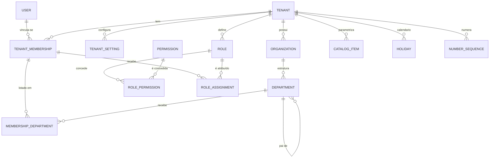
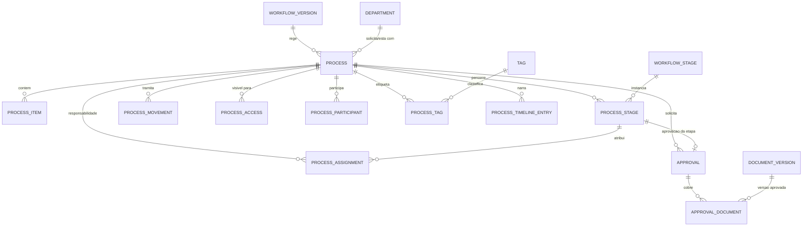
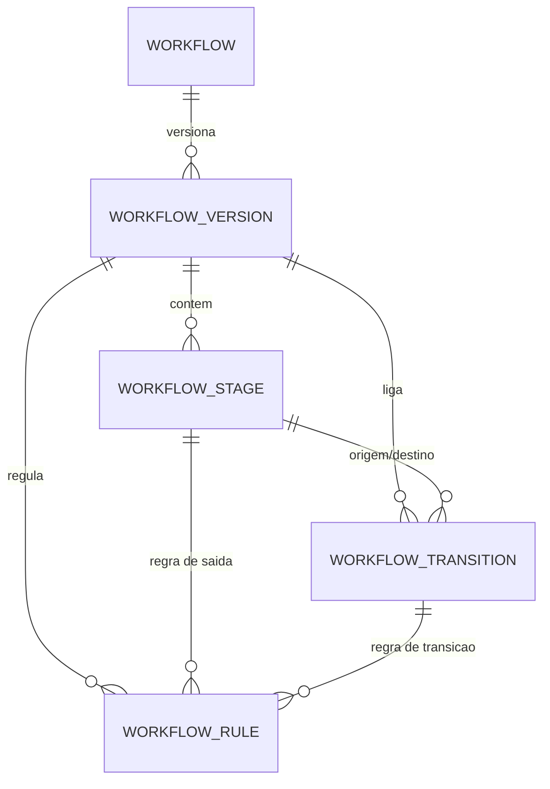
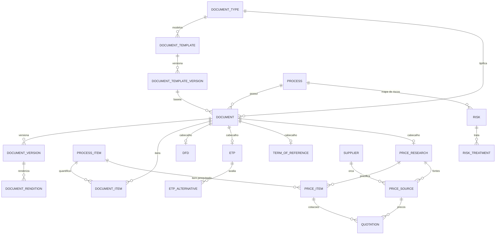
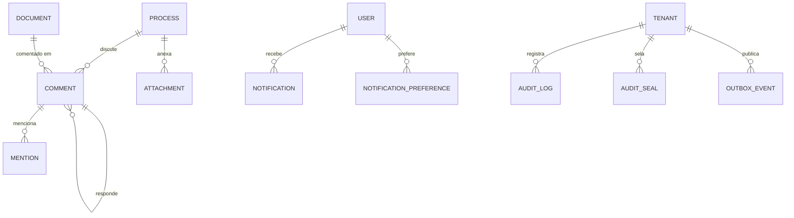

# MVP 1 — Modelo de Dados (Entidades)

> **Documento canônico** de entidades, campos, enums, índices, constraints e relacionamentos do MVP 1.
> Decisões de base: [DEC-002, DEC-003, DEC-080 a DEC-086](../architecture/decisions.md). Visão de domínio e ERD conceitual de todos os MVPs: [domains.md](../architecture/domains.md).
> Notação de tipos: PostgreSQL (`uuid`, `varchar(n)`, `text`, `int`, `smallint`, `bigint`, `numeric(p,s)`, `boolean`, `date`, `timestamptz`, `jsonb`, `inet`, `citext`, `tsvector`, `<Enum>`). No Prisma: modelo PascalCase singular, campo camelCase com `@map` para snake_case, tabela com `@@map`.

Sumário: [1. Convenções](#1-convenções) · [2. Enums](#2-enums) · [3. Diagramas ER](#3-diagramas-er-do-mvp-1) · [4. Entidades](#4-entidades) · [5. Estruturas JSON](#5-estruturas-json-canônicas) · [6. Configurações do tenant](#6-registro-de-configurações-do-tenant-tenantsetting) · [7. Dados semeados](#7-dados-semeados-no-provisionamento) · [8. Entidades futuras](#8-entidades-de-mvps-futuros-reservadas) · [9. Migrações previstas](#9-migrações-previstas-para-os-próximos-mvps)

---

## 1. Convenções

### 1.1 Colunas padrão
Quando uma entidade indicar **Padrão**, ela contém:

| Campo | Tipo | Null | Default | Observações |
|---|---|---|---|---|
| `id` | uuid | não | UUIDv7 (aplicação) | PK |
| `tenantId` | uuid | não | — | FK `tenants.id`; RLS; parte de toda FK composta |
| `createdAt` | timestamptz | não | `now()` | |
| `updatedAt` | timestamptz | não | `now()` | `@updatedAt` |
| `createdById` | uuid | sim | — | FK `users.id` (nulo quando ação de sistema) |
| `updatedById` | uuid | sim | — | FK `users.id` |
| `version` | int | não | `1` | Concorrência otimista; incrementado a cada alteração; exposto como `ETag` |

Marcadores adicionais:
- **+SD** → possui `deletedAt timestamptz NULL` (exclusão lógica; `deletedById uuid NULL`). Unicidades usam índice parcial `WHERE deleted_at IS NULL`.
- **Imutável** → sem `updatedAt`/`updatedById`/`version`; trigger bloqueia `UPDATE` e `DELETE` (exceto colunas explicitamente listadas como "mutável").
- Toda tabela de negócio tem `UNIQUE (tenant_id, id)` para permitir FKs compostas (DEC-081). Nas tabelas abaixo isso está implícito e **não** é repetido.
- Toda FK entre tabelas de negócio é composta: `(tenant_id, <fk>) → <tabela>(tenant_id, id)`. FKs para `users` e `permissions` (tabelas de plataforma) são simples.
- RLS `ENABLE` + `FORCE` com política `tenant_id = current_setting('app.tenant_id')::uuid` em toda tabela com `tenant_id` (DEC-082). Exceções descritas na entidade.
- `ON DELETE`: padrão `RESTRICT`. `CASCADE` somente onde indicado (filhos sem significado próprio).

### 1.2 Tamanhos e formatos recorrentes
| Conceito | Tipo | Validação |
|---|---|---|
| CNPJ | `varchar(14)` | Normalizado sem máscara, maiúsculas; aceita formato **alfanumérico** (IN RFB 2.229/2024): 12 posições `[0-9A-Z]` + 2 DV numéricos (cálculo com valor ASCII − 48) |
| CPF | criptografado (`bytea`) + `varchar(64)` blind index | 11 dígitos + DV |
| E-mail | `citext` | RFC 5322 simplificado, máx. 254 |
| Telefone | `varchar(20)` | E.164 ou nacional normalizado |
| CEP | `char(8)` | 8 dígitos |
| UF | `char(2)` | Lista de UFs |
| Cor | `varchar(7)` | `#RRGGBB` |
| Hash | `varchar(64)` | SHA-256 hexadecimal minúsculo |
| Rich text | `jsonb` | Documento TipTap validado contra `packages/editor` (máx. 1 MB por campo) |

---

## 2. Enums

> Valores técnicos são estáveis; rótulos pt-BR em [terminology.md](../product/terminology.md). Enums marcados *(registro)* são `varchar` validados por registro em `packages/types` (extensíveis sem migração).

| Enum | Valores |
|---|---|
| `TenantType` | `MUNICIPALITY`, `CITY_COUNCIL`, `AUTARCHY`, `PUBLIC_CONSORTIUM`, `FOUNDATION`, `PUBLIC_COMPANY`, `OTHER` |
| `TenantStatus` | `PROVISIONING`, `ACTIVE`, `SUSPENDED`, `OFFBOARDING`, `DEACTIVATED` |
| `OrganizationType` | `DIRECT_ADMINISTRATION`, `FUND`, `AUTARCHY`, `FOUNDATION`, `PUBLIC_COMPANY`, `MIXED_CAPITAL_COMPANY`, `PUBLIC_CONSORTIUM`, `LEGISLATIVE`, `OTHER` |
| `DepartmentType` | `SECRETARIAT`, `BOARD`, `DEPARTMENT`, `DIVISION`, `SECTOR`, `COMMITTEE`, `OTHER` |
| `UserStatus` | `ACTIVE`, `BLOCKED`, `DEACTIVATED` |
| `MembershipType` | `INTERNAL`, `EXTERNAL`, `SERVICE` |
| `MembershipStatus` | `INVITED`, `ACTIVE`, `SUSPENDED`, `REVOKED`, `EXPIRED` |
| `ScopeType` | `TENANT`, `ORGANIZATION`, `DEPARTMENT`, `OWN_DEPARTMENTS` |
| `PermissionRiskLevel` | `LOW`, `MEDIUM`, `HIGH` |
| `CatalogType` | `CONTRACTING_TYPE`, `MODALITY`, `PROCESS_ORIGIN`, `UNIT_OF_MEASURE`, `RISK_CATEGORY`, `PRICE_SOURCE_TYPE`, `JUDGMENT_CRITERION`, `ATTACHMENT_CATEGORY` |
| `HolidayScope` | `NATIONAL`, `STATE`, `MUNICIPAL`, `OPTIONAL` |
| `ProcessStatus` | `DRAFT`, `IN_PROGRESS`, `AWAITING_APPROVAL`, `RETURNED`, `SUSPENDED`, `CANCELED`, `COMPLETED`, `PUBLISHED` |
| `Priority` | `LOW`, `MEDIUM`, `HIGH`, `URGENT` |
| `PcaStatus` | `PLANNED`, `NOT_PLANNED`, `NOT_APPLICABLE` |
| `EstimatedValueSource` | `MANUAL`, `DFD`, `ETP`, `PRICE_RESEARCH`, `TERM` |
| `CreationChannel` | `WEB`, `DUPLICATION`, `IMPORT`, `API` |
| `ItemKind` | `GOOD`, `SERVICE`, `ENGINEERING_SERVICE`, `WORK` |
| `ItemCatalogSystem` | `CATMAT`, `CATSER`, `OTHER` |
| `ParticipantRole` | `OBSERVER`, `COLLABORATOR`, `CONSULTANT` |
| `PrincipalType` | `DEPARTMENT`, `USER` |
| `ProcessAccessReason` | `REQUESTING`, `CURRENT`, `HISTORICAL`, `CREATOR`, `RESPONSIBLE`, `PARTICIPANT`, `APPROVER` |
| `ProcessStageStatus` | `ACTIVE`, `COMPLETED`, `RETURNED`, `CANCELED` |
| `AssignmentType` | `STAGE_ENTRY`, `CLAIM`, `MANUAL`, `RETURN` |
| `MovementAction` | `CREATE`, `FORWARD`, `RETURN`, `CLAIM`, `ASSIGN`, `APPROVE`, `REJECT`, `COMPLETE`, `CANCEL`, `SUSPEND`, `RESUME` |
| `ActorType` | `USER`, `SYSTEM`, `PLATFORM_OPERATOR`, `INTEGRATION` |
| `SavedViewScope` | `PROCESS_LIST`, `INBOX` |
| `WorkflowVersionStatus` | `DRAFT`, `PUBLISHED`, `RETIRED` |
| `StageType` | `START`, `TASK`, `APPROVAL`, `END` |
| `DepartmentResolution` | `FIXED`, `REQUESTING_DEPARTMENT`, `REQUESTING_SECRETARIAT`, `CHOSEN_ON_FORWARD` |
| `StageAssignmentPolicy` | `UNASSIGNED`, `CREATOR`, `DEPARTMENT_HEAD`, `PREVIOUS_ASSIGNEE` (responsável individual mais recente de passagem anterior pela mesma etapa no processo; sem histórico → fila da unidade — US-048) |
| `ApproverType` | `USER`, `ROLE`, `DEPARTMENT_HEAD` |
| `TransitionAction` | `FORWARD`, `RETURN`, `APPROVE`, `REJECT`, `COMPLETE` |
| `DayCountType` | `BUSINESS`, `CALENDAR` |
| `RuleScope` | `STAGE_EXIT`, `TRANSITION` |
| `RuleType` | `REQUIRED_DOCUMENT`, `REQUIRED_FIELD`, `REQUIRED_APPROVAL`, `CONDITION` |
| `RuleSeverity` | `BLOCKING`, `WARNING` |
| `ApprovalSubjectType` | `PROCESS_STAGE`, `DOCUMENT` |
| `ApprovalStatus` | `PENDING`, `APPROVED`, `RETURNED`, `REJECTED`, `CANCELED` |
| `ApprovalDecision` | `APPROVE`, `RETURN`, `REJECT` |
| `DocumentKind` | `STRUCTURED`, `FREE_TEXT`, `UPLOADED` |
| `SystemDocumentModule` | `DFD`, `ETP`, `TERM_OF_REFERENCE`, `RISK_MAP`, `PRICE_RESEARCH` |
| `DocumentStatus` | `DRAFT`, `IN_REVIEW`, `RETURNED`, `FINALIZED`, `APPROVED`, `REJECTED`, `CANCELED` |
| `Confidentiality` | `PUBLIC`, `INTERNAL`, `RESTRICTED` |
| `TemplateVersionStatus` | `DRAFT`, `PUBLISHED`, `RETIRED` |
| `SectionRequirement` | `REQUIRED`, `REQUIRED_OR_JUSTIFY`, `OPTIONAL` |
| `SectionState` | `EMPTY`, `FILLED`, `NOT_APPLICABLE` |
| `VersionReason` | `MANUAL`, `SUBMISSION`, `FINALIZATION`, `IMPORT`, `UPLOAD`, `REOPEN`, `SYSTEM` |
| `RenditionKind` | `PREVIEW`, `CONTENT`, `APPROVAL_STAMPED`, `SIGNED` |
| `RenditionStatus` | `PENDING`, `PROCESSING`, `READY`, `FAILED`, `EXPIRED` |
| `DfdWizardStep` | `IDENTIFICATION`, `JUSTIFICATION`, `PLANNING`, `REVIEW`, `CONCLUSION` |
| `ParcelingDecision` | `PARCELED`, `NOT_PARCELED`, `NOT_APPLICABLE` |
| `EtpConclusion` | `PENDING`, `VIABLE`, `NOT_VIABLE` |
| `AlternativeDecision` | `UNDER_ANALYSIS`, `RECOMMENDED`, `DISCARDED` |
| `PriceCalculationMethod` | `MEAN`, `MEDIAN`, `LOWEST`, `MANUAL` |
| `PriceDefaultMethod` | `AUTO_CV`, `MEAN`, `MEDIAN`, `LOWEST` (`AUTO_CV` = mediana se CV > limite, senão média) |
| `QuotationStatus` | `VALID`, `EXCLUDED` |
| `ExclusionReason` | `UNFEASIBLE`, `EXCESSIVE`, `INCONSISTENT`, `EXPIRED`, `NON_COMPLIANT`, `OTHER` |
| `OutlierFlag` | `NONE`, `LOW`, `HIGH` |
| `SupplierDocumentType` | `CNPJ`, `CPF`, `FOREIGN` |
| `RiskPhase` | `PLANNING`, `SELECTION`, `CONTRACT_MANAGEMENT` |
| `RiskLevel` | `LOW`, `MEDIUM`, `HIGH`, `EXTREME` |
| `RiskStatus` | `OPEN`, `IN_TREATMENT`, `MITIGATED`, `MATERIALIZED`, `CLOSED` |
| `TreatmentType` | `PREVENTIVE`, `CONTINGENCY` |
| `TreatmentStatus` | `PLANNED`, `IN_PROGRESS`, `DONE`, `CANCELED` |
| `AwardType` | `BY_ITEM`, `BY_LOT`, `GLOBAL` |
| `CommentTargetType` | `PROCESS`, `DOCUMENT` |
| `AttachmentTargetType` | `PROCESS`, `DOCUMENT`, `DOCUMENT_VERSION`, `PRICE_SOURCE`, `COMMENT`, `MOVEMENT`, `RISK`, `TENANT_ASSET`, `TEMPLATE_VERSION` |
| `AttachmentStatus` | `PENDING_UPLOAD`, `UPLOADED`, `SCANNING`, `AVAILABLE`, `INFECTED`, `REJECTED`, `DELETED` |
| `TimelineVisibility` | `STANDARD`, `BUDGET_RESTRICTED` |
| `NotificationChannel` | `IN_APP`, `EMAIL` |
| `NotificationPriority` | `NORMAL`, `HIGH` |
| `EmailDeliveryStatus` | `NOT_APPLICABLE`, `PENDING`, `SENT`, `FAILED`, `SKIPPED` |
| `AuditCategory` | `DATA_CHANGE`, `WORKFLOW`, `ACCESS`, `SECURITY`, `EXPORT`, `CONFIGURATION`, `SYSTEM` |
| `AuditResult` | `SUCCESS`, `DENIED`, `FAILURE` |
| `OutboxStatus` | `PENDING`, `PUBLISHED`, `FAILED` |
| `AiGenerationKind` | `DRAFT`, `SECTION` (US-115) |
| `AiSectionAction` | `REWRITE`, `COMPLETE`, `SUMMARIZE` (US-121) |
| `AiGenerationStatus` | `QUEUED`, `RUNNING`, `SUCCEEDED`, `FAILED`, `CANCELED`, `APPLIED`, `DISCARDED`, `EXPIRED` (US-115) |
| `NotificationType` *(registro)* | ver [events.md §6](events.md#6-notificações-derivadas-de-eventos) |
| `TimelineEntryType` *(registro)* | ver [events.md §5](events.md#5-projeção-na-timeline) |
| `DashboardWidgetKey` *(registro)* | `PENDING_ITEMS`, `BY_STATUS`, `BY_STAGE`, `OVERDUE`, `DUE_SOON`, `AVG_STAGE_DURATION`, `OPENED_BY_MONTH`, `VALUE_BY_SECRETARIAT`, `RECENT_ACTIVITY` (US-076; `DSH-02`) |

---

## 3. Diagramas ER do MVP 1

### 3.1 Tenancy, identidade e acesso


### 3.2 Processo, tramitação e aprovação


### 3.3 Workflow (definição)


### 3.4 Documentos e artefatos tipados


### 3.5 Colaboração, arquivos, notificações e auditoria


---

## 4. Entidades

### 4.1 Tenancy e estrutura organizacional

#### Tenant (`tenants`) — módulo `tenancy` · tabela de plataforma
Cliente/conta do SaaS e fronteira de isolamento (DEC-011). Sem `tenant_id` e sem RLS; acesso da aplicação somente pelo `TenantContextService` (leitura do próprio tenant) e por rotas de plataforma.

| Campo | Tipo | Null | Default | Regras / observações |
|---|---|---|---|---|
| `id` | uuid | não | UUIDv7 | PK |
| `slug` | varchar(63) | não | — | `^[a-z0-9](-?[a-z0-9])*$`; único; imutável após ativação |
| `name` | varchar(200) | não | — | Nome de exibição ("Município de São José") |
| `legalName` | varchar(250) | sim | — | Razão/denominação oficial |
| `type` | TenantType | não | — | |
| `status` | TenantStatus | não | `PROVISIONING` | Requisições de usuários só com `ACTIVE` |
| `stateCode` | char(2) | não | — | UF |
| `ibgeCityCode` | char(7) | sim | — | Código IBGE do município |
| `timezone` | varchar(64) | não | `America/Sao_Paulo` | IANA |
| `locale` | varchar(10) | não | `pt-BR` | |
| `plan` | varchar(40) | não | `STANDARD` | PEND-17 |
| `primaryOrganizationId` | uuid | sim | — | FK composta → `organizations` (preenchida no provisionamento) |
| `activatedAt` | timestamptz | sim | — | |
| `suspendedAt` | timestamptz | sim | — | |
| `suspensionReason` | text | sim | — | Obrigatório quando `SUSPENDED` |
| `deactivatedAt` | timestamptz | sim | — | |
| `offboardingStartedAt` | timestamptz | sim | — | Início do encerramento (`OFFBOARDING`) |
| `offboardingEndsAt` | timestamptz | sim | — | Fim do prazo de leitura/exportação (DEC-132); obrigatório em `OFFBOARDING` |
| `provisioningFingerprint` | char(64) | sim | — | SHA-256 de slug + CNPJ do órgão principal + e-mail do primeiro administrador (US-099 · DEC-078): a retomada do provisionamento só continua o mesmo pedido. Só o `cf_platform` lê; nunca exposto |
| `createdAt`, `updatedAt`, `version` | — | não | — | |

- **Unique:** `slug`.
- **Índices:** `status`.
- **Check:** `status <> 'SUSPENDED' OR suspension_reason IS NOT NULL`.

#### TenantSetting (`tenant_settings`) — módulo `tenancy` · Padrão
Configuração tipada chave-valor; chaves e schemas no registro de configurações (§6).

| Campo | Tipo | Null | Default | Regras |
|---|---|---|---|---|
| `key` | varchar(120) | não | — | Deve existir no registro |
| `value` | jsonb | não | — | Validado pelo schema Zod da chave |

- **Unique:** `(tenant_id, key)`. `tenant_id` e `key` são imutáveis (trigger); sem `DELETE` para a aplicação.
- **Concorrência:** `version` por chave (RN-TEN-54): chave sem linha tem `version = 0` na leitura; a primeira gravação cria a versão 1.
- **Auditoria:** toda alteração gera `settings.update` com valor anterior e novo, uma entrada por chave (`entityType = Tenant`, `entityId = tenantId`, `metadata.key`/`group`).

#### Organization (`organizations`) — módulo `tenancy` · Padrão
Órgão/entidade com CNPJ dentro do tenant (DEC-011).

| Campo | Tipo | Null | Default | Regras |
|---|---|---|---|---|
| `name` | varchar(250) | não | — | |
| `shortName` | varchar(30) | não | — | Sigla; usada no token `{org}` da numeração |
| `cnpj` | varchar(14) | não | — | Validação de DV (inclusive alfanumérico) |
| `type` | OrganizationType | não | — | |
| `isActive` | boolean | não | `true` | Órgão inativo não recebe novos processos |
| `email` | citext | sim | — | |
| `phone` | varchar(20) | sim | — | |
| `website` | varchar(255) | sim | — | URL https |
| `addressStreet` | varchar(200) | sim | — | |
| `addressNumber` | varchar(20) | sim | — | |
| `addressComplement` | varchar(100) | sim | — | |
| `addressDistrict` | varchar(100) | sim | — | |
| `addressCity` | varchar(100) | sim | — | |
| `addressState` | char(2) | sim | — | |
| `addressZipCode` | char(8) | sim | — | |
| `ibgeCityCode` | char(7) | sim | — | |
| `logoAttachmentId` | uuid | sim | — | FK → `attachments` (`targetType = TENANT_ASSET`) |
| `metadata` | jsonb | não | `{}` | Reservado (ex.: códigos de unidade no PNCP — MVP 3) |

- **Unique:** `(tenant_id, cnpj)`, `(tenant_id, short_name)`.
- **Relacionamentos:** 1 Tenant : N Organization; 1 Organization : N Department; 1 Organization : N Process.

#### Department (`departments`) — módulo `organization` · Padrão
Unidade administrativa em árvore (secretaria, diretoria, setor…).

| Campo | Tipo | Null | Default | Regras |
|---|---|---|---|---|
| `organizationId` | uuid | não | — | FK → `organizations` |
| `parentId` | uuid | sim | — | FK → `departments` (mesmo órgão); raiz quando nulo |
| `type` | DepartmentType | não | — | Rótulo exibido configurável (`labels.secretariat`, `labels.department`) |
| `name` | varchar(200) | não | — | |
| `acronym` | varchar(30) | sim | — | Sigla |
| `code` | varchar(40) | sim | — | Código interno/unidade orçamentária |
| `email` | citext | sim | — | Caixa da unidade (cópia de notificações opcional) |
| `phone` | varchar(20) | sim | — | |
| `headUserId` | uuid | sim | — | FK → `users`; titular; precisa de vínculo `ACTIVE` lotado na unidade ou com escopo sobre ela |
| `deputyUserId` | uuid | sim | — | FK → `users`; substituto |
| `path` | text | não | — | Caminho materializado `/<idRaiz>/…/<id>/` (mantido pela aplicação) |
| `depth` | int | não | — | 0 na raiz |
| `isActive` | boolean | não | `true` | Inativa não recebe processos nem novos vínculos |
| `sortOrder` | int | não | `0` | |

- **Unique:** `(tenant_id, organization_id, acronym) WHERE acronym IS NOT NULL`; `(tenant_id, organization_id, COALESCE(parent_id, '00000000-0000-0000-0000-000000000000'), lower(name))`.
- **Índices:** `(tenant_id, path text_pattern_ops)`; `(tenant_id, organization_id, parent_id)`; `(tenant_id, head_user_id)`; `(tenant_id, deputy_user_id)`.
- **Check:** `head_user_id <> deputy_user_id` (nulos permitidos; `IS DISTINCT FROM` recusaria titular e substituto ambos vazios); `parent_id <> id`.
- **Regras:** proibido ciclo (validação pelo `path`); mover unidade recalcula `path`/`depth` da subárvore na mesma transação; exclusão física só sem referências — caso contrário, desativação.

### 4.2 Identidade e acesso

#### User (`users`) — módulo `identity` · tabela de plataforma
Identidade global (DEC-012). Sem `tenant_id`/RLS; dados expostos a um tenant somente para usuários com vínculo nele.

| Campo | Tipo | Null | Default | Regras |
|---|---|---|---|---|
| `id` | uuid | não | UUIDv7 | PK |
| `externalSubject` | varchar(255) | sim | — | `sub` do Authentik (UUID do usuário); preenchido no 1º login |
| `authentikUserId` | varchar(64) | sim | — | PK do usuário no Authentik (operações via API) |
| `email` | citext | não | — | |
| `emailVerified` | boolean | não | `false` | |
| `name` | varchar(200) | não | — | Nome civil |
| `socialName` | varchar(200) | sim | — | Nome social (Decreto 8.727/2016); quando presente é o nome exibido |
| `cpfEncrypted` | bytea | sim | — | AES-256-GCM (DEC-086) |
| `cpfHash` | varchar(64) | sim | — | Blind index HMAC-SHA256 |
| `phone` | varchar(20) | sim | — | |
| `status` | UserStatus | não | `ACTIVE` | `BLOCKED` = bloqueio de plataforma |
| `isPlatformOperator` | boolean | não | `false` | Acesso a rotas de plataforma (DEC-139) |
| `lastLoginAt` | timestamptz | sim | — | |
| `preferences` | jsonb | não | `{}` | Preferências de UI: `{ density?: 'comfortable' \| 'compact', theme?: 'light' \| 'dark' \| 'system', defaultOrganizationId?: uuid }` (US-098) |
| `createdAt`, `updatedAt`, `version` | — | não | — | |

- **Unique:** `email`, `external_subject`, `authentik_user_id`, `cpf_hash`.

#### TenantMembership (`tenant_memberships`) — módulo `identity` · Padrão
Vínculo do usuário com o tenant.

| Campo | Tipo | Null | Default | Regras |
|---|---|---|---|---|
| `userId` | uuid | não | — | FK → `users` |
| `type` | MembershipType | não | `INTERNAL` | |
| `status` | MembershipStatus | não | `INVITED` | |
| `jobTitle` | varchar(150) | sim | — | Cargo/função |
| `registrationNumber` | varchar(40) | sim | — | Matrícula |
| `invitedById` | uuid | sim | — | FK → `users` |
| `invitedAt` | timestamptz | sim | — | |
| `inviteTokenHash` | varchar(64) | sim | — | SHA-256 do token do convite |
| `inviteExpiresAt` | timestamptz | sim | — | Padrão 7 dias |
| `inviteResendCount` | int | não | `0` | Reenvios do convite atual (RN-IAM-53: máx. 5; zerado a cada novo convite) — US-091 |
| `activatedAt` | timestamptz | sim | — | |
| `expiresAt` | timestamptz | sim | — | Obrigatório para `EXTERNAL` (≤ `security.externalMembershipMaxDays`) |
| `suspendedAt` | timestamptz | sim | — | |
| `suspensionReason` | text | sim | — | |
| `revokedAt` | timestamptz | sim | — | |
| `revokedById` | uuid | sim | — | |
| `revocationReason` | text | sim | — | |
| `lastAccessAt` | timestamptz | sim | — | Atualizado no máx. 1×/5 min |

- **Unique:** `(tenant_id, user_id)`.
- **Índices:** `(tenant_id, status)`; `(tenant_id, expires_at) WHERE type = 'EXTERNAL'`.
- **Check:** `type <> 'EXTERNAL' OR expires_at IS NOT NULL`; `status <> 'REVOKED' OR revoked_at IS NOT NULL`; `invite_resend_count BETWEEN 0 AND 5`.
- **Unique parcial (US-091):** `invite_token_hash WHERE invite_token_hash IS NOT NULL` (aceite por hash).

#### MembershipDepartment (`membership_departments`) — módulo `identity`
Lotação do vínculo em unidades (1 principal + N adicionais).

| Campo | Tipo | Null | Default | Regras |
|---|---|---|---|---|
| `id` | uuid | não | UUIDv7 | PK |
| `tenantId` | uuid | não | — | |
| `membershipId` | uuid | não | — | FK → `tenant_memberships` (`ON DELETE CASCADE`) |
| `departmentId` | uuid | não | — | FK → `departments` |
| `isPrimary` | boolean | não | `false` | |
| `createdAt` | timestamptz | não | `now()` | |
| `createdById` | uuid | sim | — | |

- **Unique:** `(tenant_id, membership_id, department_id)`; `(tenant_id, membership_id) WHERE is_primary`.
- **Índices:** `(tenant_id, department_id)`.

#### Permission (`permissions`) — módulo `access` · tabela de plataforma
Catálogo global de permissões, definido em código (`packages/types/permissions.ts`) e sincronizado por migração (DEC-134). Lista em [permissions.md](permissions.md).

| Campo | Tipo | Null | Default | Regras |
|---|---|---|---|---|
| `code` | varchar(80) | não | — | PK; `RESOURCE_ACTION` |
| `module` | varchar(40) | não | — | Módulo dono |
| `name` | varchar(120) | não | — | Rótulo pt-BR |
| `description` | text | não | — | |
| `riskLevel` | PermissionRiskLevel | não | — | `HIGH` exige MFA quando `security.mfaPolicy = ADMINS` |
| `scopable` | boolean | não | — | Se aceita restrição por escopo |
| `isDeprecated` | boolean | não | `false` | |
| `introducedIn` | varchar(10) | não | — | Ex.: `MVP1` |
| `createdAt`, `updatedAt` | timestamptz | não | — | |

#### Role (`roles`) — módulo `access` · Padrão
| Campo | Tipo | Null | Default | Regras |
|---|---|---|---|---|
| `key` | varchar(60) | não | — | SCREAMING_SNAKE; imutável |
| `name` | varchar(120) | não | — | |
| `description` | text | sim | — | |
| `isSystem` | boolean | não | `false` | Semeado; não pode ser excluído |
| `isProtected` | boolean | não | `false` | `ADMIN_ORGAO`: permissões de administração não removíveis |
| `allowExternalAssignment` | boolean | não | `false` | Pode ser atribuído a vínculos `EXTERNAL` (POL-15). Semeado `true` em `AUDITOR` (controle externo — Lei 14.133, art. 24, I) e `CONSULTOR_EXTERNO`; ligar em perfil com permissão `HIGH` exige MFA e gera auditoria `SECURITY` |
| `isActive` | boolean | não | `true` | Inativo deixa de conceder permissões |

- **Unique:** `(tenant_id, key)`, `(tenant_id, lower(name))`.

#### RolePermission (`role_permissions`) — módulo `access`
| Campo | Tipo | Null | Default | Regras |
|---|---|---|---|---|
| `id` | uuid | não | UUIDv7 (aplicação) | Só para a unicidade `(tenant_id, id)` de toda tabela de tenant (DEC-081 · US-094); a PK continua composta |
| `tenantId` | uuid | não | — | |
| `roleId` | uuid | não | — | FK → `roles` (`ON DELETE CASCADE`) |
| `permissionCode` | varchar(80) | não | — | FK → `permissions.code` |
| `createdAt` | timestamptz | não | `now()` | |
| `createdById` | uuid | sim | — | |

- **PK:** `(tenant_id, role_id, permission_code)`.

#### RoleAssignment (`role_assignments`) — módulo `access` · Padrão
Atribuição de perfil a um vínculo com escopo e vigência (DEC-134). Tabela criada na US-091 (migração `20261015330000_invitations_role_assignments`), com o perfil inicial do convite no escopo padrão do perfil (§3.1; personalizado → `TENANT`); a gestão é da US-096.

| Campo | Tipo | Null | Default | Regras |
|---|---|---|---|---|
| `membershipId` | uuid | não | — | FK → `tenant_memberships` |
| `roleId` | uuid | não | — | FK → `roles` |
| `scopeType` | ScopeType | não | — | |
| `scopeOrganizationId` | uuid | sim | — | Obrigatório se `ORGANIZATION` |
| `scopeDepartmentId` | uuid | sim | — | Obrigatório se `DEPARTMENT` |
| `includeSubtree` | boolean | não | `true` | Para `DEPARTMENT`/`OWN_DEPARTMENTS` |
| `validFrom` | timestamptz | não | `now()` | |
| `validUntil` | timestamptz | sim | — | |
| `grantedById` | uuid | não | — | |
| `reason` | text | sim | — | |
| `revokedAt` | timestamptz | sim | — | |
| `revokedById` | uuid | sim | — | |
| `revocationReason` | text | sim | — | |

- **Check:** `(scope_type = 'TENANT' AND scope_organization_id IS NULL AND scope_department_id IS NULL) OR (scope_type = 'ORGANIZATION' AND scope_organization_id IS NOT NULL AND scope_department_id IS NULL) OR (scope_type = 'DEPARTMENT' AND scope_department_id IS NOT NULL) OR (scope_type = 'OWN_DEPARTMENTS' AND scope_organization_id IS NULL AND scope_department_id IS NULL)`; `valid_until IS NULL OR valid_until > valid_from`.
- **Unique:** `(tenant_id, membership_id, role_id, scope_type, COALESCE(scope_organization_id, '0…0'), COALESCE(scope_department_id, '0…0')) WHERE revoked_at IS NULL`.
- **Índices:** `(tenant_id, membership_id) WHERE revoked_at IS NULL`; `(tenant_id, role_id)`.

### 4.3 Catálogos, calendário e numeração

#### CatalogItem (`catalog_items`) — módulo `catalog` · Padrão
| Campo | Tipo | Null | Default | Regras |
|---|---|---|---|---|
| `catalogType` | CatalogType | não | — | |
| `code` | varchar(60) | não | — | SCREAMING_SNAKE; imutável |
| `label` | varchar(150) | não | — | |
| `description` | text | sim | — | |
| `isSystem` | boolean | não | `false` | Não excluível |
| `isActive` | boolean | não | `true` | Inativo não aparece em seleções novas; registros existentes mantêm a referência |
| `sortOrder` | int | não | `0` | |
| `parentId` | uuid | sim | — | FK → `catalog_items` (mesmo `catalogType`) |
| `metadata` | jsonb | não | `{}` | Schema por tipo (§5.9) |

- **Unique:** `(tenant_id, catalog_type, code)`; também `(tenant_id, catalog_type, id)` (alvo da FK do pai) e `(tenant_id, id)` (alvo das FKs de outros módulos).
- **Índices:** `(tenant_id, catalog_type, is_active, sort_order)`.
- **Integridade:** FK composta `(tenant_id, catalog_type, parent_id)` → `catalog_items` (o pai é do mesmo tenant e catálogo); `parent_id <> id`; `code` em `SCREAMING_SNAKE_CASE`; `tenant_id`, `catalog_type`, `code` e `is_system` são imutáveis (trigger); sem `DELETE` para a aplicação (RN-TEN-64). Item novo: `sortOrder = max + 1`.
- **Auditoria/eventos:** `catalog.create`/`catalog.update`/`catalog.deactivate` e `CatalogItemChanged` (US-104).

#### Holiday (`holidays`) — módulo `catalog` · Padrão
| Campo | Tipo | Null | Default | Regras |
|---|---|---|---|---|
| `date` | date | não | — | |
| `name` | varchar(120) | não | — | |
| `scope` | HolidayScope | não | — | `OPTIONAL` = ponto facultativo |
| `isRecurring` | boolean | não | `false` | Data fixa anual; job `maintenance` gera o ano seguinte |
| `isSystem` | boolean | não | `false` | Semeado; não pode ser excluído (`CATALOG_ITEM_SYSTEM`), só desativado/editado (US-106) |
| `isActive` | boolean | não | `true` | |

- **Unique:** `(tenant_id, date, lower(name))`; também `(tenant_id, id)` (alvo das FKs de outros módulos — DEC-081).
- **Índices:** `(tenant_id, date) WHERE is_active`.
- **Integridade:** `tenant_id`, `date` e `is_system` são imutáveis (trigger; para mudar a data, exclui-se e recadastra-se) e o `name` de feriado de sistema também (é a chave natural do seeder); feriado de sistema não é excluído (trigger de `DELETE` — RN-TEN-77). A aplicação tem `DELETE` (CAL-04, só feriado do administrador); o worker, só `SELECT`/`INSERT` (geração do ano seguinte). `NATIONAL` só nasce do seed.
- **Auditoria/eventos:** `holiday.create`/`holiday.update`/`holiday.delete` e `HolidayChanged` (US-106).

#### NumberSequence (`number_sequences`) — módulo `catalog`
| Campo | Tipo | Null | Default | Regras |
|---|---|---|---|---|
| `id` | uuid | não | UUIDv7 | PK |
| `tenantId` | uuid | não | — | |
| `sequenceKey` | varchar(120) | não | — | `PROCESS:<orgId|*>:<ano>` ou `DOCUMENT:<TYPE>:<orgId|*>:<ano>` |
| `lastValue` | int | não | `0` | `UPDATE … SET last_value = last_value + 1 RETURNING last_value` (DEC-028) |
| `createdAt`, `updatedAt` | timestamptz | não | — | |

- **Unique:** `(tenant_id, sequence_key)`. Linha criada sob demanda com `INSERT … ON CONFLICT DO NOTHING`.
- **Integridade:** formato da chave conferido por check; `tenant_id` e `sequence_key` imutáveis e `last_value` nunca diminui (trigger); sem `DELETE` para a aplicação; o worker só lê. No MVP 1 documentos usam sempre `*` (por tipo e ano no tenant — DEC-028/US-105).

### 4.4 Processo

#### Process (`processes`) — módulo `process` · Padrão + SD (somente rascunho descartado)
Agregado central (DEC-010).

| Campo | Tipo | Null | Default | Regras |
|---|---|---|---|---|
| `organizationId` | uuid | não | `tenants.primary_organization_id` | FK → `organizations`; imutável após sair de `DRAFT` |
| `number` | int | sim | — | Nulo até a atribuição (DEC-028) |
| `year` | int | não | ano corrente (fuso do tenant) | Exercício |
| `code` | varchar(40) | sim | — | Formatado pela máscara (ex.: `0012/2026`) |
| `internalCode` | varchar(60) | sim | — | "Código interno" — nº externo (protocolo/SEI); único quando preenchido |
| `title` | varchar(200) | não | — | 5–200 caracteres |
| `object` | text | não | — | 10–2.000 caracteres |
| `description` | text | sim | — | Até 10.000 caracteres |
| `contractingTypeId` | uuid | não | — | FK → `catalog_items` (`CONTRACTING_TYPE`, ativo) |
| `modalityId` | uuid | sim | — | FK → `catalog_items` (`MODALITY`); "modalidade prevista" |
| `isPriceRegistration` | boolean | não | `false` | Sistema de Registro de Preços |
| `requestingSecretariatId` | uuid | não | — | FK → `departments`; imutável após sair de `DRAFT` |
| `requestingDepartmentId` | uuid | não | — | FK → `departments`; deve estar na subárvore da secretaria |
| `currentDepartmentId` | uuid | não | — | FK → `departments`; unidade com a custódia (desnormalizado do estágio ativo) |
| `currentResponsibleId` | uuid | sim | — | FK → `users`; nulo = na fila da unidade |
| `priority` | Priority | não | `MEDIUM` | |
| `status` | ProcessStatus | não | `DRAFT` | Somente via `ProcessLifecycleService` (DEC-013) |
| `statusBeforeSuspension` | ProcessStatus | sim | — | |
| `workflowVersionId` | uuid | não | — | FK → `workflow_versions` (`PUBLISHED`); imutável |
| `currentStageId` | uuid | sim | — | FK → `process_stages` (deferrable; preenchido na mesma transação da criação) |
| `currentWorkflowStageId` | uuid | sim | — | FK → `workflow_stages` (desnormalizado) |
| `currentStageDueAt` | timestamptz | sim | — | Desnormalizado de `process_stages.due_at` |
| `overdueSince` | timestamptz | sim | — | Desnormalizado; mantido pelo job `deadlines` e pela tramitação |
| `openedAt` | timestamptz | sim | — | Data de abertura/autuação (na criação ou no 1º encaminhamento, conforme `numbering.process.assignOn`) |
| `targetDate` | date | sim | — | Prazo alvo; ≥ data de criação |
| `estimatedValue` | numeric(18,2) | sim | — | ≥ 0; derivado (DEC-032); mascarado se sigiloso (DEC-030) |
| `estimatedValueSource` | EstimatedValueSource | sim | — | |
| `isBudgetConfidential` | boolean | não | `false` | Orçamento sigiloso (art. 24) |
| `originId` | uuid | não | — | FK → `catalog_items` (`PROCESS_ORIGIN`) |
| `creationChannel` | CreationChannel | não | `WEB` | |
| `pcaStatus` | PcaStatus | não | — | Escolha explícita no cadastro |
| `pcaYear` | int | sim | — | Obrigatório se `PLANNED` |
| `pcaItemCode` | varchar(60) | sim | — | |
| `pcaJustification` | text | sim | — | Obrigatório se `NOT_PLANNED` |
| `notes` | text | sim | — | "Observações", até 5.000 |
| `duplicatedFromId` | uuid | sim | — | FK → `processes` |
| `completedAt` / `completedById` | timestamptz / uuid | sim | — | |
| `canceledAt` / `canceledById` | timestamptz / uuid | sim | — | |
| `cancellationReason` | text | sim | — | Obrigatório se `CANCELED` (≥ 20 caracteres) |
| `suspendedAt` / `suspendedById` | timestamptz / uuid | sim | — | |
| `suspensionReason` | text | sim | — | Obrigatório se `SUSPENDED` |
| `searchVector` | tsvector | não | gerado | `to_tsvector('portuguese', unaccent(code ∥ internal_code ∥ title ∥ object ∥ description))` — coluna gerada via SQL bruto (Prisma `Unsupported`) |

- `createdById` é **obrigatório** neste modelo (criador).
- **Unique:** `(tenant_id, code) WHERE code IS NOT NULL`; `(tenant_id, internal_code) WHERE internal_code IS NOT NULL AND deleted_at IS NULL`.
- **Índices:** `(tenant_id, status, updated_at DESC)`; `(tenant_id, current_department_id, status)`; `(tenant_id, current_responsible_id, status)`; `(tenant_id, requesting_secretariat_id, status)`; `(tenant_id, organization_id, year, number)`; `(tenant_id, current_stage_due_at) WHERE status IN ('IN_PROGRESS','AWAITING_APPROVAL','RETURNED')`; `(tenant_id, overdue_since) WHERE overdue_since IS NOT NULL`; `(tenant_id, target_date)`; `(tenant_id, created_at DESC)`; GIN `(search_vector)`; GIN `gin_trgm_ops` em `code` e `title`.
- **Check:** `pca_status <> 'NOT_PLANNED' OR pca_justification IS NOT NULL`; `pca_status <> 'PLANNED' OR pca_year IS NOT NULL`; `status <> 'SUSPENDED' OR status_before_suspension IS NOT NULL`; `status <> 'CANCELED' OR cancellation_reason IS NOT NULL`; `estimated_value IS NULL OR estimated_value >= 0`; `(number IS NULL) = (code IS NULL)`.
- **Relacionamentos:** Organization 1:N; Department (secretaria, setor, atual) N:1; User (criador, responsável) N:1; WorkflowVersion N:1; filhos: ProcessItem, ProcessStage, ProcessAssignment, ProcessMovement, ProcessAccess, ProcessParticipant, ProcessTag, Document, Approval, Risk, Comment, Attachment, ProcessTimelineEntry.

#### ProcessItem (`process_items`) — módulo `process` · Padrão + SD
Item canônico da contratação (DEC-019).

| Campo | Tipo | Null | Default | Regras |
|---|---|---|---|---|
| `processId` | uuid | não | — | FK → `processes` |
| `sequence` | int | não | — | Nº do item (1..n), único no processo; renumeração explícita |
| `lotNumber` | int | sim | — | Lote |
| `lotName` | varchar(150) | sim | — | |
| `kind` | ItemKind | não | — | |
| `description` | varchar(2000) | não | — | |
| `unitOfMeasureId` | uuid | não | — | FK → `catalog_items` (`UNIT_OF_MEASURE`) |
| `catalogSystem` | ItemCatalogSystem | sim | — | |
| `catalogCode` | varchar(30) | sim | — | Código CATMAT/CATSER |
| `referenceQuantity` | numeric(18,4) | sim | — | > 0; atualizado quando documento com itens é aprovado/finalizado |
| `referenceQuantitySourceDocumentId` | uuid | sim | — | FK → `documents` |
| `referenceUnitPrice` | numeric(18,4) | sim | — | Atualizado ao concluir a pesquisa; mascarado se sigiloso |
| `referenceUnitPriceSourceDocumentId` | uuid | sim | — | FK → `documents` |
| `notes` | text | sim | — | |

- **Unique:** `(tenant_id, process_id, sequence) WHERE deleted_at IS NULL`.
- **Índices:** `(tenant_id, process_id)`.
- **Check:** `reference_quantity IS NULL OR reference_quantity > 0`; `catalog_code IS NULL OR catalog_system IS NOT NULL`.
- **Regra:** item referenciado por `DocumentItem`/`PriceItem` não pode ser excluído (apenas em documentos ainda em rascunho, removendo a referência antes).

#### ProcessParticipant (`process_participants`) — módulo `process` · Padrão
Acesso explícito por processo (DEC-036).

| Campo | Tipo | Null | Default | Regras |
|---|---|---|---|---|
| `processId` | uuid | não | — | |
| `userId` | uuid | sim | — | Exatamente um entre `userId` e `departmentId` |
| `departmentId` | uuid | sim | — | |
| `role` | ParticipantRole | não | — | |
| `notify` | boolean | não | `true` | Recebe notificações do processo |
| `grantedById` | uuid | não | — | |
| `grantedAt` | timestamptz | não | `now()` | |
| `expiresAt` | timestamptz | sim | — | Obrigatório para `CONSULTANT` |
| `reason` | text | sim | — | |
| `revokedAt` / `revokedById` | timestamptz / uuid | sim | — | |
| `revocationReason` | text | sim | — | |

- **Check:** `(user_id IS NULL) <> (department_id IS NULL)`; `role <> 'CONSULTANT' OR expires_at IS NOT NULL`; `role <> 'CONSULTANT' OR user_id IS NOT NULL`.
- **Unique:** `(tenant_id, process_id, user_id) WHERE revoked_at IS NULL AND user_id IS NOT NULL`; `(tenant_id, process_id, department_id) WHERE revoked_at IS NULL AND department_id IS NOT NULL`.

#### Tag (`tags`) — módulo `process` · Padrão
| Campo | Tipo | Null | Default | Regras |
|---|---|---|---|---|
| `name` | varchar(40) | não | — | |
| `color` | varchar(7) | não | `#64748B` | Paleta acessível do design system |
| `isActive` | boolean | não | `true` | |

- **Unique:** `(tenant_id, lower(name))`.

#### ProcessTag (`process_tags`) — módulo `process`
`tenantId`, `processId` (FK, `CASCADE`), `tagId` (FK), `createdAt`, `createdById`. **PK:** `(tenant_id, process_id, tag_id)`. **Índice:** `(tenant_id, tag_id, process_id)` — filtro por etiqueta da lista de processos (US-002, lacuna 2; criado junto com a tabela na US-007). Máx. 10 etiquetas por processo (regra de aplicação).

#### ProcessStage (`process_stages`) — módulo `process`
Instância de etapa do workflow no processo (cada passagem cria uma nova linha).

| Campo | Tipo | Null | Default | Regras |
|---|---|---|---|---|
| `id`, `tenantId` | uuid | não | — | |
| `processId` | uuid | não | — | |
| `workflowStageId` | uuid | não | — | FK → `workflow_stages` |
| `sequence` | int | não | — | Ordem da passagem no processo (1..n) |
| `status` | ProcessStageStatus | não | `ACTIVE` | |
| `departmentId` | uuid | não | — | Unidade responsável na passagem |
| `assigneeId` | uuid | sim | — | Responsável atual (desnormalizado do `ProcessAssignment` ativo) |
| `enteredAt` | timestamptz | não | `now()` | |
| `exitedAt` | timestamptz | sim | — | |
| `dueAt` | timestamptz | sim | — | Fim do dia útil do prazo no fuso do tenant |
| `slaDays` | int | sim | — | Snapshot da definição |
| `slaType` | DayCountType | sim | — | Snapshot |
| `dueDateOverridden` | boolean | não | `false` | |
| `dueDateOverrideReason` | text | sim | — | Obrigatório se sobrescrito |
| `pausedAt` | timestamptz | sim | — | Suspensão em curso |
| `pausedTotalSeconds` | int | não | `0` | Acumulado de pausas |
| `overdueSince` | timestamptz | sim | — | |
| `dueSoonNotifiedAt` | timestamptz | sim | — | Evita alerta duplicado |
| `overdueNotifiedAt` | timestamptz | sim | — | |
| `enteredViaMovementId` | uuid | sim | — | FK → `process_movements` |
| `exitedViaMovementId` | uuid | sim | — | FK → `process_movements` |
| `createdAt`, `updatedAt`, `version` | — | não | — | |

- **Unique:** `(tenant_id, process_id) WHERE status = 'ACTIVE'` (uma etapa ativa por processo — DEC-014); `(tenant_id, process_id, sequence)`.
- **Índices:** `(tenant_id, department_id) WHERE status = 'ACTIVE'`; `(tenant_id, assignee_id) WHERE status = 'ACTIVE'`; `(tenant_id, due_at) WHERE status = 'ACTIVE'`.
- **Check:** `status = 'ACTIVE' OR exited_at IS NOT NULL`; `NOT due_date_overridden OR due_date_override_reason IS NOT NULL`.

#### ProcessAssignment (`process_assignments`) — módulo `process`
Histórico de responsabilidade (quem esteve com o processo e por quanto tempo).

| Campo | Tipo | Null | Default | Regras |
|---|---|---|---|---|
| `id`, `tenantId` | uuid | não | — | |
| `processId` | uuid | não | — | |
| `processStageId` | uuid | não | — | |
| `departmentId` | uuid | não | — | |
| `assigneeId` | uuid | sim | — | Nulo = fila da unidade |
| `type` | AssignmentType | não | — | |
| `assignedById` | uuid | sim | — | Nulo quando automático |
| `reason` | text | sim | — | Obrigatório em reatribuição manual |
| `startedAt` | timestamptz | não | `now()` | |
| `endedAt` | timestamptz | sim | — | **mutável** (encerramento) |
| `isActive` | boolean | não | `true` | **mutável** |
| `createdAt` | timestamptz | não | `now()` | |

- **Unique:** `(tenant_id, process_id) WHERE is_active`.
- **Índices:** `(tenant_id, assignee_id) WHERE is_active`; `(tenant_id, department_id) WHERE is_active AND assignee_id IS NULL`.

#### ProcessMovement (`process_movements`) — módulo `process` · Imutável
Registro de tramitação com todos os dados exigidos (origem, destino, usuário, data/hora, comentário, prazo, documentos, IP, metadata).

| Campo | Tipo | Null | Default | Regras |
|---|---|---|---|---|
| `id`, `tenantId` | uuid | não | — | |
| `processId` | uuid | não | — | |
| `sequence` | int | não | — | 1..n por processo |
| `action` | MovementAction | não | — | |
| `workflowTransitionId` | uuid | sim | — | Transição usada (quando houver) |
| `fromProcessStageId` / `toProcessStageId` | uuid | sim | — | |
| `fromWorkflowStageId` / `toWorkflowStageId` | uuid | sim | — | |
| `fromDepartmentId` / `toDepartmentId` | uuid | sim | — | Origem/destino |
| `fromUserId` / `toUserId` | uuid | sim | — | |
| `statusFrom` / `statusTo` | ProcessStatus | sim | — | |
| `actorType` | ActorType | não | `USER` | |
| `actorId` | uuid | sim | — | Usuário que executou |
| `actorDepartmentId` | uuid | sim | — | Unidade em nome da qual atuou |
| `comment` | text | sim | — | Até 5.000; obrigatório em `RETURN`, `REJECT`, `CANCEL`, `SUSPEND` e quando a transição exigir |
| `dueAt` | timestamptz | sim | — | Prazo atribuído ao destino |
| `documents` | jsonb | não | `[]` | Snapshot dos documentos encaminhados (§5.6) |
| `approvalId` | uuid | sim | — | Quando decorrente de decisão |
| `ip` | inet | sim | — | |
| `userAgent` | varchar(512) | sim | — | |
| `correlationId` | varchar(64) | não | — | |
| `metadata` | jsonb | não | `{}` | `MovementMetadata` (§5.6): avisos reconhecidos, prazo calculado/sobrescrito, aprovação solicitada, rótulos, canal |
| `occurredAt` | timestamptz | não | `now()` | Data e hora |

- **Unique:** `(tenant_id, process_id, sequence)`.
- **Índices:** `(tenant_id, process_id, occurred_at DESC)`; `(tenant_id, to_department_id, occurred_at DESC)`; `(tenant_id, actor_id, occurred_at DESC)`.
- **Check:** `action NOT IN ('RETURN','REJECT','CANCEL','SUSPEND') OR comment IS NOT NULL`.

#### ProcessAccess (`process_access`) — módulo `process`
Concessões de visibilidade (DEC-024), mantidas na mesma transação.

| Campo | Tipo | Null | Default | Regras |
|---|---|---|---|---|
| `id`, `tenantId` | uuid | não | — | |
| `processId` | uuid | não | — | `ON DELETE CASCADE` |
| `principalType` | PrincipalType | não | — | |
| `departmentId` | uuid | sim | — | Quando `DEPARTMENT` |
| `userId` | uuid | sim | — | Quando `USER` |
| `reason` | ProcessAccessReason | não | — | |
| `sourceId` | uuid | sim | — | Participante, aprovação ou movimento de origem |
| `grantedAt` | timestamptz | não | `now()` | |
| `revokedAt` | timestamptz | sim | — | Participação revogada/expirada; `CURRENT` vira `HISTORICAL` na saída |

- **Check:** `(principal_type = 'DEPARTMENT') = (department_id IS NOT NULL)`; `(principal_type = 'USER') = (user_id IS NOT NULL)`.
- **Unique:** `(tenant_id, process_id, principal_type, COALESCE(department_id, user_id), reason) WHERE revoked_at IS NULL`.
- **Índices:** `(tenant_id, department_id, process_id) WHERE revoked_at IS NULL`; `(tenant_id, user_id, process_id) WHERE revoked_at IS NULL`.

#### SavedView (`saved_views`) — módulo `process` · Padrão (P2)
`ownerId` (uuid, não), `scope` (SavedViewScope), `name` (varchar(80)), `filters` (jsonb), `sort` (varchar(120)), `columns` (jsonb), `isShared` (boolean, `false`), `isDefault` (boolean, `false`). **Unique:** `(tenant_id, owner_id, scope, lower(name))`.

### 4.5 Workflow (definição)

#### Workflow (`workflows`) — módulo `workflow` · Padrão
| Campo | Tipo | Null | Default | Regras |
|---|---|---|---|---|
| `key` | varchar(60) | não | — | Imutável |
| `name` | varchar(150) | não | — | |
| `description` | text | sim | — | |
| `isActive` | boolean | não | `true` | Inativo não é aplicado a novos processos |
| `isDefault` | boolean | não | `false` | Usado quando nenhuma regra de aplicabilidade casar |
| `applicabilityRule` | jsonb | sim | — | JSON Logic sobre `RuleContext.process` (§5.4) |
| `applicabilityPriority` | int | não | `100` | Menor = avaliado primeiro; empate → `createdAt` crescente (US-042) |
| `currentPublishedVersionId` | uuid | sim | — | FK → `workflow_versions` |

- **Unique:** `(tenant_id, key)`; `(tenant_id) WHERE is_default`.

#### WorkflowVersion (`workflow_versions`) — módulo `workflow` · Padrão
| Campo | Tipo | Null | Default | Regras |
|---|---|---|---|---|
| `workflowId` | uuid | não | — | |
| `versionNumber` | int | não | — | 1..n |
| `status` | WorkflowVersionStatus | não | `DRAFT` | |
| `initialStageId` | uuid | sim | — | Obrigatório para publicar; etapa `START` |
| `changeNotes` | text | sim | — | Obrigatório para publicar a partir da v2 |
| `publishedAt` / `publishedById` | timestamptz / uuid | sim | — | |
| `retiredAt` / `retiredById` | timestamptz / uuid | sim | — | |
| `definitionSnapshot` | jsonb | sim | — | JSON canônico de etapas/transições/regras na publicação |
| `definitionHash` | varchar(64) | sim | — | SHA-256 do snapshot |

- **Unique:** `(tenant_id, workflow_id, version_number)`; `(tenant_id, workflow_id) WHERE status = 'DRAFT'`.
- **Imutabilidade:** trigger impede alterações em `workflow_stages`, `workflow_transitions` e `workflow_rules` de versões não `DRAFT`.

#### WorkflowStage (`workflow_stages`) — módulo `workflow` · Padrão
| Campo | Tipo | Null | Default | Regras |
|---|---|---|---|---|
| `workflowVersionId` | uuid | não | — | `ON DELETE CASCADE` (só em DRAFT) |
| `key` | varchar(60) | não | — | |
| `name` | varchar(150) | não | — | |
| `instructions` | text | sim | — | Markdown; orientação exibida ao responsável no painel situacional |
| `type` | StageType | não | — | |
| `groupLabel` | varchar(60) | sim | — | Agrupamento no stepper ("Demanda", "Planejamento"…) |
| `displayOrder` | int | não | — | |
| `departmentResolution` | DepartmentResolution | não | — | Como a unidade responsável é definida |
| `fixedDepartmentId` | uuid | sim | — | Obrigatório se `FIXED` |
| `assignmentPolicy` | StageAssignmentPolicy | não | `UNASSIGNED` | |
| `approverType` | ApproverType | sim | — | Obrigatório se `APPROVAL` |
| `approverUserId` | uuid | sim | — | Se `USER` |
| `approverRoleId` | uuid | sim | — | Se `ROLE` (perfil com escopo sobre o processo) |
| `approverDepartmentResolution` | DepartmentResolution | sim | — | Se `DEPARTMENT_HEAD` (`FIXED`, `REQUESTING_SECRETARIAT`, `REQUESTING_DEPARTMENT`) |
| `approverFixedDepartmentId` | uuid | sim | — | |
| `allowDeputy` | boolean | não | `true` | |
| `approvalDocumentTypeCodes` | varchar(40)[] | não | `{}` | Tipos cobertos pela aprovação da etapa |
| `documentTypeCodes` | varchar(40)[] | não | `{}` | Tipos que podem ser criados/editados na etapa (vazio = todos) |
| `slaDays` | int | sim | — | |
| `slaType` | DayCountType | não | `BUSINESS` | |
| `color` | varchar(7) | sim | — | |

- **Unique:** `(tenant_id, workflow_version_id, key)`.
- **Check:** `type <> 'APPROVAL' OR approver_type IS NOT NULL`; `department_resolution <> 'FIXED' OR fixed_department_id IS NOT NULL`; `slaDays IS NULL OR sla_days BETWEEN 1 AND 365`.

#### WorkflowTransition (`workflow_transitions`) — módulo `workflow` · Padrão
| Campo | Tipo | Null | Default | Regras |
|---|---|---|---|---|
| `workflowVersionId` | uuid | não | — | |
| `key` | varchar(60) | não | — | |
| `name` | varchar(150) | não | — | Rótulo do botão ("Encaminhar para Compras") |
| `description` | text | sim | — | |
| `fromStageId` | uuid | não | — | |
| `toStageId` | uuid | não | — | |
| `action` | TransitionAction | não | — | `APPROVE`/`REJECT`/`RETURN` a partir de etapa `APPROVAL` são disparadas pela decisão, não por botão |
| `displayOrder` | int | não | `0` | |
| `isPrimary` | boolean | não | `false` | Ação principal no painel |
| `requiresComment` | boolean | não | `false` | Forçado `true` para `RETURN`/`REJECT` |
| `allowDueDateOverride` | boolean | não | `true` | |

- **Unique:** `(tenant_id, workflow_version_id, key)`; `(tenant_id, workflow_version_id, from_stage_id, to_stage_id, action)`.
- **Check:** `from_stage_id <> to_stage_id`.

#### WorkflowRule (`workflow_rules`) — módulo `workflow` · Padrão
| Campo | Tipo | Null | Default | Regras |
|---|---|---|---|---|
| `workflowVersionId` | uuid | não | — | |
| `scope` | RuleScope | não | — | |
| `stageId` | uuid | sim | — | Se `STAGE_EXIT` |
| `transitionId` | uuid | sim | — | Se `TRANSITION` |
| `type` | RuleType | não | — | |
| `name` | varchar(150) | não | — | |
| `description` | text | sim | — | |
| `severity` | RuleSeverity | não | `BLOCKING` | |
| `config` | jsonb | não | — | Schema por tipo (§5.5) |
| `message` | varchar(500) | não | — | Mensagem ao usuário |
| `isActive` | boolean | não | `true` | |
| `displayOrder` | int | não | `0` | |

- **Check:** `(scope = 'STAGE_EXIT' AND stage_id IS NOT NULL AND transition_id IS NULL) OR (scope = 'TRANSITION' AND transition_id IS NOT NULL AND stage_id IS NULL)`.

### 4.6 Aprovação

#### Approval (`approvals`) — módulo `approval` · Padrão
| Campo | Tipo | Null | Default | Regras |
|---|---|---|---|---|
| `processId` | uuid | não | — | |
| `subjectType` | ApprovalSubjectType | não | — | |
| `processStageId` | uuid | sim | — | Obrigatório se `PROCESS_STAGE` |
| `documentId` | uuid | sim | — | Obrigatório se `DOCUMENT` |
| `title` | varchar(200) | não | — | Ex.: "Aprovação da demanda — DFD 0005/2026" |
| `requestedById` | uuid | não | — | |
| `requestedAt` | timestamptz | não | `now()` | |
| `requestComment` | text | sim | — | |
| `approverType` | ApproverType | não | — | |
| `approverUserId` | uuid | sim | — | Resolvido na solicitação (inclusive titular, quando `DEPARTMENT_HEAD`) |
| `approverRoleId` | uuid | sim | — | Quando `ROLE` |
| `approverDepartmentId` | uuid | sim | — | Unidade cujo titular/substituto decide (`DEPARTMENT_HEAD`) |
| `allowDeputy` | boolean | não | — | |
| `dueAt` | timestamptz | sim | — | |
| `status` | ApprovalStatus | não | `PENDING` | |
| `decision` | ApprovalDecision | sim | — | |
| `decidedById` | uuid | sim | — | |
| `decidedAt` | timestamptz | sim | — | |
| `decisionComment` | text | sim | — | Obrigatório para `RETURN`/`REJECT` (≥ 10 caracteres) |
| `decidedAsDeputy` | boolean | não | `false` | |
| `canceledAt` / `canceledById` | timestamptz / uuid | sim | — | |
| `cancellationReason` | text | sim | — | |

- **Check:** `subject_type <> 'PROCESS_STAGE' OR process_stage_id IS NOT NULL`; `subject_type <> 'DOCUMENT' OR document_id IS NOT NULL`; `status = 'PENDING' OR decided_at IS NOT NULL OR canceled_at IS NOT NULL`; `decision NOT IN ('RETURN','REJECT') OR decision_comment IS NOT NULL`; `approver_type <> 'USER' OR approver_user_id IS NOT NULL`; `approver_type <> 'ROLE' OR approver_role_id IS NOT NULL`; `approver_type <> 'DEPARTMENT_HEAD' OR approver_department_id IS NOT NULL`.
- **Unique:** `(tenant_id, process_stage_id) WHERE status = 'PENDING' AND subject_type = 'PROCESS_STAGE'`; `(tenant_id, document_id) WHERE status = 'PENDING' AND subject_type = 'DOCUMENT'`.
- **Índices:** `(tenant_id, approver_user_id) WHERE status = 'PENDING'`; `(tenant_id, approver_department_id) WHERE status = 'PENDING'`; `(tenant_id, approver_role_id) WHERE status = 'PENDING'`; `(tenant_id, process_id, created_at DESC)`; `(tenant_id, decided_by_id, decided_at DESC)`.

#### ApprovalDocument (`approval_documents`) — módulo `approval`
`id`, `tenantId`, `approvalId` (FK, `CASCADE`), `documentId` (FK), `documentVersionId` (FK — versão exata analisada), `createdAt`. **Unique:** `(tenant_id, approval_id, document_id)`. **Índices:** `(tenant_id, document_id)`.

### 4.7 Documentos

#### DocumentType (`document_types`) — módulo `document` · Padrão
| Campo | Tipo | Null | Default | Regras |
|---|---|---|---|---|
| `code` | varchar(40) | não | — | Imutável; usado em regras e numeração |
| `name` | varchar(120) | não | — | |
| `description` | text | sim | — | |
| `kind` | DocumentKind | não | — | |
| `systemModule` | SystemDocumentModule | sim | — | Obrigatório sse `STRUCTURED` |
| `isSystem` | boolean | não | `false` | |
| `isActive` | boolean | não | `true` | |
| `allowMultiplePerProcess` | boolean | não | `true` | `false` para DFD, ETP, TR, RISK_MAP, PRICE_RESEARCH |
| `numberingEnabled` | boolean | não | `true` | |
| `numberingMask` | varchar(60) | sim | — | Nulo = `numbering.document.defaultMask` |
| `requiresApproval` | boolean | não | `false` | DEC-018 |
| `approvalPolicy` | jsonb | sim | — | Obrigatório se `requiresApproval` (§5.7) |
| `defaultTemplateId` | uuid | sim | — | FK → `document_templates` |
| `defaultConfidentiality` | Confidentiality | não | `INTERNAL` | |
| `sortOrder` | int | não | `0` | |

- **Unique:** `(tenant_id, code)`.
- **Check:** `(kind = 'STRUCTURED') = (system_module IS NOT NULL)`; `NOT requires_approval OR approval_policy IS NOT NULL`.

#### DocumentTemplate (`document_templates`) — módulo `document` · Padrão
| Campo | Tipo | Null | Default | Regras |
|---|---|---|---|---|
| `documentTypeId` | uuid | não | — | |
| `name` | varchar(150) | não | — | |
| `description` | text | sim | — | |
| `isActive` | boolean | não | `true` | |
| `isSystem` | boolean | não | `false` | Biblioteca padrão |
| `currentPublishedVersionId` | uuid | sim | — | |

- **Unique:** `(tenant_id, document_type_id, lower(name))`.

#### DocumentTemplateVersion (`document_template_versions`) — módulo `document` · Padrão
| Campo | Tipo | Null | Default | Regras |
|---|---|---|---|---|
| `templateId` | uuid | não | — | |
| `versionNumber` | int | não | — | |
| `status` | TemplateVersionStatus | não | `DRAFT` | Publicada é imutável |
| `sections` | jsonb | não | `[]` | `SectionDefinition[]` (§5.1) |
| `layout` | jsonb | não | — | `LayoutDefinition` (§5.2) |
| `fieldConfig` | jsonb | não | `{}` | `Record<fieldKey, { label?, required?, defaultValue? }>` — rótulos/obrigatoriedade/valores padrão de campos tipados (US-107) |
| `importMappings` | jsonb | sim | — | Mapeamento de importação (TR ← ETP) (§5.8) |
| `changeNotes` | text | sim | — | |
| `publishedAt` / `publishedById` | timestamptz / uuid | sim | — | |
| `retiredAt` / `retiredById` | timestamptz / uuid | sim | — | |
| `contentHash` | varchar(64) | sim | — | SHA-256 na publicação |

- **Unique:** `(tenant_id, template_id, version_number)`; `(tenant_id, template_id) WHERE status = 'DRAFT'`.

#### Document (`documents`) — módulo `document` · Padrão + SD
| Campo | Tipo | Null | Default | Regras |
|---|---|---|---|---|
| `processId` | uuid | não | — | |
| `documentTypeId` | uuid | não | — | |
| `templateVersionId` | uuid | sim | — | Nulo para `UPLOADED` |
| `number` | int | sim | — | Atribuído na criação (se `numberingEnabled`) |
| `year` | int | sim | — | |
| `code` | varchar(60) | sim | — | Ex.: `DFD 0005/2026` |
| `title` | varchar(250) | não | — | |
| `status` | DocumentStatus | não | `DRAFT` | DEC-018 |
| `confidentiality` | Confidentiality | não | do tipo | `RESTRICTED` quando contiver valores sigilosos (DEC-030) |
| `draftContent` | jsonb | não | `{"sections":{}}` | `DraftContent` (§5.3) |
| `draftRevision` | int | não | `1` | Incrementado a cada salvamento do rascunho |
| `singletonKey` | uuid | sim | — | `= document_type_id` quando o tipo não permite múltiplos |
| `currentVersionId` | uuid | sim | — | Última versão |
| `approvedVersionId` | uuid | sim | — | Última versão aprovada |
| `pendingApprovalId` | uuid | sim | — | Aprovação de etapa em curso que cobre o documento |
| `responsibleId` | uuid | sim | — | Redator responsável (padrão: criador) |
| `submittedAt` / `submittedById` | timestamptz / uuid | sim | — | |
| `finalizedAt` / `finalizedById` | timestamptz / uuid | sim | — | |
| `approvedAt` | timestamptz | sim | — | |
| `returnedAt` / `rejectedAt` | timestamptz | sim | — | |
| `reopenedAt` / `reopenedById` | timestamptz / uuid | sim | — | |
| `reopenReason` | text | sim | — | |
| `canceledAt` / `canceledById` | timestamptz / uuid | sim | — | |
| `cancellationReason` | text | sim | — | |
| `sourceDocumentId` | uuid | sim | — | Origem de duplicação/importação |

- `createdById` obrigatório.
- **Unique:** `(tenant_id, code) WHERE code IS NOT NULL`; `(tenant_id, process_id, singleton_key) WHERE singleton_key IS NOT NULL AND status <> 'CANCELED' AND deleted_at IS NULL` (um DFD/ETP/TR/mapa/pesquisa ativo por processo).
- **Índices:** `(tenant_id, process_id, document_type_id)`; `(tenant_id, status)`; `(tenant_id, responsible_id, status)`.
- **Check:** `status <> 'CANCELED' OR cancellation_reason IS NOT NULL`.

#### DocumentVersion (`document_versions`) — módulo `document` · Imutável
| Campo | Tipo | Null | Default | Regras |
|---|---|---|---|---|
| `id`, `tenantId` | uuid | não | — | |
| `documentId` | uuid | não | — | |
| `processId` | uuid | não | — | Desnormalizado |
| `versionNumber` | int | não | — | 1..n |
| `reason` | VersionReason | não | — | |
| `statusAtCreation` | DocumentStatus | não | — | |
| `content` | jsonb | sim | — | Snapshot completo (§5.3.2); nulo para `UPLOADED` |
| `contentHash` | varchar(64) | não | — | SHA-256 do JSON canônico (RFC 8785) ou do arquivo |
| `attachmentId` | uuid | sim | — | Arquivo da versão (`UPLOADED`) |
| `templateVersionId` | uuid | sim | — | |
| `changeSummary` | varchar(500) | sim | — | |
| `createdById` | uuid | não | — | |
| `createdAt` | timestamptz | não | `now()` | |

- **Unique:** `(tenant_id, document_id, version_number)`.
- **Índices:** `(tenant_id, process_id)`; `(tenant_id, content_hash)`.

#### DocumentRendition (`document_renditions`) — módulo `document`
| Campo | Tipo | Null | Default | Regras |
|---|---|---|---|---|
| `id`, `tenantId` | uuid | não | — | |
| `documentId` | uuid | não | — | |
| `documentVersionId` | uuid | sim | — | Nulo em `PREVIEW` de rascunho |
| `draftRevision` | int | sim | — | Revisão do rascunho (PREVIEW) |
| `approvalId` | uuid | sim | — | `APPROVAL_STAMPED` |
| `kind` | RenditionKind | não | — | |
| `status` | RenditionStatus | não | `PENDING` | |
| `storageKey` | varchar(512) | sim | — | |
| `sha256` | varchar(64) | sim | — | Hash do PDF |
| `sizeBytes` | bigint | sim | — | |
| `pageCount` | int | sim | — | |
| `errorCode` | varchar(60) | sim | — | |
| `errorMessage` | text | sim | — | Sanitizada |
| `attempts` | int | não | `0` | |
| `requestedById` | uuid | sim | — | |
| `requestedAt` | timestamptz | não | `now()` | |
| `startedAt` / `readyAt` | timestamptz | sim | — | |
| `expiresAt` | timestamptz | sim | — | `PREVIEW`: +24 h |
| `createdAt`, `updatedAt` | timestamptz | não | — | |

- **Unique:** `(tenant_id, document_version_id) WHERE kind = 'CONTENT'`; `(tenant_id, document_version_id, approval_id) WHERE kind = 'APPROVAL_STAMPED'`.
- **Índices:** `(tenant_id, document_id, kind, created_at DESC)`; `(status, requested_at) WHERE status IN ('PENDING','PROCESSING')`.

#### DocumentItem (`document_items`) — módulo `document` · Padrão
Linha de item em um documento (DFD, ETP, TR).

| Campo | Tipo | Null | Default | Regras |
|---|---|---|---|---|
| `documentId` | uuid | não | — | `ON DELETE CASCADE` |
| `processItemId` | uuid | não | — | |
| `quantity` | numeric(18,4) | não | — | > 0 |
| `specification` | jsonb | sim | — | Rich text (TR) |
| `acceptanceCriteria` | jsonb | sim | — | Rich text (TR) |
| `calculationMemo` | jsonb | sim | — | Rich text (memória de cálculo — ETP) |
| `notes` | text | sim | — | |
| `sortOrder` | int | não | `0` | |

- **Unique:** `(tenant_id, document_id, process_item_id)`.
- **Regra:** editável somente com o documento em `DRAFT`/`RETURNED`.

### 4.8 Documentos tipados

#### Dfd (`dfds`) — módulo `dfd` · Padrão
Cabeçalho tipado do DFD. Seções de template: `JUSTIFICATION`, `EXPECTED_RESULTS`, `NOTES`. Itens (quantidade/unidade) em `DocumentItem`. Anexos em `Attachment` (`targetType = DOCUMENT`).

| Campo | Tipo | Null | Default | Regras |
|---|---|---|---|---|
| `processId` | uuid | não | — | |
| `documentId` | uuid | não | — | FK 1:1 |
| `requestingDepartmentId` | uuid | não | `process.requestingDepartmentId` | "Setor" |
| `responsibleId` | uuid | não | criador | "Responsável" pela demanda |
| `requestDate` | date | não | hoje | "Data" |
| `objectSummary` | varchar(2000) | não | `process.object` | "Objeto" |
| `priority` | Priority | não | `process.priority` | "Prioridade" |
| `expectedDate` | date | sim | — | "Previsão" — data pretendida para a contratação |
| `estimatedValue` | numeric(18,2) | sim | — | Estimativa preliminar (opcional) |
| `pcaStatus` | PcaStatus | não | `process.pcaStatus` | "Vínculo com PCA" |
| `pcaYear` | int | sim | — | |
| `pcaItemCode` | varchar(60) | sim | — | |
| `pcaJustification` | text | sim | — | |
| `wizardStep` | DfdWizardStep | não | `IDENTIFICATION` | Passo para retomada |
| `completedSteps` | DfdWizardStep[] | não | `{}` | |

- **Unique:** `(tenant_id, document_id)`.
- **Check:** mesmas regras de PCA de `Process`; `expected_date IS NULL OR expected_date >= request_date`.

#### Etp (`etps`) — módulo `etp` · Padrão
Seções de template (chaves): `NEED_DESCRIPTION`, `PROBLEM`, `OBJECTIVE`, `PCA_ALIGNMENT`, `REQUIREMENTS`, `MARKET_SURVEY`, `ALTERNATIVES`, `ESTIMATES`, `RECOMMENDED_SOLUTION`, `PARCELING`, `RELATED_CONTRACTS`, `EXPECTED_RESULTS`, `ENVIRONMENTAL_IMPACTS`, `PRIOR_MEASURES`, `RISKS`, `CONCLUSION`.

| Campo | Tipo | Null | Default | Regras |
|---|---|---|---|---|
| `processId` | uuid | não | — | |
| `documentId` | uuid | não | — | FK 1:1 |
| `recommendedAlternativeId` | uuid | sim | — | FK → `etp_alternatives` (desnormalizado da alternativa `RECOMMENDED`) |
| `parcelingDecision` | ParcelingDecision | sim | — | Obrigatório para finalizar |
| `conclusion` | EtpConclusion | não | `PENDING` | Obrigatório ≠ `PENDING` para finalizar |
| `estimatedTotalValue` | numeric(18,2) | sim | — | Mascarado se sigiloso |
| `estimatedValueSource` | EstimatedValueSource | sim | — | `MANUAL` ou `PRICE_RESEARCH` |
| `priceResearchId` | uuid | sim | — | Vínculo com a pesquisa |
| `importedFromDfdVersionId` | uuid | sim | — | FK → `document_versions` |

- **Unique:** `(tenant_id, document_id)`.

#### EtpAlternative (`etp_alternatives`) — módulo `etp` · Padrão + SD
| Campo | Tipo | Null | Default | Regras |
|---|---|---|---|---|
| `etpId` | uuid | não | — | |
| `processId` | uuid | não | — | |
| `name` | varchar(150) | não | — | |
| `description` | jsonb | não | — | Rich text |
| `advantages` | jsonb | sim | — | Rich text |
| `disadvantages` | jsonb | sim | — | Rich text |
| `estimatedCost` | numeric(18,2) | sim | — | Mascarado se sigiloso |
| `riskLevel` | RiskLevel | sim | — | |
| `observations` | text | sim | — | |
| `decision` | AlternativeDecision | não | `UNDER_ANALYSIS` | |
| `decisionJustification` | text | sim | — | Obrigatório para `RECOMMENDED`/`DISCARDED` |
| `sortOrder` | int | não | `0` | |

- **Unique:** `(tenant_id, etp_id) WHERE decision = 'RECOMMENDED' AND deleted_at IS NULL`; `(tenant_id, etp_id, lower(name)) WHERE deleted_at IS NULL`.
- **Check:** `decision = 'UNDER_ANALYSIS' OR decision_justification IS NOT NULL`.

#### PriceResearch (`price_research`) — módulo `price-research` · Padrão
Cabeçalho tipado da pesquisa. Seções de template: `METHODOLOGY`, `CONCLUSION` (narrativas) e `PRICE_SUMMARY` (computada na renderização a partir de `PriceItem`/`PriceSource`/`Quotation` — mapa comparativo, US-031). Parâmetros copiados das configurações na criação (DEC-020).

| Campo | Tipo | Null | Default | Regras |
|---|---|---|---|---|
| `processId` | uuid | não | — | |
| `documentId` | uuid | não | — | FK 1:1 |
| `referenceDate` | date | não | hoje | Data-base |
| `defaultMethod` | PriceDefaultMethod | não | `priceResearch.defaultMethod` | |
| `cvThresholdPercent` | numeric(9,4) | não | `priceResearch.cvThresholdPercent` | |
| `minQuotations` | int | não | `priceResearch.minQuotations` | ≥ 1 |
| `directQuoteMaxAgeDays` | int | não | `priceResearch.directQuoteMaxAgeDays` | |
| `similarContractMaxAgeDays` | int | não | `priceResearch.similarContractMaxAgeDays` | |
| `outlierLowerPercent` | numeric(9,4) | não | config | |
| `outlierUpperPercent` | numeric(9,4) | não | config | |
| `unitPriceDecimals` | smallint | não | config | 2 ou 4 |
| `roundingMode` | varchar(10) | não | config | `HALF_UP` ou `HALF_EVEN` (snapshot de `priceResearch.roundingMode`, DEC-020) |
| `totalEstimatedValue` | numeric(18,2) | sim | — | Calculado; mascarado se sigiloso |
| `itemsCount` | int | não | `0` | |
| `itemsWithAlertsCount` | int | não | `0` | |
| `lastCalculatedAt` | timestamptz | sim | — | |
| `completedAt` / `completedById` | timestamptz / uuid | sim | — | Conclusão = finalização do documento |

- **Unique:** `(tenant_id, document_id)`.

#### PriceItem (`price_items`) — módulo `price-research` · Padrão
| Campo | Tipo | Null | Default | Regras |
|---|---|---|---|---|
| `priceResearchId` | uuid | não | — | `ON DELETE CASCADE` |
| `processItemId` | uuid | não | — | |
| `quantity` | numeric(18,4) | não | `processItem.referenceQuantity` | > 0 |
| `methodOverride` | PriceCalculationMethod | sim | — | |
| `effectiveMethod` | PriceCalculationMethod | sim | — | Calculado |
| `validQuotationsCount` | int | não | `0` | |
| `meanPrice` / `medianPrice` / `lowestPrice` / `highestPrice` | numeric(18,4) | sim | — | Calculados |
| `stdDeviation` | numeric(18,4) | sim | — | Desvio-padrão amostral |
| `coefficientOfVariation` | numeric(9,4) | sim | — | Em % |
| `recommendedUnitPrice` | numeric(18,4) | sim | — | |
| `manualUnitPrice` | numeric(18,4) | sim | — | Se `MANUAL` |
| `manualJustification` | text | sim | — | Se `MANUAL` (≥ 20 caracteres) |
| `totalPrice` | numeric(18,2) | sim | — | `recommendedUnitPrice × quantity` |
| `belowMinimumJustification` | text | sim | — | Exigida para concluir com menos cotações que o mínimo |
| `alerts` | jsonb | não | `[]` | `BELOW_MINIMUM_QUOTES`, `HIGH_CV`, `HAS_OUTLIERS`, `EXPIRED_QUOTES`, `NO_VALID_QUOTES` |
| `notes` | text | sim | — | |
| `sortOrder` | int | não | `0` | |
| `calculatedAt` | timestamptz | sim | — | |

- **Unique:** `(tenant_id, price_research_id, process_item_id)`.
- **Check:** `method_override IS DISTINCT FROM 'MANUAL' OR (manual_unit_price IS NOT NULL AND manual_justification IS NOT NULL)`.

#### PriceSource (`price_sources`) — módulo `price-research` · Padrão + SD
"FontePesquisa" (instância/evidência).

| Campo | Tipo | Null | Default | Regras |
|---|---|---|---|---|
| `priceResearchId` | uuid | não | — | |
| `processId` | uuid | não | — | |
| `sourceTypeId` | uuid | não | — | FK → `catalog_items` (`PRICE_SOURCE_TYPE`) |
| `supplierId` | uuid | sim | — | Obrigatório conforme metadados do tipo (ex.: pesquisa direta) |
| `description` | varchar(300) | não | — | |
| `quoteDate` | date | sim | — | Data do orçamento/documento |
| `accessedAt` | timestamptz | sim | — | Data e hora de acesso (sítios eletrônicos — art. 23, §1º, III) |
| `url` | varchar(2048) | sim | — | https |
| `referenceOrganization` | varchar(250) | sim | — | Órgão da contratação similar |
| `referenceDocument` | varchar(120) | sim | — | Nº de contrato/ata/NF/código de tabela |
| `supplierChoiceJustification` | text | sim | — | Pesquisa direta (art. 23, §1º, IV) |
| `notes` | text | sim | — | |
| `sortOrder` | int | não | `0` | |

- **Índices:** `(tenant_id, price_research_id)`; `(tenant_id, supplier_id)`.

#### Quotation (`quotations`) — módulo `price-research` · Padrão
"Cotação": preço de um item em uma fonte.

| Campo | Tipo | Null | Default | Regras |
|---|---|---|---|---|
| `priceResearchId` | uuid | não | — | |
| `priceItemId` | uuid | não | — | `ON DELETE CASCADE` |
| `priceSourceId` | uuid | não | — | `ON DELETE CASCADE` |
| `unitPrice` | numeric(18,4) | não | — | > 0 |
| `brandModel` | varchar(200) | sim | — | Marca/modelo cotado |
| `status` | QuotationStatus | não | `VALID` | |
| `exclusionReason` | ExclusionReason | sim | — | Se `EXCLUDED` |
| `exclusionJustification` | text | sim | — | Se `EXCLUDED` (≥ 20 caracteres) |
| `excludedById` / `excludedAt` | uuid / timestamptz | sim | — | |
| `outlierFlag` | OutlierFlag | não | `NONE` | Calculado (sugestão) |
| `isExpired` | boolean | não | `false` | Calculado pela data da fonte × regra do tipo |
| `notes` | text | sim | — | |

- **Unique:** `(tenant_id, price_item_id, price_source_id)`.
- **Índices:** `(tenant_id, price_research_id)`.
- **Check:** `status <> 'EXCLUDED' OR (exclusion_reason IS NOT NULL AND exclusion_justification IS NOT NULL)`.

#### Supplier (`suppliers`) — módulo `supplier` · Padrão + SD
| Campo | Tipo | Null | Default | Regras |
|---|---|---|---|---|
| `documentType` | SupplierDocumentType | não | — | |
| `documentNumber` | varchar(20) | não | — | CNPJ/estrangeiro em claro; CPF **mascarado** (`***.456.789-**`) |
| `documentNumberEncrypted` | bytea | sim | — | Somente CPF |
| `documentNumberHash` | varchar(64) | não | — | Blind index HMAC do número normalizado |
| `legalName` | varchar(250) | não | — | Razão social/nome |
| `tradeName` | varchar(250) | sim | — | Nome fantasia |
| `email` | citext | sim | — | |
| `phone` | varchar(20) | sim | — | |
| `website` | varchar(255) | sim | — | |
| `contactName` | varchar(150) | sim | — | |
| `addressStreet` … `addressZipCode` | (como Organization) | sim | — | |
| `isActive` | boolean | não | `true` | |
| `notes` | text | sim | — | |

- **Unique:** `(tenant_id, document_type, document_number_hash) WHERE deleted_at IS NULL`.
- **Índices:** GIN trigram em `legal_name` e `trade_name`; `(tenant_id, document_number)`.

#### Risk (`risks`) — módulo `risk` · Padrão + SD
| Campo | Tipo | Null | Default | Regras |
|---|---|---|---|---|
| `processId` | uuid | não | — | |
| `code` | varchar(10) | não | — | `R01`, `R02`… sequencial no processo |
| `title` | varchar(200) | não | — | "Risco" |
| `description` | text | sim | — | |
| `categoryId` | uuid | não | — | FK → `catalog_items` (`RISK_CATEGORY`) |
| `phase` | RiskPhase | não | — | |
| `cause` | text | não | — | |
| `consequence` | text | não | — | |
| `probability` | smallint | não | — | 1..`scale.max` |
| `impact` | smallint | não | — | 1..`scale.max` |
| `score` | smallint | não | — | `probability × impact` (calculado) |
| `level` | RiskLevel | não | — | Pelas faixas vigentes (calculado) |
| `scaleSnapshot` | jsonb | não | — | Escala e faixas usadas no cálculo |
| `ownerId` | uuid | sim | — | "Responsável" (usuário) |
| `ownerDepartmentId` | uuid | sim | — | Alternativa: unidade responsável |
| `status` | RiskStatus | não | `OPEN` | |
| `residualProbability` / `residualImpact` | smallint | sim | — | Risco residual (opcional) |
| `residualScore` | smallint | sim | — | |
| `residualLevel` | RiskLevel | sim | — | |
| `sortOrder` | int | não | `0` | |
| `aiGenerationId` | uuid | sim | — | FK composta → `ai_generations`; risco criado a partir de proposta de IA (US-119) |
| `aiReviewedAt` / `aiReviewedById` | timestamptz / uuid | sim | — | Revisão humana do risco gerado por IA (RSK-12); nulo com `aiGenerationId` preenchido = "gerado por IA — revisão pendente" |

- **Unique:** `(tenant_id, process_id, code)`.
- **Índices:** `(tenant_id, process_id, level)`.
- **Check:** `probability > 0 AND impact > 0`; `score = probability * impact`.

#### RiskTreatment (`risk_treatments`) — módulo `risk` · Padrão + SD
| Campo | Tipo | Null | Default | Regras |
|---|---|---|---|---|
| `riskId` | uuid | não | — | |
| `processId` | uuid | não | — | |
| `type` | TreatmentType | não | — | "Prevenção" (`PREVENTIVE`) / "Contingência" (`CONTINGENCY`) |
| `description` | text | não | — | |
| `responsibleId` | uuid | sim | — | |
| `responsibleDepartmentId` | uuid | sim | — | |
| `dueDate` | date | sim | — | "Prazo" |
| `status` | TreatmentStatus | não | `PLANNED` | |
| `completedAt` | timestamptz | sim | — | Obrigatório se `DONE` |
| `notes` | text | sim | — | |
| `sortOrder` | int | não | `0` | |
| `aiGenerationId` | uuid | sim | — | FK composta → `ai_generations`; tratamento proposto pela IA (US-119), revisado junto com o risco |

- **Índices:** `(tenant_id, risk_id)`; `(tenant_id, responsible_id, status)`.

#### TermOfReference (`terms_of_reference`) — módulo `term` · Padrão
Seções de template (chaves): `OBJECT`, `JUSTIFICATION`, `SPECIFICATIONS`, `ACCEPTANCE_CRITERIA`, `CONTRACTOR_OBLIGATIONS`, `CONTRACTING_PARTY_OBLIGATIONS`, `DEADLINES`, `DELIVERY`, `PAYMENT`, `OVERSIGHT`, `GUARANTEES`, `SANCTIONS`, `SELECTION_CRITERIA`, `ESTIMATED_VALUE`.

| Campo | Tipo | Null | Default | Regras |
|---|---|---|---|---|
| `processId` | uuid | não | — | |
| `documentId` | uuid | não | — | FK 1:1 |
| `objectDefinition` | varchar(2000) | não | `process.object` | |
| `contractDurationMonths` | int | sim | — | Vigência (1..120) |
| `executionDeadline` | int | sim | — | Prazo de execução/entrega |
| `executionDeadlineType` | DayCountType | sim | — | Obrigatório se `executionDeadline` |
| `deliveryLocation` | text | sim | — | |
| `paymentTermDays` | int | sim | — | 1..90 |
| `productWarrantyMonths` | int | sim | — | Garantia do objeto (0..120) |
| `contractGuaranteePercent` | numeric(9,4) | sim | — | Garantia contratual (0..10 %; Lei 14.133, arts. 96–98) |
| `allowsSubcontracting` | boolean | sim | — | |
| `selectionCriterionId` | uuid | sim | — | FK → `catalog_items` (`JUDGMENT_CRITERION`) |
| `awardType` | AwardType | sim | — | |
| `estimatedTotalValue` | numeric(18,2) | sim | — | Mascarado se sigiloso |
| `estimatedValueSource` | EstimatedValueSource | sim | — | |
| `priceResearchId` | uuid | sim | — | |
| `importedFromEtpId` | uuid | sim | — | |
| `importedFromEtpVersionId` | uuid | sim | — | Versão do ETP usada na importação |
| `importedAt` / `importedById` | timestamptz / uuid | sim | — | |

- **Unique:** `(tenant_id, document_id)`.
- **Check:** `execution_deadline IS NULL OR execution_deadline_type IS NOT NULL`; `contract_guarantee_percent IS NULL OR contract_guarantee_percent BETWEEN 0 AND 10`.

> **Mapa de riscos (`RISK_MAP`)** não tem cabeçalho tipado: o conteúdo é composto pelos `Risk`/`RiskTreatment` do processo + seções de template (`INTRODUCTION`, `METHODOLOGY`, `NOTES`). O snapshot da versão inclui a lista de riscos e tratamentos.

### 4.9 Colaboração e arquivos

#### Comment (`comments`) — módulo `collaboration` · Padrão + SD
| Campo | Tipo | Null | Default | Regras |
|---|---|---|---|---|
| `processId` | uuid | não | — | |
| `targetType` | CommentTargetType | não | — | |
| `documentId` | uuid | sim | — | Se `DOCUMENT` |
| `sectionKey` | varchar(60) | sim | — | Âncora opcional em seção |
| `parentId` | uuid | sim | — | Resposta (1 nível) |
| `authorId` | uuid | não | — | |
| `body` | jsonb | não | — | Rich text restrito (parágrafo, negrito, itálico, link, lista, menção) |
| `bodyText` | text | não | — | Texto puro (1–10.000) |
| `editedAt` | timestamptz | sim | — | Edição só pelo autor em até 15 min |
| `deletionReason` | text | sim | — | Exclusão por moderador exige motivo |
| `resolvedAt` / `resolvedById` | timestamptz / uuid | sim | — | (P2) |

- **Índices:** `(tenant_id, process_id, created_at DESC)`; `(tenant_id, document_id, section_key)`; `(tenant_id, parent_id)`.
- **Check:** `target_type <> 'DOCUMENT' OR document_id IS NOT NULL`.

#### Mention (`mentions`) — módulo `collaboration`
`id`, `tenantId`, `commentId` (FK, `CASCADE`), `processId`, `mentionedUserId` (uuid, nulo), `mentionedDepartmentId` (uuid, nulo), `notifiedAt` (timestamptz, nulo), `createdAt`. **Check:** exatamente um alvo. **Unique:** `(tenant_id, comment_id, mentioned_user_id) WHERE mentioned_user_id IS NOT NULL`; idem departamento. **Índices:** `(tenant_id, mentioned_user_id, created_at DESC)`.

#### Attachment (`attachments`) — módulo `files` · Padrão + SD
| Campo | Tipo | Null | Default | Regras |
|---|---|---|---|---|
| `processId` | uuid | sim | — | Obrigatório exceto `TENANT_ASSET`/`TEMPLATE_VERSION` |
| `targetType` | AttachmentTargetType | não | — | |
| `targetId` | uuid | sim | — | Entidade alvo |
| `categoryId` | uuid | sim | — | FK → `catalog_items` (`ATTACHMENT_CATEGORY`) |
| `fileName` | varchar(255) | não | — | Nome original sanitizado |
| `extension` | varchar(10) | não | — | Minúsculas |
| `declaredMimeType` | varchar(120) | não | — | |
| `detectedMimeType` | varchar(120) | sim | — | Por *magic bytes* |
| `sizeBytes` | bigint | não | — | ≤ `uploads.maxFileSizeMb` |
| `sha256` | varchar(64) | sim | — | Calculado no scan |
| `storageKey` | varchar(512) | não | — | Chave definitiva |
| `quarantineKey` | varchar(512) | sim | — | |
| `status` | AttachmentStatus | não | `PENDING_UPLOAD` | |
| `scanResult` | jsonb | sim | — | Motor, assinatura, versão da base |
| `scannedAt` | timestamptz | sim | — | |
| `description` | varchar(500) | sim | — | |
| `uploadedById` | uuid | não | — | |
| `uploadedAt` | timestamptz | sim | — | Confirmação do upload |
| `deletionReason` | text | sim | — | |
| `sourceAttachmentId` | uuid | sim | — | Cópia lógica (duplicação) |

- **Índices:** `(tenant_id, process_id, created_at DESC)`; `(tenant_id, target_type, target_id)`; `(tenant_id, sha256)`; `(tenant_id, status) WHERE status IN ('PENDING_UPLOAD','UPLOADED','SCANNING')`.
- **Check:** `target_type IN ('TENANT_ASSET','TEMPLATE_VERSION') OR process_id IS NOT NULL`.

### 4.10 Timeline, notificações, auditoria e outbox

#### ProcessTimelineEntry (`process_timeline_entries`) — módulo `timeline` · Imutável
| Campo | Tipo | Null | Default | Regras |
|---|---|---|---|---|
| `id`, `tenantId` | uuid | não | — | |
| `processId` | uuid | não | — | |
| `occurredAt` | timestamptz | não | — | Do evento |
| `type` | varchar(60) | não | — | `TimelineEntryType` (registro) |
| `actorType` | ActorType | não | — | |
| `actorId` | uuid | sim | — | |
| `actorName` | varchar(200) | sim | — | Congelado no momento |
| `actorDepartmentName` | varchar(200) | sim | — | Congelado |
| `entityType` | varchar(40) | sim | — | |
| `entityId` | uuid | sim | — | |
| `movementId` | uuid | sim | — | |
| `params` | jsonb | não | `{}` | Dados para renderização (nomes, códigos, status) |
| `visibility` | TimelineVisibility | não | `STANDARD` | `BUDGET_RESTRICTED` exige `PROCESS_VIEW_CONFIDENTIAL_BUDGET` ou custódia atual (POL-09); para os demais a entrada é omitida, sem indicação (US-060) |
| `sourceEventId` | uuid | não | — | Idempotência |
| `createdAt` | timestamptz | não | `now()` | |

- **Unique:** `(tenant_id, source_event_id, type)`.
- **Índices:** `(tenant_id, process_id, occurred_at DESC, id DESC)`.

#### Notification (`notifications`) — módulo `notification`
| Campo | Tipo | Null | Default | Regras |
|---|---|---|---|---|
| `id`, `tenantId` | uuid | não | — | |
| `recipientId` | uuid | não | — | FK → `users` (com vínculo ativo) |
| `type` | varchar(60) | não | — | `NotificationType` (registro) |
| `priority` | NotificationPriority | não | `NORMAL` | |
| `title` | varchar(200) | não | — | |
| `body` | varchar(1000) | não | — | Sem dados sigilosos |
| `link` | varchar(500) | sim | — | Rota web relativa |
| `processId` | uuid | sim | — | |
| `entityType` / `entityId` | varchar(40) / uuid | sim | — | |
| `sourceEventId` | uuid | não | — | Primeiro evento do grupo |
| `groupKey` | varchar(120) | sim | — | `{type}:{processId}` — agrupamento de 5 min (events.md §6) |
| `groupCount` | int | não | `1` | Eventos agregados na notificação |
| `groupedEventIds` | uuid[] | não | `{}` | Demais eventos agregados (idempotência na reentrega; máx. 50) |
| `emailStatus` | EmailDeliveryStatus | não | `NOT_APPLICABLE` | |
| `emailSentAt` | timestamptz | sim | — | |
| `emailError` | varchar(500) | sim | — | |
| `readAt` | timestamptz | sim | — | |
| `archivedAt` | timestamptz | sim | — | |
| `expiresAt` | timestamptz | sim | — | |
| `createdAt` | timestamptz | não | `now()` | |

- **Unique:** `(tenant_id, recipient_id, source_event_id, type)`.
- **Índices:** `(tenant_id, recipient_id, read_at, created_at DESC)`; `(email_status) WHERE email_status = 'PENDING'`; `(tenant_id, recipient_id, group_key, created_at DESC) WHERE archived_at IS NULL`; GIN em `grouped_event_ids` (reentrega de evento já agregado, mesmo após a janela ou o arquivamento — US-111).
- **FK:** `(tenant_id, recipient_id)` → `tenant_memberships (tenant_id, user_id)`. A API (`cf_app`) só tem `SELECT` e `UPDATE (read_at, archived_at)`; quem grava é o worker (US-111).

#### NotificationPreference (`notification_preferences`) — módulo `notification`
`id`, `tenantId`, `userId`, `notificationType` (varchar(60)), `channel` (NotificationChannel), `enabled` (boolean), `createdAt`, `updatedAt`. **Unique:** `(tenant_id, user_id, notification_type, channel)`. Ausência de linha = padrão do registro; tipos obrigatórios (ex.: `APPROVAL_REQUESTED` in-app) não podem ser desativados. **FK:** `(tenant_id, user_id)` → `tenant_memberships (tenant_id, user_id)`. A API (`cf_app`) tem `SELECT`, `INSERT`, `DELETE` e `UPDATE (enabled, updated_at)` ("usar padrão" apaga a linha); o worker (`cf_worker`) só lê, a cada despacho (US-113).

#### AuditLog (`audit_logs`) — módulo `audit` · Imutável · particionada por mês (`occurred_at`)
| Campo | Tipo | Null | Default | Regras |
|---|---|---|---|---|
| `id` | uuid | não | UUIDv7 | PK composta `(id, occurred_at)` |
| `occurredAt` | timestamptz | não | `now()` | Chave de partição |
| `tenantId` | uuid | sim | — | Nulo apenas para eventos de plataforma |
| `actorType` | ActorType | não | — | |
| `actorUserId` | uuid | sim | — | |
| `actorName` | varchar(200) | sim | — | Congelado |
| `actorMembershipId` | uuid | sim | — | |
| `onBehalfOfUserId` | uuid | sim | — | Acesso de suporte |
| `action` | varchar(80) | não | — | `resource.action` (catálogo em [events.md §7](events.md#7-catálogo-de-ações-de-auditoria)) |
| `category` | AuditCategory | não | — | |
| `result` | AuditResult | não | — | |
| `entityType` | varchar(60) | sim | — | |
| `entityId` | uuid | sim | — | |
| `processId` | uuid | sim | — | |
| `changes` | jsonb | sim | — | `[{ path, old, new }]` com mascaramento |
| `metadata` | jsonb | não | `{}` | |
| `reasonCode` | varchar(80) | sim | — | Permissão/código de erro em `DENIED`/`FAILURE` |
| `ip` | inet | sim | — | |
| `userAgent` | varchar(512) | sim | — | |
| `correlationId` | varchar(64) | sim | — | |
| `requestId` | varchar(64) | sim | — | |
| `sessionIdHash` | varchar(64) | sim | — | |
| `rowHash` | varchar(64) | não | — | SHA-256 do registro canônico |

- **Índices** (por partição): `(tenant_id, occurred_at DESC)`; `(tenant_id, entity_type, entity_id, occurred_at DESC)`; `(tenant_id, process_id, occurred_at DESC)`; `(tenant_id, actor_user_id, occurred_at DESC)`; `(tenant_id, action, occurred_at DESC)`.
- **Permissões de banco:** papel da aplicação com `INSERT`/`SELECT` apenas; trigger bloqueia `UPDATE`/`DELETE`.
- **RLS:** `tenant_id = current_setting('app.tenant_id')::uuid` (registros de plataforma visíveis só ao papel de plataforma).

#### AuditSeal (`audit_seals`) — módulo `audit` · Imutável
`id`, `tenantId` (nulo = plataforma), `periodStart`, `periodEnd` (timestamptz), `firstAuditId`, `lastAuditId` (uuid), `recordCount` (int), `digest` (varchar(64) — SHA-256 sobre os `rowHash` ordenados), `previousSealId` (uuid, nulo), `chainHash` (varchar(64) — SHA-256(`chainHash` anterior ∥ `digest`)), `sealedAt`, `createdAt`. **Unique:** `(tenant_id, period_start)`.

#### OutboxEvent (`outbox_events`) — módulo `platform`
| Campo | Tipo | Null | Default | Regras |
|---|---|---|---|---|
| `id` | uuid | não | UUIDv7 | = `eventId` |
| `tenantId` | uuid | sim | — | Nulo só para eventos de plataforma |
| `eventType` | varchar(80) | não | — | |
| `routingKey` | varchar(120) | não | — | |
| `eventVersion` | int | não | `1` | |
| `aggregateType` | varchar(60) | não | — | |
| `aggregateId` | uuid | não | — | |
| `processId` | uuid | sim | — | |
| `payload` | jsonb | não | — | |
| `metadata` | jsonb | não | — | `actor`, `correlationId`, `causationId`, `traceparent` |
| `occurredAt` | timestamptz | não | `now()` | |
| `status` | OutboxStatus | não | `PENDING` | |
| `attempts` | int | não | `0` | |
| `nextAttemptAt` | timestamptz | sim | — | |
| `publishedAt` | timestamptz | sim | — | |
| `lastError` | text | sim | — | |

- **Índices:** `(status, occurred_at) WHERE status = 'PENDING'`; `(tenant_id, aggregate_type, aggregate_id, occurred_at)`.
- **RLS:** a aplicação só insere no próprio tenant; o relay usa papel `cf_relay` (apenas `SELECT`/`UPDATE` nesta tabela, com `BYPASSRLS`).

### 4.11 Inteligência artificial

#### AiGeneration (`ai_generations`) — módulo `ai` · Padrão
Registro de cada geração com IA (rascunho completo ou ajuste de seção) — DEC-037, DEC-079, US-115. `createdById` = solicitante (obrigatório). Nunca é excluído; só o status muda (RN-AI-03).

| Campo | Tipo | Null | Default | Regras |
|---|---|---|---|---|
| `processId` | uuid | não | — | |
| `documentId` | uuid | sim | — | Documento alvo; nulo só para `RISK_MAP` sem documento emitido |
| `targetModule` | SystemDocumentModule | não | — | `DFD`, `ETP`, `RISK_MAP`, `TERM_OF_REFERENCE` |
| `kind` | AiGenerationKind | não | — | |
| `action` | AiSectionAction | sim | — | Obrigatório se `SECTION` |
| `sectionKey` | varchar(60) | sim | — | Obrigatório se `SECTION` |
| `baseRevision` | int | sim | — | Revisão da seção no pedido de ajuste (`SECTION`); diferente na aplicação → `AI_SUGGESTION_STALE` |
| `status` | AiGenerationStatus | não | `QUEUED` | Transições condicionais (RN-AI-03) |
| `needSummary` | text | sim | — | Resumo da necessidade: obrigatório no rascunho do DFD; opcional nos demais; quando informado, 20..2.000 caracteres |
| `instruction` | varchar(500) | sim | — | Orientação opcional do usuário |
| `provider` | varchar(30) | não | — | `fake`, `anthropic`, `bedrock`, `openai`, `azure-openai` |
| `model` | varchar(100) | sim | — | Preenchido na execução |
| `promptKey` | varchar(60) | não | — | `draft.dfd`, `draft.etp`, `draft.risk_map`, `draft.tr`, `section.rewrite`, `section.complete`, `section.summarize` |
| `promptVersion` | varchar(20) | não | — | Versão semântica do prompt (`1.0.0`) |
| `inputRefs` | jsonb | não | `[]` | `AiInputRef[]` (§5.10) — entradas usadas, sem conteúdo |
| `contextHash` | varchar(64) | sim | — | SHA-256 do contexto canônico enviado ao provedor |
| `output` | jsonb | sim | — | `AiGenerationOutput` (§5.10) — a proposta |
| `outputHash` | varchar(64) | sim | — | |
| `placeholdersCount` | int | não | `0` | Marcações `toConfirm` na proposta |
| `groundingReplacements` | int | não | `0` | Números/valores/prazos trocados por `toConfirm` (RN-AI-54) |
| `reservedTokens` | int | não | — | Estimativa reservada no pedido (RN-AI-18) |
| `inputTokens` / `outputTokens` / `totalTokens` | int | sim | — | Somatório das tentativas |
| `costUsd` | numeric(12,6) | sim | — | Pela tabela de preços (`pricingVersion`) — RN-AI-09 |
| `pricingVersion` | varchar(20) | sim | — | |
| `latencyMs` | int | sim | — | |
| `attempts` | smallint | não | `0` | |
| `providerRequestId` | varchar(200) | sim | — | Identificador da chamada no provedor |
| `errorCode` | varchar(40) | sim | — | `PROVIDER_UNAVAILABLE`, `PROVIDER_RATE_LIMITED`, `TIMEOUT`, `CONTENT_FILTERED`, `CONTEXT_TOO_LARGE`, `OUTPUT_INVALID`; em `CANCELED`, `CANCELED_BY_POLICY` quando a revalidação no worker falha (IA desligada, permissão, limites ou pré-requisito da cadeia perdido — ex.: DFD cancelado depois do pedido) |
| `startedAt` / `completedAt` | timestamptz | sim | — | |
| `expiresAt` | timestamptz | sim | — | `completedAt` + 7 dias (RN-AI-11) |
| `appliedAt` / `appliedById` | timestamptz / uuid | sim | — | |
| `appliedTargets` | jsonb | sim | — | `{ sectionKeys: string[], riskIds: uuid[] }`; uma aplicação por geração, exceto `RISK_MAP` (riscos por RSK-11 e seções por DOC-26, cada parte uma vez — acumula) |
| `discardedAt` / `discardedById` | timestamptz / uuid | sim | — | |

- **Unique (parciais):** `(tenant_id, process_id, target_module) WHERE kind = 'DRAFT' AND status IN ('QUEUED','RUNNING')`; `(tenant_id, document_id, section_key) WHERE kind = 'SECTION' AND status IN ('QUEUED','RUNNING')` (RN-AI-12).
- **Índices:** `(tenant_id, process_id, created_at DESC)`; `(tenant_id, created_by_id, created_at)`; `(tenant_id, created_at)` (consumo do mês — RN-AI-18); `(tenant_id, status, expires_at)`.
- **Check:** `kind <> 'SECTION' OR (action IS NOT NULL AND section_key IS NOT NULL AND document_id IS NOT NULL)`; `status <> 'FAILED' OR error_code IS NOT NULL`; `document_id IS NOT NULL OR target_module = 'RISK_MAP'`; `target_module IN ('DFD','ETP','RISK_MAP','TERM_OF_REFERENCE')`.
- **Conteúdo:** `needSummary`, `instruction` e `output` são conteúdo de documento — nunca vão para logs, eventos ou auditoria (só hashes); valores de orçamento sigiloso nunca entram no contexto (RN-AI-05).

---

## 5. Estruturas JSON canônicas

> Schemas Zod correspondentes em `packages/validation` (nomes entre parênteses).

### 5.1 `SectionDefinition` (`sectionDefinitionSchema`)
```ts
type SectionDefinition = {
  key: string;                 // SCREAMING_SNAKE, único no template
  title: string;               // "Descrição da necessidade"
  order: number;
  helpText?: string;           // orientação ao redator (markdown)
  legalBasis?: string;         // "Lei 14.133/2021, art. 18, §1º, I"
  requirement: 'REQUIRED' | 'REQUIRED_OR_JUSTIFY' | 'OPTIONAL';
  defaultContent?: TipTapDoc;  // variáveis {{...}} resolvidas na criação do documento
  minChars?: number;
  maxChars?: number;           // padrão 50.000
  render?: 'TEXT' | 'ITEMS_TABLE' | 'ALTERNATIVES_TABLE' | 'RISK_MATRIX' | 'RISK_LIST' | 'PRICE_SUMMARY' | 'ESTIMATED_VALUE';
  allowNarrative?: boolean;    // seções com render ≠ TEXT podem ter texto complementar (padrão true)
  aiHints?: string;            // orientação extra ao prompt de IA (opcional; uso pleno no MVP 5)
};
```

### 5.2 `LayoutDefinition` (`layoutDefinitionSchema`)
```ts
type LayoutDefinition = {
  pageSize: 'A4';
  orientation: 'portrait' | 'landscape';
  marginsMm: { top: number; right: number; bottom: number; left: number };
  fontFamily: 'Inter' | 'Arial' | 'Times New Roman' | 'Liberation Serif';
  fontSizePt: number;          // 9..14
  lineHeight: number;          // 1.0..2.0
  header?: TipTapDoc;          // com variáveis
  footer?: TipTapDoc;
  logo?: { attachmentId: string; position: 'left' | 'center' | 'right'; maxHeightMm: number };
  showPageNumbers: boolean;
  showDocumentHashInFooter: boolean;   // padrão true para versões
  draftWatermark: boolean;             // padrão true
};
```
Variáveis permitidas (resolvidas no servidor): `{{tenant.name}}`, `{{organization.name}}`, `{{organization.cnpj}}`, `{{organization.address}}`, `{{process.code}}`, `{{process.title}}`, `{{process.object}}`, `{{process.requestingSecretariat}}`, `{{process.requestingDepartment}}`, `{{document.code}}`, `{{document.title}}`, `{{document.version}}`, `{{document.date}}`, `{{document.hash}}`, `{{today}}`, `{{user.name}}`, `{{page}}`, `{{pages}}`. Variável desconhecida → erro de validação na publicação do template.

### 5.3 Conteúdo de documento
#### 5.3.1 `DraftContent` (`draftContentSchema`)
```ts
type DraftContent = {
  sections: Record<string /* sectionKey */, {
    state: 'EMPTY' | 'FILLED' | 'NOT_APPLICABLE';
    content: TipTapDoc | null;
    justification: string | null;   // obrigatório se NOT_APPLICABLE (≥ 20 caracteres)
    revision: number;                // concorrência por seção
    updatedAt: string;               // ISO
    updatedById: string;
    ai?: SectionAiProvenance;        // conteúdo aplicado de uma geração de IA (US-122); ausente/null = sem IA
  }>;
};
type SectionAiProvenance = {
  generationId: string;            // AiGeneration aplicada
  appliedAt: string; appliedById: string;
  reviewedAt: string | null;       // null = "Gerado por IA — revisão pendente" (bloqueia a conclusão — RN-AI-57)
  reviewedById: string | null;
} | null;
```
#### 5.3.2 Snapshot de `DocumentVersion.content` (`documentSnapshotSchema`)
```ts
type DocumentSnapshot = {
  schemaVersion: 1;
  document: { id; code; title; typeCode; kind; confidentiality; versionNumber };
  template: { templateId; versionId; versionNumber } | null;
  process: { id; code; title; object; organizationName; organizationCnpj; requestingSecretariatName; requestingDepartmentName; isBudgetConfidential };
  header: Record<string, unknown>;   // campos do cabeçalho tipado (Dfd/Etp/TermOfReference/PriceResearch)
  sections: DraftContent['sections']; // sem revision/updatedBy; mantém `ai` (proveniência revisada)
  collections: {
    items?: Array<{ processItemId; sequence; lotNumber; description; unit; quantity; specification?; acceptanceCriteria?; calculationMemo? }>;
    alternatives?: Array<EtpAlternativeSnapshot>;
    priceItems?: Array<PriceItemSnapshot & { quotations: QuotationSnapshot[] }>;
    priceSources?: Array<PriceSourceSnapshot>;
    risks?: Array<RiskSnapshot & { treatments: RiskTreatmentSnapshot[] }>;
  };
  generatedAt: string;
};
```
Canonicalização RFC 8785 antes do hash; valores monetários como string decimal.

### 5.4 `RuleContext` v1 (`ruleContextSchema`)
```ts
type RuleContextV1 = {
  version: 1;
  now: string;
  process: {
    status; priority; estimatedValue: number | null; contractingTypeCode; modalityCode: string | null;
    originCode; isPriceRegistration; isBudgetConfidential; pcaStatus; organizationId;
    requestingSecretariatId; requestingDepartmentId; tags: string[]; targetDate: string | null;
    year; itemsCount; hasLots: boolean;
  };
  documents: Record<string /* typeCode */, { exists; count; status: string | null; isComplete: boolean; versionNumber: number | null; approvedAt: string | null }>;
  priceResearch: { exists; completed; totalEstimatedValue: number | null; itemsBelowMinimum; itemsWithOutliers; itemsWithoutValidQuotes };
  risks: { count; highOrExtremeCount; withoutTreatmentCount };
  stage: { key; enteredAt; businessDaysInStage };
};
```
Somente caminhos deste schema podem ser usados em `REQUIRED_FIELD` e em expressões `CONDITION` (validação na publicação do workflow). Novos campos = nova versão do contexto.

### 5.5 `WorkflowRule.config` por tipo (`workflowRuleConfigSchema`)
| `type` | `config` |
|---|---|
| `REQUIRED_DOCUMENT` | `{ documentTypeCode: string, minStatus: 'EXISTS' \| 'COMPLETE' \| 'SUBMITTED' \| 'FINAL' \| 'APPROVED', minCount?: number }` |
| `REQUIRED_FIELD` | `{ field: string /* caminho do RuleContext */ }` |
| `REQUIRED_APPROVAL` | `{ stageKey: string }` — exige aprovação `APPROVED` na última passagem pela etapa |
| `CONDITION` | `{ expression: JsonLogic }` — verdadeiro = regra satisfeita |

### 5.6 `ProcessMovement.documents`
```ts
type MovementDocumentRef = { documentId; documentVersionId: string | null; versionNumber: number | null; code: string | null; title; documentTypeCode; status };
```

`ProcessMovement.metadata` (todos opcionais; definido por US-047, US-048, US-053 e US-055):
```ts
type MovementMetadata = {
  warningsAcknowledged?: string[];          // ids de WorkflowRule WARNING reconhecidas
  computedDueAt?: string | null;            // prazo calculado pelo SLA antes de eventual sobrescrita
  dueDateOverridden?: boolean; dueDateOverrideReason?: string;
  approvalRequestedId?: string;             // Approval criada pelo encaminhamento a etapa APPROVAL (approvalId fica para decisões)
  labels?: { fromStage?: string; toStage?: string; fromDepartment?: string; toDepartment?: string }; // rótulos congelados para o histórico
  withdrawn?: boolean;                      // movimento gerado por retirada de aprovação (POL-17)
  clientChannel?: 'WEB' | 'API';
};
```

### 5.7 `DocumentType.approvalPolicy`
```ts
type ApprovalPolicy = {
  approverType: 'USER' | 'ROLE' | 'DEPARTMENT_HEAD';
  approverUserId?: string; approverRoleId?: string;
  approverDepartmentResolution?: 'FIXED' | 'REQUESTING_SECRETARIAT' | 'REQUESTING_DEPARTMENT';
  approverFixedDepartmentId?: string;
  allowDeputy: boolean; slaDays?: number; slaType?: 'BUSINESS' | 'CALENDAR';
};
```

### 5.8 `DocumentTemplateVersion.importMappings` (TR ← ETP)
```ts
type ImportMappings = {
  fromDocumentType: 'ETP';
  sections: Array<{ target: string; sources: string[]; mode: 'REPLACE' | 'APPEND' }>;   // ex.: OBJECT ← [RECOMMENDED_SOLUTION]
  fields: Array<{ target: string; source: string }>;                                   // ex.: estimatedTotalValue ← etp.estimatedTotalValue
  items: { copyQuantities: boolean; copyCalculationMemoToNotes: boolean };
};
```
Mapeamento padrão semeado: `OBJECT ← RECOMMENDED_SOLUTION`; `JUSTIFICATION ← NEED_DESCRIPTION + PROBLEM + OBJECTIVE` (APPEND, com referência ao ETP); `SPECIFICATIONS ← REQUIREMENTS`; `ESTIMATED_VALUE ← ESTIMATES`; campos `estimatedTotalValue`, `priceResearchId`; itens com quantidades do ETP.

### 5.9 `CatalogItem.metadata` por tipo
| `catalogType` | Schema |
|---|---|
| `MODALITY` | `{ legalBasis: string, isDirectContracting: boolean, pncpCodes?: number[] /* MVP 3 */ }` |
| `CONTRACTING_TYPE` | `{ itemKinds: ItemKind[], isContinuous?: boolean }` |
| `PRICE_SOURCE_TYPE` | `{ legalBasis: string, requiredFields: Array<'supplierId'\|'quoteDate'\|'accessedAt'\|'url'\|'referenceOrganization'\|'referenceDocument'\|'attachment'\|'supplierChoiceJustification'>, maxAgeDays?: number, ageReference?: 'quoteDate' \| 'accessedAt' }` |
| `UNIT_OF_MEASURE` | `{ abbreviation: string, allowsDecimal: boolean }` |
| `RISK_CATEGORY` | `{ color?: string }` |
| `JUDGMENT_CRITERION` | `{ legalBasis: string }` |
| `PROCESS_ORIGIN` | `{ requiresPcaStatus?: PcaStatus }` |
| `ATTACHMENT_CATEGORY` | `{}` |

### 5.10 Geração com IA (`aiInputRefSchema`, `aiGenerationOutputSchema`, nó `toConfirm`)
```ts
type AiInputRef = {
  kind: 'USER_SUMMARY' | 'USER_INSTRUCTION' | 'PROCESS' | 'PROCESS_ITEMS' | 'ORGANIZATION' | 'TEMPLATE_VERSION'
      | 'DOCUMENT_VERSION' | 'DOCUMENT_DRAFT' | 'SECTION' | 'ETP_ALTERNATIVES' | 'PRICE_RESEARCH' | 'RISKS'
      | 'TERM_CONDITIONS' | 'CATALOG';
  id: string | null;               // id do recurso (nulo para USER_*)
  documentTypeCode?: string;       // DFD, ETP, TR, RISK_MAP
  versionNumber?: number;          // DOCUMENT_VERSION / TEMPLATE_VERSION
  revision?: number;               // DOCUMENT_DRAFT (draftRevision) / SECTION (revision)
  contentHash: string;             // SHA-256 da parte do contexto derivada desta entrada
};
type AiGenerationOutput = {
  sections: Array<{ sectionKey: string; title: string; content: TipTapDoc; placeholdersCount: number; groundingReplacements: number }>;
  risks?: Array<{                  // só RISK_MAP (US-119)
    proposalKey: string; title: string; description: string; categoryCode: string; phase: RiskPhase;
    cause: string; consequence: string; probability: number; impact: number; rationale: string;
    similarToRiskId?: string;
    treatments: Array<{ proposalKey: string; type: TreatmentType; description: string }>;
  }>;
  warnings: Array<{ code: 'USED_DRAFT_INPUTS' | 'MISSING_PRICE_RESEARCH' | 'BUDGET_CONFIDENTIAL_VALUES_OMITTED'
                        | 'MISSING_OPTIONAL_INPUT' | 'CONTEXT_TRUNCATED'; params?: Record<string, string> }>;
};
// Nó inline do editor (packages/editor — DEC-056): "[a confirmar: label]" (US-122)
type ToConfirmNode = { type: 'toConfirm'; attrs: {
  label: string;                   // 1..120
  category: 'QUANTITY' | 'VALUE' | 'DEADLINE' | 'DATE' | 'DATA' | 'DECISION' | 'OTHER';
  origin: 'AI' | 'USER';
} };
```
Seções com `toConfirm` ou com `ai.reviewedAt = null` geram violações bloqueantes em DOC-08 (`SECTION_PLACEHOLDER_PENDING`, `SECTION_AI_REVIEW_PENDING` — RN-AI-57).

Regras de conservação da proveniência (US-122):
- **Cópias:** duplicar DFD (DFD-05) e importar do ETP para o TR (TRM-06) levam a proveniência pendente (`reviewedAt = null`, mesmo `generationId`) e mantêm os `toConfirm`. Conteúdo já revisado na origem chega sem pendência (`ai = null`). Assim, nenhuma cópia "lava" conteúdo de IA não revisado.
- **Riscos:** os campos de texto de `Risk`/`RiskTreatment` não são TipTap; neles a marcação é o texto literal "[a confirmar: …]", detectado por `RISK_PLACEHOLDER_PENDING` (US-119).
- **Importação do ETP no TR (TRM-06):** `REPLACE` leva a proveniência da seção de origem (pendente) ou nenhuma, se a origem estiver revisada; `APPEND` mantém a proveniência do destino e deixa a seção pendente se a origem estiver pendente.
- **Limpeza:** salvar a seção vazia (`EMPTY`) ou marcá-la `NOT_APPLICABLE` (DOC-05) limpa `ai`; editar o texto mantém a proveniência e não conta como revisão.

Categoria do `toConfirm` gerada pelo *GroundingGuard* e rótulo padrão: valor monetário e percentual → `VALUE` ("valor"); quantidade → `QUANTITY` ("quantidade"); prazo ou duração → `DEADLINE` ("prazo"); data → `DATE` ("data"); dado do órgão ou do processo → `DATA` ("dado do órgão"); decisão da equipe → `DECISION` ("decisão da equipe"); demais casos → `OTHER` ("informação").

---

## 6. Registro de configurações do tenant (`TenantSetting`)

| Chave | Tipo | Padrão | Limites / observações |
|---|---|---|---|
| `labels.secretariat` | string | `"Secretaria"` | Rótulo do nível de unidade requisitante |
| `labels.department` | string | `"Setor"` | |
| `branding.primaryColor` | string | `"#1D4ED8"` | Contraste validado (WCAG AA) |
| `branding.logoAttachmentId` | uuid \| null | `null` | |
| `numbering.process.mask` | string | `"{seq:4}/{year}"` | Deve conter `{seq:N}` e `{year}` |
| `numbering.process.scope` | `"TENANT"` \| `"ORGANIZATION"` | `"TENANT"` | Alterável só no início do exercício (aviso) |
| `numbering.process.assignOn` | `"CREATE"` \| `"START"` | `"CREATE"` | DEC-028 |
| `numbering.document.defaultMask` | string | `"{type} {seq:4}/{year}"` | |
| `numbering.document.<TYPE>.mask` | string | — (ausente = `defaultMask`) | Chave dinâmica por código de tipo (US-105 · RN-TEN-72); máscara de documento; não semeada |
| `process.duplicateDetectionWindowMinutes` | int | `10` | 0 desativa |
| `process.requireInternalCode` | boolean | `false` | |
| `access.historicalDepartmentsCanView` | boolean | `true` | |
| `approval.preventSelfApproval` | boolean | `true` | Segregação de funções |
| `security.mfaPolicy` | `"NONE"` \| `"ADMINS"` \| `"ALL"` | `"ADMINS"` | |
| `security.sessionIdleMinutes` | int | `30` | 5..120 |
| `security.sessionAbsoluteHours` | int | `12` | 1..24 |
| `security.externalMembershipMaxDays` | int | `180` | 1..365 |
| `deadlines.warnBeforeBusinessDays` | int | `2` | 0..10 |
| `calendar.optionalHolidaysAreNonBusiness` | boolean | `false` | |
| `priceResearch.defaultMethod` | PriceDefaultMethod | `"AUTO_CV"` | DEC-020 |
| `priceResearch.cvThresholdPercent` | number | `25` | |
| `priceResearch.minQuotations` | int | `3` | 1..10 |
| `priceResearch.directQuoteMaxAgeDays` | int | `180` | Art. 23, §1º, IV |
| `priceResearch.similarContractMaxAgeDays` | int | `365` | Art. 23, §1º, II |
| `priceResearch.outlierLowerPercent` | number | `70` | % da mediana das demais cotações |
| `priceResearch.outlierUpperPercent` | number | `130` | |
| `priceResearch.unitPriceDecimals` | `2` \| `4` | `2` | |
| `priceResearch.roundingMode` | `"HALF_UP"` \| `"HALF_EVEN"` | `"HALF_UP"` | PEND-05 |
| `risk.scale` | `{ max: 3\|4\|5, probabilityLabels: string[], impactLabels: string[] }` | 5 níveis (Muito baixa…Muito alta) | DEC-021 |
| `risk.levelThresholds` | `Array<{ level: RiskLevel, minScore: number, maxScore: number }>` | 1–4 LOW, 5–9 MEDIUM, 10–16 HIGH, 17–25 EXTREME | Contíguas, sem lacunas |
| `uploads.maxFileSizeMb` | int | `50` | ≤ teto da plataforma (100) |
| `uploads.allowedExtensions` | string[] | `pdf, docx, xlsx, odt, ods, csv, txt, png, jpg, jpeg` | Subconjunto da allowlist da plataforma |
| `notifications.emailEnabled` | boolean | `true` | |
| `features.<flag>` | boolean | por flag | DEC-059 |
| `ai.enabled` | boolean | `false` | Liga a geração assistida por IA no órgão (opt-in — DEC-037, US-116); ligar exige `ai.termsAcceptedVersion` vigente; não pública |
| `ai.termsAcceptedVersion` | string \| null | `null` | Versão dos termos de uso da IA aceita (`AI_TERMS_VERSION` da plataforma); quem e quando ficam na auditoria `settings.update` |
| `ai.monthlyTokenLimit` | int | `2000000` | 50.000..`AI_TENANT_MAX_MONTHLY_TOKENS` (plataforma, padrão 20.000.000); mês civil no fuso do tenant (RN-AI-18; PEND-22) |
| `ai.userDailyRequestLimit` | int | `40` | 1..500 gerações por usuário por dia (RN-AI-19) |

---

## 7. Dados semeados no provisionamento

| Item | Conteúdo |
|---|---|
| Organização | 1 `Organization` principal com os dados informados |
| Estrutura | Nenhuma unidade obrigatória; assistente de implantação sugere "Gabinete", "Secretaria de Administração" → "Setor de Compras" |
| Perfis | 15 perfis de DEC-035 com permissões de [permissions.md](permissions.md) |
| Catálogos | `CONTRACTING_TYPE`: AQUISICAO_BENS, SERVICO_COMUM, SERVICO_ESPECIAL, SERVICO_CONTINUO_SEM_DEDICACAO, SERVICO_CONTINUO_COM_DEDICACAO, SERVICO_ENGENHARIA_COMUM, SERVICO_ENGENHARIA_ESPECIAL, OBRA, LOCACAO_IMOVEL, SOLUCAO_TIC, OUTRO · `MODALITY`: PREGAO, CONCORRENCIA, CONCURSO, LEILAO, DIALOGO_COMPETITIVO, DISPENSA, INEXIGIBILIDADE (`Process.modalityId` nulo = "A definir") · `PROCESS_ORIGIN`: PCA, DEMANDA_NAO_PREVISTA, RENOVACAO_CONTRATO, EMERGENCIAL, DETERMINACAO_LEGAL_JUDICIAL, OUTRA · `UNIT_OF_MEASURE`: UN, CX, PCT, KIT, PAR, RESMA, ROLO, FRASCO, AMPOLA, COMPRIMIDO, KG, G, T, L, ML, M, M2, M3, KM, HORA, DIA, DIARIA, MES, ANO, SERVICO, GLOBAL · `RISK_CATEGORY`: PLANEJAMENTO, ORCAMENTARIO_FINANCEIRO, MERCADO_FORNECEDOR, TECNICO_OPERACIONAL, LEGAL_CONFORMIDADE, PRAZO, AMBIENTAL, REPUTACIONAL, SEGURANCA_INFORMACAO, OUTRO · `PRICE_SOURCE_TYPE`: PAINEL_PRECOS_PNCP (art. 23, §1º, I), CONTRATACAO_SIMILAR (II; 365 dias), MIDIA_ESPECIALIZADA (III), SITIO_ELETRONICO (III; exige `url` + `accessedAt`), TABELA_REFERENCIA (III), PESQUISA_DIRETA_FORNECEDOR (IV; exige fornecedor, data, anexo e justificativa de escolha; 180 dias), NOTA_FISCAL_ELETRONICA (V), OUTRA · `JUDGMENT_CRITERION` (art. 33): MENOR_PRECO, MAIOR_DESCONTO, MELHOR_TECNICA_CONTEUDO_ARTISTICO, TECNICA_E_PRECO, MAIOR_LANCE, MAIOR_RETORNO_ECONOMICO · `ATTACHMENT_CATEGORY`: ORCAMENTO, PROPOSTA, NOTA_TECNICA, PARECER, OFICIO, PLANILHA, FOTO, PROJETO, CERTIDAO, OUTRO |
| Tipos de documento | `DFD` (STRUCTURED/DFD), `ETP` (STRUCTURED/ETP), `TR` (STRUCTURED/TERM_OF_REFERENCE), `RISK_MAP` (STRUCTURED/RISK_MAP; `numberingMask = "MR {seq:4}/{year}"`), `PRICE_RESEARCH` (STRUCTURED/PRICE_RESEARCH; `defaultConfidentiality = INTERNAL`; `numberingMask = "PP {seq:4}/{year}"`), `DESPACHO` (`DESP {seq:4}/{year}`), `OFICIO` (`OF {seq:4}/{year}`), `NOTA_TECNICA` (`NT {seq:4}/{year}`), `AUTORIZACAO` (`AUT {seq:4}/{year}`), `DECLARACAO` (`DECL {seq:4}/{year}`) (FREE_TEXT), `DOCUMENTO_EXTERNO` (UPLOADED; `numberingEnabled = false`). Demais tipos sem máscara própria (usam `numbering.document.defaultMask`). Todos com `requiresApproval = false` (DEC-018) |
| Templates | Biblioteca padrão publicada (v1) para cada tipo acima, com seções, orientações e base legal (US-110) |
| Workflows | (1) "Fase preparatória — Lei 14.133/2021" publicado (v1) e `isDefault` (DEC-015); etapa `PESQUISA_PRECOS` com `CHOSEN_ON_FORWARD` até o administrador configurar a unidade de Compras. (2) "Contratação direta — Lei 14.133/2021, art. 72" publicado (v1) com `applicabilityRule` = modalidade `DISPENSA` ou `INEXIGIBILIDADE` e `applicabilityPriority` menor que o padrão |
| Calendário | Feriados nacionais do ano corrente e do seguinte: 01/01, 21/04, 01/05, 07/09, 12/10, 02/11, 15/11, 20/11 (Lei 14.759/2023), 25/12 (`NATIONAL`, recorrentes); Carnaval (2ª e 3ª), Quarta-feira de Cinzas e Corpus Christi como `OPTIONAL`; Sexta-feira Santa como `MUNICIPAL` sugerido (revisar com o órgão) |
| Configurações | Todas as chaves do §6 com padrão |

---

## 8. Entidades de MVPs futuros (reservadas)

> Definição **preliminar**, apenas para garantir que o modelo do MVP 1 as acomode. Serão detalhadas (campos, tipos, índices) na especificação do respectivo MVP.

| Entidade | MVP | Propósito | Relações previstas com o MVP 1 |
|---|---|---|---|
| `Pca` | 2 | Plano de Contratações Anual (exercício, órgão, status, versão) | `Organization` 1:N |
| `PcaItem` | 2 | Item do PCA (secretaria, objeto, categoria, valor previsto, mês previsto, responsável, status) | `Department`; `Process.pcaItemId` e `Dfd.pcaItemId` (novas FKs) |
| `BudgetAllocation` | 2 | Dotação orçamentária vinculada ao processo (classificação, fonte, valor, reserva) | `Process` 1:N |
| `LegalReview` | 2 | Análise jurídica (status aguardando, em análise, diligência, favorável, favorável com ressalvas, desfavorável) e parecer (`Document` tipo `PARECER_JURIDICO`) | `Process` 1:N; `Approval`/etapa de workflow |
| `InternalControlReview` | 2 | Análise do Controle Interno | `Process` 1:N |
| `Tender` (Edital) | 2 | Edital e anexos | `Process` 1:1; `Document` |
| `Publication` | 3 | Publicação de um ato/documento em um veículo | `Process`, `DocumentVersion` |
| `PublicationAttempt` | 3 | Tentativa de envio a um provedor (`PublicationProvider`), com idempotência e retries | `Publication` 1:N |
| `SignatureRequest` | 3 | Assinatura eletrônica de versões | `DocumentVersion`; gera `DocumentRendition` `SIGNED` |
| `Integration` | 3 | Configuração de integração por tenant (credenciais criptografadas) | `Tenant` 1:N |
| `Webhook` / `WebhookDelivery` | 3 | Assinaturas de eventos e entregas | Consome `OutboxEvent` |
| `ApiClient` | 3 | Clientes da API pública (vínculo `SERVICE`) | `TenantMembership` |
| `Contract` | 4 | Contrato (número, processo, fornecedor, objeto, valor, início, fim, fiscal, gestor, status rascunho/vigente/suspenso/encerrado/rescindido) | `Process`, `Supplier` |
| `ContractItem` | 4 | Itens contratados | `ProcessItem` |
| `ContractManager` / `ContractInspector` | 4 | Gestor e fiscais designados | `User`/`TenantMembership` |
| `ContractMeasurement` | 4 | Medições | `Contract`, `ContractItem` |
| `ContractOccurrence` | 4 | Ocorrências da fiscalização | `Contract` |
| `ContractAmendment` | 4 | Aditivos, reajustes, renovações | `Contract` |
| `AIAnalysis` | 5 | Execução de análise de IA (prompt versionado, modelo, custo, resultado). A geração de documentos já usa `AiGeneration` no MVP 1 (§4.11); no MVP 5, avaliar estender `AiGeneration` em vez de criar entidade paralela (e alinhar o nome — DOM-01 em domains.md) | `Process`, `DocumentVersion`, `AiGeneration` |
| `ValidationResult` | 5 | Resultado de validação automática (ex.: divergência de quantidade ETP × TR por `processItemId`) | `Process`, `DocumentItem` |
| `Embedding` | 5 | Vetores (pgvector) de documentos/itens para similaridade | `DocumentVersion`, `ProcessItem` |

---

## 9. Migrações previstas para os próximos MVPs

| MVP | Migração | Impacto no MVP 1 |
|---|---|---|
| 2 | Criar `pcas`, `pca_items`; adicionar `process.pca_item_id` e `dfd.pca_item_id` (nulos); job de reconciliação tenta resolver `pcaYear` + `pcaItemCode`. Os status do plano e dos itens usarão enums **novos** (`PcaPlanStatus`, `PcaItemStatus`) — `PcaStatus` já designa a situação do processo em relação ao PCA | Campos de referência permanecem (histórico) |
| 2 | Nova versão do workflow padrão com etapas Dotação, Jurídico e Controle Interno; processos em andamento seguem na v1 (DEC-014) | Nenhum |
| 2 | `Approval.decisionPolicy` (`ANY`/`ALL`/`SEQUENTIAL`) com padrão `ANY` | Compatível |
| 3 | Habilitar transição `COMPLETED → PUBLISHED`; `RenditionKind.SIGNED` passa a ser usado; `MembershipType.SERVICE` | Enums já existem |
| 4 | `Supplier` ganha vínculos com `Contract`; `ProcessItem` → `ContractItem` | Nenhum |
| 5 | `CREATE EXTENSION vector` já instalada; tabelas de embeddings; `SectionDefinition.aiHints` passa a ser usado (os prompts do MVP 1 já podem lê-lo, se preenchido) | `ai_generations` reaproveitada |
