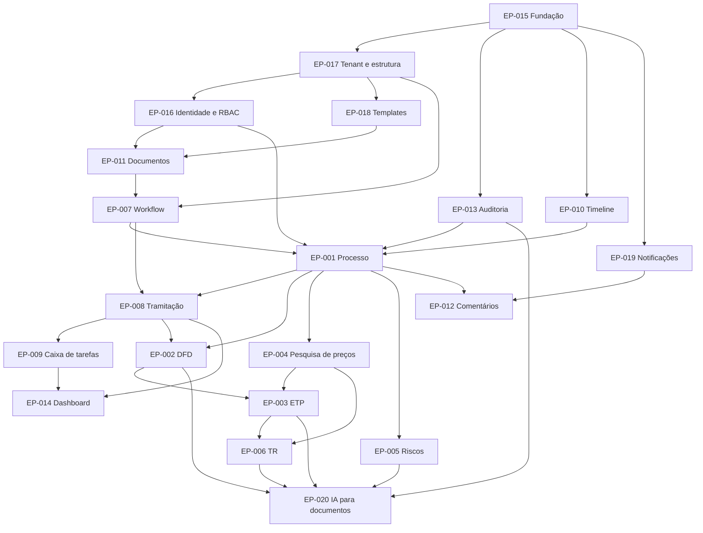

# MVP 1 — Épicos

> Resumo dos 20 épicos do MVP 1. Especificação completa em `../backlog/epic-NNN-*.md`; features e stories em [features.md](features.md); plano em [delivery-plan.md](delivery-plan.md).
> EP-001 a EP-014 são os épicos pedidos pelo produto; EP-015 a EP-019 são épicos de plataforma necessários para que os anteriores funcionem (fundação, identidade, tenancy, templates e notificações). EP-020 (IA para documentos do planejamento) entrou em 2026-10-16 por decisão do usuário (prd-3, DEC-037).

| Épico | Objetivo | Features | Stories | Pontos | Depende de | Arquivo |
|---|---|---|---|---|---|---|
| EP-001 Processo de contratação | Agregado central: abrir, consultar, manter, acompanhar e encerrar o processo, com acesso e sigilo | FT-001..FT-007 | 13 | 71 | EP-007, EP-013, EP-016, EP-017 | [epic-001](../backlog/epic-001-process.md) |
| EP-002 DFD | Formalizar a demanda em wizard, com template, autosave, PDF, versões, aprovação e duplicação | FT-008..FT-010 | 5 | 25 | EP-001, EP-008, EP-011, EP-018 | [epic-002](../backlog/epic-002-dfd.md) |
| EP-003 ETP | Elaborar o estudo técnico preliminar por seções (art. 18 §§1º–2º), com alternativas, estimativas e conclusão | FT-011..FT-014 | 5 | 28 | EP-002, EP-004, EP-011, EP-018 | [epic-003](../backlog/epic-003-etp.md) |
| EP-004 Pesquisa de preços | Estimar o valor com fontes, cotações, exclusões justificadas, estatísticas, alertas e mapa comparativo | FT-015..FT-020 | 9 | 45 | EP-001, EP-011 | [epic-004](../backlog/epic-004-price-research.md) |
| EP-005 Mapa de riscos | Identificar, avaliar e tratar riscos; emitir o mapa de riscos | FT-021..FT-023 | 3 | 15 | EP-001, EP-011 | [epic-005](../backlog/epic-005-risk-map.md) |
| EP-006 Termo de Referência | Elaborar o TR (art. 6º XXIII) importando do ETP, com itens e condições contratuais | FT-024..FT-027 | 4 | 23 | EP-003, EP-004, EP-011 | [epic-006](../backlog/epic-006-term-of-reference.md) |
| EP-007 Workflow | Workflows configuráveis e versionados, com motor de regras e workflow padrão da fase preparatória | FT-028..FT-030 | 7 | 44 | EP-011, EP-017 | [epic-007](../backlog/epic-007-workflow.md) |
| EP-008 Tramitação | Encaminhar, devolver, assumir, atribuir, aprovar/devolver/indeferir, histórico completo e prazos | FT-031..FT-035 | 9 | 51 | EP-001, EP-007, EP-011 | [epic-008](../backlog/epic-008-routing.md) |
| EP-009 Caixa de tarefas | Mostrar a cada pessoa o que exige sua ação: processos, filas da unidade, aprovações, devolvidos, atrasados | FT-036 | 3 | 18 | EP-008 | [epic-009](../backlog/epic-009-task-inbox.md) |
| EP-010 Timeline | Narrativa cronológica e confiável de tudo que aconteceu no processo | FT-037 | 2 | 10 | EP-015 | [epic-010](../backlog/epic-010-timeline.md) |
| EP-011 Documentos | Tipos, ciclo de vida, versões imutáveis com hash, PDF, documentos livres/externos e anexos seguros | FT-038..FT-042 | 10 | 56 | EP-015, EP-016, EP-018 | [epic-011](../backlog/epic-011-documents.md) |
| EP-012 Comentários | Discussão contextual em processos e documentos, com menções | FT-043 | 2 | 10 | EP-001, EP-019 | [epic-012](../backlog/epic-012-comments.md) |
| EP-013 Auditoria | Trilha transacional, append-only, selada e consultável | FT-044..FT-045 | 3 | 18 | EP-015 | [epic-013](../backlog/epic-013-audit.md) |
| EP-014 Dashboard | Indicadores operacionais por perfil | FT-046 | 1 | 8 | EP-001, EP-008, EP-009 | [epic-014](../backlog/epic-014-dashboard.md) |
| EP-015 Fundação técnica | Monorepo, ambiente, CI, API base, persistência, outbox, worker, observabilidade, shell web | FT-047..FT-050 | 10 | 59 | — | [epic-015](../backlog/epic-015-technical-foundation.md) |
| EP-016 Identidade, acesso e RBAC | Login OIDC/BFF, sessão, MFA, convites, usuários, perfis, escopos e autorização | FT-051..FT-054 | 12 | 57 | EP-015, EP-017 | [epic-016](../backlog/epic-016-identity-access.md) |
| EP-017 Tenant e estrutura organizacional | Provisionamento, isolamento, órgãos, unidades, configurações, catálogos, numeração, calendário | FT-055..FT-057 | 8 | 37 | EP-015 | [epic-017](../backlog/epic-017-tenancy-organization.md) |
| EP-018 Templates de documentos | Templates versionados com seções, base legal, layout e biblioteca padrão | FT-058 | 4 | 23 | EP-011 (tipos), EP-017 | [epic-018](../backlog/epic-018-document-templates.md) |
| EP-019 Notificações | Central in-app, e-mails, preferências e lembretes de prazo | FT-059 | 4 | 17 | EP-015 | [epic-019](../backlog/epic-019-notifications.md) |
| EP-020 IA para documentos do planejamento | Gerar com IA rascunhos de DFD, ETP, mapa de riscos e TR em cadeia e ajustar seções, com marcações, revisão humana obrigatória, rastreabilidade e governança por órgão | FT-060..FT-062 | 8 | 46 | EP-002, EP-003, EP-005, EP-006, EP-011, EP-013, EP-015 | [epic-020](../backlog/epic-020-ai-document-generation.md) |
| **Total** | | **62** | **122** | **661** | | |

## Dependências entre épicos

## Princípios que todos os épicos respeitam
1. Processo como entidade principal (DEC-010) — todo artefato tem `processId`.
2. Histórico completo: versões imutáveis, timeline e auditoria (DEC-017, DEC-025).
3. Workflow e regras configuráveis, sem regras legais fixas em código (DEC-014, DEC-016).
4. RBAC granular com escopo e políticas contextuais (DEC-134) e isolamento total entre tenants (DEC-080..082).
5. UX orientada às 7 perguntas do painel situacional (DEC-180), progressive disclosure e acessibilidade (DEC-181..184).
6. IA sempre assistiva: nunca decide, aprova ou encaminha; conteúdo gerado marcado e revisado por uma pessoa (princípio 16, DEC-037).
