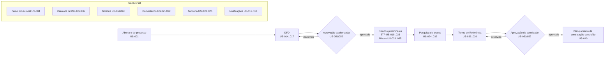

# MVP 1 — Planejamento e Tramitação

> **Objetivo:** criar o núcleo operacional da plataforma — o **processo de contratação** com seus documentos de planejamento (DFD, ETP, pesquisa de preços, mapa de riscos, TR), tramitação por workflow configurável, aprovações, caixa de tarefas, timeline, comentários, auditoria e dashboard — sobre uma fundação multi-tenant segura.

Sumário: [1. Visão](#1-visão-do-mvp-1) · [2. Escopo](#2-escopo) · [3. Jornada coberta](#3-jornada-coberta) · [4. Personas](#4-personas-atendidas) · [5. Números](#5-números-do-mvp-1) · [6. Métricas de sucesso](#6-métricas-de-sucesso) · [7. Premissas e restrições](#7-premissas-e-restrições) · [8. Arquitetura](#8-arquitetura-em-uma-página) · [9. Mapa de documentos](#9-mapa-de-documentos-do-mvp-1) · [10. Fechamento](#10-fechamento-do-mvp-1)

---

## 1. Visão do MVP 1

Ao final do MVP 1, um órgão público consegue conduzir **todo o planejamento da contratação** (artefatos do art. 18 da Lei 14.133/2021) dentro da plataforma; dotação, minuta do edital, parecer jurídico e controle interno completam a fase preparatória no MVP 2 (DEC-015):

1. a área requisitante **abre o processo** e formaliza a demanda no **DFD**, que é aprovado pelo titular da secretaria;
2. a equipe de planejamento elabora o **ETP** (com alternativas, estimativas e conclusão), o **mapa de riscos** e o **TR** (importando dados do ETP);
3. compras realiza a **pesquisa de preços** com fontes, cotações, exclusões justificadas, estatísticas e mapa comparativo;
4. a **autoridade competente** aprova o conjunto de artefatos e o processo é **concluído**, pronto para a licitação/contratação direta (que chega nos MVPs seguintes);
5. em todo o percurso, cada pessoa sabe **onde o processo está, quem é o responsável, o que falta, qual o próximo passo e se há atraso**, e tudo fica registrado em **versões imutáveis, timeline e trilha de auditoria**.

## 2. Escopo

### 2.1 Incluído
| Área | Épicos |
|---|---|
| Núcleo de negócio | EP-001 Processo de contratação · EP-002 DFD · EP-003 ETP · EP-004 Pesquisa de preços · EP-005 Mapa de riscos · EP-006 Termo de Referência |
| Fluxo e acompanhamento | EP-007 Workflow · EP-008 Tramitação (inclui aprovações) · EP-009 Caixa de tarefas · EP-010 Timeline · EP-014 Dashboard |
| Documentos e colaboração | EP-011 Documentos · EP-018 Templates · EP-012 Comentários · EP-019 Notificações |
| Governança e plataforma | EP-013 Auditoria · EP-015 Fundação técnica · EP-016 Identidade, acesso e RBAC · EP-017 Tenant e estrutura organizacional |

Detalhe de cada épico: [epics.md](epics.md). Features e stories: [features.md](features.md).

### 2.2 Fora do escopo do MVP 1
- PCA como módulo (apenas referência — DEC-029), dotação orçamentária, análise jurídica e do controle interno, edital, SLA avançado, indicadores e gargalos (**MVP 2**).
- Publicações (PNCP, Diário Oficial), assinatura eletrônica, API pública e webhooks (**MVP 3**).
- Contratos, fiscalização, medições, aditivos e vencimentos (**MVP 4**).
- Inteligência artificial, validação automática por IA, busca semântica e benchmark (**MVP 5**).
- Itens postergados do próprio MVP 1: [delivery-plan.md §9](delivery-plan.md#9-itens-postergados).

## 3. Jornada coberta

O fluxo acima é o **workflow padrão semeado** (DEC-015); cada órgão pode ajustá-lo (etapas, responsáveis, prazos, regras) sem código.

## 4. Personas atendidas

| Persona (perfil) | Principais capacidades no MVP 1 |
|---|---|
| Área requisitante (`REQUISITANTE`) | Abrir processos, elaborar DFD/ETP/riscos/TR, tramitar, acompanhar |
| Planejamento (`PLANEJAMENTO`) | ETP, riscos, TR, apoio à pesquisa, tramitação |
| Compras (`COMPRAS`) | Pesquisa de preços, fornecedores, TR |
| Autoridade competente (`AUTORIDADE_COMPETENTE`) | Aprovar/devolver/indeferir, suspender, cancelar |
| Gestor de contratações (`GESTOR_CONTRATACOES`) | Visão global, distribuição, intervenção, dashboard |
| Administrador do órgão (`ADMIN_ORGAO`) | Usuários, perfis, estrutura, workflows, templates, catálogos, configurações, auditoria |
| Licitações, Contabilidade, Jurídico, Controle Interno | Tramitar, comentar, decidir quando designados, leitura ampla (capacidades específicas nos MVPs 2–4) |
| Auditor, Somente leitura | Consulta (auditor também na trilha de auditoria) |
| Fiscal e Gestor de contrato | Leitura (ampliados no MVP 4); gestor de contrato abre demandas |
| Consultoria externa (`CONSULTOR_EXTERNO`) | Colaboração em processos específicos, com validade |

Personas completas: [personas.md](../product/personas.md).

## 5. Números do MVP 1

| Item | Quantidade |
|---|---|
| Épicos / features / stories | 19 / 59 / 114 |
| Pontos (P0 / P1 / P2) | 480 / 104 / 31 — total 615 |
| Entidades (MVP 1) | 58 ([entities.md](entities.md)) |
| Permissões / perfis padrão / políticas | 68 / 15 / 17 ([permissions.md](permissions.md)) |
| Operações de API | 269 ([api.md](api.md) §3; detalhe em [api/](api/)) |
| Eventos de domínio (canônicos) | 80, mais 12 nomes especializados ([events.md](events.md)) |
| Telas especificadas | 26 do conjunto pedido + 16 complementares ([screens.md](screens.md)) |
| Cenários de aceite (Gherkin) | 1.110 em 8 categorias ([acceptance-criteria.md](acceptance-criteria.md) §3) |
| ADRs | 11 ([../adr/](../adr/)) |
| Duração estimada (squad de referência) | Sprint 0 + 18 sprints ≈ 38 semanas ([delivery-plan.md](delivery-plan.md)) |

## 6. Métricas de sucesso

| Métrica | Meta (3 meses após o release nos pilotos) |
|---|---|
| Processos com o planejamento da contratação conduzido na plataforma | ≥ 80% dos novos processos do piloto |
| Tempo médio do planejamento da contratação | Redução ≥ 25% em relação à linha de base medida antes da implantação |
| Processos com etapa atrasada | ≤ 15% dos processos ativos |
| Devoluções por documento incompleto | Redução ≥ 30% (checklist e validação de completude) |
| Usuários ativos semanais / convidados | ≥ 70% |
| Satisfação (CSAT) dos usuários-chave | ≥ 4/5 |
| Disponibilidade | ≥ 99,5% |
| Incidentes de isolamento entre tenants | 0 |

## 7. Premissas e restrições

**Premissas**
- Cliente-piloto disponível para validação a cada marco (M2–M5).
- Pilotos aceitam o workflow padrão com ajustes de configuração (sem desenvolvimento sob medida).
- Usuários acessam por navegador moderno; edição de documentos majoritariamente em desktop.
- Documentos do MVP 1 não são assinados eletronicamente na plataforma (RL-02).

**Restrições**
- Stack e arquitetura definidas ([decisions.md](../architecture/decisions.md)); dados no Brasil (`sa-east-1`).
- Nenhuma regra legal/administrativa fixa em código (princípio 17).
- Conformidade com LGPD, WCAG 2.1 AA/eMAG e boas práticas OWASP ASVS nível 2.

## 8. Arquitetura em uma página

- **Monólito modular** NestJS (23 módulos com fronteiras verificadas — DEC-040/041), **BFF** Next.js, **worker** BullMQ.
- **PostgreSQL** compartilhado com `tenant_id`, RLS e FKs compostas; **Redis** para sessão, cache, idempotência e filas; **S3** para arquivos; **Gotenberg** para PDF; **ClamAV** para uploads; **Authentik** para identidade.
- **Outbox transacional** para eventos; timeline e visibilidade como projeções síncronas; auditoria transacional com selagem.
- Detalhes: [architecture.md](../architecture/architecture.md) · [domains.md](../architecture/domains.md) · [multi-tenancy.md](../architecture/multi-tenancy.md) · [security.md](../architecture/security.md) · [authentication.md](../architecture/authentication.md) · [storage.md](../architecture/storage.md) · [queues.md](../architecture/queues.md) · [observability.md](../architecture/observability.md).

## 9. Mapa de documentos do MVP 1

| Documento | Conteúdo |
|---|---|
| [epics.md](epics.md) | Os 19 épicos: objetivo, escopo, features, pontos, dependências |
| [features.md](features.md) | Esqueleto canônico: features, stories, prioridades, estimativas, dependências, inventário de telas |
| [entities.md](entities.md) | Modelo de dados completo (campos, tipos, nulos, índices, constraints, relacionamentos, timestamps) |
| [api.md](api.md) | Convenções, erros e catálogo de endpoints com especificação detalhada |
| [screens.md](screens.md) | Especificação das telas (objetivo, persona, componentes, campos, ações, filtros, permissões, estados, responsividade) |
| [permissions.md](permissions.md) | Permissões, perfis, matriz, participação, visibilidade e políticas |
| [events.md](events.md) | Eventos, timeline, notificações e ações de auditoria |
| [acceptance-criteria.md](acceptance-criteria.md) | Critérios de aceite transversais, jornadas do MVP e índice dos critérios por story |
| [tests.md](tests.md) | Estratégia e plano de testes |
| [delivery-plan.md](delivery-plan.md) | Backlog priorizado, dependências, ordem, estimativas e sequência de implementação |
| [risks-and-decisions.md](risks-and-decisions.md) | Riscos, débitos, ambiguidades, regras configuráveis, decisões pendentes, integrações |
| [release-checklist.md](release-checklist.md) | Definition of Done, postergados e checklist de release |
| [../backlog/](../backlog/README.md) | Cards detalhados (épicos, features e stories) |

## 10. Fechamento do MVP 1

Itens exigidos ao final de cada MVP e onde estão:

| Item | Onde |
|---|---|
| Backlog priorizado | [delivery-plan.md §3](delivery-plan.md#3-backlog-priorizado) |
| Dependências | [delivery-plan.md §4](delivery-plan.md#4-dependências-e-caminho-crítico) e campo `depends_on` de cada card |
| Ordem recomendada | [delivery-plan.md §5](delivery-plan.md#5-proposta-de-sequência-de-implementação) |
| Estimativas | [delivery-plan.md §2](delivery-plan.md#2-estimativas-consolidadas) |
| Riscos (técnicos, legais, segurança, multi-tenancy, performance) | [risks-and-decisions.md §1–§5](risks-and-decisions.md) |
| Débitos técnicos | [risks-and-decisions.md §6](risks-and-decisions.md#6-débitos-técnicos-assumidos) |
| Decisões de arquitetura | [risks-and-decisions.md §11](risks-and-decisions.md#11-decisões-de-arquitetura-do-mvp-1) e [decisions.md](../architecture/decisions.md) |
| Definition of Done | [release-checklist.md §1](release-checklist.md#1-definition-of-done) |
| Itens postergados | [release-checklist.md §2](release-checklist.md#2-itens-postergados) e [delivery-plan.md §9](delivery-plan.md#9-itens-postergados) |
| Checklist de release | [release-checklist.md §3](release-checklist.md#3-checklist-de-release) |
| Pontos ambíguos | [risks-and-decisions.md §7](risks-and-decisions.md#7-pontos-ambíguos-do-pedido-e-interpretação-adotada) |
| Regras configuráveis | [risks-and-decisions.md §9](risks-and-decisions.md#9-regras-configuráveis) |
| Regras que precisam de decisão de produto | [risks-and-decisions.md §8](risks-and-decisions.md#8-regras-que-precisam-de-decisão-de-produto) |
| Integrações externas | [risks-and-decisions.md §10](risks-and-decisions.md#10-integrações-externas) |
| Validação antes do MVP 2 | [risks-and-decisions.md §12](risks-and-decisions.md#12-validação-para-iniciar-o-mvp-2) |
