# MVP 1 — Especificação de telas

> Especificação tela a tela da camada web do MVP 1 (rotas, acesso, layout, componentes, dados e endpoints, ações, estados, validações, acessibilidade).
> Inventário canônico: [features.md — Apêndice A](features.md#apêndice-a--inventário-canônico-de-telas-do-mvp-1). Contratos: [api.md](api.md). Permissões: [permissions.md](permissions.md). Fonte de cada tela: seções "Frontend" das stories em [../backlog/](../backlog/README.md).

Sumário: [1. Visão geral](#1-visão-geral) · [2. Telas — grupo A](#2-telas--grupo-a) (navegação principal, processo e documentos) · [3. Telas — grupo B](#3-telas--grupo-b) (administração, workflow, templates, auditoria e perfil)

---
## 1. Visão geral

### 1.1 Propósito e convenções

Este documento especifica, tela a tela, a camada web do MVP 1 do ContrataFlow (Next.js, design system em `packages/ui`, TanStack Query, React Hook Form + Zod). Reúne as telas do grupo A (§2 — navegação principal, processo e documentos) e do grupo B (§3 — telas administrativas: usuários, perfis, templates, catálogos, calendário, workflows, auditoria, perfil do usuário etc.). Convenções:

- **IDs `SCR-XXX`** seguem o inventário canônico de `features.md` (Apêndice A). IDs `SCR-0xx`/`SCR-1xx` abaixo de `SCR-100` são telas de navegação primária (rota própria, item de menu ou destino direto de ação). IDs **`SCR-1xx`** (a partir de `SCR-101`) são **diálogos, painéis laterais ou telas adicionais** introduzidos para fechar o MVP 1 — a maioria se sobrepõe a uma tela "hospedeira" (ex.: SCR-103…116 sobre SCR-006) e não tem rota própria.
- **Rotas** são sempre em pt-BR (`/processos`, `/tarefas`, `/aprovacoes`, `/painel`, `/entrar`, `/selecionar-orgao` etc.), conforme `architecture.md` §8.2 (route groups `(auth)` sem casca, `(app)` com casca autenticada, `(app)/admin`).
- Componentes transversais sem tela própria (ex.: `AttachmentUploader`/`AttachmentList` de US-068, o diálogo de sigilo de US-013) são descritos dentro da seção da tela onde aparecem, não em seção própria.
- Nomenclatura de componentes segue o nome usado pela story "principal" de cada tela; variações terminológicas entre stories estão registradas nos pontos onde ocorrem e resumidas no fim de §1.4.

### 1.2 Casca da aplicação

A casca (`AppShell`, US-086 · repaginada no prd-4) envolve toda rota do route group `(app)`: **menu lateral** claro, em grupos "Operação" e "Governança", com contadores de pendências em Caixa de tarefas e Aprovações (`TSK-02`, só com `INBOX_VIEW`), bloco de ajuda no rodapé e gaveta abaixo de 1024 px, itens renderizados condicionalmente por permissão (cada item é um `<Can permission="...">`, que oculta a entrada quando a ação nunca seria possível para o vínculo atual — RN-FND-92); **cabeçalho** com busca global (atalho Ctrl K; envia `q` à lista de processos), **seletor de tenant/órgão** (`TenantSwitcherMenu`, reaproveita a lista de `SCR-101`; troca executa `queryClient.clear()` e publica em `BroadcastChannel('cf-session')` — RN-FND-90, US-093, US-100), **central de notificações** (contador via `NTF-02`, lista via `NTF-01`, marcar lida/arquivar via `NTF-03`/`NTF-05`) e **menu do avatar** (perfil — `/perfil`, grupo B — e "Sair", US-088). O `layout.tsx` de `(app)` resolve sessão e tenant ativo no servidor antes de renderizar qualquer filho: sem sessão → `SCR-001`; sem tenant selecionado → `SCR-101` (RN-FND-87). Leituras iniciais são *prefetched* em Server Components e hidratadas no TanStack Query (`HydrationBoundary`); nenhuma página autenticada é cacheada pelo navegador (RN-FND-88). O cabeçalho das páginas é o `AppPageHeader` (`components/shell/page-header.tsx`: `PageHeader` do `packages/ui` com trilha, título, descrição e ações; as áreas de `/admin` mostram a trilha "Administração / <área>"). `packages/ui` fornece só componentes genéricos com tokens semânticos; componentes de domínio (badges de status, etc.) vivem em `apps/web/src/features/**` (RN-FND-91).

### 1.3 Mapa de navegação

```mermaid
flowchart TD
    subgraph AUTH["Autenticação e vínculo"]
        SCR001["SCR-001 Login /entrar"]
        SCR002["SCR-002 Recuperar senha /recuperar-senha"]
        SCR101["SCR-101 Selecionar órgão /selecionar-orgao"]
        SCR102["SCR-102 Aceite de convite /convite/[token]"]
        SCR111["SCR-111 Erros e estados globais /erro/*"]
    end

    subgraph NUCLEO["Núcleo"]
        SCR003["SCR-003 Dashboard /painel"]
        SCR004["SCR-004 Processos /processos"]
        SCR005["SCR-005 Novo processo /processos/novo"]
        SCR013["SCR-013 Caixa de tarefas /tarefas"]
        SCR014["SCR-014 Aprovações /aprovacoes"]
        SCR015["SCR-015 Detalhe da aprovação /aprovacoes/[id]"]
    end

    subgraph PROCESSO["Processo e documentos"]
        SCR006["SCR-006 Detalhe do processo /processos/[id]"]
        SCR007["SCR-007 DFD .../dfd/[dfdId]"]
        SCR008["SCR-008 ETP .../etp/[etpId]"]
        SCR009["SCR-009 Pesquisa de preços .../pesquisa-precos/[researchId]"]
        SCR010["SCR-010 Mapa comparativo .../mapa"]
        SCR011["SCR-011 Riscos .../riscos"]
        SCR012["SCR-012 TR .../tr/[termId]"]
        SCR105["SCR-105 Documento livre/externo .../documentos/[docId]"]
        SCR106["SCR-106 Versões .../documentos/[docId]/versoes"]
    end

    subgraph DIALOGOS["Diálogos/painéis sobre SCR-006 (e SCR-013)"]
        SCR103["SCR-103 Encaminhar processo"]
        SCR104["SCR-104 Devolver processo"]
        SCR113["SCR-113 Duplicar processo"]
        SCR115["SCR-115 Atribuir / assumir"]
        SCR116["SCR-116 Suspender / retomar / cancelar / concluir"]
    end

    subgraph IA["Painel de IA sobre os editores (EP-020)"]
        SCR117["SCR-117 Assistente de redação com IA"]
    end

    subgraph GRUPOB["Grupo B (detalhado no §3; nós citados a partir de stories do grupo A)"]
        SCR029["SCR-029 Usuários /admin/usuarios"]
        SCR032["SCR-032 Assistente de implantação"]
        SCR039["SCR-039 Perfil /perfil"]
        SCR109["SCR-109 Etiquetas (admin)"]
        SCR112["SCR-112 Participantes (lista completa)"]
    end

    SCR001 -->|1 vínculo| SCR003
    SCR001 -->|2+ vínculos| SCR101
    SCR001 -->|"Esqueci minha senha"| SCR002
    SCR001 -->|sem vínculo/bloqueado| SCR111
    SCR002 -.->|fluxo Authentik| SCR001
    SCR101 --> SCR003
    SCR102 -->|convite aceito| SCR101
    SCR003 --> SCR004
    SCR003 --> SCR013
    SCR003 --> SCR014
    SCR004 --> SCR005
    SCR004 --> SCR006
    SCR005 --> SCR006
    SCR013 --> SCR006
    SCR013 -.-> SCR115
    SCR014 --> SCR015
    SCR015 -.-> SCR006
    SCR006 --> SCR007
    SCR006 --> SCR008
    SCR006 --> SCR009
    SCR009 --> SCR010
    SCR006 --> SCR011
    SCR006 --> SCR012
    SCR006 --> SCR105
    SCR105 --> SCR106
    SCR006 -.-> SCR103
    SCR006 -.-> SCR104
    SCR006 -.-> SCR113
    SCR006 -.-> SCR115
    SCR006 -.-> SCR116
    SCR113 --> SCR006
    SCR103 -.-> SCR015
    SCR006 -.-> SCR029
    SCR006 -.-> SCR039
    SCR004 -.-> SCR109
    SCR006 -.-> SCR112
    SCR111 -.->|"Trocar de instituição"| SCR101
    SCR007 -.-> SCR117
    SCR008 -.-> SCR117
    SCR011 -.-> SCR117
    SCR012 -.-> SCR117
```

### 1.4 Padrões globais

- **Carregando:** *skeleton* por bloco/cartão/linha (nunca a tela inteira quando houver blocos independentes, ex. SCR-003, SCR-006); dados anteriores mantidos durante *refetch* (`placeholderData`/`keepPreviousData`); indicador de carregamento discreto ao refazer consultas já exibidas.
- **Vazio:** mensagem específica da lista/seção + ação primária quando o usuário tem permissão para resolver (ex. "Nenhum documento ainda — Criar DFD"); nunca um "vazio" genérico sem orientação.
- **Erro:** *toast* ou banner com `correlationId` copiável e botão "Tentar novamente"; blocos/cartões falham de forma independente (um erro não derruba a tela, ex. SCR-003, SCR-006); nenhum código técnico é exposto ao usuário além do `correlationId` (RN-FND-95).
- **Sem permissão:** `<Can permission="...">` **oculta** a ação quando ela nunca seria possível para o vínculo e **desabilita com explicação** (`aria-describedby`/tooltip) quando a indisponibilidade é contextual — origem em `meta.allowedActions`/`GET .../available-actions` (PRC-08), nunca reimplementada no cliente (RN-FND-92).
- **403/404/500/manutenção/sessão expirada/sem vínculo:** tratados em `SCR-111` (`/erro/*`) e nos limites globais de erro (`error.tsx`/`global-error.tsx`, US-086); interceptador do cliente de API mapeia 401 `SESSION_EXPIRED` → `SessionExpiredModal`, 403 `MEMBERSHIP_INACTIVE`/`TENANT_SUSPENDED` → `SCR-111` com "Trocar de instituição" quando há outros vínculos, 503 → banner de indisponibilidade com "Tentar novamente" (US-088, US-100).
- **Toasts:** componente genérico de `packages/ui`; sucesso, erro (com `correlationId`) e progresso (ex. exportações) seguem o mesmo padrão visual e temporizador.
- **Diálogos de confirmação:** `ConfirmDialog` com foco preso (*focus trap*), foco inicial no campo mais relevante (motivo/justificativa quando existir) e devolução de foco ao elemento que abriu o diálogo ao fechar; ações destrutivas/irreversíveis exigem justificativa com contador de caracteres (ex. cancelar processo ≥ 20 caracteres — POL-06).
- **Conflito de edição (412):** toda mutação de atualização envia `If-Match` com o `ETag` recebido em `meta.etag` (RN-FND-90); divergência retorna **412** e abre `ConflictDialog`/`SectionConflictDialog`/`HeaderConflictDialog` comparando campo a campo (ou parágrafo a parágrafo em texto rico) o valor local com `meta.current`.
- **Sessão expirada:** `SessionWatcher` monitora ociosidade e expiração via `BroadcastChannel('cf-session')`; `IdleWarningDialog` ("Você continua aí?") com contagem regressiva antes do término; `SessionExpiredModal` bloqueante ao expirar; `LogoutGuard` confirma perda de rascunhos não salvos ao sair (US-088).
- **Orçamento sigiloso (POL-09):** quando `isBudgetConfidential = true`, o valor estimado só é exibido a quem tem `PROCESS_VIEW_CONFIDENTIAL_BUDGET` cobrindo o processo **ou** detém a custódia atual; para os demais, a API retorna o valor mascarado (`null` + `masked: true`, via `ConfidentialFieldsInterceptor`) em toda superfície — telas, PDFs/*renditions*, exportações, timeline (`BUDGET_RESTRICTED`) e notificações. O selo "Sigiloso"/cadeado nunca é a única informação (texto sempre presente) e aparece onde quer que o valor apareça mascarado.
- **Acessibilidade:** WCAG 2.1 AA + eMAG 3.1 (DEC-183) em toda tela — *primitives* Radix (foco, teclado, ARIA), *skip link* no `AppShell`, foco gerenciado após navegação e em diálogos, erros de formulário associados por `aria-describedby`, regiões `aria-live` para autosave/validação/*toasts*, contraste ≥ 4,5:1, alvo de toque ≥ 24 px (RN-FND-96) — várias telas voltadas a uso móvel intensivo adotam ≥ 44 px (ex. SCR-004, SCR-115). Nenhum estado é comunicado só por cor (ícone + texto). `axe-core` roda no Storybook e como *gate* de CI.
- **Responsividade:** breakpoint de referência 768 px. Editores de documento estruturado (SCR-007, SCR-008, SCR-012) são *desktop-first* (DEC-183): abaixo de 768 px entram em modo leitura + comentários, com aviso discreto sugerindo o desktop para edição de texto rico. Telas operacionais (SCR-003, SCR-004, SCR-006, SCR-009 leitura, SCR-011, SCR-013, SCR-014, SCR-015) permanecem plenamente utilizáveis a partir de 360 px, normalmente convertendo tabelas em listas de cartões.
- **Componentes transversais (nomes unificados na consolidação):** `ConfidentialValue` exibe valor de orçamento mascarado (POL-09, `…Masked`); `ConfidentialBadge` sinaliza processo sigiloso; `EstimatedValueBadge` (US-017) compõe valor + origem usando `ConfidentialValue`; `DueDateBadge` indica prazo com os estados normal/a vencer/atrasado/suspenso/sem prazo (US-055).

## 2. Telas — grupo A

### SCR-001 — Login (entrada)
- **Rota:** `/entrar` (tela nativa do ContrataFlow — DEC-187; antes, a tela de login do Authentik) · **Acesso:** público, não autenticado · **Personas:** qualquer usuário com vínculo ativo em pelo menos um tenant; usuário sem nenhum vínculo (mensagem dedicada)
- **Objetivo:** entrar com usuário e senha (e o código do segundo fator, quando houver) na própria tela do app e comunicar o motivo de retorno quando a pessoa chega vindo de um logout, expiração de sessão, redefinição de senha ou erro. O navegador nunca vê o IdP no login: o BFF conduz o *flow* do Authentik no servidor.
- **Referência visual:** `docs/brand/mockups/repaginacao-2026-10/Main.dc.html` (prévia aprovada em 2026-10-28; substitui `prototype/entrar.html`). Sem identidade visual de tenant (DEC-141).
- **Layout e regiões:** tela inteira. A partir de 1024 px, à esquerda o painel institucional em navy sólido (`LoginBrandPanel`, 460–520 px): marca, "Contratações públicas mais simples, seguras e eficientes.", "Da demanda à publicação, todo o processo em um único lugar, com rastreabilidade completa sob a Lei 14.133/2021.", três destaques com ícone (Processos padronizados; Tramitação e aprovações; Transparência e controle) e o rodapé "Lei 14.133/2021 · MVP 1 · Política de privacidade" — sem imagem de fundo. À direita, em branco: "Precisa de ajuda?" no topo, o formulário centrado (até 420 px) e o aviso de privacidade no rodapé. Abaixo de 1024 px fica só o acesso, com a marca no topo.
- **Formulário (`LoginForm`):** título "Entrar" e "Use o usuário e a senha fornecidos pelo seu órgão."; "Usuário ou e-mail" (`autocomplete="username"`, exemplo `nome.sobrenome`), "Senha" com mostrar/ocultar (`autocomplete="current-password"`), "Esqueci minha senha" (SCR-002) e botão "Entrar" (estado "Entrando…"). Sem "Manter conectado": a sessão do BFF não se prolonga por escolha do usuário (DEC-131). Etapa de código quando o usuário tem segundo fator: "Confirme sua identidade", "Código de verificação" (6 dígitos, `inputmode="numeric"`, `autocomplete="one-time-code"`), "Confirmar e entrar" e "Voltar".
- **Login gov.br:** fora do MVP 1 (PEND-18): o mockup mostra o botão "em breve", mas a tela não o exibe.
- **Componentes:** `LoginFrame`, `LoginBrandPanel`, `LoginForm`, `LoginReasonMessage`, `PrivacyNotice` (linha LGPD; "Saiba mais" abre o aviso completo), `HelpLink`, `InstitutionList` (ponte para SCR-101), `NoMembershipPage`.
- **Dados e endpoints:** rotas do BFF (fora da API NestJS): `POST /api/auth/login` (`{ username, password, returnTo? }` ou `{ transaction, code }`), `GET /api/auth/login` (atalho para `/entrar`, preserva `returnTo`), `GET /api/auth/session`, `GET /api/auth/forgot-password`.
- **Ações:** "Entrar" → `POST /api/auth/login` → `step: 'done'` navega para o destino (SCR-003 com 1 vínculo, SCR-101 com 2+, ou a página de erro que a API indicar) ou `step: 'mfa'` mostra a etapa de código; "Voltar" na etapa de código retorna à senha. Já autenticado, `/entrar` volta para `returnTo` (FA-07).
- **Estados:** sem *skeleton* (página estática); motivos (`saiu`, `sessao-expirada`, `senha-redefinida`, `erro`, `indisponivel`) em `role="status"` acima do formulário; erros em `role="alert"` no mesmo lugar: credencial inválida (genérica, avisa que 5 tentativas bloqueiam temporariamente), acesso bloqueado temporariamente, código inválido, verificação expirada (volta à senha), muitas tentativas, serviço indisponível, origem não confirmada; `NoMembershipPage` quando não há vínculo algum.
- **Validações e mensagens:** campos obrigatórios no cliente e no BFF; mensagens genéricas que nunca revelam se a conta existe (RN-IAM-18); motivo só por querystring controlada pelo próprio app/BFF; nenhum código técnico exposto.
- **Acessibilidade e responsividade:** rótulos reais, foco inicial no usuário e, depois de um erro, no primeiro campo com erro (senha apagada nas recusas de credencial; código na etapa de MFA); `aria-invalid` + mensagem do campo ligada por `aria-describedby`; alvos ≥ 44 px; foco visível de 3 px; ícones decorativos com `aria-hidden`; `lang="pt-BR"`; coluna única abaixo de 1024 px, a partir de 360 px, sem rolagem horizontal; testado com axe (Vitest e E2E).
- **Stories:** US-087 (principal), US-090 (etapa de código; o step-up reaproveita o componente de erro), US-089 (link), US-088 (mensagens de saída/expiração) · DEC-187.

### SCR-002 — Recuperar senha
- **Rota:** `/recuperar-senha` · **Acesso:** público · **Personas:** usuário que esqueceu a senha.
- **Objetivo:** acionar a recuperação de senha no Authentik; não existe formulário próprio no ContrataFlow.
- **Layout e regiões:** tela de transição, sem formulário.
- **Componentes:** nenhum componente novo; reaproveita o bloco de erro de SCR-001.
- **Dados e endpoints:** `GET /api/auth/forgot-password` (BFF) → redireciona ao Authentik, que renderiza a redefinição.
- **Ações:** Acessar a rota → `GET /api/auth/forgot-password` → redirecionamento imediato.
- **Estados:** sem *loading* relevante (redirecionamento imediato); erro de indisponibilidade (`?motivo=indisponivel`, para onde o BFF devolve quando o Authentik não responde) reaproveita o componente de erro de SCR-001, com "Tentar novamente" (de novo `GET /api/auth/forgot-password`) e "Voltar para a entrada", preservando `returnTo`.
- **Validações e mensagens:** nenhuma validação própria (delegada ao Authentik).
- **Acessibilidade e responsividade:** segue o padrão de foco e contraste de SCR-001.
- **Stories:** US-089.

### SCR-003 — Dashboard
- **Rota:** `/painel` · **Acesso:** `DASHBOARD_VIEW` · **Personas:** qualquer perfil com acesso ao painel — dados restritos à visibilidade de processos de cada um (§5 de `permissions.md`).
- **Objetivo:** visão operacional por perfil, com indicadores e atalhos para as filas de trabalho.
- **Layout e regiões:** cabeçalho com saudação ("Bom dia, {nome}"), data no fuso do órgão, `DepartmentFilterBar` e "Novo processo" (`PROCESS_CREATE`) à direita; `DashboardSummaryCards` em 4 `KpiTile` (Pendências, Atrasados, Próximos do prazo, Abertos — cada um link para a lista filtrada); linha com "Minhas pendências", "Processos por situação" e "Abertos por etapa"; atrasados e próximos do prazo por secretaria (tabelas); tempo médio por etapa e abertos por mês; valor por secretaria e `RecentActivityFeed`. Grades de 4 → 2 → 1 colunas (repaginação prd-4, mockup `docs/brand/mockups/repaginacao-2026-10/Painel.dc.html`).
- **Componentes:** `DashboardSummaryCards` (`KpiTile`), cartões por indicador sobre `Card` (loading/erro/vazio independentes; vazio com `EmptyState` e ação — "Criar processo", "Ver caixa de tarefas"), `Donut` (situação), `BarList` (etapa, mês, valor), `ColumnChart` (tempo médio), `StatusChip` (pendências por visão), todos de `packages/ui`; `RecentActivityFeed`, `DepartmentFilterBar`. "Minhas pendências" lista também os 5 primeiros itens da visão "Comigo" (TSK-01 `?view=MINE&sort=dueAt&pageSize=5`, só com `INBOX_VIEW`; chave `['t', tenantId, 'tasks', 'preview', …]`) com o prazo em texto colorido.
- **Dados e endpoints:** DSH-01 `GET /dashboard/summary`, DSH-02 `GET /dashboard/widgets/{widgetKey}` — chaves `['t', tenantId, 'dashboard', 'summary', filters]` e `['t', tenantId, 'dashboard', 'widget', widgetKey, filters]`, `refetchInterval: 60000`.
- **Ações:** Filtrar por secretaria/unidade → atualiza a URL e refaz as consultas → cartões recarregam individualmente; "Tentar novamente" por cartão → refetch isolado do widget.
- **Estados:** *skeleton* por cartão; vazio contextual por widget ("Nenhuma atividade recente."); erro por cartão com "Tentar novamente"; filtros refletidos na *query string* (permite compartilhar/recarregar a visão).
- **Validações e mensagens:** agregados somam só valores visíveis ao usuário (POL-09); grupo com exclusões sinaliza `confidentialExcluded: true`.
- **Acessibilidade e responsividade:** paleta com contraste AA e redundância padrão/ícone (RN-DASH-12); dados de gráfico também em tabela (alternância); `aria-live` nos cartões ao atualizar via *polling* sem roubar o foco; grade de 1 coluna (< 768 px) a 3 colunas.
- **Stories:** US-076.

### SCR-004 — Processos
- **Rota:** `/processos` · **Acesso:** `PROCESS_VIEW`; exportar CSV exige `PROCESS_EXPORT`; criar etiqueta exige `TAG_MANAGE` · **Personas:** qualquer perfil com `PROCESS_VIEW` no escopo; filtros rápidos "Comigo"/"Da minha unidade" dependem de custódia/lotação.
- **Objetivo:** listar, pesquisar, filtrar, ordenar, salvar visões e exportar processos.
- **Layout e regiões:** `PageHeader` com trilha Painel / Processos, "Exportar CSV" (`PROCESS_EXPORT`) e "Novo processo" (`PROCESS_CREATE`); barra de visões salvas; abas de visão com contador; barra de filtros (busca, chips removíveis, "Filtros", "Limpar filtros", "Ordenar: {campo}" e "Colunas"); tabela (cartões no mobile) com rodapé "Mostrando x–y de n" e paginação numerada (repaginação prd-4, mockup `docs/brand/mockups/repaginacao-2026-10/Processos.dc.html`).
- **Componentes:** `ProcessListPage`, busca (*debounce* 300 ms), `ViewTabs` em links (Todos, Comigo, Na fila da minha unidade, Atrasados, Devolvidos — os atalhos de RN-PROC-24; trocar de aba tira o atalho da anterior e mantém os demais filtros; o contador de cada aba é o `totalItems` de PRC-01 com `pageSize=1`, e a aba ativa usa o total da própria lista; "Acompanhando" do mockup não tem filtro na API e não aparece), `ProcessFiltersPanel` (Sheet/painel inferior), `FilterChip`, tabela com os primitivos `TableContainer`/`Th`/`TableFooter` de `packages/ui` (paginação/ordenação/filtro manuais), menu "Ordenar" (campo + direção), `ColumnChooser`, colunas padrão Número, Objeto (título + modalidade · tipo), Secretaria, Etapa atual, Responsável (`Avatar` + nome, ou "Na fila de {unidade}"), Prazo da etapa (texto colorido: atrasado vermelho, "Vence hoje" âmbar, demais neutros — US-055), Situação (`StatusChip`) e menu ⋯ (abrir o processo, Documentos, Tramitação, Comentários); `PriorityBadge`, `ConfidentialValue`, `TagChips`/`TagPicker` (US-007) nas colunas opcionais; `EmptyState`; `SavedViewSelect`, `SaveViewDialog`, `ManageViewsDialog`, `ExportCsvDialog`, `useCsvDownload` (US-003). Sem seleção em massa (não há ação em lote nesta tela).
- **Dados e endpoints:** PRC-01 `GET /processes` — chave `['t', tenantId, 'processes', 'list', params]` (`placeholderData: keepPreviousData`, `staleTime` 30 s, refetch ao focar, `AbortSignal` ao digitar); estado da consulta vive na URL. PRC-34 `GET /processes/export` (CSV); PRC-35/36/37/38 (`saved-views`, chave `['t', tenantId, 'saved-views', scope]`); TAG-01 `GET /tags`.
- **Ações:** Pesquisar/filtrar/ordenar → PRC-01 → — → tabela/lista atualiza com *skeleton*/barra discreta; Salvar visão → PRC-36 (Idem.) → — → fecha diálogo, aparece em "Minhas visões"; Exportar CSV → PRC-34 → `PROCESS_EXPORT` → *streaming* → `Blob` → download, com "Cancelar" (aborta o *fetch*) e toast de conclusão.
- **Estados:** *skeleton* de 8 linhas da tabela; vazios com `EmptyState` ("Nenhum processo por aqui" — geral, com "Criar processo", e "sem resultado para os filtros", com "Limpar filtros"); erro com `correlationId` e "Tentar novamente"; progresso indeterminado durante exportação.
- **Validações e mensagens:** nenhuma; exportação avisa limite de linhas.
- **Acessibilidade e responsividade:** `<table>` semântica com `aria-sort`; total e conclusões anunciados via `aria-live` (ex. "Exportação concluída: 137 processos."); filtros em formulário rotulado; chips removíveis por teclado; cartões abaixo de 768 px; alvos de toque ≥ 44 px.
- **Stories:** US-002 (principal), US-003, US-007 (etiquetas/filtro), US-055 (badge de prazo).

### SCR-005 — Novo processo (wizard)
- **Rota:** `/processos/novo` · **Acesso:** `PROCESS_CREATE` · **Personas:** servidor autorizado a criar processo para a unidade solicitante escolhida.
- **Objetivo:** coletar os dados mínimos para abrir um processo de contratação e redirecionar ao painel do processo criado.
- **Layout e regiões:** `Stepper` (3 passos) com formulário único por passo, seção colapsável "Mais informações", resumo final.
- **Componentes:** `Stepper`, formulário único (React Hook Form + `zodResolver(createProcessSchema)`, validação por passo via `trigger`), `CatalogSelect`, `OrganizationSelect`, `DepartmentTreeSelect`, `PrioritySelect`, `DatePicker`, `MoneyInput` (BRL, string decimal), `PcaFieldset`, `DuplicateWarningPanel`, `WorkflowPreviewCard`, `ReviewSummary`, `CollapsibleSection`.
- **Dados e endpoints:** `['t', tenantId, 'catalogs', type]` (`staleTime` 10 min), `['t', tenantId, 'departments', orgId]`; PRC-03 `POST /processes/check-duplicates`; PRC-02 `POST /processes` (Idem., `Idempotency-Key` única por sessão do wizard) — sucesso invalida `['t', tenantId, 'processes']`, `['t', tenantId, 'tasks']`, `['t', tenantId, 'dashboard']`.
- **Ações:** Avançar passo → `trigger()` local → — → foco no título do próximo passo; Criar processo → PRC-02 → `PROCESS_CREATE` → redireciona para SCR-006 do processo criado.
- **Estados:** *skeleton* nos *selects*; vazio se não houver tipo de contratação ativo ("Fale com o administrador."); erro de carregamento com "Tentar novamente"; botão principal com carregamento; aviso de rascunho recuperado.
- **Validações e mensagens:** validação por passo antes de avançar; aviso de possíveis duplicados (PRC-03) antes de confirmar.
- **Acessibilidade e responsividade:** foco no título do passo a cada troca; erros via `aria-live`; *stepper* navegável por teclado; abaixo de 768 px o *stepper* vira "Passo 2 de 3", campos em coluna única, botões fixos no rodapé.
- **Stories:** US-001 (principal). Serve também de destino para US-018 (duplicar DFD para "novo processo", via `DuplicateTargetPicker` em SCR-113).

### SCR-006 — Detalhe do processo
- **Rota:** `/processos/[id]?aba=resumo|documentos|itens|tramitacao|timeline|comentarios|participantes|anexos` · **Acesso:** `PROCESS_VIEW` para abrir; ações do painel exigem, cada uma, sua permissão (`PROCESS_UPDATE`, `PROCESS_FORWARD`, `PROCESS_RETURN`, `PROCESS_CLAIM`, `PROCESS_ASSIGN`, `PROCESS_SUSPEND`, `PROCESS_CANCEL`, `PROCESS_COMPLETE`, `PROCESS_DUPLICATE`, `PROCESS_MANAGE_PARTICIPANTS`, `PROCESS_FOLLOW`, `PROCESS_VIEW_CONFIDENTIAL_BUDGET`/`PROCESS_SET_CONFIDENTIAL_BUDGET`, `TAG_MANAGE`, `COMMENT_CREATE`/`COMMENT_MODERATE`, `ATTACHMENT_UPLOAD`/`ATTACHMENT_DELETE`) + POL-01 (custódia) na maioria das escritas · **Personas:** requisitante/gestor com custódia; participante (observador/colaborador/consultor); aprovador designado; titular/substituto da unidade atual.
- **Objetivo:** painel situacional único do processo — onde está, quem é responsável, o que falta, quando vence — mais acesso a documentos, itens, tramitação, timeline, comentários e participantes.
- **Layout e regiões:** `ProcessHeader` no topo — trilha (Painel / Processos / número), título 28/800, chips de situação/prioridade/sigilo e a `ProcessActionBar` (ação primária + menu "Mais") à direita; faixa de fatos (etapa atual com o prazo colorido, responsável com `Avatar`, valor estimado com a origem); etiquetas e ações secundárias (criar DFD/ETP/pesquisa/TR, Riscos, Seguir). Depois, `StageStepper` (horizontal desktop / vertical mobile) e `ProcessTabs` roláveis: Visão geral (`resumo`), Documentos, Tramitação (visões "Histórico de tramitação" = `tramitacao` e "Linha do tempo" = `timeline`), Itens, Comentários, Participantes e Anexos (`anexos`). A visão geral põe no centro o próximo passo, o que falta, os documentos da etapa em cartões e as aprovações, e no resumo lateral onde está, responsável, prazos e "Dados do processo" (secretaria e unidade requisitantes, catálogos, PCA, fluxo, datas, valor e o "Orçamento sigiloso"); abaixo de 1024 px o resumo lateral desce (repaginação prd-4).
- **Componentes:** `ProcessHeader` (código, título, `StatusBadge`, `PriorityBadge`, `TagChips`, `ConfidentialBadge`/`ConfidentialValue`), `ProcessActionBar` (`PrimaryActionButton` desabilitado com motivo, `MoreActionsMenu`, `FollowToggle` — US-012 descreve o mesmo botão como parte do cabeçalho do painel situacional, DEC-180), `WhereCard`, `ResponsibleCard`, `PendingCard` (+ `ChecklistDrawer`), `NextStepCard`, `DeadlinesCard` (`DueDateBadge` + prazo alvo), `DocumentsCard`, `PendingApprovalsCard`; abas: Resumo, **Documentos** (`DocumentsPanel`, `DocumentTypeCard`, `PendingApprovalBadge`, `CreateDocumentMenu` — US-062), **Itens** (`ProcessItemsTab`, `ProcessItemForm`, `SortableItemsList`, `RenumberBanner` — US-006), **Tramitação** (`MovementTimeline`, `MovementFilterBar` — US-054), **Timeline** (`TimelineFeed`, `TimelineFilterBar`, `TimelineDayGroup` — US-060; eventos projetados por US-059, sem UI própria), **Comentários** (`CommentsPanel`, `CommentThread`, `CommentComposer`, `ModerationDialog`, `MentionAutocomplete` — US-071/US-072), **Participantes** (`ParticipantsList`, `AddParticipantDialog`, `FollowToggleButton`, `ConfirmRemoveDialog` — US-012; US-012 rotula esta aba como "SCR-112", mas o inventário a mantém como aba desta tela). Também embutidos: `ConfidentialBudgetToggle`/`ConfirmConfidentialityDialog` (US-013, em "Mais informações"), `AttachmentUploader`/`AttachmentList`/`DeleteAttachmentDialog` (US-068/US-069), `AvailableActionsPanel`/`ActionButton`/`StageChecklist` (US-041), `EditProcessSheet` (US-005, com `LockedField`, `EstimatedValueField`, `ConflictDialog`, `UnsavedChangesGuard`), `DecisionBanner`/`CancelSuggestionCallout` (US-017).
- **Dados e endpoints:** PRC-04 (detalhe), PRC-07 (resumo), PRC-08 (`available-actions`), PRC-09 (`checklist`), PRC-10 (`stages`), PRC-11 (`movements`), PRC-12 (`timeline`), PRC-13 (`items`), DOC-01 (`documents`) — chaves `['t', tenantId, 'processes', id, 'detail'|'summary'|'actions'|'stages'|'checklist']`, `refetchOnWindowFocus` + `refetchInterval` 60 s com aba visível; `['t', tenantId, 'processes', id, 'movements', filters]` (*infinite query*, cursor, `staleTime` 30 s); `['t', tenantId, 'process', id, 'comments', filtros]` (*infinite query*); CMT-01/02/03/04/05; ATT-01..06.
- **Ações:** Editar dados → PRC-05 (IM) → POL-01 → painel atualiza; Encaminhar → SCR-103 → PRC-19 (IM, Idem.) → POL-01 → novo responsável/etapa; Devolver → SCR-104 → PRC-20 (IM, Idem.) → POL-01; Assumir/Atribuir → SCR-115 → PRC-21/PRC-22; Suspender/Retomar/Cancelar/Concluir → SCR-116 → PRC-23/24/25/26; Duplicar → SCR-113 → PRC-27; Seguir/Deixar de seguir → PRC-31/32 → `PROCESS_FOLLOW`; Definir sigilo → PRC-33 → `PROCESS_SET_CONFIDENTIAL_BUDGET`; Adicionar/remover participante → PRC-29/30 → POL-10; Descartar rascunho → PRC-06.
- **Estados:** *skeleton* por bloco (painel aparece progressivamente); vazio por bloco ("Nenhum documento ainda — Criar DFD", "Nenhuma aprovação pendente"); erro por bloco com "Tentar novamente" sem derrubar a tela; modo leitura para processos em status final; sigiloso (POL-09, valor mascarado) e conflito de concorrência (412) na edição de dados.
- **Validações e mensagens:** ação primária desabilitada traz o motivo (`reasons[]`); banner de decisão do DFD/documento anunciado via `aria-live`; aviso de perda de custódia ao editar.
- **Acessibilidade e responsividade:** cada bloco é uma seção com `h2`; ação primária com `aria-describedby` quando desabilitada; *stepper* como lista ordenada com `aria-current="step"`; leitura plena em 360 px (DEC-183); abas roláveis horizontalmente; abaixo de 768 px a aba Participantes move para o menu "Mais".
- **Stories:** US-004 (principal), US-005, US-006, US-054, US-060, US-062, US-071 (abas/painel); US-007, US-008, US-009, US-010, US-011, US-012, US-013, US-017, US-036 (entrada do TR), US-041, US-047 (entrada), US-048 (entrada), US-049/US-050 (entrada), US-051 (selo), US-052/US-053 (painel lateral), US-055, US-059, US-065, US-068, US-069, US-072.

### SCR-007 — DFD (wizard/editor)
- **Rota:** `/processos/[id]/dfd/[dfdId]?passo=identificacao|justificativa|planejamento|revisao|conclusao` · **Acesso:** `PROCESS_VIEW` para abrir; `DFD_CREATE` para criar/duplicar; `DFD_UPDATE` + POL-02 para editar seções/itens · **Personas:** requisitante/gestor com custódia do processo; participante `COLLABORATOR`/`CONSULTANT` enquanto o DFD estiver em `DRAFT`/`RETURNED`.
- **Objetivo:** elaborar o Documento de Formalização de Demanda a partir de template, com autosave, retomada e conclusão/envio para aprovação.
- **Layout e regiões:** `DfdWizard` (`Stepper` de 5 passos) com indicador de autosave fixo no cabeçalho.
- **Componentes:** `DfdIdentificationStep` (`DatePicker`, `DepartmentTreeSelect`, `UserLookup`, `PrioritySelect`), `DfdJustificationStep` (`SectionEditor` de `packages/editor`, `SectionHelp`, `LegalBasisTooltip`, `AttachmentUploader`), `DfdPlanningStep` (`DocumentItemsGrid`, `InlineProcessItemDialog`, `QuantityInput`, `MoneyInput`, `PcaFieldset`), `DfdReviewStep` (`CompletenessChecklist`, `ReadOnlySummary`, `PdfPreviewDialog`), `DfdConclusionStep` (+ `ReadyToSendCard`, `WarningsAcknowledgement`, `ForwardPanel` preset, `VersionPdfButton`, `InApprovalBadge` — US-016), `TemplatePickerDialog`; transversais: `useAutosave`/`AutosaveIndicator`/`ConflictDialog`/`HeaderConflictDialog`/`RecoveredDraftBanner` (US-015), `DecisionBanner`/`CancelSuggestionCallout` (US-017), `CommentsPanel` lateral (US-071/072).
- **Dados e endpoints:** DFD-01 (lista), DFD-02 (criar, Idem.), DFD-03 (detalhe), DFD-04 (PATCH cabeçalho, IM), DFD-05 (duplicar); DOC-05 (seções, IM de seção), DOC-06/07 (itens), DOC-08 (`validation`, invalidada com *debounce* 2 s); chaves `['t', tenantId, 'dfds', dfdId]`, `['t', tenantId, 'documents', documentId]`, `['...,'items']`, `['...,'validation']`, `['t', tenantId, 'processes', processId, 'items']`.
- **Ações:** Salvar seção → DOC-05 (*debounce* 1.500 ms) → POL-02 → `AutosaveIndicator` "Salvo às HH:mm"; Concluir e enviar para aprovação → PRC-19 `forward` (IM, Idem.) → POL-01 → submete o DFD automaticamente (DEC-018) → redireciona com `InApprovalBadge` em SCR-006; Duplicar → DFD-05 (Idem.) → `DFD_CREATE` (+`PROCESS_CREATE` se novo processo).
- **Estados:** *skeleton* por passo; vazio de itens; erro de carregamento com "Tentar novamente"; modo leitura com faixa de status; checklist "Sem pendências"; conflito de edição (412, `ConflictDialog`/`SectionDiffView`); recuperação de rascunho local após reconexão.
- **Validações e mensagens:** pendências anunciadas em `aria-live="polite"`; "Ir para o campo" move o foco e descreve o erro; aviso de decisão (aprovado/devolvido/indeferido) com motivo via `DecisionBanner`.
- **Acessibilidade e responsividade:** *stepper* com `aria-current="step"`; foco no título do passo a cada troca; indicador de autosave em `aria-live="polite"`; *desktop-first* (DEC-183) — abaixo de 768 px, passos em coluna única, tabela de itens em cartões, edição de texto rico com aviso para uso no desktop.
- **IA (EP-020):** `AiDraftButton` no cabeçalho (rascunho a partir do resumo da necessidade — US-117), `AiSectionMenu` nas seções narrativas (US-121), `AiGeneratedBadge`/`ToConfirmChip` (US-122); painel em SCR-117.
- **Stories:** US-014 (principal), US-015, US-016, US-017, US-018; US-071/US-072 (comentários/menções); US-068 (anexos); US-117, US-121, US-122 (IA).

### SCR-008 — ETP (editor por seções)
- **Rota:** `/processos/[id]/etp/[etpId]` · **Acesso:** `PROCESS_VIEW`; criar `ETP_CREATE`; editar `ETP_UPDATE` + POL-02; concluir `ETP_SUBMIT` · **Personas:** mesmas de SCR-007, aplicadas ao ETP.
- **Objetivo:** elaborar o Estudo Técnico Preliminar por seções, com importação do DFD, alternativas, estimativas vinculadas à pesquisa de preços e validação de completude.
- **Layout e regiões:** `SectionSidebarNav` (ícones de completude) + área de edição por seção; painéis de Alternativas e Estimativas dentro das seções correspondentes; painel de Completude.
- **Componentes:** `CreateEtpButton`/`ImportFromDfdCard` (US-019); `RichTextEditor` (TipTap, autosave 1.500 ms), `NotApplicableToggle`, `ItemsTableReadonly`, `AlternativesTableReadonly`, `RiskListReadonly`, `ConflictDialog` (US-020); `AlternativesComparisonTable`, `AlternativeFormDrawer`, `DecideAlternativeDialog`, `ReplaceRecommendedConfirm`, `MoneyInput` (US-021); `ItemsEstimateTable`, `EstimatedValuePanel`, `PriceResearchSelect`, `ConfidentialValueBadge` (US-022); `CompletenessPanel`, `ConclusionFieldset`, `AcknowledgeWarningDialog`, `FinalizeButton` (US-023); `SectionCommentsPanel` (US-071).
- **Dados e endpoints:** ETP-01 (lista), ETP-02 (criar, Idem.), ETP-03 (detalhe, +POL-09), ETP-04 (PATCH, IM), ETP-05..09 (alternativas); DOC-05 (seções), DOC-06/07 (itens), DOC-08 (validação); conclusão via DOC-10 `finalize` (IM, Idem.) com `ETP_SUBMIT` + POL-02.
- **Ações:** Criar a partir do DFD → ETP-02 (Idem.) → — → navega para o editor; Salvar seção → DOC-05 → POL-02 → indicador "Salvando…/Salvo"; Decidir alternativa recomendada → ETP-09 (IM) → POL-02 → `EtpAlternativeRecommended`; Concluir → DOC-10 (IM, Idem.) → `ETP_SUBMIT` + POL-02 → documento bloqueado, status atualizado.
- **Estados:** *skeleton* no cartão de importação e nas seções; vazio (sem DFD elegível — cartão oculto; "Nenhuma alternativa cadastrada ainda"; "Nenhum item herdado do DFD"); erro com toast (`DOCUMENT_ALREADY_EXISTS` ao tentar recriar); somente leitura quando não editável ou vinculado à pesquisa (estimativas); botão de concluir desabilitado com contagem de pendências.
- **Validações e mensagens:** "não se aplica" exige justificativa; status de salvamento em `aria-live="polite"`; lista de pendências com link para a seção/campo.
- **Acessibilidade e responsividade:** navegação lateral operável por teclado, recolhe para menu "Seções" abaixo de 768 px; tabela comparativa com cabeçalhos associados às células; itens em cartões empilhados em telas estreitas; diálogo de aviso com *focus trap*.
- **IA (EP-020):** `AiDraftButton` (rascunho em cadeia a partir do DFD — US-118), `AiSectionMenu`, `AiGeneratedBadge`/`ToConfirmChip`; painel em SCR-117.
- **Stories:** US-019 (principal), US-020, US-021, US-022, US-023; US-071/US-072; US-118, US-121, US-122 (IA).

### SCR-009 — Pesquisa de preços
- **Rota:** `/processos/[id]/pesquisa-precos/[researchId]` (abas Itens, Fontes, Cotações/grade, Mapa → SCR-010, Documento) · **Acesso:** `PROCESS_VIEW`; criar `PRICE_RESEARCH_CREATE`; editar `PRICE_RESEARCH_UPDATE` + POL-02; excluir cotação `PRICE_RESEARCH_EXCLUDE_QUOTATION`; concluir `PRICE_RESEARCH_COMPLETE` · **Personas:** requisitante/gestor com custódia; consulta a `SUPPLIER_VIEW`/`SUPPLIER_MANAGE` para fornecedores.
- **Objetivo:** registrar fontes e cotações, calcular estatísticas e valor estimado por item, sinalizar alertas/outliers e concluir a pesquisa.
- **Layout e regiões:** diálogo de criação (a partir de SCR-006); abas Itens/Fontes/Cotações/Mapa/Documento.
- **Componentes:** `CreatePriceResearchDialog`, `DatePicker` (data-base), `ParametersPanel`, `PriceItemsTable`, `MissingItemsBanner`, `DocumentStatusBadge`, `MaskedValue` (US-024); `PriceSourceList`, `PriceSourceForm` (campos condicionais por `requiredFields`), `SupplierCombobox`, `AttachmentUploader`, `QuotationGrid` (US-026); `ExcludeQuotationDialog` + botão "Restaurar" inline (US-027); `ImportQuotationsDialog`, `ImportPreviewTable` (US-028); `PriceItemStatsCard`, `MethodSelect`, `ManualPriceFieldset`, `RecalculateButton` (US-029); `AlertBadgeList`, `OutlierBadge`/`ExpiredBadge` (US-030); `CompleteResearchDialog`, `IncompleteItemsList`, `CompletedBadge` (US-032); seções `METHODOLOGY`/`CONCLUSION` do documento (autosave DOC-05).
- **Dados e endpoints:** PRS-01 (lista), PRS-02 (criar, Idem.), PRS-03 (detalhe, +POL-09), PRS-04 (PATCH, IM), PRS-05..08 (itens), PRS-09..17 (fontes/cotações/exclusão), PRS-18/19/24 (importação por planilha), PRS-20 (recalcular), PRS-23 (concluir, IM, Idem.); SUP-01..06; chave `['t', tenantId, 'price-research', researchId]`.
- **Ações:** Registrar fonte/cotação → PRS-10/PRS-13 (Idem./IM) → POL-02 → `PriceResearchRecalculated`; Desconsiderar/restaurar cotação → PRS-16/17 (IM) → justificativa obrigatória → recálculo automático; Importar planilha → PRS-18 (prévia) → PRS-19 (Idem.) → grade atualizada; Concluir → PRS-23 (IM, Idem.) → `PRICE_RESEARCH_COMPLETE` + POL-02 → selo "Concluída" + valor atualizado.
- **Estados:** *skeleton*; vazio ("Nenhuma fonte registrada ainda", "Sem cotações válidas", "Sem alertas"); erro com "Tentar novamente"/`correlationId`; célula `EXCLUDED` em somente leitura com tooltip do motivo; somente leitura quando o documento não é editável.
- **Validações e mensagens:** exclusão de cotação exige motivo + justificativa; conclusão lista itens pendentes/`violations[]` antes de confirmar.
- **Acessibilidade e responsividade:** tabela de itens com `caption` e seleção por teclado; grade de cotações navegável por setas, coluna "Item" fixa em rolagem horizontal; valores recalculados anunciados via `aria-live="polite"`; edição *desktop-first* (DEC-183), leitura em mobile com cartões por item.
- **Stories:** US-024 (principal), US-026, US-027, US-028, US-029, US-030, US-032; US-025 (fornecedores, consumida via `SupplierCombobox`).

### SCR-010 — Mapa comparativo
- **Rota:** `/processos/[id]/pesquisa-precos/[researchId]/mapa` · **Acesso:** `PROCESS_VIEW` (+ POL-09) · **Personas:** mesmas de SCR-009, em modo leitura/exportação.
- **Objetivo:** visualizar e exportar o quadro comparativo de preços por fonte e por item.
- **Layout e regiões:** matriz com cabeçalho de fonte fixo e rolagem sincronizada; menu de exportação.
- **Componentes:** `ComparativeMapGrid`, `MapCellPrice` (valor + selos de US-030), `ExportMenu` (XLSX/PDF), `RenditionStatusPoller`.
- **Dados e endpoints:** PRS-21 (`comparative-map`, +POL-09), PRS-22 (export XLSX); exportação em PDF = renderização do documento `PRICE_RESEARCH` via DOC-20/21/22/23 (seção `PRICE_SUMMARY` do template).
- **Ações:** Exportar XLSX → PRS-22 → `PROCESS_VIEW` + POL-09 → download direto; Exportar PDF → DOC-20/21 → *polling* DOC-22 até `READY`/`FAILED` → DOC-23 (link de download).
- **Estados:** *skeleton* da matriz; vazio (sem fontes); erro com `correlationId`; exportando (spinner no botão; *polling* para PDF).
- **Validações e mensagens:** nenhuma entrada de dados nesta tela.
- **Acessibilidade e responsividade:** matriz navegável por teclado (setas entre células); selos com texto alternativo; em telas estreitas, rolagem horizontal com cabeçalho de item fixo.
- **Stories:** US-031 (principal), US-030 (selos reaproveitados).

### SCR-011 — Riscos (mapa de riscos)
- **Rota:** `/processos/[id]/riscos` (seções/abas "Lista de riscos" e "Matriz") · **Acesso:** `PROCESS_VIEW`; gerenciar `RISK_MANAGE` + POL-02; concluir mapa `RISK_MAP_SUBMIT` · **Personas:** requisitante/gestor com custódia.
- **Objetivo:** registrar e avaliar riscos, gerenciar ações de tratamento e emitir o Mapa de Riscos a partir da matriz probabilidade × impacto.
- **Layout e regiões:** aba/seção "Lista de riscos" (lista + painel expandido por risco) e aba "Matriz" (grade de calor).
- **Componentes:** `RiskList`, `RiskFormDrawer`, `ProbabilityImpactGrid`, `LevelBadge`, `CatalogSelect` (`RISK_CATEGORY`), `DeleteRiskDialog` (US-033); `TreatmentList`, `TreatmentFormDrawer`, `TreatmentStatusSelect`, `OverdueBadge` (US-034); `RiskHeatmapGrid`, `RiskFilterBar`, `EmitRiskMapButton`, `RiskMapCompletenessPanel`, `DocumentStatusBadge`, `FinalizeDocumentDialog`, `ReopenDocumentDialog` (US-035); `SectionCommentsPanel` (US-071).
- **Dados e endpoints:** RSK-01 (lista), RSK-02 (criar, Idem.), RSK-03 (detalhe), RSK-04 (PATCH, IM), RSK-05 (excluir, IM), RSK-06..08 (tratamentos), RSK-09 (`risk-matrix`), RSK-10 (criar mapa, Idem.); conclusão do documento via DOC-09/10 (`RISK_MAP_SUBMIT`).
- **Ações:** Registrar risco → RSK-02 (Idem.) → POL-02 → aparece na lista e na matriz; Reavaliar P×I → RSK-04 (IM) → `RiskAssessed`; Emitir Mapa de Riscos → RSK-10 (Idem.) → gera documento → finalizar via DOC-10 → bloqueia edição de riscos até reabertura (DOC-12, POL-11).
- **Estados:** *skeleton* na lista/matriz; vazio ("Nenhum risco registrado. Comece identificando o primeiro risco."; por risco, "Nenhuma ação de tratamento."); erro com "Tentar novamente"; bloqueado quando o `RISK_MAP` existe e está `FINALIZED`/`APPROVED`/`IN_REVIEW` (com link para reabrir).
- **Validações e mensagens:** exclusão de risco lista tratamentos vinculados antes de confirmar; pendências bloqueantes (`RISK_*`) destacadas antes de permitir finalizar.
- **Acessibilidade e responsividade:** grade de probabilidade × impacto com `aria-label` por célula; cores de nível sempre acompanhadas de texto; grade rola horizontalmente em telas estreitas mantendo cabeçalhos fixos; layout em coluna única abaixo de 768 px.
- **IA (EP-020):** "Propor riscos com IA" (`AiRiskProposalList` — US-119), badge "Gerado por IA" por risco com "Marcar como revisado" (RSK-12), menu de IA nas seções do `RISK_MAP` (US-121); painel em SCR-117.
- **Stories:** US-033 (principal), US-034, US-035; US-071 (comentários); US-119, US-121, US-122 (IA).

### SCR-012 — TR (editor)
- **Rota:** `/processos/[id]/tr/[termId]` · **Acesso:** `PROCESS_VIEW`; criar `TERM_CREATE`; editar `TERM_UPDATE` + POL-02; concluir `TERM_SUBMIT` · **Personas:** requisitante/gestor com custódia.
- **Objetivo:** elaborar o Termo de Referência por seções, com importação do ETP, especificação de itens/condições contratuais e validação de completude.
- **Layout e regiões:** `DocumentSectionNav` lateral + área de edição; painéis "Itens" e "Condições contratuais"; painel "Importar do ETP"; painel "Completude do TR".
- **Componentes:** `CreateDocumentDialog` (tipo TR), `DocumentSectionNav`, `SectionEditor` + `AutosaveIndicator` + `SectionConflictDialog`, `NotApplicableToggle`, `LegalBasisTooltip`, `TermGeneralDataPanel`, `EstimatedValueCard`, `PdfPreviewButton` (US-036); `ImportEtpPreviewPanel`, `FieldImportList`, `ItemsImportTable`, `ReplaceValueSourceDialog`, `StaleEtpBanner` (US-037); `ItemsPickerTable`, `RichTextCell`, `ConditionsForm`, `JudgmentCriterionSelect`, `AwardTypeSelect`, `DayCountFieldset` (US-038); `ValidationChecklist`, `AcknowledgeWarningToggle`, `ConcludeButton`, `ConfirmationDialog` (US-039); `SectionCommentsPanel` (US-071).
- **Dados e endpoints:** TRM-01 (lista), TRM-02 (criar, Idem.), TRM-03 (detalhe, +POL-09), TRM-04 (PATCH, IM), TRM-05 (`import-etp/preview`), TRM-06 (`import-etp`, IM, Idem.); DOC-05 (seções), DOC-06/07 (itens); conclusão via DOC-09/10 (`TERM_SUBMIT`, rótulo dinâmico "Concluir TR"/"Submeter para aprovação").
- **Ações:** Importar do ETP → TRM-05 (prévia) → TRM-06 (IM, Idem.) → resumo "X seções e Y itens importados"; Especificar itens/condições → DOC-07/TRM-04 → POL-02 → indicador "Salvando…/Salvo"; Concluir → DOC-09/10 (IM, Idem.) → `TERM_SUBMIT` + POL-02 → documento bloqueado.
- **Estados:** *skeleton* do editor/importação; vazio (processo sem TR — "Crie o Termo de Referência a partir do modelo do órgão"; sem ETP, com link para criá-lo; "Nenhum item cadastrado no processo"); modo leitura; selo "Em aprovação"; erro com `correlationId`; prévia de importação expirada (recarrega automaticamente).
- **Validações e mensagens:** lista de pendências com foco programático ao clicar; status anunciado via `aria-live`; diff "antes/depois" da importação.
- **Acessibilidade e responsividade:** navegação lateral como `nav` com marcos e `aria-current`; atalhos para seção anterior/próxima; *desktop-first* (DEC-183) — abaixo de 768 px, leitura e comentários; diff "antes/depois" vira abas; tabela de itens em cartões; checklist em acordeão.
- **IA (EP-020):** `AiDraftButton` (rascunho em cadeia a partir do ETP — US-120), `AiSectionMenu`, `AiGeneratedBadge`/`ToConfirmChip`; painel em SCR-117.
- **Stories:** US-036 (principal), US-037, US-038, US-039; US-015 (autosave/conflito), US-071/US-072; US-120, US-121, US-122 (IA).

### SCR-013 — Caixa de tarefas
- **Rota:** `/tarefas` · **Acesso:** `INBOX_VIEW`; ações em lote exigem `PROCESS_CLAIM`/`PROCESS_ASSIGN` por item · **Personas:** qualquer servidor lotado em unidade com fila; titular/substituto de unidade (atribuição em lote).
- **Objetivo:** reunir, por abas, os processos sob responsabilidade, na fila da unidade e aprovações pendentes do usuário, com ações rápidas de assumir/atribuir.
- **Layout e regiões:** `InboxTabs` com contadores; `InboxTable`/lista por aba; barra de ações em lote (visão "Na fila da minha unidade").
- **Componentes:** `InboxTabs`, `InboxTable`, `QuickClaimButton`, `OverdueBadge`, `DueDateBadge` (US-055), `EmptyState` por visão; `BulkActionBar` ("{N} selecionados"), `BulkResultSummary`, `AssigneeSelect` (US-058).
- **Dados e endpoints:** TSK-01 `GET /tasks`, TSK-02 `GET /tasks/counters`; TSK-03 `POST /tasks/bulk-claim` (Idem., lote de 2 a 50), TSK-04 `POST /tasks/bulk-assign` (Idem., lote de 2 a 50).
- **Ações:** Assumir (linha única) → PRC-21 ou TSK-03 → `PROCESS_CLAIM` + POL-04 → toast de sucesso; Atribuir em lote → SCR-115 (variante múltipla) → TSK-04 → `PROCESS_ASSIGN`/titular → resumo por item.
- **Estados:** *skeleton* nas abas/tabela; vazio por visão; erro com "Tentar novamente"; linha em "assumindo…" durante a chamada; barra de ações oculta sem seleção, botões desabilitados durante o processamento ("Processando {N} processos…").
- **Validações e mensagens:** erro inline se outro usuário já assumiu o processo; resumo de lote com lista expansível de erros.
- **Acessibilidade e responsividade:** abas com `role="tablist"`; contadores lidos ao trocar de aba; seleção por teclado (`aria-label` por linha); resumo de resultado via `aria-live`; tabela em cartões abaixo de 768 px; barra de ações fixa no rodapé em telas pequenas.
- **Stories:** US-056 (principal), US-058; US-055 (badges), US-050 (atribuição individual).

### SCR-014 — Aprovações
- **Rota:** `/aprovacoes` · **Acesso:** `APPROVAL_VIEW` (ou designado) · **Personas:** aprovador designado (usuário, perfil ou titular de unidade — POL-03).
- **Objetivo:** listar as aprovações sob responsabilidade do usuário, com filtros e atalho para a decisão.
- **Layout e regiões:** barra de filtros + tabela/lista.
- **Componentes:** `ApprovalFilters` (status, tipo, unidade, período, busca), `ApprovalTable`, `OverdueBadge`, `EmptyState`.
- **Dados e endpoints:** APV-01 `GET /approvals`.
- **Ações:** Abrir aprovação → navega para SCR-015.
- **Estados:** *skeleton*; vazio (geral e "sem resultado para os filtros"); erro com "Tentar novamente".
- **Validações e mensagens:** nenhuma nesta tela (decisão ocorre em SCR-015).
- **Acessibilidade e responsividade:** filtros com rótulos associados, navegáveis por teclado; tabela em cartões abaixo de 768 px; contraste AA.
- **Stories:** US-057.

### SCR-015 — Detalhe da aprovação
- **Rota:** `/aprovacoes/[id]` (também consumida em painel lateral a partir de SCR-006) · **Acesso:** `APPROVAL_VIEW`/designado para visualizar; decidir `APPROVAL_DECIDE` + POL-03; retirar `PROCESS_FORWARD` + POL-17; redirecionar `APPROVAL_REASSIGN` · **Personas:** aprovador designado; solicitante original (retirada); titular/substituto de unidade.
- **Objetivo:** decidir (aprovar, devolver, indeferir), retirar ou redirecionar uma solicitação de aprovação, com evidência dos documentos cobertos.
- **Layout e regiões:** painel de decisão com três ações principais; lista de documentos cobertos; trilha de auditoria da aprovação.
- **Componentes:** `ApprovalDecisionPanel`, `CommentField` (obrigatório condicional), `WarningsChecklist`, `DocumentCoverageList`, `ApprovalStatusBadge`; `WithdrawApprovalDialog`, `ReassignApprovalDialog`, `ApprovalAuditTrail` (US-053).
- **Dados e endpoints:** APV-02 (detalhe) — chave `['t', tenantId, 'approvals', id]`; APV-03 `decide` (IM, Idem.); APV-04 `withdraw` (IM); APV-05 `reassign` (IM) — sucesso invalida `['t', tenantId, 'approvals']`, `['t', tenantId, 'processes', processId]`, `['t', tenantId, 'tasks']`.
- **Ações:** Aprovar/Devolver/Indeferir → APV-03 (IM, Idem.) → POL-03 (designação + `preventSelfApproval`) → avança/retorna a etapa, atualiza documento; Retirar → APV-04 (IM) → POL-17; Redirecionar → APV-05 (IM) → `APPROVAL_REASSIGN` (busca assíncrona de elegíveis, com motivo obrigatório).
- **Estados:** *skeleton* no carregamento; aviso quando `allowDeputy`; botão desabilitado durante o envio; mensagem clara e recarga automática quando a aprovação já foi decidida por outra pessoa.
- **Validações e mensagens:** comentário obrigatório conforme o tipo de decisão; motivo obrigatório no redirecionamento.
- **Acessibilidade e responsividade:** botões de decisão com rótulo e `aria-pressed`; diálogos com foco inicial no campo de motivo e resultado anunciado via `aria-live`; layout de coluna única e botões grandes abaixo de 768 px (uso móvel é requisito).
- **Stories:** US-052 (principal), US-053.

### SCR-101 — Seleção de órgão
- **Rota:** `/selecionar-orgao` (e seletor global no cabeçalho) · **Acesso:** capacidade implícita (qualquer vínculo ativo) · **Personas:** usuário com vínculo em 2+ tenants/órgãos.
- **Objetivo:** escolher o órgão/tenant ativo para a sessão, no primeiro acesso ou a qualquer momento pelo cabeçalho.
- **Layout e regiões:** lista de instituições; no cabeçalho, menu compacto equivalente.
- **Componentes:** `InstitutionList` (login, US-087), `TenantSwitcherMenu`, `TenantList` (US-093).
- **Dados e endpoints:** ME-04 `GET /me/memberships`; ORG-01 `GET /organizations`; troca efetivada pelo BFF `POST /api/auth/switch-tenant`.
- **Ações:** Selecionar instituição → `switch-tenant` → — → `queryClient.clear()` + `BroadcastChannel('cf-session')` (RN-FND-90/RN-TEN-35) → navega a SCR-003 com toast "Agora você está em {tenant}".
- **Estados:** *loading* no botão durante a troca; erro inline se falhar; (no primeiro acesso, via login, a lista aparece sem a moldura do cabeçalho — US-087 completada pela US-093).
- **Validações e mensagens:** nenhuma; lista restrita a vínculos ativos.
- **Acessibilidade e responsividade:** itens focáveis por teclado; layout de coluna única em telas pequenas.
- **Stories:** US-093 (principal), US-087 (entrada no login), US-099/US-100 (destino de "Trocar de instituição" a partir de SCR-111).

### SCR-102 — Aceite de convite / primeiro acesso
- **Rota:** `/convite/[token]` · **Acesso:** usuário autenticado + token válido (sem exigir vínculo prévio no tenant) · **Personas:** pessoa convidada, ainda sem vínculo ativo no tenant.
- **Objetivo:** aceitar um convite e ativar o vínculo com o tenant.
- **Layout e regiões:** cartão único de aceite.
- **Componentes:** `InvitationAcceptCard`.
- **Dados e endpoints:** USR-06 `POST /invitations/accept` (usuário autenticado + token) → evento `MembershipActivated`.
- **Ações:** Aceitar convite → USR-06 → — → `MembershipActivated` → redireciona a SCR-101.
- **Estados:** convite válido, expirado e inválido; *loading* durante o aceite.
- **Validações e mensagens:** mensagens específicas para token expirado/inválido, sem detalhe técnico.
- **Acessibilidade e responsividade:** legível em telas pequenas; botão de confirmação sempre visível.
- **Stories:** US-091.

### SCR-103 — Encaminhar processo (painel lateral)
- **Rota:** painel lateral (Sheet) sobre SCR-006 · **Acesso:** `PROCESS_FORWARD` + POL-01 (custódia) · **Personas:** requisitante/gestor com custódia atual do processo.
- **Objetivo:** escolher a transição de etapa, destino, responsável e prazo, verificar pendências e confirmar o encaminhamento (que pode submeter documentos para aprovação).
- **Layout e regiões:** painel lateral de tela inteira no mobile; resumo final antes de confirmar.
- **Componentes:** `ForwardPanel` (Sheet), `TransitionRadioGroup`, `DestinationDepartmentField` (`DepartmentTreeSelect`), `AssigneeLookup`, `DueDateField` (prévia via PRC-08, recálculo por CAL-06) + `OverrideDueDateField` (US-055), `CommentField`, `DocumentsChecklist` (selo "Em aprovação"), `RuleViolationsList`, `WarningsAcknowledgement`, `ForwardSummary`.
- **Dados e endpoints:** `['t', tenantId, 'process', id, 'available-actions']` (PRC-08), `[...,'checklist']` (PRC-09), `[...,'documents']` (DOC-01); PRC-19 `POST /processes/{id}/forward` (IM, Idem.) → `ProcessStageChanged`, `ProcessStatusChanged`, `ProcessAssigned`, `ProcessNumberAssigned`, `DocumentSubmitted`, `DocumentVersionCreated`, `ApprovalRequested`.
- **Ações:** Encaminhar → PRC-19 → POL-01 → invalida `process`, `summary`, `movements`, `timeline`, `tasks`, `dashboard` → fecha o painel e atualiza SCR-006.
- **Estados:** *skeleton*; sem transições disponíveis ("Não há encaminhamentos disponíveis nesta etapa"); erro de carga com "Tentar novamente"; botão com carregamento; avisos de conflito/regra violada.
- **Validações e mensagens:** violações bloqueantes impedem confirmar; avisos exigem reconhecimento explícito (`WarningsAcknowledgement`); erro `APPROVER_UNRESOLVED` quando a resolução do aprovador falha (US-051).
- **Acessibilidade e responsividade:** foco preso no painel, devolvido ao botão de origem ao fechar; violações via `aria-live`; `Esc` com confirmação se houver dados; abaixo de 768 px ocupa a tela inteira com ações fixas no rodapé.
- **Stories:** US-047 (principal), US-016 (preset de conclusão do DFD), US-055 (campo de prazo), US-051 (erro de aprovador).

### SCR-104 — Devolver processo (diálogo)
- **Rota:** diálogo sobre SCR-006 · **Acesso:** `PROCESS_RETURN` + POL-01 · **Personas:** requisitante/gestor com custódia (inclui custódia da etapa de aprovação, quando em `AWAITING_APPROVAL`).
- **Objetivo:** devolver o processo a uma etapa já percorrida, com motivo e, quando aplicável, novo prazo.
- **Layout e regiões:** diálogo simples (tela cheia no mobile).
- **Componentes:** `StageTargetSelect` (etapas já percorridas), `TextareaField` (motivo, contador de caracteres), `DatePicker` condicional (prazo), `ConfirmButton`.
- **Dados e endpoints:** PRC-20 `POST /processes/{id}/return` (IM, Idem.) → `ProcessStageChanged`, `ProcessStatusChanged`, `ProcessAssigned`.
- **Ações:** Devolver → PRC-20 → POL-01 → fecha o diálogo e atualiza o painel de SCR-006.
- **Estados:** *skeleton* ao carregar destinos possíveis; vazio defensivo ("Nenhuma etapa anterior disponível para devolução"); erro de carregamento com "Tentar novamente"; sucesso fecha o diálogo.
- **Validações e mensagens:** motivo obrigatório; erros anunciados via `aria-live`.
- **Acessibilidade e responsividade:** foco inicial no seletor de etapa; diálogo em tela cheia abaixo de 768 px.
- **Stories:** US-048.

### SCR-105 — Documento livre/externo (editor e visualizador)
- **Rota:** `/processos/[id]/documentos/[docId]` · **Acesso:** `PROCESS_VIEW` para abrir; `DOCUMENT_CREATE`/`DOCUMENT_UPDATE` + POL-02 para editar; `DOCUMENT_SUBMIT` para finalizar; `DOCUMENT_REOPEN` + POL-11 para reabrir; `DOCUMENT_CANCEL` para cancelar · **Personas:** requisitante/gestor com custódia; participante `COLLABORATOR`/`CONSULTANT`.
- **Objetivo:** criar/editar um documento de texto livre ou incluir um arquivo externo (upload), com ciclo de vida completo (submeter, reabrir, cancelar) e indicador de edição concorrente.
- **Layout e regiões:** editor por seções (texto livre) ou dropzone + prévia (externo); barra de ações do documento.
- **Componentes:** `CreateDocumentDialog`, `SectionEditor` (TipTap), `SectionStatusIndicator`, `NotApplicableToggle` + `JustificationField`, `AutosaveIndicator` (US-063); `FileUploadDropzone`, `UploadProgress`, `InlinePreview`, `UnsupportedPreviewPlaceholder`, `VersionBadge` (US-064); `DocumentActionsBar`, `CompletenessPanel`, `AcknowledgeWarningsDialog`, `ReopenDialog`/`CancelDialog`, `StatusTimeline` (US-065); `PresenceIndicator` + `useDocumentPresence` (*heartbeat* 20 s, `sendBeacon` no `beforeunload` — US-070); `AttachmentUploader`/`AttachmentList`/`AttachmentViewer` (US-068/US-069); `CommentsPanel`/`MentionAutocomplete` (US-071/US-072).
- **Dados e endpoints:** DOC-02 (criar, Idem.), DOC-03 (detalhe, +POL-09), DOC-04 (PATCH meta, IM), DOC-05 (seções, IM), DOC-08 (validação), DOC-09 (submit, IM, Idem.), DOC-10 (finalize, IM, Idem.), DOC-11 (withdraw, IM), DOC-12 (reopen, IM), DOC-13 (cancel, IM), DOC-14 (delete, IM), DOC-19 (upload-version, IM, Idem.), DOC-20 (preview PDF), DOC-24/25 (presença, Redis TTL 60 s); ATT-01..06; CMT-01..05.
- **Ações:** Criar → DOC-02 → `DOCUMENT_CREATE` + POL-02; Salvar seção → DOC-05 → POL-02 → `AutosaveIndicator`; Enviar arquivo → ATT-02 → ATT-03 (confirmar) → `SCANNING` → `AVAILABLE`/`INFECTED`/`REJECTED`; Finalizar/Submeter → DOC-09/10 (IM, Idem.) → POL-02 → bloqueia edição; Reabrir → DOC-12 (IM) → POL-11 (justificativa obrigatória); Cancelar → DOC-13 (IM) → custódia.
- **Estados:** *loading* no diálogo de criação; *skeleton* nas seções; "Salvando…"/"Salvo às HH:mm"/"Não foi possível salvar"; progresso de envio e verificação ("Verificando o arquivo…"); pendências bloqueantes (ação desabilitada) vs. só avisos (habilitada com confirmação); erro de concorrência (412, recarregar); indicador de presença (ausente ou com 1+ editores).
- **Validações e mensagens:** "não se aplica" exige justificativa; reabertura e cancelamento exigem justificativa (`aria-describedby`); rejeição de upload mostra motivo resumido, sem detalhe técnico.
- **Acessibilidade e responsividade:** navegação entre seções por teclado; `aria-live` para autosave e progresso de upload (a cada 10%); *dropzone* acessível por teclado; indicador de presença não bloqueia o teclado do editor; editor e prévia em coluna única abaixo de 768 px; barra de ações colapsa em "Mais ações".
- **Stories:** US-063 (principal, texto livre), US-064 (principal, upload), US-065 (ciclo de vida), US-070 (presença); US-068, US-069, US-071, US-072; US-015 (autosave/conflito reaproveitado).

### SCR-106 — Versões e comparação
- **Rota:** `/processos/[id]/documentos/[docId]/versoes` (diálogo "Salvar versão" sobre SCR-105) · **Acesso:** `PROCESS_VIEW` (+POL-09) para visualizar; permissão de edição do tipo para salvar nova versão · **Personas:** mesmas de SCR-105.
- **Objetivo:** listar versões imutáveis do documento, comparar duas versões e gerar PDF de uma versão específica.
- **Layout e regiões:** lista de versões; comparador lado a lado (empilhado no mobile); botão de geração de PDF.
- **Componentes:** `SaveVersionDialog`, `VersionList` ("Comparar com a anterior"), `VersionComparePicker`, `VersionDiffView` (cabeçalho, seções, coleções); `GeneratePdfButton`, `PdfPreviewPanel` (pdf.js), `RenditionStatusBadge`.
- **Dados e endpoints:** DOC-15 (lista), DOC-16 (criar versão, Idem.), DOC-17 (detalhe de versão, +POL-09), DOC-18 (`compare?from=&to=`, +POL-09); DOC-21/22/23 (renditions, +POL-09, com *polling* `refetchInterval` enquanto `PENDING`/`PROCESSING`).
- **Ações:** Salvar versão → DOC-16 (Idem.) → toast "Versão {n} salva"; Comparar → DOC-18 → `VersionDiffView`; Gerar PDF desta versão → DOC-21 → *polling* DOC-22 até `READY`/`FAILED` → DOC-23 (download).
- **Estados:** *skeleton* na lista/comparação; lista vazia ("Nenhuma versão salva ainda"); erro ao comparar (recarregar); gerando (spinner + "Gerando PDF…"); falha (`FAILED`, "Tentar novamente"); pronto (visualizador + "Baixar PDF").
- **Validações e mensagens:** indicadores de alteração sempre com texto além de cor (`aria-label="Alterado"`).
- **Acessibilidade e responsividade:** status de geração em `aria-live="polite"`; em telas estreitas a comparação empilha os dois lados; visualizador cede lugar a "Baixar PDF" sem *iframe* em telas estreitas.
- **Stories:** US-066 (principal), US-067.

### SCR-111 — Páginas de erro e estados globais
- **Rota:** `/erro/*` (403, 404, 500, sessão expirada, manutenção, sem vínculo, sem acesso à instituição, acesso indisponível/suspenso) · **Acesso:** qualquer sessão (ou nenhuma) — tela de destino de interceptadores globais · **Personas:** qualquer usuário atingido por um erro de autorização, disponibilidade ou tenant.
- **Objetivo:** comunicar de forma consistente os estados globais de erro e oferecer a ação de recuperação possível (tentar novamente, trocar de instituição, sair).
- **Layout e regiões:** página única por variante — título, explicação, ação primária.
- **Componentes:** `ErrorBoundary`/`error.tsx`/`global-error.tsx`; variantes reaproveitam `LoginReasonMessage`/`NoMembershipPage` (SCR-001) e o botão "Trocar de instituição" → SCR-101.
- **Dados e endpoints:** acionada por interceptadores de resposta (401 `SESSION_EXPIRED`, 403 `PERMISSION_DENIED`/`MEMBERSHIP_INACTIVE`/`TENANT_SUSPENDED`, 404, 500, 503); não possui endpoint de leitura próprio.
- **Ações:** Tentar novamente → repete a requisição de origem; Trocar de instituição → SCR-101 (quando há outros vínculos); Sair → logout (US-088).
- **Estados:** variantes: 403 (bloqueado), 404, 500, sessão expirada, manutenção/indisponibilidade ("Tentar novamente"), sem vínculo, sem acesso a esta instituição, acesso indisponível (`TENANT_SUSPENDED`: "O acesso a esta instituição está indisponível no momento. Procure o administrador."), instituição em encerramento (`OFFBOARDING`: faixa fixa "somente consulta e exportação", ações de comando ocultas), confirmação de identidade indisponível ou não concluída (*step-up* da US-090: "Tentar novamente" refaz o desafio para o mesmo destino; a sessão segue válida).
- **Validações e mensagens:** nenhum código técnico exposto além do `correlationId`.
- **Acessibilidade e responsividade:** título, explicação e ação primária sempre focáveis; anúncio via `aria-live`; utilizável em 360 px.
- **Stories:** US-086 (principal), US-087, US-088, US-090, US-099, US-100.

### SCR-113 — Duplicar processo (diálogo)
- **Rota:** diálogo sobre SCR-006 · **Acesso:** `PROCESS_DUPLICATE` + `PROCESS_CREATE` (para a unidade solicitante do novo processo) · **Personas:** requisitante com permissão de criar processo.
- **Objetivo:** duplicar um processo (e, por extensão, duplicar apenas um DFD) para um novo processo ou um processo existente elegível.
- **Layout e regiões:** formulário com campos de identificação pré-preenchidos (reaproveita US-001) + opções de cópia.
- **Componentes:** campos de identificação de SCR-005 pré-preenchidos; dois `Switch` (`copyDocuments`, `copyAttachments`) com texto de ajuda; `DuplicateTargetPicker` (novo processo | processo existente) e `ProcessSearchSelect` (US-018).
- **Dados e endpoints:** PRC-27 `POST /processes/{id}/duplicate` (Idem.) → `ProcessCreated`, `ProcessDuplicated`, `DocumentCreated`; DFD-05 `POST /dfds/{id}/duplicate` (Idem.) para a opção "Duplicar apenas o DFD".
- **Ações:** Duplicar processo → PRC-27 → `PROCESS_DUPLICATE` + `PROCESS_CREATE` → redireciona a SCR-006 do novo processo; Duplicar apenas o DFD → DFD-05 → destino SCR-007 (novo processo ou existente).
- **Estados:** *loading* ao confirmar; lista de documentos elegíveis quando `copyDocuments` ativado; erro de referência inativa com link para corrigir; vazio ("Nenhum processo elegível encontrado", ao duplicar só o DFD para processo existente).
- **Validações e mensagens:** textos de ajuda associados via `aria-describedby`, explicando o que é/não é copiado.
- **Acessibilidade e responsividade:** foco inicial no título; diálogo utilizável em 360 px.
- **Stories:** US-011 (principal), US-018.

### SCR-115 — Atribuir responsável / assumir (diálogo)
- **Rota:** diálogo sobre SCR-006 e SCR-013 · **Acesso:** assumir = `PROCESS_CLAIM` + POL-04; atribuir/reatribuir = `PROCESS_ASSIGN` ou titular/substituto da unidade + POL-05 · **Personas:** servidor lotado na unidade atual (assumir); titular/substituto ou perfil com `PROCESS_ASSIGN` (atribuir).
- **Objetivo:** assumir um processo sem responsável, ou atribuir/reatribuir o responsável — individualmente ou em lote.
- **Layout e regiões:** esta tela agrega **duas interações distintas**: Assumir é uma ação direta (sem diálogo de confirmação — US-049, por ser reversível e sem efeito colateral sensível); Atribuir/Reatribuir é um diálogo (US-050), com variante para múltiplos processos a partir de SCR-013 (US-058).
- **Componentes:** `ClaimButton` (estado de carregamento, desaparece após sucesso — assumir); `DepartmentMemberSelect` (membros da unidade atual + "Deixar na fila da unidade"), `TextareaField` (motivo, condicional), `ConfirmButton` (atribuir).
- **Dados e endpoints:** PRC-21 `POST /processes/{id}/claim` (IM) → POL-04; PRC-22 `POST /processes/{id}/assign` (IM) → POL-05; em lote, TSK-03/TSK-04 (Idem., 2 a 50 itens).
- **Ações:** Assumir → PRC-21 → POL-04 → toast de sucesso, botão desaparece; Atribuir/Reatribuir → PRC-22 (ou TSK-04 em lote) → POL-05 → fecha o diálogo e atualiza o painel/lista.
- **Estados:** botão de assumir visível só quando elegível, desabilitado durante o envio; *skeleton* ao carregar membros (atribuir); vazio ("Nenhum outro membro ativo nesta unidade"); erro inline se outro usuário já assumiu (`PROCESS_ALREADY_ASSIGNED`, 409); erro de carregamento.
- **Validações e mensagens:** motivo obrigatório na reatribuição (`aria-required`); novo responsável deve ter vínculo ativo, lotação na unidade atual e `PROCESS_VIEW`.
- **Acessibilidade e responsividade:** `ClaimButton` com `aria-label` "Assumir este processo", alvo de toque ≥ 44 px; foco inicial no seletor de responsável (atribuir); diálogo em tela cheia abaixo de 768 px.
- **Stories:** US-049 (assumir, principal dessa variante), US-050 (atribuir, principal dessa variante), US-058 (lote).

### SCR-116 — Suspender, retomar, cancelar e concluir (diálogos)
- **Rota:** diálogos sobre SCR-006 · **Acesso:** suspender/retomar `PROCESS_SUSPEND` + POL-07; cancelar `PROCESS_CANCEL` + POL-06; concluir `PROCESS_COMPLETE` + POL-08 · **Personas:** requisitante/gestor com custódia (suspender/retomar/concluir); perfil com `PROCESS_CANCEL` (risco alto, cancelar).
- **Objetivo:** suspender/retomar o andamento do processo, cancelá-lo (ou descartar rascunho) ou concluir a fase preparatória.
- **Layout e regiões:** um diálogo por ação, cada um com efeitos explicados antes da confirmação.
- **Componentes:** `SuspendProcessDialog` (efeitos + motivo com contador), `ResumeProcessDialog` (período suspenso, dias úteis acrescidos, novo prazo, comentário opcional), `SuspendedBanner` ("Suspenso desde … — motivo … — por …") (US-008); `ConfirmDialog` com `Textarea` e lista de impactos ("1 aprovação pendente será cancelada") para cancelar/descartar rascunho (US-009); painel de checklist (`BLOCKING`/`WARNING`, reaproveitado do painel situacional — DEC-180) + `ConfirmDialog` com "Entendo os avisos" para concluir (US-010).
- **Dados e endpoints:** PRC-23 `suspend` (IM), PRC-24 `resume` (IM); PRC-25 `cancel` (IM) / PRC-06 `DELETE` (descartar rascunho); PRC-26 `complete` (IM, Idem.).
- **Ações:** Suspender → PRC-23 → POL-07 (motivo obrigatório) → `SuspendedBanner`; Retomar → PRC-24 → POL-07 → novo prazo calculado no front com os feriados de CAL-05 e confirmado pela API; Cancelar → PRC-25 → POL-06 (justificativa ≥ 20 caracteres) → cancela aprovações pendentes na mesma transação; Concluir → PRC-26 → POL-08 (regras `BLOCKING` satisfeitas) → selo "Concluído".
- **Estados:** botão com "Suspendendo…/Retomando…/Concluindo…"; diálogo bloqueado durante a requisição; erro mantém o texto digitado; botão primário de concluir desabilitado com dica quando há `BLOCKING`.
- **Validações e mensagens:** motivo obrigatório (suspender); justificativa ≥ 20 caracteres (cancelar); violações anunciadas via `aria-live` (concluir); aviso de impacto associado via `aria-describedby`.
- **Acessibilidade e responsividade:** foco preso nos diálogos; foco inicial no campo de justificativa quando existir; diálogos em tela cheia abaixo de 768 px; utilizável em 360 px.
- **Stories:** US-008 (principal, suspender/retomar), US-009 (principal, cancelar/descartar), US-010 (principal, concluir).

### SCR-117 — Assistente de redação com IA (painel lateral)
- **Rota:** painel lateral sobre SCR-007 (DFD), SCR-008 (ETP), SCR-011 (Riscos) e SCR-012 (TR); `?ia=<generationId>` abre o painel já na proposta, por exemplo a partir da notificação `AI_GENERATION_READY`.
- **Acesso:**
  - gerar e ajustar: `AI_GENERATE` + POL-18;
  - aplicar: permissão de edição do tipo + POL-02 e ser o solicitante;
  - revisar: permissão de edição do tipo + POL-02;
  - histórico: `PROCESS_VIEW`.
- **Personas:** redatores com custódia ou participação (`REQUISITANTE` no DFD; `PLANEJAMENTO`, `COMPRAS` e `GESTOR_CONTRATACOES` no ETP, nos riscos e no TR).
- **Objetivo:**
  - pedir à IA um rascunho completo do documento (a partir do resumo da necessidade, no DFD) ou um ajuste de seção;
  - acompanhar a geração sem bloquear o editor;
  - comparar e aplicar seletivamente o que interessa;
  - revisar o conteúdo gerado antes de concluir (DEC-037).
- **Layout e regiões:**
  - painel à direita do editor, com três abas: "Gerar", "Proposta" e "Histórico de IA";
  - aviso fixo `AiDisclaimer`: "Conteúdo gerado por IA pode conter erros. Revise antes de concluir.";
  - no editor, por seção: badge de proveniência, menu de IA e chips [a confirmar].
- **Componentes:**
  - **Gerar:**
    - `AiDraftButton` ("Gerar rascunho com IA", no cabeçalho do editor);
    - `AiRequestForm` (no DFD, "Descreva a necessidade em poucas linhas", obrigatório, 20–2.000 caracteres com contador; nos demais, orientações opcionais; lista das entradas que serão usadas, como "DFD aprovado v2", "Pesquisa de preços concluída" ou "Riscos (8)", e avisos de entradas faltantes — montados pelo cliente com os dados já carregados no editor, enquanto os avisos definitivos vêm do servidor em `output.warnings`; consumo estimado);
    - `AiGenerationProgress` ("Gerando… você pode continuar editando", com "Cancelar" → AI-04).
  - **Proposta:**
    - `AiProposalSectionList`: seções com prévia, contagem de [a confirmar] e checkbox; as `EMPTY` vêm marcadas; as `FILLED`/`NOT_APPLICABLE` vêm desmarcadas, com o aviso "substituirá o texto atual" e uma versão automática antes;
    - `AiSectionDiffView` (atual × sugerido);
    - `AiRiskProposalList` (US-119: riscos com categoria, fase, P×I sugeridos e justificativa; tratamentos escolhidos um a um; aviso "parecido com R03");
    - botões "Aplicar selecionadas" e "Descartar".
  - **Ajuste de seção (US-121):** `AiSectionMenu` ("IA ▸ Reescrever / Completar / Resumir", com orientação opcional), comparação lado a lado e "Desfazer" enquanto o painel estiver aberto.
  - **Revisão (US-122):** `AiGeneratedBadge` ("Gerado por IA · revisão pendente"), `MarkReviewedButton`, `ReviewAllDialog` ("Li e revisei as N seções"), `ToConfirmChip` (nó `toConfirm` em destaque, com ação "Marcar como a confirmar" na barra do editor).
  - **Histórico:** `AiHistoryTab` (AI-03: quem, quando, tipo, seção, modelo, versão do prompt, tokens, status).
- **Dados e endpoints:**
  - AI-05 (disponibilidade; mostra, oculta ou desabilita as ações);
  - AI-01 (solicitar, Idem.);
  - AI-02 (acompanhar: consulta a cada 2 s até 5 s; para após 3 min e passa a depender da notificação);
  - AI-03 (histórico) e AI-04 (descartar/cancelar);
  - DOC-26 (aplicar seções, IM + Idem.), DOC-27 (revisar seções);
  - RSK-11/RSK-12 (riscos);
  - DOC-08 (validação: `SECTION_AI_REVIEW_PENDING`, `SECTION_PLACEHOLDER_PENDING`, `RISK_AI_REVIEW_PENDING`, `RISK_PLACEHOLDER_PENDING`);
  - chaves de consulta `['t', tenantId, 'ai', 'generations', generationId]`, `['t', tenantId, 'processes', processId, 'ai-generations']` e `['t', tenantId, 'ai', 'availability', documentId]`.
- **Ações:**
  - Gerar rascunho → AI-01 (`DRAFT`) → POL-18 → progresso → proposta;
  - Aplicar → DOC-26 (ou RSK-11) → só o solicitante, POL-02 → seções marcadas "Gerado por IA" e toast "N seções aplicadas";
  - Ajustar seção → AI-01 (`SECTION`) → comparação → DOC-26;
  - Revisar → DOC-27 / RSK-12 → badge some e a pendência sai do checklist;
  - Descartar → AI-04.
- **Estados:**
  - IA desligada no órgão: ações ocultas, com nota "A IA não está ativa neste órgão" só para quem tem `SETTINGS_MANAGE`, com link para SCR-041;
  - sem `AI_GENERATE`: ações ocultas;
  - limite atingido ou provedor indisponível: botão desabilitado com explicação (`AI_USAGE_LIMIT_REACHED`, `AI_USER_DAILY_LIMIT_REACHED`, `AI_PROVIDER_UNAVAILABLE`);
  - gerando (skeleton + progresso);
  - proposta pronta;
  - falhou ("Não foi possível gerar agora" + "Tentar novamente");
  - expirada ("Esta proposta expirou; gere novamente");
  - conflito: `AI_SUGGESTION_STALE` (seção mudou — refazer o ajuste) e `VERSION_CONFLICT` (recarregar);
  - antecessor ausente (`AI_PREREQUISITE_MISSING`, com link para criar o DFD ou o ETP).
- **Validações e mensagens:**
  - contador do resumo;
  - aviso quando o antecessor ainda é rascunho (`USED_DRAFT_INPUTS`), quando falta a pesquisa de preços (`MISSING_PRICE_RESEARCH`) e quando há sigilo (`BUDGET_CONFIDENTIAL_VALUES_OMITTED`);
  - confirmação obrigatória para substituir seções preenchidas;
  - checklist de completude com "Gerado por IA — revisão pendente" e "[a confirmar] (N)", com link para a seção.
- **Acessibilidade e responsividade:**
  - painel como `complementary` com título;
  - foco movido ao painel ao abrir e devolvido ao botão ao fechar;
  - progresso e conclusão anunciados em `aria-live="polite"`;
  - comparação com rótulos "Texto atual"/"Texto sugerido" e navegação por teclado;
  - `ToConfirmChip` com texto, nunca só cor;
  - *desktop-first* (DEC-183); abaixo de 768 px o painel ocupa a tela inteira e a comparação vira abas "Atual"/"Sugerido".
- **Stories:** US-117 (principal: painel, solicitar, acompanhar e aplicar), US-118, US-119, US-120 (rascunhos por documento), US-121 (ajuste de seção), US-122 (marcações e revisão); US-115 (histórico, AI-02/AI-03/AI-04); US-116 (disponibilidade, AI-05).

---

## 3. Telas — grupo B

### SCR-029 — Usuários

- **Rota:** `/admin/usuarios` e `/admin/usuarios/[userId]` · **Acesso:** `USER_VIEW` (listar/ver), `USER_MANAGE` (editar, suspender, reativar, revogar, redefinir MFA), `USER_INVITE` (convidar); aba "Perfis e acessos" usa `ROLE_VIEW`/`ROLE_ASSIGN` · **Personas:** perfis com essas permissões, tipicamente Administrador do órgão (`ADMIN_ORGAO`).
- **Objetivo:** cadastrar, convidar, consultar e administrar vínculos de usuários do tenant — lotações, perfis atribuídos e autenticação em duas etapas.
- **Layout e regiões:** lista principal (busca, filtros, paginação) com formulário "Convidar usuário" e lista de convites pendentes; detalhe `[userId]` em abas — dados/lotações, "Perfis e acessos" (US-096), ações de segurança.
- **Componentes:**
  - `UserList` (busca, filtros, paginação) e `InviteUserForm` (e-mail, nome, tipo, cargo, validade condicional, `DepartmentTreeSelect`, `RoleSelect` opcional)
  - `UserDetailForm`, `DepartmentTreeMultiSelect` (destaque da lotação principal), `StatusBadge`
  - `ConfirmDialog` (suspender/revogar com motivo obrigatório), `MfaResetDialog` (motivo obrigatório)
  - aba Perfis: `RoleSelect`, `ScopeFieldset` (`OrganizationSelect`/`DepartmentTreeSelect` condicionais), `DateRangeFields`, `RoleAssignmentList`, `ConfirmRevokeDialog`
- **Dados e endpoints:**
  - USR-01 (listar), USR-02 (lookup)
  - USR-03/04/05 (convite: criar/reenviar/cancelar)
  - USR-07 (detalhe), USR-08 (atualizar, IM), USR-09 (lotações, IM)
  - USR-10/11/12 (suspender/reativar/revogar, IM), USR-13 (redefinir MFA, IM)
  - aba Perfis: ROL-09/10 (listar atribuições), ROL-11 (atribuir, Idem.), ROL-12 (revogar, IM)
- **Ações:**
  - convidar usuário → USR-03 → `USER_INVITE` → convite listado como pendente, com "Reenviar"/"Cancelar"
  - suspender/revogar vínculo → USR-10/USR-12 → `USER_MANAGE` + POL-12 (mantém ≥ 1 `ADMIN_ORGAO` ativo no tenant) → `StatusBadge` atualizado e toast
  - redefinir autenticação em duas etapas → USR-13 → `USER_MANAGE` + POL-16 → `MfaResetDialog` com motivo obrigatório
  - atribuir perfil com escopo e vigência → ROL-11 → `ROLE_ASSIGN` + POL-13 (anti-escalonamento)/POL-15 → item na `RoleAssignmentList`
- **Estados:** carregando (skeleton na lista/detalhe) · vazio ("Nenhum usuário encontrado") · erro ("Tentar novamente") · sem permissão (botões ocultos/desabilitados conforme `allowedActions`) · concorrência (USR-08/09/10/11/12 e ROL-12 usam If-Match; 409 recarrega os dados atuais).
- **Validações e mensagens:** operação que violaria POL-12 retorna `LAST_ADMIN_REQUIRED`; atribuição acima do próprio alcance retorna `PRIVILEGE_ESCALATION_FORBIDDEN` (POL-13); foco no primeiro campo inválido do formulário.
- **Acessibilidade e responsividade:** foco no primeiro campo ao abrir formulário/diálogo; confirmações com `role="alertdialog"`; diálogo de atribuição de perfil com foco inicial no campo Perfil; lista colapsa para cartões abaixo de 768 px.
- **Stories:** US-090, US-091, US-092, US-096.

### SCR-030 — Perfis

- **Rota:** `/admin/perfis` · **Acesso:** `ROLE_VIEW` (listar), `ROLE_MANAGE` (criar/editar/duplicar/desativar) · **Personas:** perfis com essas permissões, tipicamente Administrador do órgão.
- **Objetivo:** listar os perfis do tenant (15 padrão + personalizados), com contagem de vínculos ativos, e dar acesso à matriz de permissões (SCR-031).
- **Layout e regiões:** lista/tabela de perfis com contagem de vínculos e ações por linha; ação "Novo perfil" em destaque.
- **Componentes:**
  - `RoleList` (com contagem de vínculos ativos)
  - `RoleForm` (nome, descrição, `allowExternalAssignment`)
  - `DeactivateRoleDialog` (confirmação com contagem de vínculos afetados), `DuplicateRoleButton`
- **Dados e endpoints:**
  - ROL-02 (listar)
  - ROL-03 (criar, + POL-13)
  - ROL-07 (duplicar), ROL-08 (desativar, IM, + POL-12)
  - chave de cache `['t', tenantId, 'roles']`
- **Ações:**
  - criar perfil → ROL-03 → `ROLE_MANAGE` + POL-13 → novo item na lista
  - duplicar perfil → ROL-07 → `ROLE_MANAGE` → cópia editável
  - desativar perfil → ROL-08 → `ROLE_MANAGE` + POL-12 (se afetar o último vínculo `ADMIN_ORGAO`) → `DeactivateRoleDialog` com contagem de vínculos
- **Estados:** carregando (skeleton na lista) · vazio ("Nenhum perfil personalizado ainda" — os 15 padrão sempre existem) · erro ("Tentar novamente") · sem permissão (ações ocultas/desabilitadas) · concorrência (ROL-08 com If-Match).
- **Validações e mensagens:** desativação com vínculos ativos exige confirmação explícita da contagem afetada; botões com estado de carregamento.
- **Acessibilidade e responsividade:** desativação anunciada via `aria-live`; lista em cartões abaixo de 768 px.
- **Stories:** US-095.

### SCR-031 — Permissões (matriz do perfil)

- **Rota:** `/admin/perfis/[roleId]` · **Acesso:** `ROLE_VIEW` (ver), `ROLE_MANAGE` + POL-13 (editar matriz/dados) · **Personas:** perfis com essas permissões, tipicamente Administrador do órgão.
- **Objetivo:** editar nome/descrição do perfil e sua matriz de permissões por módulo, com referência ao catálogo completo de permissões da plataforma.
- **Layout e regiões:** cabeçalho com dados do perfil (`RoleForm`); corpo com a matriz de permissões por módulo e painel de referência do catálogo completo.
- **Componentes:**
  - `RoleForm` (nome/descrição)
  - `PermissionMatrix` (interruptores agrupados por módulo, `role="switch"`, `RiskLevelBadge`, desabilitada para permissões fora do alcance do ator ou protegidas)
  - `PermissionCatalogPanel` (lista agrupada por módulo, com busca local), `RiskLevelBadge`, `DeactivateRoleDialog`
- **Dados e endpoints:**
  - ROL-01 (catálogo de permissões), ROL-04 (detalhe do perfil)
  - ROL-05 (atualizar nome/descrição, IM), ROL-06 (atualizar matriz, IM, + POL-13)
  - chaves `['t', tenantId, 'roles', roleId]` e `['t', tenantId, 'permissions']` (staleTime alto)
  - mutação invalida `roles`/`roles[id]` e, quando afeta o próprio perfil do ator, `['t', tenantId, 'me', 'permissions']`
- **Ações:**
  - alternar permissão na matriz → ROL-06 → `ROLE_MANAGE` + POL-13 (só concede o que o próprio ator já possui, com escopo igual ou mais amplo, exceto `ADMIN_ORGAO`) → confirmação inline
  - salvar nome/descrição → ROL-05 → `ROLE_MANAGE` (IM) → toast
- **Estados:** carregando (skeleton na matriz) · vazio (não se aplica — catálogo é único e fixo para todos os tenants) · erro ("Tentar novamente") · sem permissão (interruptores desabilitados, não ocultos, com tooltip explicando o motivo) · concorrência (ROL-05/06 com If-Match; 409 recarrega a matriz atual).
- **Validações e mensagens:** tentativa de conceder permissão acima do próprio alcance retorna `PRIVILEGE_ESCALATION_FORBIDDEN` (403, POL-13).
- **Acessibilidade e responsividade:** matriz navegável por teclado (grade de switches com rótulos associados); confirmações de desativação via `aria-live`; matriz com rolagem horizontal e cabeçalho fixo, catálogo colapsável por módulo, abaixo de 768 px.
- **Stories:** US-094, US-095 — divergência de papel: US-094 não descreve uma tela própria de CRUD; seu `PermissionCatalogPanel` é incorporado a esta tela, construída pela US-095 (tratada aqui como principal, conforme inventário).

### SCR-032 — Secretarias (estrutura: órgãos, secretarias, setores)

- **Rota:** `/admin/estrutura` · **Acesso:** leitura implícita (autenticado no tenant); escrita `ORGANIZATION_MANAGE` (aba Órgãos) ou `DEPARTMENT_MANAGE` (aba Secretarias) · **Personas:** perfis com essas permissões, tipicamente Administrador do órgão.
- **Objetivo:** cadastrar órgãos/entidades e organizar a árvore de secretarias e setores do tenant, com assistente de implantação no primeiro acesso.
- **Layout e regiões:** abas "Órgãos" e "Secretarias"; quando não há nenhuma unidade cadastrada, o estado vazio é substituído por um assistente de implantação.
- **Componentes:**
  - aba Órgãos: `OrganizationList`, `OrganizationFormDialog`, `CnpjInput` (máscara + validação), `AttachmentPicker` (logotipo)
  - aba Secretarias: `DepartmentTree` (arrastar/soltar, expandir/colapsar), `DepartmentFormDialog`, `UserLookupSelect` (titular/substituto), `MoveDepartmentDialog`
  - primeiro acesso: `ImplementationAssistant`, `SuggestedStructureForm` (nome/tipo/hierarquia editáveis, checkbox por unidade), `FirstStepsChecklist`
- **Dados e endpoints:**
  - ORG-01 (listar), ORG-02 (criar), ORG-03 (detalhe), ORG-04 (atualizar, IM)
  - DEP-01 (listar), DEP-02 (lookup), DEP-03 (criar), DEP-04 (detalhe)
  - DEP-05 (atualizar, IM), DEP-06 (mover, IM)
  - DEP-07/08 (desativar/ativar, IM), DEP-09 (excluir, sem referências)
- **Ações:**
  - criar órgão → ORG-02 → `ORGANIZATION_MANAGE` → item na lista
  - mover secretaria/setor na árvore → DEP-06 → `DEPARTMENT_MANAGE` (IM) → árvore atualizada, com indicador de movimentação em progresso
  - excluir setor → DEP-09 → `DEPARTMENT_MANAGE` (IM, somente sem referências) → remoção da árvore
  - assistente de implantação → cria unidades sugeridas em lote, com progresso por unidade criada; falha parcial mostra o que já foi criado e permite repetir
- **Estados:** carregando (skeleton na lista/árvore) · vazio ("Nenhum órgão cadastrado" / "Nenhuma unidade cadastrada para este órgão", ou assistente no primeiro acesso) · erro ("Tentar novamente") · sem permissão (ações ocultas/desabilitadas) · concorrência (ORG-04 e DEP-05..08 com If-Match).
- **Validações e mensagens:** `CnpjInput` com máscara e validação; exclusão de setor bloqueada quando há referências.
- **Acessibilidade e responsividade:** foco no primeiro campo ao abrir diálogos; erros em `aria-live`; árvore navegável por teclado (setas/Enter) com "Mover para…" como alternativa ao arrastar; progresso do assistente anunciado em `aria-live`, foco no título ao concluir; diálogos em tela cheia e árvore em lista indentada abaixo de 768 px.
- **Stories:** US-101 (Órgãos), US-102 (Secretarias); US-099 soma o assistente de implantação exibido nesta tela quando o tenant ainda não tem estrutura.

### SCR-033 — Templates

- **Rota:** `/admin/templates` (lista e versões; edição de conteúdo/layout em SCR-114) · **Acesso:** `TEMPLATE_VIEW` (listar/ver), `TEMPLATE_MANAGE` (criar/editar metadados e versões), `TEMPLATE_PUBLISH` (publicar/aposentar/definir padrão) · **Personas:** perfis com essas permissões, tipicamente Administrador do órgão.
- **Objetivo:** gerenciar os templates de documento do tenant — metadados, histórico de versões e publicação — por tipo de documento.
- **Layout e regiões:** lista de templates com selo "Modelo padrão da plataforma" (`isSystem`); aba "Versões" por template, com histórico e ações por linha.
- **Componentes:**
  - `TemplateList`, `TemplateFormDialog` (criar/editar metadados), `SystemTemplateBadge`
  - `VersionHistoryTable` (status, datas, hash resumido, ações por linha)
  - `PublishConfirmDialog` (mostra violações, se houver), `RetireConfirmDialog` (bloqueia com explicação se `TEMPLATE_IN_USE`), `DefaultTemplateSelect` (templates `isActive` com versão publicada do tipo)
- **Dados e endpoints:**
  - TPL-01 (listar), TPL-02 (criar), TPL-03 (detalhe), TPL-04 (atualizar metadados, IM)
  - TPL-05 (listar versões), TPL-06 (criar versão)
  - TPL-10 (publicar, IM), TPL-11 (aposentar, IM)
  - "Definir padrão" usa DTY-04 (`TEMPLATE_PUBLISH`, IM)
- **Ações:**
  - nova versão → TPL-06 → `TEMPLATE_MANAGE` → rascunho aberto em SCR-114
  - publicar versão → TPL-10 → `TEMPLATE_PUBLISH` (IM) → desabilitado com tooltip enquanto houver pendências de validação; toast "Versão publicada"
  - aposentar versão → TPL-11 → `TEMPLATE_PUBLISH` (IM) → bloqueado se for a única versão publicada/padrão do tipo (`TEMPLATE_IN_USE`)
  - definir template padrão do tipo → DTY-04 → `TEMPLATE_PUBLISH` (IM) → atualiza `DefaultTemplateSelect`
- **Estados:** carregando (skeleton na lista/histórico) · vazio (não especificado para a lista de templates nas fontes lidas) · erro ("Tentar novamente") · sem permissão (ações ocultas/desabilitadas) · concorrência (TPL-04/10/11 com If-Match) · rascunho × publicado ("Publicar" desabilitado com tooltip havendo erros; "Aposentar" desabilitado quando única versão publicada/padrão).
- **Validações e mensagens:** diálogos de confirmação com `aria-describedby` apontando a lista de violações; sucesso com toast e atualização imediata da tabela.
- **Acessibilidade e responsividade:** foco inicial no botão de ação primária dos diálogos; tabela de histórico com rolagem horizontal em telas estreitas; selo do sistema expresso também em texto, não só ícone.
- **Stories:** US-107, US-108; US-110 soma o selo de modelo padrão da plataforma e reaproveita "Nova versão" para a adoção manual de atualizações.

### SCR-034 — Workflow (lista e editor)

- **Rota:** `/admin/workflows` e `/admin/workflows/[id]` · **Acesso:** `WORKFLOW_VIEW` (listar/ver), `WORKFLOW_MANAGE` (editar etapas/transições/rascunho), `WORKFLOW_PUBLISH` (tornar padrão/publicar/aposentar) · **Personas:** perfis com essas permissões, tipicamente Administrador do órgão.
- **Objetivo:** gerenciar workflows de tramitação — lista com workflow padrão, editor de etapas/transições, versionamento e diagrama.
- **Layout e regiões:** lista (`/admin/workflows`) com selo "Padrão"; editor (`/admin/workflows/[id]`) em abas — Etapas/Transições, Regras (abre SCR-035), Versões, Diagrama.
- **Componentes:**
  - lista: `WorkflowList`, `DefaultBadge`, `SetDefaultButton`
  - editor: `StageTable` (ordenável), `StagePropertiesPanel`, `TransitionList`, `TransitionForm`, `CreateDraftButton`
  - versões: `VersionList`, `ValidationResultPanel` (`errors[]`/`warnings[]` com link para `stageKey`/`transitionKey`/`ruleId`), `PublishDialog` (notas da versão), `RetireConfirmDialog`
  - diagrama: `WorkflowDiagram` (quadro próprio com zoom/pan/minimapa), `useDiagramLayout` (layout hierárquico em camadas próprio — sem React Flow/elkjs, dependências novas fora do catálogo, RN-FND-11, decisão de 2026-10-16), `StageNode`, `TransitionEdge`, `VersionSwitcher`, `DiagramFallbackList`
- **Dados e endpoints:**
  - WF-01 (listar), WF-02 (criar), WF-03 (detalhe), WF-04 (atualizar, IM)
  - WF-05 (tornar padrão, IM), WF-06 (resolver aplicabilidade)
  - WF-07 (listar versões), WF-08 (criar versão/rascunho), WF-09 (detalhe da versão)
  - WF-10..12 (etapas: criar/atualizar/excluir)
  - WF-13..15 (transições: criar/atualizar/excluir)
  - WF-20 (validar versão), WF-21 (publicar, IM), WF-22 (aposentar, IM)
- **Ações:**
  - tornar padrão → WF-05 → `WORKFLOW_PUBLISH` (IM) → desabilitado para workflow inativo/sem versão publicada; toast "Workflow X agora é o padrão"
  - criar rascunho de versão → WF-08 → `WORKFLOW_MANAGE` → nova versão em edição
  - publicar versão → WF-21 → `WORKFLOW_PUBLISH` (IM) → desabilitado com tooltip enquanto WF-20 apontar erros; toast "Versão N publicada"
  - aposentar versão → WF-22 → `WORKFLOW_PUBLISH` (IM)
- **Estados:** carregando (skeleton na lista/etapas/transições/diagrama) · vazio ("Nenhuma etapa ainda — adicione a primeira"; diagrama: "Nenhuma etapa criada ainda", com `DiagramFallbackList` como alternativa) · erro ("Tentar novamente") · sem permissão (ações ocultas/desabilitadas) · concorrência (WF-04/21/22 com If-Match) · rascunho × publicado (etapas/transições/regras só editáveis na versão rascunho; publicação bloqueada por erros de validação).
- **Validações e mensagens:** `ValidationResultPanel` separa `errors[]` (bloqueiam publicação) de `warnings[]` (não bloqueiam), com link direto ao item.
- **Acessibilidade e responsividade:** selo "Padrão" com ícone + texto; tabela de etapas navegável por teclado (setas como alternativa ao arrastar); painel lateral torna-se modal abaixo de 768 px; nós/arestas do diagrama com `aria-label` e navegação por tab, zoom inicial ajustado e minimapa oculto abaixo de 768 px; lista de erros com foco no primeiro item; diálogos com foco preso.
- **Stories:** US-042, US-043, US-045, US-046 (conteúdo direto desta tela); US-044 cobre a aba Regras, detalhada em SCR-035.

### SCR-035 — Regras (painel de regras do workflow)

- **Rota:** `/admin/workflows/[id]/regras` · **Acesso:** `WORKFLOW_MANAGE` (CRUD de regras), `WORKFLOW_VIEW` (schema/contexto); testar regras exige também `PROCESS_VIEW` do processo usado no teste · **Personas:** perfis com essas permissões, tipicamente Administrador do órgão.
- **Objetivo:** configurar regras de obrigatoriedade/condição por etapa e transição da versão em edição do workflow, e testá-las contra um processo real.
- **Layout e regiões:** lista de regras por etapa/transição (ordenável) com painel de teste.
- **Componentes:** `RuleList` (`displayOrder` arrastável), `RuleTypeSelect`, `RequiredDocumentFields`, `RequiredFieldPicker` (opções de WF-19), `RequiredApprovalFields`, `ConditionBuilder` (construtor próprio que gera JSON Logic — combinador E/OU e linhas campo/operador/valor, com edição em JSON como alternativa; sem react-querybuilder, que exigiria dependência nova — RN-FND-11), `RuleTestPanel` (busca de processo + resultado).
- **Dados e endpoints:** WF-16 (criar regra), WF-17 (atualizar, IM), WF-18 (excluir, IM), WF-19 (schema do contexto de regra), WF-23 (testar regras da versão).
- **Ações:**
  - adicionar/reordenar regra → WF-16 → `WORKFLOW_MANAGE` → item na `RuleList`
  - testar regras → WF-23 → `WORKFLOW_MANAGE` + `PROCESS_VIEW` do processo base → resultado por regra, com destaque de cor (satisfeita/não satisfeita)
- **Estados:** carregando (skeleton ao carregar schema/regras) · vazio ("Nenhuma regra configurada para esta etapa") · erro ("Tentar novamente") · sem permissão (ações ocultas/desabilitadas) · concorrência (WF-17/18 com If-Match) · rascunho × publicado (regras editáveis apenas enquanto a versão do workflow for rascunho, herdado de SCR-034).
- **Validações e mensagens:** resultado do teste é anunciado e destacado por regra, não só por cor.
- **Acessibilidade e responsividade:** construtor de condições navegável por teclado; resultado do teste anunciado via `aria-live`; lista de regras em coluna única abaixo de 768 px.
- **Stories:** US-044.

### SCR-036 — Notificações

- **Rota:** `/notificacoes`, mais o sininho global no cabeçalho (presente em todas as telas) · **Acesso:** implícito — cada usuário autenticado só acessa as próprias notificações (`destinatário`) · **Personas:** todos os usuários autenticados.
- **Objetivo:** consultar o histórico completo de notificações in-app, com acesso rápido pelo sininho global.
- **Layout e regiões:** sininho com contador no cabeçalho (dropdown com lista curta) e página completa paginada por cursor.
- **Componentes:** `NotificationBell` (contador), `NotificationPanel` (lista curta no dropdown), `NotificationList` (página completa, `useInfiniteQuery` por cursor), `NotificationItem` (ícone por tipo, título, tempo relativo, lido/não lido); atalho para a aba "Notificações" de SCR-039.
- **Dados e endpoints:** NTF-01 (listar), NTF-02 (contagem não lidas), NTF-03 (marcar lida), NTF-04 (marcar todas lidas), NTF-05 (arquivar); chaves `['t', tenantId, 'notifications', 'unread-count']` (refetch periódico ou tempo real — US-086) e `['t', tenantId, 'notifications', 'list']`; mutações invalidam ambas.
- **Ações:**
  - marcar como lida → NTF-03 → item muda para estilo atenuado
  - marcar todas como lidas → NTF-04 → contador zera
  - arquivar → NTF-05 → item removido da lista
- **Estados:** carregando (skeleton na primeira carga) · vazio ("Nenhuma notificação por aqui ainda") · erro ("Tentar novamente") · sem permissão (não se aplica — cada usuário só vê as próprias) · item lido com estilo atenuado.
- **Validações e mensagens:** não há formulário nesta tela; nenhuma validação adicional.
- **Acessibilidade e responsividade:** contador anunciado via `aria-live="polite"`; lista navegável por teclado; painel do sininho vira página cheia abaixo de 768 px.
- **Stories:** US-111 (conteúdo principal); US-113 soma apenas um atalho para a aba "Notificações" de SCR-039 — a grade de preferências em si vive naquela tela (ver divergência em SCR-039); US-114 reaproveita integralmente os componentes desta tela, sem UI própria.

### SCR-037 — Auditoria

- **Rota:** `/auditoria` · **Acesso:** `AUDIT_VIEW` (consultar registros e selos), `AUDIT_EXPORT` (exportar) · **Personas:** perfis com essas permissões, tipicamente Administrador do órgão (auditoria de plataforma usa `PLATFORM_AUDIT_VIEW`, fora deste grupo).
- **Objetivo:** consultar a trilha de auditoria do tenant, exportá-la e verificar a integridade dos selos periódicos.
- **Layout e regiões:** abas "Registros" (padrão) e "Selos"; "Registros" com filtros avançados colapsáveis, tabela e painel de detalhe; "Selos" com lista de selos e painel de verificação.
- **Componentes:**
  - aba Registros: `DateRangePicker` (limite de 90 dias), `AuditFiltersPanel` (ator, ação, categoria, resultado, entidade, processo), `AuditResultsTable` (cursor/"carregar mais"), `AuditDetailPanel` (diff `path`/`old`/`new`), `ExportDialog`, `CollapsibleSection`
  - aba Selos: `SealList` (período, quantidade de registros, status), `SealVerificationPanel` (intervalo + "Verificar integridade"), `SealVerificationResult` (ícone íntegro/quebrado + detalhe da quebra)
- **Dados e endpoints:** AUD-01 (buscar), AUD-02 (detalhe), AUD-03 (exportar, CSV/NDJSON), AUD-04 (listar selos), AUD-05 (verificar selos); chave `['t', tenantId, 'audit', filters]` com paginação por cursor; `useMutation` para exportação (download via `blob`/`Content-Disposition`).
- **Ações:**
  - buscar registros → AUD-01 → `AUDIT_VIEW` → tabela paginada
  - exportar → AUD-03 → `AUDIT_EXPORT` → `ExportDialog` (formato + confirmação) → download
  - verificar selo → AUD-05 → `AUDIT_VIEW` → resultado por selo
- **Estados:** carregando (skeleton na tabela/lista de selos) · vazio ("Nenhum registro de auditoria encontrado para os filtros selecionados." / "Nenhum selo gerado ainda para este período") · erro ("Tentar novamente") · sem permissão (aba/ação ocultas) · exportação com carregamento e desabilitada durante a geração; verificação de selo com carregamento próprio (pode levar segundos em intervalos longos).
- **Validações e mensagens:** filtro de período limitado a 90 dias.
- **Acessibilidade e responsividade:** filtros navegáveis por teclado; diff com contraste AA e rótulos "antes"/"depois" (não só cor); status íntegro/quebrado também em texto; tabela com colunas priorizadas (data, ação, resultado) abaixo de 768 px; tabela de selos com rolagem horizontal; foco movido ao resultado da verificação ao concluir.
- **Stories:** US-075 (aba Registros, principal/padrão), US-074 (aba Selos).

### SCR-039 — Perfil (meu perfil)

- **Rota:** `/perfil` · **Acesso:** implícito — próprio usuário autenticado (sessão) · **Personas:** todos os usuários autenticados.
- **Objetivo:** gerenciar dados e preferências do próprio usuário, preferências de notificação e consultar o próprio status de segurança/MFA.
- **Layout e regiões:** abas — dados/preferências gerais, "Notificações" (grade de preferências), segurança (status de MFA somente leitura); atalhos para o Authentik.
- **Componentes:** `ProfileForm`, `PreferencesFieldset`, `AuthentikShortcutLinks`; `NotificationPreferencesGrid` (tipos agrupados por área, duas colunas de `Switch`, nota de "obrigatório" e de "e-mails desligados pelo órgão"); `MfaStatusBadge`.
- **Dados e endpoints:** ME-01 (dados próprios, inclui status de MFA), ME-02 (atualizar, IM), ME-05 (ler preferências de notificação), ME-06 (gravar preferências de notificação).
- **Ações:**
  - salvar dados/preferências gerais → ME-02 → IM → toast com `aria-live`
  - alternar preferência de notificação → ME-06 → interruptor individual em carregamento → toast "Preferências salvas"
  - redefinir MFA → não disponível aqui (somente leitura); a ação fica em SCR-029, executada por administrador
  - step-up de MFA → interceptador global de `MFA_REQUIRED` abre `/api/auth/step-up` e retoma a ação original ao concluir (POL-14)
- **Estados:** carregando (skeleton) · vazio (não se aplica — perfil sempre existe) · erro ("Tentar novamente"; indisponibilidade reaproveita o componente de SCR-001) · sem permissão (não se aplica ao próprio perfil) · sucesso via toast com `aria-live`; interruptor de preferência com carregamento individual; *loading* durante redirecionamento de step-up.
- **Validações e mensagens:** preferências marcadas como "obrigatórias" não podem ser desligadas; aviso quando e-mails foram desligados pelo órgão.
- **Acessibilidade e responsividade:** layout em coluna única abaixo de 768 px; cada `Switch` com rótulo associado e `aria-checked`; grade de preferências em cartões abaixo de 768 px; aviso de step-up anunciado via `aria-live`.
- **Stories:** US-098 (dados/preferências gerais), US-090 (painel somente leitura de MFA); US-113 — divergência: o inventário lista SCR-036 como tela da story, mas a seção Frontend de US-113 descreve a `NotificationPreferencesGrid` completa aqui, em SCR-039 ("/perfil", aba "Notificações"), deixando em SCR-036 apenas um atalho; documentei a grade nesta tela por ser a única fonte do componente.

### SCR-041 — Configurações gerais

- **Rota:** `/admin/configuracoes` · **Acesso:** `SETTINGS_MANAGE` (leitura e escrita — não há permissão de visualização separada) · **Personas:** perfis com essa permissão, tipicamente Administrador do órgão.
- **Objetivo:** editar as configurações do tenant por grupo (geral, identidade visual, numeração etc.), com prévia de máscara de numeração.
- **Layout e regiões:** abas por grupo de configuração; grupo "Numeração" com campos específicos de máscara/escopo.
- **Componentes:** `SettingsGroupTabs`, `SettingField` (editor conforme o tipo do schema: texto, interruptor, número, seleção, cor), `SaveBar` (alterações pendentes e versões); grupo Numeração: `MaskField` com prévia ao vivo (debounce), `ScopeSelect`, `AssignOnSelect`.
- **Dados e endpoints:** SET-01 (ler todas, requer `SETTINGS_MANAGE` mesmo para leitura), SET-02 (atualizar, IM por chave no corpo), SET-03 (`/settings/public`, implícito), SET-04 (prévia de numeração).
- **Ações:**
  - editar campo e salvar → `SettingField` + `SaveBar` → SET-02 → `SETTINGS_MANAGE` (IM por chave) → indicador "salvando…"
  - alterar máscara de numeração → debounce → SET-04 → prévia "calculando prévia…"
- **Estados:** carregando (skeleton por grupo) · vazio (não se aplica — grupos sempre existem) · erro ("Tentar novamente") · sem permissão (tela inacessível sem `SETTINGS_MANAGE`) · indicador "salvando…"; aviso não bloqueante para chaves com efeito futuro (RN-TEN-58, inclusive mudança de escopo de numeração); erro de máscara inline.
- **Validações e mensagens:** prévia de máscara anunciada via `aria-live`; aviso de efeito futuro não bloqueia o salvamento.
- **Acessibilidade e responsividade:** cada campo com rótulo e descrição associados; contraste AA no seletor de cor (`branding.primaryColor`); abas em menu suspenso abaixo de 768 px.
- **Grupo "Inteligência artificial" (US-116):**
  - `AiSettingsSection`: interruptor `ai.enabled`. Ligar abre o `AiTermsDialog` (finalidade, provedor, dados enviados e omitidos, processamento possivelmente fora do Brasil, não uso para treinamento, responsabilidade humana pela revisão) com "Li e aceito", e o SET-02 envia `ai.enabled` + `ai.termsAcceptedVersion` (`AI_TERMS_NOT_ACCEPTED` se a versão divergir);
  - `ai.monthlyTokenLimit`, com equivalência aproximada em rascunhos completos;
  - `ai.userDailyRequestLimit`;
  - `AiUsageCard` (AI-06: consumo do mês × limite, por tipo de documento, por tipo de geração e por usuário, com custo estimado);
  - link para a auditoria filtrada por `ai.*` (SCR-037).
  - Desligar pede confirmação ("gerações em fila serão canceladas").
  - POL-14: MFA se a política exigir.
- **Stories:** US-103 (mecanismo geral de grupos/campos), US-105 (grupo Numeração), US-116 (grupo Inteligência artificial).

### SCR-107 — Fornecedores

- **Rota:** `/fornecedores` · **Acesso:** `SUPPLIER_VIEW` (listar/ver), `SUPPLIER_MANAGE` (criar/editar/excluir) · **Personas:** perfis com essas permissões.
- **Objetivo:** cadastrar e manter o cadastro de fornecedores usado pelos processos de contratação.
- **Layout e regiões:** lista com busca e filtro "Ativos/Inativos"; formulário em modal ou painel lateral.
- **Componentes:** `DataTable` (busca `q` + filtro de situação), `SupplierForm` (React Hook Form + Zod), `DocumentTypeSelect`, `DocumentNumberInput` (máscara dinâmica por tipo), `AddressFieldset`.
- **Dados e endpoints:** SUP-01 (listar), SUP-02 (criar, Idempotency-Key), SUP-03 (detalhe), SUP-04 (atualizar, IM), SUP-05 (excluir, IM, somente sem uso), SUP-06 (lookup por documento).
- **Ações:**
  - cadastrar fornecedor → SUP-02 → `SUPPLIER_MANAGE` → item na lista
  - editar → SUP-04 → `SUPPLIER_MANAGE` (IM)
  - excluir → SUP-05 → `SUPPLIER_MANAGE` (IM) → bloqueado se o fornecedor estiver em uso
- **Estados:** carregando (skeleton na lista) · vazio ("Nenhum fornecedor cadastrado. Cadastre o primeiro.") · erro ("Tentar novamente") · sem permissão (ações ocultas/desabilitadas) · concorrência (SUP-04/05 com If-Match); botão "Salvar" com carregamento.
- **Validações e mensagens:** máscara de documento anunciada por `aria-describedby`; erros em `aria-live`.
- **Acessibilidade e responsividade:** formulário em coluna única abaixo de 768 px.
- **Stories:** US-025.

### SCR-108 — Tipos de documento

- **Rota:** `/admin/tipos-documento` · **Acesso:** leitura implícita; escrita `DOCUMENT_TYPE_MANAGE`; "Definir padrão" usa `TEMPLATE_PUBLISH` · **Personas:** perfis com essas permissões, tipicamente Administrador do órgão.
- **Objetivo:** gerenciar os tipos de documento do tenant (natureza, numeração, política de aprovação) e indicar o template padrão de cada tipo.
- **Layout e regiões:** tabela agrupada por natureza; painel lateral (`Sheet`) com formulário de edição.
- **Componentes:** `DataTable` agrupada por natureza, `Badge` de situação e "Do sistema", `Sheet` (React Hook Form + `zodResolver`), `NumberingMaskInput` com prévia (debounce 500 ms → SET-04), `ApprovalPolicyFieldset` (campos condicionais por tipo de aprovador), `UserLookup`, `RoleSelect`, `DepartmentTreeSelect`, `ImpactPreviewDialog`, `LockedField`, `DefaultTemplateSelect` (templates `isActive` com versão publicada do tipo).
- **Dados e endpoints:** DTY-01 (listar, implícito), DTY-02 (criar), DTY-03 (atualizar, IM), DTY-04 (definir template padrão, IM); prévia de máscara via SET-04; chave `['t', tenantId, 'document-types', { includeInactive }]` (staleTime 5 min), invalidando também `['t', tenantId, 'processes', processId, 'documents']`.
- **Ações:**
  - editar tipo → DTY-03 → `DOCUMENT_TYPE_MANAGE` (IM) → `ImpactPreviewDialog` antes de mudanças relevantes (FA-04/FA-05)
  - definir template padrão → DTY-04 → `TEMPLATE_PUBLISH` (IM) → atualiza `DefaultTemplateSelect`
- **Estados:** carregando (skeleton da tabela) · vazio (impossível — há seeds) · erro ("Não foi possível carregar os tipos. Tentar novamente") · sem permissão (campos bloqueados por `LockedField`, com texto alternativo, além de ações ocultas/desabilitadas) · concorrência (DTY-03/04 com If-Match); botão salvar "Salvando…".
- **Validações e mensagens:** aviso de impacto antes de mudanças relevantes; campos condicionais anunciados via `aria-live`.
- **Acessibilidade e responsividade:** painel com foco preso e retorno ao gatilho; tela desktop-first, utilizável a partir de 768 px (tabela vira lista de cartões).
- **Stories:** US-061 (principal); US-108 soma a ação "Definir padrão" (`DefaultTemplateSelect`, DTY-04) nesta tela.

### SCR-109 — Catálogos

- **Rota:** `/admin/catalogos` · **Acesso:** leitura implícita; escrita `CATALOG_MANAGE`; aba "Etiquetas" usa permissão distinta `TAG_MANAGE` (ver divergência) · **Personas:** perfis com essas permissões, tipicamente Administrador do órgão.
- **Objetivo:** manter os catálogos parametrizáveis do tenant (listas de opções usadas em formulários) e, pela aba "Etiquetas", as etiquetas de processo disponíveis em toda a organização.
- **Layout e regiões:** abas por `catalogType`, cada uma com tabela reordenável de itens; aba "Etiquetas" com tabela administrativa própria.
- **Componentes:** `CatalogTypeTabs`, `CatalogItemTable` (arrastar para reordenar), `CatalogItemFormDialog` (campos dinâmicos de `metadata` por `catalogType`), `SystemBadge`; aba Etiquetas: `TagAdminTable`, `TagForm` (nome, `ColorPaletteSelect`).
- **Dados e endpoints:** CAT-01 (listar itens, implícito), CAT-02 (criar), CAT-03 (atualizar, IM), CAT-04/05 (ativar/desativar, IM), CAT-06 (reordenar); endpoint de gestão de etiquetas não identificado nas fontes consultadas.
- **Ações:**
  - criar item de catálogo → CAT-02 → `CATALOG_MANAGE` → item na tabela
  - reordenar itens → CAT-06 → `CATALOG_MANAGE` → nova ordem persistida
  - desativar item → CAT-05 → `CATALOG_MANAGE` (IM)
  - criar etiqueta (aba Etiquetas) → `TAG_MANAGE` → disponível no `TagPicker` usado nos processos (SCR-006/SCR-004)
- **Estados:** carregando (skeleton na lista) · vazio ("Nenhum item neste catálogo") · erro ("Tentar novamente") · sem permissão (ações ocultas/desabilitadas) · concorrência (CAT-03 com If-Match); indicador de salvamento.
- **Validações e mensagens:** reordenação por arrastar tem alternativa por teclado ("Mover para cima/baixo").
- **Acessibilidade e responsividade:** diálogo em tela cheia abaixo de 768 px; combobox do `TagPicker` com anúncio da quantidade selecionada; cor nunca é a única informação (nome sempre visível, contraste AA).
- **Stories:** US-104 (principal, catálogos genéricos) — divergência: US-007 também cita esta tela para a aba "Etiquetas" (`TagAdminTable`/`TagForm`, permissão `TAG_MANAGE`), não mencionada pelo inventário nem pela story principal (US-104), que descreve só as `CatalogTypeTabs` genéricas sob `CATALOG_MANAGE`; mantive as duas descrições por serem a única fonte de cada uma, sem reconciliar o modelo de permissão.

### SCR-110 — Calendário de dias úteis

- **Rota:** `/admin/calendario` · **Acesso:** leitura implícita; escrita `CALENDAR_MANAGE` · **Personas:** perfis com essa permissão, tipicamente Administrador do órgão.
- **Objetivo:** gerenciar feriados e dias não úteis por ano, usados no cálculo de prazos em todo o sistema.
- **Layout e regiões:** seletor de ano seguido da tabela de feriados do ano selecionado.
- **Componentes:** `YearSelector`, `HolidayTable`, `HolidayFormDialog`, selos "Sistema"/"Recorrente".
- **Dados e endpoints:** CAL-01 (listar por ano), CAL-02 (criar), CAL-03 (atualizar, IM), CAL-04 (excluir, IM); o cálculo de dias úteis usado por outras telas (prazos) depende de CAL-05/CAL-06.
- **Ações:**
  - adicionar feriado → CAL-02 → `CALENDAR_MANAGE` → linha na tabela
  - excluir feriado → CAL-04 → `CALENDAR_MANAGE` (IM)
- **Estados:** carregando (skeleton na lista) · vazio ("Nenhum feriado cadastrado para este ano" — não ocorre no ano semeado) · erro ("Tentar novamente") · sem permissão (ações ocultas/desabilitadas) · concorrência (CAL-03/04 com If-Match).
- **Validações e mensagens:** não especificadas nas fontes além dos estados acima.
- **Acessibilidade e responsividade:** tabela navegável por teclado; diálogo em tela cheia abaixo de 768 px.
- **Stories:** US-106.

### SCR-112 — Participantes do processo (painel)

- **Rota:** aba "Participantes", dentro de `/processos/[id]` (SCR-006, fora do grupo B) · **Acesso:** `PROCESS_VIEW` (ver lista), `PROCESS_MANAGE_PARTICIPANTS` + POL-10 (adicionar/remover), `PROCESS_FOLLOW` (seguir/deixar de seguir) · **Personas:** perfis com essas permissões no processo, incluindo participantes com papel adequado.
- **Objetivo:** gerenciar observadores, colaboradores e consultores de um processo específico, e permitir que qualquer usuário elegível o siga.
- **Layout e regiões:** aba "Participantes" no painel situacional do processo, com lista e botão "Seguir" no cabeçalho do painel (DEC-180).
- **Componentes:** `ParticipantsList`, `AddParticipantDialog` (busca via USR-02/DEP-01, `RoleSelect`, `DateTimePicker` condicional, `Switch` "notify"), `FollowToggleButton`, `ConfirmRemoveDialog`.
- **Dados e endpoints:** PRC-28 (listar participantes), PRC-29 (adicionar, Idempotency-Key, + POL-10), PRC-30 (remover), PRC-31 (seguir), PRC-32 (deixar de seguir).
- **Ações:**
  - adicionar participante → PRC-29 → `PROCESS_MANAGE_PARTICIPANTS` + POL-10 (papel `CONSULTANT` só para vínculo `EXTERNAL` ativo com `expiresAt` ≤ validade do vínculo; impossível adicionar a si mesmo como `COLLABORATOR`) → item na lista
  - seguir → PRC-31 → `PROCESS_FOLLOW` → confirmação "Você está seguindo este processo" via `aria-live`
  - remover participante → PRC-30 → `PROCESS_MANAGE_PARTICIPANTS` → `ConfirmRemoveDialog`
- **Estados:** carregando (skeleton na lista) · vazio ("Nenhum participante além da tramitação. Adicione alguém para dar visibilidade.") · erro ("Tentar novamente") · sem permissão (ação "Adicionar" oculta/desabilitada) · *loading* no botão "Seguir"; `PARTICIPANT_ALREADY_EXISTS` (409) e `PARTICIPANT_NOT_ELIGIBLE` (422) tratados como erro do diálogo de adição.
- **Validações e mensagens:** elegibilidade de papel validada por POL-10 antes do envio.
- **Acessibilidade e responsividade:** foco no campo de busca ao abrir o diálogo; lista navegável por teclado; aba no menu "Mais" abaixo de 768 px.
- **Stories:** US-012.

### SCR-114 — Editor de template (seções e layout)

- **Rota:** `/admin/templates/[id]/versoes/[versionId]` · **Acesso:** `TEMPLATE_VIEW` (ver/pré-visualizar), `TEMPLATE_MANAGE` (editar conteúdo/layout) · **Personas:** perfis com essas permissões, tipicamente Administrador do órgão.
- **Objetivo:** editar o conteúdo (seções) e o layout de impressão de uma versão de template, e gerar prévia em PDF.
- **Layout e regiões:** abas "Conteúdo" e "Layout" dentro da versão; banner de somente leitura quando a versão não é `DRAFT`.
- **Componentes:**
  - aba Conteúdo: `SectionList` (arrastar/reordenar), `SectionEditorPanel` (campos de `SectionDefinition`, editor rich text com paleta de variáveis), `FieldConfigPanel` (tipos `STRUCTURED`), `ImportMappingsPanel` (só TR), `ReadOnlyBanner`
  - aba Layout: `LayoutFormPanel` (margens, fonte, orientação), `HeaderFooterEditor` (rich text com variáveis, incluindo `page`/`pages`/`document.hash`), `LogoUploader` (upload genérico, `targetType = TENANT_ASSET`), `PreviewButton` + `PreviewViewer`
- **Dados e endpoints:** TPL-07 (detalhe da versão; publicada é implícita), TPL-08 (atualizar conteúdo/layout, IM), TPL-09 (gerar prévia), TPL-12 (consultar prévia), TPL-13 (download da prévia).
- **Ações:**
  - editar seção/campo → TPL-08 → `TEMPLATE_MANAGE` (IM), bloqueado se a versão não é `DRAFT`
  - editar layout (margens, cabeçalho/rodapé, logotipo) → TPL-08 → `TEMPLATE_MANAGE` (IM)
  - gerar prévia → TPL-09 → polling até `READY`/`FAILED` → `PreviewViewer` exibe o PDF embutido
- **Estados:** carregando (skeleton ao carregar a versão) · vazio ("Nenhuma seção. Adicione a primeira.") · erro de validação inline por seção (`TEMPLATE_INVALID`) · sem permissão (edição bloqueada, visualização mantida) · concorrência (TPL-08 com If-Match) · rascunho × publicado (`ReadOnlyBanner` quando a versão não é `DRAFT`); prévia com "Gerando…" (spinner), "Pronta" (visualizador) e "Falhou" (+ "Tentar novamente"); aviso quando o layout foi alterado após a última prévia gerada.
- **Validações e mensagens:** erros de validação de seção exibidos inline (`TEMPLATE_INVALID`).
- **Acessibilidade e responsividade:** reordenação por teclado (alternativa ao drag-and-drop); foco mantido na seção editada após salvar; visualizador de PDF com alternativa de download para leitores de tela; painéis em coluna única abaixo de 768 px; foco anunciado ao concluir a prévia (`aria-live`).
- **Stories:** US-107 (aba Conteúdo), US-109 (aba Layout); US-110 reaproveita esta tela, sem conteúdo novo, para revisar/publicar atualizações de templates padrão.
