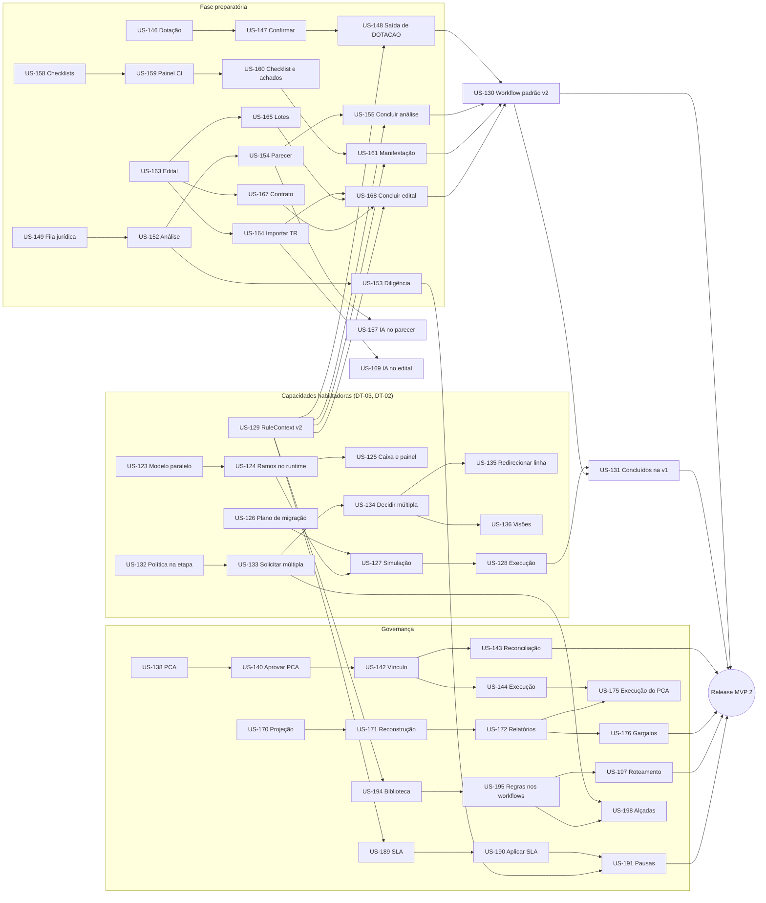

# MVP 2 — Plano de Entrega e Sequência de Implementação

> Estimativas, backlog priorizado, dependências, sequência por sprint, marcos e a **proposta de sequência de implementação do MVP 2** (cards por story).
> Fonte dos itens: [features.md](features.md) (documento canônico de IDs, prioridades, estimativas e dependências). Riscos e débitos: [risks-and-decisions.md](risks-and-decisions.md). Release: [release-checklist.md](release-checklist.md). Escopo canônico: [roadmap §4](../product/roadmap.md#4-mvp-2--governança-e-controle).
> **Versão 1, revisável depois do UAT do MVP 1** (DEC-192). As estimativas são da especificação e são recalibradas na Sprint 0 com a velocidade real medida no MVP 1.

Sumário: [1. Premissas](#1-premissas-de-planejamento) · [2. Estimativas](#2-estimativas-consolidadas) · [3. Backlog priorizado](#3-backlog-priorizado) · [4. Dependências e caminho crítico](#4-dependências-e-caminho-crítico) · [5. Sequência](#5-proposta-de-sequência-por-sprint) · [6. Marcos](#6-marcos-e-entregas-incrementais) · [7. Trilhas](#7-trilhas-paralelas-e-alocação) · [8. Capacidade](#8-cenários-de-capacidade) · [9. Postergados](#9-itens-postergados-do-mvp-2) · [10. UAT do MVP 1](#10-o-que-depende-do-uat-do-mvp-1) · [11. Cards de implementação](#11-proposta-de-sequência-de-implementação-em-cards)

---

## 1. Premissas de planejamento

| Premissa | Valor adotado |
|---|---|
| Sprint | 2 semanas |
| Escala de pontos | XS = 1 · S = 2 · M = 5 · L = 8 · XL = 13 (≈ 1 dia-dev por ponto); nenhuma story do MVP 2 é XL |
| Squad de referência | O mesmo do MVP 1 ([delivery-plan §1](../mvp-01/delivery-plan.md#1-premissas-de-planejamento)): 6 desenvolvedores, 1 QA/SDET, 1 designer, 1 PO, 1 Tech Lead (50% codificando) e o especialista em contratações públicas em meio período ([roadmap §9.1](../product/roadmap.md#91-premissa-de-time-squad-de-referência)) |
| Velocidade estimada | **40–45 pts** desde a sprint 1 (sem *ramp-up*: mesma equipe, mesma fundação) — recalibrar na Sprint 0 com a velocidade real do MVP 1 |
| Sprint 0 | 2 semanas, nas primeiras semanas de *hypercare* do MVP 1: revisão da especificação com o aprendizado do UAT, validações com o piloto (§10), pedido de credenciamento no Login Único, protótipos e spikes |
| Definição de pronto | [release-checklist.md §1](release-checklist.md#1-definition-of-done) e a DoD de cada card |
| Cliente-piloto | O mesmo do MVP 1 (prefeitura de porte médio), com o **jurídico** e o **controle interno** do órgão envolvidos desde a Sprint 0 |
| Suítes pesadas | `test:integration`, `test:tenant-leak`, `test:e2e` e desempenho rodam em **cards de endurecimento** agendados antes de cada marco (DEC-190 — não há CI de PR); nunca dentro do card da story |

**Critérios de entrada ([roadmap §4.7](../product/roadmap.md#47-critérios-de-entrada)) e o desvio consciente:**

| Critério do roadmap §4.7 | Situação na especificação (2026-11-11) | Como o plano trata |
|---|---|---|
| Aprendizado do MVP 1 incorporado (beta M3/M4 e primeiras semanas de produção, com métricas) | **Não cumprido** — a especificação veio antes do piloto (decisão do usuário, prd-7, DEC-192) | Especificação = versão 1; a Sprint 0 revisa as stories com o aprendizado do UAT e o plano é recalibrado antes da sprint 1 (§10) |
| Gate (§2) com ADRs de etapas paralelas, múltiplos aprovadores e migração de versão | Cumprido: DEC-193, DEC-194, DEC-195; [ADR-016](../adr/adr-016-workflow-version-migration.md) (migração) e [ADR-005](../adr/adr-005-workflow-engine.md) revisada (paralelismo); [ADR-014](../adr/adr-014-indicators-read-model.md), [ADR-015](../adr/adr-015-rules-engine-sla-notifications.md), [ADR-017](../adr/adr-017-govbr-login.md) | — |
| Definições com o piloto (parecer, prioridade da fila, dispensa, checklist do CI, PCA, classificação orçamentária) | **Padrões semeados e configuráveis, "a validar com o piloto"** ([overview §7](overview.md#7-a-validar-com-o-piloto)) | Validação na Sprint 0 (§10); mudança vira configuração ou revisão da story, nunca código fixo |
| Decisão sobre a posição do edital e a ordem Jurídico × Controle Interno (L-04) | Resolvida pela DEC-196, **a validar com o jurídico do piloto** | Ordem é configuração da versão do workflow; a v2 é oferecida, nunca imposta |

Pré-condições técnicas da implementação (DEC-192): **endurecimento das suítes órfãs concluído** (spec-622 e as correções spec-631..637) e **DT-02 e DT-03 como primeiros cards** (§11).

## 2. Estimativas consolidadas

| Épico | Stories | P0 | P1 | P2 | Pontos | Pontos P0 + P1 |
|---|---|---|---|---|---|---|
| EP-021 Workflow v2 | 9 | 8 | 1 | 0 | 57 | 57 |
| EP-022 Aprovação múltipla | 6 | 5 | 1 | 0 | 33 | 33 |
| EP-023 PCA | 8 | 0 | 8 | 0 | 43 | 43 |
| EP-024 Dotação orçamentária | 3 | 3 | 0 | 0 | 15 | 15 |
| EP-025 Jurídico | 9 | 8 | 1 | 0 | 51 | 51 |
| EP-026 Controle Interno | 5 | 4 | 1 | 0 | 25 | 25 |
| EP-027 Edital | 7 | 5 | 2 | 0 | 38 | 38 |
| EP-028 Indicadores e gargalos | 8 | 0 | 8 | 0 | 46 | 46 |
| EP-029 Plataforma e backoffice | 11 | 0 | 7 | 4 | 48 | 38 |
| EP-030 SLA | 5 | 0 | 5 | 0 | 28 | 28 |
| EP-031 Regras condicionais | 7 | 0 | 7 | 0 | 38 | 38 |
| **Total** | **78** | **33** | **41** | **4** | **422** | **412** |

Por prioridade: **P0 = 189 pts** (fecham a fase preparatória) · **P1 = 223 pts** (critérios de saída do roadmap §4.8 e as IAs do parecer e do edital) · **P2 = 10 pts** (DT-13 a DT-16). Escopo do release do MVP 2 = P0 + P1 = **412 pts**.

Comparação com o roadmap: o §9.2 estimava ≈ 10 sprints. Com 412 pts a 40–45 pts/sprint, são **10 sprints de desenvolvimento** (a última com folga para o endurecimento) **+ 1 sprint de release**, além da Sprint 0 — ≈ 24 semanas no total (§8). O MVP 2 não repete a fundação técnica (178 dos 584 pts do MVP 1 original), mas carrega três capacidades de alto risco (paralelismo, aprovação múltipla e migração de versão — US-123..US-128 e US-132..US-136, 73 pts).

## 3. Backlog priorizado

Ordem = prioridade de negócio (P0 → P2) **ajustada pelo caminho crítico**: DT-03 e DT-02 primeiro (DEC-192), `RuleContext` v2 cedo, os módulos da fase preparatória em seguida e a v2 do workflow padrão no fim da cadeia. A coluna "Sprint" refere-se ao §5.

| # | Story | Título | Prio | Est | Pts | Sprint |
|---|---|---|---|---|---|---|
| 1 | US-123 | Modelar etapas paralelas no workflow (ramificação e junção) | P0 | L | 8 | 1 |
| 2 | US-132 | Configurar política de decisão e aprovadores ordenados na etapa | P0 | M | 5 | 1 |
| 3 | US-133 | Solicitar aprovação com múltiplos aprovadores | P0 | L | 8 | 1 |
| 4 | US-129 | `RuleContext` v2: contrato versionado e provedores por módulo | P0 | M | 5 | 1 |
| 5 | US-126 | Planejar a migração de processos: mapeamento de etapas e filtro | P0 | M | 5 | 1 |
| 6 | US-138 | Criar o plano anual e manter os itens do PCA | P1¹ | L | 8 | 1 |
| 7 | US-124 | Executar ramos paralelos no processo | P0 | L | 8 | 2 |
| 8 | US-134 | Decidir aprovação múltipla: votos, encerramento e concorrência | P0 | L | 8 | 2 |
| 9 | US-135 | Redirecionar linha de aprovação e retirar aprovação múltipla | P0 | M | 5 | 2 |
| 10 | US-146 | Indicar a dotação orçamentária do processo | P0 | M | 5 | 2 |
| 11 | US-139 | Importar itens do PCA por planilha | P1¹ | M | 5 | 2 |
| 12 | US-140 | Enviar o PCA para aprovação e decidir | P1¹ | M | 5 | 2 |
| 13 | US-170 | Alimentar o read model de indicadores pelos eventos | P1² | L | 8 | 2 |
| 14 | US-125 | Ramos paralelos na caixa de tarefas, no painel situacional e nos prazos | P0 | M | 5 | 3 |
| 15 | US-136 | Aprovação múltipla na caixa de tarefas, na lista e no detalhe da aprovação | P0 | M | 5 | 3 |
| 16 | US-127 | Simular a migração e decidir os processos que exigem decisão | P0 | L | 8 | 3 |
| 17 | US-147 | Confirmar a reserva com evidência e cancelar dotação | P0 | M | 5 | 3 |
| 18 | US-148 | Compatibilidade da dotação com o valor estimado e regra de saída da etapa | P0 | M | 5 | 3 |
| 19 | US-141 | Revisar o PCA aprovado com nova versão | P1 | M | 5 | 3 |
| 20 | US-142 | Vincular DFD e processo a item do PCA | P1 | M | 5 | 3 |
| 21 | US-137 | Prazo da aprovação avulsa por tipo de documento (DT-17) | P1 | S | 2 | 3 |
| 22 | US-128 | Executar a migração de forma assíncrona, idempotente e auditada | P0 | L | 8 | 4 |
| 23 | US-163 | Criar a minuta do edital com cabeçalho tipado | P0 | M | 5 | 4 |
| 24 | US-164 | Importar itens, critérios e condições do TR para o edital | P0 | M | 5 | 4 |
| 25 | US-149 | Abrir a análise jurídica e fila priorizada | P0 | L | 8 | 4 |
| 26 | US-158 | Gerenciar checklists versionados do Controle Interno | P0 | M | 5 | 4 |
| 27 | US-171 | Reconstruir e reconciliar o read model | P1² | M | 5 | 4 |
| 28 | US-143 | Reconciliar as referências textuais ao PCA e conciliar manualmente | P1 | L | 8 | 4 |
| 29 | US-165 | Organizar os lotes do edital | P0 | M | 5 | 5 |
| 30 | US-167 | Elaborar a minuta do contrato | P0 | M | 5 | 5 |
| 31 | US-150 | Distribuir análises na assessoria jurídica | P0 | S | 2 | 5 |
| 32 | US-151 | Configurar critérios da fila e hipóteses de dispensa | P0 | M | 5 | 5 |
| 33 | US-152 | Conduzir a análise jurídica sobre versões exatas | P0 | M | 5 | 5 |
| 34 | US-159 | Abrir a manifestação e painel do Controle Interno com visão de riscos | P0 | L | 8 | 5 |
| 35 | US-172 | Relatórios de indicadores | P1 | L | 8 | 5 |
| 36 | US-144 | Acompanhar a execução do PCA | P1 | M | 5 | 5 |
| 37 | US-168 | Concluir a minuta do edital | P0 | M | 5 | 6 |
| 38 | US-153 | Pedir diligência e retomar a análise | P0 | L | 8 | 6 |
| 39 | US-154 | Elaborar o parecer jurídico e registrar ressalvas | P0 | M | 5 | 6 |
| 40 | US-160 | Responder o checklist e registrar achados e recomendações | P0 | M | 5 | 6 |
| 41 | US-166 | Matriz de alocação de riscos do edital | P1 | M | 5 | 6 |
| 42 | US-173 | Relatório detalhado com detalhamento por processo | P1 | M | 5 | 6 |
| 43 | US-145 | Exportar o PCA para divulgação | P1 | S | 2 | 6 |
| 44 | US-194 | Biblioteca de regras reutilizáveis com versões | P1³ | L | 8 | 6 |
| 45 | US-155 | Concluir a análise com a situação conclusiva | P0 | M | 5 | 7 |
| 46 | US-156 | Dispensar a análise jurídica por hipótese configurada | P0 | M | 5 | 7 |
| 47 | US-161 | Emitir a manifestação e concluir com a situação | P0 | M | 5 | 7 |
| 48 | US-162 | Acompanhar o atendimento dos achados | P1 | S | 2 | 7 |
| 49 | US-176 | Análise de gargalos por etapa, unidade e responsável | P1 | L | 8 | 7 |
| 50 | US-175 | Indicadores de execução do PCA | P1 | S | 2 | 7 |
| 51 | US-189 | Cadastrar políticas de SLA | P1 | L | 8 | 7 |
| 52 | US-195 | Usar regras da biblioteca nos workflows por versão fixada | P1 | M | 5 | 7 |
| 53 | US-196 | Modelos prontos de regras | P1 | S | 2 | 7 |
| 54 | US-130 | Workflow padrão v2 da fase preparatória e oferta de adoção | P0 | M | 5 | 8 |
| 55 | US-157 | Gerar o rascunho do parecer jurídico com IA | P1 | L | 8 | 8 |
| 56 | US-169 | Gerar o rascunho do edital com IA | P1 | L | 8 | 8 |
| 57 | US-190 | Aplicar a política de SLA ao processo e calcular prazos | P1 | M | 5 | 8 |
| 58 | US-174 | Exportar relatórios | P1 | M | 5 | 8 |
| 59 | US-178 | Acesso ao backoffice e provisionamento de tenant e órgãos | P1 | L | 8 | 8 |
| 60 | US-199 | Simular regras com processo hipotético | P1 | M | 5 | 8 |
| 61 | US-131 | Levar à fase preparatória processos concluídos na v1 | P1 | M | 5 | 9 |
| 62 | US-191 | Pausar e retomar prazos | P1 | M | 5 | 9 |
| 63 | US-192 | Escalonar prazos em degraus | P1 | M | 5 | 9 |
| 64 | US-193 | Regras de notificação condicional | P1 | M | 5 | 9 |
| 65 | US-177 | Filas, envelhecimento e comparação entre períodos | P1 | M | 5 | 9 |
| 66 | US-179 | Ciclo de vida do tenant no backoffice | P1 | M | 5 | 9 |
| 67 | US-180 | Conceder e encerrar acesso de suporte | P1 | M | 5 | 9 |
| 68 | US-182 | Entrar com gov.br via Authentik | P1⁴ | L | 8 | 9 |
| 69 | US-197 | Roteamento condicional: etapa dispensada e transição condicional | P1 | L | 8 | 10 |
| 70 | US-198 | Alçadas por valor | P1 | M | 5 | 10 |
| 71 | US-200 | Casos de teste de regra e bloqueio da publicação | P1 | M | 5 | 10 |
| 72 | US-181 | Saúde operacional por tenant no backoffice | P1 | M | 5 | 10 |
| 73 | US-183 | Vincular e desvincular a identidade gov.br | P1⁴ | M | 5 | 10 |
| 74 | US-184 | Habilitar o gov.br no órgão e nível de confiança na política de MFA | P1⁴ | S | 2 | 10 |
| 75 | US-185 | Reativar perfil desativado (DT-13) | P2 | S | 2 | pós-release |
| 76 | US-186 | Notificar a quebra do selo de auditoria (DT-14) | P2 | S | 2 | pós-release |
| 77 | US-187 | Atualizar a biblioteca padrão de templates com adoção assistida (DT-15) | P2 | M | 5 | pós-release |
| 78 | US-188 | Limite configurável do lote da caixa de tarefas (DT-16) | P2 | XS | 1 | pós-release |

¹ O PCA é P1, mas entra cedo porque é uma trilha independente (só depende do MVP 1), porque o critério de saída do roadmap §4.8 exige um plano **aprovado e vinculado** com reconciliação executada (o que pede tempo de uso no piloto) e porque o calendário legal do plano (elaboração até o fim do primeiro semestre do exercício anterior) não espera o fim do MVP 2.
² O read model entra cedo para acumular histórico real: relatórios e gargalos do piloto só têm valor com semanas de fatos projetados, e a reconstrução (US-171) precisa ser medida antes do release.
³ A biblioteca de regras (US-194) adianta-se ao SLA porque `SlaPolicy` e `NotificationRule` referenciam regras por `RuleRef` (M2-09 antes de M2-10 e M2-18 — [entities.md §10](entities.md#10-migrações-expandcontract)).
⁴ O gov.br depende do **credenciamento da plataforma no Login Único** (dependência externa, pedida na Sprint 0). Sem credenciamento até a sprint 9, as três stories concluem com o IdP fake no CI e o botão oculto (`auth.govbrEnabled` sem efeito) e a homologação entra no release.

## 4. Dependências e caminho crítico

**Caminho crítico** (sequência mais longa até a fase preparatória completa na v2):
`US-132 → US-133 → US-134` e `US-123 → US-124 → US-127 → US-128` (DT-03 e DT-02, sprints 1–4) → `US-129` → módulos da fase preparatória em paralelo (dotação sprints 2–3; edital 4–6; jurídico `US-149 → US-152 → US-154 → US-155`, sprints 4–7; controle interno `US-158 → US-159 → US-160 → US-161`, sprints 4–7) → **US-130** (sprint 8) → **US-131** (sprint 9) → endurecimento e release.

Itens de maior risco técnico — desenvolvedores mais experientes, *pairing* e revisão de arquitetura obrigatória: **US-124** (várias `ProcessStage` ativas e a troca dos índices únicos — M2-06), **US-134** (serialização das decisões por trava de linha), **US-128** (execução não reversível em processos reais — ADR-016), **US-129** (contrato que todos os módulos novos consomem) e **US-170** (projeção idempotente que alimenta todos os relatórios). Um atraso em qualquer um deles desloca o marco M2.1 e, em cascata, a US-130.

**Dependência "de volta":** US-130 depende das regras de saída das quatro etapas novas (US-148, US-155, US-161, US-168). Os módulos não dependem da v2 semeada: cada um testa com versões de workflow próprias de teste ([features.md](features.md#notas-de-priorização-e-dependências)).

## 5. Proposta de sequência por sprint

| Sprint | Tema | Stories | Pts | Resultado demonstrável |
|---|---|---|---|---|
| 0 | Preparação | Revisão da especificação com o aprendizado do UAT do MVP 1 (versão 2 das stories afetadas); validações com o piloto (§10); pedido de credenciamento no Login Único; protótipos SCR-018/019/020/021/118 e das ampliações de SCR-006/013/034; spikes: troca dos índices únicos de `process_stages`/`process_assignments` (M2-06) numa cópia anonimizada do piloto, `REFRESH CONCURRENTLY` das visões do read model com 100 mil processos, serialização de decisões concorrentes em `Approval` | — | Stories revisadas, padrões confirmados ou ajustados com o piloto, spikes registrados (ADR atualizada quando mudar decisão), plano recalibrado com a velocidade real |
| 1 | DT-03 (I) e bases | US-123, US-132, US-133, US-129, US-126, US-138 | 39 | Workflow com ramificação/junção e etapa com política `ALL`/`SEQUENTIAL` publicáveis; `RuleContext` v2 com contrato versionado; plano de migração rascunhado; PCA em elaboração |
| 2 | DT-03 (II) e trilhas novas | US-124, US-134, US-135, US-146, US-139, US-140, US-170 | 44 | **Ramos paralelos** no processo; **decisão múltipla** com votos e concorrência; dotação indicada; PCA importado e enviado para aprovação; read model projetando eventos |
| 3 | Visões, simulação e dotação | US-125, US-136, US-127, US-147, US-148, US-141, US-142, US-137 | 40 | Ramos e linhas de aprovação na caixa, na lista e no painel; **simulação da migração**; dotação confirmada com evidência e regra de saída de `DOTACAO`; vínculo DFD/processo ao PCA; prazo das aprovações avulsas |
| 4 | DT-02 e abertura da fase preparatória | US-128, US-163, US-164, US-149, US-158, US-171, US-143 | 44 | **Migração executada** (assíncrona, auditada) entre versões de teste; minuta do edital criada a partir do TR; fila jurídica priorizada; checklists do CI; reconciliação do PCA e do read model — **Marco M2.1** |
| 5 | Edital, jurídico e CI (I) | US-165, US-167, US-150, US-151, US-152, US-159, US-172, US-144 | 43 | Lotes e minuta do contrato; distribuição e configuração da fila; análise sobre versões exatas; painel do CI com visão de riscos; **relatórios de indicadores**; execução do PCA |
| 6 | Edital, jurídico e CI (II) | US-168, US-153, US-154, US-160, US-166, US-173, US-145, US-194 | 43 | Minuta do edital concluída; **diligência** e retomada; parecer com ressalvas; checklist e achados; matriz de riscos; relatório detalhado; exportação do PCA; biblioteca de regras |
| 7 | Conclusões e governança | US-155, US-156, US-161, US-162, US-176, US-175, US-189, US-195, US-196 | 42 | Análise jurídica concluída e dispensa; **manifestação do CI**; acompanhamento dos achados; **gargalos**; políticas de SLA; regras da biblioteca nos workflows — **Marco M2.2** |
| 8 | v2 do padrão e IA | US-130, US-157, US-169, US-190, US-174, US-178, US-199 | 44 | **Workflow padrão v2** publicado/oferecido; rascunhos do parecer e do edital com IA; SLA aplicado; exportação de relatórios; backoffice com provisionamento; simulador de regras |
| 9 | Continuidade, SLA e plataforma | US-131, US-191, US-192, US-193, US-177, US-179, US-180, US-182 | 43 | Processos concluídos na v1 levados à fase preparatória; **pausas e escalonamento**; notificações por regra; filas e envelhecimento; ciclo de vida do tenant e acesso de suporte; entrada com gov.br — **Marco M2.3** |
| 10 | Regras, gov.br e endurecimento | US-197, US-198, US-200, US-181, US-183, US-184 + endurecimento (suítes completas, carga do read model e da migração, pentest dos fluxos novos, `ai:eval` dos geradores novos) | 30 + endurecimento | Roteamento condicional e **alçadas por valor**; casos de teste de regra; saúde por tenant; vínculo e habilitação do gov.br; metas de [tests.md §7](tests.md#7-testes-não-funcionais) medidas |
| 11 | Release | UAT com o piloto (J-12..J-20 e regressão J-01..J-11), adoção da v2 e **migração dos processos do piloto**, reconciliação do PCA do exercício, homologação do gov.br, treinamento por persona (jurídico, controle interno, contabilidade, licitações), go-live | — | **Release do MVP 2 (R2)** |

Observações:
- A sprint 10 tem folga deliberada (30 pts contra 40–45) para o endurecimento e para absorver atraso do caminho crítico, como as sprints 15–18 do MVP 1.
- **Endurecimento por marco** (DEC-190): um card de endurecimento roda as suítes pesadas no fim das sprints 4, 7 e 9, além do endurecimento completo da sprint 10 (§11).
- **Contingência** se a velocidade das sprints 1–4 ficar abaixo de 38 pts: (1) adiar US-177 e US-181 para pós-release; (2) entregar US-196 e US-200 depois do release (o simulador da US-199 continua); (3) entregar US-157 e US-169 só com o `FakeAiProvider` se o provedor (PEND-21) não estiver decidido; (4) manter a v2 do workflow padrão e a US-131, que são o critério de saída.
- **Contingência do gov.br:** sem credenciamento até a sprint 9, US-182..US-184 concluem com o IdP fake e a homologação entra na sprint 11 (a entrada por usuário e senha continua).
- Cada sprint termina com demo ao piloto; a partir do M2.2, com o jurídico e o controle interno do órgão.

## 6. Marcos e entregas incrementais

| Marco | Fim da sprint | Critério de saída | Uso |
|---|---|---|---|
| **M2.1 — Capacidades habilitadoras** | 4 | DT-03 e DT-02 pagos: ramos paralelos, aprovação `ALL`/`SEQUENTIAL` com concorrência, migração simulada e executada entre versões de teste; `RuleContext` v2; dotação com regra de saída; PCA aprovado e vinculado (J-14; J-15 com versões de teste) | Demo interna; revisão de arquitetura; staging com cópia anonimizada do piloto |
| **M2.2 — Fase preparatória instruída** | 7 | Dotação, minuta do edital, análise jurídica com diligência e manifestação do CI de ponta a ponta numa versão de teste do workflow; reconciliação do PCA; relatórios e gargalos com dados do staging (J-13, J-16, J-17) | Beta com o jurídico e o controle interno do piloto (dados sintéticos) |
| **M2.3 — Fase preparatória completa** | 9 | Workflow padrão v2 oferecido e adotado no staging; processos concluídos na v1 levados à fase preparatória; IA no parecer e no edital; SLA com pausas e escalonamento; backoffice (J-12, J-15, J-18, J-20 parcial) | Beta ampliado no piloto |
| **R2 — Release do MVP 2** | 11 | Todos os P0 e P1; critérios de saída do [roadmap §4.8](../product/roadmap.md#48-critérios-de-saída); checklist de release ([release-checklist.md](release-checklist.md)) | Produção para os pilotos |

Critérios de saída do roadmap §4.8 × marcos:

| Critério (§4.8) | Stories | Marco | Jornada |
|---|---|---|---|
| Nova versão do workflow padrão publicada com dotação, edital, jurídico e controle interno; processos em andamento preservados | US-130, US-126..US-128 | M2.3 | J-12, J-15 |
| PCA elaborado, aprovado e vinculado por pelo menos um órgão; reconciliação executada com relatório | US-138..US-143 | M2.1 (staging) → R2 (produção) | J-16 |
| Análise jurídica com diligência de ponta a ponta, parecer vinculado às versões analisadas | US-149..US-155 | M2.2 | J-13 |
| Relatórios e indicadores com dados reais e exportação; gargalos ao gestor | US-170..US-177 | M2.2 (staging) → R2 (dados reais) | J-17 |
| Biblioteca de regras com simulador; alçadas por valor no piloto | US-194..US-200 | R2 | J-20 |
| Regressão completa do MVP 1 sem falhas; KPIs E3 e Q1 medidos | — | R2 | J-01..J-11 |

## 7. Trilhas paralelas e alocação

| Trilha | Responsáveis sugeridos | Stories (ordem) |
|---|---|---|
| Workflow v2 e aprovação múltipla (caminho crítico) | 1 back sênior + Tech Lead + 1 front | US-123, 132, 133, 124, 134, 135, 125, 136, 126, 127, 128, 137, 130, 131 |
| Regras, SLA e notificações | 1 back sênior (a partir da sprint 1 com US-129) + front de apoio | US-129, 194, 195, 196, 189, 190, 199, 191, 192, 193, 197, 198, 200 |
| Fase preparatória — dotação, edital e IA | 1 back/full-stack + 1 front | US-146, 147, 148, 163, 164, 165, 167, 168, 166, 169 |
| Fase preparatória — jurídico, controle interno e IA | 1 back/full-stack + 1 front (com o especialista em contratações) | US-149, 158, 150, 151, 152, 159, 153, 154, 160, 155, 156, 161, 162, 157 |
| PCA | 1 back/full-stack (sprints 1–6) | US-138, 139, 140, 141, 142, 143, 144, 145 |
| Indicadores e gargalos | dev plataforma + 1 front (a partir da sprint 2) | US-170, 171, 172, 173, 176, 175, 174, 177 |
| Plataforma, backoffice e gov.br | dev plataforma + 1 front (a partir da sprint 8) | US-178, 179, 180, 182, 181, 183, 184 (P2: 185..188) |
| Qualidade | QA/SDET | Matriz RBAC dos perfis ampliados e tenant leak das tabelas novas desde a sprint 1; J-14/J-15 no M2.1; J-12/J-13/J-16/J-17 no M2.2; carga do read model e da migração na sprint 10 ([tests.md](tests.md)) |
| UX | Designer | Protótipos 1–2 sprints à frente; testes de usabilidade com procurador, controle interno e contabilidade do piloto no M2.2 e no M2.3 |

## 8. Cenários de capacidade

| Cenário | Capacidade | Duração para P0 + P1 (412 pts) |
|---|---|---|
| Squad de referência (6 devs) | 40–45 pts/sprint | **Sprint 0 + 10 sprints de desenvolvimento + 1 de release ≈ 24 semanas** (o roadmap previa ≈ 10 sprints/20 semanas; a diferença é a Sprint 0 e a sprint de release explícitas) |
| Squad enxuto (4 devs) | 26–30 pts/sprint | ≈ 15 sprints de desenvolvimento (≈ 34 semanas com Sprint 0 e release) — recomenda-se cortar US-177, US-181, US-196 e US-200 e entregar a IA (US-157, US-169) depois do release |
| Dois squads (10–11 devs) | 70–75 pts/sprint | ≈ 6–7 sprints (≈ 16 semanas) — o caminho crítico (DT-03 → DT-02 → módulos → US-130) limita o ganho; exige contratos de `RuleContext` v2 e de `ApprovalApprover` congelados na sprint 1 |

Com o T0 hipotético do [roadmap §9.2](../product/roadmap.md#92-plano-indicativo), o MVP 2 começa depois do release do MVP 1 (T0 + 40 semanas) e termina em **T0 + 64 semanas** (fim de janeiro de 2028). A ativação nos clientes fica para depois do encerramento do exercício; o PCA de 2028 já terá sido elaborado fora da plataforma — o piloto o **importa por planilha** (US-139) e usa o módulo de ponta a ponta no PCA de 2029.

## 9. Itens postergados do MVP 2

| Item | Motivo | Destino |
|---|---|---|
| Stories P2 (US-185, US-186, US-187, US-188 — DT-13 a DT-16) | Não bloqueiam a fase preparatória (DEC-209) | Pós-release do MVP 2 (sprints de estabilização), como os P2 do MVP 1 |
| Ramos paralelos aninhados e mais de uma junção por ramificação | Um nível basta para Jurídico ∥ Controle Interno (DEC-194) | Avaliar com o uso (DT-23) |
| Quórum e voto de minerva na aprovação múltipla | Fora da DEC-193 | Avaliar após o piloto do MVP 2 |
| Reversão automática de migração de workflow | Voltar = nova migração (DEC-195, ADR-016) | Sob demanda (DT-24) |
| IA na manifestação do Controle Interno | Não pedida no prd-7 (DEC-200) | MVP 5 (validações) |
| Integração contábil (consulta de dotação e reserva) | Sem integração obrigatória no MVP 2 (DEC-198) | MVP 3 (adapters) |
| Publicação do PCA e do edital (PNCP, sítio oficial), número do edital, status `PUBLISHED`, impugnações | DEC-201, PEND-16 → MVP 3 (DEC-210) | MVP 3 |
| Assinatura eletrônica do parecer, da manifestação e do edital | Escopo do MVP 3 | MVP 3 |
| Remoção das colunas legadas de aprovador único em `approvals` (M2-22) | Contract depois que nenhum leitor as usar | MVP 3 (DT-21) |
| Edição colaborativa em tempo real | PEND-12 (DEC-210) | Avaliar após o MVP 2 |
| Planos comerciais e cobrança da IA | PEND-17, DEC-203 | Decisão comercial |
| Alerta de fracionamento de despesa (L-12) | Requer natureza do objeto e unidade gestora bem modeladas | Regra configurável sobre a biblioteca (EP-031) ou recomendação no MVP 5 — decidir no gate do MVP 3 |

## 10. O que depende do UAT do MVP 1

A especificação veio antes do piloto (DEC-192). Na **Sprint 0**, com o aprendizado do UAT e das primeiras semanas de produção do MVP 1, o PO revisa:

| Tema | Padrão especificado | Quem valida | Efeito de uma mudança |
|---|---|---|---|
| Ordem `DOTACAO` → `MINUTA_EDITAL` → `JURIDICO` → `CONTROLE_INTERNO` → `AUTORIZACAO_LICITACAO` (L-04, DEC-196) | Sequencial, configurável (inverter ou paralelizar) | Jurídico do piloto | Seed da v2 (US-130); critérios não mudam |
| Modelo de parecer, critérios da fila, hipóteses de dispensa | Template `PARECER_JURIDICO` e critérios do [overview §7](overview.md#7-a-validar-com-o-piloto) | Procuradoria do piloto | Template e configuração (US-151, US-154) |
| Checklist do Controle Interno | `FASE_PREPARATORIA` v1 | Controle interno do piloto | Checklist semeado (US-158) |
| Estrutura e calendário do PCA, classificação orçamentária | Um plano por órgão e exercício; catálogos editáveis | Planejamento e contabilidade do piloto | Configuração e catálogos (US-138, US-146) |
| Uso real do MVP 1: tempo por etapa, devoluções, etapas `TASK` provisórias criadas pelo piloto para dotação ou jurídico | — | PO com os dados de produção | Mapa de migração (US-126) e prioridade dos relatórios (US-172, US-176) |
| Métricas de desempenho do MVP 1 em produção (caixa de tarefas, painel) | Metas de [tests.md §7.1](tests.md#71-desempenho-metas-por-fluxo) | Tech Lead | Se a caixa passar de p95 500 ms, antecipar o read model da caixa (DT-01) antes da US-125 |
| Provedor de IA (PEND-21) | Camada agnóstica + `FakeAiProvider` | Usuário (produto) + jurídico/DPO | US-157 e US-169 entregam o adaptador real ou ficam com o fake |

Saída da Sprint 0: stories afetadas revisadas (versão 2), `pnpm docs:check` verde e este plano recalibrado.

## 11. Proposta de sequência de implementação em cards

Para o PRD de implementação do MVP 2 (como o prd-2 fez com o MVP 1): **um card por story**, na ordem do §3, com as dependências do [features.md](features.md) ligadas entre cards, `verify` `pnpm turbo run lint typecheck test` e o commit `Refs: US-NNN` (DEC-190). Ordem proposta:

| Lote | Cards (ordem estrita dentro do lote) | Observação |
|---|---|---|
| 0 | Revisão pós-UAT da especificação (docs-only, `pnpm docs:check`) | Só se o UAT trouxer mudança; senão, pular |
| 1 — DT-03 | US-132 → US-133 → US-134 → US-135 → US-136; US-123 → US-124 → US-125 | Primeiros cards (DEC-192); domínio de alto risco |
| 2 — DT-02 e contexto | US-129; US-126 → US-127 → US-128; US-137 | US-129 cedo: todos os módulos novos publicam o seu provedor sobre ele |
| E1 | **Endurecimento M2.1** (`test:integration`, `test:tenant-leak`, `test:e2e`, migração com 2.000 processos) | Card próprio, agendado pelo piloto |
| 3 — Fase preparatória | US-146 → US-147 → US-148; US-163 → US-164 → US-165 → US-167 → US-168 → US-166; US-149 → US-150 → US-151 → US-152 → US-153 → US-154 → US-155 → US-156; US-158 → US-159 → US-160 → US-161 → US-162 | Em sequência na mesma `main`; o jurídico e o CI só abrem depois da US-129 |
| 4 — PCA | US-138 → US-139 → US-140 → US-141 → US-142 → US-143 → US-144 → US-145 | Pode intercalar com o lote 3 (módulo independente) |
| 5 — Indicadores | US-170 → US-171 → US-172 → US-173 → US-176 → US-175 → US-174 → US-177 | US-175 depois da US-144 |
| E2 | **Endurecimento M2.2** (+ carga do read model com 100 mil processos) | — |
| 6 — v2 e IA | US-130 → US-131; US-157; US-169 | US-130 só depois de US-148, US-155, US-161 e US-168 |
| 7 — Regras e SLA | US-194 → US-195 → US-196 → US-199 → US-200 → US-197 → US-198; US-189 → US-190 → US-191 → US-192 → US-193 | US-191 depois da US-153; US-198 depois da US-133 |
| 8 — Plataforma | US-178 → US-179 → US-180 → US-181; US-182 → US-183 → US-184 | gov.br com IdP fake até o credenciamento |
| E3 | **Endurecimento final** (suítes completas, metas de desempenho, pentest dos fluxos novos, `ai:eval` dos geradores novos) | Antes do release |
| 9 — P2 | US-185, US-186, US-187, US-188 | Pós-release ou folga |

**Presets sugeridos** (como no MVP 1): modelo mais forte e esforço alto nos cards de domínio e segurança — US-124, US-127, US-128, US-129, US-133, US-134, US-153, US-170, US-180, US-182; esforço padrão nos demais; stories S/XS com o modelo econômico. Todo card leva o aviso de não terminar o turno esperando subagente ou comando em segundo plano.
