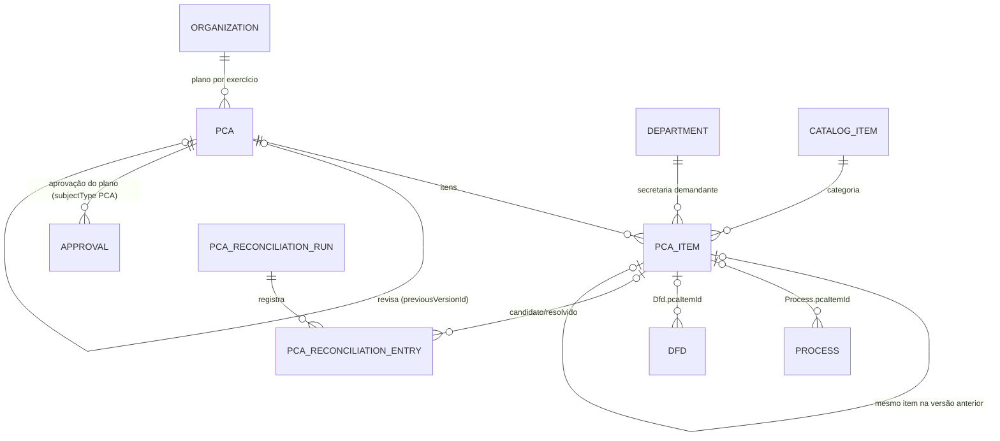
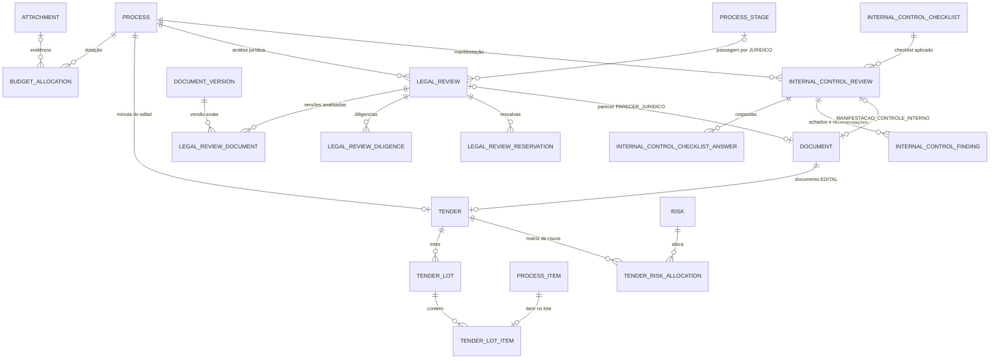
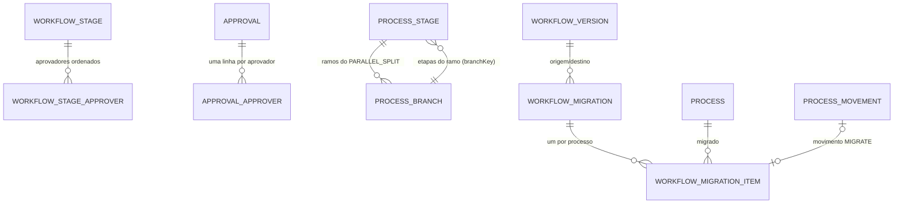
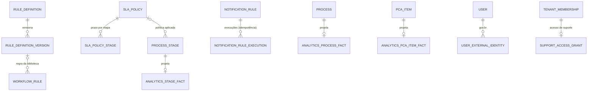
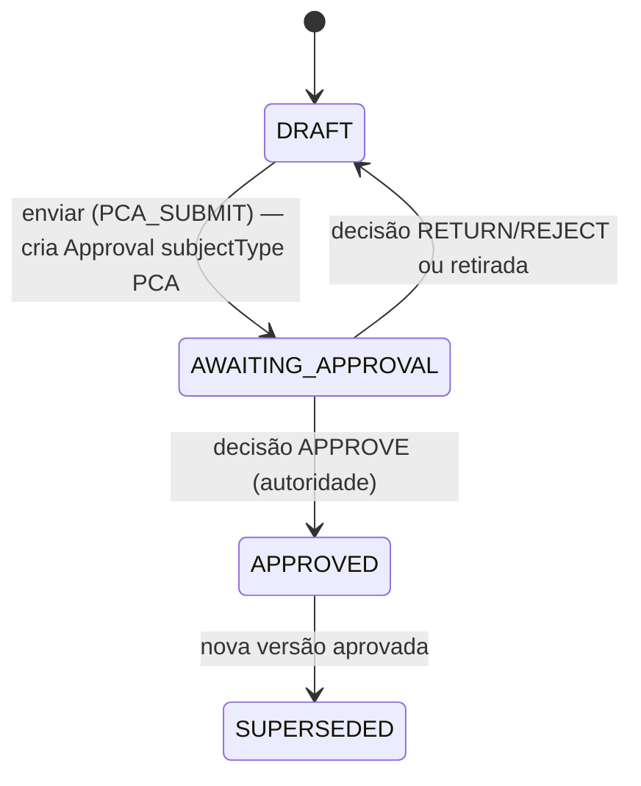
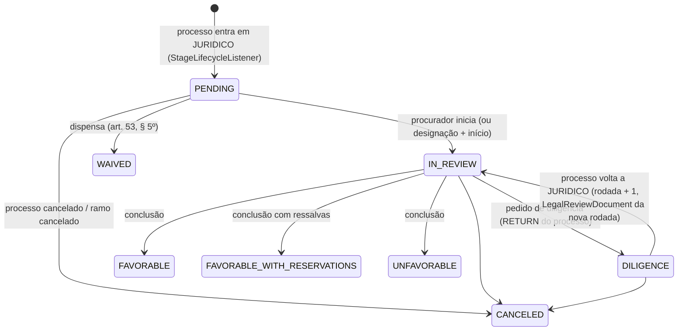

# MVP 2 — Modelo de Dados (Entidades)

> **Documento canônico** de entidades, campos, enums, índices, invariantes e migrações do MVP 2 (Governança e Controle). Estende — não refaz — o modelo do MVP 1 ([mvp-01/entities.md](../mvp-01/entities.md)): tudo o que não está aqui continua como lá.
> Decisões de base: [DEC-192 a DEC-210](../architecture/decisions.md#mvp-2--governança-e-controle) · ADRs [014](../adr/adr-014-indicators-read-model.md), [015](../adr/adr-015-rules-engine-sla-notifications.md), [016](../adr/adr-016-workflow-version-migration.md), [017](../adr/adr-017-govbr-login.md) · contextos e níveis em [domains.md §11.2](../architecture/domains.md#112-mvp-2--governança-e-controle).
> **Status:** versão 1, revisável após o UAT do MVP 1 (DEC-192). Notação de tipos e de Prisma igual à do MVP 1.

Sumário: [1. Convenções](#1-convenções) · [2. Enums](#2-enums-novos-e-ampliados) · [3. Diagramas ER](#3-diagramas-er-do-mvp-2) · [4. Entidades novas](#4-entidades-novas) · [5. Entidades alteradas](#5-entidades-do-mvp-1-alteradas) · [6. Ciclos de vida e invariantes](#6-ciclos-de-vida-e-invariantes) · [7. Estruturas JSON](#7-estruturas-json-canônicas) · [8. Configurações](#8-novas-chaves-de-configuração-do-tenant) · [9. Dados semeados](#9-dados-semeados) · [10. Migrações](#10-migrações-expandcontract) · [11. Rastreabilidade](#11-rastreabilidade-decisões--entidades)

---

## 1. Convenções

Valem integralmente as convenções do MVP 1 ([§1](../mvp-01/entities.md#1-convenções)): colunas **Padrão** (`id` UUIDv7, `tenantId`, `createdAt`, `updatedAt`, `createdById`, `updatedById`, `version`), marcadores **+SD** e **Imutável**, `UNIQUE (tenant_id, id)` implícito em toda tabela de negócio, **FKs compostas com o tenant** (DEC-081), **RLS `ENABLE` + `FORCE`** com `tenant_id = current_setting('app.tenant_id')::uuid` (DEC-082) e `ON DELETE RESTRICT` por padrão. Toda tabela nova abaixo tem `tenant_id` e RLS, salvo a tabela de plataforma `user_external_identities` (identidade global, como `users`); as tabelas de fatos do `analytics` têm `tenant_id` e RLS, mas não têm FK para as tabelas transacionais (§4.11) — as exceções são ditas na entidade.

Regras adicionais do MVP 2:
- **Dono único (D1):** cada entidade tem um módulo dono; só ele escreve. Quando um módulo precisa alterar dado de outro (ex.: reconciliação do PCA grava `Process.pcaItemId`), a escrita passa por **porta declarada no nível inferior e implementada pelo dono** ([domains.md §12.3](../architecture/domains.md#123-portas-de-extensão-inversão-de-dependência)).
- **Referências a regras (`RuleRef`, §7.1):** colunas `jsonb` que guardam uma expressão JSON Logic local **ou** a referência a uma versão publicada da biblioteca (`RuleDefinitionVersion`). As versões da biblioteca nunca são excluídas, por isso a referência em `jsonb` é validada na publicação do workflow (e não por FK).
- **"Alterada"** (§5) lista só os campos, enums, índices e constraints que mudam; o resto da entidade segue o MVP 1.
- Os valores de enum são estáveis; rótulos pt-BR entram em [terminology.md](../product/terminology.md) com as stories.

---

## 2. Enums (novos e ampliados)

| Enum | Valores | Situação | Base |
|---|---|---|---|
| `PcaPlanStatus` | `DRAFT`, `AWAITING_APPROVAL`, `APPROVED`, `SUPERSEDED` | Novo | DEC-197 |
| `PcaItemStatus` | `PLANNED`, `IN_PROGRESS`, `CONTRACTED`, `POSTPONED`, `CANCELED` | Novo | DEC-197 |
| `PcaLinkStatus` | `NOT_APPLICABLE`, `PENDING`, `LINKED`, `UNRESOLVED`, `AMBIGUOUS` | Novo — situação do vínculo textual × FK em `Process`/`Dfd` | DEC-197 |
| `PcaImportStatus` | `QUEUED`, `VALIDATING`, `PREVIEW_READY`, `APPLYING`, `COMPLETED`, `FAILED`, `EXPIRED` | Novo | US-139 |
| `PcaExportFormat` / `PcaExportStatus` | `CSV`, `PDF` / `PENDING`, `PROCESSING`, `READY`, `FAILED` | Novo | US-145 |
| `PcaReconciliationOutcome` | `LINKED`, `UNRESOLVED`, `AMBIGUOUS`, `MANUAL`, `SKIPPED` | Novo | DEC-197 |
| `PcaReconciliationRunStatus` | `RUNNING`, `COMPLETED`, `FAILED` | Novo | DEC-197 |
| `BudgetAllocationStatus` | `DRAFT`, `CONFIRMED`, `CANCELED` | Novo | DEC-198 |
| `LegalReviewStatus` | `PENDING`, `IN_REVIEW`, `DILIGENCE`, `FAVORABLE`, `FAVORABLE_WITH_RESERVATIONS`, `UNFAVORABLE`, `WAIVED`, `CANCELED` | Novo | DEC-199 |
| `LegalReservationStatus` | `OPEN`, `ADDRESSED`, `RISK_ACCEPTED` | Novo — ressalva do parecer | DEC-199 |
| `InternalControlReviewStatus` | `PENDING`, `IN_REVIEW`, `COMPLIANT`, `COMPLIANT_WITH_RECOMMENDATIONS`, `NON_COMPLIANT`, `CANCELED` | Novo | DEC-200 |
| `ChecklistAnswer` | `PENDING`, `COMPLIANT`, `NON_COMPLIANT`, `NOT_APPLICABLE` | Novo | DEC-200 |
| `FindingSeverity` | `LOW`, `MEDIUM`, `HIGH`, `CRITICAL` | Novo | DEC-200 |
| `FindingStatus` | `OPEN`, `ADDRESSED`, `RISK_ACCEPTED`, `CANCELED` | Novo | DEC-200 |
| `DisputeMode` | `OPEN`, `CLOSED`, `OPEN_CLOSED`, `CLOSED_OPEN` (art. 56) | Novo | DEC-201 |
| `ExecutionRegime` | `UNIT_PRICE`, `GLOBAL_PRICE`, `FULL_CONTRACTING`, `TURNKEY`, `TASK`, `INTEGRATED`, `SEMI_INTEGRATED`, `SUPPLY_AND_SERVICE` (art. 46) | Novo | DEC-201 |
| `SmallBusinessBenefit` | `NONE`, `EXCLUSIVE`, `RESERVED_QUOTA`, `SUBCONTRACTING` (LC 123/2006, arts. 47–49) | Novo | DEC-201 |
| `RiskAllocation` | `CONTRACTING_PARTY`, `CONTRACTOR`, `SHARED` (art. 22) | Novo | DEC-201 |
| `ApprovalDecisionPolicy` | `ANY`, `ALL`, `SEQUENTIAL` | Novo | DEC-193 |
| `ApprovalApproverStatus` | `WAITING`, `PENDING`, `APPROVED`, `RETURNED`, `REJECTED`, `SKIPPED`, `CANCELED` | Novo | DEC-193 |
| `ProcessBranchStatus` | `OPEN`, `ARRIVED`, `CANCELED` | Novo | DEC-194 |
| `WorkflowMigrationStatus` | `DRAFT`, `SIMULATED`, `RUNNING`, `COMPLETED`, `CANCELED` | Novo | DEC-195 |
| `MigrationClassification` | `AUTOMATIC`, `NEEDS_DECISION`, `BLOCKED` | Novo | DEC-195 |
| `MigrationItemDecision` | `PENDING`, `MIGRATE`, `EXCLUDE` | Novo | DEC-195 |
| `MigrationItemResult` | `PENDING`, `MIGRATED`, `EXCLUDED`, `FAILED`, `STALE` | Novo — `STALE` = processo mudou depois da simulação | DEC-195 |
| `RuleDefinitionKind` | `VALIDATION`, `ROUTING`, `APPROVAL_THRESHOLD`, `SLA`, `NOTIFICATION` | Novo | DEC-204 |
| `RuleVersionStatus` | `DRAFT`, `PUBLISHED`, `RETIRED` | Novo | DEC-204 |
| `SlaPauseReason` | `PROCESS_SUSPENDED`, `LEGAL_DILIGENCE`, `CONDITION` | Novo | DEC-205 |
| `NotificationRuleStatus` | `ACTIVE`, `INACTIVE`, `AUTO_DISABLED` | Novo | DEC-205 |
| `ExternalIdentityProvider` | `GOVBR` | Novo | DEC-207 |
| `GovbrTrustLevel` | `BRONZE`, `SILVER`, `GOLD` | Novo | DEC-207 |
| `ExternalIdentityLinkMethod` | `PROFILE`, `CPF_MATCH` | Novo | DEC-207 |
| `SupportAccessStatus` | `ACTIVE`, `ENDED`, `EXPIRED` | Novo | DEC-208 |
| `StageType` | + `PARALLEL_SPLIT`, `PARALLEL_JOIN` | Ampliado | DEC-194 |
| `ProcessStageStatus` | + `MIGRATED` (fechada por migração), `SKIPPED` (dispensada por `applicabilityRule`) | Ampliado | DEC-195, DEC-204 |
| `MovementAction` | + `MIGRATE`, `SKIP` | Ampliado | DEC-195, DEC-204 |
| `AssignmentType` | + `MIGRATION` | Ampliado | DEC-195 |
| `ApprovalSubjectType` | + `PCA` | Ampliado | DEC-197 |
| `SystemDocumentModule` | + `LEGAL_OPINION`, `TENDER`, `INTERNAL_CONTROL_REPORT` | Ampliado | DEC-199 a DEC-201 |
| `CatalogType` | + `PCA_CATEGORY`, `BUDGET_UNIT`, `BUDGET_ACTION`, `EXPENSE_NATURE`, `FUNDING_SOURCE`, `LEGAL_WAIVER_HYPOTHESIS` | Ampliado | DEC-197 a DEC-199 |
| `AttachmentTargetType` | + `PCA`, `BUDGET_ALLOCATION`, `INTERNAL_CONTROL_REVIEW`, `REPORT_EXPORT` (arquivo gerado da exportação de relatório — US-174) | Ampliado | DEC-197, DEC-198, DEC-200, DEC-206 |
| `AiInputRef.kind` *(schema)* | + `BUDGET_ALLOCATIONS`, `TENDER`, `LEGAL_REVIEW` | Ampliado | DEC-202 |
| `NotificationType` *(registro)* | ver [events.md §6](events.md#6-notificações-e-lembretes) | Ampliado | — |
| `TimelineEntryType` *(registro)* | ver [events.md §5](events.md#5-projeção-na-timeline) | Ampliado | — |

`AiGeneration.targetModule` continua tipado como `SystemDocumentModule`; o *check* que o restringe passa a aceitar `LEGAL_OPINION` e `TENDER` (§5.12). `ProcessStatus`, `ApprovalStatus`, `DocumentStatus` e `ApprovalDecision` **não mudam** (o `COMPLETED` da v2 do workflow é rotulado pela etapa `END` — DEC-196).

---

## 3. Diagramas ER do MVP 2

Linhas cheias = relações novas do MVP 2; entidades do MVP 1 aparecem só como âncora.

### 3.1 PCA e vínculo com DFD e processo


### 3.2 Fase preparatória: dotação, edital, jurídico e controle interno


### 3.3 Workflow v2: aprovação múltipla, paralelismo e migração


### 3.4 Regras, SLA, notificações condicionais e read model


---

## 4. Entidades novas

### 4.1 PCA (módulo `pca`)

#### Pca (`pcas`) — módulo `pca` · Padrão
Plano de Contratações Anual de um órgão num exercício (art. 12, VII; DEC-197). Cada revisão do plano aprovado é uma nova linha (nova versão); a anterior vira `SUPERSEDED`.

| Campo | Tipo | Null | Default | Regras |
|---|---|---|---|---|
| `organizationId` | uuid | não | `tenants.primary_organization_id` | FK → `organizations`; imutável |
| `year` | int | não | — | Exercício a que o plano se refere (2000..2100); imutável |
| `versionNumber` | int | não | `1` | 1..n por (órgão, exercício) |
| `previousVersionId` | uuid | sim | — | FK → `pcas` (versão revisada); obrigatório quando `versionNumber > 1` |
| `title` | varchar(200) | não | `"PCA {year}"` | |
| `status` | PcaPlanStatus | não | `DRAFT` | Transições §6.1 |
| `revisionReason` | text | sim | — | Obrigatório quando `versionNumber > 1` (≥ 20 caracteres) |
| `submittedAt` / `submittedById` | timestamptz / uuid | sim | — | Envio à aprovação |
| `approvalId` | uuid | sim | — | FK → `approvals` (última aprovação solicitada) |
| `approvedAt` / `approvedById` | timestamptz / uuid | sim | — | Preenchidos pela decisão (ApprovalSubjectHandler) |
| `supersededAt` | timestamptz | sim | — | Quando a revisão seguinte é aprovada |
| `totalPlannedValue` | numeric(18,2) | não | `0` | Soma desnormalizada dos itens não cancelados; recalculada na mesma transação |
| `itemsCount` | int | não | `0` | Desnormalizado |
| `importAttachmentId` | uuid | sim | — | FK → `attachments` (`targetType = PCA`) — última planilha importada |
| `exportedAt` | timestamptz | sim | — | Última exportação para divulgação (art. 12, § 1º) |

- **Unique:** `(tenant_id, organization_id, year, version_number)`; `(tenant_id, organization_id, year) WHERE status IN ('DRAFT','AWAITING_APPROVAL')` (uma versão em elaboração por exercício); `(tenant_id, organization_id, year) WHERE status = 'APPROVED'` (uma vigente).
- **Índices:** `(tenant_id, year, status)`.
- **Check:** `version_number = 1 OR (previous_version_id IS NOT NULL AND revision_reason IS NOT NULL)`; `status <> 'APPROVED' OR approved_at IS NOT NULL`; `status <> 'SUPERSEDED' OR superseded_at IS NOT NULL`.
- **Integridade:** `organization_id`, `year` e `version_number` imutáveis (trigger); plano `APPROVED`/`SUPERSEDED` não aceita alteração de itens (trigger em `pca_items` — mudança só por nova versão); sem `DELETE` para a aplicação, exceto plano `DRAFT` de versão 1 sem itens vinculados.
- **Auditoria/eventos:** `pca.create`, `pca.update`, `pca.submit`, `pca.revise`, `pca.import`, `pca.export`; eventos `PcaCreated`, `PcaStatusChanged`, `PcaRevisionCreated`, `PcaImported` ([events.md §4.2](events.md#42-pca-módulo-pca)).

#### PcaItem (`pca_items`) — módulo `pca` · Padrão + SD
Item do plano (art. 12, VII; Decreto 11.317/2022 e regulamentos locais). O `code` é a chave estável que liga as versões do plano e a referência textual do MVP 1.

| Campo | Tipo | Null | Default | Regras |
|---|---|---|---|---|
| `pcaId` | uuid | não | — | FK → `pcas` |
| `code` | varchar(60) | não | — | Código do item no plano; normalizado (sem espaços nas pontas, maiúsculas); estável entre versões |
| `previousItemId` | uuid | sim | — | FK → `pca_items` (mesmo `code` na versão anterior) |
| `departmentId` | uuid | não | — | FK → `departments` — secretaria demandante |
| `object` | varchar(2000) | não | — | Objeto (10..2.000) |
| `categoryId` | uuid | não | — | FK → `catalog_items` (`PCA_CATEGORY`, ativo) |
| `catalogSystem` | ItemCatalogSystem | sim | — | Classe CATMAT/CATSER (opcional) |
| `catalogCode` | varchar(30) | sim | — | |
| `contractingTypeId` | uuid | sim | — | FK → `catalog_items` (`CONTRACTING_TYPE`) |
| `plannedValue` | numeric(18,2) | não | — | Valor previsto ≥ 0 |
| `plannedMonth` | smallint | não | — | Mês previsto (1..12) |
| `quantity` | numeric(18,4) | sim | — | > 0 |
| `unitOfMeasureId` | uuid | sim | — | FK → `catalog_items` (`UNIT_OF_MEASURE`) |
| `priority` | Priority | não | `MEDIUM` | Grau de prioridade |
| `responsibleId` | uuid | sim | — | FK → `users` — responsável pelo item |
| `status` | PcaItemStatus | não | `PLANNED` | Transições §6.2 |
| `statusReason` | text | sim | — | Obrigatório em `POSTPONED`/`CANCELED` |
| `linkedProcessesCount` | int | não | `0` | Desnormalizado pelo consumidor de eventos (acompanhamento da execução) |
| `importRowNumber` | int | sim | — | Linha da planilha de origem, quando importado |
| `notes` | text | sim | — | |

- **Unique:** `(tenant_id, pca_id, code) WHERE deleted_at IS NULL`.
- **Índices:** `(tenant_id, pca_id, department_id)`; `(tenant_id, pca_id, category_id)`; `(tenant_id, pca_id, status)`; `(tenant_id, code)` (reconciliação); `(tenant_id, previous_item_id)`.
- **Check:** `planned_value >= 0`; `planned_month BETWEEN 1 AND 12`; `quantity IS NULL OR quantity > 0`; `status NOT IN ('POSTPONED','CANCELED') OR status_reason IS NOT NULL`; `catalog_code IS NULL OR catalog_system IS NOT NULL`.
- **Integridade:** `pca_id` e `code` imutáveis (trigger); itens de plano `APPROVED`/`SUPERSEDED` só mudam `status`, `status_reason` e `linked_processes_count` (acompanhamento da execução); item vinculado a processo/DFD não é excluído (exclusão lógica bloqueada com `PCA_ITEM_IN_USE`).

#### PcaReconciliationRun (`pca_reconciliation_runs`) — módulo `pca` · Padrão
Execução do job de reconciliação (DEC-197) para um plano aprovado.

| Campo | Tipo | Null | Default | Regras |
|---|---|---|---|---|
| `pcaId` | uuid | não | — | FK → `pcas` (`APPROVED`) |
| `trigger` | varchar(20) | não | — | `PCA_APPROVED`, `MANUAL`, `REVISION` |
| `status` | PcaReconciliationRunStatus | não | `RUNNING` | |
| `startedAt` / `finishedAt` | timestamptz | não / sim | `now()` / — | |
| `linkedCount` / `unresolvedCount` / `ambiguousCount` / `skippedCount` | int | não | `0` | Totais |
| `errorMessage` | varchar(500) | sim | — | Em `FAILED` |

- **Unique:** `(tenant_id, pca_id) WHERE status = 'RUNNING'` (uma execução por plano por vez).
- **Índices:** `(tenant_id, pca_id, started_at DESC)`.

#### PcaReconciliationEntry (`pca_reconciliation_entries`) — módulo `pca`
Uma linha por referência textual examinada (processo ou DFD). É o **relatório de reconciliação** e a fila da conciliação manual assistida.

| Campo | Tipo | Null | Default | Regras |
|---|---|---|---|---|
| `id`, `tenantId` | uuid | não | — | |
| `runId` | uuid | não | — | FK → `pca_reconciliation_runs` (`CASCADE`) |
| `targetType` | varchar(10) | não | — | `PROCESS` ou `DFD` |
| `targetId` | uuid | não | — | Id do processo ou do DFD (sem FK: alvos de módulos superiores — lidos pela porta `PcaLinkTarget`) |
| `processId` | uuid | não | — | Processo do alvo (para visibilidade) |
| `pcaYear` | int | não | — | Referência textual examinada |
| `pcaItemCode` | varchar(60) | sim | — | |
| `outcome` | PcaReconciliationOutcome | não | — | |
| `resolvedItemId` | uuid | sim | — | FK → `pca_items`; obrigatório em `LINKED`/`MANUAL` |
| `candidateItemIds` | uuid[] | não | `{}` | Candidatos (`AMBIGUOUS`, ou sugestões por similaridade em `UNRESOLVED`) |
| `resolvedById` / `resolvedAt` | uuid / timestamptz | sim | — | Conciliação manual |
| `reasonCode` | varchar(40) | sim | — | `NO_MATCH`, `NO_CODE`, `ITEM_CANCELED`, `MULTIPLE_MATCH`, `NO_COUNTERPART`, `MARKED_WITHOUT_ITEM`, `TARGET_CHANGED`, `PROCESSING_ERROR` (US-143) |
| `resolutionNote` | varchar(500) | sim | — | Justificativa/nota da conciliação manual (US-143) |
| `createdAt`, `updatedAt` | timestamptz | não | `now()` | |

- **Unique:** `(tenant_id, run_id, target_type, target_id)`.
- **Índices:** `(tenant_id, outcome) WHERE outcome IN ('UNRESOLVED','AMBIGUOUS')`; `(tenant_id, process_id)`; `(tenant_id, target_type, target_id, created_at DESC)`; `(tenant_id, run_id, outcome)`. Índice novo em `dfds (tenant_id, pca_item_id)` (US-143).
- **Semântica de `SKIPPED`:** referência examinada e deliberadamente não vinculada; "sem item no PCA" = entrada `SKIPPED` (`reasonCode = MARKED_WITHOUT_ITEM`) mais alvo com `pcaLinkStatus = NOT_APPLICABLE` e `pcaStatus = PLANNED`. Na reconciliação o texto original (`pcaYear`/`pcaItemCode`) é preservado (exceção ao espelho de §5.1, US-143).

#### PcaImport (`pca_imports`) — módulo `pca` (US-139)
Importação de planilha em duas fases (prévia e confirmação). Campos: `pcaId`, `attachmentId`, `requestedById`, `status` (`PcaImportStatus`: `QUEUED`, `VALIDATING`, `PREVIEW_READY`, `APPLYING`, `COMPLETED`, `FAILED`, `EXPIRED`), `fileFormat`, contagens (`rowsRead`, `rowsValid`, `rowsRejected`, `toCreate`, `toUpdate`, `unchanged`, `created`, `updated`), `rejections` (jsonb), `sample` (jsonb), `planVersionAtPreview`, `previewExpiresAt` (15 min), `errorCode`, `version` e carimbos. Único parcial por plano enquanto `QUEUED`/`VALIDATING`/`APPLYING`. Fila `pca-import` (jobs `validate` e `apply`).

#### PcaExport (`pca_exports`) — módulo `pca` (US-145)
Pedido assíncrono de exportação para divulgação. Campos: `pcaId`, `format` (`PcaExportFormat`: `CSV`, `PDF`), `status` (`PcaExportStatus`: `PENDING`, `PROCESSING`, `READY`, `FAILED`), `requestedById/At`, `startedAt`, `finishedAt`, `attachmentId`, `fileName`, `sizeBytes`, `sha256`, `versionNumber`, `itemsCount`, `maskedItemsCount`, `attempts`, `errorCode` (`PLAN_CHANGED`, `RENDER_FAILED`, `STORAGE_UNAVAILABLE`, `TIMEOUT`, `ENQUEUE_FAILED`), `errorMessage`. Único parcial: uma exportação ativa por (plano, formato).
- **Check:** `outcome NOT IN ('LINKED','MANUAL') OR resolved_item_id IS NOT NULL`; `target_type IN ('PROCESS','DFD')`.

### 4.2 Dotação orçamentária (módulo `budget`)

#### BudgetAllocation (`budget_allocations`) — módulo `budget` · Padrão
Dotação indicada e confirmada pela Contabilidade para o processo (art. 72, IV; art. 150; DEC-198). 1:N com o processo (mais de uma fonte ou exercício).

| Campo | Tipo | Null | Default | Regras |
|---|---|---|---|---|
| `processId` | uuid | não | — | FK → `processes` |
| `processStageId` | uuid | sim | — | FK → `process_stages` — passagem por `DOTACAO` em que foi registrada |
| `fiscalYear` | int | não | ano corrente | Exercício da dotação |
| `budgetUnitId` | uuid | não | — | FK → `catalog_items` (`BUDGET_UNIT`) — unidade orçamentária |
| `budgetActionId` | uuid | não | — | FK → `catalog_items` (`BUDGET_ACTION`) — programa de trabalho/ação |
| `expenseNatureId` | uuid | não | — | FK → `catalog_items` (`EXPENSE_NATURE`) — natureza da despesa |
| `fundingSourceId` | uuid | não | — | FK → `catalog_items` (`FUNDING_SOURCE`) — fonte de recursos |
| `reservedAmount` | numeric(18,2) | não | — | > 0; mascarado se o orçamento do processo for sigiloso (POL-09) |
| `reservationNumber` | varchar(60) | sim | — | Nº da reserva/pré-empenho; obrigatório para confirmar |
| `reservationDate` | date | sim | — | Obrigatória para confirmar |
| `evidenceAttachmentId` | uuid | sim | — | FK → `attachments` (`targetType = BUDGET_ALLOCATION`, `AVAILABLE`); obrigatória para confirmar |
| `status` | BudgetAllocationStatus | não | `DRAFT` | §6.3 |
| `confirmedAt` / `confirmedById` | timestamptz / uuid | sim | — | |
| `canceledAt` / `canceledById` | timestamptz / uuid | sim | — | |
| `cancellationReason` | text | sim | — | Obrigatório em `CANCELED` (≥ 10) |
| `notes` | text | sim | — | |

- **Índices:** `(tenant_id, process_id, status)`; `(tenant_id, fiscal_year, budget_unit_id)`.
- **Unique:** `(tenant_id, reservation_number, fiscal_year) WHERE status = 'CONFIRMED' AND reservation_number IS NOT NULL` (a mesma reserva não confirma duas dotações).
- **Check:** `reserved_amount > 0`; `status <> 'CONFIRMED' OR (reservation_number IS NOT NULL AND reservation_date IS NOT NULL AND evidence_attachment_id IS NOT NULL AND confirmed_at IS NOT NULL)`; `status <> 'CANCELED' OR cancellation_reason IS NOT NULL`.
- **Integridade:** `CONFIRMED` é imutável salvo cancelamento (trigger); confirmar e cancelar exigem o processo em status editável e custódia na etapa `DOTACAO` (POL-25).
- **Compatibilidade (DEC-198):** `budget.coverage` = Σ `reserved_amount` das `CONFIRMED` ÷ `Process.estimatedValue`; a regra de saída padrão de `DOTACAO` exige `budget.coverageRatio >= 1` (BLOCKING, configurável para `WARNING`) — exposta no `RuleContext` v2 (§7.2).

### 4.3 Análise jurídica (módulo `legal-review`)

#### LegalReview (`legal_reviews`) — módulo `legal-review` · Padrão
Análise jurídica do processo (art. 53; DEC-199). Uma análise **aberta** por processo; ela atravessa as diligências como **rodadas** (`currentRound`) e é retomada — não recriada — quando o processo volta a `JURIDICO` (DEC-196). Uma nova `LegalReview` só nasce se o processo voltar a `JURIDICO` depois de uma análise concluída (ex.: devolução do Controle Interno).

| Campo | Tipo | Null | Default | Regras |
|---|---|---|---|---|
| `processId` | uuid | não | — | FK → `processes` |
| `sequence` | int | não | — | 1..n por processo |
| `processStageId` | uuid | não | — | FK → `process_stages` — passagem por `JURIDICO` que abriu a análise |
| `currentProcessStageId` | uuid | sim | — | Passagem atual por `JURIDICO` (muda a cada retomada); nulo fora da etapa |
| `status` | LegalReviewStatus | não | `PENDING` | §6.4 |
| `currentRound` | smallint | não | `1` | Incrementado a cada retomada pós-diligência |
| `assigneeId` | uuid | sim | — | FK → `users` — procurador designado (distribuição — `PROCESS_ASSIGN` na unidade jurídica) |
| `assignedAt` / `assignedById` | timestamptz / uuid | sim | — | |
| `enteredQueueAt` | timestamptz | não | `now()` | Entrada na fila (base da prioridade) |
| `queuePriorityScore` | numeric(12,4) | não | `0` | Calculado pelos critérios objetivos (§7.5); recalculado em mudança de prazo, urgência ou valor |
| `priorityFactors` | jsonb | não | `{}` | Fatores usados no cálculo (auditável — art. 53, § 1º, I) |
| `startedAt` | timestamptz | sim | — | Primeira passagem a `IN_REVIEW` |
| `opinionDocumentId` | uuid | sim | — | FK → `documents` (tipo `PARECER_JURIDICO`) |
| `opinionDocumentVersionId` | uuid | sim | — | FK → `document_versions` — versão do parecer na conclusão |
| `concludedAt` / `concludedById` | timestamptz / uuid | sim | — | |
| `conclusionSummary` | varchar(1000) | sim | — | Ementa (sem dados sigilosos); obrigatória na conclusão |
| `waiverHypothesisId` | uuid | sim | — | FK → `catalog_items` (`LEGAL_WAIVER_HYPOTHESIS`); obrigatória em `WAIVED` |
| `waiverJustification` | text | sim | — | Obrigatória em `WAIVED` (≥ 20) |
| `waivedById` / `waivedAt` | uuid / timestamptz | sim | — | |
| `canceledAt` / `cancellationReason` | timestamptz / text | sim | — | Processo cancelado ou ramo cancelado |

- **Unique:** `(tenant_id, process_id, sequence)`; `(tenant_id, process_id) WHERE status IN ('PENDING','IN_REVIEW','DILIGENCE')` (uma aberta).
- **Índices:** `(tenant_id, status, queue_priority_score DESC, entered_queue_at)` (fila SCR-019); `(tenant_id, assignee_id) WHERE status IN ('PENDING','IN_REVIEW')`.
- **Check:** `status NOT IN ('FAVORABLE','FAVORABLE_WITH_RESERVATIONS','UNFAVORABLE') OR (concluded_at IS NOT NULL AND opinion_document_version_id IS NOT NULL AND conclusion_summary IS NOT NULL)`; `status <> 'WAIVED' OR (waiver_hypothesis_id IS NOT NULL AND waiver_justification IS NOT NULL)`; `status <> 'CANCELED' OR canceled_at IS NOT NULL`.
- **Invariantes:** concluir exige o parecer `FINALIZED` (DEC-018), todas as seções de IA revisadas (US-122) e a situação conclusiva escolhida por pessoa (a IA nunca preenche `status` — DEC-202); `FAVORABLE_WITH_RESERVATIONS` exige ao menos uma `LegalReviewReservation`; a análise concluída é imutável (trigger).

#### LegalReviewDocument (`legal_review_documents`) — módulo `legal-review`
Versões **exatas** analisadas em cada rodada (como `ApprovalDocument`). `id`, `tenantId`, `legalReviewId` (FK, `CASCADE`), `round` (smallint), `documentId` (FK), `documentVersionId` (FK — versão analisada), `documentTypeCode` (varchar(40), congelado), `createdAt`. **Unique:** `(tenant_id, legal_review_id, round, document_id)`. **Índices:** `(tenant_id, document_id)`. Gravadas ao abrir cada rodada (snapshot das versões vigentes de DFD, ETP, mapa de riscos, pesquisa, TR, edital, minuta do contrato) e completadas na conclusão; imutáveis.

#### LegalReviewDiligence (`legal_review_diligences`) — módulo `legal-review` · Padrão
Pedido de diligência (DEC-196, DEC-199).

| Campo | Tipo | Null | Default | Regras |
|---|---|---|---|---|
| `legalReviewId` | uuid | não | — | FK → `legal_reviews` |
| `round` | smallint | não | — | Rodada em que foi pedida |
| `request` | text | não | — | Pedido (20..10.000) |
| `returnStageKey` | varchar(60) | não | — | Etapa para onde o processo foi devolvido |
| `movementId` | uuid | não | — | FK → `process_movements` (o `RETURN`) |
| `requestedAt` / `requestedById` | timestamptz / uuid | não | — | |
| `dueAt` | timestamptz | sim | — | Prazo de atendimento (lembretes — `legalReview.diligenceReminderBusinessDays`) |
| `lastReminderAt` | timestamptz | sim | — | |
| `answeredAt` | timestamptz | sim | — | Retorno do processo a `JURIDICO` |
| `answerSummary` | text | sim | — | Resposta de quem atendeu (opcional) |

- **Unique:** `(tenant_id, legal_review_id, round)`.
- **Índices:** `(tenant_id, due_at) WHERE answered_at IS NULL`.

#### LegalReviewReservation (`legal_review_reservations`) — módulo `legal-review` · Padrão
Ressalva do parecer como item rastreável que a etapa seguinte vê (DEC-199).

| Campo | Tipo | Null | Default | Regras |
|---|---|---|---|---|
| `legalReviewId` | uuid | não | — | FK → `legal_reviews` |
| `sequence` | int | não | — | 1..n |
| `description` | text | não | — | 10..5.000 |
| `documentTypeCode` | varchar(40) | sim | — | Documento afetado (ex.: `EDITAL`) |
| `status` | LegalReservationStatus | não | `OPEN` | `ADDRESSED` exige `response`; `RISK_ACCEPTED` exige motivação da autoridade |
| `response` | text | sim | — | Como foi atendida |
| `respondedById` / `respondedAt` | uuid / timestamptz | sim | — | |

- **Unique:** `(tenant_id, legal_review_id, sequence)`.
- **Check:** `status = 'OPEN' OR (response IS NOT NULL AND responded_at IS NOT NULL)`.

### 4.4 Controle Interno (módulo `internal-control`)

#### InternalControlChecklist (`internal_control_checklists`) — módulo `internal-control` · Padrão
Modelo de checklist do tenant, **versionado** (cada linha é uma versão; publicada = imutável — DEC-200).

| Campo | Tipo | Null | Default | Regras |
|---|---|---|---|---|
| `key` | varchar(60) | não | — | Identidade lógica do checklist (ex.: `FASE_PREPARATORIA`) |
| `versionNumber` | int | não | — | 1..n por `key` |
| `name` | varchar(150) | não | — | |
| `status` | TemplateVersionStatus | não | `DRAFT` | Reaproveita `DRAFT`/`PUBLISHED`/`RETIRED` |
| `items` | jsonb | não | `[]` | `ChecklistItem[]` (§7.6), 1..200 itens |
| `applicabilityRule` | jsonb | sim | — | `RuleRef` (§7.1) — quando o checklist se aplica (ex.: por modalidade) |
| `isDefault` | boolean | não | `false` | Usado quando nenhum outro se aplica |
| `publishedAt` / `publishedById` | timestamptz / uuid | sim | — | |

- **Unique:** `(tenant_id, key, version_number)`; `(tenant_id, key) WHERE status = 'DRAFT'`; `(tenant_id) WHERE is_default AND status = 'PUBLISHED'`.
- **Integridade:** versão `PUBLISHED`/`RETIRED` imutável (trigger), salvo `status`/`retiredAt`.

#### InternalControlReview (`internal_control_reviews`) — módulo `internal-control` · Padrão
Manifestação do Controle Interno sobre o processo (art. 169, II; DEC-200). Mesma mecânica de abertura, rodadas e retomada da `LegalReview`.

| Campo | Tipo | Null | Default | Regras |
|---|---|---|---|---|
| `processId` | uuid | não | — | FK → `processes` |
| `sequence` | int | não | — | 1..n por processo |
| `processStageId` | uuid | não | — | FK → `process_stages` (passagem por `CONTROLE_INTERNO`) |
| `currentProcessStageId` | uuid | sim | — | |
| `status` | InternalControlReviewStatus | não | `PENDING` | §6.5 |
| `currentRound` | smallint | não | `1` | |
| `checklistId` | uuid | não | — | FK → `internal_control_checklists` (versão `PUBLISHED` fixada na abertura) |
| `assigneeId` | uuid | sim | — | FK → `users` |
| `startedAt` | timestamptz | sim | — | |
| `reportDocumentId` | uuid | sim | — | FK → `documents` (`MANIFESTACAO_CONTROLE_INTERNO`) |
| `reportDocumentVersionId` | uuid | sim | — | FK → `document_versions` — versão na conclusão |
| `reviewedDocumentVersionIds` | uuid[] | não | `{}` | Versões exatas analisadas na conclusão (inclui o parecer) |
| `legalReviewId` | uuid | sim | — | FK → `legal_reviews` — análise jurídica considerada |
| `warningsOverriddenCount` | int | não | `0` | Avisos `WARNING` superados no processo (L-08), congelado na abertura |
| `concludedAt` / `concludedById` | timestamptz / uuid | sim | — | |
| `conclusionSummary` | varchar(1000) | sim | — | Obrigatória na conclusão |
| `canceledAt` / `cancellationReason` | timestamptz / text | sim | — | |

- **Unique:** `(tenant_id, process_id, sequence)`; `(tenant_id, process_id) WHERE status IN ('PENDING','IN_REVIEW')`.
- **Índices:** `(tenant_id, status, created_at)`; `(tenant_id, assignee_id) WHERE status IN ('PENDING','IN_REVIEW')`.
- **Check:** `status NOT IN ('COMPLIANT','COMPLIANT_WITH_RECOMMENDATIONS','NON_COMPLIANT') OR (concluded_at IS NOT NULL AND report_document_version_id IS NOT NULL AND conclusion_summary IS NOT NULL)`.
- **Invariantes:** concluir exige todas as respostas obrigatórias do checklist diferentes de `PENDING`, todo `NON_COMPLIANT` com achado vinculado, a manifestação `FINALIZED`; `COMPLIANT_WITH_RECOMMENDATIONS` exige ≥ 1 achado com recomendação; `NON_COMPLIANT` exige ≥ 1 achado `HIGH`/`CRITICAL`.

#### InternalControlChecklistAnswer (`internal_control_checklist_answers`) — módulo `internal-control` · Padrão
`reviewId` (FK, `CASCADE`), `itemKey` (varchar(60) — chave do item no checklist fixado), `answer` (ChecklistAnswer, `PENDING`), `note` (text, nulo; obrigatório em `NON_COMPLIANT` e `NOT_APPLICABLE`), `evidenceDocumentVersionId` (uuid, nulo — FK → `document_versions`), `answeredById`/`answeredAt`. **Unique:** `(tenant_id, review_id, item_key)`. Linhas criadas na abertura, uma por item do checklist.

#### InternalControlFinding (`internal_control_findings`) — módulo `internal-control` · Padrão
Achado e recomendação (DEC-200).

| Campo | Tipo | Null | Default | Regras |
|---|---|---|---|---|
| `reviewId` | uuid | não | — | FK → `internal_control_reviews` |
| `sequence` | int | não | — | 1..n |
| `checklistItemKey` | varchar(60) | sim | — | Item que originou o achado |
| `title` | varchar(200) | não | — | |
| `description` | text | não | — | Achado (10..10.000) |
| `recommendation` | text | sim | — | Recomendação |
| `severity` | FindingSeverity | não | — | |
| `riskId` | uuid | sim | — | FK → `risks` — risco do mapa relacionado |
| `status` | FindingStatus | não | `OPEN` | §6.5 |
| `response` | text | sim | — | Atendimento |
| `respondedById` / `respondedAt` | uuid / timestamptz | sim | — | |

- **Unique:** `(tenant_id, review_id, sequence)`.
- **Índices:** `(tenant_id, status) WHERE status = 'OPEN'`.
- **Check:** `status NOT IN ('ADDRESSED','RISK_ACCEPTED') OR response IS NOT NULL`.

### 4.5 Edital (módulo `tender`)

#### Tender (`tenders`) — módulo `tender` · Padrão
Cabeçalho tipado da **minuta** do edital (art. 25; DEC-201), 1:1 com o processo e com o documento `EDITAL`. Número do edital, publicação e sessão pública ficam para o MVP 3+.

| Campo | Tipo | Null | Default | Regras |
|---|---|---|---|---|
| `processId` | uuid | não | — | FK → `processes` |
| `documentId` | uuid | não | — | FK 1:1 → `documents` (`EDITAL`); `id = document_id` (padrão do DFD) |
| `contractDraftDocumentId` | uuid | sim | — | FK → `documents` (`MINUTA_CONTRATO`) |
| `modalityId` | uuid | não | `process.modalityId` | FK → `catalog_items` (`MODALITY`, não direta) |
| `judgmentCriterionId` | uuid | não | — | FK → `catalog_items` (`JUDGMENT_CRITERION`) |
| `disputeMode` | DisputeMode | sim | — | Obrigatório para pregão e concorrência |
| `executionRegime` | ExecutionRegime | sim | — | Obrigatório para serviços e obras |
| `awardType` | AwardType | não | `BY_ITEM` | Adjudicação |
| `isPriceRegistration` | boolean | não | `process.isPriceRegistration` | |
| `smallBusinessBenefit` | SmallBusinessBenefit | não | `NONE` | |
| `isElectronic` | boolean | não | `true` | Forma eletrônica (art. 17, § 2º); `false` exige justificativa |
| `inPersonJustification` | text | sim | — | |
| `estimatedValueDisclosed` | boolean | não | `NOT process.isBudgetConfidential` | Orçamento sigiloso (art. 24) |
| `proposalValidityDays` | smallint | sim | — | 1..365 |
| `executionTermDays` | int | sim | — | Prazo de execução/entrega |
| `contractTermMonths` | smallint | sim | — | Vigência prevista |
| `guaranteePercent` | numeric(5,2) | sim | — | Garantia contratual (art. 96–98), 0..10 (30 em obras com retomada) |
| `siteVisit` | varchar(12) | sim | — | `NONE`, `OPTIONAL`, `MANDATORY` |
| `habilitationRequirements` | jsonb | não | `{}` | `TenderHabilitation` (§7.7) |
| `riskMatrixRequired` | boolean | não | `false` | Matriz de alocação de riscos obrigatória (art. 22, § 3º; regra semeada por valor/objeto) |
| `importedFromTermVersionId` | uuid | sim | — | FK → `document_versions` (TR) — última importação |
| `importedAt` | timestamptz | sim | — | |

- **Unique:** `(tenant_id, process_id)`; `(tenant_id, document_id)`.
- **Check:** `id = document_id`; `is_electronic OR in_person_justification IS NOT NULL`; `guarantee_percent IS NULL OR guarantee_percent BETWEEN 0 AND 30`; `site_visit IS NULL OR site_visit IN ('NONE','OPTIONAL','MANDATORY')`.
- **Edição:** segue o ciclo de vida do documento `EDITAL` (DEC-018) e POL-02 com `TENDER_UPDATE`; completude (`TypedDocumentModule.validateCompleteness`) exige critério, modalidade, lotes cobrindo todos os itens quando `awardType = BY_LOT` e matriz completa quando `riskMatrixRequired`.

#### TenderLot (`tender_lots`) — módulo `tender` · Padrão
`tenderId` (FK, `CASCADE` só em rascunho), `number` (int ≥ 1), `name` (varchar(150)), `description` (text, nulo), `smallBusinessBenefit` (SmallBusinessBenefit, nulo = o do edital), `estimatedValue` (numeric(18,2), nulo — desnormalizado dos itens; mascarado se sigiloso). **Unique:** `(tenant_id, tender_id, number)`.

#### TenderLotItem (`tender_lot_items`) — módulo `tender`
`id`, `tenantId`, `tenderLotId` (FK, `CASCADE`), `tenderId` (FK), `processItemId` (FK → `process_items`), `createdAt`. **Unique:** `(tenant_id, tender_id, process_item_id)` (um item em um lote só). Na criação e na importação do TR, os lotes nascem de `ProcessItem.lotNumber`/`lotName` (que continuam como planejamento — dono `process`).

#### TenderRiskAllocation (`tender_risk_allocations`) — módulo `tender` · Padrão
Matriz de alocação de riscos (art. 6º, XXVII; art. 22) a partir do mapa de riscos.

| Campo | Tipo | Null | Default | Regras |
|---|---|---|---|---|
| `tenderId` | uuid | não | — | FK → `tenders` |
| `riskId` | uuid | sim | — | FK → `risks` (nulo = risco próprio da matriz) |
| `title` | varchar(200) | não | — | Congelado do risco quando vinculado |
| `allocation` | RiskAllocation | não | — | Parte que assume |
| `rationale` | text | não | — | Justificativa da alocação |
| `mitigation` | text | sim | — | Medidas/mecanismos (seguros, garantias) |
| `economicBalanceImpact` | text | sim | — | Reflexo no equilíbrio econômico-financeiro (art. 22, § 2º) |
| `sortOrder` | int | não | `0` | |

- **Unique:** `(tenant_id, tender_id, risk_id) WHERE risk_id IS NOT NULL`.

### 4.6 Aprovação múltipla (módulos `approval` e `workflow`)

#### ApprovalApprover (`approval_approvers`) — módulo `approval` · Padrão
Uma linha por aprovador de uma `Approval` (DEC-193). É a fonte de verdade de quem decide; as colunas de aprovador da `Approval` passam a espelhar a linha corrente (§5.9).

| Campo | Tipo | Null | Default | Regras |
|---|---|---|---|---|
| `approvalId` | uuid | não | — | FK → `approvals` (`CASCADE`) |
| `sequence` | smallint | não | — | 1..n; ordem explícita (relevante em `SEQUENTIAL`) |
| `approverType` | ApproverType | não | — | |
| `approverUserId` | uuid | sim | — | Resolvido na solicitação (inclusive titular em `DEPARTMENT_HEAD`) |
| `approverRoleId` | uuid | sim | — | |
| `approverDepartmentId` | uuid | sim | — | |
| `allowDeputy` | boolean | não | — | |
| `status` | ApprovalApproverStatus | não | — | `PENDING` em `ANY`/`ALL`; em `SEQUENTIAL` só a 1ª nasce `PENDING`, as demais `WAITING` |
| `activatedAt` | timestamptz | sim | — | Quando passou a `PENDING` (prazo por linha) |
| `dueAt` | timestamptz | sim | — | Prazo da linha (política de SLA — DEC-205); nulo = `Approval.dueAt` |
| `decision` | ApprovalDecision | sim | — | |
| `decidedById` / `decidedAt` | uuid / timestamptz | sim | — | |
| `decisionComment` | text | sim | — | Obrigatório para `RETURN`/`REJECT` (≥ 10) |
| `decidedAsDeputy` | boolean | não | `false` | |
| `reassignedFromId` | uuid | sim | — | FK → `approval_approvers` (linha substituída no redirecionamento) |
| `skippedReason` | varchar(40) | sim | — | `NEGATIVE_DECISION`, `ANY_DECIDED`, `REASSIGNED`, `WITHDRAWN` |

- **Unique:** `(tenant_id, approval_id, sequence) WHERE status <> 'CANCELED'`.
- **Índices:** `(tenant_id, approver_user_id) WHERE status = 'PENDING'`; `(tenant_id, approver_department_id) WHERE status = 'PENDING'`; `(tenant_id, approver_role_id) WHERE status = 'PENDING'` (caixa de tarefas — só linhas `PENDING`).
- **Check:** mesmas regras de tipo × coluna da `Approval` (MVP 1); `status NOT IN ('APPROVED','RETURNED','REJECTED') OR (decided_at IS NOT NULL AND decision IS NOT NULL)`; `decision NOT IN ('RETURN','REJECT') OR decision_comment IS NOT NULL`.
- **Integridade:** linha decidida é imutável (trigger — "não se retira voto"); redirecionar = marcar a linha `CANCELED` (`skippedReason = REASSIGNED`) e criar outra com o mesmo `sequence` e `reassignedFromId`.

#### WorkflowStageApprover (`workflow_stage_approvers`) — módulo `workflow` · Padrão
Lista ordenada de aprovadores da etapa `APPROVAL` quando `WorkflowStage.decisionPolicy <> ANY` ou quando há alçada por valor (DEC-193, DEC-204). Imutável em versão publicada.

| Campo | Tipo | Null | Default | Regras |
|---|---|---|---|---|
| `workflowVersionId` | uuid | não | — | Versão da etapa (repetida para a FK composta `(tenant_id, workflow_version_id, workflow_stage_id)` e o gatilho `trg_wf_definition_immutable` — US-132) |
| `workflowStageId` | uuid | não | — | FK → `workflow_stages` (`CASCADE` só em `DRAFT`) |
| `sequence` | smallint | não | — | 1..20 |
| `approverType` | ApproverType | não | — | |
| `approverUserId` / `approverRoleId` | uuid | sim | — | Conforme o tipo |
| `approverDepartmentResolution` | DepartmentResolution | sim | — | Se `DEPARTMENT_HEAD` |
| `approverFixedDepartmentId` | uuid | sim | — | |
| `allowDeputy` | boolean | não | `true` | |
| `applicabilityRule` | jsonb | sim | — | `RuleRef` — alçada: a linha só entra na aprovação quando verdadeira (ex.: valor > X) |
| `label` | varchar(120) | sim | — | Rótulo exibido ("Secretário de Administração") |

- **Unique:** `(tenant_id, workflow_stage_id, sequence)`.
- **Validação na publicação:** etapa `APPROVAL` com política `ALL`/`SEQUENTIAL` exige ≥ 2 linhas; com alçadas, para todo contexto ao menos uma linha aplicável (o simulador avisa); `WF_APPROVERS_INVALID` (422).
- **Checks (US-132):** `sequence BETWEEN 1 AND 20`; tipo × coluna como no aprovador único (`USER` ⇔ `approverUserId`, `ROLE` ⇔ `approverRoleId`, `DEPARTMENT_HEAD` ⇔ `approverDepartmentResolution`, `FIXED` ⇔ `approverFixedDepartmentId`, nunca `CHOSEN_ON_FORWARD`); `label` de 1 a 120. Na etapa: `type = 'APPROVAL' OR decision_policy = 'ANY'` e `decision_policy_rules` sempre array.
- **Espelho (US-132 · RN-APV-08):** com lista não vazia, as colunas do aprovador único da `WorkflowStage` (`approverType` e referências, `allowDeputy`) espelham a linha 1 e ficam somente leitura no WF-11 (`NOT_ALLOWED`); com lista vazia voltam a valer e a ser editáveis. A escrita da lista é só pelo WF-65 (substituição atômica, `sequence` calculada pela ordem do array).
- **`DocumentType.approvalPolicy` (US-132 · RN-APV-11, aditivo ao §5.7 do MVP 1):** ganha `decisionPolicy?` (padrão `ANY`) e `approvers?[]` (1 a 20 linhas na forma acima, sem `sequence` — a ordem do array é a ordem). Só são gravados fora do padrão (`ANY` sem linhas), para a política do MVP 1 ficar idêntica; a leitura (DTY-01..03) devolve `decisionPolicy = ANY` e `approvers = []` quando ausentes. Com linhas, o aprovador único é o espelho da linha 1; `ALL`/`SEQUENTIAL` exigem ≥ 2 linhas no salvamento (`DOCUMENT_APPROVAL_POLICY_INVALID`).

### 4.7 Paralelismo e migração de versão (módulo `process`)

#### ProcessBranch (`process_branches`) — módulo `process` · Padrão
Ramo aberto por um `PARALLEL_SPLIT` (DEC-194). Serializa a junção: a chegada de cada ramo trava a `ProcessStage` do split (`FOR UPDATE`).

| Campo | Tipo | Null | Default | Regras |
|---|---|---|---|---|
| `processId` | uuid | não | — | FK → `processes` |
| `splitProcessStageId` | uuid | não | — | FK → `process_stages` (tipo `PARALLEL_SPLIT`) |
| `branchKey` | varchar(60) | não | — | Chave do ramo na definição (`WorkflowStage.branchKey`) |
| `status` | ProcessBranchStatus | não | `OPEN` | `ARRIVED` quando a última etapa do ramo é concluída rumo ao `PARALLEL_JOIN` |
| `arrivedAt` | timestamptz | sim | — | |
| `canceledAt` / `cancellationReason` | timestamptz / varchar(200) | sim | — | Devolução para antes da ramificação (DEC-194) ou cancelamento do processo |

- **Unique:** `(tenant_id, split_process_stage_id, branch_key)`.
- **Índices:** `(tenant_id, process_id) WHERE status = 'OPEN'`.
- **Invariante:** o `PARALLEL_JOIN` fecha (e o processo segue) na transação em que o último ramo `OPEN` vira `ARRIVED`.

#### WorkflowMigration (`workflow_migrations`) — módulo `process` · Padrão
Plano de migração de processos em andamento entre versões (DEC-195, ADR-016). Fica em `process` porque a execução escreve no runtime do processo (D1); a definição de etapas é lida da fachada de `workflow`.

| Campo | Tipo | Null | Default | Regras |
|---|---|---|---|---|
| `name` | varchar(150) | não | — | |
| `sourceWorkflowVersionId` | uuid | não | — | FK → `workflow_versions` |
| `targetWorkflowVersionId` | uuid | não | — | FK → `workflow_versions` (`PUBLISHED`) |
| `stageMapping` | jsonb | não | `[]` | `StageMapping[]` (§7.4); gerado por `key` + `type` e completado pelo administrador |
| `processFilter` | jsonb | não | `{}` | `MigrationFilter` (§7.4) |
| `status` | WorkflowMigrationStatus | não | `DRAFT` | §6.8 |
| `simulatedAt` / `simulatedById` | timestamptz / uuid | sim | — | |
| `simulationHash` | varchar(64) | sim | — | SHA-256 de mapa + filtro + itens classificados; executar exige o mesmo hash |
| `startedAt` / `startedById` | timestamptz / uuid | sim | — | |
| `completedAt` | timestamptz | sim | — | |
| `canceledAt` / `canceledById` / `cancellationReason` | — | sim | — | |
| `totals` | jsonb | não | `{}` | `{ automatic, needsDecision, blocked, migrated, excluded, failed, stale }` |

- **Unique:** `(tenant_id, source_workflow_version_id) WHERE status = 'RUNNING'`.
- **Check:** `source_workflow_version_id <> target_workflow_version_id`; `status <> 'RUNNING' OR simulated_at IS NOT NULL`.
- **Integridade:** origem e destino do **mesmo** `Workflow`, exceto a migração da v1 do padrão para a v2 do padrão (DEC-195/196, mesmo `seedKey`); plano `COMPLETED`/`CANCELED` imutável.

#### WorkflowMigrationItem (`workflow_migration_items`) — módulo `process` · Padrão
Um por processo do filtro (DEC-195).

| Campo | Tipo | Null | Default | Regras |
|---|---|---|---|---|
| `migrationId` | uuid | não | — | FK → `workflow_migrations` (`CASCADE` em `DRAFT`) |
| `processId` | uuid | não | — | FK → `processes` |
| `classification` | MigrationClassification | não | — | Resultado da simulação |
| `classificationReasons` | jsonb | não | `[]` | Códigos: `STAGE_REMOVED`, `STAGE_TYPE_CHANGED`, `APPROVAL_INCOMPATIBLE`, `PARALLEL_ACTIVE`, `BLOCKING_RULE_VIOLATED`, `COMPLETED_V1_CONTINUATION`, `FINAL_STATUS`, `EDIT_LOCK`, `MIGRATION_IN_PROGRESS` |
| `expectedProcessStageIds` | uuid[] | não | — | Etapas ativas na simulação (corrida → `STALE`) |
| `proposedTargetStageKey` | varchar(60) | sim | — | Pelo mapa |
| `decision` | MigrationItemDecision | não | `PENDING` | `AUTOMATIC` nasce `MIGRATE` |
| `targetStageKey` | varchar(60) | sim | — | Escolhido pela pessoa em `NEEDS_DECISION` |
| `targetDepartmentId` | uuid | sim | — | FK → `departments`; unidade da etapa de destino quando ela nasce `CHOSEN_ON_FORWARD` (ex.: `DOTACAO` na continuação v1 → v2, US-131) |
| `decisionJustification` | text | sim | — | Obrigatória em decisão humana (≥ 20) |
| `decidedById` / `decidedAt` | uuid / timestamptz | sim | — | |
| `result` | MigrationItemResult | não | `PENDING` | |
| `movementId` | uuid | sim | — | FK → `process_movements` (ação `MIGRATE`) |
| `errorCode` / `errorMessage` | varchar(60) / varchar(500) | sim | — | Em `FAILED` |
| `executedAt` | timestamptz | sim | — | |

- **Unique:** `(tenant_id, migration_id, process_id)`.
- **Índices:** `(tenant_id, process_id, result)`; `(tenant_id, migration_id, classification, result)`.
- **Check:** `classification <> 'BLOCKED' OR decision = 'EXCLUDE'`; `decision <> 'MIGRATE' OR classification = 'AUTOMATIC' OR (target_stage_key IS NOT NULL AND decision_justification IS NOT NULL)`; `result <> 'MIGRATED' OR movement_id IS NOT NULL`.
- **Idempotência:** item `MIGRATED`/`EXCLUDED` nunca é reexecutado; reexecutar o plano retoma só `PENDING`/`FAILED`.

### 4.8 Biblioteca de regras (módulo `rules`)

#### RuleDefinition (`rule_definitions`) — módulo `rules` · Padrão
Regra reutilizável do tenant (DEC-204, SCR-035).

| Campo | Tipo | Null | Default | Regras |
|---|---|---|---|---|
| `key` | varchar(60) | não | — | SCREAMING_SNAKE; imutável |
| `name` | varchar(150) | não | — | |
| `description` | text | sim | — | |
| `kind` | RuleDefinitionKind | não | — | Onde pode ser usada |
| `tags` | varchar(40)[] | não | `{}` | |
| `isSystem` | boolean | não | `false` | Modelo semeado (não excluível; pode ser copiado) |
| `templateKey` | varchar(60) | sim | — | Chave do modelo semeado de que a regra foi copiada (US-196); a cópia é independente do original |
| `isActive` | boolean | não | `true` | Inativa não é oferecida a novos usos; usos publicados continuam |
| `currentPublishedVersionId` | uuid | sim | — | FK → `rule_definition_versions` |

- **Unique:** `(tenant_id, key)`; `(tenant_id, lower(name))`.

#### RuleDefinitionVersion (`rule_definition_versions`) — módulo `rules` · Padrão
Versão publicada **imutável** (como `WorkflowVersion`).

| Campo | Tipo | Null | Default | Regras |
|---|---|---|---|---|
| `ruleDefinitionId` | uuid | não | — | FK → `rule_definitions` |
| `versionNumber` | int | não | — | 1..n |
| `status` | RuleVersionStatus | não | `DRAFT` | |
| `contextVersion` | smallint | não | `2` | Versão do `RuleContext` (1 ou 2) |
| `expression` | jsonb | não | — | JSON Logic (allowlist da ADR-008); só caminhos do contexto da versão |
| `severity` | RuleSeverity | sim | — | Para `VALIDATION` |
| `message` | varchar(500) | sim | — | Mensagem ao usuário (`VALIDATION`) |
| `testCases` | jsonb | não | `[]` | `RuleTestCase[]` (§7.3); obrigatório ≥ 1 em `ROUTING` e `APPROVAL_THRESHOLD` |
| `testRunHash` | varchar(64) | sim | — | Hash da última execução verde dos casos (publicar exige o hash da expressão atual) |
| `changeNotes` | text | sim | — | Obrigatório a partir da v2 |
| `expressionHash` | varchar(64) | sim | — | SHA-256 canônico na publicação |
| `publishedAt` / `publishedById` | timestamptz / uuid | sim | — | |

- **Unique:** `(tenant_id, rule_definition_id, version_number)`; `(tenant_id, rule_definition_id) WHERE status = 'DRAFT'`.
- **Integridade:** versão `PUBLISHED`/`RETIRED` imutável e nunca excluída (trigger) — é referenciada por `RuleRef` em workflows, políticas de SLA e regras de notificação.

### 4.9 SLA (módulo `sla`)

#### SlaPolicy (`sla_policies`) — módulo `sla` · Padrão
Política de prazo aplicável por condição (DEC-205, ADR-015). Alterar uma política vale para **novas entradas** em etapa; passagens em curso mantêm o snapshot de `ProcessStage` (como `slaDays` no MVP 1).

| Campo | Tipo | Null | Default | Regras |
|---|---|---|---|---|
| `key` | varchar(60) | não | — | Imutável |
| `name` | varchar(150) | não | — | |
| `description` | text | sim | — | |
| `applicabilityRule` | jsonb | não | — | `RuleRef` sobre o `RuleContext` v2 (tipo de contratação, modalidade, valor…) |
| `priority` | int | não | `100` | Menor vence; empate → `createdAt` (uma etapa nunca tem duas políticas) |
| `workflowId` | uuid | sim | — | FK → `workflows` — restringe a um workflow (nulo = todos) |
| `pauseConditions` | jsonb | não | `[]` | `SlaPauseCondition[]` (§7.8) |
| `escalationSteps` | jsonb | não | `[]` | `SlaEscalationStep[]` (§7.8), até 5 degraus |
| `isActive` | boolean | não | `true` | |

- **Unique:** `(tenant_id, key)`.
- **Índices:** `(tenant_id, is_active, priority)`.

#### SlaPolicyStage (`sla_policy_stages`) — módulo `sla` · Padrão
Prazo da política por etapa (chave estável, não id — vale entre versões do workflow). `slaPolicyId` (FK, `CASCADE`), `stageKey` (varchar(60)), `days` (int, 1..365), `dayCountType` (DayCountType), `approverDays` (int, nulo — prazo por linha de `ApprovalApprover` em etapas `APPROVAL`). **Unique:** `(tenant_id, sla_policy_id, stage_key)`. Etapa sem linha na política aplicável → vale `WorkflowStage.slaDays` (DEC-031).

### 4.10 Notificação condicional (módulo `notification`)

#### NotificationRule (`notification_rules`) — módulo `notification` · Padrão
Regra de notificação configurada pelo administrador (DEC-205).

| Campo | Tipo | Null | Default | Regras |
|---|---|---|---|---|
| `name` | varchar(150) | não | — | |
| `eventType` | varchar(80) | não | — | Evento de domínio de origem — só os marcados "notificável por regra" em [events.md §4](events.md#4-catálogo-de-eventos) |
| `condition` | jsonb | sim | — | `RuleRef` sobre o `RuleContext` v2 do processo do evento (nulo = sempre) |
| `recipients` | jsonb | não | — | `NotificationRecipientSpec` (§7.9) |
| `titleTemplate` | varchar(200) | não | — | Variáveis da allowlist (§7.9); sem dados sigilosos |
| `bodyTemplate` | varchar(1000) | não | — | |
| `priority` | NotificationPriority | não | `NORMAL` | |
| `sendEmail` | boolean | não | `false` | Respeita preferências (US-113) e `notifications.emailEnabled` |
| `maxPerRecipientPerDay` | smallint | não | `20` | 1..200 (contenção — ADR-015) |
| `status` | NotificationRuleStatus | não | `ACTIVE` | `AUTO_DISABLED` quando estoura o limite global por janela |
| `autoDisabledAt` / `autoDisabledReason` | timestamptz / varchar(200) | sim | — | |

- **Unique:** `(tenant_id, lower(name))`.
- **Índices:** `(tenant_id, event_type) WHERE status = 'ACTIVE'`.

#### NotificationRuleExecution (`notification_rule_executions`) — módulo `notification`
Idempotência por `eventId` + regra e contenção. `id`, `tenantId`, `notificationRuleId` (FK), `sourceEventId` (uuid), `processId` (uuid, nulo), `matched` (boolean), `recipientsCount` (int), `suppressedCount` (int — barrados pelo limite), `createdAt`. **Unique:** `(tenant_id, notification_rule_id, source_event_id)`. **Índices:** `(tenant_id, notification_rule_id, created_at DESC)`. Retenção 90 dias (job `maintenance`). Só o worker escreve.

### 4.11 Read model de indicadores (módulo `analytics`)

Tabelas de fatos com `tenant_id` e RLS (ADR-014). **Só o worker** (projetor e reconciliação) escreve; a API (`cf_app`) tem apenas `SELECT`. Valores monetários de processos com orçamento sigiloso ficam gravados, mas a leitura passa pelo mascaramento por linha antes de agregar (POL-09/DEC-206). Nenhuma FK para tabelas transacionais (o fato sobrevive ao rascunho descartado e a reconstrução não trava a tramitação); chaves naturais garantem a idempotência.

#### AnalyticsStageFact (`analytics_stage_facts`) — módulo `analytics`
Uma linha por passagem de etapa (`ProcessStage`).

| Campo | Tipo | Null | Regras |
|---|---|---|---|
| `tenantId`, `processStageId` | uuid | não | PK `(tenant_id, process_stage_id)` |
| `processId` | uuid | não | |
| `organizationId`, `requestingSecretariatId` | uuid | não | Recortes |
| `workflowVersionId`, `stageKey`, `stageType` | uuid, varchar(60), StageType | não | |
| `branchKey` | varchar(60) | sim | |
| `departmentId`, `assigneeId` | uuid | não / sim | Unidade e último responsável da passagem |
| `enteredAt`, `exitedAt` | timestamptz | não / sim | |
| `exitStatus` | ProcessStageStatus | sim | `COMPLETED`, `RETURNED`, `CANCELED`, `MIGRATED`, `SKIPPED` |
| `durationBusinessDays`, `durationCalendarDays` | numeric(8,2) | sim | Calculados no fechamento, descontadas as pausas |
| `pausedSeconds` | int | não | |
| `dueAt`, `wasOverdue`, `overdueBusinessDays` | timestamptz, boolean, numeric(8,2) | sim / não / sim | Cumprimento de prazo |
| `slaPolicyId` | uuid | sim | |
| `returnedFrom` | boolean | não | Passagem aberta por devolução |
| `escalationLevelReached` | smallint | não | |
| `contractingTypeCode`, `modalityCode` | varchar(60) | sim | |
| `lastEventId`, `projectedAt` | uuid, timestamptz | não | |

Índices: `(tenant_id, entered_at)`; `(tenant_id, stage_key, exited_at)`; `(tenant_id, department_id, exited_at)`; `(tenant_id, assignee_id, exited_at)`; `(tenant_id, exited_at) WHERE exited_at IS NULL` (filas e envelhecimento).

#### AnalyticsProcessFact (`analytics_process_facts`) — módulo `analytics`
Uma linha por processo: PK `(tenant_id, process_id)`; `organizationId`, `requestingSecretariatId`, `requestingDepartmentId`, `year`, `code`, `status`, `contractingTypeCode`, `modalityCode`, `workflowVersionId`, `pcaItemId` (nulo), `pcaStatus`, `isBudgetConfidential`, `estimatedValue` (numeric(18,2), nulo), `openedAt`, `dfdApprovedAt`, `planningCompletedAt` (fim da etapa `APROVACAO_AUTORIDADE`), `legalConcludedAt`, `legalOutcome` (LegalReviewStatus, nulo), `internalControlOutcome` (InternalControlReviewStatus, nulo), `completedAt`, `canceledAt`, `cycleTimeBusinessDays` (numeric(8,2), nulo), `returnsCount`, `overdueStagesCount`, `migrationsCount`, `currentStageKeys` (varchar(60)[]), `lastEventId`, `projectedAt`. Índices: `(tenant_id, year, status)`; `(tenant_id, requesting_secretariat_id, opened_at)`; `(tenant_id, modality_code, opened_at)`; `(tenant_id, pca_item_id)`.

#### AnalyticsPcaItemFact (`analytics_pca_item_facts`) — módulo `analytics`
Execução do PCA por item: PK `(tenant_id, pca_item_id)`; `pcaId`, `organizationId`, `year`, `code`, `departmentId`, `categoryCode`, `plannedValue`, `plannedMonth`, `status` (PcaItemStatus), `linkedProcessesCount`, `linkedEstimatedValue` (numeric(18,2) — soma dos processos vinculados, sem os sigilosos para quem não tem POL-09 na leitura), `completedProcessesCount`, `firstProcessOpenedAt`, `lastEventId`, `projectedAt`. Índices: `(tenant_id, year, department_id)`; `(tenant_id, year, category_code)`.

#### AnalyticsProcessedEvent (`analytics_processed_events`) — módulo `analytics`
Idempotência da projeção: `tenantId`, `eventId` (PK composta), `eventType`, `processedAt`. Retenção 30 dias (a reconciliação noturna cobre o restante).

#### AnalyticsReconciliationRun (`analytics_reconciliation_runs`) — módulo `analytics`
`id`, `tenantId`, `scope` (varchar(20) — `NIGHTLY`, `REBUILD`), `startedAt`, `finishedAt`, `status` (varchar(12) — `RUNNING`, `COMPLETED`, `FAILED`), `factsChecked` (int), `divergencesFixed` (int), `divergenceSample` (jsonb — até 50 chaves, sem valores), `errorMessage`. **Unique:** `(tenant_id) WHERE status = 'RUNNING'`.

**Visões materializadas** (dono `analytics`, `REFRESH … CONCURRENTLY` em agenda — ADR-014): `mv_analytics_stage_monthly` (tenant, mês, etapa, unidade: passagens, duração média/mediana/p90, % no prazo, devoluções), `mv_analytics_process_monthly` (tenant, mês, secretaria, modalidade: abertos, concluídos, cancelados, tempo de ciclo, valor visível e flag de sigilosos), `mv_analytics_pca_execution` (tenant, exercício, secretaria, categoria: previsto × vinculado × concluído). Cada visão tem índice único `(tenant_id, …chaves do recorte)` exigido pelo `CONCURRENTLY` e é lida com filtro explícito de `tenant_id` (RLS não se aplica a visões materializadas — o acesso passa só pelo repositório do `analytics`, que injeta o tenant, e o papel `cf_app` não tem `SELECT` direto nelas: lê por funções `security definer` com o tenant da sessão). Os valores agregados das visões **excluem** processos sigilosos; a soma desses entra numa coluna separada exibida só a quem tem a permissão de sigilo.

### 4.12 Plataforma (módulos `identity` e `access`)

#### UserExternalIdentity (`user_external_identities`) — módulo `identity` · tabela de plataforma
Vínculo do `User` com o gov.br (DEC-207, ADR-017). Sem `tenant_id`/RLS (identidade global, como `users`).

| Campo | Tipo | Null | Default | Regras |
|---|---|---|---|---|
| `id` | uuid | não | UUIDv7 | PK |
| `userId` | uuid | não | — | FK → `users` |
| `provider` | ExternalIdentityProvider | não | `GOVBR` | |
| `subjectHash` | varchar(64) | não | — | HMAC-SHA256 do identificador gov.br (CPF) com a chave de blind index (DEC-086) |
| `linkMethod` | ExternalIdentityLinkMethod | não | — | |
| `linkedAt` | timestamptz | não | `now()` | |
| `lastLoginAt` | timestamptz | sim | — | |
| `lastTrustLevel` | GovbrTrustLevel | sim | — | Último nível informado (o da sessão vai em `govbrTrustLevel`) |
| `unlinkedAt` / `unlinkedById` | timestamptz / uuid | sim | — | Desvinculação pelo próprio usuário ou pelo operador |

- **Unique:** `(provider, subject_hash) WHERE unlinked_at IS NULL`; `(user_id, provider) WHERE unlinked_at IS NULL`.
- **Regra:** `CPF_MATCH` só quando `users.cpf_hash = subject_hash` (mesma chave HMAC); nunca se grava o CPF em claro.

#### SupportAccessGrant (`support_access_grants`) — módulo `access` · Padrão
Acesso de suporte concedido pelo backoffice (DEC-139, DEC-208). Escrito só por `cf_platform` em contexto de operador; visível ao administrador do tenant (RLS normal).

| Campo | Tipo | Null | Default | Regras |
|---|---|---|---|---|
| `membershipId` | uuid | não | — | FK → `tenant_memberships` (`EXTERNAL`, criado para o acesso) |
| `operatorUserId` | uuid | não | — | FK → `users` (`isPlatformOperator`) |
| `ticketReference` | varchar(80) | não | — | Chamado obrigatório |
| `reason` | text | não | — | ≥ 20 |
| `roleId` | uuid | não | — | FK → `roles` (perfil concedido; com `allowExternalAssignment`) |
| `startsAt` | timestamptz | não | `now()` | |
| `expiresAt` | timestamptz | não | — | ≤ `startsAt` + 72 h |
| `status` | SupportAccessStatus | não | `ACTIVE` | `EXPIRED` pelo job `maintenance` |
| `endedAt` / `endedById` | timestamptz / uuid | sim | — | Encerramento antecipado (operador ou administrador do tenant) |

- **Unique:** `(tenant_id, operator_user_id) WHERE status = 'ACTIVE'`.
- **Check:** `expires_at > starts_at AND expires_at <= starts_at + interval '72 hours'`.

---

## 5. Entidades do MVP 1 alteradas

### 5.1 Process (`processes`) — módulo `process`
| Mudança | Detalhe |
|---|---|
| `+ pcaItemId` uuid, nulo | FK composta → `pca_items`. Preenchido no cadastro (seleção do item), pela propagação do DFD ou pela reconciliação (porta `PcaLinkTarget`). Quando preenchido, `pcaStatus = PLANNED` e `pcaYear`/`pcaItemCode` são copiados do item (histórico textual mantido) |
| `+ pcaLinkStatus` PcaLinkStatus, não, padrão `NOT_APPLICABLE` | `PENDING` quando `pcaStatus = PLANNED` sem FK; `LINKED`; `UNRESOLVED`/`AMBIGUOUS` após a reconciliação |
| `currentStageId` | Semântica (DEC-194): a única etapa ativa **ou**, no paralelismo, a `ProcessStage` do `PARALLEL_SPLIT`. A fonte de verdade das etapas ativas passa a ser `process_stages` (`status = ACTIVE`, tipos `TASK`/`APPROVAL`) |
| `currentDepartmentId` / `currentResponsibleId` | No paralelismo: unidade do primeiro ramo (ordem de exibição) e responsável nulo — mantidos só por compatibilidade; custódia e visibilidade passam a valer por etapa ativa (POL-01 estendida, `ProcessAccess` `CURRENT` por ramo) |
| `currentStageDueAt` | No paralelismo: o **menor** `dueAt` entre as etapas ativas (DEC-194) |
| `workflowVersionId` | Deixa de ser imutável: muda **só** pela execução de `WorkflowMigrationItem` (trigger aceita a mudança apenas com `app.migration_item_id` setado na transação) |
| `+ activeStagesCount` smallint, não, padrão `1` | Desnormalizado (0 em status finais) — filtros e índice da caixa |
| Check | `+ pca_item_id IS NULL OR pca_status = 'PLANNED'`; `+ (pca_item_id IS NOT NULL) = (pca_link_status = 'LINKED')` |
| Índices | `+ (tenant_id, pca_item_id) WHERE pca_item_id IS NOT NULL`; `+ (tenant_id, pca_link_status) WHERE pca_link_status IN ('PENDING','UNRESOLVED','AMBIGUOUS')` |
| API | `activeStages[]` acrescentado às respostas (aditivo — DEC-108) |

### 5.2 Dfd (`dfds`) — módulo `dfd`
`+ pcaItemId` (uuid, nulo, FK composta → `pca_items`) e `+ pcaLinkStatus` (PcaLinkStatus, padrão `NOT_APPLICABLE`), com os mesmos checks de `Process`. A propagação DFD → processo (US-016) passa a levar `pcaItemId`. Seleção do item exige plano `APPROVED` do órgão do processo e do exercício informado; com plano ainda em elaboração, o DFD guarda só a referência textual (`PENDING`).

### 5.3 ProcessStage (`process_stages`) — módulo `process`
| Mudança | Detalhe |
|---|---|
| `+ stageType` StageType, não | Snapshot do tipo da `WorkflowStage` (consultas sem junção; preenchido pela migração de dados) |
| `+ branchKey` varchar(60), nulo | Ramo a que a passagem pertence |
| `+ splitProcessStageId` uuid, nulo | FK → `process_stages` (o split que abriu o ramo) |
| `+ slaPolicyId` uuid, nulo | FK → `sla_policies` — política aplicada na entrada (snapshot dos dias em `slaDays`/`slaType`) |
| `+ pauseReason` SlaPauseReason, nulo | Motivo da pausa em curso (`pausedAt` já existe) |
| `+ escalationLevel` smallint, não, `0` | Último degrau disparado (§7.8) |
| `+ lastEscalatedAt` timestamptz, nulo | |
| `+ skipRuleResult` jsonb, nulo | Em `SKIPPED`: regra (`RuleRef`), versão do contexto e valor avaliado |
| `status` | + `MIGRATED`, `SKIPPED` |
| Unique | **Substitui** `(tenant_id, process_id) WHERE status = 'ACTIVE'` por: `(tenant_id, process_id) WHERE status = 'ACTIVE' AND branch_key IS NULL` (um tronco ativo — etapa comum ou o split) e `(tenant_id, split_process_stage_id, branch_key) WHERE status = 'ACTIVE' AND branch_key IS NOT NULL` (uma etapa ativa por ramo) |
| Check | `+ (branch_key IS NULL) = (split_process_stage_id IS NULL)`; `+ status <> 'SKIPPED' OR skip_rule_result IS NOT NULL` |
| Índices | `+ (tenant_id, process_id) WHERE status = 'ACTIVE'` (não único — etapas ativas); `+ (tenant_id, paused_at) WHERE paused_at IS NOT NULL AND status = 'ACTIVE'` |

`SKIPPED` nasce já fechada (`enteredAt = exitedAt`), sem responsável e sem prazo; `MIGRATED` fecha a passagem na migração e a de destino abre com `enteredAt` novo, mas `dueAt` preservado.

### 5.4 ProcessAssignment (`process_assignments`) — módulo `process`
Unique **substituído**: `(tenant_id, process_id) WHERE is_active` → `(tenant_id, process_stage_id) WHERE is_active` (uma responsabilidade ativa por etapa ativa — ramos paralelos). `type` + `MIGRATION` (responsabilidade recriada na etapa de destino da migração, mesmo responsável e unidade).

### 5.5 ProcessMovement (`process_movements`) — módulo `process`
`action` + `MIGRATE` (de → para etapa, `metadata.migration = { migrationId, itemId, fromVersion, toVersion, mapping }`) e `SKIP` (etapa dispensada por regra; `metadata.skip = { stageKey, ruleRef, value }`). `+ branchKey` (varchar(60), nulo). `MovementMetadata` ganha `branch?: { splitProcessStageId, branchKey }` e `canceledBranches?: string[]` (devolução para antes da ramificação).

### 5.6 ProcessAccess (`process_access`) — módulo `process`
Sem colunas novas. Regras: no paralelismo cada ramo concede `DEPARTMENT/CURRENT` à sua unidade; a junção converte os `CURRENT` dos ramos em `HISTORICAL`. Aprovador de cada linha `ApprovalApprover` recebe `USER/APPROVER` (`sourceId` = id da linha). Procurador designado e analista do Controle Interno recebem `USER/RESPONSIBLE` pela atribuição da etapa (como no MVP 1).

### 5.7 Workflow (`workflows`) e WorkflowVersion (`workflow_versions`) — módulo `workflow`
- `Workflow`: `+ seedKey` (varchar(60), nulo — `PREPARATORY_PHASE`, `DIRECT_CONTRACTING` nos semeados; imutável), `+ offeredSeedVersion` (smallint, nulo — versão do padrão oferecida e ainda não adotada), `+ offerDismissedAt` (timestamptz, nulo).
- `WorkflowVersion`: `+ seedVersion` (smallint, nulo — preenchido quando a versão é cópia sem customização da semente, comparando `definitionHash` com o hash da semente); `+ ruleRefs` (jsonb, `[]` — lista das `RuleDefinitionVersion` fixadas na publicação, para auditoria e impacto). "Tenant sem customização" (DEC-196) = `currentPublishedVersionId` com `seedVersion` preenchido.

### 5.8 WorkflowStage, WorkflowTransition e WorkflowRule — módulo `workflow`
| Entidade | Mudança |
|---|---|
| `WorkflowStage` | `type` + `PARALLEL_SPLIT`/`PARALLEL_JOIN` (sem responsável, prazo nem aprovador: check `type NOT IN ('PARALLEL_SPLIT','PARALLEL_JOIN') OR (sla_days IS NULL AND approver_type IS NULL)`); `+ branchKey` (varchar(60), nulo — ramo da etapa; calculado e validado na publicação); `+ decisionPolicy` (ApprovalDecisionPolicy, não, `ANY`); `+ decisionPolicyRules` (jsonb, `[]` — `[{ when: RuleRef, policy }]`, alçada da política por faixa); `+ applicabilityRule` (jsonb, nulo — `RuleRef`: falsa na entrada → etapa `SKIPPED`); `+ isLegallyRequired` (boolean, `false` — semeado `true` em `JURIDICO` da licitação; não aceita `applicabilityRule`: check `NOT is_legally_required OR applicability_rule IS NULL`); `+ pauseSlaWhileReturned` (boolean, `false` — a etapa pausa o SLA quando devolve por diligência; semeado `true` em `JURIDICO` e `CONTROLE_INTERNO`) |
| `WorkflowTransition` | `+ condition` (jsonb, nulo — `RuleRef`: transição só disponível quando verdadeira) |
| `WorkflowRule` | `+ ruleDefinitionVersionId` (uuid, nulo — FK → `rule_definition_versions`; quando presente, `config` é ignorado e vale a expressão da biblioteca); `+ contextVersion` (smallint, não, `1` — regras do MVP 1 continuam no contexto v1); check `+ rule_definition_version_id IS NULL OR type = 'CONDITION'` |

Validação do grafo na publicação (`WF_PARALLEL_INVALID`, 422): todo `PARALLEL_SPLIT` com ≥ 2 transições `FORWARD` e exatamente um `PARALLEL_JOIN` alcançável por todos os ramos; sem ramos aninhados; nenhuma transição entre ramos; `RETURN` dentro do ramo só para etapas do mesmo ramo ou anteriores ao split.

**Derivação de `branchKey` e compatibilidade (US-123, lacunas resolvidas):** `branchKey` = `key` da **primeira etapa do ramo** (destino da transição `FORWARD` que sai do `PARALLEL_SPLIT`), para todas as etapas `TASK`/`APPROVAL` do ramo; ramificação, junção e etapas fora de ramos ficam nulas (check `branch_key IS NULL OR type IN ('TASK','APPROVAL')`). É calculado na publicação (gravado com a versão ainda `DRAFT`, coberto pelo gatilho de imutabilidade), entra no `definitionSnapshot` só quando presente (o `definitionHash` das versões sem bloco não muda) e é zerado na cópia (WF-08). Ação × tipo: `FORWARD` sai de `START`/`TASK`/`PARALLEL_SPLIT`/`PARALLEL_JOIN` e chega a `TASK`/`APPROVAL`/`PARALLEL_SPLIT`/`PARALLEL_JOIN`; `APPROVE` também chega à junção; a saída da ramificação e da junção vai só para `TASK`/`APPROVAL`; a junção só recebe de `TASK` (`FORWARD`) ou `APPROVAL` (`APPROVE`) e tem exatamente uma saída; `RETURN`/`REJECT`/`COMPLETE` nunca tocam ramificação/junção. Migração `20261111150000_workflow_parallel_stages` (M2-01 do `stage_type` + `branch_key` da M2-04); os checks comparam `type::text` porque o valor novo do enum só pode ser usado depois do commit.

### 5.9 Approval (`approvals`) — módulo `approval`
| Mudança | Detalhe |
|---|---|
| `+ decisionPolicy` | ApprovalDecisionPolicy, não, padrão `ANY` (copiada da etapa ou da `approvalPolicy` do tipo de documento) |
| `+ thresholdResolution` | jsonb, nulo — resolução da alçada por valor no momento da solicitação (faixa aplicada, valor avaliado, `RuleRef` e versão; US-198); `ApprovalRequested` leva `thresholdResolution?` |
| `processId` | Passa a **nulo** quando `subjectType = PCA` |
| `+ pcaId` | uuid, nulo — FK → `pcas`; obrigatório se `PCA` |
| `subjectType` | + `PCA` |
| `approverType`, `approverUserId`, `approverRoleId`, `approverDepartmentId`, `allowDeputy` | **Fase expand:** mantidas e espelhando a linha `ApprovalApprover` corrente (`SEQUENTIAL`) ou a primeira (`ANY`/`ALL`), para os leitores do MVP 1; `approverType` passa a nulo permitido. **Contract** (MVP 3, depois que todos os leitores usarem as linhas): remoção (§10) |
| `decidedById`, `decision`, `decidedAt`, `decisionComment`, `decidedAsDeputy` | Passam a registrar a decisão **final** (a linha que encerrou a aprovação) |
| Check | `+ subject_type <> 'PCA' OR (pca_id IS NOT NULL AND process_id IS NULL)`; `+ subject_type = 'PCA' OR process_id IS NOT NULL`; checks de aprovador do MVP 1 passam a valer só quando `approver_type IS NOT NULL` |
| Unique | `+ (tenant_id, pca_id) WHERE status = 'PENDING' AND subject_type = 'PCA'` |
| Views | `v_inbox_pending_approvals` **v2** (dono `approval`): uma linha por `ApprovalApprover` `PENDING`, com `approval_approver_id`, `sequence`, `decision_policy`; a v1 continua publicada até o contract |

Na migração de dados, toda `Approval` existente ganha uma linha `ApprovalApprover` (`sequence = 1`) com o aprovador e, se decidida, a decisão (DEC-193).

### 5.10 DocumentType, DocumentTemplate e DocumentTemplateVersion — módulo `document`
- `DocumentType`: sem colunas novas; novos tipos de sistema semeados (§9). DT-17: `approvalPolicy.slaDays` passa a ser **usado** para calcular `Approval.dueAt` nas submissões avulsas (o campo já existe — §5.7 do MVP 1).
- `DocumentTemplate`: `+ libraryKey` (varchar(60), nulo — chave do template na biblioteca padrão de origem).
- `DocumentTemplateVersion`: `+ libraryVersion` (varchar(20), nulo) e `+ libraryContentHash` (varchar(64), nulo) — versão e hash da biblioteca de origem, para o diff da atualização assistida (DT-15). A biblioteca padrão continua definida em código e versionada; um tenant tem "atualização disponível" quando o `contentHash` da biblioteca nova difere de `libraryContentHash` da sua versão publicada.

### 5.11 CatalogItem (`catalog_items`) e Attachment (`attachments`)
- `CatalogItem.catalogType` + `PCA_CATEGORY`, `BUDGET_UNIT`, `BUDGET_ACTION`, `EXPENSE_NATURE`, `FUNDING_SOURCE`, `LEGAL_WAIVER_HYPOTHESIS` (schemas de `metadata` em §7.10). Códigos oficiais com pontos (ex.: natureza `3.3.90.30`) ficam em `metadata.officialCode`; `code` continua em SCREAMING_SNAKE (`ND_33903000`).
- `Attachment.targetType` + `PCA` (planilha importada e exportações), `BUDGET_ALLOCATION` (evidência da reserva), `INTERNAL_CONTROL_REVIEW` (papéis de trabalho). Resolvedores (`AttachmentTargetResolver`) nos donos `pca`, `budget` e `internal-control`.

### 5.12 AiGeneration (`ai_generations`) — módulo `ai`
| Mudança | Detalhe |
|---|---|
| `targetModule` | Check passa a `target_module IN ('DFD','ETP','RISK_MAP','TERM_OF_REFERENCE','LEGAL_OPINION','TENDER')` |
| `promptKey` | + `draft.legal_opinion`, `draft.tender` |
| `inputRefs` | `AiInputRef.kind` + `BUDGET_ALLOCATIONS`, `TENDER`, `LEGAL_REVIEW` (§7.11) |
| Regra | Em `LEGAL_OPINION`, a seção de conclusão sai sempre como `toConfirm` (`category = DECISION`) e `output` nunca carrega situação conclusiva (DEC-202); verificado pelo `GroundingGuard` (`OUTPUT_INVALID` se vier) |

### 5.13 Role (`roles`) — módulo `access`
DT-13: `+ deactivatedAt` / `+ deactivatedById` (nulos) e reativação (`isActive` volta a `true`) como caso de uso novo; sem mudança de restrição.

### 5.14 Inalteradas, com uso novo
`Notification` (tipos novos no registro), `NotificationPreference` (idem), `ProcessTimelineEntry` (tipos novos), `AuditLog` (ações novas), `OutboxEvent` (eventos novos), `TenantSetting` (chaves novas — §8), `Department`, `Organization`, `ProcessItem` (lotes do planejamento continuam aqui; o edital tem `TenderLot`).

---

## 6. Ciclos de vida e invariantes

### 6.1 Plano (`PcaPlanStatus`)

- Enviar exige ≥ 1 item e nenhum item com dado obrigatório faltando. Uma revisão nasce `DRAFT` com cópia dos itens (`previousItemId`), enquanto a versão `APPROVED` continua vigente.
- Ao aprovar uma revisão: anterior → `SUPERSEDED`; job de reconciliação com `trigger = REVISION` reaponta `Process.pcaItemId`/`Dfd.pcaItemId` do item antigo para o item de mesmo `code` da nova versão; item sem correspondente mantém o vínculo antigo e entra no relatório como `UNRESOLVED`.

### 6.2 Item do plano (`PcaItemStatus`)
`PLANNED → IN_PROGRESS` (automático: primeiro processo vinculado aberto) · `IN_PROGRESS → CONTRACTED` (automático: processo vinculado `COMPLETED` na v2, ou manual) · `PLANNED|IN_PROGRESS → POSTPONED|CANCELED` (manual, com motivo, por nova versão do plano ou por `PCA_MANAGE` no acompanhamento) · `POSTPONED → PLANNED`. As transições automáticas vêm de eventos (`process.created`, `process.status_changed.*`), idempotentes.

### 6.3 Dotação (`BudgetAllocationStatus`)
`DRAFT → CONFIRMED` (reserva, data e evidência obrigatórias; `BUDGET_ALLOCATION_CONFIRM` + POL-25) · `DRAFT → CANCELED` · `CONFIRMED → CANCELED` (motivo; recalcula a cobertura; se o processo já passou de `DOTACAO`, gera aviso na timeline e para o responsável). Editar só em `DRAFT`.

### 6.4 Análise jurídica (`LegalReviewStatus`)

- **Vínculo às versões analisadas:** cada rodada grava `LegalReviewDocument` com as versões vigentes; a conclusão grava a versão do parecer. Se algum documento analisado ganhar versão nova depois da conclusão e antes da autorização, o `RuleContext` v2 expõe `legalReview.outdatedDocuments` (regra padrão `WARNING` na saída de `CONTROLE_INTERNO` e em `AUTORIZACAO_LICITACAO`).
- **Prazo:** a etapa `JURIDICO` pausa o SLA enquanto `DILIGENCE` (pausa `LEGAL_DILIGENCE` — DEC-205), e a passagem reaberta continua o prazo restante.
- **Parecer não vinculante:** `UNFAVORABLE` não bloqueia; a decisão `APPROVE` em `AUTORIZACAO_LICITACAO` com parecer desfavorável exige motivação (POL-23).
- **Saída da etapa `JURIDICO`:** regra padrão `legalReview.concluded = true` (BLOCKING) — verdadeira em `FAVORABLE*`, `UNFAVORABLE` e `WAIVED`.

### 6.5 Controle Interno (`InternalControlReviewStatus`, `FindingStatus`)
`PENDING → IN_REVIEW → COMPLIANT | COMPLIANT_WITH_RECOMMENDATIONS | NON_COMPLIANT`; `IN_REVIEW → PENDING` não existe (a devolução do processo mantém `IN_REVIEW` e reabre a rodada na volta); qualquer aberta → `CANCELED`. Achados: `OPEN → ADDRESSED` (resposta de quem detém a custódia) · `OPEN → RISK_ACCEPTED` (autoridade, com motivação, na decisão de `AUTORIZACAO_LICITACAO`) · `OPEN → CANCELED` (pelo próprio Controle Interno antes da conclusão). Saída de `CONTROLE_INTERNO`: `internalControl.concluded = true` (BLOCKING); `internalControl.openFindingsHighOrCritical > 0` gera `WARNING` na autorização.

### 6.6 Aprovação com política (`ApprovalApproverStatus`)
| Política | Abertura | Decisão positiva de uma linha | Decisão negativa | Encerramento |
|---|---|---|---|---|
| `ANY` | Todas `PENDING` | Aprovação `APPROVED`; demais `SKIPPED` (`ANY_DECIDED`) | Aprovação `RETURNED`/`REJECTED`; demais `SKIPPED` | Primeira decisão |
| `ALL` | Todas `PENDING` | Linha `APPROVED`; aprovação continua `PENDING` (evento `ApprovalVoteRecorded`) | Encerra `RETURNED`/`REJECTED`; demais `SKIPPED` (`NEGATIVE_DECISION`) | Todas aprovadas ou 1 negativa |
| `SEQUENTIAL` | 1ª `PENDING`, demais `WAITING` | Linha `APPROVED`; próxima `WAITING → PENDING` (`ApprovalApproverActivated`) | Encerra como em `ALL` | Última aprovada ou 1 negativa |

Invariantes: decisões serializadas por `SELECT … FOR UPDATE` na `Approval` (DEC-193); `ApprovalSubjectHandler.onDecision` só é chamado no encerramento; retirada (`CANCELED`) cancela todas as linhas não decididas (`WITHDRAWN`); segregação (`preventSelfApproval`) avaliada por linha na resolução e na decisão.

### 6.7 Paralelismo (`ProcessStage`, `ProcessBranch`)
Entrar num `PARALLEL_SPLIT`: cria a `ProcessStage` do split (`ACTIVE`, sem responsável), um `ProcessBranch` `OPEN` por transição de saída e a primeira etapa de cada ramo (`ACTIVE`, com `branchKey`), tudo na mesma transação. Concluir a última etapa do ramo: `ProcessBranch → ARRIVED`; se não restar ramo `OPEN`, cria a `ProcessStage` do `PARALLEL_JOIN` já `COMPLETED`, fecha o split (`COMPLETED`) e entra na etapa seguinte. `RETURN` para antes do split: ramos `OPEN` → `CANCELED`, etapas ativas dos ramos → `CANCELED`, aprovações pendentes → `CANCELED`, split → `RETURNED`.

### 6.8 Migração (`WorkflowMigrationStatus`)
`DRAFT → SIMULATED` (simulação classifica todos os itens) · `SIMULATED → DRAFT` (mudança no mapa ou no filtro invalida a simulação) · `SIMULATED → RUNNING` (todos os `NEEDS_DECISION` decididos; `simulationHash` igual) · `RUNNING → COMPLETED` (nenhum item `PENDING`; `FAILED`/`STALE` ficam no relatório e podem ir para nova migração) · `DRAFT|SIMULATED → CANCELED`. Na execução, item cujo `expectedProcessStageIds` não confere vira `STALE` sem efeito.

### 6.9 Versão de regra (`RuleVersionStatus`)
`DRAFT → PUBLISHED` (expressão válida no `contextVersion`, casos de teste verdes com `testRunHash` atual; publicar aposenta a versão publicada anterior: `RETIRED`) · `PUBLISHED → RETIRED`. Usos já publicados continuam na versão fixada (ADR-015).

---

## 7. Estruturas JSON canônicas

Schemas Zod em `packages/validation` (nomes entre parênteses).

### 7.1 `RuleRef` (`ruleRefSchema`)
```ts
type RuleRef =
  | { mode: 'INLINE'; contextVersion: 1 | 2; expression: JsonLogic; label?: string }
  | { mode: 'LIBRARY'; ruleDefinitionId: string; ruleDefinitionVersionId: string; label?: string };
```
Usado em `WorkflowStage.applicabilityRule`, `WorkflowStage.decisionPolicyRules[].when`, `WorkflowTransition.condition`, `WorkflowStageApprover.applicabilityRule`, `InternalControlChecklist.applicabilityRule`, `SlaPolicy.applicabilityRule`, `SlaPolicy.pauseConditions[].rule` e `NotificationRule.condition`. Na publicação do workflow, `LIBRARY` exige versão `PUBLISHED` cujo `kind` combine com o uso.

### 7.2 `RuleContext` v2 (`ruleContextV2Schema`)
Superset da v1 (§5.4 do MVP 1): todos os caminhos da v1 continuam com o mesmo significado.
```ts
type RuleContextV2 = Omit<RuleContextV1, 'version'> & {
  version: 2;
  stages: { active: Array<{ key: string; type: StageType; branchKey: string | null; enteredAt: string; businessDaysInStage: number }> };
  pca: { linked: boolean; itemStatus: PcaItemStatus | null; plannedValue: number | null; planYear: number | null; withinPlannedValue: boolean | null };
  budget: { allocationsCount: number; confirmedCount: number; confirmedTotal: number | null; coverageRatio: number | null; fiscalYears: number[] };
  legalReview: { exists: boolean; status: LegalReviewStatus | null; concluded: boolean; round: number; openReservations: number; waived: boolean; outdatedDocuments: string[] /* typeCodes */ };
  internalControl: { exists: boolean; status: InternalControlReviewStatus | null; concluded: boolean; openFindings: number; openFindingsHighOrCritical: number };
  tender: { exists: boolean; isComplete: boolean; judgmentCriterionCode: string | null; disputeMode: DisputeMode | null; lotsCount: number; riskMatrixRequired: boolean; riskMatrixComplete: boolean };
  sla: { policyKey: string | null; paused: boolean; escalationLevel: number; overdue: boolean };
};
```
Valores de orçamento sigiloso entram no contexto (a avaliação é do servidor) mas nunca saem em mensagens, simulador para quem não tem POL-09, eventos ou auditoria. Montagem preguiçosa por namespace (ADR-015). Contribuem com a v2: `process`, `pca` (via `process`), `budget`, `legal-review`, `internal-control`, `tender`, `sla` (`RuleContextContributor`).

### 7.3 `RuleTestCase` (`ruleTestCaseSchema`)
```ts
type RuleTestCase = { name: string; context: DeepPartial<RuleContextV2>; expected: boolean | string /* política/aprovador esperado em APPROVAL_THRESHOLD */ };
```
Até 50 casos por versão; contexto hipotético completado com padrões neutros do schema.

### 7.4 Migração (`stageMappingSchema`, `migrationFilterSchema`)
```ts
type StageMapping = { sourceStageKey: string; targetStageKey: string | null /* null = sem destino → NEEDS_DECISION */; origin: 'AUTO' | 'MANUAL' };
type MigrationFilter = {
  statuses?: Array<'IN_PROGRESS' | 'AWAITING_APPROVAL' | 'RETURNED' | 'SUSPENDED' | 'COMPLETED'>; // COMPLETED só na continuação v1 → v2 do padrão
  stageKeys?: string[]; requestingSecretariatIds?: string[]; openedFrom?: string; openedTo?: string; processIds?: string[]; // máx. 1.000 ids
};
```

### 7.5 Critérios da fila jurídica (`legalQueueCriteriaSchema` — chave `legalReview.queueCriteria`)
```ts
type LegalQueueCriteria = Array<{ factor: 'STAGE_DUE_AT' | 'URGENCY' | 'ESTIMATED_VALUE' | 'ENTERED_QUEUE_AT'; weight: number /* 0..100 */; direction: 'ASC' | 'DESC' }>;
```
Padrão semeado (overview §7): prazo de vencimento da etapa, urgência (`Priority = URGENT`), valor estimado e data de entrada, nesta ordem. O valor sigiloso participa do cálculo, mas `priorityFactors` grava só a faixa, nunca o valor.

### 7.6 `ChecklistItem` (`checklistItemSchema`)
```ts
type ChecklistItem = { key: string; group: string; question: string; legalBasis?: string; required: boolean; evidenceHint?: string;
  autoCheck?: RuleRef /* sugestão de resposta a partir do RuleContext v2 — nunca preenche sozinha */ };
```

### 7.7 `TenderHabilitation` (`tenderHabilitationSchema`)
```ts
type TenderHabilitation = {
  legal: boolean; fiscalSocialLabor: boolean;                 // arts. 66 e 68 (sempre exigidas, salvo dispensa motivada)
  economicFinancial: { required: boolean; indices?: Array<{ name: string; min: number }>; minNetWorthPercent?: number };
  technical: { required: boolean; professional?: string; operational?: string; quantitativeMinPercent?: number }; // art. 67
  waiverJustification?: string;                                // art. 70, III
};
```

### 7.8 SLA (`slaPauseConditionSchema`, `slaEscalationStepSchema`)
```ts
type SlaPauseCondition = { reason: 'PROCESS_SUSPENDED' | 'LEGAL_DILIGENCE' | 'CONDITION'; rule?: RuleRef /* obrigatório em CONDITION */ };
type SlaEscalationStep = { level: 1 | 2 | 3 | 4 | 5; offsetBusinessDays: number /* negativo = antes do vencimento */;
  notify: Array<'ASSIGNEE' | 'DEPARTMENT_HEAD' | 'DEPARTMENT_DEPUTY' | 'PROCESS_MANAGER_ROLE' | 'REQUESTING_SECRETARIAT_HEAD'>; repeatEveryBusinessDays?: number };
```
`PROCESS_SUSPENDED` está sempre implícito (comportamento do MVP 1). Sem política aplicável, o job `deadlines` mantém os avisos do MVP 1 (`deadlines.warnBeforeBusinessDays`).

### 7.9 Notificação por regra (`notificationRecipientSpecSchema`)
```ts
type NotificationRecipientSpec = {
  assignee?: boolean; currentDepartmentMembers?: boolean; departmentHead?: boolean; requestingSecretariatHead?: boolean;
  processCreator?: boolean; participants?: boolean; roleKeys?: string[] /* detentores com escopo sobre o processo */; userIds?: string[];
}; // máx. 50 destinatários resolvidos (acima disso: titular e substituto da unidade — regra do MVP 1)
```
Variáveis de modelo: `{{process.code}}`, `{{process.title}}`, `{{stage.name}}`, `{{department.name}}`, `{{event.label}}`, `{{dueAt}}`, `{{link}}` — nunca valores de orçamento nem conteúdo de documento.

### 7.10 `CatalogItem.metadata` dos tipos novos
| `catalogType` | Schema |
|---|---|
| `PCA_CATEGORY` | `{ itemKinds: ItemKind[], legalReference?: string }` — semeado: MATERIAL, SERVICO, OBRA, SERVICO_ENGENHARIA, SOLUCAO_TIC |
| `BUDGET_UNIT` | `{ officialCode: string, organizationId?: uuid }` |
| `BUDGET_ACTION` | `{ officialCode: string /* programa de trabalho */, budgetUnitCode?: string }` |
| `EXPENSE_NATURE` | `{ officialCode: string /* c.g.mm.ee */ }` |
| `FUNDING_SOURCE` | `{ officialCode: string }` |
| `LEGAL_WAIVER_HYPOTHESIS` | `{ legalBasis: string, actReference: string /* ato da autoridade jurídica máxima */, condition?: RuleRef, maxEstimatedValue?: number }` |

### 7.11 IA: entradas e saída dos geradores novos
- `draft.legal_opinion`: entradas `PROCESS`, `PROCESS_ITEMS`, `DOCUMENT_VERSION` (DFD, ETP, RISK_MAP, PRICE_RESEARCH, TR, EDITAL, MINUTA_CONTRATO — versões vigentes), `BUDGET_ALLOCATIONS` (classificação e cobertura, sem valores sigilosos), `TENDER`, `LEGAL_REVIEW` (rodada, diligências anteriores), `TEMPLATE_VERSION`. Saída: só `sections` (sem `risks`); seção `CONCLUSION` sempre com `toConfirm` de categoria `DECISION`.
- `draft.tender`: entradas `PROCESS`, `PROCESS_ITEMS`, `DOCUMENT_VERSION` (TR, PRICE_RESEARCH, RISK_MAP), `TENDER`, `RISKS`, `TEMPLATE_VERSION`. Saída: `sections`; a matriz de riscos proposta entra como seção (texto), nunca grava `TenderRiskAllocation` sozinha.

---

## 8. Novas chaves de configuração do tenant

| Chave | Tipo | Padrão | Limites / observações |
|---|---|---|---|
| `pca.elaborationDeadline` | `{ month: 1..12, day: 1..31 }` | `{ month: 6, day: 30 }` do exercício anterior | Calendário do plano — "a validar com o piloto" |
| `pca.requireLinkForPlanned` | boolean | `false` | `true` = DFD com `pcaStatus = PLANNED` só conclui com `pcaItemId` (com plano aprovado do exercício) |
| `pca.import.maxRows` | int | `1000` | 50..5000 — linhas máximas por planilha (US-139) |
| `pca.approverRoleKey` | string | `AUTORIDADE_COMPETENTE` | Perfil aprovador do PCA (POL-22, US-140) |
| `pca.itemBalanceSeverity` | `"OFF"` \| `"WARNING"` \| `"BLOCKING"` | `"WARNING"` | Severidade do saldo previsto do item ao vincular (US-142; a validar com o piloto) |
| `budget.coverageRuleSeverity` | `"BLOCKING"` \| `"WARNING"` | `"BLOCKING"` | Severidade da regra padrão de cobertura (DEC-198) |
| `legalReview.queueCriteria` | `LegalQueueCriteria` | §7.5 | |
| `legalReview.diligenceDueBusinessDays` | int | `10` | 1..60 — prazo sugerido para atender diligência |
| `legalReview.diligenceReminderBusinessDays` | int | `2` | 0..10 — lembrete antes do prazo da diligência |
| `internalControl.defaultChecklistKey` | string | `"FASE_PREPARATORIA"` | |
| `tender.riskMatrixValueThreshold` | number \| null | `null` | Valor a partir do qual a matriz é obrigatória (além das hipóteses legais do art. 22, § 3º) |
| `workflow.offerSeedUpdates` | boolean | `true` | Receber oferta de novas versões do padrão (DEC-196) |
| `sla.escalationEnabled` | boolean | `true` | Desliga só os degraus; avisos do MVP 1 continuam |
| `notificationRules.maxPerRulePerHour` | int | `500` | 10..5.000 — acima disso a regra vai a `AUTO_DISABLED` |
| `inbox.bulkMaxItems` | int | `50` | 2..`INBOX_BULK_MAX_ITEMS` da plataforma (padrão 200) — DT-16 |
| `auth.govbrEnabled` | boolean | `false` | Exige credenciamento da plataforma no Login Único (DEC-207) |
| `auth.govbrCountsAsMfa` | `"NEVER"` \| `"SILVER_OR_GOLD"` \| `"GOLD"` | `"NEVER"` | Nível gov.br aceito como segundo fator (DEC-207) |
| `analytics.fiscalYearStartMonth` | int | `1` | 1..12 — recorte de exercício nos relatórios |

---

## 9. Dados semeados

Sementes **incrementais** por tenant (`TenantSeeder` com `applyToExistingTenants`), respeitando customizações; tudo "a validar com o piloto" (overview §7).

| Item | Conteúdo |
|---|---|
| Catálogos | `PCA_CATEGORY` (5 classes); `BUDGET_UNIT`, `BUDGET_ACTION`, `EXPENSE_NATURE` (naturezas usuais de compras: 3.3.90.30, 3.3.90.39, 3.3.90.40, 4.4.90.51, 4.4.90.52…), `FUNDING_SOURCE` (vazias exceto natureza e fontes genéricas, editáveis); `LEGAL_WAIVER_HYPOTHESIS` inativas: `BAIXO_VALOR`, `MINUTA_PADRONIZADA` |
| Tipos de documento | `PARECER_JURIDICO` (STRUCTURED/LEGAL_OPINION; `PJ {seq:4}/{year}`; múltiplos por processo), `EDITAL` (STRUCTURED/TENDER; `allowMultiplePerProcess = false`; `ED {seq:4}/{year}`), `MINUTA_CONTRATO` (FREE_TEXT; `MC {seq:4}/{year}`), `MANIFESTACAO_CONTROLE_INTERNO` (STRUCTURED/INTERNAL_CONTROL_REPORT; `MCI {seq:4}/{year}`; múltiplos). Todos `requiresApproval = false` (a aprovação do edital é a etapa `AUTORIZACAO_LICITACAO`) |
| Templates | Biblioteca padrão v2: parecer (relatório, fundamentação, análise dos artefatos — art. 18 e art. 72 —, ressalvas, conclusão), edital (com `importMappings` TR → EDITAL: objeto, itens, lotes, critérios, condições de execução e pagamento), minuta do contrato (cláusulas do art. 92), manifestação do Controle Interno |
| Checklist | `FASE_PREPARATORIA` v1 `PUBLISHED`, `isDefault`: itens sobre DFD, ETP, pesquisa de preços (art. 23), mapa de riscos, TR, dotação, edital, parecer e avisos `WARNING` superados (L-08) |
| Workflows | "Fase preparatória — Lei 14.133/2021" **v2** (DEC-196) e "Contratação direta" v2 (art. 72): publicadas automaticamente só onde a versão vigente tem `seedVersion` (sem customização); demais recebem oferta (`offeredSeedVersion`) |
| Regras da biblioteca (modelos, `isSystem`) | `COBERTURA_DOTACAO` (VALIDATION), `CI_ACIMA_DE_VALOR` (ROUTING, valor configurável), `ALCADA_AUTORIDADE_POR_VALOR` (APPROVAL_THRESHOLD), `SLA_PREGAO`, `NOTIFICAR_GESTOR_PRAZO_VENCIDO` (NOTIFICATION) — sem uso até o administrador adotar |
| Políticas de SLA | Nenhuma ativa; modelo `PADRAO_FASE_PREPARATORIA` inativo com prazos sugeridos por etapa |
| Configurações | Todas as chaves do §8 com padrão |

---

## 10. Migrações (expand/contract)

Ordem de aplicação (cada linha = uma ou mais migrações Prisma/SQL; `R` = reversível com `down` sem perda; `NR` = não reversível). Todas as tabelas novas nascem com `tenant_id`, `UNIQUE (tenant_id, id)`, FKs compostas, RLS `ENABLE`/`FORCE`, *grants* de `cf_app`/`cf_worker` e entram nas suítes de tenant leak e de autorização.

| # | Fase | Migração | Módulos | Reversível | Observações |
|---|---|---|---|---|---|
| M2-01 | expand | `ALTER TYPE … ADD VALUE` em `StageType`, `ProcessStageStatus`, `MovementAction`, `AssignmentType`, `ApprovalSubjectType`, `SystemDocumentModule`, `CatalogType`, `AttachmentTargetType`; criar enums novos (§2) | vários | **NR** (PostgreSQL não remove valor de enum) | Fora de transação longa; o código só usa os valores depois do deploy correspondente |
| M2-02 | expand | `approval_approvers`; `approvals.decision_policy` (padrão `ANY`), `pca_id`, `approver_type` nulo; checks novos como `NOT VALID` + `VALIDATE` | `approval` | R | — |
| M2-03 | dados | Backfill: uma `approval_approvers` por aprovação existente (lotes de 1.000, idempotente por `(approval_id, sequence)`); view `v_inbox_pending_approvals` v2 | `approval` | R (apaga as linhas geradas) | Pré-requisito do DT-03 |
| M2-04 | expand | (US-132 entregou `workflow_stage_approvers`, `decision_policy` e `decision_policy_rules` na migração `20261111090000_workflow_stage_approvers`; as demais colunas entram com as stories donas) `workflow_stage_approvers`; `workflow_stages`: `branch_key`, `decision_policy`, `decision_policy_rules`, `applicability_rule`, `is_legally_required`, `pause_sla_while_returned`; `workflow_transitions.condition`; `workflow_rules.rule_definition_version_id`, `context_version`; `workflows.seed_key`, `offered_seed_version`, `offer_dismissed_at`; `workflow_versions.seed_version`, `rule_refs` | `workflow` | R | Trigger de imutabilidade estendido às tabelas novas |
| M2-05 | expand | `process_stages`: `stage_type` (nulo), `branch_key`, `split_process_stage_id`, `sla_policy_id`, `pause_reason`, `escalation_level`, `last_escalated_at`, `skip_rule_result`; `process_branches`; `process_movements.branch_key` | `process` | R | — |
| M2-06 | dados + contract parcial | Backfill `process_stages.stage_type` → `SET NOT NULL`; **troca dos índices únicos** de `process_stages` e `process_assignments` (cria os novos `CONCURRENTLY`, remove os antigos) | `process` | R (recria os antigos enquanto não houver ramo ativo) | Pré-requisito do DT-03; depois do primeiro ramo aberto o *down* é recusado |
| M2-07 | expand | `processes.active_stages_count`, `pca_link_status`; relaxar o trigger de imutabilidade de `workflow_version_id` (só com `app.migration_item_id`) | `process` | R | — |
| M2-08 | expand | `workflow_migrations`, `workflow_migration_items` | `process` | R | DT-02 |
| M2-09 | expand | `rule_definitions`, `rule_definition_versions` | `rules` | R | Antes de `sla` e `notification` (referências `RuleRef`) |
| M2-10 | expand | `sla_policies`, `sla_policy_stages`; FK `process_stages.sla_policy_id` | `sla`, `process` | R | — |
| M2-11 | expand | `pcas`, `pca_items`, `pca_reconciliation_runs`, `pca_reconciliation_entries`; `processes.pca_item_id`, `dfds.pca_item_id`, `dfds.pca_link_status` (nulos, FKs compostas `NOT VALID` + `VALIDATE`) | `pca`, `process`, `dfd` | R | — |
| M2-12 | dados | `pca_link_status`: `PENDING` onde `pca_status = 'PLANNED'`, senão `NOT_APPLICABLE` | `process`, `dfd` | R | A reconciliação de fato só roda com plano aprovado (abaixo) |
| M2-13 | expand | `budget_allocations` | `budget` | R | — |
| M2-14 | expand | `tenders`, `tender_lots`, `tender_lot_items`, `tender_risk_allocations` | `tender` | R | — |
| M2-15 | expand | `legal_reviews`, `legal_review_documents`, `legal_review_diligences`, `legal_review_reservations` | `legal-review` | R | — |
| M2-16 | expand | `internal_control_checklists`, `internal_control_reviews`, `internal_control_checklist_answers`, `internal_control_findings` | `internal-control` | R | — |
| M2-17 | expand | `ai_generations`: novo check de `target_module` (`NOT VALID` + `VALIDATE`) | `ai` | R | — |
| M2-18 | expand | `notification_rules`, `notification_rule_executions` | `notification` | R | — |
| M2-19 | expand | `analytics_*` (fatos, eventos processados, execuções) e visões materializadas `mv_analytics_*` com índices únicos | `analytics` | R | Carga inicial pelo job `REBUILD` (abaixo), fora do horário de uso |
| M2-20 | expand | `user_external_identities`, `support_access_grants`; `roles.deactivated_at`/`deactivated_by_id`; `document_templates.library_key`, `document_template_versions.library_version`/`library_content_hash` | `identity`, `access`, `document` | R | — |
| M2-21 | sementes | Seeders incrementais (§9): catálogos, tipos de documento, templates v2, checklist, workflows v2 (publicação ou oferta), modelos de regra, chaves de configuração | vários | **NR** para workflows publicados (versões publicadas são imutáveis; desfazer = aposentar) | Idempotentes por `TenantSeeder.version` |
| M2-22 | contract (MVP 3+) | Remover `approvals.approver_*` e `allow_deputy` e a view `v_inbox_pending_approvals` v1, depois que nenhum leitor os usar (verificado por teste de contrato) | `approval` | **NR** | Fora do MVP 2; registrado como débito |
| M2-23 | contract (após o piloto do MVP 2) | Avaliar a remoção de `Process.currentDepartmentId`/`currentResponsibleId`/`currentStageDueAt` como colunas e mantê-los como campos derivados da API | `process` | NR | Só com nova decisão; até lá continuam desnormalizados |

**Jobs de dados (fila `maintenance`), não migrações:**
- **Reconciliação do PCA** (DEC-197): disparada por `PcaStatusChanged → APPROVED`, por revisão aprovada e manualmente (`PCA_RECONCILE`). Para cada referência com `pcaLinkStatus IN ('PENDING','UNRESOLVED','AMBIGUOUS')` do órgão e exercício do plano (lida pela porta `PcaLinkTarget`, implementada por `process` e `dfd`): normaliza `pcaItemCode` (trim, maiúsculas); **um** `PcaItem` com o mesmo `code` no plano `APPROVED` de `organizationId` + `pcaYear` → `LINKED` (o dono grava `pcaItemId`, `pcaLinkStatus`, auditoria `process.pca_link`/`dfd.pca_link` com `actorType = SYSTEM`); nenhum → `UNRESOLVED` (com sugestões por similaridade de objeto); mais de um (código duplicado entre versões não supersedidas — não deveria ocorrer) → `AMBIGUOUS`. Uma transação por alvo, idempotente; o resultado vai para `PcaReconciliationEntry`. Os campos textuais nunca são apagados.
- **Backfill do read model** (ADR-014): `REBUILD` por tenant recalcula os fatos das tabelas transacionais e faz o primeiro `REFRESH`; depois, reconciliação noturna.
- **Adoção do workflow v2:** publicação/oferta pelo seeder; **nenhum processo muda de versão** sem `WorkflowMigration` (DEC-195).

**O que não é reversível (resumo):** valores de enum (M2-01); versões de workflow publicadas pelas sementes (M2-21); qualquer `WorkflowMigrationItem` executado (voltar = nova migração inversa — ADR-016); vínculos `pcaItemId` gravados pela reconciliação podem ser desfeitos só por conciliação manual (o histórico textual permanece); a remoção das colunas legadas de `approvals` (M2-22).

---

## 11. Rastreabilidade: decisões → entidades

| Decisão | Entidades e mudanças |
|---|---|
| DEC-193 (aprovação múltipla) | `ApprovalApprover`, `WorkflowStageApprover`, `Approval.decisionPolicy`, `WorkflowStage.decisionPolicy`/`decisionPolicyRules`, `ApprovalDecisionPolicy`, `ApprovalApproverStatus` |
| DEC-194 (paralelismo) | `StageType` `PARALLEL_SPLIT`/`PARALLEL_JOIN`, `ProcessBranch`, `ProcessStage.branchKey`/`splitProcessStageId`, uniques de `ProcessStage`/`ProcessAssignment`, `WorkflowStage.branchKey` |
| DEC-195 (migração) | `WorkflowMigration`, `WorkflowMigrationItem`, `ProcessStageStatus.MIGRATED`, `MovementAction.MIGRATE`, `AssignmentType.MIGRATION` |
| DEC-196 (workflow v2) | Sementes de workflow (§9), `Workflow.seedKey`/`offeredSeedVersion`, `WorkflowVersion.seedVersion`, `WorkflowStage.isLegallyRequired`/`pauseSlaWhileReturned` |
| DEC-197 (PCA) | `Pca`, `PcaItem`, `PcaReconciliationRun`, `PcaReconciliationEntry`, `Process`/`Dfd.pcaItemId` e `pcaLinkStatus`, `ApprovalSubjectType.PCA`, `PcaPlanStatus`, `PcaItemStatus`, `CatalogType.PCA_CATEGORY` |
| DEC-198 (dotação) | `BudgetAllocation`, catálogos orçamentários, `AttachmentTargetType.BUDGET_ALLOCATION` |
| DEC-199 (jurídico) | `LegalReview`, `LegalReviewDocument`, `LegalReviewDiligence`, `LegalReviewReservation`, `LegalReviewStatus`, `SystemDocumentModule.LEGAL_OPINION`, `CatalogType.LEGAL_WAIVER_HYPOTHESIS` |
| DEC-200 (controle interno) | `InternalControlChecklist`, `InternalControlReview`, `InternalControlChecklistAnswer`, `InternalControlFinding`, `SystemDocumentModule.INTERNAL_CONTROL_REPORT` |
| DEC-201 (edital) | `Tender`, `TenderLot`, `TenderLotItem`, `TenderRiskAllocation`, `SystemDocumentModule.TENDER` |
| DEC-202 (IA) | `AiGeneration.targetModule`/`promptKey`/`inputRefs` |
| DEC-203 (custo da IA) | Sem entidade nova (consumo já em `AiGeneration`) |
| DEC-204 (regras) | `RuleDefinition`, `RuleDefinitionVersion`, `RuleRef`, `RuleContext` v2, `WorkflowStage.applicabilityRule`, `WorkflowTransition.condition`, `WorkflowRule.ruleDefinitionVersionId`, `ProcessStageStatus.SKIPPED`, `MovementAction.SKIP` |
| DEC-205 (SLA e notificação) | `SlaPolicy`, `SlaPolicyStage`, `ProcessStage.slaPolicyId`/`pauseReason`/`escalationLevel`, `NotificationRule`, `NotificationRuleExecution` |
| DEC-206 (indicadores) | `AnalyticsStageFact`, `AnalyticsProcessFact`, `AnalyticsPcaItemFact`, `AnalyticsProcessedEvent`, `AnalyticsReconciliationRun`, `mv_analytics_*` |
| DEC-207 (gov.br) | `UserExternalIdentity`, chaves `auth.govbr*` |
| DEC-208 (backoffice) | `SupportAccessGrant` |
| DEC-209 (DT-13 a DT-17) | `Role.deactivatedAt` (DT-13); `NotificationType` `AUDIT_SEAL_BROKEN` (DT-14); `DocumentTemplate.libraryKey`/`libraryVersion`/`libraryContentHash` (DT-15); `inbox.bulkMaxItems` (DT-16); uso de `approvalPolicy.slaDays` (DT-17) |

Nenhuma entidade do MVP 1 é duplicada: parecer, manifestação e edital são `Document`; decisões continuam em `Approval`; etapas novas são `WorkflowStage`; categorias e classificação orçamentária são `CatalogItem`; secretaria do item do PCA é `Department`.
