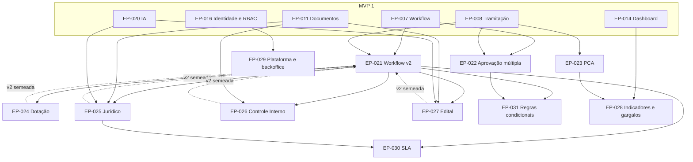

# MVP 2 — Épicos

> Resumo dos 11 épicos do MVP 2 "Governança e Controle". Especificação completa em `../backlog/epic-NNN-*.md`; features e stories em [features.md](features.md) (documento canônico de IDs); visão geral em [overview.md](overview.md).
> Escopo canônico: [roadmap §4.2](../product/roadmap.md#42-escopo-e-épicos) — **um épico por módulo reservado na DEC-040**, mais as capacidades habilitadoras (EP-021, EP-022) e os itens de plataforma postergados do MVP 1 (EP-029). O roadmap lista "Indicadores" e "Gargalos" como dois épicos; aqui são um só (EP-028), com uma feature para cada, porque compartilham o módulo `analytics`, o read model (DEC-206) e as telas SCR-027/SCR-028.
> Numeração global contínua depois do MVP 1 (último EP-020): EP-021 a EP-031. Versão 1, revisável depois do UAT do MVP 1 (DEC-192).

| Épico | Objetivo | Features | Stories | Pontos | Módulo | Depende de | Arquivo |
|---|---|---|---|---|---|---|---|
| EP-021 Workflow v2 | Etapas paralelas, migração de processos em andamento entre versões (DT-02), `RuleContext` v2 e a versão 2 do workflow padrão com a fase preparatória completa, oferecida e nunca imposta | FT-063..FT-065 | 9 | 57 | `workflow`, `process` | EP-007, EP-008, EP-009, EP-013, EP-015; EP-024, EP-025, EP-026, EP-027 (só a v2 semeada) | [epic-021](../backlog/epic-021-workflow-v2.md) |
| EP-022 Aprovação múltipla | Políticas `ANY`, `ALL` e `SEQUENTIAL` com aprovadores ordenados, decisão por linha, redirecionamento e segregação de funções (DT-03, PEND-13 → DEC-193); prazo das aprovações avulsas por tipo de documento (DT-17) | FT-066..FT-067 | 6 | 33 | `approval`, `workflow` | EP-007, EP-008, EP-009, EP-011 | [epic-022](../backlog/epic-022-multi-approval.md) |
| EP-023 PCA | Plano de contratações anual por exercício, importação por planilha, aprovação pela autoridade, vínculo com DFD e processo, reconciliação das referências do MVP 1, acompanhamento da execução e exportação para divulgação | FT-068..FT-071 | 8 | 43 | `pca` | EP-001, EP-002, EP-008, EP-015, EP-016, EP-017 | [epic-023](../backlog/epic-023-pca.md) |
| EP-024 Dotação orçamentária | Classificação orçamentária, fonte, valor reservado e evidência; compatibilidade com o valor estimado; regra de saída da etapa `DOTACAO` | FT-072 | 3 | 15 | `budget` | EP-001, EP-004, EP-011, EP-016, EP-017; EP-021 (`RuleContext` v2) | [epic-024](../backlog/epic-024-budget-allocation.md) |
| EP-025 Jurídico | Fila priorizada por critérios objetivos, análise com as seis situações, diligência, parecer vinculado às versões analisadas, dispensa de análise (art. 53, § 5º) e rascunho do parecer por IA | FT-073..FT-075 | 9 | 51 | `legal-review` | EP-008, EP-011, EP-016, EP-017, EP-018, EP-020; EP-021 (`RuleContext` v2) | [epic-025](../backlog/epic-025-legal-review.md) |
| EP-026 Controle Interno | Manifestação com checklist configurável, achados e recomendações, visão de riscos e acompanhamento do atendimento | FT-076..FT-077 | 5 | 25 | `internal-control` | EP-005, EP-008, EP-011, EP-016, EP-017, EP-018; EP-021 (`RuleContext` v2) | [epic-026](../backlog/epic-026-internal-control.md) |
| EP-027 Edital | Minutas do edital e do contrato a partir de template e do TR, com lotes, critérios, matriz de alocação de riscos (art. 22) e rascunho por IA | FT-078..FT-079 | 7 | 38 | `tender` | EP-001, EP-005, EP-006, EP-011, EP-018, EP-020; EP-021 (`RuleContext` v2) | [epic-027](../backlog/epic-027-tender.md) |
| EP-028 Indicadores e gargalos | Relatórios (SCR-027) e relatório detalhado (SCR-028) em read model próprio: tempo de ciclo, devoluções, prazos, volume e valor, execução do PCA, gargalos por etapa, unidade e responsável, exportação | FT-080..FT-082 | 8 | 46 | `analytics` | EP-010, EP-013, EP-014, EP-015, EP-016; EP-023 (execução do PCA) | [epic-028](../backlog/epic-028-analytics.md) |
| EP-029 Plataforma e backoffice | Backoffice da plataforma (DT-07, DT-18), login gov.br (PEND-18 → DEC-207) e os débitos DT-13 a DT-16 | FT-083..FT-085 | 11 | 48 | `tenancy`, `identity`, `access`, `audit` (+ ajustes em `notification`, `document`, `inbox`) | EP-009, EP-013, EP-015, EP-016, EP-017, EP-018, EP-019, EP-020 | [epic-029](../backlog/epic-029-platform-backoffice.md) |
| EP-030 SLA | Políticas de prazo por tipo de contratação, modalidade ou valor; pausas; escalonamento em degraus; regras de notificação condicional | FT-086..FT-087 | 5 | 28 | `sla`, `notification` | EP-008, EP-017, EP-019; EP-021 (`RuleContext` v2); EP-025 (pausa na diligência) | [epic-030](../backlog/epic-030-sla.md) |
| EP-031 Regras condicionais | Biblioteca de regras reutilizáveis (SCR-035) com versões, roteamento condicional, alçadas por valor, modelos prontos, simulador e casos de teste | FT-088..FT-090 | 7 | 38 | `rules` | EP-007, EP-008; EP-021 (`RuleContext` v2); EP-022 (alçadas sobre a política de decisão) | [epic-031](../backlog/epic-031-conditional-rules.md) |
| **Total** | | **28** | **78** | **422** | | | |

Prioridade dos épicos: **P0** — EP-021, EP-022, EP-024, EP-025, EP-026, EP-027 (fecham a fase preparatória); **P1** — EP-023, EP-028, EP-029, EP-030, EP-031 (critérios de saída do [roadmap §4.8](../product/roadmap.md#48-critérios-de-saída)). Os débitos DT-13 a DT-16 são stories P2 dentro do EP-029.

## Dependências entre épicos

Setas = "é pré-requisito de". Os épicos do MVP 1 aparecem só onde o MVP 2 os estende (dependências completas em cada card de épico e, por story, em [features.md](features.md)).

As setas tracejadas indicam a única dependência "de volta": a **v2 do workflow padrão** (US-130) só é semeada quando dotação, jurídico, controle interno e edital têm as suas regras de saída (US-148, US-155, US-161, US-168). O resto do EP-021 (paralelismo, migração e `RuleContext` v2) vem antes de todos — é o primeiro bloco da implementação (DEC-192).

## Princípios que todos os épicos respeitam

Os seis princípios do [MVP 1](../mvp-01/epics.md#princípios-que-todos-os-épicos-respeitam) continuam valendo (processo como entidade principal; histórico completo; workflow e regras configuráveis; RBAC com escopo e isolamento entre tenants; UX das 7 perguntas e acessibilidade; IA sempre assistiva). O MVP 2 acrescenta:

1. **Estender, não refazer** (DEC-192): parecer, manifestação e edital são `Document`; decisões são `Approval`; dotação, edital, jurídico e controle interno são `WorkflowStage`; o PCA usa `CatalogItem` e `Department`. Contratos de API do MVP 1 só mudam de forma aditiva (DEC-108).
2. **Oferecer, nunca impor:** a v2 do workflow padrão é oferecida para adoção (DEC-196); processos em andamento só mudam de versão por migração pedida, simulada e auditada (DEC-195).
3. **Padrões semeados "a validar com o piloto"** (DEC-192, [overview §7](overview.md#7-a-validar-com-o-piloto)): ordem das etapas, modelo de parecer, critérios da fila jurídica, hipóteses de dispensa, checklist do Controle Interno, calendário do PCA e classificação orçamentária são configuração por tenant, nunca código.
4. **Relatórios fora do banco transacional** (DEC-206): indicadores e gargalos só leem o read model do `analytics`.
5. **Pareceres e manifestações não vinculantes** (DEC-199, DEC-200): `UNFAVORABLE` e `NON_COMPLIANT` não bloqueiam por si; seguir adiante exige motivação registrada da autoridade.
6. **IA nunca propõe a conclusão do parecer** (DEC-202): a conclusão sai como "[a confirmar]" e a situação é escolhida pelo procurador.
