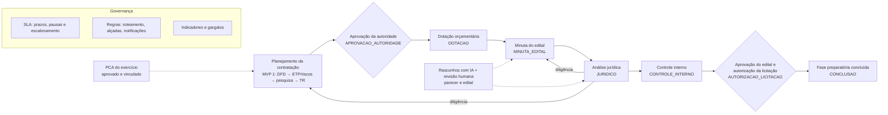

# MVP 2 — Governança e Controle

> **Objetivo:** completar a **fase preparatória** da contratação na plataforma — dotação orçamentária, minuta do edital, análise jurídica (art. 53) e manifestação do controle interno — e dar à alta administração os instrumentos de governança exigidos pela Lei 14.133/2021 (art. 11, parágrafo único): **plano de contratações anual**, **prazos gerenciados**, **regras condicionais** e **indicadores e gargalos**.
>
> **Status da especificação:** versão 1, **revisável após o UAT do MVP 1** (DEC-192). Escopo canônico: [roadmap.md §4](../product/roadmap.md#4-mvp-2--governança-e-controle).

Sumário: [1. Visão](#1-visão-do-mvp-2) · [2. Escopo](#2-escopo) · [3. Jornada coberta](#3-jornada-coberta) · [4. Personas](#4-personas-atendidas) · [5. Relação com o MVP 1](#5-relação-com-o-mvp-1) · [6. Premissas e restrições](#6-premissas-e-restrições) · [7. A validar com o piloto](#7-a-validar-com-o-piloto) · [8. Governança da especificação](#8-governança-da-especificação-prd-7) · [9. Mapa de documentos](#9-mapa-de-documentos-do-mvp-2)

---

## 1. Visão do MVP 2

Ao final do MVP 2, um órgão público conduz **a fase preparatória inteira** dentro da plataforma e governa o conjunto das contratações:

1. o **PCA** do exercício é elaborado (ou importado de planilha), aprovado pela autoridade e vinculado aos DFDs; as referências textuais do MVP 1 são reconciliadas;
2. depois da aprovação dos artefatos do planejamento, a **Contabilidade** indica a dotação e confirma a reserva, com evidência e verificação de compatibilidade com o valor estimado;
3. **Licitações** elabora a **minuta do edital** e do contrato a partir do TR, com lotes, critérios e matriz de riscos — com rascunho assistido por IA;
4. o **Jurídico** analisa o processo numa fila priorizada por critérios objetivos, pede **diligência** quando preciso e emite o **parecer** vinculado às versões analisadas — também com rascunho assistido por IA, sem que a IA sugira a conclusão;
5. o **Controle Interno** manifesta-se com checklist, achados e recomendações;
6. a **autoridade** aprova o edital e autoriza a licitação, e o processo chega a **"Fase preparatória concluída"**;
7. o **gestor** acompanha prazos com políticas de SLA, pausas e escalonamento, e enxerga **indicadores e gargalos** por etapa, unidade e responsável;
8. o **administrador do órgão** configura regras reutilizáveis (roteamento, alçadas por valor, prazos e notificações), testa no simulador e adota a nova versão do workflow padrão quando quiser, migrando os processos em andamento com segurança.

## 2. Escopo

### 2.1 Incluído

Épicos previstos (os IDs globais, a partir de EP-021, são atribuídos em [epics.md](epics.md); o roadmap §4.2 é a fonte):

| Área | Épico | Objetivo | Módulo (DEC-040) |
|---|---|---|---|
| Capacidades habilitadoras | Workflow v2 | Etapas paralelas (ramificação e junção), migração de processos em andamento entre versões (DT-02), nova versão do workflow padrão com a fase preparatória completa e `RuleContext` v2 | `workflow`, `process` |
| Capacidades habilitadoras | Aprovação múltipla | Políticas `ANY`, `ALL` e `SEQUENTIAL` com ordem explícita de aprovadores, redirecionamento por linha e segregação de funções (PEND-13, DT-03); prazo das aprovações avulsas por tipo de documento (DT-17) | `approval` |
| Planejamento anual | PCA | Plano por exercício com itens, importação por planilha, aprovação, vínculo com DFD e processo, reconciliação das referências do MVP 1, acompanhamento da execução e exportação para divulgação | `pca` |
| Fase preparatória | Dotação orçamentária | Classificação orçamentária, fonte, valor reservado e evidência; compatibilidade com o valor estimado; regra de saída de etapa | `budget` |
| Fase preparatória | Jurídico | Fila priorizada, análise com as seis situações, diligência, parecer vinculado às versões analisadas, dispensa de análise (art. 53, § 5º) e rascunho de parecer por IA | `legal-review` |
| Fase preparatória | Controle Interno | Manifestação com checklist configurável, achados e recomendações, visão de riscos | `internal-control` |
| Fase preparatória | Edital | Minuta do edital e do contrato a partir de template e do TR, lotes, critérios, matriz de alocação de riscos (art. 22) e rascunho por IA | `tender` |
| Governança | SLA | Políticas de prazo por tipo de contratação, modalidade ou valor; pausas; escalonamento; cumprimento por etapa e unidade | `sla` |
| Governança | Regras condicionais | Biblioteca reutilizável (SCR-035): roteamento, alçadas por valor, aplicabilidade, simulador e testes; regras de notificação | `rules` |
| Governança | Indicadores e gargalos | Relatórios (SCR-027) e relatório detalhado (SCR-028), análise de gargalos, exportação — em read model próprio | `analytics` |
| Plataforma | Plataforma e backoffice | Backoffice da plataforma (DT-07, DT-18), login gov.br (PEND-18) e os débitos DT-13 a DT-16 (o DT-17 fica na Aprovação múltipla) | `tenancy`, `identity`, `access`, `audit` |

Telas reservadas do roadmap: SCR-018 PCA · SCR-019 Jurídico · SCR-020 Controle Interno · SCR-021 Edital · SCR-027 Relatórios · SCR-028 Relatório detalhado · SCR-035 Regras. A dotação acontece como etapa no Detalhe do processo (SCR-006) e na Caixa de tarefas (SCR-013). Telas fora das 41 recebem `SCR-118+`.

Decisões que fixam o escopo: DEC-192 a DEC-210 em [decisions.md](../architecture/decisions.md#mvp-2--governança-e-controle); ADRs [014](../adr/adr-014-indicators-read-model.md), [015](../adr/adr-015-rules-engine-sla-notifications.md), [016](../adr/adr-016-workflow-version-migration.md) e [017](../adr/adr-017-govbr-login.md).

### 2.2 Fora do escopo do MVP 2

- Publicação do edital e de atos (PNCP, Diário Oficial, status `PUBLISHED`), assinatura eletrônica, API pública, webhooks e adapters de sistemas contábeis (**MVP 3**). O edital do MVP 2 é a **minuta** e sua análise.
- Registro do resultado da seleção, contratos, fiscalização, medições, aditivos e vencimentos (**MVP 4**).
- IA além do parecer jurídico e do edital: assistente contextual, validações cruzadas, saúde do processo, recomendações, benchmark e busca semântica (**MVP 5**). IA na manifestação do Controle Interno não está no MVP 2.
- Escolha do provedor de IA (ADR-013, PEND-21 — decisão separada), cobrança por uso da IA e planos comerciais (PEND-17).
- Edição colaborativa em tempo real (PEND-12, avaliar após o MVP 2) e reabertura genérica de processos concluídos ou cancelados (PEND-03).

## 3. Jornada coberta

O fluxo acima é a **versão 2 do workflow padrão** (DEC-196), oferecida para adoção e nunca imposta. A ordem entre Jurídico e Controle Interno é configurável (inverter ou paralelizar — DEC-194), e o Controle Interno pode ser condicional por regra (ex.: só acima de um valor). Na contratação direta (art. 72), a nova versão acrescenta `DOTACAO` e `JURIDICO` antes da autorização, sem minuta de edital.

## 4. Personas atendidas

| Persona (perfil existente) | Principais capacidades no MVP 2 |
|---|---|
| Planejamento (`PLANEJAMENTO`) | Elaborar o PCA, importar planilha, acompanhar a execução, vincular DFDs |
| Contabilidade (`CONTABILIDADE`) | Indicar e confirmar a dotação, com evidência |
| Licitações (`LICITACOES`) | Elaborar a minuta do edital e do contrato, com rascunho por IA |
| Jurídico (`JURIDICO`) | Fila priorizada, análise, diligência, parecer (com rascunho por IA), dispensa de análise |
| Controle Interno (`CONTROLE_INTERNO`) | Manifestação com checklist, achados e recomendações; visão de riscos e de avisos superados |
| Autoridade competente (`AUTORIDADE_COMPETENTE`) | Aprovar o PCA e o edital; autorizar a licitação; decidir em aprovações múltiplas |
| Gestor de contratações (`GESTOR_CONTRATACOES`) | SLA, indicadores, gargalos, redirecionamento de aprovadores |
| Administrador do órgão (`ADMIN_ORGAO`) | Regras, políticas de SLA, adoção do workflow v2 e migração de processos, checklist do Controle Interno, critérios da fila jurídica, gov.br |
| Auditor (`AUDITOR`) | Relatórios e trilha de auditoria; aviso de quebra do selo (DT-14) |
| Operador da plataforma (fora dos perfis do órgão) | Backoffice: provisionamento, ciclo de vida do tenant, acesso de suporte |

Os perfis `CONTABILIDADE`, `JURIDICO` e `CONTROLE_INTERNO` já existem ([permissions.md](../mvp-01/permissions.md)); o MVP 2 **amplia** as permissões deles, sem criar perfis duplicados. A consultoria externa (`CONSULTOR_EXTERNO`) não acessa o PCA (DEC-197, lacuna L-07).

## 5. Relação com o MVP 1

**O que continua** — tudo o que o MVP 1 decidiu ([decisions.md](../architecture/decisions.md)): monólito modular, multi-tenancy com RLS, outbox, auditoria, ciclo de vida único de documento (DEC-018), motor de workflow versionado (DEC-014), aprovação genérica (DEC-022), visibilidade (DEC-024), sigilo do orçamento (DEC-030), prazos e calendário (DEC-031), IA com revisão humana (DEC-037, DEC-079). Contratos de API do MVP 1 só mudam de forma aditiva (DEC-108).

**O que o MVP 2 estende, sem refazer:**

| Conceito do MVP 1 | Extensão no MVP 2 | Decisão |
|---|---|---|
| `Process`, `Dfd` com referência textual ao PCA | `pcaItemId` (FK) + reconciliação; referências textuais ficam como histórico | DEC-197 |
| `WorkflowStage`, uma etapa ativa por processo | `PARALLEL_SPLIT`/`PARALLEL_JOIN`; várias `ProcessStage` ativas; `activeStages[]` na API | DEC-194 |
| Processo preso à versão do workflow | Migração pedida, simulada e auditada (`WorkflowMigration`) | DEC-195 |
| Workflow padrão v1 (7 etapas) | v2 com `DOTACAO`, `MINUTA_EDITAL`, `JURIDICO`, `CONTROLE_INTERNO`, `AUTORIZACAO_LICITACAO`; `COMPLETED` = fase preparatória concluída na v2 | DEC-196 |
| `Approval` com política `ANY` | `decisionPolicy` `ANY`/`ALL`/`SEQUENTIAL` e `ApprovalApprover`; `ApprovalSubjectType` `PCA` | DEC-193, DEC-197 |
| `Document`/`DocumentType` | Tipos `PARECER_JURIDICO`, `EDITAL`, `MINUTA_CONTRATO`, `MANIFESTACAO_CONTROLE_INTERNO`; `SystemDocumentModule` `LEGAL_OPINION`, `TENDER`, `INTERNAL_CONTROL_REPORT` | DEC-199 a DEC-201 |
| `WorkflowRule` e `RuleContext` v1 | Biblioteca (`RuleDefinition`), roteamento, alçadas, `RuleContext` v2 | DEC-204 |
| Prazo por etapa (`slaDays`) | `SlaPolicy` com pausas e escalonamento; `NotificationRule` | DEC-205 |
| Dashboard sobre views (DEC-088) | Relatórios e gargalos em read model próprio (`analytics`) | DEC-206 |
| `AiGeneration` (DFD, ETP, riscos, TR) | Geradores `draft.legal_opinion` e `draft.tender` | DEC-202 |
| Login por usuário e senha (DEC-187) | gov.br federado no Authentik | DEC-207 |
| Provisionamento pela CLI de plataforma | Backoffice da plataforma | DEC-208 |

**Entidades novas:** `Pca`, `PcaItem`, `BudgetAllocation`, `LegalReview`, `LegalReviewDocument`, `InternalControlReview`, `InternalControlChecklist`, `InternalControlFinding`, `Tender`, `TenderLot`, `ApprovalApprover`, `WorkflowStageApprover`, `WorkflowMigration`, `WorkflowMigrationItem`, `RuleDefinition`, `RuleDefinitionVersion`, `SlaPolicy`, `NotificationRule` e as tabelas de fatos do `analytics`. Detalhe em `entities.md` do MVP 2.

**Processos em andamento** ficam na versão do workflow em que nasceram até uma migração pedida pelo administrador (DEC-195); processos concluídos no MVP 1 podem continuar para a fase preparatória completa por essa mesma ferramenta.

## 6. Premissas e restrições

**Premissas**
- O MVP 1 está estável nos pilotos quando a implementação do MVP 2 começar (DEC-192); a implementação abre com DT-02 e DT-03.
- Os pilotos aceitam padrões semeados e configuráveis para o que ainda não foi validado com eles (§7).
- O parecer e o edital não são assinados eletronicamente na plataforma no MVP 2 (assinatura no MVP 3).
- Integrações externas não são obrigatórias: PCA por planilha, dotação digitada com evidência, divulgação do PCA por exportação. O login gov.br depende do credenciamento no Login Único e é opcional por tenant.

**Restrições**
- Nenhuma regra legal ou administrativa fixa em código (princípio 17): etapas, prazos, prioridades, hipóteses de dispensa, checklist e alçadas são configuração semeada.
- A IA nunca decide (princípio 16): no parecer, não propõe a conclusão; tudo o que gera passa por revisão humana.
- Relatórios nunca consultam as tabelas transacionais diretamente em produção (DEC-206).
- Mesmas exigências de segurança, LGPD, acessibilidade (WCAG 2.1 AA/eMAG) e isolamento entre tenants do MVP 1.

## 7. A validar com o piloto

Definições que o roadmap (§4.7) previa colher com o piloto antes do detalhamento. Como a especificação vem antes do piloto (DEC-192), cada uma entra como **padrão semeado e configurável por tenant**, a confirmar no UAT — não são pendências.

| Definição | Padrão semeado | Onde se configura |
|---|---|---|
| Ordem entre Jurídico e Controle Interno e posição do edital (L-04) | `DOTACAO` → `MINUTA_EDITAL` → `JURIDICO` → `CONTROLE_INTERNO` → `AUTORIZACAO_LICITACAO` (DEC-196) — a validar com o jurídico do piloto | Versão do workflow do tenant |
| Modelo de parecer jurídico | Template `PARECER_JURIDICO` com relatório, fundamentação, análise dos artefatos (art. 18 e art. 72), ressalvas e conclusão | Templates de documento |
| Critérios de prioridade da fila do jurídico (art. 53, § 1º, I) | Prazo de vencimento da etapa, urgência declarada no processo, valor estimado e data de entrada, nesta ordem | Configuração do `legal-review` |
| Hipóteses de dispensa de análise jurídica (art. 53, § 5º) | Nenhuma ativa; modelos de hipótese (baixo valor, compras com minutas padronizadas) disponíveis para o ato da autoridade jurídica máxima | Configuração do `legal-review` |
| Checklist do Controle Interno | Itens sobre DFD, ETP, pesquisa de preços (art. 23), mapa de riscos, TR, dotação, edital e parecer, e avisos `WARNING` superados (L-08) | `InternalControlChecklist` |
| Estrutura e calendário do PCA | Um plano por órgão e exercício; elaboração até o fim do primeiro semestre do exercício anterior; revisões com nova versão | Configuração do `pca` |
| Classificação orçamentária | Unidade orçamentária, programa de trabalho/ação, natureza da despesa e fonte de recursos, como catálogos editáveis | Catálogos (`CatalogItem`) |

## 8. Governança da especificação (prd-7)

- **Decisão do usuário (2026-11-10):** especificar o MVP 2 **antes** de o MVP 1 estar em produção nos pilotos. O gate de [roadmap.md §2](../product/roadmap.md#2-governança-do-roadmap-um-mvp-detalhado-por-vez) e de [risks-and-decisions.md §12](../mvp-01/risks-and-decisions.md#12-validação-para-iniciar-o-mvp-2) é recomendação, não bloqueio técnico.
- **Consequências registradas (DEC-192):** esta é a versão 1, revisável depois do UAT do MVP 1; a implementação só começa depois do endurecimento das suítes órfãs, com DT-02 e DT-03 como primeiros cards; o que depende do piloto entra como padrão configurável (§7).
- **Numeração global contínua:** EP-021+, FT-063+, US-123+; cards no padrão de 28 seções com Gherkin nas 8 categorias, verificados por `pnpm docs:check`.

## 9. Mapa de documentos do MVP 2

Mesma estrutura do MVP 1; os arquivos abaixo são produzidos em sequência pelos cards da especificação (prd-7).

| Documento | Conteúdo |
|---|---|
| [overview.md](overview.md) | Esta visão geral |
| [epics.md](epics.md) | Épicos com IDs globais, objetivo, escopo, features, pontos, dependências |
| [features.md](features.md) | Esqueleto canônico: features, stories, prioridades, estimativas, dependências |
| [entities.md](entities.md) | Modelo de dados e migrações do MVP 2 |
| [api.md](api.md) | Endpoints novos e extensões aditivas |
| [screens.md](screens.md) | SCR-018, 019, 020, 021, 027, 028, 035 e telas complementares |
| [permissions.md](permissions.md) | Permissões novas e ampliação dos perfis |
| [events.md](events.md) | Eventos, timeline, notificações e auditoria |
| [acceptance-criteria.md](acceptance-criteria.md) | Critérios transversais e jornadas |
| [tests.md](tests.md) | Estratégia e plano de testes |
| [delivery-plan.md](delivery-plan.md) | Sequência, marcos, estimativas e débitos |
| [risks-and-decisions.md](risks-and-decisions.md) | Riscos, débitos, ambiguidades e decisões |
| [release-checklist.md](release-checklist.md) | Definition of Done e checklist de release |
| [../backlog/](../backlog/README.md) | Cards detalhados (épicos, features e stories) |
