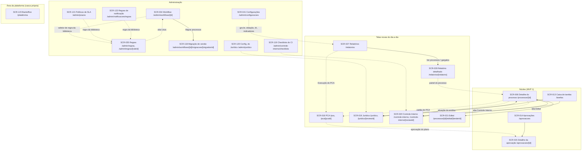

# MVP 2 — Especificação de telas

> Especificação tela a tela da camada web do MVP 2 "Governança e Controle": telas novas, com os números reservados no [roadmap §8](../product/roadmap.md) (SCR-018, SCR-019, SCR-020, SCR-021, SCR-027, SCR-028 e SCR-035) e `SCR-118+` para as telas fora das 41 do inventário, e as mudanças nas telas do MVP 1.
> Molde e padrões: [MVP 1 — screens.md](../mvp-01/screens.md) (§1 casca, mapa e padrões globais continuam valendo). Contratos: [api.md](api.md). Permissões: [permissions.md](permissions.md). Fonte de cada tela: a seção "Frontend" das stories US-123 a US-200 — divergência entre este documento e a story é bug de especificação. Versão 1, revisável depois do UAT do MVP 1 (DEC-192).

Sumário: [1. Visão geral](#1-visão-geral) · [2. Telas novas](#2-telas-novas) · [3. Mudanças em telas do MVP 1](#3-mudanças-em-telas-do-mvp-1) · [4. Rastreabilidade](#4-rastreabilidade-tela--story)

---

## 1. Visão geral

### 1.1 Convenções

- **Numeração.** Os números SCR-018 a SCR-028 e SCR-035 vêm do inventário de 41 telas do produto (roadmap §8) e foram reservados para o MVP 2; `SCR-118` em diante são telas novas fora desse inventário (o MVP 1 terminou em SCR-117). A dotação orçamentária **não tem tela própria**: é um painel do detalhe do processo (SCR-006) com resumo na caixa de tarefas (SCR-013). O edital tem tela própria (SCR-021), mas sem item de menu: abre-se pela aba "Edital" do processo.
- **SCR-035 evolui.** No MVP 1 a ficha SCR-035 era o painel de regras de uma versão de workflow (`/admin/workflows/[id]/regras`); esse painel continua, como aba "Regras" do editor de workflow (SCR-034), para regras locais. No MVP 2 o número passa a designar a **biblioteca de regras** (`/admin/regras`).
- **Rotas** em pt-BR (`architecture.md` §8.2); segmentos dinâmicos de identificador seguem o padrão do MVP 1 (`[pcaId]`, `[reviewId]`, `[tenderId]`). O segmento `[relatorio]` usa um *slug* pt-BR mapeado à chave do relatório na API (`devolucoes` ↔ `returns`, `tempo-de-ciclo` ↔ `cycle-time`, `prazos` ↔ `deadline-compliance`, `volume-e-valor` ↔ `volume-value`, `execucao-pca` ↔ `pca-execution`, `gargalos` ↔ visão de gargalos); parâmetros de filtro na *query string* espelham os da API.
- **Modelos de página** ([docs/brand/README.md](../brand/README.md), segunda e terceira levas — prd-5 e prd-6): `ListPage` (lista com `FilterPanel` aberto, "Mais filtros", chips só dos filtros extras e linha de contagem), `DetailPage` (cabeçalho com trilha, situação e uma ação primária; abas), `FormPage`/`WizardShell` (criação e edição em passos) e `SettingsPage` (configurações em grupos). Uma ação primária por tela, no cabeçalho.
- **Formato das fichas.** Rota, acesso e personas; objetivo; modelo de página e regiões; componentes; dados e endpoints (códigos de [api.md](api.md)); ações; estados; permissões (o que some, o que fica desabilitado com motivo); acessibilidade e responsividade; stories.

### 1.2 Casca e menu lateral

A casca do MVP 1 (`AppShell`, [MVP 1 §1.2](../mvp-01/screens.md#12-casca-da-aplicação)) não muda de estrutura. Entram itens novos, cada um num `<Can permission="...">` (some para quem nunca poderia usá-lo):

| Grupo | Item | Rota | Permissão | Posição |
|---|---|---|---|---|
| Dia a dia | **PCA** | `/pca` | `PCA_VIEW` | depois de "Processos" |
| Dia a dia | **Jurídico** | `/juridico` | `LEGAL_REVIEW_VIEW` | depois de "Aprovações" |
| Dia a dia | **Controle interno** | `/controle-interno` | `INTERNAL_CONTROL_REVIEW_VIEW` | depois de "Jurídico" |
| Dia a dia | **Relatórios** | `/relatorios` | `REPORT_VIEW` | depois de "Controle interno" (antes do grupo "Sistema") |
| Sistema › Administração | **Regras** | `/admin/regras` | `RULE_VIEW` | junto de "Workflows" |
| Sistema › Administração | **Prazos (SLA)** | `/admin/prazos` | `SLA_POLICY_MANAGE` | junto de "Calendário" |
| Sistema › Administração | **Regras de notificação** | `/admin/notificacoes/regras` | `NOTIFICATION_RULE_MANAGE` | junto de "Prazos (SLA)" |
| Sistema › Administração | **Jurídico** (critérios e dispensas) | `/admin/juridico` | `LEGAL_REVIEW_CONFIGURE` | área de configuração dos módulos |
| Sistema › Administração | **Checklists do Controle Interno** | `/admin/controle-interno/checklists` | `INTERNAL_CONTROL_CHECKLIST_MANAGE` (leitura: `INTERNAL_CONTROL_REVIEW_VIEW`) | área de configuração dos módulos |

- **Edital:** sem item de menu — aba "Edital" do processo (SCR-006) e rota `/processos/[id]/edital/[tenderId]` (SCR-021).
- **Backoffice:** **fora** do menu do órgão. A área `/plataforma` (SCR-123) é um grupo de rotas separado, com casca própria (`PlatformShell`, `PlatformNav`), só para operador da plataforma com MFA; para quem não é operador a rota responde 404 e nada dela vai para o *bundle* público (US-178). O operador com acesso de suporte ativo a um órgão vê, no `AppShell` do órgão, a faixa `SupportSessionBanner` (US-180).
- **Paleta de comandos (Ctrl K):** "Ir para" passa a listar PCA, Jurídico, Controle interno e Relatórios, filtrados pelas mesmas permissões.

### 1.3 Mapa de navegação

Só o que o MVP 2 acrescenta; o mapa completo do MVP 1 está em [MVP 1 §1.3](../mvp-01/screens.md#13-mapa-de-navegação).

### 1.4 Padrões globais novos

Os padrões do [MVP 1 §1.4](../mvp-01/screens.md#14-padrões-globais) continuam (carregando, vazio, erro, sem permissão, 412, sessão, sigilo, acessibilidade WCAG 2.1 AA + eMAG, repaginação). O MVP 2 acrescenta:

- **Situação sempre por texto e ícone.** Selos de situação de parecer (aguardando, em análise, diligência, favorável, favorável com ressalvas, desfavorável), de manifestação, de achado, de plano, de migração, de política e de regra usam `StatusBadge` com rótulo e ícone — nunca só cor (WCAG 1.4.1).
- **Trabalho assíncrono.** Importação, simulação, execução de migração, exportação e geração por IA mostram progresso com `role="progressbar"`/`aria-valuenow`, *polling* com recuo (2 s → 5 s), anúncio por `aria-live="polite"` em marcos (não a cada atualização) e a ação "Tentar novamente" na falha; o botão que disparou fica desabilitado com motivo enquanto o pedido está ativo.
- **Dados do read model.** Telas de relatório mostram `FreshnessBadge`/`DataAsOfBadge` ("Dados atualizados em {data e hora}", `meta.dataAsOf`), faixa `StaleBanner` quando a projeção está atrasada além do limite e o estado "não preparado" (`ANALYTICS_NOT_READY`). Gráficos sempre com tabela equivalente e descrição textual.
- **Sigilo nos agregados (POL-28).** Somas e médias excluem processos sigilosos para quem não tem `PROCESS_VIEW_CONFIDENTIAL_BUDGET`, com `ConfidentialExcludedNotice` ("Inclui valores sigilosos não exibidos"); célula mascarada como `ConfidentialValueCell` ("Sigiloso" com cadeado e texto acessível).
- **IA para parecer e edital.** Reaproveita o painel SCR-117 (`?ia=<generationId>`) e os componentes do EP-020 (`AiAssistantPanel`, `AiProposalSectionList`, `AiSectionDiffView`, `AiGeneratedBadge`, `ToConfirmChip`, `MarkReviewedButton`, `ReviewAllDialog`); conclusões e alocação de riscos levam o selo "Decisão sua"/"Sugestão — decisão da equipe" e nunca são aplicadas sem revisão humana.
- **Decisões irreversíveis.** Executar migração, concluir parecer ou manifestação, dispensar análise, publicar regra e as ações de ciclo de vida do tenant usam `ConfirmDialog` com resumo do efeito, ciência explícita (checkbox ou identificador digitado) e *step-up* de MFA quando a permissão é de risco `H` (`MfaChallengeDialog`).
- **Responsividade.** Telas operacionais novas (SCR-018 leitura, SCR-019, SCR-020, SCR-027, SCR-028) seguem o padrão do MVP 1: abaixo de 768 px tabelas viram cartões, painéis laterais e diálogos ocupam a tela. Editores (minuta do edital, parecer, manifestação, regras, migração) são *desktop-first* (DEC-183).

### 1.5 Inventário

| SCR | Tela | Rota | Modelo | Épico | Stories |
|---|---|---|---|---|---|
| SCR-018 | PCA | `/pca`, `/pca/[pcaId]` | `ListPage` + `DetailPage` (abas) | EP-023 | US-138, US-139, US-140, US-141, US-143, US-144, US-145 |
| SCR-019 | Jurídico | `/juridico`, `/juridico/[reviewId]` | `ListPage` + `DetailPage` | EP-025 | US-149, US-150, US-152 a US-157 |
| SCR-020 | Controle Interno | `/controle-interno`, `/controle-interno/[reviewId]` | `ListPage` + `DetailPage` (abas) | EP-026 | US-159 a US-162 |
| SCR-021 | Edital | `/processos/[id]/edital/[tenderId]` | `DetailPage` (abas) | EP-027 | US-163 a US-169 |
| SCR-027 | Relatórios | `/relatorios` | `ListPage` (cartões) + relatório aberto | EP-028 | US-172, US-174, US-175 |
| SCR-028 | Relatório detalhado | `/relatorios/[relatorio]`, `/relatorios/gargalos` | `DetailPage` (abas) | EP-028 | US-173, US-174, US-176, US-177 |
| SCR-035 | Regras (biblioteca) | `/admin/regras`, `/admin/regras/[ruleId]` | `ListPage` + `DetailPage` (abas) | EP-031 | US-194, US-195, US-196, US-199, US-200 |
| SCR-118 | Migração de versão de workflow | `/admin/workflows/[id]/migracoes/[migrationId]` | `WizardShell` (fases) | EP-021 | US-126, US-127, US-128, US-131 |
| SCR-119 | Checklists do Controle Interno | `/admin/controle-interno/checklists`, `.../[id]` | `ListPage` + `FormPage` | EP-026 | US-158 |
| SCR-120 | Configuração do Jurídico | `/admin/juridico` | `SettingsPage` (abas) | EP-025 | US-151 (consulta em US-156) |
| SCR-121 | Políticas de SLA | `/admin/prazos` | `ListPage` + `DetailPage` (abas) | EP-030 | US-189, US-190, US-191, US-192 |
| SCR-122 | Regras de notificação | `/admin/notificacoes/regras` | `ListPage` + `DetailPage`/painel | EP-030 | US-193 |
| SCR-123 | Backoffice da plataforma | `/plataforma/**` | casca própria; `ListPage`, `DetailPage`, `WizardShell` | EP-029 | US-178, US-179, US-180, US-181 |

---

## 2. Telas novas

### SCR-018 — PCA
- **Rota:** `/pca` (lista de planos) e `/pca/[pcaId]` (detalhe) · **Acesso:** `PCA_VIEW` (ver), `PCA_MANAGE` (criar, editar itens, importar, revisar), `PCA_SUBMIT` (enviar e retirar da aprovação), `PCA_RECONCILE` (reconciliação), `PCA_EXPORT` (divulgação e exportação), `APPROVAL_DECIDE` (decisão pela autoridade, em SCR-015) · **Personas:** Planejamento (elabora), Autoridade competente (aprova), Gestor de contratações e Auditor (consultam).
- **Objetivo:** elaborar o Plano de Contratações Anual por exercício, aprová-lo, revisá-lo com nova versão, reconciliar as referências textuais do MVP 1, acompanhar a execução e exportar para divulgação.
- **Modelo e regiões:** lista em `ListPage` (`FilterPanel` aberto com Exercício e Situação, "Mais filtros", linha de contagem, ação primária "Novo plano"); detalhe em `DetailPage` com cabeçalho (exercício, versão, `PcaStatusBadge`, prazo do calendário do plano — `PcaDeadlineBanner`) e abas **Itens**, **Resumo**, **Aprovação**, **Versões**, **Reconciliação**, **Execução** e **Divulgação**. Em revisão, `RevisionBanner` ("Revisão da versão N em elaboração").
- **Componentes:** `PcaListTable`, `PcaCreateDialog`, `PcaItemsTable` (Código, Secretaria, Objeto, Categoria, Mês, Valor previsto, Responsável, Situação), `PcaItemDrawer`, `PcaTotalsSummary`, `PcaImportDialog` (*stepper* Modelo → Arquivo → Prévia → Resultado, com `PcaFileUploader`, `PcaImportSummary`, `PcaImportRejectionsTable`), `PcaApprovalTab` (`PcaReadinessChecklist`, `SubmitPcaDialog`, `WithdrawPcaDialog`, `PcaApprovalHistoryTable`), `PcaVersionTimeline`, `CreateRevisionDialog`, `VersionCompareTable`, `RevisionImpactPanel`, `ReconciliationSummaryCard`, `PendingReferencesTable`, `ConciliationSidePanel`, `BatchConciliationDialog`, `ExecutionSummaryCards`, `ExecutionTable` (`ProgressMeter` com percentual em texto), `ItemProcessesDrawer`, `ChangeItemStatusDialog`, `DisclosureSummary`, `ExportDialog`, `ExportHistoryTable`, `ConfidentialValueTag`.
- **Dados e endpoints:** PCA-01..09 (planos e itens), PCA-10..14 (importação; upload por ATT-02/ATT-03/ATT-04), PCA-15..18 (envio, retirada, histórico de aprovações e verificação de envio; decisão por APV-02/APV-03), PCA-20..24 (revisões, comparação, impacto), PCA-25..28 (execução), PCA-32..36 (exportação e prévia de divulgação), PCA-48..57 (reconciliação); apoio: DEP-02, CAT-01 (`PCA_CATEGORY`), USR-02, SET-02 (calendário do plano).
- **Ações:** "Novo plano" → PCA-02; adicionar/editar/remover item → PCA-07..09 (`If-Match`); "Importar planilha" → PCA-10..13; "Enviar para aprovação" → PCA-15 (bloqueado com a lista de pendências de PCA-18); "Criar revisão" → PCA-20; "Executar reconciliação" → PCA-48; conciliar pendência → PCA-56 (uma) ou PCA-57 (lote), com candidatos de PCA-55; mudar situação do item → PCA-27; "Exportar" → PCA-32 e download por PCA-34.
- **Estados:** *skeleton* por bloco; vazio por aba ("Este plano ainda não tem itens…", "Nenhuma pendência. Todas as referências foram tratadas.", "Nenhuma exportação ainda"); erro por bloco com "Tentar novamente"; leitura (plano em aprovação ou aprovado, com faixa de situação); conflito 412; importação, reconciliação e exportação em andamento com progresso; sucesso por *toast*.
- **Permissões:** sem `PCA_VIEW` o item de menu some e a rota responde 403; ações de escrita ocultas sem `PCA_MANAGE`; "Enviar" oculto sem `PCA_SUBMIT`; abas Reconciliação e Divulgação em leitura sem `PCA_RECONCILE`/`PCA_EXPORT`; valores de itens ligados a processo sigiloso mascarados (POL-09) com *step-up* para desmascarar (US-144).
- **Acessibilidade e responsividade:** tabelas com cabeçalhos associados e ordenação anunciada; valores com `aria-label` completo ("Valor previsto: R$ 125.000,50"); situação por texto e ícone; *drawers* e diálogos com foco preso; totais e resultado de lote anunciados por `aria-live`; abaixo de 768 px tabelas em cartões e diálogo de importação em tela cheia.
- **Stories:** US-138 (principal), US-139, US-140, US-141, US-143, US-144, US-145. O vínculo de DFD e processo ao item (US-142) aparece em SCR-005, SCR-006 e SCR-007 (§3).

### SCR-019 — Jurídico
- **Rota:** `/juridico` (fila) e `/juridico/[reviewId]` (painel da análise) · **Acesso:** `LEGAL_REVIEW_VIEW` (fila e painel), `LEGAL_REVIEW_MANAGE` (conduzir, diligência, parecer, ressalvas), `LEGAL_REVIEW_CONCLUDE` (concluir com a situação, MFA), `LEGAL_REVIEW_WAIVE` (dispensar), `PROCESS_ASSIGN` (distribuir), `AI_GENERATE` (rascunho por IA) · **Personas:** Jurídico (procuradores e chefia da assessoria); Gestor, Controle Interno, Autoridade e Auditor em leitura.
- **Objetivo:** trabalhar a fila priorizada por critérios objetivos, conduzir a análise sobre as versões exatas dos documentos, pedir diligência, elaborar o parecer (com rascunho por IA), registrar ressalvas, concluir com uma das seis situações ou dispensar a análise (art. 53, § 5º).
- **Modelo e regiões:** fila em `ListPage` (`QueueSummaryBar`, `FilterPanel` aberto com chips só dos filtros extras, linha de contagem; "Distribuir" na barra de ações em lote para quem tem `PROCESS_ASSIGN`); painel em `DetailPage` com cabeçalho (processo, `ReviewStatusBadge`, prazo, responsável) e seções **Versões analisadas**, **Diligências**, **Parecer e ressalvas**, **Conclusão**; o editor do parecer é o editor estruturado do MVP 1 (`/processos/[id]/documentos/[docId]`) com o painel lateral `LegalOpinionEditorSidebar`.
- **Componentes:** `LegalQueueTable` (posição, selos de prazo e urgência), `QueueFilters`, `PriorityFactorsPopover` ("Por que esta ordem?"), `AssignLegalReviewDialog`, `BulkAssignBar`, `BulkResultSummary`, `LegalReviewPanel`, `StartReviewDialog`, `AnalyzedVersionsTable`, `RoundComparePanel`, `RequestDiligenceDialog`, `DiligenceTimeline`, `AnswerDiligencePanel`, `OpenOpinionButton`, `ReservationList`, `ReservationFormDialog`, `ResolveReservationDialog`, `OpinionValidationPanel`, `ConclusionChecklist`, `ConcludeLegalReviewDialog` (situação em `RadioGroup` sem pré-seleção, ementa), `WaiveReviewDialog`, `WaiverRecordCard`, `LegalReviewOutcomeBadge`, `MfaChallengeDialog`, `AiDraftButton` + painel SCR-117, `OpinionReviewPendingBanner`.
- **Dados e endpoints:** LGL-01, LGL-02, LGL-09 (fila, painel, resumo), LGL-03/LGL-04 (distribuição; PRC-22), LGL-10..12 (iniciar, versões, comparação; DOC-17/DOC-18), LGL-13..15 (diligência; PRC-20), LGL-16..18 e LGL-20 (ressalvas e parecer; DOC-05, DOC-08, DOC-10, DOC-12), LGL-19 e LGL-24 (conclusão e situação no processo), LGL-21 (dispensa), AI-01, AI-02, AI-04, AI-05, AI-06, DOC-26, DOC-27 (IA, `targetModule = LEGAL_OPINION`).
- **Ações:** "Iniciar análise" → LGL-10; "Pedir diligência" → LGL-13 (devolve o processo, pausa o SLA); "Elaborar parecer" → LGL-20; "Gerar rascunho com IA" → AI-01; ressalvas → LGL-17/LGL-18; "Concluir" → LGL-19 (`If-Match` + `Idempotency-Key`, MFA); "Dispensar análise" → LGL-21; "Distribuir" → LGL-03/LGL-04.
- **Estados:** *skeleton*; fila vazia com "Limpar filtros"; faixa de valor restrita ("Faixa restrita"); aviso "Prioridade recalculada em {hora}"; análise em leitura quando não está `IN_REVIEW`; rascunho de parecer restrito (só título e situação para quem não é do jurídico); conclusão desabilitada com o motivo enquanto a lista de verificação estiver incompleta; IA gerando, pronta, aplicada ou falha.
- **Permissões:** sem `LEGAL_REVIEW_VIEW` o item "Jurídico" some e a API responde 403; ações de condução ocultas sem `LEGAL_REVIEW_MANAGE`; "Concluir" oculto sem `LEGAL_REVIEW_CONCLUDE`; "Dispensar" oculto sem `LEGAL_REVIEW_WAIVE`; distribuição só com `PROCESS_ASSIGN` sobre a unidade (POL-05); valor sigiloso pela POL-09.
- **Acessibilidade e responsividade:** ordem, prazo vencido e situação por texto e ícone; tabela com `aria-sort`; *popover* de fatores por teclado; diálogos com foco preso e retorno; contadores de caracteres anunciados de forma educada; abaixo de 768 px fila em cartões, diálogos em tela cheia, painel lateral do editor vira aba.
- **Stories:** US-149 (principal), US-150, US-152, US-153, US-154, US-155, US-156, US-157. Configuração da fila e das hipóteses de dispensa em SCR-120 (US-151).

### SCR-020 — Controle Interno
- **Rota:** `/controle-interno` (fila e "Achados em aberto") e `/controle-interno/[reviewId]` (manifestação) · **Acesso:** `INTERNAL_CONTROL_REVIEW_VIEW` (ver), `INTERNAL_CONTROL_REVIEW_MANAGE` (checklist, achados, manifestação), `INTERNAL_CONTROL_REVIEW_CONCLUDE` (concluir), `ATTACHMENT_UPLOAD` (papéis de trabalho) · **Personas:** Controle Interno; Gestor e unidades responsáveis por achados em leitura e resposta.
- **Objetivo:** abrir a manifestação com a visão de riscos e dos avisos superados do processo, responder o checklist versionado, registrar achados e recomendações, emitir a manifestação com a situação e acompanhar o atendimento dos achados.
- **Modelo e regiões:** fila em `ListPage` (abas por situação e visão "Achados em aberto"); manifestação em `DetailPage` com cabeçalho (`ReviewHeader`, situação, checklist fixado) e abas **Visão de riscos**, **Checklist**, **Achados**, **Manifestação**.
- **Componentes:** `InternalControlQueueTable`, `ReviewHeader`, `RiskOverviewPanel` (matriz e lista), `OverriddenWarningsList`, `LegalOpinionCard`, `ChecklistProgress`, `StartReviewDialog`, `ChecklistGroupList`, `ChecklistItemRow`, `AnswerForm`, `EvidencePicker`, `SuggestionBadge`, `FindingForm`, `FindingsTable`, `CancelFindingDialog`, `WorkPapersPanel`, `ManifestationEditor` (editor do MVP 1), `ConclusionChecklistPanel`, `ConcludeReviewDialog`, `ReviewedVersionsList`, `OutcomeBadge`, `RespondFindingDialog`, `FindingStatusBadge`, `FindingHistory`.
- **Dados e endpoints:** ICT-08..11 (fila, análise, início e aba do processo; visão de riscos por RSK-09 e DOC-17), ICT-12..15 (respostas e achados; ATT-02/ATT-03), ICT-16/ICT-17 (manifestação e conclusão; DOC-05, DOC-10, DOC-21), ICT-18/ICT-19 (atendimento dos achados).
- **Ações:** "Iniciar manifestação" → ICT-10; responder item → ICT-12 (gravação otimista, reverte no 412); "Registrar achado" → ICT-13/ICT-14; cancelar achado → ICT-14 (lista em ICT-15); "Concluir" → ICT-17; responder achado → ICT-18 (achados em aberto em ICT-19).
- **Estados:** *skeleton*; vazio ("Nenhuma manifestação na fila", "Nenhum achado registrado", "Nenhum achado em aberto"); bloco da visão de riscos com recarga isolada; leitura quando a análise não está `IN_REVIEW`; "Concluir" desabilitado com o motivo.
- **Permissões:** sem `INTERNAL_CONTROL_REVIEW_VIEW` o item some; escrita oculta sem `…_MANAGE`; "Concluir" oculto sem `…_CONCLUDE`; a aba "Controle Interno" do processo (SCR-006) mostra a manifestação em leitura para quem vê o processo.
- **Acessibilidade e responsividade:** situação, nível de risco e criticidade por texto e ícone; abas com `role="tablist"`; grupos do checklist como regiões com título; foco devolvido ao item depois de salvar; abaixo de 768 px itens e achados em cartões.
- **Stories:** US-159 (principal), US-160, US-161, US-162. Checklists em SCR-119 (US-158).

### SCR-021 — Edital
- **Rota:** `/processos/[id]/edital/[tenderId]` (sem item de menu; entrada pela aba "Edital" de SCR-006) · **Acesso:** `PROCESS_VIEW` (ver), `TENDER_CREATE` (criar a minuta e a do contrato), `TENDER_UPDATE` (editar cabeçalho, importar do TR, lotes, matriz de riscos), `TENDER_SUBMIT` (concluir a minuta), `AI_GENERATE` (rascunho por IA) · **Personas:** Licitações (elabora); Jurídico, Controle Interno e Autoridade em leitura.
- **Objetivo:** elaborar a minuta do edital e a do contrato a partir do template e do TR, com cabeçalho tipado, lotes, critérios, matriz de alocação de riscos (art. 22) e rascunho por IA, e concluí-la para análise. Publicação e PNCP ficam no MVP 3.
- **Modelo e regiões:** `DetailPage` com cabeçalho (processo, `TenderStatusPanel` com a situação do documento, TR, lotes, matriz e contrato; ação primária conforme a fase) e abas **Cabeçalho**, **Itens e lotes**, **Matriz de riscos**, **Minuta do contrato**, **Conclusão**; faixa `StaleTermBanner` quando o TR mudou desde a importação.
- **Componentes:** `TenderTab` e `CreateTenderDialog` (em SCR-006), `TenderHeaderForm`, `HabilitationRequirementsEditor`, `RiskMatrixRequiredNotice`, `ModalityMismatchNotice`, `ImportTermPreviewPanel`, `ItemsImportTable`, `LotSeedingSummary`, `TenderLotsBoard`, `LotCard`, `MoveToLotMenu`, `LotFormDialog`, `CoverageIndicator`, `RiskMatrixTab`, `AddMapRisksDialog`, `AllocationRow`, `OwnRiskDialog`, `CompletenessIndicator`, `ContractDraftPanel`, `TermImportPreview`, `TenderCompletenessPanel`, `AcknowledgeWarningToggle`, `ConcludeTenderDialog`, `FrozenVersionsCard`, `RenditionStatusChip`, `TenderConcludedBanner`, `AiDraftButton` + painel SCR-117, `AiSectionMenu`, `TenderReviewPendingBanner`, `ConfidentialValue`.
- **Dados e endpoints:** TND-01..04 (minuta e cabeçalho; DOC-05), TND-05/TND-06 (importação do TR; DOC-17/DOC-18), TND-07/TND-08 (lotes), TND-09/TND-10 (matriz; RSK-09), TND-11/TND-12 (minuta do contrato; DOC-03, DOC-04, DOC-13, DOC-20), TND-13/TND-14 (análise e conclusão; DOC-08, DOC-21, DOC-22), AI-01, AI-02, AI-04, AI-05, AI-06, DOC-26, DOC-27 (IA, `targetModule = TENDER`).
- **Ações:** "Criar minuta" → TND-01; salvar cabeçalho → TND-04 (`If-Match`); "Importar do TR" → TND-05 (prévia) e TND-06 (aplicar); lotes → TND-08; matriz → TND-10 (substituição inteira); "Criar minuta do contrato" → TND-11; "Gerar rascunho com IA" → AI-01; "Concluir minuta" → TND-14 (congela as versões; não aprova nem publica).
- **Estados:** *skeleton*; vazio ("Este processo ainda não tem minuta de edital", "Nenhum lote criado", "Nenhuma alocação registrada"); bloqueado (TR não concluído, com link); leitura com o motivo (`editBlockedReason`); rascunho local preservado em erro; alterações não salvas sinalizadas ao sair da aba; análise com bloqueios (ação desabilitada) ou sem pendências; PDF gerando, pronto ou pendente.
- **Permissões:** criação oculta sem `TENDER_CREATE`; edição em leitura sem `TENDER_UPDATE`; "Concluir" oculto sem `TENDER_SUBMIT`; valores sigilosos pela POL-09 (`ConfidentialBudgetHint`).
- **Acessibilidade e responsividade:** arrastar e soltar sempre com alternativa por teclado e `aria-live` do novo lote; campos condicionais anunciados; diffs "antes/depois" viram abas abaixo de 768 px; formulário em acordeão por bloco no celular; contraste AA nos dois temas.
- **Stories:** US-163 (principal), US-164, US-165, US-166, US-167, US-168, US-169.

### SCR-027 — Relatórios
- **Rota:** `/relatorios` (catálogo e relatório aberto com filtros na URL; `/relatorios/execucao-pca` abre o relatório de execução do PCA no mesmo modelo) · **Acesso:** `REPORT_VIEW` (escopo de POL-28), `REPORT_EXPORT` (exportar) · **Personas:** Gestor de contratações, Autoridade, Controle Interno, Auditor.
- **Objetivo:** consultar os indicadores do read model — tempo de ciclo, devoluções, cumprimento de prazos, volume e valor, execução do PCA — com filtros, visões salvas e exportação.
- **Modelo e regiões:** cabeçalho com `ReportSelector`, `FreshnessBadge` e ação primária "Exportar"; `ReportFiltersBar` (período, granularidade, secretaria, modalidade, tipo, agrupar por); cartões de KPI; gráfico com tabela equivalente; painel "Exportações recentes"; cartões de entrada para "Gargalos" e "Execução do PCA".
- **Componentes:** `ReportSelector`, `ReportFiltersBar`, `FreshnessBadge`, `ReportKpiCards`, `ReportChart`, `ReportDataTable`, `ConfidentialNotice`, `ScopeEmptyState`, `SavedViewsMenu`, `SaveViewDialog`, `StaleBanner`, `ExportButton`, `ExportDialog`, `ExportProgress`, `RecentExportsPanel`, `PcaExecutionSummaryCards`, `PcaExecutionTable`, `GroupBySwitch`, `OpenInPcaLink`.
- **Dados e endpoints:** ANL-05 (catálogo), ANL-06 (relatório), ANL-07/ANL-08 (visões salvas), ANL-14 (execução do PCA), ANL-11/ANL-12/ANL-13/ANL-19 (exportação).
- **Ações:** escolher relatório e filtros → ANL-06 (URL compartilhável); "Salvar visão" → ANL-08; "Ver processos" num número → SCR-028; "Exportar" → ANL-11, progresso por ANL-12, download por ANL-13 (arquivo de 24 h).
- **Estados:** *skeleton* de cartões e gráfico; vazio (sem dados no recorte; escopo sem cobertura); não preparado (`ANALYTICS_NOT_READY`); atrasado (`StaleBanner`); erro com "Tentar novamente"; valores sigilosos excluídos sinalizados.
- **Permissões:** sem `REPORT_VIEW` o item "Relatórios" some; "Exportar" oculto sem `REPORT_EXPORT`; o escopo recorta secretarias e processos (POL-28).
- **Acessibilidade e responsividade:** tabela equivalente e descrição textual de todo gráfico; séries com padrão ou rótulo, nunca só cor; números em pt-BR; `aria-live` ao recarregar; abaixo de 768 px filtros em painel recolhível e tabela em cartões.
- **Stories:** US-172 (principal), US-174, US-175. A atualização e a reconstrução do read model ficam em SCR-041 (US-170, US-171).

### SCR-028 — Relatório detalhado
- **Rota:** `/relatorios/[relatorio]` (detalhamento por processo de um número; ex.: `/relatorios/devolucoes?periodKey=2026-04&…`) e `/relatorios/gargalos` (abas por etapa, unidade, responsável, filas, envelhecimento e comparação) · **Acesso:** `REPORT_VIEW`; `PROCESS_VIEW` para abrir o processo; `REPORT_EXPORT` para exportar · **Personas:** Gestor de contratações, Controle Interno, Auditor.
- **Objetivo:** explicar um número do relatório processo a processo e analisar gargalos (duração média, mediana e p90 por etapa, unidade e responsável; filas atuais; envelhecimento; comparação entre períodos).
- **Modelo e regiões:** `DetailPage` com `ReportDetailHeader` (trilha, chips do recorte, `FreshnessBadge`), abas (`ReportTabs`/`BottleneckTabs`) e painel lateral de *drill-down* (`ProcessAnalyticsDrawer`, `PassagesDrawer`).
- **Componentes:** `ReportProcessesTable`, `ConfidentialValueCell`, `HiddenCountNotice`, `ProcessSearchBox`, `ProcessAnalyticsDrawer`, `BottleneckTable`, `DurationBars`, `SampleSizeBadge`, `PeriodPicker`, `ScopeNotice`, `AnalyticNoticeAssignee` (texto fixo sobre o uso analítico por responsável), `QueueTable`, `AgingStackedBar`, `AgingMatrix`, `PeriodPairPicker`, `ComparisonTable`, `IncompletePeriodNotice`, `DataAsOfBadge`, `ExportButton`, `StaleBanner`.
- **Dados e endpoints:** ANL-09/ANL-10 (processos do número e painel do processo), ANL-15/ANL-16 (gargalos e passagens), ANL-17/ANL-18 (filas, envelhecimento e comparação), ANL-11/ANL-12/ANL-13/ANL-19 (exportação).
- **Ações:** ordenar e buscar; abrir o painel do processo (link para SCR-006); trocar aba e período (URL compartilhável `?aba=…&de=…&ate=…`); "Exportar".
- **Estados:** *skeleton*; vazio ("Nenhum processo que você possa ver neste número.", "Nenhuma passagem de etapa concluída neste período e escopo…", "Nenhum processo parado neste escopo agora."); não preparado; dados desatualizados; período atual em andamento; erro com filtros mantidos.
- **Permissões:** processos fora da visibilidade não aparecem e são contados em `HiddenCountNotice`; valores sigilosos mascarados (POL-28); análise por responsável com aviso de uso analítico.
- **Acessibilidade e responsividade:** barras sempre com valores em texto; abas por teclado; painel com foco preso, `Esc` e retorno à linha; tabelas em cartões abaixo de 768 px; datas no fuso do tenant.
- **Stories:** US-173 (principal), US-174, US-176, US-177.

### SCR-035 — Regras (biblioteca)
- **Rota:** `/admin/regras` (lista e aba "Modelos") e `/admin/regras/[ruleId]` (regra com abas) · **Acesso:** `RULE_VIEW` (ver), `RULE_MANAGE` (criar, editar rascunho, copiar modelo, casos de teste), `RULE_PUBLISH` (publicar e aposentar, MFA conforme `security.mfaPolicy`) · **Personas:** Administrador do órgão, Gestor de contratações; Controle Interno e Auditor em leitura.
- **Objetivo:** manter regras reutilizáveis e versionadas (aplicabilidade, transição, roteamento, alçada, SLA, notificação), copiar modelos prontos, simular com processo hipotético ou real e exigir casos de teste verdes para publicar (POL-27). Evolui a ficha do MVP 1: o painel de regras locais de uma versão de workflow continua em SCR-034 (aba "Regras").
- **Modelo e regiões:** lista em `ListPage` (filtros tipo, etiqueta, situação; busca; ação primária "Nova regra"; aba "Modelos"); regra em `DetailPage` com abas **Expressão**, **Versões**, **Usos**, **Simulador** e **Casos de teste**.
- **Componentes:** `RuleLibraryList`, `RuleForm`, `RuleKindBadge`, `RuleVersionTimeline`, `RuleExpressionEditor` (reusa o `ConditionBuilder` do MVP 1 com os campos do `RuleContext` v2 — WF-19 — e edição em JSON como alternativa), `PublishRuleDialog`, `RetireRuleDialog`, `RuleTemplateCard`, `RuleTemplateDetail`, `CopyRuleDialog`, `RuleUsagesTable`, `RuleSimulatorPanel`, `SimulationModeSwitch`, `HypotheticalContextForm`, `ProcessPicker`, `EvaluationTrace`, `SimulationVerdict`, `RuleTestCaseList`, `RuleTestCaseEditor`, `RunAllTestsButton`, `TestResultBadge`, `TestDiffPanel`, `TestsGreenSeal`.
- **Dados e endpoints:** RUL-01..10 (regras e versões), RUL-11 (usos), RUL-12 (copiar modelo), RUL-13 (simular), RUL-14..16 (casos de teste), WF-19 (schema do contexto), WF-80/WF-81 (referências nos workflows, a partir da aba Usos), PRC-01 (escolher processo real no simulador).
- **Ações:** "Nova regra" → RUL-02; editar rascunho → RUL-08 (`If-Match`); "Nova versão" → RUL-06; "Publicar" → RUL-09 (recusa com a lista dos casos vermelhos); "Aposentar" → RUL-10; "Copiar modelo" → RUL-12; "Simular" → RUL-13; "Rodar todos" → RUL-16; "Criar rascunho e adotar" (Usos) → WF-81.
- **Estados:** *skeleton*; vazio ("Nenhuma regra ainda. Crie uma ou copie um modelo"; "Nenhum caso de teste…"); rascunho × publicado (campos bloqueados com selo); regra inativa; resultado de simulação desatualizado; conflito 412; erro com "Tentar novamente".
- **Permissões:** sem `RULE_VIEW` o item "Regras" some e a rota responde 403; criar/editar ocultos sem `RULE_MANAGE`; "Publicar" e "Aposentar" ocultos sem `RULE_PUBLISH`; modo "processo real" do simulador exige `PROCESS_VIEW` do processo; valor sigiloso mascarado.
- **Acessibilidade e responsividade:** editor por teclado; erros de validação e cada nó da trilha anunciados por `aria-live`; verdadeiro/falso e passou/falhou por texto e ícone; coluna única abaixo de 768 px.
- **Stories:** US-194 (principal), US-195, US-196, US-199, US-200. Usos de regra em SCR-034 (US-195, US-197, US-198), SCR-121 e SCR-122.

### SCR-118 — Migração de versão de workflow
- **Rota:** `/admin/workflows/[id]/migracoes/[migrationId]` (entrada por "Migrar processos" na aba Versões de SCR-034 ou pela faixa "Continuação dos concluídos") · **Acesso:** `WORKFLOW_MIGRATE` (risco `H`, MFA sempre — POL-21) para planejar, simular, decidir e executar; `WORKFLOW_VIEW` em leitura · **Personas:** Administrador do órgão.
- **Objetivo:** levar processos em andamento de uma versão de workflow para outra (DT-02, DEC-195, ADR-016) com mapa de etapas, filtro, simulação, decisão caso a caso, execução assíncrona e idempotente e relatório; e levar à fase preparatória da v2 processos concluídos na v1 (US-131).
- **Modelo e regiões:** `WizardShell` com `MigrationHeader` (trilha, situação, versões de origem e destino) e fases em `MigrationPhaseTabs`: **Plano** (mapa e filtro) · **Simulação** · **Decisões** · **Execução** (com relatório). Modo "Continuação dos concluídos" com as mesmas fases sobre a lista de concluídos.
- **Componentes:** `MigrationWizardDialog`, `StageMappingTable` (selo Automático/Manual/Tipo diferente/Sem destino), `MappingDiagnosticsAlert`, `ProcessFilterForm`, `FilterPreviewCard`, `DiscardSimulationConfirmDialog`, `CancelMigrationDialog`, `SimulationSummaryCards`, `MigrationItemsTable` (`ClassificationChip`), `ItemDecisionDrawer` (`EffectPreview`, destino, justificativa), `ReadinessBanner`, `ResimulateConfirmDialog`, `ExecutionPanel` (aviso "sem reversão", ciência, `ExecuteButton` com *step-up*), `MigrationProgress`, `MigrationResultTable`, `ResumeButton`, `MigrationReportCard`, `ApprovalImpactNote`, `ContinuationBanner`, `ContinuationPlanDialog`, `ContinuationItemsTable`, `BulkDecisionDialog`.
- **Dados e endpoints:** WF-25..30 (plano, pré-visualização do filtro, cancelamento), WF-31..34 (simulação, itens e decisão), WF-35/WF-36 (execução e exportação do relatório), PRC-50..52 (continuação dos concluídos e decisão em lote).
- **Ações:** criar plano → WF-25; editar mapa e filtro → WF-28 (`If-Match`; descarta a simulação com confirmação); "Simular" → WF-31; decidir item → WF-34; "Executar" → WF-35 (`If-Match` + `Idempotency-Key`, MFA, sem reversão); "Retomar" após 5 min sem progresso; "Exportar CSV" → WF-36; "Cancelar plano" → WF-30.
- **Estados:** *skeleton* por bloco; vazio ("Nenhum plano de migração ainda…", "Nenhum processo precisa da sua decisão"); simulação em andamento; "Faltam N decisões"/"Pronto para executar"; na fila; em execução (progresso a cada 5 s); concluído com relatório; plano não editável em leitura; sem destino disponível; conflito 412.
- **Permissões:** sem `WORKFLOW_MIGRATE` o atalho "Migrar processos" some e a tela abre em leitura (com `WORKFLOW_VIEW`); processos fora da visibilidade de quem planeja não entram no filtro (POL-21).
- **Acessibilidade e responsividade:** tabela de mapeamento por teclado; selos e chips com ícone e texto; progresso anunciado em marcos de 25 %; gaveta com foco preso; foco no relatório ao concluir; abaixo de 768 px tabelas em cartões e fases em `Tabs` roláveis (uso desktop-first).
- **Stories:** US-126 (principal), US-127, US-128, US-131.

### SCR-119 — Checklists do Controle Interno
- **Rota:** `/admin/controle-interno/checklists` (lista agrupada por chave) e `/admin/controle-interno/checklists/[id]` (editor da versão) · **Acesso:** `INTERNAL_CONTROL_CHECKLIST_MANAGE` (editar e publicar); `INTERNAL_CONTROL_REVIEW_VIEW` em leitura · **Personas:** Controle Interno (chefia), Administrador do órgão.
- **Objetivo:** manter checklists versionados (grupos, itens, verificação automática e aplicabilidade por regra), publicar nova versão sem afetar as análises em curso (que mantêm a versão fixada) e escolher o padrão.
- **Modelo e regiões:** lista em `ListPage` (grupos por chave, selos de situação e padrão, contagem de análises abertas; ação primária "Novo checklist"); editor em `FormPage` com itens por grupo, painel de prévia e `ValidationResultPanel`.
- **Componentes:** `ChecklistList`, `ChecklistEditor`, `ChecklistItemForm`, `RuleBuilder` (o construtor de condições do editor de workflow), `ChecklistPreviewPanel`, `PublishChecklistDialog`, `ChecklistDiffView`, `ValidationResultPanel`, `StatusBadge`.
- **Dados e endpoints:** ICT-01..07.
- **Ações:** criar, editar rascunho (`If-Match`), reordenar itens (teclado, botões e arrastar), pré-visualizar → ICT-07, publicar → ICT-05 (diferenças, aposentadoria da anterior, troca de padrão), aposentar → ICT-06.
- **Estados:** *skeleton*; vazio (improvável pela semente); salvando; conflito com diferenças; publicação inválida com pendências; sucesso com o aviso sobre análises em curso; leitura.
- **Permissões:** sem `…_CHECKLIST_MANAGE` a tela abre em leitura; sem `INTERNAL_CONTROL_REVIEW_VIEW` o item some.
- **Acessibilidade e responsividade:** reordenação também por "Mover para cima/baixo"; erros ligados ao campo; diálogos com foco preso; abaixo de 768 px itens em cartões e editor em tela cheia.
- **Stories:** US-158.

### SCR-120 — Configuração do Jurídico
- **Rota:** `/admin/juridico` (abas "Critérios da fila" e "Hipóteses de dispensa") · **Acesso:** `LEGAL_REVIEW_CONFIGURE` (editar); consulta das hipóteses pelo painel de dispensa de SCR-019 para quem tem `LEGAL_REVIEW_WAIVE` · **Personas:** chefia do Jurídico, Administrador do órgão.
- **Objetivo:** configurar os pesos e a direção dos fatores da fila priorizada (com prévia da nova ordem) e as hipóteses de dispensa de análise (base legal, ato, condição, valor máximo).
- **Modelo e regiões:** `SettingsPage` com duas abas; prévia "posição atual × nova" ao lado do formulário de pesos.
- **Componentes:** `QueueCriteriaForm` ("Restaurar padrão"), `QueuePreviewTable`, `WaiverHypothesisList`, `WaiverHypothesisForm` (editor de condição), `ActivationChecklist`, `ConfirmDialog`.
- **Dados e endpoints:** LGL-05 (configuração), LGL-06 (critérios), LGL-07/LGL-08 (hipóteses), CAT-01 (`LEGAL_WAIVER_HYPOTHESIS`).
- **Ações:** salvar critérios → LGL-06 (dispara a reordenação da fila); criar, editar, ativar e desativar hipótese → LGL-07/LGL-08.
- **Estados:** *skeleton*; vazio de hipóteses mostrando os modelos; "Reordenando a fila…"; aviso de pesos zerados; erro com "Tentar novamente".
- **Permissões:** sem `LEGAL_REVIEW_CONFIGURE` o item some do menu e a rota responde 403.
- **Acessibilidade e responsividade:** peso em `input` numérico rotulado; mudança de posição em texto (não só seta ou cor); abaixo de 768 px abas viram acordeões.
- **Stories:** US-151 (consulta em US-156).

### SCR-121 — Políticas de SLA
- **Rota:** `/admin/prazos` (lista e editor com abas; painel "Pré-visualizar com um processo") · **Acesso:** `SLA_POLICY_MANAGE` (editar, ativar, pré-visualizar); `RULE_VIEW` para escolher regra da biblioteca · **Personas:** Gestor de contratações, Administrador do órgão.
- **Objetivo:** cadastrar políticas de prazo por tipo de contratação, modalidade ou valor, com prazos por etapa, condições de pausa e degraus de escalonamento, e conferir qual política se aplica a um processo.
- **Modelo e regiões:** lista em `ListPage` (ordem de avaliação, selo de empate, situação; ação primária "Nova política"); editor em `DetailPage` com abas **Aplicabilidade**, **Prazos por etapa**, **Pausas**, **Escalonamento**; faixa `EscalationDisabledBanner` quando o escalonamento está desligado nas configurações.
- **Componentes:** `SlaPolicyTable`, `SlaPolicyEditor` (`ApplicabilityTab`, `StageDeadlinesTab`, `PauseConditionsTab`, `EscalationStepsTab`), `RuleRefField` (regra própria ou da biblioteca), `StageKeySelect`, `EscalationTimelinePreview`, `ActivateSwitch`, `ImpactNotice` ("A alteração vale para as próximas entradas em etapa"), `SlaPreviewPanel`, `CandidateResultBadge`.
- **Dados e endpoints:** SLA-01..07 (políticas e catálogo de etapas), SLA-11 (pré-visualização); o bloco "Prazo" do processo usa SLA-12 (em SCR-006).
- **Ações:** criar e editar (`If-Match`), ativar e desativar, pré-visualizar com um processo.
- **Estados:** *skeleton*; vazio; erros por campo com foco na primeira aba inválida; conflito de versão; pré-visualização sem política ("valem os prazos do workflow").
- **Permissões:** sem `SLA_POLICY_MANAGE` o item "Prazos (SLA)" some e a rota responde 403.
- **Acessibilidade e responsividade:** abas com `role="tablist"`; linha do tempo dos degraus com texto equivalente; lista em cartões e editor em coluna única abaixo de 768 px (desktop-first).
- **Stories:** US-189 (principal), US-190, US-191, US-192.

### SCR-122 — Regras de notificação
- **Rota:** `/admin/notificacoes/regras` (lista e editor em `DetailPage`/painel lateral) · **Acesso:** `NOTIFICATION_RULE_MANAGE`; `RULE_VIEW` para regra da biblioteca; `PROCESS_VIEW` para a prévia com processo real · **Personas:** Administrador do órgão, Gestor de contratações.
- **Objetivo:** criar regras de notificação condicional (evento + condição + destinatários + mensagem com variáveis permitidas + limites e canais), acompanhar execuções e reativar regras desligadas automaticamente.
- **Modelo e regiões:** `ListPage` (situação, motivo do desligamento, última execução; ação primária "Nova regra de notificação") e editor em blocos **Evento**, **Condição**, **Destinatários**, **Mensagem**, **Limites e canais**.
- **Componentes:** `NotificationRuleTable`, `NotificationRuleEditor`, `EventSelect`, `RuleRefField`, `RecipientsBuilder`, `MessageTemplateEditor` (chips de variáveis, contador e prévia ao vivo), `LimitsAndChannelsForm`, `ExecutionsDrawer`, `PreviewDialog`, `AutoDisabledBanner`.
- **Dados e endpoints:** NTR-01..09.
- **Ações:** criar e editar (`If-Match`), ativar e desativar, ver execuções, pré-visualizar.
- **Estados:** *skeleton*; vazio; erros por campo; conflito; regra desligada automaticamente com "Revisar e reativar".
- **Permissões:** sem `NOTIFICATION_RULE_MANAGE` o item some e a rota responde 403; os tipos novos aparecem na central de notificações (SCR-036) para todos.
- **Acessibilidade e responsividade:** chips de variáveis por teclado; prévia com `aria-live="polite"`; editor em coluna única abaixo de 768 px.
- **Stories:** US-193.

### SCR-123 — Backoffice da plataforma
- **Rota:** `/plataforma` (instituições), `/plataforma/instituicoes/nova` (assistente de provisionamento), `/plataforma/instituicoes/[tenantId]` (detalhe, checklist, ciclo de vida e histórico), `/plataforma/instituicoes/[tenantId]/suporte` (acesso de suporte), `/plataforma/suporte` ("Meus acessos de suporte"), `/plataforma/saude`, `/plataforma/instituicoes/[tenantId]/saude` e `/plataforma/saude/filas` · **Acesso:** operador da plataforma com MFA; `PLATFORM_TENANT_MANAGE` (instituições e ciclo de vida), `PLATFORM_SUPPORT_ACCESS` (acesso de suporte), `PLATFORM_HEALTH_VIEW` (saúde), `PLATFORM_QUEUE_ADMIN` (atalho do painel de filas) · **Personas:** Operador da plataforma.
- **Objetivo:** provisionar tenant e órgãos com convite do primeiro administrador, conduzir o ciclo de vida do tenant (suspender, reativar, *offboarding*, desativar), conceder e encerrar acesso de suporte com prazo e acompanhar a saúde operacional por tenant — sem nunca ver dado de processo ou documento (DEC-208).
- **Modelo e regiões:** casca própria (`PlatformShell`, `PlatformNav` por permissão, faixa `OperatorBanner`), separada do `AppShell` do órgão; lista em `ListPage`, detalhe em `DetailPage` (painel "Ciclo de vida", abas "Histórico", "Suporte", "Saúde"), provisionamento em `WizardShell` de quatro passos.
- **Componentes:** `TenantListTable`, `TenantFilters`, `TenantDetailCard`, `ProvisioningChecklist`, `ProvisioningWizard`, `SlugField`, `OrganizationsFieldArray`, `ProvisioningProgress`, `ProvisioningResult`, `FirstAdminInvitationStatus`, `TenantLifecyclePanel`, `LifecycleActionButton`, `LifecycleConfirmDialog` (impacto, motivo, data, identificador digitado), `OffboardingDeadlineBadge`, `TenantStatusBadge`, `TenantStatusHistory`, `SupportAccessForm`, `SupportAccessTable`, `EndSupportAccessDialog`, `HealthSummaryCards`, `TenantHealthTable`, `HealthFilters`, `HealthBlockCard`, `AiUsageDetail`, `PlatformQueuesTable`, `BullBoardHint`, `AutoRefreshToggle`, `DataAsOfBadge`.
- **Dados e endpoints:** PLT-01..07 (MVP 1: tenants e ciclo de vida, ampliados), PLT-09..14 (sessão do operador, *slug*, provisionamento, convite, ciclo de vida e histórico), PLT-15..19 (acesso de suporte), PLT-20..24 (saúde). O lado do órgão do acesso de suporte (SPA-01..03) fica em SCR-037.
- **Ações:** provisionar → PLT-01/PLT-11 (retomável); reenviar convite → PLT-12; ação de ciclo de vida → PLT-04..07 (`If-Match`, confirmação do identificador); conceder acesso → PLT-15; encerrar → PLT-16; filtrar saúde e abrir tenant → PLT-20/PLT-21; atualização automática a cada 60 s (pausa com a aba oculta).
- **Estados:** *skeleton*; vazio ("Nenhuma instituição cadastrada.", "Nenhum acesso de suporte neste órgão.", "Nenhum órgão com este filtro."); provisionando com progresso por etapa; parcial com "Retomar"; ação de ciclo de vida em andamento; `DEACTIVATED` sem ações; erro parcial por bloco de saúde; 404 para quem não é operador.
- **Permissões:** itens de `PlatformNav` por permissão; nenhuma rota `/plataforma/*` devolve dado de processo ou documento; operador sem MFA recebe o desafio antes de entrar.
- **Acessibilidade e responsividade:** assistente por teclado com foco no título do passo; gravidade e situação por texto e ícone; progresso e mudança de gravidade anunciados por `aria-live`; tabelas com cabeçalho fixo e cartões abaixo de 768 px (uso de plantão, desktop-first).
- **Stories:** US-178 (principal), US-179, US-180, US-181.

---

## 3. Mudanças em telas do MVP 1

Todas aditivas: nenhuma rota do MVP 1 muda; o que aparece novo depende de permissão e de dado (processo sem ramos, sem dotação ou sem análise mostra a tela como no MVP 1).

| Tela | O que muda | Stories |
|---|---|---|
| SCR-001 Login | Botão "Entrar com gov.br", separador "ou" e mensagens de motivo `govbr-*`, só quando o ambiente está credenciado e algum órgão habilitou o gov.br (`auth.govbrEnabled`); rotas do BFF `GET /api/auth/govbr/start` e `…/refused` | US-182 |
| SCR-005 Novo processo | Passo 2: vínculo opcional a item do PCA (busca por PCA-40/PCA-41) | US-142 |
| SCR-006 Detalhe do processo | **Ramos paralelos** (*stepper* com ramos, cartões lado a lado, encaminhar e devolver por ramo); **cartão do PCA** e "Alterar item"; **painel "Dotação orçamentária"** (indicar, anexar evidência, confirmar, cancelar, declaração, `CoverageMeter`) — sem rota nova; **situação da análise jurídica**, registro de dispensa e bloco "Ressalvas do parecer"; **aba "Controle Interno"**; **aba "Edital"** (cartão e criação da minuta); **bloco "Prazo"** (política aplicada, pausas, nível de escalonamento); estágios dispensados e transições condicionais no *stepper* e na timeline; alçada aplicada no encaminhamento | US-124, US-125, US-142, US-146, US-147, US-148, US-149, US-152 a US-156, US-159 a US-163, US-165, US-168, US-190, US-191, US-192, US-197, US-198 |
| SCR-007 DFD | Passo "Planejamento": vínculo ao item do PCA, com situação do vínculo | US-142 |
| SCR-013 Caixa de tarefas | Uma linha por etapa ativa (ramo) com `branchLabel` e irmãos; linhas por **linha de aprovação** em "Aprovações pendentes" (política, progresso, prazo próprio da aprovação avulsa); resumo da dotação na linha da etapa `DOTACAO`; selo "Diligência do jurídico"; pendência de achado do Controle Interno; aprovação do PCA (`subjectType = PCA`); limite do lote configurável (`inbox.bulkMaxItems`) | US-125, US-136, US-137, US-140, US-146, US-148, US-153, US-162, US-188 |
| SCR-014 Aprovações | Política (`ANY`/`ALL`/`SEQUENTIAL`), progresso e "minha linha"; filtros por política, situação da linha e prazo; ramo; aprovações do PCA; alçada aplicada | US-125, US-133, US-134, US-136, US-137, US-140, US-141, US-198 |
| SCR-015 Detalhe da aprovação | Painel de decisão por linha (votos, encerramento, `If-Match` por linha), redirecionar linha e retirar; resumo do PCA e da comparação entre versões; parecer e ressalvas na decisão da autorização; alçada aplicada (APV-46) | US-125, US-133, US-134, US-135, US-136, US-137, US-140, US-141, US-154, US-155, US-198 |
| SCR-030 / SCR-031 Perfis | Filtro "Mostrar desativados", coluna "Desativado em/por", ação e faixa "Reativar perfil" (ROL-13) | US-185 |
| SCR-033 / SCR-114 Templates | Faixa e selo de atualização da biblioteca padrão; painel "Atualização do modelo padrão" e tela de diferença `/admin/templates/[id]/atualizacao` (TPL-14..17); o rascunho criado abre no editor (SCR-114) | US-187 |
| SCR-034 Workflow | Tipos de etapa `PARALLEL_SPLIT`/`PARALLEL_JOIN` e diagrama com ramos; atalho "Migrar processos" e faixa "Continuação dos concluídos" (→ SCR-118); faixa de oferta da v2 do workflow padrão com comparação e selos; política de decisão e aprovadores ordenados na etapa `APPROVAL`; regras da biblioteca na aba "Regras" (selo "Biblioteca · chave vN", adoção de versão); "Aplicabilidade" da etapa e "Condição" da transição; "Alçada por valor"; painel "Regras da versão" com o `RuleContext` v2 | US-123, US-126, US-129, US-130, US-131, US-132, US-195, US-197, US-198 |
| SCR-036 Notificações | Tipos novos (events.md §6), entre eles `SLA_ESCALATION`, `AUDIT_SEAL_BROKEN` com selo "Prioridade alta" e `REPORT_EXPORT_READY` | US-186, US-192, US-174 |
| SCR-037 Auditoria | Aba "Acessos de suporte" (`/auditoria?aba=suporte`; SPA-01..03, encerrar com `USER_MANAGE`); aba "Selos" com a faixa "Os responsáveis foram avisados em {data}" | US-180, US-186 |
| SCR-039 Meu perfil | Cartão "Conta gov.br" na aba Segurança (vincular e desvincular — GOV-04..07) | US-183 |
| SCR-041 Configurações | Grupos novos: calendário e regras do PCA; "Dotação orçamentária" (severidade da compatibilidade); "Inteligência artificial" com os geradores de parecer e edital; "Atualização dos indicadores" e "Reconstruir indicadores"; "Autenticação" (gov.br e nível de confiança na política de MFA — GOV-09); "Caixa de tarefas" (limite do lote); "Escalonamento de prazos" | US-138, US-142, US-148, US-157, US-169, US-170, US-171, US-184, US-188, US-192 |
| SCR-101 Selecionar órgão / SCR-111 Erros | Em sessão gov.br, órgãos sem gov.br habilitado aparecem desabilitados com o motivo; bloqueio e manutenção como na US-087 | US-182 |
| SCR-104 Devolver processo | Variante "Pedir diligência" (texto, etapa de retorno, prazo em dias úteis) | US-153 |
| SCR-106 Versões | Abertura de versão analisada e comparação a partir do painel do Jurídico; versões do parecer finalizado | US-152, US-154 |
| SCR-108 Tipos de documento | Bloco "Quem aprova": política de decisão, aprovadores ordenados e prazo da aprovação avulsa por tipo (DT-17) | US-132 |
| SCR-115 Atribuir responsável | Variante de distribuição de análise jurídica com carga por procurador e motivo condicional | US-150 |
| SCR-117 Assistente de IA | Geradores `draft.legal_opinion` (SCR-019) e `draft.tender` (SCR-021), com entradas em cadeia e selos de decisão humana | US-157, US-169 |
| `AppShell` | Itens de menu novos (§1.2); faixa `SupportSessionBanner` durante acesso de suporte | US-149, US-172, US-180, US-194 |

---

## 4. Rastreabilidade tela × story

`pnpm docs:check` confere que toda tela citada em `screens:` de uma story existe em [MVP 1 — screens.md](../mvp-01/screens.md) ou neste documento (cabeçalho `### SCR-NNN`), e que toda tela nova deste documento é citada por ao menos uma story. A coluna "Stories" do inventário (§1.5) e da tabela do §3 é a visão inversa.
