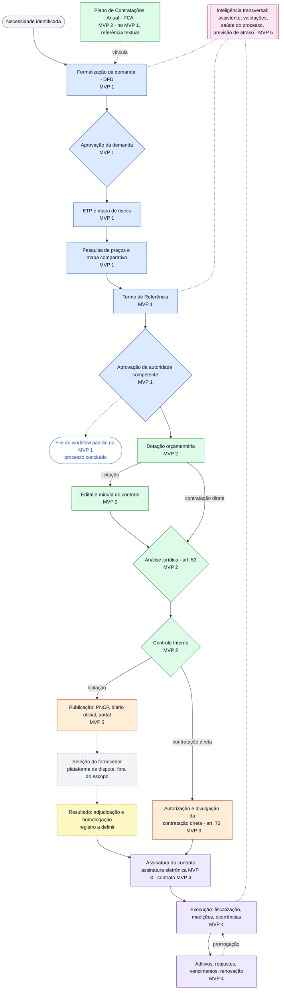
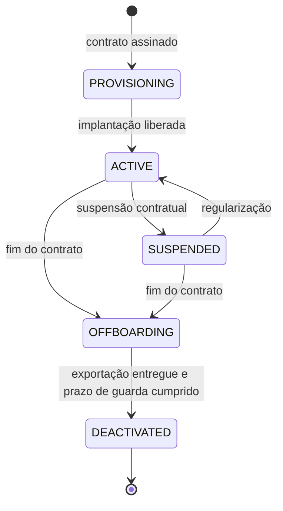

# ContrataFlow — Visão do Produto

> **Status:** v1.0 · base para o detalhamento do MVP 1 (Planejamento e Tramitação).
> **Precedência:** em caso de conflito, prevalece o [registro de decisões](../architecture/decisions.md). Nomes de entidades, perfis, status e módulos seguem a [terminologia](terminology.md).
> **Documentos irmãos:** [personas](personas.md) · [roadmap](roadmap.md) · [terminologia](terminology.md).
> **Aviso:** as referências normativas deste documento orientam decisões de produto e **não constituem parecer jurídico**. A configuração adotada por cada ente deve ser validada por sua assessoria jurídica.

**Sumário:** [1. Resumo executivo](#1-resumo-executivo) · [2. Visão, missão e posicionamento](#2-visão-missão-e-posicionamento) · [3. O problema](#3-o-problema) · [4. Contexto legal e regulatório](#4-contexto-legal-e-regulatório) · [5. Mercado-alvo e segmentação](#5-mercado-alvo-e-segmentação) · [6. Proposta de valor](#6-proposta-de-valor) · [7. Princípios do produto](#7-princípios-do-produto) · [8. Jornada ponta a ponta](#8-jornada-ponta-a-ponta-da-contratação) · [9. O que o ContrataFlow não é](#9-o-que-o-contrataflow-não-é) · [10. Diferenciais](#10-diferenciais) · [11. Modelo SaaS](#11-modelo-saas) · [12. Métricas de sucesso](#12-métricas-de-sucesso) · [13. Premissas, restrições e riscos](#13-premissas-restrições-e-riscos) · [14. Alternativas no mercado](#14-alternativas-existentes-no-mercado) · [15. Documentos relacionados](#15-documentos-relacionados)

---

## 1. Resumo executivo

O **ContrataFlow** é uma plataforma SaaS B2G, multi-tenant, de gestão das contratações públicas. Seu núcleo é o **processo de contratação**: documentos, aprovações, tramitações, comentários, pendências, prazos, versões, usuários e integrações existem sempre vinculados a um processo (DEC-010). O produto substitui o arranjo atual — Word, Excel, e-mail, WhatsApp, sistemas de protocolo, portais de compras, pastas de rede e papel — por um único registro rastreável, do planejamento à fiscalização do contrato. **Não é apenas um gerador de ETP/TR.**

- **Para quem:** prefeituras, câmaras municipais, autarquias, fundações, consórcios públicos e demais órgãos que contratam sob a Lei 14.133/2021. Empresas públicas são atendidas com ressalvas, pois seguem a Lei 13.303/2016 (§5.3).
- **Por que agora:**
  1. desde 30/12/2023, com a revogação das Leis 8.666/1993 e 10.520/2002 e de parte da Lei 12.462/2011, a Lei 14.133/2021 é o regime geral das novas contratações (art. 193, II, na redação da LC 198/2023);
  2. os municípios com até 20 mil habitantes têm até **abril de 2027** para cumprir as exigências de designação de agentes e segregação de funções, licitação eletrônica e divulgação em sítio eletrônico oficial (art. 176);
  3. a lei privilegia atos digitais (art. 12, VI) e exige gestão de riscos e controle preventivo, inclusive com tecnologia da informação (art. 169).
- **Como entregamos:** cinco MVPs incrementais — Planejamento e Tramitação → Governança e Controle → Integrações e Publicação → Gestão Contratual → Inteligência e IA ([roadmap](roadmap.md)).
- **Como medimos:** North Star = processos de contratação concluídos integralmente na plataforma, por mês (§12).

---

## 2. Visão, missão e posicionamento

**Visão (definida pelo cliente)**
> "Uma plataforma completa de gestão das contratações públicas, acompanhando toda a jornada desde a identificação da necessidade até a publicação, contratação, fiscalização e inteligência sobre os processos."

**Missão**
Permitir que qualquer órgão público — do pequeno município ao órgão estruturado — planeje, instrua, decida, publique e fiscalize suas contratações com segurança jurídica, rastreabilidade completa e eficiência, sem depender de papel, planilhas e mensagens dispersas.

**Declaração de posicionamento**
> Para órgãos públicos que contratam sob a Lei 14.133/2021 e precisam instruir processos completos, no prazo e defensáveis perante o controle, o **ContrataFlow** é a plataforma de gestão do processo de contratação que reúne documentos, tramitação, aprovações, prazos e evidências em um único registro auditável. Diferentemente de editores de documentos, sistemas de protocolo genéricos e módulos de compras de sistemas de gestão, o ContrataFlow tem o **processo como núcleo**, **workflow e regras configuráveis** para a regulamentação de cada ente e uma **trilha de evidências imutável** que mostra, a qualquer momento, onde o processo está, com quem, o que falta e se está atrasado.

**Em uma frase:** tudo o que acontece com uma contratação acontece — e fica registrado — dentro do processo.

---

## 3. O problema

### 3.1 Um processo típico hoje

A Secretaria de Saúde precisa de insumos. A demanda nasce numa mensagem de WhatsApp; o DFD é copiado de um processo do ano anterior em Word; o ETP segue um modelo baixado da internet; a pesquisa de preços vive numa planilha com cotações recebidas por e-mail e capturas de tela do Painel de Preços; o número do processo vem do livro de protocolo; as aprovações são assinaturas em papel; o parecer jurídico chega por e-mail. Quando o secretário pergunta "onde está a compra?", a resposta exige três telefonemas. Quando o tribunal de contas pergunta "qual versão do TR foi aprovada, por quem e com base em quê?", a resposta exige dias — e às vezes não existe.

### 3.2 Problemas estruturais

| # | Problema | Como se manifesta | Consequência | Resposta do ContrataFlow |
|---|---|---|---|---|
| 1 | Fragmentação | Necessidade no WhatsApp, documentos em Word, cálculos em Excel, aprovações em papel, pareceres por e-mail, arquivos em pastas de rede | Informação duplicada e divergente; ninguém tem o processo completo | Processo como agregado central: todo artefato tem `processId` (DEC-010); documentos estruturados (DEC-017) |
| 2 | Falta de rastreabilidade | "TR_final_v3_revisado.docx"; ninguém sabe quem alterou o quê nem qual versão foi aprovada | Fragilidade perante o controle; disputa sobre o que foi decidido | Versões imutáveis com hash SHA-256 (DEC-017, DEC-084); aprovação vinculada à versão exata (`ApprovalDocument`, DEC-022); auditoria append-only com selagem (DEC-025) |
| 3 | Invisibilidade situacional | "Onde está o processo?" é respondido por telefone | Atrasos descobertos tarde; cobrança informal; desgaste entre áreas | Painel situacional com 7 perguntas (DEC-180); caixa de tarefas (DEC-026); prazo por etapa e prazo alvo (DEC-031) |
| 4 | Retrabalho | Devoluções por documento incompleto; ETP e TR divergentes; pesquisa refeita por cotação vencida | Ciclo longo; servidores sobrecarregados | Regras de completude por etapa (DEC-016); importação ETP → TR; mínimo de cotações e validade parametrizados (DEC-020); itens canônicos (DEC-019) |
| 5 | Risco de responsabilização de agentes | Motivação não registrada; a mesma pessoa elabora e aprova; aprovações informais | Exposição pessoal (o agente responde por dolo ou erro grosseiro — LINDB, art. 28) | Segregação de funções nativa (DEC-022); justificativa obrigatória em atos sensíveis (exclusão de cotação, demanda não prevista no PCA, reabertura de documento); trilha de auditoria |
| 6 | Dificuldade de cumprir a NLLC | Muitos elementos obrigatórios (13 do ETP, 10 do TR, parâmetros de preço, instrução da contratação direta) e regulamentos locais diferentes | Processos incompletos; apontamentos dos órgãos de controle | Templates e regras semeados e configuráveis (DEC-016); checklist da etapa no painel; curadoria normativa versionada (§4.5) |
| 7 | Prazos e gargalos invisíveis | Nenhuma medição de tempo por etapa ou unidade | Impossível gerir capacidade e priorizar | Prazo por etapa, atraso e dashboard (MVP 1); indicadores, SLA avançado e gargalos (MVP 2) |
| 8 | Dependência de pessoas-chave | Conhecimento tácito em poucos servidores ou na consultoria | Rotatividade — inclusive na troca de gestão — paralisa as compras | Templates versionados, orientação por etapa, histórico pesquisável, duplicação de processos recorrentes (DEC-033) |

### 3.3 Hipóteses sobre o custo do problema (a validar)

Não há base pública confiável sobre esses custos por porte de órgão. As hipóteses abaixo serão medidas na descoberta com os design partners e viram **linha de base** no onboarding de cada cliente (§12.3).

| ID | Hipótese | Como medir a linha de base | KPI relacionado |
|---|---|---|---|
| H1 | A maior parte do tempo da fase preparatória é **espera** (processo parado sem responsável ou aguardando decisão), não elaboração | Amostra de 10–20 processos recentes com datas de entrada e saída por setor | E1, E2, E6 |
| H2 | Pelo menos 1 em cada 3 processos sofre devolução por documento incompleto ou inconsistente | Entrevistas e análise da amostra | Q1, Q2 |
| H3 | Gestores gastam várias horas por semana localizando processos e cobrando prazos | Diário de uso de uma semana com o gestor do piloto | A3, E3 |
| H4 | A pesquisa de preços é a etapa mais longa e a que mais gera retrabalho | Duração e número de rodadas das pesquisas da amostra | E5, Q4 |
| H5 | A falta de modelos padronizados é a principal causa de DFD e ETP fracos em municípios pequenos | Avaliação de 5 DFDs/ETPs por especialista | E4, Q3 |

---

## 4. Contexto legal e regulatório

### 4.1 Premissas de leitura

- A Lei 14.133/2021 é **norma geral nacional**. Estados, DF e municípios editam regulamentos próprios e **podem aplicar os regulamentos da União** (art. 187). As instruções normativas federais citadas aplicam-se diretamente à administração federal; para os demais entes valem por adoção expressa ou nas hipóteses que cada norma prevê (por exemplo, execução de recursos federais de transferências voluntárias — verificar a disposição específica).
- Por isso, **nenhuma regra legal ou administrativa fica no código** (princípio 17): o conteúdo normativo é configuração semeada, versionada e ajustável por tenant (DEC-016).
- O produto ajuda o órgão a cumprir a lei; **a responsabilidade pelo conteúdo dos atos permanece com os agentes públicos**.

### 4.2 Lei 14.133/2021 — dispositivos que moldam o produto

| Dispositivo | Síntese | Implicação no produto | MVP |
|---|---|---|---|
| Art. 5º | Princípios, entre eles planejamento, transparência, eficiência, segregação de funções, motivação e celeridade | Os princípios do produto (§7) operacionalizam esses princípios; motivação registrada em atos sensíveis | Todos |
| Art. 6º, XX | Define o ETP: primeira etapa do planejamento, que caracteriza o interesse público e a melhor solução e dá base ao TR ou projeto | Módulo ETP (`Etp`, `EtpAlternative`) com conclusão de viabilidade (`EtpConclusion`) | 1 |
| Art. 6º, XXIII | Define o TR e seus elementos (alíneas *a* a *j*: objeto, fundamentação, solução como um todo, requisitos, modelo de execução, modelo de gestão, medição e pagamento, seleção do fornecedor, estimativas de valor, adequação orçamentária) | Template de TR com seções correspondentes e regras de completude; importação do ETP | 1 |
| Art. 7º, caput e §§ 1º e 2º | Designação de agentes para funções essenciais e **segregação de funções**, inclusive nos órgãos de assessoramento jurídico e de controle interno | Bloqueio de autoaprovação (`approval.preventSelfApproval`, DEC-022); custódia (DEC-023); perfis por função (DEC-035) | 1 |
| Art. 8º | O agente de contratação conduz a licitação até a homologação (pregoeiro, no pregão), com equipe de apoio ou comissão | Persona Licitações / perfil `LICITACOES`, com atuação plena a partir do edital e da publicação | 2–3 |
| Art. 11, parágrafo único | A alta administração responde pela governança das contratações: gestão de riscos, controles internos, alinhamento ao planejamento estratégico e às leis orçamentárias | Dashboard (MVP 1); PCA, indicadores, SLA e gargalos (MVP 2) | 1–2 |
| Art. 12, VI | Atos preferencialmente digitais, produzidos, comunicados, armazenados e validados por meio eletrônico | Processo 100% digital; PDFs com hash; aprovações registradas | 1 |
| Art. 12, VII e § 1º | PCA elaborado a partir de DFDs, na forma de regulamento, e divulgado em sítio eletrônico oficial | Referência ao PCA no DFD e no processo (DEC-029); módulo PCA (MVP 2); divulgação (MVP 3) | 1–3 |
| Art. 12, § 2º | Admite identificação e assinatura digital com certificado ICP-Brasil | Assinatura eletrônica e renderização `SIGNED` | 3 |
| Art. 17 | Fases do processo licitatório: preparatória, divulgação do edital, propostas e lances, julgamento, habilitação, recursal e homologação | Jornada do produto (§8); a disputa ocorre em plataforma própria, fora do ContrataFlow | 1–4 |
| Art. 18, caput | A fase preparatória deve se compatibilizar com o PCA e as leis orçamentárias e compreende ETP, TR, orçamento estimado, edital, minuta de contrato, modalidade e critério de julgamento, análise de riscos e motivações, entre outros | Workflow padrão cobre a parte de **planejamento** no MVP 1 (DEC-015); dotação, edital e jurídico entram no MVP 2 | 1–2 |
| Art. 18, § 1º | Treze elementos do ETP: necessidade; previsão no PCA; requisitos; quantidades com memória de cálculo; levantamento de mercado; estimativa de valor; solução como um todo; parcelamento; resultados pretendidos; providências prévias; contratações correlatas; impactos ambientais; posicionamento conclusivo | Seções do template de ETP; `EtpAlternative`; `ParcelingDecision`; `DocumentItem` com memória de cálculo | 1 |
| Art. 18, § 2º | O ETP deve conter ao menos os incisos I, IV, VI, VIII e XIII; a ausência dos demais exige justificativa | Regras semeadas (DEC-016): mínimos com severidade `BLOCKING`; demais com conteúdo **ou** justificativa | 1 |
| Art. 19, II | Catálogo eletrônico de padronização, admitida a adoção do catálogo federal por todos os entes | Código CATMAT/CATSER opcional em `ProcessItem` (DEC-019) | 1 |
| Art. 22 | Matriz de alocação de riscos no edital (obrigatória em obras e serviços de grande vulto e nos regimes de contratação integrada e semi-integrada) | Distinta do mapa de riscos do planejamento; tratada no edital e no contrato | 2, 4 |
| Art. 23 | Valor estimado compatível com o mercado; parâmetros do § 1º: painel de preços/PNCP, contratações similares, mídia e sítios especializados com data e hora de acesso, pesquisa direta com no mínimo 3 fornecedores e orçamentos de até 6 meses, notas fiscais eletrônicas | `PriceSource` + catálogo `PRICE_SOURCE_TYPE`; mínimo de cotações e validade parametrizados (DEC-020) | 1 |
| Art. 24 | O orçamento estimado pode ser sigiloso, sem que o sigilo prevaleça para os órgãos de controle interno e externo | `Process.isBudgetConfidential` com mascaramento central (DEC-030); perfis de controle com permissão de visualização | 1 |
| Art. 40 | Planejamento de compras: parcelamento quando tecnicamente viável e economicamente vantajoso (§§ 2º e 3º); TR de compras com especificação, locais de entrega e garantia exigida (§ 1º) | `ParcelingDecision`, `AwardType`; seções do TR | 1 |
| Art. 53 | Ao final da fase preparatória, controle prévio de legalidade pelo órgão jurídico; priorização por critérios objetivos e linguagem simples (§ 1º); também em contratações diretas, adesões e aditivos (§ 4º); dispensa da análise em hipóteses definidas pela autoridade jurídica máxima (§ 5º) | Módulo Jurídico: fila priorizada, parecer vinculado às versões analisadas, diligência; hipóteses de dispensa como regra configurável | 2 |
| Art. 54 | Divulgação do edital no PNCP e publicação de extrato em diário oficial (§ 1º) | `PublicationProvider` com `PNCPProvider` e `DiarioOficialProvider` | 3 |
| Art. 72 | Instrução da contratação direta (DFD e, se for o caso, ETP, análise de riscos e TR; estimativa de despesa; pareceres; compatibilidade orçamentária; habilitação; razão da escolha; justificativa de preço; autorização) e divulgação do ato (parágrafo único) | Workflow configurável para contratação direta (ver lacuna no [roadmap](roadmap.md#10-itens-fora-do-escopo-dos-5-mvps-e-lacunas-identificadas)); publicação no MVP 3 | 1–3 |
| Arts. 74 e 75 | Inexigibilidade (inviabilidade de competição) e dispensa (hipóteses taxativas, inclusive por valor); para os limites por valor, somatório por unidade gestora e por objetos de mesma natureza no exercício (art. 75, § 1º) | Catálogo `CONTRACTING_TYPE` e regras parametrizadas; alerta de possível fracionamento como candidato (MVP 2 ou 5) | 1, 2, 5 |
| Art. 94 | A divulgação no PNCP é condição de eficácia do contrato e de seus aditamentos, em prazos contados da assinatura | Dependência MVP 3 → MVP 4; prazos de publicação monitorados | 3–4 |
| Arts. 105 a 107 | Duração dos contratos, serviços e fornecimentos contínuos e prorrogações | Alertas de vencimento (180/120/90/60/30 dias) e renovação | 4 |
| Art. 117 | Fiscalização por fiscais designados (ou substitutos); registro de ocorrências; comunicação aos superiores | `ContractInspector`, `ContractOccurrence`; alertas | 4 |
| Arts. 124 a 136 | Alterações contratuais, termos aditivos, reajuste, repactuação e apostilamento | `ContractAmendment`; reajustes | 4 |
| Art. 150 | Nenhuma contratação sem caracterização do objeto e indicação dos créditos orçamentários | Etapa de dotação (`BudgetAllocation`) | 2 |
| Art. 169 | Gestão de riscos e controle preventivo, inclusive com tecnologia da informação; três linhas de defesa; acesso irrestrito dos órgãos de controle às informações, inclusive classificadas (§ 2º) | Perfis por linha de defesa; auditoria (MVP 1); Controle Interno (MVP 2); leitura ampla para controle | 1–2 |
| Art. 174 | PNCP: divulgação centralizada e obrigatória dos atos (o § 2º inclui PCA, editais e avisos de contratação direta, atas de registro de preços, contratos e aditivos) | `PNCPProvider`; status `PUBLISHED` | 3 |
| Art. 176 | Municípios com até 20 mil habitantes: 6 anos da publicação da lei (até abril de 2027) para os requisitos dos arts. 7º e 8º (caput), a licitação eletrônica e a divulgação em sítio eletrônico oficial; enquanto não adotarem o PNCP, publicam em diário oficial (parágrafo único) | Janela de mercado (§5.5); `DiarioOficialProvider` | 1, 3 |
| Art. 181, parágrafo único | Municípios com até 10 mil habitantes devem constituir, preferencialmente, consórcios públicos para compras centralizadas | Consórcios como segmento e canal (§5.3) | — |
| Art. 182 | Valores da lei atualizados anualmente pelo IPCA-E (ou índice substituto) e divulgados no PNCP | Valores-limite são parâmetros, nunca código | 1 |
| Art. 187 | Estados, DF e municípios podem aplicar os regulamentos editados pela União | Conteúdo semeado baseado em regulamentos federais, ajustável por ente | 1 |

### 4.3 Regulamentos federais e normas correlatas

| Norma | Objeto | Uso no produto |
|---|---|---|
| Decreto 10.947/2022 | PCA e DFD na administração federal (calendário anual de elaboração, sistema de planejamento) | Modelo de DFD (MVP 1) e do módulo PCA (MVP 2); calendário do PCA configurável por ente |
| IN SEGES/ME 58/2022 | Elaboração do ETP (federal) | Estrutura do template de ETP semeado |
| IN SEGES/ME 65/2021 | Pesquisa de preços para bens e serviços em geral: parâmetros, métodos (média, mediana ou menor valor), no mínimo três preços, desconsideração de valores inexequíveis, inconsistentes e excessivamente elevados, exceções justificadas | `PriceCalculationMethod`, `ExclusionReason`, mínimo de cotações e faixas de valores atípicos (DEC-020) |
| IN SEGES/ME 81/2022 | Elaboração do TR (federal) | Estrutura do template de TR semeado |
| Decreto 11.246/2022 | Agente de contratação, equipe de apoio, comissão de contratação, gestores e fiscais de contratos (federal) | Personas e perfis; modelo de gestão e fiscalização (MVP 4) |
| Decreto 11.462/2023 | Sistema de registro de preços (federal) | Fora do escopo atual — candidato (ver [roadmap](roadmap.md)) |
| LINDB — Decreto-Lei 4.657/1942, arts. 20 a 30 (incluídos pela Lei 13.655/2018) | Motivação das decisões; responsabilização pessoal do agente por dolo ou erro grosseiro (art. 28) | Registro de motivação e evidências de cada decisão |
| LGPD — Lei 13.709/2018 | Proteção de dados pessoais | Órgão = controlador; plataforma = operadora; bases legais do art. 7º, II e III, e art. 23 (DEC-140); minimização; criptografia de CPF (DEC-086) |
| LAI — Lei 12.527/2011 | Acesso à informação; transparência ativa e passiva | Documentos exportáveis e publicáveis; documentos com valores sigilosos marcados como `RESTRICTED` (DEC-030) |
| eMAG 3.1, WCAG 2.1 AA e Lei 13.146/2015, art. 63 | Acessibilidade em serviços digitais | Requisito de todas as telas (DEC-183) |
| Lei 14.063/2020 e MP 2.200-2/2001 | Níveis de assinatura eletrônica (simples, avançada, qualificada) em interações com entes públicos; ICP-Brasil | Assinatura eletrônica (MVP 3); premissa PRE-05 |
| Lei 13.303/2016 | Licitações e contratos das empresas estatais (fora do regime da Lei 14.133 — art. 1º, § 1º) | Segmento com ressalvas (§5.3) |
| IN RFB 2.229/2024 | CNPJ alfanumérico | Cadastro de `Supplier` (DEC-020) |

### 4.4 Regulamentação própria de cada ente → configurabilidade

Cada ente define, por decreto ou portaria, quem decide, em que ordem, com quais documentos e com qual metodologia. O produto trata essa variação como configuração:

| O que varia entre entes | Exemplo | Onde se configura | Decisões |
|---|---|---|---|
| Autoridade competente e alçadas | O secretário ordena as despesas da própria pasta; acima de certo valor decide o prefeito | `RoleAssignment` com escopo; responsável e aprovador por etapa; regras condicionais por valor (MVP 2) | DEC-015, DEC-022, DEC-134 |
| Etapas e ordem do fluxo | Controle Interno antes do Jurídico; etapa adicional no gabinete | `Workflow` / `WorkflowVersion` | DEC-014 |
| Documentos exigidos por tipo de contratação, modalidade ou valor | ETP dispensado nas hipóteses do regulamento local | `WorkflowRule` `REQUIRED_DOCUMENT` (com `minStatus`) e `applicabilityRule` | DEC-016, DEC-018 |
| Conteúdo mínimo de ETP e TR | Seções adicionais exigidas por decreto municipal | `DocumentTemplateVersion.sections` + regras `REQUIRED_FIELD` | DEC-016, DEC-017 |
| Metodologia da pesquisa de preços | Mínimo de cotações, validade, método padrão, faixas de valores atípicos | Parâmetros por tenant, copiados como snapshot em cada pesquisa | DEC-020 |
| Escala de risco | Matriz 3×3 em vez de 5×5 | Escalas e faixas configuráveis | DEC-021 |
| Numeração | `{seq:4}/{year}` por órgão; número atribuído na autuação | Chaves `numbering.process.*` | DEC-028 |
| Calendário | Feriados municipais e pontos facultativos | `Holiday`; `calendar.optionalHolidaysAreNonBusiness` | DEC-031 |
| Catálogos | Modalidades, tipos de contratação, origens, unidades de medida, fontes de preço, categorias de risco e de anexo | `CatalogItem` | DEC-027 |
| Valores-limite atualizados anualmente | Limites de dispensa por valor (art. 75, I e II, atualizados conforme o art. 182) | Parâmetros e regras — nunca código | DEC-016 |
| Nomenclatura da estrutura | "Secretaria" na prefeitura; "Diretoria" na câmara | `labels.secretariat` | DEC-011 |
| Hipóteses de dispensa de parecer jurídico | Ato da Procuradoria (art. 53, § 5º) | Regras condicionais (MVP 2) | DEC-016 |
| Segregação de funções | Bloqueio de autoaprovação | `approval.preventSelfApproval` | DEC-022 |
| Sigilo do orçamento | Orçamento sigiloso até o fim da licitação | `Process.isBudgetConfidential` | DEC-030 |

### 4.5 Curadoria normativa (proposta de processo de produto)

O **pacote normativo de referência** é composto por: workflow padrão "Fase preparatória — Lei 14.133/2021" (DEC-015), templates semeados (DFD, ETP, TR, mapa de riscos, pesquisa de preços, despacho, ofício), regras semeadas (por exemplo, art. 18, §§ 1º e 2º), catálogos-base (DEC-027) e parâmetros padrão (DEC-020, DEC-021).

- **Responsável:** especialista em contratações públicas do time de produto, com revisão jurídica externa antes de cada publicação.
- **Versionamento:** mudanças viram **novas versões** de workflow e template; nunca alteram versões publicadas (DEC-084) nem processos em andamento, que fixam a versão do workflow (DEC-014).
- **Distribuição:** atualizações oferecidas aos tenants como adoção opcional, com notas de versão normativas (o que mudou, por quê, base legal). Customizações locais nunca são sobrescritas.
- **Monitoramento:** novas leis, decretos e INs; atualização anual de valores (art. 182); orientações relevantes de tribunais de contas.

---

## 5. Mercado-alvo e segmentação

### 5.1 Universo

- **Municípios:** 5.568 municípios, além do Distrito Federal. Cada município tem, em regra, ao menos **dois tenants potenciais** — Prefeitura e Câmara Municipal são poderes distintos (DEC-011) — e pode ter administração indireta (autarquias, fundações, fundos) modelada como `Organization` no mesmo tenant ou como tenant próprio, conforme a autonomia de contratação.
- **Porte:** cerca de dois terços dos municípios têm até 20 mil habitantes (ordem de grandeza segundo o Censo 2022 do IBGE; confirmar na análise de mercado). É o segmento sob o prazo do art. 176.
- **Outros contratantes:** consórcios públicos (Lei 11.107/2005), autarquias e fundações estaduais e municipais, órgãos estaduais e empresas estatais (com ressalvas).

### 5.2 Segmentação por porte

| Segmento | Perfil típico | Dores dominantes | O que valoriza | Implicações | Prioridade |
|---|---|---|---|---|---|
| **P1 — até 20 mil hab.** | 1 a 3 servidores em compras acumulando funções; forte dependência de consultoria; baixa maturidade digital | Cumprir a lei com equipe mínima; prazo do art. 176; segregação de funções difícil com poucos servidores | Modelos prontos, simplicidade, preço, suporte próximo | Implantação padronizada em até 2 semanas; workflow enxuto para contratação direta; venda via consórcios, associações e consultorias | Alta (volume e janela); ticket baixo |
| **P2 — 20 a 100 mil hab.** | Setor de compras e licitações estruturado (3 a 10 pessoas); Procuradoria e Controle Interno existentes; várias secretarias | Coordenação entre áreas, prazos, padronização, devoluções | Visibilidade, prazos, auditoria, padronização | **ICP primário** do piloto e dos primeiros 12 meses | Alta |
| **P3 — 100 a 500 mil hab.** | Alto volume; vários órgãos (administração indireta); sistemas legados de gestão e protocolo | Integração com sistemas existentes; governança; escala | Integrações (MVP 3), SSO, relatórios, segurança | Venda consultiva longa; exige MVP 2–3 | Média |
| **P4 — acima de 500 mil hab. e capitais** | Sistemas próprios, equipes grandes, demandas de customização | Integração e governança em escala | Aderência a processos próprios | Foco posterior | Baixa no curto prazo |

### 5.3 Segmentação por tipo de órgão

| Tipo | Particularidades | Encaixe | Prioridade |
|---|---|---|---|
| Prefeituras (administração direta) | Muitas secretarias requisitantes; ordenação de despesa às vezes descentralizada por secretaria | Núcleo do produto | Alta |
| Câmaras municipais | Tenant próprio (DEC-011); baixo volume; fluxos simples; autoridade = Presidente da Câmara; rótulo "Diretoria" (`labels.secretariat`) | Bom encaixe com workflow simplificado | Média |
| Autarquias e fundações (SAAE, previdência própria, saúde, cultura) | `Organization` no tenant do município ou tenant próprio, conforme a autonomia | Bom encaixe; numeração por órgão (DEC-028) | Média |
| Consórcios públicos | Tenant próprio; compras para entes consorciados; preferenciais para municípios com até 10 mil habitantes (art. 181, parágrafo único) | Canal estratégico para P1; compras compartilhadas multiente fora do escopo atual | Alta como canal |
| Empresas públicas e sociedades de economia mista | Regidas pela Lei 13.303/2016 e por regulamento interno (fora do regime da Lei 14.133 — art. 1º, § 1º) | Workflow e templates configuráveis atendem parcialmente; o pacote normativo semeado (Lei 14.133) **não se aplica** | Baixa até existir pacote 13.303 |
| Órgãos estaduais | Maior escala, sistemas próprios | Encaixe a partir do MVP 3 | Baixa no curto prazo |

### 5.4 Perfil de cliente ideal (ICP) para o piloto e os primeiros 12 meses

- Município de **20 a 100 mil habitantes** (ou consórcio com municípios menores), com Procuradoria e Controle Interno estruturados.
- Setor de compras e licitações com 3 a 10 servidores e **patrocinador executivo** (secretário de Administração ou equivalente).
- Disposição para padronizar modelos com a Procuradoria e adotar o workflow padrão com ajustes por configuração.
- Volume de 150 a 800 processos por ano (hipótese a validar), suficiente para medir ganhos em até 6 meses.
- Sem compromisso de integração com sistemas legados no primeiro ano (integrações chegam no MVP 3).

### 5.5 Dinâmica de compra B2G e janelas de mercado

- **O próprio SaaS é contratado por processo público.** Ciclos de 3 a 9 meses são esperados. Recomenda-se oferecer um *kit de contratação* (modelos de DFD, ETP, TR e pesquisa de preços do próprio ContrataFlow), sem prescrever o rito, que é decisão do órgão.
- **Calendário orçamentário:** evitar go-live entre meados de dezembro e janeiro (encerramento do exercício e recesso). Melhores janelas de implantação: fevereiro a junho e agosto a outubro.
- **Art. 176:** a obrigação plena dos municípios com até 20 mil habitantes a partir de abril de 2027 gera demanda imediata por segregação de funções, processos documentados e publicação. O MVP 1 endereça planejamento, segregação e rastreabilidade; a **publicação chega no MVP 3** — risco e mitigação em §13 (RSK-05).
- **Ciclo político:** mandatos municipais 2025–2028 (eleições em outubro de 2028). Trocas de gestão podem reabrir decisões de contratação; métricas de valor documentadas reduzem esse risco.

---

## 6. Proposta de valor

### 6.1 Pilares

| Pilar | Promessa | Como se prova |
|---|---|---|
| **Visibilidade** | Saber, a qualquer momento, onde está cada processo, com quem, o que falta e se está atrasado | Painel situacional (DEC-180), caixa de tarefas, dashboard |
| **Conformidade defensável** | Cada decisão com motivação, versão exata e autor registrados; elementos legais verificados por regra | Versões com hash, `ApprovalDocument`, segregação de funções, regras semeadas, auditoria selada |
| **Produtividade** | Menos tempo escrevendo, copiando e cobrando; mais tempo decidindo | Templates, importação ETP → TR, itens canônicos, cálculos automáticos, notificações |
| **Governança** | Dados para gerir capacidade, prazos e riscos das contratações | Dashboard (MVP 1); indicadores, SLA e gargalos (MVP 2); previsão (MVP 5) |

### 6.2 Por persona-chave

Detalhamento completo em [personas.md](personas.md).

| Persona | Trabalho a ser feito | Hoje | Com o ContrataFlow | Evidência de valor |
|---|---|---|---|---|
| Área requisitante | Formalizar uma necessidade sem dominar a lei | Copia DFDs antigos; não sabe o andamento | Wizard de DFD com orientação e exemplos; acompanhamento em linguagem simples; devoluções com motivo claro | DFD aprovado sem devolução; menos ligações de cobrança |
| Planejamento | Produzir ETP e TR completos e coerentes | Copia e cola entre documentos; versões por e-mail | Editor por seções com completude; importação ETP → TR; itens canônicos | Mínimos do art. 18, § 2º sempre presentes; menos divergências |
| Compras | Pesquisa de preços válida e defensável | Planilhas frágeis; evidências dispersas | Fontes tipificadas com evidência; estatísticas automáticas; valores atípicos sinalizados; exclusões justificadas | 3 ou mais cotações válidas ou justificativa; menos refação |
| Gestor de contratações | Fazer os processos andarem no prazo | Planilha de controle desatualizada | Dashboard, caixa de tarefas, atribuição, prazos e atrasos em tempo real | % de etapas no prazo; tempo de ciclo |
| Autoridade competente | Decidir rápido e com segurança | Pilhas de papel; não sabe o que mudou | Aprovação em uma tela, inclusive no celular, com versões exatas e alertas | Tempo de decisão; nenhuma decisão sobre versão errada |
| Jurídico / Procuradoria | Controle prévio de legalidade eficiente (MVP 2) | PDFs desconexos; não sabe o que mudou após a diligência | Fila priorizada; visão consolidada; parecer vinculado à versão analisada | Pareceres no prazo; menos diligências |
| Controle Interno | Controle preventivo com evidências íntegras | Pede documentos às secretarias e espera | Leitura ampla em tempo real, trilha de auditoria, integridade verificável | Tempo para reunir evidências |
| Administrador do órgão | Implantar e manter sem depender do fornecedor | Cadastros espalhados; chamado para tudo | Estrutura, perfis, templates e workflow configuráveis e auditados | Tempo de implantação; nenhuma conta compartilhada |
| Fiscal e gestor de contrato (MVP 4) | Executar e acompanhar contratos sem surpresas | Caderno, fotos no celular pessoal, planilha de vencimentos | Ocorrências e medições registradas no ato; alertas de vencimento | Nenhum contrato vencido sem decisão |
| Consultoria externa | Atender vários entes com qualidade | Documentos por e-mail; senhas compartilhadas | Vínculos por ente com validade; edição dentro do processo | Menos rodadas de revisão; nenhum acesso indevido |

---

## 7. Princípios do produto

Os 17 princípios são **critérios de decisão**: nenhuma tela, card ou regra pode violá-los. Em conflito entre princípios, prevalecem isolamento (10), rastreabilidade (3 e 4) e decisão humana (16).

| # | Princípio | Como se materializa | Decisões |
|---|---|---|---|
| 1 | Processo como entidade principal | Todo artefato de negócio tem `processId`; o Detalhe do Processo (SCR-006) é o hub; não existe documento "solto" | DEC-010, DEC-101 |
| 2 | Documentos como artefatos do processo | `Document` com tipo, número e ciclo de vida únicos; três naturezas (estruturado, texto livre, arquivo externo); documentos estruturados alimentam itens e valor estimado | DEC-017, DEC-018, DEC-019, DEC-032 |
| 3 | Histórico completo de alterações | Versões imutáveis (`DocumentVersion`) com hash; rascunho com revisão por seção; tramitações imutáveis (`ProcessMovement`); timeline; nada é excluído fisicamente | DEC-014, DEC-017, DEC-034, DEC-084 |
| 4 | Auditoria de ações relevantes | `AuditLog` append-only na mesma transação, inclusive ações negadas, acessos e exportações; selagem periódica (`AuditSeal`); acesso de suporte auditado e visível ao cliente | DEC-025, DEC-139 |
| 5 | Workflow configurável | `Workflow` → `WorkflowVersion` declarativo; versão publicada imutável; o processo fixa a versão; workflow padrão semeado | DEC-014, DEC-015 |
| 6 | Regras parametrizáveis | `WorkflowRule` em JSON Logic com severidade e mensagem configurável; parâmetros por tenant; catálogos; snapshot de parâmetros na pesquisa de preços | DEC-016, DEC-020, DEC-027 |
| 7 | Templates versionados | `DocumentTemplate` → `DocumentTemplateVersion` com seções; versão publicada é snapshot imutável com hash | DEC-017, DEC-084 |
| 8 | RBAC granular | Permissões `RESOURCE_ACTION` com nível de risco; perfis por tenant; atribuição com escopo e vigência; políticas contextuais (custódia, segregação, estado); a API decide, a interface apenas esconde | DEC-022, DEC-023, DEC-134 |
| 9 | Multi-tenancy | `Tenant` × `Organization` × `Department`; usuário global com vínculos por tenant; configurações por tenant | DEC-011, DEC-012 |
| 10 | Isolamento total entre tenants | `tenant_id` obrigatório, FKs compostas, RLS forçado, contexto por transação e por job; recurso de outro tenant responde 404; operadores sem acesso por padrão | DEC-024, DEC-080–082, DEC-139, DEC-164 |
| 11 | Excelente UX | Wizards, editor por seções, skeleton loading, empty states, erros com ação de recuperação, autosave confiável | DEC-181, DEC-182 |
| 12 | Usuários não técnicos conseguem usar | Linguagem simples; termos legais com tooltip e glossário; nunca exibir códigos técnicos; orientação por etapa; modelos prontos | DEC-181, DEC-184 |
| 13 | Sempre mostrar onde está, quem é o responsável, o que falta, o próximo passo e se há atraso | Painel situacional com 7 perguntas (acrescenta documentos existentes e aprovações pendentes), alimentado por `GET /processes/{id}/summary` | DEC-180 |
| 14 | Evitar telas poluídas | Uma ação primária por contexto; ações secundárias em "Mais"; só aparecem ações disponíveis (`available-actions`) | DEC-102, DEC-181 |
| 15 | Progressive disclosure | Campos avançados recolhidos; resumo antes do detalhe; detalhes sob demanda | DEC-181 |
| 16 | IA auxilia, mas não substitui aprovação humana | A IA (MVP 5) sugere, valida e explica; aprovações (`Approval`) e tramitações são sempre de pessoas; conteúdo sugerido é identificado e auditado; a IA respeita RBAC e sigilo | DEC-022, DEC-030, DEC-050 |
| 17 | Regras legais e administrativas não ficam no código | Regras legais como configuração semeada (ex.: art. 18, §§ 1º e 2º); valores atualizáveis (art. 182) como parâmetros; base legal em metadados de catálogo | DEC-016, DEC-027 |

---

## 8. Jornada ponta a ponta da contratação

**Legenda:** azul = MVP 1 · verde = MVP 2 · laranja = MVP 3 · roxo = MVP 4 · rosa = MVP 5 · cinza tracejado = fora do produto · amarelo tracejado = lacuna a decidir. A posição exata do edital e a ordem Jurídico/Controle Interno no workflow do MVP 2 serão definidas no detalhamento do MVP 2 (DEC-015 prevê "Dotação, Jurídico e Controle Interno entre as etapas 6 e 7").

| Fase | O que acontece | Entidades / artefatos | Personas principais | Base legal | MVP |
|---|---|---|---|---|---|
| Planejamento anual | Consolidação das demandas do exercício; vínculo do DFD a um item do plano | `Pca`, `PcaItem` (MVP 2); no MVP 1, `pcaStatus`, `pcaYear`, `pcaItemCode` (DEC-029) | Planejamento, Requisitante, Contabilidade, Autoridade | Art. 12, VII; Decreto 10.947/2022 | 2 |
| Formalização da demanda | Necessidade, itens e quantidades, situação no PCA | `Process`, `Dfd`, `ProcessItem`, `DocumentItem` | Requisitante | Art. 12, VII; art. 72, I | 1 |
| Aprovação da demanda | Titular da secretaria solicitante decide sobre o DFD | `Approval` (`PROCESS_STAGE`), `ApprovalDocument` | Titular da secretaria (frequentemente a autoridade competente da pasta) | Art. 7º, § 1º | 1 |
| Estudos preliminares | ETP com alternativas, quantidades e conclusão; mapa de riscos | `Etp`, `EtpAlternative`, `Risk`, `RiskTreatment` | Planejamento, Requisitante, Consultoria | Art. 6º, XX; art. 18, §§ 1º e 2º; art. 18, X | 1 |
| Pesquisa de preços | Fontes, cotações, estatísticas, exclusões justificadas, mapa comparativo | `PriceResearch`, `PriceItem`, `PriceSource`, `Quotation`, `Supplier` | Compras | Art. 23; IN SEGES/ME 65/2021 | 1 |
| Termo de Referência | Objeto, requisitos, modelos de execução e gestão, critérios de medição e seleção | `TermOfReference`, `DocumentItem` | Planejamento, Requisitante | Art. 6º, XXIII; art. 40, § 1º | 1 |
| Aprovação da autoridade | Decisão sobre ETP, mapa de riscos, pesquisa e TR em conjunto | `Approval`, `ApprovalDocument` | Autoridade competente | Art. 7º; regulamento local | 1 |
| Dotação orçamentária | Indicação dos créditos orçamentários | `BudgetAllocation` | Contabilidade | Art. 18, caput; art. 72, IV; art. 150 | 2 |
| Edital | Minuta do edital e do contrato a partir do TR | Módulo `tender` | Licitações | Art. 18, V e VI; art. 25 | 2 |
| Análise jurídica | Controle prévio de legalidade; diligências; parecer | `LegalReview` | Jurídico | Art. 53 | 2 |
| Controle interno | Verificação de conformidade (segunda linha de defesa) | Módulo `internal-control` | Controle Interno | Art. 169, II | 2 |
| Publicação | Divulgação no PNCP, extrato em diário oficial, portal do ente | `Publication`, `PublicationAttempt` | Licitações | Arts. 54, 72 (parágrafo único), 174 e 176 | 3 |
| Seleção do fornecedor | Sessão pública, julgamento, habilitação e recursos | Fora do ContrataFlow (plataformas de disputa) | Agente de contratação | Art. 17, III a VII | — |
| Resultado e contratação | Adjudicação, homologação e assinatura | Registro do resultado (lacuna); `Contract` | Autoridade, Licitações, Gestor de contrato | Arts. 71 e 94 | 3–4 |
| Execução e fiscalização | Fiscalização, medições, ocorrências | `ContractInspector`, `ContractMeasurement`, `ContractOccurrence` | Fiscal, Gestor de contrato | Art. 117 | 4 |
| Alterações e encerramento | Aditivos, reajustes, vencimentos, renovação | `ContractAmendment` | Gestor de contrato, Jurídico, Autoridade | Arts. 105–107 e 124–136 | 4 |
| Inteligência | Assistente, validações cruzadas, saúde do processo, previsão de atraso | `AiAnalysis`, `ValidationResult` | Todas | Art. 169 (controle preventivo com TI) | 5 |

> **Importante:** no MVP 1, a etapa final do workflow semeado (`CONCLUSAO`, "Planejamento da contratação concluído" — DEC-015) marca a conclusão do **planejamento** aprovado pela autoridade. Dotação, edital e parecer jurídico — também integrantes da fase preparatória (art. 18 e art. 53) — passam a ser conduzidos na plataforma no MVP 2; até lá, o órgão pode modelá-los como etapas `TASK` genéricas por configuração (ver [roadmap](roadmap.md#3-mvp-1--planejamento-e-tramitação)).

---

## 9. O que o ContrataFlow não é

| Não é | Por quê | O que fazemos em vez disso |
|---|---|---|
| Um gerador de ETP/TR avulso | Documento sem processo não resolve rastreabilidade, prazo nem decisão | Documentos são artefatos do processo (princípio 2) |
| Uma plataforma de disputa eletrônica (sessão de lances) | Ambiente regulado e especializado, com plataformas públicas e privadas consolidadas | Preparamos e publicamos; o registro do resultado é lacuna a decidir (recomendação: MVP 4) |
| Um sistema contábil ou financeiro | Empenho, liquidação e pagamento pertencem ao sistema contábil do ente | Registramos a dotação (MVP 2) e integramos por adapters (MVP 3) |
| Um sistema de protocolo ou GED geral do órgão | O escopo é o processo de contratação, não toda a tramitação administrativa | Guardamos o número externo (`internalCode`) e integramos quando necessário |
| Um portal da transparência | A divulgação oficial ocorre no PNCP, em diário oficial e no portal do ente | Publicamos nesses canais por `PublicationProvider` (MVP 3) |
| Um substituto do parecer jurídico ou da decisão da autoridade | A responsabilidade pelos atos é dos agentes públicos | Organizamos, verificamos e evidenciamos; pessoas decidem |
| Uma consultoria jurídica | Modelos e regras semeados são ponto de partida | Curadoria normativa versionada; validação local pela Procuradoria |
| Uma ferramenta de BPM genérica | Fluxo genérico não conhece itens, pesquisa de preços nem regras da NLLC | Workflow configurável **especializado** em contratações |
| Um sistema de almoxarifado, patrimônio ou folha | Fora do domínio | Integrações futuras, se houver demanda |
| Um portal do fornecedor | Fornecedores não são usuários no roadmap atual | Cotações recebidas e registradas como evidência; candidato futuro |

---

## 10. Diferenciais

| Diferencial | Na prática | Por que importa | Base |
|---|---|---|---|
| Processo como núcleo | Um único lugar para documentos, decisões, prazos, comentários e evidências | Elimina a fragmentação, que é a causa raiz dos demais problemas | DEC-010 |
| Workflow e regras configuráveis sem código | Etapas, responsáveis, prazos e exigências ajustáveis por ente; versões publicadas imutáveis; processos em andamento não são afetados por mudanças | Cada ente tem sua regulamentação; mudanças normativas não exigem novo software | DEC-014, DEC-016 |
| Painel situacional "7 perguntas" | Onde está, quem é o responsável, o que falta, próximo passo, atraso, documentos e aprovações pendentes — sem cliques | Acaba com o "onde está o processo?" | DEC-180 |
| Rastreabilidade forte | Versões imutáveis com SHA-256 sobre JSON canonicalizado; aprovação vinculada às versões exatas; PDFs com hash; auditoria append-only com selagem | Prova de integridade perante controle interno, tribunais de contas e Judiciário | DEC-017, DEC-022, DEC-060, DEC-084 |
| Itens canônicos | O mesmo item atravessa DFD, ETP, pesquisa e TR com quantidades e preços por documento | Consistência e base para validações cruzadas (ex.: "Quantidade divergente entre ETP e TR") | DEC-019 |
| Conformidade embutida | Autoaprovação bloqueada, orçamento sigiloso por política central, justificativas obrigatórias, mínimos do ETP verificados | Reduz erros que geram responsabilização | DEC-016, DEC-022, DEC-030 |
| IA assistiva com humano no controle | Sugestões, validações e previsões explicáveis, sem decisão automática | Ganho de produtividade sem transferir responsabilidade | Princípio 16; MVP 5 |
| Multi-órgão e multi-ente nativos | Tenant × órgão × unidade; consultoria com vínculos por ente e validade | Atende a administração indireta e o ecossistema de consultorias com segurança | DEC-011, DEC-012, DEC-036 |
| Acessível e utilizável no celular para decidir | WCAG 2.1 AA e eMAG; consulta, caixa e aprovações plenas no celular | Autoridades decidem fora do gabinete; inclusão de servidores com deficiência | DEC-183 |

---

## 11. Modelo SaaS

### 11.1 Multi-tenancy e isolamento

Uma única plataforma atende todos os clientes; cada cliente é um **tenant** isolado por construção: `tenant_id` em toda tabela de negócio, FKs compostas que impedem referência cruzada no banco, Row-Level Security forçado e contexto de tenant em cada transação e job (DEC-080 a DEC-082, DEC-164; ADR-002). Recurso de outro tenant responde como inexistente (404, DEC-024). Operadores da plataforma **não acessam dados** de clientes por padrão; o suporte usa vínculo temporário de até 72 horas, registrado em chamado e auditado de forma visível ao administrador do tenant (DEC-139).

### 11.2 Ciclo de vida do tenant (proposta)

Os valores de `TenantStatus` estão definidos na [terminologia](terminology.md#14-rótulos-de-enums-na-interface); as transições abaixo são **proposta** a confirmar em `architecture/multi-tenancy.md`.

Pela DEC-132, apenas tenants `ACTIVE` recebem requisições. Como processos de contratação são documentos públicos de guarda obrigatória, recomenda-se garantir ao órgão, durante `OFFBOARDING`, a **exportação completa** (processos, PDFs com hash, metadados, timeline e trilha de auditoria) — formato e regra de acesso a definir.

### 11.3 Provisionamento e onboarding

| Fase | Duração indicativa | Atividades | Responsáveis | Critério de saída |
|---|---|---|---|---|
| 0. Contratação e preparação | 1 semana | Acordo de tratamento de dados (LGPD); designação do administrador e do patrocinador; coleta de órgãos/CNPJ, estrutura, usuários e volume histórico (linha de base) | Comercial, Sucesso do Cliente, órgão | Dados mínimos recebidos |
| 1. Provisionamento | 1 a 2 dias | Criação do tenant (`PROVISIONING`), órgãos, cópia do catálogo-base, perfis padrão (DEC-035), workflow padrão (DEC-015), templates e feriados nacionais | Plataforma (automatizado) | Tenant `ACTIVE` |
| 2. Configuração estrutural | 1 a 2 semanas | Importação da estrutura organizacional; titulares e substitutos; convites em lote com lotações; perfis e escopos; numeração (DEC-028); parâmetros de pesquisa de preços; feriados locais; revisão dos templates com a Procuradoria | Administrador do órgão, Sucesso do Cliente, especialista de domínio | Checklist de implantação 100% |
| 3. Capacitação por persona | 1 semana, em paralelo | Trilhas curtas por persona (ex.: autoridade 30 min; requisitante 1 h; compras e planejamento 3 h; administrador 4 h) e central de ajuda | Sucesso do Cliente | 80% dos usuários-chave capacitados |
| 4. Piloto assistido | 3 a 4 semanas | 3 a 5 processos reais de ponta a ponta com acompanhamento | Órgão, Sucesso do Cliente | 3 processos concluídos |
| 5. Go-live e hypercare | 30 dias | Todos os novos processos na plataforma; acompanhamento semanal das métricas | Sucesso do Cliente | KPIs de adoção dentro da meta (§12) |

Metas de onboarding: **primeiro processo criado em até 10 dias úteis** após a assinatura do contrato e **primeiro processo concluído em até 60 dias**.

### 11.4 Suporte e sucesso do cliente (proposta)

- **Canais:** central de ajuda integrada à interface (com o glossário — DEC-184), abertura de chamado, atendimento em horário comercial; página pública de status.
- **Níveis:** N1 (Sucesso do Cliente), N2 (especialistas de produto e de contratações públicas), N3 (engenharia).
- **Severidades e tempos-alvo:**

| Severidade | Exemplo | Primeira resposta | Contorno |
|---|---|---|---|
| S1 — crítica | Plataforma indisponível; suspeita de vazamento de dados | 1 h, 24×7 | 4 h |
| S2 — alta | Tramitação ou aprovação impedida para vários usuários | 4 h úteis | 1 dia útil |
| S3 — média | Funcionalidade não crítica com falha | 1 dia útil | Próxima versão de correção |
| S4 — baixa | Dúvida, sugestão de melhoria | 2 dias úteis | Avaliação no backlog |

- **Sucesso do cliente:** revisão trimestral de métricas com o patrocinador (adoção, prazos, devoluções), plano de evolução e comunicação das novidades normativas (§4.5).

### 11.5 Planos comerciais — decisão pendente (PEND-17)

Até a decisão, valem **limites técnicos padrão sem cobrança diferenciada** (PEND-17). Opções a avaliar:

1. **Por faixa populacional + módulos (MVPs)** — previsível para o orçamento público e alinhado ao porte.
2. **Por órgão (`Organization`)** com usuários ilimitados — simples para administração indireta.
3. **Por usuário** — **não recomendado**: desestimula a adesão de usuários ocasionais (requisitantes, autoridades, leitura), essenciais para o valor do produto.

Recomendação de produto: opção 1 com usuários ilimitados e limites de armazenamento por faixa.

### 11.6 Dados, privacidade e continuidade

- **Papéis LGPD:** órgão como controlador; plataforma como operadora; atendimento aos titulares via administrador do tenant (DEC-140).
- **Hospedagem:** dados no Brasil — região `sa-east-1`, conforme o checklist de release do MVP 1 (PRE-06).
- **Retenção:** sem eliminação automática no MVP 1; tabela de temporalidade do órgão pendente (PEND-07).
- **Continuidade (metas propostas):** RPO de até 15 minutos e RTO de até 4 horas, com teste de restauração trimestral (§12.2, C7).

---

## 12. Métricas de sucesso

### 12.1 North Star

**Processos de contratação concluídos integralmente na plataforma, por mês.**

- **Definição operacional:** número de `Process` que transitaram para `COMPLETED` no mês e cujos documentos exigidos pelo workflow (DFD, ETP quando exigido, pesquisa de preços e TR) foram elaborados como documentos **estruturados** (`STRUCTURED`, não `UPLOADED`) e aprovados nas etapas do workflow.
- **Por que esta métrica:** captura valor real (a contratação planejada avançou), profundidade de adoção (documentos produzidos dentro da plataforma, não PDFs anexados) e é diretamente influenciada pelo produto.
- **Leitura recomendada:** total, por tenant ativo e como **cobertura** (% dos processos do órgão no período, comparada ao volume histórico informado no onboarding).
- **Meta inicial proposta:** cobertura de **70% dos processos do órgão em até 6 meses** após o go-live.
- **Evolução:** a partir do MVP 3, acompanhar também a fração que chega a `PUBLISHED`; no MVP 4, métrica complementar "contratos com fiscalização em dia".
- **Métricas de proteção (guardrails):** tempo de ciclo (E1), % de etapas no prazo (E3), taxa de devolução (Q1) e incidentes de isolamento (C5 = 0).

### 12.2 KPIs e metas iniciais propostas

As metas são iniciais e serão recalibradas após dois ciclos trimestrais com dados reais.

**Adoção**

| ID | KPI | Definição operacional | Fonte | Meta inicial | Desde |
|---|---|---|---|---|---|
| A1 | Ativação de convites | % de vínculos `INVITED` que passam a `ACTIVE` em até 14 dias | `TenantMembership` | ≥ 85% | MVP 1 |
| A2 | Tenants ativos | % de tenants com ao menos uma tramitação na semana | `ProcessMovement` | ≥ 90% após 60 dias do go-live | MVP 1 |
| A3 | Usuários ativos semanais | % de vínculos ativos com perfis operacionais (`REQUISITANTE`, `PLANEJAMENTO`, `COMPRAS`, `GESTOR_CONTRATACOES`, `AUTORIDADE_COMPETENTE`) que usaram a plataforma na semana | Sessões e auditoria | ≥ 60% | MVP 1 |
| A4 | Cobertura de processos | % dos processos do órgão abertos na plataforma, comparado ao volume histórico | `Process` × linha de base | ≥ 70% em 6 meses | MVP 1 |
| A5 | Documentos estruturados | % de DFD, ETP, pesquisas e TR elaborados como `STRUCTURED` | `Document` | ≥ 80% | MVP 1 |
| A6 | Tempo até o primeiro processo | Da assinatura do contrato ao primeiro processo criado | Onboarding | ≤ 10 dias úteis | MVP 1 |
| A7 | Tempo até o valor | Da assinatura do contrato ao primeiro processo `COMPLETED` | Onboarding | ≤ 60 dias | MVP 1 |

**Eficiência**

| ID | KPI | Definição operacional | Fonte | Meta inicial | Desde |
|---|---|---|---|---|---|
| E1 | Tempo de ciclo do planejamento | Mediana e p80 da criação até `COMPLETED` | `ProcessMovement` | −30% sobre a linha de base em 6 meses | MVP 1 |
| E2 | Tempo de decisão | Mediana entre criação e decisão de `Approval` | `Approval` | ≤ 2 dias úteis | MVP 1 |
| E3 | Etapas no prazo | % de etapas concluídas até o prazo da etapa (`dueAt`) | Etapas e prazos (DEC-031) | ≥ 80% (MVP 1); ≥ 90% (MVP 2) | MVP 1 |
| E4 | Tempo de elaboração por documento | Mediana da criação à finalização (DFD, ETP, TR) | `Document` | Calibrar na linha de base; referência inicial: DFD ≤ 1, TR ≤ 3, ETP ≤ 5 dias úteis | MVP 1 |
| E5 | Duração da pesquisa de preços | Da criação da pesquisa à conclusão (`completedAt`) | `PriceResearch` | −30% sobre a linha de base | MVP 1 |
| E6 | Tempo sem responsável | Mediana do tempo em que a etapa fica na unidade sem usuário responsável | `ProcessAssignment` | ≤ 1 dia útil | MVP 1 |

**Qualidade e conformidade**

| ID | KPI | Definição operacional | Fonte | Meta inicial | Desde |
|---|---|---|---|---|---|
| Q1 | Taxa de devolução | Devoluções (`RETURN`) por processo concluído | `ProcessMovement` | −40% em 6 meses | MVP 1 |
| Q2 | Aprovação na primeira submissão | % de aprovações decididas com `APPROVE` na primeira solicitação | `Approval` | ≥ 80% | MVP 1 |
| Q3 | Completude do ETP | % de ETP finalizados com os 13 elementos do art. 18, § 1º, ou justificativa dos ausentes (os mínimos do § 2º são garantidos por regra bloqueante) | Regras e `Etp` | ≥ 95% | MVP 1 |
| Q4 | Robustez da pesquisa | % de itens com 3 ou mais cotações válidas ou justificativa registrada | `PriceItem`, `Quotation` | 100% | MVP 1 |
| Q5 | Reaberturas após aprovação | Reaberturas (`DOCUMENT_REOPEN`) por 100 documentos aprovados | Auditoria | Monitorar tendência de queda | MVP 1 |
| Q6 | Divergências detectadas a tempo | % das divergências entre documentos detectadas antes da etapa de aprovação | `ValidationResult` | ≥ 90% | MVP 5 |

**Confiabilidade (metas propostas, a validar com `architecture/observability.md`)**

| ID | KPI | Meta inicial |
|---|---|---|
| C1 | Disponibilidade mensal, exceto janelas programadas | ≥ 99,5% (MVP 1–2); ≥ 99,9% a partir do MVP 3 |
| C2 | Latência p95 | Leituras ≤ 500 ms; comandos ≤ 1 s; painel situacional ≤ 800 ms |
| C3 | Geração de PDF | p95 ≤ 15 s; falha < 0,5% |
| C4 | Entrega de e-mail de notificação | ≥ 99% em até 5 minutos |
| C5 | Incidentes de isolamento entre tenants | **0** (tolerância zero) |
| C6 | Integridade verificável | 100% das versões e selos de auditoria verificados por rotina automática |
| C7 | Continuidade | RPO ≤ 15 min; RTO ≤ 4 h; teste de restauração trimestral |
| C8 | Vulnerabilidades altas ou críticas abertas há mais de 30 dias | 0 |
| C9 | Publicações confirmadas no prazo legal | ≥ 99% (MVP 3) |

**Satisfação**

| ID | KPI | Meta inicial |
|---|---|---|
| S1 | SUS (System Usability Scale) nas personas de baixo letramento digital (Requisitante, Autoridade) | ≥ 75 |
| S2 | CSAT pós-tarefa (criar DFD, decidir aprovação, concluir pesquisa) | ≥ 4,2 de 5 |
| S3 | Chamados de suporte por 100 usuários ativos por mês | ≤ 5 após 90 dias do go-live |

### 12.3 Governança das métricas

- **Linha de base:** coletada na fase 0 do onboarding (amostra de processos recentes) — sem ela não há como provar ganho.
- **Instrumentação:** a partir de eventos de domínio e entidades de tramitação; nenhuma métrica depende de digitação manual. Cada KPI tem dono, fórmula e consulta versionadas.
- **Cadência:** painel interno semanal; revisão mensal de produto; revisão trimestral com o patrocinador de cada cliente.
- **Privacidade:** métricas de produto agregadas por tenant; comparações entre tenants somente com dados agregados e anonimizados.

---

## 13. Premissas, restrições e riscos

### 13.1 Premissas

| ID | Premissa | Como validar | Se for falsa |
|---|---|---|---|
| PRE-01 | Os órgãos têm conectividade e navegadores atuais | Checklist técnico no onboarding | Orçamento de performance mais rígido; modo leve |
| PRE-02 | Cada usuário tem e-mail individual (institucional ou não) | Coleta de dados na fase 0 | Sem e-mail individual não há identidade nem auditoria confiável; contas compartilhadas são proibidas |
| PRE-03 | O órgão designa administrador e patrocinador executivo | Contrato e kick-off | Implantação não inicia |
| PRE-04 | Os regulamentos federais (art. 187) são ponto de partida aceitável, com ajustes por configuração | Validação com 3 ou mais Procuradorias | Pacotes normativos regionais |
| PRE-05 | O registro eletrônico de aprovação na plataforma (usuário autenticado, MFA conforme política, versão e hash) é aceito pelo órgão até a chegada da assinatura eletrônica (MVP 3) | Parecer da Procuradoria do piloto | Exportar o PDF `APPROVAL_STAMPED` para assinatura externa até o MVP 3 |
| PRE-06 | Dados hospedados no Brasil | Confirmada: produção em `sa-east-1` ([checklist de release do MVP 1](../mvp-01/release-checklist.md)) | — |
| PRE-07 | A API do PNCP permanece disponível para sistemas integrados, com credenciamento viável | Início do credenciamento durante o MVP 2 | Publicação assistida (geração de arquivos e registro manual de comprovantes) |
| PRE-08 | Uma prefeitura de porte médio como cliente-piloto, com validação contínua (demo a cada sprint a partir da sprint 6; beta a partir do marco M3), e até 3 órgãos na produção do MVP 1 | Termo de cooperação ([plano de entrega](../mvp-01/delivery-plan.md#1-premissas-de-planejamento)) | Risco de construir sem validação; adiar marcos |
| PRE-09 | Hipótese de dimensionamento: tenant de médio porte com até cerca de 2.000 processos/ano e 300 usuários | Dados do piloto | Revisão de capacidade com a arquitetura |

### 13.2 Restrições

| ID | Restrição | Origem |
|---|---|---|
| RES-01 | Conformidade com Lei 14.133/2021, LGPD, LAI e requisitos de acessibilidade (eMAG, WCAG 2.1 AA, Lei 13.146/2015) | Legal |
| RES-02 | Stack e arquitetura definidas: monólito modular, Authentik, PostgreSQL com RLS, AWS como primeira nuvem | DEC-050, DEC-058, ADRs |
| RES-03 | O MVP 1 não inclui: entidade PCA, publicação, etapas paralelas, múltiplos aprovadores, edição colaborativa em tempo real, imagens no editor, login gov.br, API pública e reabertura de processo concluído ou cancelado | DEC-029, PEND-16, DEC-014, PEND-13, PEND-12, PEND-08, PEND-18, DEC-053, PEND-03 |
| RES-04 | Edição de documentos *desktop-first*; no celular, leitura, comentários, caixa de tarefas e aprovações | DEC-183 |
| RES-05 | Clientes compram por processo público, com ciclo orçamentário anual | Mercado |
| RES-06 | Capacidade de um squad de referência com 6 desenvolvedores: MVP 1 em ≈ 38 semanas (Sprint 0 + 17 + 1 de release) | [Roadmap](roadmap.md#9-horizonte-indicativo-e-marcos); [plano de entrega](../mvp-01/delivery-plan.md#8-cenários-de-capacidade) |
| RES-07 | Suporte sem acesso a dados, salvo vínculo temporário auditado | DEC-139 |

### 13.3 Riscos de produto

| ID | Risco | Prob. | Impacto | Mitigação | Indicador de alerta |
|---|---|---|---|---|---|
| RSK-01 | Baixa adoção por usuários ocasionais (requisitantes, autoridades) | Alta | Alto | Wizard de DFD, aprovação no celular, capacitação por persona, multiplicadores internos, notificações úteis e sem excesso | A1, A3 |
| RSK-02 | Conteúdo normativo semeado incorreto ou desatualizado | Média | Alto | Curadoria normativa com revisão jurídica, versionamento, notas de versão, configuração local, aviso de responsabilidade | Chamados normativos; reaberturas (Q5) |
| RSK-03 | Variedade de regulamentos locais maior que a capacidade de configuração | Média | Alto | Workflow, regras e templates configuráveis; catalogar padrões recorrentes; pacotes regionais | Pedidos de customização por tenant |
| RSK-04 | Escopo do MVP 1 (19 épicos, 26 telas) acima da capacidade | Alta | Alto | Priorização P0/P1/P2; marcos M1 a M5 com o piloto; plano de contingência do plano de entrega se a velocidade ficar abaixo do previsto | Burn-up versus plano |
| RSK-05 | Janela do art. 176 e ciclo de venda B2G: publicação só no MVP 3 | Média | Médio | Foco inicial no ICP de médio porte; parcerias com consórcios e consultorias; kit de contratação; reavaliar PEND-16 (registro manual de publicação) | Pipeline comercial |
| RSK-06 | Falha de isolamento entre tenants | Baixa | Crítico | RLS + FKs compostas + testes automatizados entre tenants + pentest + revisão de código | C5 |
| RSK-07 | Indisponibilidade em momentos críticos (prazos legais, fim de exercício) | Baixa | Alto | SLOs, redundância, observabilidade, comunicação proativa de incidentes | C1 |
| RSK-08 | Dependências externas (PNCP, diários oficiais, provedores de assinatura) | Média | Alto | Adapters isolados, filas com retentativas e DLQ, modo manual assistido, monitoramento | C9 |
| RSK-09 | Resistência de Procuradoria ou Controle Interno ao registro digital | Média | Médio | Envolvê-los desde o piloto; integridade verificável; assinatura no MVP 3 | PRE-05 |
| RSK-10 | Troca de gestão (eleições de 2028) e rotatividade de servidores | Média | Médio | Patrocínio múltiplo, métricas de valor documentadas, capacitação contínua | Saída de patrocinador |
| RSK-11 | IA gerar conteúdo incorreto ou expor dados (MVP 5) | Média | Alto | Humano decide; fontes citadas; contexto filtrado por RBAC e sigilo; adesão opcional por tenant; avaliação contínua | Taxa de sugestões rejeitadas |
| RSK-12 | Conectividade e equipamentos limitados em municípios pequenos | Média | Médio | Orçamento de performance, páginas leves, autosave com contingência local (DEC-182), testes com rede limitada | C2 por região |
| RSK-13 | Sistemas de gestão pública com módulo de compras já instalados no cliente | Alta | Médio | Integrar em vez de substituir (MVP 3); diferenciação por processo, UX e rastreabilidade | Taxa de perda comercial |
| RSK-14 | Conflito entre retenção (LGPD) e guarda documental pública | Média | Médio | Sem eliminação automática (PEND-07); política por tenant; exportação | Decisão de PEND-07 |

---

## 14. Alternativas existentes no mercado

Categorias, sem avaliação de fornecedores específicos. As limitações são **típicas da categoria** para o problema descrito neste documento, não afirmações sobre produtos individuais.

| Categoria | O que resolve bem | Limitações típicas para este problema | Posição do ContrataFlow |
|---|---|---|---|
| Ferramentas de escritório e comunicação (editores de texto, planilhas, e-mail, mensageiros, pastas de rede) | Flexibilidade; custo aparente zero | Sem versões confiáveis, prazos, controle de acesso, padronização ou trilha de auditoria | Substitui |
| Sistemas de protocolo, processo eletrônico ou GED genéricos | Tramitação de documentos, numeração, arquivo | Não conhecem o domínio (itens, pesquisa de preços, regras da NLLC); documentos tratados como anexos não estruturados | Substitui para contratações ou integra (número externo em `internalCode`) |
| Sistemas de gestão pública com módulo de compras e licitações | Integração com orçamento, contabilidade e patrimônio | Foco transacional; planejamento colaborativo da fase preparatória costuma ser secundário | Complementa e integra (MVP 3) |
| Plataformas de disputa eletrônica (públicas e privadas) | Sessão pública, lances, habilitação, recursos | Começam após a publicação; não cobrem o planejamento | Complementa (registro do resultado: recomendação para o MVP 4) |
| Sistemas do ecossistema federal de compras | Padrão federal; ferramentas de planejamento, pesquisa e publicação para quem adere | Uso por entes subnacionais depende de adesão; aderência a regulamentos locais e à gestão interna do processo é limitada | Complementa (fonte de preços; publicação no PNCP) |
| Bancos de preços e ferramentas de pesquisa de preços | Acesso a preços de referência | Não gerenciam o processo; a pesquisa ainda precisa ser documentada e justificada | Complementa (fonte de preço; integração candidata) |
| Consultorias com modelos próprios | Conhecimento especializado | Entregáveis em arquivos; dependência; pouca rastreabilidade | Parceria: consultores trabalham dentro da plataforma (persona Consultoria externa) |
| Plataformas de BPM ou low-code genéricas | Flexibilidade de fluxo | Exigem construção e manutenção; sem conteúdo normativo nem documentos estruturados | Substitui |
| Desenvolvimento próprio pela TI do órgão | Aderência total ao processo local | Custo de manutenção, dependência de pessoas, atualização normativa contínua | Substitui ou integra |

---

## 15. Documentos relacionados

- [Registro de decisões](../architecture/decisions.md) — fonte canônica (DEC-NNN, PEND-NN).
- [Personas](personas.md) — 15 personas, matrizes RACI e de relevância por MVP.
- [Roadmap](roadmap.md) — 5 MVPs, mapeamento das 41 telas, evolução do modelo e marcos.
- [Terminologia](terminology.md) — glossário pt-BR ↔ identificadores técnicos e rótulos de enums.
- [Visão geral do MVP 1](../mvp-01/overview.md) — escopo detalhado do primeiro MVP.
