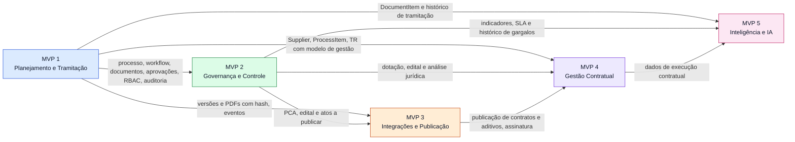
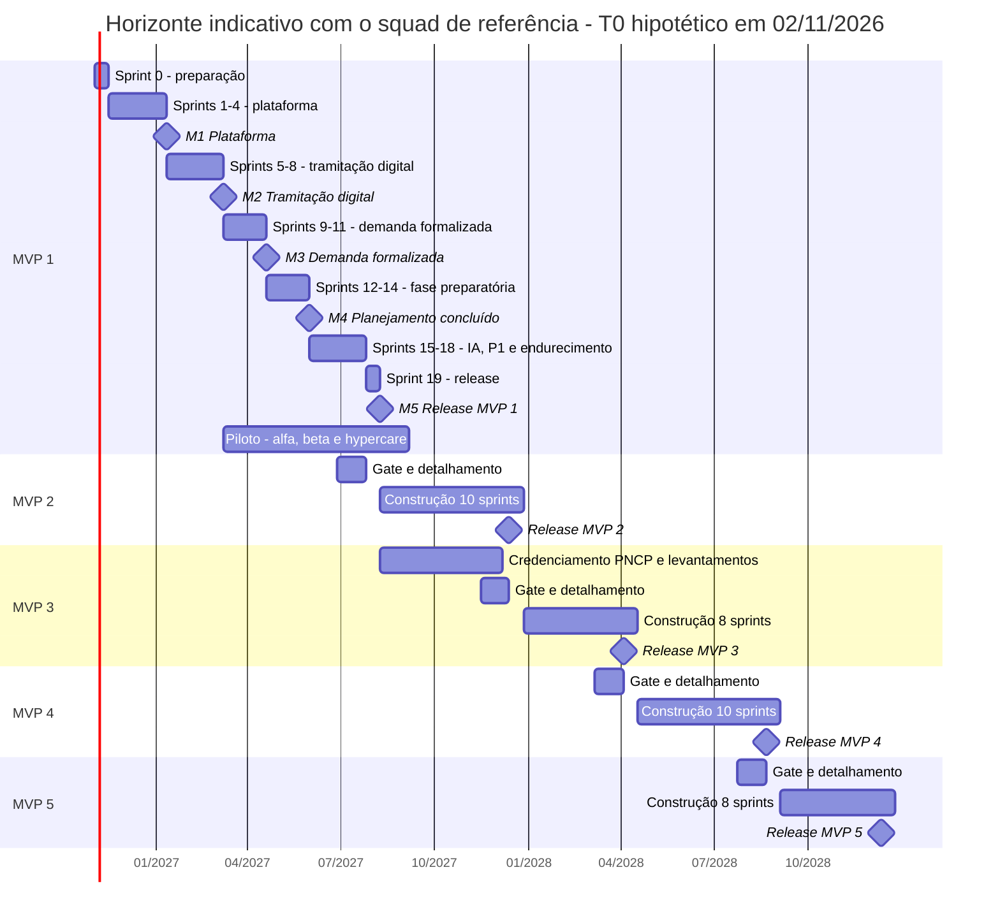
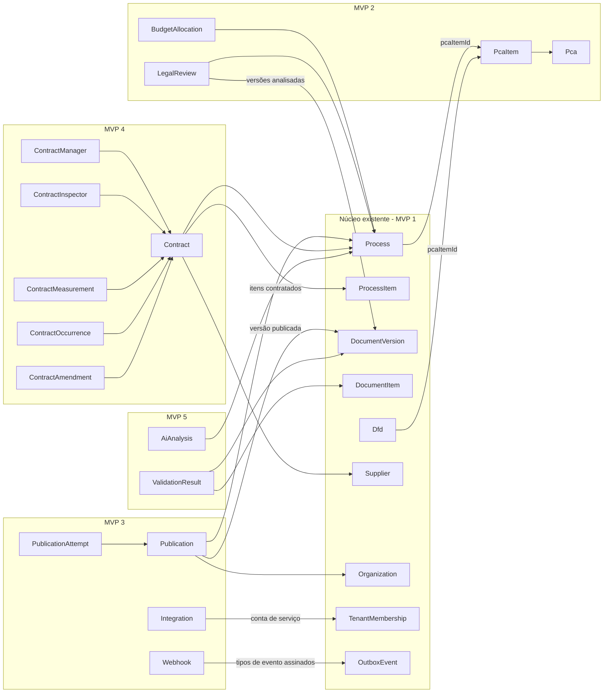

# ContrataFlow — Roadmap dos 5 MVPs

> **Status:** v1.0 · MVP 1 em especificação detalhada ([`mvp-01/`](../mvp-01/overview.md)); MVPs 2 a 5 em **nível de visão**.
> **Precedência:** o [registro de decisões](../architecture/decisions.md) prevalece. Entidades futuras citadas aqui são **nomes propostos** até serem registradas em `decisions.md` no detalhamento de cada MVP — exceto `Pca` e `PcaItem`, já fixados pela DEC-029.
> **Documentos irmãos:** [visão do produto](product-overview.md) · [personas](personas.md) · [terminologia](terminology.md).

**Sumário:** [1. Visão geral](#1-visão-geral) · [2. Governança do roadmap](#2-governança-do-roadmap-um-mvp-detalhado-por-vez) · [3. MVP 1](#3-mvp-1--planejamento-e-tramitação) · [4. MVP 2](#4-mvp-2--governança-e-controle) · [5. MVP 3](#5-mvp-3--integrações-e-publicação) · [6. MVP 4](#6-mvp-4--gestão-contratual) · [7. MVP 5](#7-mvp-5--inteligência-e-ia) · [8. Mapeamento das 41 telas](#8-mapeamento-das-41-telas) · [9. Horizonte e marcos](#9-horizonte-indicativo-e-marcos) · [10. Fora do escopo e lacunas](#10-itens-fora-do-escopo-dos-5-mvps-e-lacunas-identificadas) · [11. Evolução do modelo](#11-evolução-do-modelo-e-migrações-previstas) · [12. Riscos transversais](#12-riscos-transversais-do-roadmap) · [13. Documentos relacionados](#13-documentos-relacionados)

---

## 1. Visão geral

| MVP | Tema | Objetivo | Pergunta de valor respondida | Horizonte indicativo (squad de referência) |
|---|---|---|---|---|
| **1** | Planejamento e Tramitação | Núcleo operacional: processo, documentos de planejamento, workflow, tramitação, aprovações, prazos, auditoria e fundação multi-tenant | "Consigo planejar e aprovar uma contratação inteiramente na plataforma, sabendo sempre onde ela está?" | Sprint 0 + 17 sprints + 1 de release (≈ 38 semanas) |
| **2** | Governança e Controle | Fase preparatória completa e instrumentos de governança: PCA, dotação, jurídico, controle interno, edital, SLA, indicadores, gargalos, regras condicionais | "A fase preparatória inteira acontece na plataforma, com controle e dados para gestão?" | ≈ 10 sprints |
| **3** | Integrações e Publicação | Publicação oficial (PNCP, diário oficial, portal), assinatura eletrônica, API pública, webhooks e adapters | "O que foi decidido é publicado e assinado sem redigitação, com prova de cada envio?" | ≈ 8 sprints |
| **4** | Gestão Contratual | Contratos, fiscalização, medições, ocorrências, aditivos, reajustes, vencimentos e renovação | "Os contratos são executados e acompanhados sem surpresas?" | ≈ 10 sprints |
| **5** | Inteligência e IA | Assistente, validações, saúde do processo, recomendações, similares, benchmark, gargalos e previsão de atraso | "A plataforma me ajuda a errar menos e a antecipar problemas?" | ≈ 8 sprints |

A dependência MVP 3 → MVP 4 é **legal**, não apenas técnica: a divulgação no PNCP é condição de eficácia do contrato e de seus aditamentos (Lei 14.133/2021, art. 94).

---

## 2. Governança do roadmap: um MVP detalhado por vez

Somente o MVP 1 está especificado em detalhe. Os MVPs 2 a 5 permanecem neste nível de visão e **cada um só é detalhado depois de passar pelo gate abaixo** (ver também [`docs/README.md`](../README.md)).

| # | Verificação do gate | Evidência esperada |
|---|---|---|
| 1 | **Dependências validadas** — MVPs anteriores em produção e estáveis; dependências externas confirmadas (ex.: credenciamento no PNCP) | Métricas de produção; registro das dependências externas |
| 2 | **Entidades existentes revisadas** — o que se reutiliza, o que se estende e o que é novo, sem duplicar conceitos | Seção de modelo do overview do MVP; atualização de `architecture/domains.md` |
| 3 | **Impactos mapeados** — telas, permissões, eventos, API, relatórios, notificações e auditoria | Matriz de impacto |
| 4 | **Mudanças de arquitetura avaliadas** — novos módulos (reservados na DEC-040), filas e integrações | ADRs novos ou atualizados quando a mudança for estrutural |
| 5 | **Migrações planejadas** — esquema, dados, seeds por tenant, novas versões de workflow e templates, permissões | Plano de migração (ver §11) |
| 6 | **Decisões registradas** — novas entradas em `decisions.md` (substituindo as anteriores quando for o caso); pendências relevantes resolvidas | Entradas DEC e PEND |
| 7 | **Aprendizado incorporado** — métricas e feedback do MVP anterior revisados; prioridades ajustadas | Revisão de produto registrada |
| 8 | **Numeração contínua** — épicos, features e stories continuam a partir do último número usado (EP/FT/US globais) | Índice do backlog |

**Saídas do gate:** pasta `docs/mvp-0N/` com a mesma estrutura de `docs/mvp-01/`; épicos com IDs globais atribuídos nesse momento; este roadmap atualizado.

**Controle de mudanças:** mover escopo entre MVPs exige registro em `decisions.md` e atualização deste documento.

---

## 3. MVP 1 — Planejamento e Tramitação

### 3.1 Objetivo

Entregar o núcleo operacional: um órgão formaliza a demanda, elabora ETP, mapa de riscos, pesquisa de preços e TR, tramita e aprova tudo na plataforma — com painel situacional, prazos, notificações, auditoria e isolamento entre tenants — substituindo Word, Excel, e-mail e papel no planejamento das contratações.

### 3.2 Escopo

**Inclui**
- Processo de contratação com numeração, itens canônicos, participantes, etiquetas, visões salvas, duplicação, suspensão, retomada e cancelamento.
- Documentos estruturados (DFD, ETP, mapa de riscos, pesquisa de preços, TR), de texto livre (despacho, ofício, nota técnica) e arquivos externos; versões imutáveis com hash; PDF; anexos com verificação antivírus.
- Workflow padrão semeado "Fase preparatória — Lei 14.133/2021" (DEC-015), editor de workflow e regras básicas em JSON Logic.
- Tramitação, aprovações (política `ANY`, substituto, segregação de funções), caixa de tarefas, timeline, comentários e menções, notificações in-app e por e-mail.
- Prazos por etapa com calendário de dias úteis, prazo alvo e dashboard operacional.
- Auditoria append-only com selagem e tela de consulta.
- Identidade (Authentik, MFA), RBAC com escopo, tenants, órgãos, unidades, catálogos, numeração, calendário e configurações gerais.
- **Geração assistida por IA** de DFD, ETP, mapa de riscos e TR (rascunho completo em cadeia e ajuste por seção), com revisão humana obrigatória e governança por órgão — antecipada do MVP 5 por decisão de 2026-10-14 (EP-020, DEC-037).

**Não inclui**

| Fora do MVP 1 | Referência | Previsto para |
|---|---|---|
| Entidade PCA (há apenas referência textual no processo e no DFD) | DEC-029 | MVP 2 |
| Dotação, análise jurídica, controle interno e edital como módulos | DEC-015 | MVP 2 |
| Etapas paralelas | DEC-014 | MVP 2 |
| Múltiplos aprovadores ou aprovação sequencial | PEND-13 | MVP 2 |
| Migração de processos em andamento para nova versão de workflow | DEC-014 | MVP 2, com as regras condicionais |
| Publicação e status `PUBLISHED` alcançável | DEC-013, PEND-16 | MVP 3 |
| Assinatura eletrônica e renderização `SIGNED`; PDF/A | DEC-017, PEND-09 | MVP 3 |
| API pública, webhooks e contas de serviço | DEC-053, DEC-012 | MVP 3 |
| Login gov.br | PEND-18 | Reavaliar no MVP 3 |
| Reabertura de processo concluído ou cancelado | PEND-03 | A decidir |
| Edição colaborativa em tempo real; imagens embutidas no editor; comentários restritos por unidade | PEND-12, PEND-08, PEND-11 | A decidir |

**Contorno configurável.** Entes que precisem registrar dotação, parecer jurídico ou manifestação do controle interno já no MVP 1 podem incluir etapas `TASK` genéricas em uma nova versão do workflow, com documentos de texto livre ou arquivo externo. Essas etapas não têm os recursos dos módulos do MVP 2 (situações do parecer, diligência, prioridade) e precisam ser consideradas no plano de migração do MVP 2.

**Recomendação.** Semear um segundo workflow, "Contratação direta — art. 72", como configuração (sem código novo), dado o peso provável das contratações diretas no volume de processos de municípios pequenos — hipótese a confirmar com os design partners (lacuna L-02, §10).

### 3.3 Épicos

| ID | Épico | Escopo resumido | Módulos (DEC-040) | Telas |
|---|---|---|---|---|
| EP-001 | Processo de contratação | Criação por wizard, lista com busca e filtros, detalhe com painel situacional, itens, participantes, etiquetas, visões salvas, duplicação | `process` | SCR-004, SCR-005, SCR-006 |
| EP-002 | DFD | DFD estruturado com itens, justificativa e referência ao PCA (DEC-029) | `dfd`, `document` | SCR-007 |
| EP-003 | ETP | Seções do art. 18, § 1º; alternativas; memória de cálculo; parcelamento; conclusão de viabilidade | `etp`, `document` | SCR-008 |
| EP-004 | Pesquisa de preços | Fontes, fornecedores, cotações, estatísticas, valores atípicos, exclusões justificadas, mapa comparativo, conclusão | `price-research`, `supplier` | SCR-009, SCR-010 |
| EP-005 | Mapa de riscos | Riscos, matriz probabilidade × impacto, tratamentos, documento `RISK_MAP` | `risk`, `document` | SCR-011 |
| EP-006 | Termo de Referência | Seções do art. 6º, XXIII; importação do ETP; especificação e critérios de aceitação por item | `term`, `document` | SCR-012 |
| EP-007 | Workflow | Definição versionada, workflow padrão semeado, editor, regras básicas | `workflow` | SCR-034, SCR-035 (básica) |
| EP-008 | Tramitação (inclui aprovações) | Encaminhar, devolver, assumir, atribuir, suspender, retomar, cancelar e concluir; aprovações com resolução de aprovador, substituto e segregação | `process` (runtime), `approval` | SCR-006, SCR-014, SCR-015 |
| EP-009 | Caixa de tarefas | Consulta unificada de etapas e aprovações pendentes (DEC-026) | `inbox` | SCR-013 |
| EP-010 | Timeline | Narrativa curada do processo (DEC-025) | `timeline` | SCR-006 |
| EP-011 | Documentos | Tipos, versões, renderização em PDF, anexos | `document`, `files` | SCR-006 e editores |
| EP-012 | Comentários | Comentários e menções | `collaboration` | SCR-006 |
| EP-013 | Auditoria | Trilha append-only, selagem, consulta | `audit` | SCR-037 |
| EP-014 | Dashboard | Indicadores operacionais por perfil | `dashboard` | SCR-003 |
| EP-015 | Fundação técnica | Monorepo, CI/CD, ambientes, outbox e filas, armazenamento, PDF, observabilidade, segurança | `platform` | — |
| EP-016 | Identidade, acesso e RBAC | Login e recuperação de senha (Authentik), MFA, sessão, vínculos, perfis, permissões e escopos | `identity`, `access` | SCR-001, SCR-002, SCR-029, SCR-030, SCR-031, SCR-039 |
| EP-017 | Tenant e estrutura organizacional | Provisionamento, isolamento, órgãos, secretarias e setores, configurações, catálogos, numeração, calendário | `tenancy`, `organization`, `catalog` | SCR-032, SCR-041 |
| EP-018 | Templates de documentos | Templates versionados por tipo, seções e layout de PDF | `document` | SCR-033 |
| EP-019 | Notificações | In-app e e-mail, preferências, alertas de prazo | `notification` | SCR-036, SCR-039 |
| EP-020 | IA para documentos do planejamento | Rascunho completo em cadeia e ajuste por seção de DFD, ETP, mapa de riscos e TR; marcações e revisão humana; rastreabilidade; ativação e limites por órgão | `ai` (+ `document`, `risk`) | SCR-117 (painel nos editores), SCR-041 |

### 3.4 Telas (26)

| Grupo | Telas |
|---|---|
| Acesso | SCR-001 Login · SCR-002 Recuperar senha · SCR-039 Perfil |
| Operação | SCR-003 Dashboard · SCR-004 Processos · SCR-005 Novo Processo · SCR-006 Detalhe do Processo · SCR-013 Caixa de tarefas · SCR-014 Aprovações · SCR-015 Detalhe da aprovação · SCR-036 Notificações |
| Documentos | SCR-007 DFD · SCR-008 ETP · SCR-009 Pesquisa de preços · SCR-010 Mapa comparativo · SCR-011 Riscos · SCR-012 TR |
| Administração | SCR-029 Usuários · SCR-030 Perfis · SCR-031 Permissões · SCR-032 Secretarias · SCR-033 Templates · SCR-034 Workflow · SCR-035 Regras (versão básica, dentro do editor de workflow) · SCR-037 Auditoria · SCR-041 Configurações gerais |

### 3.5 Personas atendidas

- **Primárias:** Área requisitante (P03), Planejamento (P04), Compras (P05), Gestor de contratações (P02), Autoridade competente (P10), Administrador do órgão (P01), Consultoria externa (P15).
- **Secundárias:** Controle Interno (P09) e Auditor (P13), com leitura ampla e auditoria; Jurídico (P08), em colaboração e revisão de templates; Usuário somente leitura (P14).
- **Somente leitura:** Licitações (P06), Contabilidade (P07), Fiscal de contrato (P11) e Gestor de contrato (P12).

### 3.6 Entidades introduzidas

| Módulo | Entidades |
|---|---|
| `tenancy` | `Tenant`, `Organization`, `TenantSetting` |
| `organization` | `Department` |
| `identity` | `User`, `TenantMembership`, `MembershipDepartment` |
| `access` | `Permission`, `Role`, `RolePermission`, `RoleAssignment` |
| `catalog` | `CatalogItem`, `Holiday`, `NumberSequence` |
| `process` | `Process`, `ProcessItem`, `ProcessParticipant`, `Tag`, `ProcessTag`, `ProcessStage`, `ProcessAssignment`, `ProcessMovement`, `ProcessAccess`, `SavedView` |
| `workflow` | `Workflow`, `WorkflowVersion`, `WorkflowStage`, `WorkflowTransition`, `WorkflowRule` |
| `approval` | `Approval`, `ApprovalDocument` |
| `document` | `DocumentType`, `DocumentTemplate`, `DocumentTemplateVersion`, `Document`, `DocumentVersion`, `DocumentRendition`, `DocumentItem` |
| `dfd` | `Dfd` |
| `etp` | `Etp`, `EtpAlternative` |
| `price-research` | `PriceResearch`, `PriceItem`, `PriceSource`, `Quotation` |
| `supplier` | `Supplier` |
| `risk` | `Risk`, `RiskTreatment` |
| `term` | `TermOfReference` |
| `collaboration` | `Comment`, `Mention` |
| `files` | `Attachment` |
| `timeline` | `ProcessTimelineEntry` |
| `notification` | `Notification`, `NotificationPreference` |
| `audit` | `AuditLog`, `AuditSeal` |
| `platform` | `OutboxEvent` |

### 3.7 Integrações externas

Somente componentes de infraestrutura: Authentik (OIDC, login, recuperação de senha e MFA), envio de e-mail (SMTP/SES), armazenamento S3, Gotenberg (PDF) e ClamAV (antivírus). **Não há integração com PNCP, diários oficiais ou sistemas contábeis.** Consultas a fontes externas de preço (painéis de preços, PNCP, sítios especializados) são registradas como evidência na pesquisa (`PriceSource` com data, hora e anexo).

### 3.8 Critérios de entrada

- `decisions.md` e ADR-001 a ADR-011 aceitos; documentos de `docs/mvp-01/` (entidades, permissões, eventos, API e telas) completos para os cards P0 e P1.
- Cards P0 e P1 prontos para desenvolvimento: critérios de aceite em Gherkin, estimativa e dependências.
- Squad de referência alocado (§9.1); ambientes de desenvolvimento e homologação disponíveis.
- Cliente-piloto definido — uma prefeitura de porte médio, com termo de cooperação e patrocinador — para validação contínua a partir do marco M3, e até 3 órgãos para a produção do release ([plano de entrega, §1](../mvp-01/delivery-plan.md#1-premissas-de-planejamento)).
- Templates semeados (DFD, ETP, TR, mapa de riscos, pesquisa de preços, despacho, ofício) revisados por especialista e pela Procuradoria do piloto.
- **Ao fim da Sprint 0** (condição para iniciar a sprint 1): pendências críticas fechadas — PEND-01, PEND-04, PEND-06, PEND-10 e PEND-15 (✅ fechadas em 2026-10-07: DEC-028, DEC-020, DEC-141, DEC-061, DEC-021) —, protótipos das telas P0 validados com o piloto e spikes técnicos (RLS com Prisma, Gotenberg, Authentik) registrados em ADR; as demais pendências seguem o padrão adotado até a sprint indicada em `mvp-01/risks-and-decisions.md`.

### 3.9 Critérios de saída (Definition of Done do MVP 1)

**Funcionais**
- Jornada completa — DFD → aprovação da demanda → ETP e mapa de riscos → pesquisa de preços → TR → aprovação da autoridade → conclusão — aceita em UAT assinado pelo cliente-piloto e liberada em produção para os pilotos (até 3 órgãos), conforme o marco M5 e o [checklist de release](../mvp-01/release-checklist.md).
- 100% dos cards P0 e P1 concluídos; cards P2 remanescentes registrados e priorizados para as sprints de estabilização pós-release.
- Painel situacional respondendo às 7 perguntas (DEC-180) em todos os status do processo.
- Caixa de tarefas, notificações e aprovações plenamente utilizáveis no celular (DEC-183).

**Qualidade e segurança**
- Suíte automatizada de isolamento entre tenants (API e banco, incluindo RLS) sem falhas; pentest sem achados altos ou críticos em aberto.
- Todas as ações relevantes auditadas; selagem ativa e verificada.
- Nenhuma violação crítica ou séria de acessibilidade (axe-core) nas 26 telas e teste manual das jornadas principais com teclado e leitor de tela.
- Metas de desempenho (C2, C3 da [visão do produto](product-overview.md#122-kpis-e-metas-iniciais-propostas)) atingidas em teste de carga com o volume de referência.
- Backup e restauração testados; observabilidade com dashboards, alertas, runbooks e monitoramento da fila `dead-letter`.

**Produto e operação**
- North Star e KPIs de adoção, eficiência e qualidade instrumentados.
- Central de ajuda, trilhas de capacitação por persona e notas de versão publicadas.
- `docs/mvp-01/release-checklist.md` cumprido.

**Sucesso pós-release (hypercare de até 6 semanas):** pelo menos 5 processos reais concluídos em produção pelos pilotos, com os KPIs de adoção dentro da meta.

### 3.10 Dependências

- **De MVPs anteriores:** nenhuma.
- **Externas:** instância do Authentik com identidade visual do ContrataFlow; domínio e e-mail transacional; conta de nuvem; design partners; revisão jurídica dos templates semeados.

### 3.11 Riscos

| Risco | Mitigação |
|---|---|
| Escopo amplo (19 épicos, 26 telas, 584 pontos P0 + P1) | Entrega incremental pelos marcos M1 a M5; folga deliberada nas sprints 15 a 17; plano de contingência do [plano de entrega, §5](../mvp-01/delivery-plan.md#5-proposta-de-sequência-de-implementação) se a velocidade ficar abaixo de 38 pontos nas sprints 3 a 6 (adiar US-109 e US-074; editor de workflow e regras como edição assistida por configuração; documentos livres e externos como anexos) |
| Editor por seções e autosave mais complexos que o previsto | Spike do editor antecipado na trilha de documentos, antes do ciclo de documentos (sprint 8); pacote `packages/editor` compartilhado (DEC-051) |
| Regras de completude do ETP e do TR mal calibradas (bloqueio excessivo ou permissivo) | Calibração com o piloto; severidade `WARNING` onde houver controvérsia interpretativa |
| Baixa adoção pelo piloto | Demo ao piloto ao fim de cada sprint a partir da sprint 6; alfa no M2, beta fechado no M3 e beta ampliado no M4; métricas de adoção desde o beta |
| Desempenho da caixa de tarefas como consulta (DEC-026) | Índices adequados e medição desde cedo; modelo de leitura dedicado se necessário (débito monitorado) |
| Aceitação do registro eletrônico de aprovação sem assinatura avançada (premissa PRE-05) | Manifestação da Procuradoria do piloto; PDF `APPROVAL_STAMPED` para assinatura externa enquanto o MVP 3 não chega |

### 3.12 Plano indicativo de sprints

Resumo do [plano de entrega do MVP 1](../mvp-01/delivery-plan.md#5-proposta-de-sequência-de-implementação), que é a fonte da sequência por story e prevalece em caso de divergência: **Sprint 0 + 17 sprints de desenvolvimento + 1 sprint de release ≈ 38 semanas** com o squad de referência (§9.1), para 584 pontos P0 + P1.

| Sprints | Tema | Marco ao final | Uso do marco |
|---|---|---|---|
| 0 | Preparação: pendências críticas, contas de nuvem e repositório, protótipos das telas P0, spikes (RLS com Prisma, Gotenberg, Authentik) | — | Decisões fechadas e protótipos validados com o piloto |
| 1–4 | Fundação, base técnica e login, plataforma e estrutura organizacional, acesso e parametrização | **M1 — Plataforma** (sprint 4): login, tenant provisionado, estrutura, usuários convidados, perfis e auditoria com isolamento verificado | Demo interna; validação de segurança arquitetural |
| 5–8 | Administração e base de workflow; criação de processos; painel situacional e tramitação; devolução, atribuição, prazos e ciclo de documentos | **M2 — Tramitação digital** (sprint 8): processo criado, encaminhado, devolvido e atribuído, com prazos, timeline e caixa de unidade | Alfa com o piloto (dados sintéticos) |
| 9–11 | Aprovações por etapa e anexos; PDF e DFD em wizard; DFD fim a fim e colaboração | **M3 — Demanda formalizada** (sprint 11): DFD fim a fim com aprovação e PDF; comentários; auditoria consultável | Beta fechado com 1 secretaria do piloto |
| 12–14 | ETP, pesquisa de preços e riscos; TR e indicadores | **M4 — Planejamento da contratação concluído** (sprint 14): ETP, pesquisa, riscos, TR e aprovação da autoridade até `COMPLETED`; dashboard | Beta ampliado no piloto |
| 15–17 | Itens P1 (suspensão, participantes, duplicação, valores atípicos, mapa de riscos, MFA, editor de workflow e regras, documentos livres e externos, menções) e endurecimento (selagem da auditoria, carga, pentest) | — | Folga deliberada para riscos do caminho crítico |
| 18 | Release: UAT com o piloto, carga inicial de estrutura e usuários, capacitação, go-live | **M5 — Release do MVP 1** (sprint 18): todos os P0 e P1; checklist de release completo | Produção para os pilotos (até 3 órgãos) |

### 3.13 Preparação para os MVPs seguintes

Decisões já tomadas que evitam retrabalho:

| Decisão no MVP 1 | Benefício | MVP |
|---|---|---|
| `PUBLISHED` já existe em `ProcessStatus` (DEC-013) | Publicação sem migração de enum | 3 |
| `SERVICE` reservado em `MembershipType` (DEC-012) | Contas de serviço da API pública | 3 |
| `SIGNED` reservado em `RenditionKind` (DEC-017) | Assinatura eletrônica | 3 |
| Rotas reservadas `/legal-reviews`, `/publications`, `/contracts`, `/integrations`, `/pca`, `/webhooks` (DEC-100) | Contrato de API previsível | 2–4 |
| Módulos reservados `pca`, `budget`, `legal-review`, `internal-control`, `tender`, `sla`, `analytics`, `rules`, `publication`, `signature`, `integration`, `public-api`, `webhook`, `contract`, `ai` (DEC-040) | Fronteiras definidas | 2–5 |
| Referência textual ao PCA em `Process` e `Dfd` (DEC-029) | Migração para `pcaItemId` | 2 |
| `Organization` com CNPJ (DEC-011) e metadados PNCP nos catálogos (DEC-027) | Publicação no PNCP | 3 |
| `DocumentItem` por documento (DEC-019) | Validações cruzadas | 5 |
| `Supplier` em módulo compartilhado (DEC-040) | Fornecedor do contrato | 4 |
| Envelope de evento com `eventVersion`, outbox e ator `INTEGRATION` (DEC-160, DEC-161) | Webhooks e consumidores externos | 3 |
| `RuleContext` versionado (DEC-016) | Novos dados nas regras sem quebrar as existentes | 2 |
| `pgvector` disponível no banco (DEC-050) | Busca semântica | 5 |

Verificações recomendadas no detalhamento do MVP 1 (para evitar migrações caras):
- Modelar como **campos tipados**, e não apenas texto, os dados que o MVP 5 vai comparar entre documentos — por exemplo, prazo de garantia do objeto, prazos de vigência e de entrega, local de entrega — no cabeçalho de `Etp` e `TermOfReference` ou em `DocumentItem` (DEC-017: o cabeçalho tipado guarda o que o sistema precisa validar).
- Garantir que `ProcessItem` registre a natureza (`ItemKind`) e aceite código CATMAT/CATSER — base para o alerta de fracionamento (art. 75, § 1º) e para o benchmark.
- Registrar na tramitação e na auditoria a ciência de avisos `WARNING` superados (lacuna L-08).

---

## 4. MVP 2 — Governança e Controle

### 4.1 Objetivo

Completar a fase preparatória na plataforma e dar à alta administração os instrumentos de governança exigidos pela lei (art. 11, parágrafo único): plano anual, dotação, controle prévio de legalidade, controle interno, edital, prazos gerenciados e dados para identificar gargalos.

### 4.2 Escopo e épicos

Épicos sem ID; a numeração global será atribuída no detalhamento.

| Épico | Escopo | Módulo reservado (DEC-040) |
|---|---|---|
| PCA | Plano por exercício com itens (exercício, secretaria, objeto, categoria, valor previsto, mês previsto, responsável, status); aprovação; vínculo entre DFD e item do plano; acompanhamento da execução; exportação para divulgação até o MVP 3 | `pca` |
| Dotação orçamentária | Indicação da classificação orçamentária, fonte de recursos, valor reservado e evidência; verificação de compatibilidade com o valor estimado; regra de saída de etapa | `budget` |
| Jurídico | Fila priorizada por critérios objetivos; análise com as situações aguardando, em análise, diligência, favorável, favorável com ressalvas e desfavorável; parecer vinculado às versões analisadas; devolução por diligência; hipóteses de dispensa de análise (art. 53, § 5º) | `legal-review` |
| Controle Interno | Etapa de manifestação com checklist configurável, achados e recomendações; visão de riscos | `internal-control` |
| Edital | Minuta de edital e de contrato a partir de template, importando itens, lotes, critérios e condições do TR; matriz de alocação de riscos quando aplicável (art. 22) | `tender` |
| SLA | Políticas de prazo por tipo de contratação, modalidade ou valor; pausas (ex.: diligência); escalonamento; cumprimento por etapa e unidade. Evolui o prazo por etapa do MVP 1 (DEC-031), que continua sendo a base | `sla` |
| Indicadores | Relatórios (SCR-027) e relatório detalhado (SCR-028): tempo de ciclo, devoluções, cumprimento de prazo, volume e valor por secretaria e modalidade, execução do PCA; exportação | `analytics` |
| Gargalos | Análise descritiva do tempo por etapa, unidade e responsável; filas e envelhecimento; comparação entre períodos | `analytics` |
| Regras condicionais | Biblioteca completa de regras reutilizáveis (SCR-035): regras que alteram o roteamento (ex.: "valor acima de X exige Controle Interno"), alçadas por valor, aplicabilidade, simulador e testes. Evolui as regras `CONDITION` do MVP 1 (DEC-016) | `rules` |

**Capacidades habilitadoras** (decididas no gate, com ADR): etapas paralelas (DEC-014, "MVP 2+"); múltiplos aprovadores e aprovação sequencial (PEND-13); migração de processos em andamento para nova versão de workflow (postergada na DEC-014); `RuleContext` v2.

### 4.3 Telas

SCR-018 PCA · SCR-019 Jurídico · SCR-020 Controle Interno · SCR-021 Edital · SCR-027 Relatórios · SCR-028 Relatório detalhado · SCR-035 Regras (biblioteca completa). A dotação não tem tela dedicada entre as 41: ocorre como etapa no Detalhe do Processo (SCR-006) e na Caixa de tarefas (SCR-013).

### 4.4 Personas atendidas

Planejamento (PCA), Contabilidade (dotação), Jurídico, Controle Interno, Licitações (edital), Gestor de contratações (SLA, indicadores e gargalos), Autoridade competente (aprovação do PCA e do edital), Administrador do órgão (regras) e Auditor (relatórios).

### 4.5 Entidades introduzidas

- `Pca` e `PcaItem` (fixados pela DEC-029).
- `BudgetAllocation` e `LegalReview` (nomes indicados pelo cliente; confirmar no gate).
- A definir no gate: manifestação do Controle Interno, cabeçalho tipado do edital (módulo `tender`), políticas de SLA, biblioteca de regras e modelos de leitura analíticos.

### 4.6 Integrações externas

Nenhuma obrigatória. Importação do PCA por planilha. Consulta a sistemas contábeis fica para os adapters do MVP 3. A divulgação do PCA em sítio oficial (art. 12, § 1º) é feita por exportação até a publicação automatizada do MVP 3.

### 4.7 Critérios de entrada

- Aprendizado do MVP 1 incorporado: uso pelo piloto desde o beta (marcos M3 e M4) e primeiras semanas de produção, com métricas coletadas.
- Gate (§2) concluído, com ADRs para etapas paralelas (impacto em `currentStageId`, caixa de tarefas e painel situacional), múltiplos aprovadores (PEND-13) e migração de processos entre versões de workflow.
- Definições com o piloto: modelo de parecer, critérios de prioridade (art. 53, § 1º, I), hipóteses de dispensa de análise (art. 53, § 5º), checklist do Controle Interno, estrutura e calendário do PCA, classificação orçamentária.
- Decisão sobre a posição do edital e a ordem entre Jurídico e Controle Interno na nova versão do workflow padrão (lacuna L-04).

### 4.8 Critérios de saída

- Nova versão do workflow padrão publicada com dotação, edital (quando licitação), jurídico e controle interno; processos em andamento preservados na versão anterior.
- PCA do exercício elaborado, aprovado e vinculado aos DFDs por pelo menos um órgão; migração das referências textuais executada, com relatório de reconciliação.
- Análise jurídica com diligência executada de ponta a ponta, com parecer vinculado às versões analisadas.
- Relatórios e indicadores com dados reais e exportação; análise de gargalos disponível ao gestor.
- Biblioteca de regras com simulador; alçadas por valor operando no piloto.
- Regressão completa do MVP 1 sem falhas; KPIs E3 e Q1 medidos contra as metas do MVP 2.

### 4.9 Dependências do MVP 1

Workflow versionado e regras (EP-007); tramitação e aprovações (EP-008); documentos e templates (EP-011, EP-018); referência ao PCA no DFD (DEC-029); auditoria (EP-013); dashboard (EP-014) como base dos indicadores.

### 4.10 Riscos

| Risco | Mitigação |
|---|---|
| Práticas muito diferentes entre Procuradorias | Configuração de situações, prioridades e modelos; validação com o piloto |
| Referências textuais ao PCA não resolvidas na migração | Relatório de reconciliação e conciliação manual assistida |
| Etapas paralelas aumentam a complexidade do motor e da experiência | Decidir por ADR; manter sequencial se o ganho não compensar |
| Relatórios pesados sobre o banco transacional | Modelos de leitura e visões materializadas; réplica de leitura |
| Regras condicionais complexas demais para administradores | Modelos prontos, simulador, testes de regra e revisão por especialista |
| Tenants que customizaram o workflow padrão | Nova versão oferecida para adoção, nunca imposta |

---

## 5. MVP 3 — Integrações e Publicação

### 5.1 Objetivo

Levar à divulgação oficial e à assinatura o que foi decidido na plataforma, sem redigitação, e abrir o ContrataFlow a integrações seguras — sempre com retentativas, idempotência e prova de cada envio.

### 5.2 Escopo e épicos

| Épico | Escopo | Módulo reservado (DEC-040) |
|---|---|---|
| Publicações | Núcleo de publicação por ato e canal, vinculado às versões publicadas; interface `PublicationProvider` com `PNCPProvider`, `DiarioOficialProvider` e `PortalMunicipalProvider`; tentativas, reconciliação e reprocessamento; processo passa a alcançar `PUBLISHED` | `publication` |
| PNCP | Publicação do PCA, de avisos e editais e dos atos de contratação direta (contratos e aditivos quando o MVP 4 existir); identificação do órgão pelo CNPJ da `Organization` e códigos PNCP dos catálogos (DEC-027) | `publication`, `integration` |
| Diário Oficial | Extratos para diários oficiais (municipal, estadual ou de associações de municípios); modo assistido para diários sem API (gera o arquivo e registra o comprovante) | `publication` |
| Assinatura eletrônica | Assinatura de documentos e atos; renderização `SIGNED`; verificação; decisão sobre PDF/A (PEND-09) | `signature` |
| API pública | Exposição controlada da API (DEC-053), autenticação de clientes, contas de serviço (`SERVICE`), escopos, limites de taxa, documentação OpenAPI | `public-api` |
| Webhooks | Assinatura de eventos de domínio por clientes, entrega assinada, retentativas e DLQ, painel de entregas | `webhook` |
| Adapters de integração | Padrão comum para integrações (sistemas contábeis, protocolo): retentativas com backoff, idempotência, observabilidade e segredos criptografados (DEC-086) | `integration` |

### 5.3 Telas

SCR-016 Publicações · SCR-017 Nova publicação · SCR-038 Integrações.

### 5.4 Personas atendidas

Licitações (publicações), Administrador do órgão (integrações, contas de serviço, webhooks), Autoridade competente e Jurídico (assinatura), Gestor de contratações (acompanhamento), Contabilidade (integração contábil) e Auditor (evidências de publicação).

### 5.5 Entidades introduzidas

- `Publication`, `PublicationAttempt`, `Integration` e `Webhook` (nomes indicados pelo cliente; confirmar no gate).
- Ativação de capacidades já previstas: status `PUBLISHED` (DEC-013), renderização `SIGNED` (DEC-017), vínculos `SERVICE` (DEC-012) e ator `INTEGRATION` nos eventos (DEC-160).

### 5.6 Integrações externas

PNCP; diários oficiais; portais municipais; provedores de assinatura eletrônica (níveis definidos pela Lei 14.063/2020; ICP-Brasil quando exigido); sistemas contábeis e de protocolo via adapters; login gov.br (PEND-18), a reavaliar.

### 5.7 Critérios de entrada

- Credenciamento do ContrataFlow como sistema integrado ao PNCP **iniciado durante o MVP 2** (prazo externo) e ambiente de testes disponível.
- Canais de diário oficial dos pilotos levantados (formato, API ou envio manual).
- ADRs: provedor de assinatura e níveis aceitos; autenticação de clientes da API pública, escopos e limites; política de webhooks (assinatura do payload, retentativas, desativação).
- PEND-09 e PEND-16 decididas; PEND-18 reavaliada.
- Catálogo de eventos publicáveis definido, com `eventVersion` como contrato.

### 5.8 Critérios de saída

- Publicação no PNCP dos atos no escopo com confirmação, reconciliação e reprocessamento; processos alcançam `PUBLISHED`.
- Pelo menos um `DiarioOficialProvider` automatizado e modo assistido para os demais; `PortalMunicipalProvider` operacional no piloto.
- Assinatura eletrônica com renderização `SIGNED` e verificação.
- API pública v1 documentada, com contas `SERVICE`, escopos e limites de taxa; webhooks assinados com retentativas, DLQ e painel de entregas.
- Nenhuma publicação duplicada em testes de falha (idempotência ponta a ponta); KPIs C1 (≥ 99,9%) e C9 atendidos.

### 5.9 Dependências

- **MVP 1:** `DocumentVersion` e `DocumentRendition` com hash; outbox e eventos; `Organization` com CNPJ; catálogos com metadados PNCP.
- **MVP 2:** `Pca` (publicação do PCA), edital (aviso e edital), workflow com as etapas finais da fase preparatória.

### 5.10 Riscos

| Risco | Mitigação |
|---|---|
| Prazo de credenciamento e mudanças na API do PNCP | Iniciar cedo; adapter isolado; testes de contrato; monitoramento; modo assistido |
| Diários oficiais heterogêneos, muitos sem API | Modo assistido como padrão; automação priorizada pelos diários dos clientes |
| Custo e aceitação jurídica da assinatura | Validar níveis com Procuradorias; custo por assinatura refletido no modelo comercial (PEND-17) |
| Superfície de ataque da API pública | Autenticação de máquinas via provedor de identidade (a decidir em ADR), escopos mínimos, limites de taxa, WAF, rotação de credenciais, auditoria com ator `INTEGRATION` |
| Publicações duplicadas ou perdidas | Idempotência por publicação, reconciliação periódica e alertas |

---

## 6. MVP 4 — Gestão Contratual

### 6.1 Objetivo

Acompanhar a execução dos contratos originados nos processos — fiscalização, medições, ocorrências, aditivos, reajustes, vencimentos e renovação — com alertas que evitam contratações emergenciais por vencimento e com a publicação dos atos no prazo legal (art. 94).

### 6.2 Escopo e épicos

| Épico | Escopo |
|---|---|
| Contratos | Cadastro a partir do processo: número, processo, fornecedor, objeto, valor, início, fim, fiscal, gestor e status (rascunho, vigente, suspenso, encerrado, rescindido); itens a partir de `ProcessItem`; fornecedor a partir de `Supplier`; carteira de contratos |
| Fiscalização | Designação de fiscais e substitutos (art. 117); checklists e rotinas de fiscalização; comunicação aos superiores (art. 117, § 2º) |
| Medições | Medições por período, atesto e vínculo com a liquidação |
| Ocorrências | Registro com evidências (art. 117, § 1º), providências e prazos |
| Aditivos | Termos aditivos e apostilamentos com tramitação, análise jurídica (art. 53, § 4º) e publicação (art. 94) |
| Reajustes | Índices parametrizáveis, cálculo e registro por apostila (art. 136) |
| Vencimentos | Alertas em 180, 120, 90, 60 e 30 dias |
| Renovação | Prorrogação (arts. 106 e 107) ou nova contratação a partir da duplicação do processo (DEC-033) |

Todos no módulo reservado `contract` (DEC-040).

### 6.3 Telas

SCR-022 Contratos · SCR-023 Detalhe do contrato · SCR-024 Fiscalização · SCR-025 Medições · SCR-026 Aditivos.

### 6.4 Personas atendidas

Gestor de contrato e Fiscal de contrato (perfis com permissões ampliadas — DEC-035), Contabilidade (medições e empenhos), Jurídico (aditivos), Autoridade competente (aditivos e prorrogações), Área requisitante (acompanhamento), Controle Interno e Auditor.

### 6.5 Entidades introduzidas

- `Contract`, `ContractManager`, `ContractInspector`, `ContractMeasurement`, `ContractOccurrence` e `ContractAmendment` (nomes indicados pelo cliente; confirmar no gate).
- Reutilização de `Supplier` e `ProcessItem` (DEC-019, DEC-040).

### 6.6 Integrações externas

PNCP (contratos e aditivos, via infraestrutura do MVP 3); sistema contábil (empenho e liquidação, via adapters); fontes oficiais de índices de preços para reajuste.

### 6.7 Critérios de entrada

- Decisão sobre o registro do resultado da seleção — adjudicação, homologação, vencedores por item ou lote e preços finais (lacuna L-01).
- Decisão sobre aditivos: sub-fluxo do contrato ou novo processo vinculado.
- Estratégia de uso móvel do fiscal com conectividade instável.
- Índices de reajuste e origem dos valores definidos (cadastro manual ou integração).
- Plano de carga inicial dos contratos vigentes.
- Permissões ampliadas de `FISCAL_CONTRATO` e `GESTOR_CONTRATO` especificadas.

### 6.8 Critérios de saída

- Contratos gerados a partir do processo, reaproveitando `Supplier` e `ProcessItem`, sem redigitação.
- Gestor, fiscais e substitutos designados; ocorrências e medições registradas em campo pelo celular.
- Aditivos com tramitação, parecer (art. 53, § 4º) e publicação no PNCP no prazo (art. 94).
- Alertas de vencimento (180/120/90/60/30 dias) operando, com fluxo de renovação ou nova contratação.
- Carga dos contratos vigentes do piloto concluída.

### 6.9 Dependências

- **MVP 1:** `Supplier`, `ProcessItem`, TR (modelo de gestão e de fiscalização), job `deadlines`, notificações.
- **MVP 2:** dotação, edital e análise jurídica.
- **MVP 3:** publicação no PNCP, assinatura eletrônica e integração contábil.

### 6.10 Riscos

| Risco | Mitigação |
|---|---|
| Sem registro do resultado da seleção, o contrato depende de redigitação | Resolver L-01 antes do gate |
| Uso em campo com conectividade instável | Estratégia móvel decidida no gate (formulários leves, envio adiado com conferência) |
| Volume e qualidade dos contratos legados | Importação assistida com validação e auditoria |
| Índices e regras de reajuste variam por contrato | Parametrização por contrato; cálculo auditável |
| Responsabilização de fiscais | Registros formais, imutáveis e datados; designação explícita com substituto |

---

## 7. MVP 5 — Inteligência e IA

### 7.1 Objetivo

Usar os dados estruturados acumulados nos MVPs anteriores para reduzir erros, antecipar atrasos e acelerar a elaboração — com a IA sempre como assistente e a decisão sempre humana (princípio 16).

### 7.2 Escopo e épicos

| Épico | Escopo |
|---|---|
| Assistente contextual | Perguntas sobre o processo aberto e explicação da lei com fontes (SCR-040); respeita permissões e sigilo. A geração de rascunhos e o ajuste de seções de DFD, ETP, mapa de riscos e TR já estão no MVP 1 (EP-020, DEC-037) |
| Validação automática | Validações cruzadas **determinísticas** sobre `DocumentItem` e campos tipados — ex.: ETP com 150 unidades e TR com 140 → "Quantidade divergente entre ETP e TR"; garantia do objeto de 36 meses no ETP e de 12 meses no TR → "Garantia divergente" — e verificações assistidas por IA, sempre como alerta |
| Saúde do processo | Indicador explicável a partir de prazo, completude, devoluções e riscos |
| Recomendações | Próximas ações, fontes de preço e cláusulas a revisar |
| Busca de contratações similares | Busca semântica (pgvector — DEC-057) no próprio tenant e em dados públicos |
| Benchmark de preços | Comparação com preços públicos (dados abertos do PNCP e painéis públicos) |
| Detecção de gargalos | Detecção automática de anomalias e causas prováveis — evolução da análise descritiva do MVP 2 |
| Previsão de atraso | Probabilidade de atraso por processo, com fatores explicativos |

Módulo `ai`, camada `AiProvider` e fila `ai-generation` já existem desde o MVP 1 (DEC-079); este MVP acrescenta a fila de eventos `ai` (DEC-161) e as entidades de análise.

### 7.3 Telas

SCR-040 Assistente IA. As demais capacidades aparecem embutidas no Detalhe do Processo (SCR-006), nos editores de documentos e no Dashboard (SCR-003).

### 7.4 Personas atendidas

Planejamento e Compras (validações, similares, benchmark), Gestor de contratações (saúde, gargalos, previsão), Controle Interno (alertas de risco), Área requisitante (assistente de redação) e demais personas pelo assistente.

### 7.5 Entidades introduzidas

`AiAnalysis` (citada pelo cliente como "AIAnalysis"; normalizada conforme a convenção de siglas da DEC-001, como em `Pca` e `AiProvider`) e `ValidationResult` — nomes a confirmar no gate.

### 7.6 Integrações externas

Provedores de modelos via `AiProvider` (OpenAI, Anthropic, Azure OpenAI — DEC-050); dados abertos do PNCP para similares e benchmark.

### 7.7 Salvaguardas obrigatórias

1. A IA **nunca** executa tramitação, aprovação, publicação ou assinatura.
2. O contexto enviado ao modelo passa pelas mesmas políticas de autorização e serialização da API: RBAC, custódia, orçamento sigiloso (DEC-030) e minimização de dados pessoais (DEC-140).
3. **Isolamento:** dados de um tenant nunca são usados para responder a outro; similaridade e benchmark entre entes somente com dados públicos ou agregados anonimizados com base contratual expressa.
4. **Transparência:** conteúdo sugerido identificado como tal, fontes citadas, registro em `AiAnalysis` e na auditoria.
5. Adesão por tenant via feature flag (DEC-059); provedores sem retenção nem treinamento com dados do cliente; avaliação de impacto à proteção de dados antes do lançamento.
6. Qualidade medida por funcionalidade (conjuntos de avaliação; taxa de sugestões aceitas e rejeitadas).
7. Validações determinísticas podem ser bloqueantes se o tenant configurar; achados probabilísticos da IA são sempre alertas.

### 7.8 Critérios de entrada e de saída

**Entrada**
- ADR de IA (provedores, dados permitidos, retenção, custos, avaliação) e relatório de impacto à proteção de dados.
- Base histórica suficiente para previsão (sugestão: 6 a 12 meses de processos em produção em vários tenants).
- Campos tipados necessários às validações cruzadas disponíveis (§3.13).
- Fontes públicas para similares e benchmark definidas.

**Saída**
- Assistente contextual respeitando permissões e sigilo, com fontes citadas.
- Validações cruzadas executadas antes das etapas de aprovação; KPI Q6 ≥ 90%.
- Saúde do processo e previsão de atraso explicáveis, com acurácia medida e acompanhada.
- Similares e benchmark baseados apenas em dados do próprio tenant e em dados públicos.
- Custo de inferência dentro do orçamento definido por tenant.

### 7.9 Dependências

- **MVP 1:** `DocumentItem`, campos tipados, histórico de tramitação, `pgvector`.
- **MVP 2:** indicadores, SLA e histórico de gargalos.
- **MVP 3:** dados públicos e integrações.
- **MVP 4:** dados de execução contratual.

### 7.10 Riscos

| Risco | Mitigação |
|---|---|
| Respostas incorretas ("alucinação") | Fontes citadas, rótulo de sugestão, decisão humana, avaliação contínua |
| Exposição de dados sigilosos ou pessoais | Contexto filtrado pela política de serialização; minimização; auditoria |
| Quebra de isolamento entre tenants | Índices vetoriais por tenant; benchmark só com dados públicos |
| Custo de inferência | Cotas por tenant, cache, modelos adequados a cada tarefa |
| Previsões enviesadas ou opacas | Variáveis explicáveis; acurácia publicada internamente; revisão periódica |
| Dependência de um único provedor | `AiProvider` com múltiplos provedores (DEC-050) |
| Expectativa excessiva dos clientes | Comunicação clara do papel assistivo; lançamento gradual |

---

## 8. Mapeamento das 41 telas

O identificador `SCR-NNN` corresponde ao número da tela na lista do cliente (convenção de `docs/README.md`). Épicos dos MVPs 2 a 5 aparecem pelo nome, sem ID.

| Nº | ID | Tela | MVP | Épico(s) | Personas principais | Observações |
|---|---|---|---|---|---|---|
| 1 | SCR-001 | Login | 1 | EP-016 | Todas | Fluxo do Authentik com identidade visual do ContrataFlow (DEC-130); MFA (DEC-133) |
| 2 | SCR-002 | Recuperar senha | 1 | EP-016 | Todas | Fluxo do Authentik (DEC-130) |
| 3 | SCR-003 | Dashboard | 1 | EP-014 | Gestor, Autoridade, Controle Interno; blocos por perfil | Ampliado com indicadores no MVP 2 e saúde do processo no MVP 5 |
| 4 | SCR-004 | Processos | 1 | EP-001 | Todas | Busca textual, filtros e visões salvas (`SavedView`) |
| 5 | SCR-005 | Novo Processo | 1 | EP-001 | Requisitante, Gestor | Wizard (DEC-181) |
| 6 | SCR-006 | Detalhe do Processo | 1 | EP-001, EP-008, EP-010, EP-011, EP-012 | Todas | Painel situacional (DEC-180); documentos, itens, tramitações, timeline, comentários, anexos e participantes |
| 7 | SCR-007 | DFD | 1 | EP-002 | Requisitante | Wizard (DEC-181) |
| 8 | SCR-008 | ETP | 1 | EP-003 | Planejamento, Requisitante, Consultoria | Editor por seções com completude |
| 9 | SCR-009 | Pesquisa de preços | 1 | EP-004 | Compras | Inclui cadastro rápido de fornecedor (não há tela própria de fornecedores — L-18) |
| 10 | SCR-010 | Mapa comparativo | 1 | EP-004 | Compras, Autoridade, Controle Interno | Quadro item × fonte; exportação em PDF |
| 11 | SCR-011 | Riscos | 1 | EP-005 | Planejamento | Matriz probabilidade × impacto e tratamentos |
| 12 | SCR-012 | TR | 1 | EP-006 | Planejamento, Requisitante | Importação do ETP |
| 13 | SCR-013 | Caixa de tarefas | 1 | EP-009 | Personas operacionais | Consulta (DEC-026); plena no celular |
| 14 | SCR-014 | Aprovações | 1 | EP-008 | Autoridade, titulares de unidade | Plena no celular |
| 15 | SCR-015 | Detalhe da aprovação | 1 | EP-008 | Autoridade | Versões exatas cobertas (`ApprovalDocument`) |
| 16 | SCR-016 | Publicações | 3 | Publicações | Licitações, Gestor, Auditor | Situação por canal e tentativas |
| 17 | SCR-017 | Nova publicação | 3 | Publicações, PNCP, Diário Oficial | Licitações | Seleção de ato, versões e canais |
| 18 | SCR-018 | PCA | 2 | PCA | Planejamento, Autoridade, Contabilidade | Vínculo com DFDs |
| 19 | SCR-019 | Jurídico | 2 | Jurídico | Jurídico | Fila priorizada e parecer |
| 20 | SCR-020 | Controle Interno | 2 | Controle Interno | Controle Interno | Manifestação e checklist |
| 21 | SCR-021 | Edital | 2 | Edital | Licitações | Minuta a partir do TR |
| 22 | SCR-022 | Contratos | 4 | Contratos | Gestor de contrato, Fiscal | Carteira |
| 23 | SCR-023 | Detalhe do contrato | 4 | Contratos, Vencimentos, Reajustes, Renovação | Gestor de contrato | Linha do tempo do contrato |
| 24 | SCR-024 | Fiscalização | 4 | Fiscalização, Ocorrências | Fiscal | Prioridade para o celular |
| 25 | SCR-025 | Medições | 4 | Medições | Fiscal, Gestor de contrato, Contabilidade | Atesto |
| 26 | SCR-026 | Aditivos | 4 | Aditivos, Reajustes | Gestor de contrato, Jurídico, Autoridade | Tramitação e publicação |
| 27 | SCR-027 | Relatórios | 2 | Indicadores | Gestor, Controle Interno, Auditor | Exportação |
| 28 | SCR-028 | Relatório detalhado | 2 | Indicadores, Gargalos | Gestor, Controle Interno, Auditor | Detalhamento por etapa, unidade e responsável |
| 29 | SCR-029 | Usuários | 1 | EP-016 | Administrador | Vínculos, lotações e convites |
| 30 | SCR-030 | Perfis | 1 | EP-016 | Administrador | Perfis padrão editáveis, exceto `ADMIN_ORGAO` |
| 31 | SCR-031 | Permissões | 1 | EP-016 | Administrador, Controle Interno (consulta) | Matriz perfil × permissão |
| 32 | SCR-032 | Secretarias | 1 | EP-017 | Administrador | Árvore de `Department`; rótulo configurável (`labels.secretariat`) |
| 33 | SCR-033 | Templates | 1 | EP-018, EP-011 | Administrador, Jurídico (revisão) | Versões de template e tipos de documento |
| 34 | SCR-034 | Workflow | 1 | EP-007 | Administrador, Gestor | Versões; publicada é imutável |
| 35 | SCR-035 | Regras | 1 (básica) · 2 (completa) | EP-007 · Regras condicionais | Administrador | No MVP 1, dentro do editor de workflow; no MVP 2, biblioteca completa |
| 36 | SCR-036 | Notificações | 1 | EP-019 | Todas | Central de notificações e preferências |
| 37 | SCR-037 | Auditoria | 1 | EP-013 | Administrador, Controle Interno, Auditor | Exige `AUDIT_VIEW` |
| 38 | SCR-038 | Integrações | 3 | Adapters de integração, API pública, Webhooks | Administrador | Credenciais, contas de serviço, webhooks |
| 39 | SCR-039 | Perfil | 1 | EP-016, EP-019 | Todas | Dados pessoais, MFA, preferências, vínculos com tenants |
| 40 | SCR-040 | Assistente IA | 5 | Assistente contextual | Todas (adesão por tenant) | Salvaguardas do §7.7 |
| 41 | SCR-041 | Configurações gerais | 1 | EP-017 | Administrador | Órgãos, numeração, calendário, catálogos, parâmetros de pesquisa, segurança, rótulos, feature flags |

**Totais:** MVP 1 = 26 telas (SCR-035 em versão básica) · MVP 2 = 6 telas novas + SCR-035 completa · MVP 3 = 3 · MVP 4 = 5 · MVP 5 = 1.

---

## 9. Horizonte indicativo e marcos

### 9.1 Premissa de time (squad de referência)

Mesmo squad do [plano de entrega do MVP 1](../mvp-01/delivery-plan.md#1-premissas-de-planejamento), adotado como referência para todo o roadmap:

| Papel | Quantidade |
|---|---|
| Desenvolvedores — 3 back-end/full-stack, 2 front-end, 1 plataforma/DevOps | 6 |
| QA / SDET (automação, acessibilidade e desempenho) | 1 |
| Designer de produto (UX/UI) | 1 |
| Product Owner | 1 |
| Tech Lead (cerca de 50% programando) | 1 |

**Apoio recomendado, fora da capacidade de desenvolvimento:** especialista em contratações públicas em meio período, para templates, regras semeadas e validação com Procuradorias (curadoria normativa — [visão do produto, §4.5](product-overview.md#45-curadoria-normativa-proposta-de-processo-de-produto)).

**Demais premissas:** sprints de 2 semanas; velocidade de 25 a 30 pontos nas sprints 1 e 2 e de 40 a 45 pontos a partir da sprint 3; Sprint 0 de 2 semanas; nenhuma integração governamental no MVP 1; recesso de fim de ano **não** incluído (acrescentar cerca de 2 semanas se a equipe parar).

### 9.2 Plano indicativo

| MVP | Sprints | Semanas | Marco de saída (relativo a T0) |
|---|---|---|---|
| 1 | Sprint 0 + 17 de desenvolvimento + 1 de release | ≈ 38 | T0 + 38 semanas (M5) |
| 2 | 10 | 20 | T0 + 58 semanas |
| 3 | 8 | 16 | T0 + 74 semanas |
| 4 | 10 | 20 | T0 + 94 semanas |
| 5 | 8 | 16 | T0 + 110 semanas |

- O MVP 1 está calibrado pelo plano de entrega (584 pontos P0 + P1). As estimativas dos MVPs 2 a 5 são **ordens de grandeza**: o MVP 1 carrega a fundação técnica, a identidade, o tenant e a administração (sprints 1 a 5 do plano de entrega, 178 dos 584 pontos), que os MVPs seguintes reaproveitam. Cada estimativa será recalibrada no gate do respectivo MVP com a velocidade real medida no MVP 1.
- Cada gate de detalhamento (≈ 4 semanas) ocorre em paralelo às duas últimas sprints do MVP anterior, sem ociosidade do time e sem detalhar dois MVPs ao mesmo tempo.

O cronograma abaixo é **ilustrativo**, com T0 hipotético em 02/11/2026 (início da Sprint 0); não representa compromisso de datas.

### 9.3 Marcos

M1 a M5 são os marcos do [plano de entrega do MVP 1](../mvp-01/delivery-plan.md#6-marcos-e-entregas-incrementais), que prevalece em caso de divergência; R2 a R5 são os releases dos MVPs seguintes, a detalhar em cada gate. Com o EP-020, o M5 passou da sprint 18 para a 19 (+2 semanas); R2 a R5 deslocam-se na mesma medida se o plano não for recomprimido — revisar no gate de cada MVP.

| Marco | Quando | Critério | Uso |
|---|---|---|---|
| M1 — Plataforma | Fim da sprint 4 (T0 + 10 sem.) | Login, tenant provisionado, estrutura, usuários convidados, perfis e auditoria funcionando com isolamento verificado | Demo interna; validação de segurança arquitetural |
| M2 — Tramitação digital | Fim da sprint 8 (T0 + 18 sem.) | Processo criado, encaminhado, devolvido e atribuído, com prazos, timeline e caixa de unidade | Alfa com o piloto (dados sintéticos) |
| M3 — Demanda formalizada | Fim da sprint 11 (T0 + 24 sem.) | DFD fim a fim com aprovação e PDF; comentários; auditoria consultável | Beta fechado com 1 secretaria do piloto |
| M4 — Planejamento da contratação concluído | Fim da sprint 14 (T0 + 30 sem.) | ETP, pesquisa de preços, riscos, TR e aprovação da autoridade até `COMPLETED` | Beta ampliado no piloto |
| M5 — Release do MVP 1 | Fim da sprint 19 (T0 + 40 sem.; +2 semanas com o EP-020 — IA para documentos) | Todos os P0 e P1; checklist de release completo; DoD do §3.9 | Produção para os pilotos (até 3 órgãos) |
| R2 — Release do MVP 2 | T0 + 58 sem. | Critérios do §4.8 | — |
| R3 — Release do MVP 3 | T0 + 74 sem. | Critérios do §5.8 | — |
| R4 — Release do MVP 4 | T0 + 94 sem. | Critérios do §6.8 | — |
| R5 — Release do MVP 5 | T0 + 110 sem. | Critérios do §7.8 | — |

### 9.4 Leituras do calendário

- Com T0 em novembro de 2026, o marco M3 (demanda formalizada, beta fechado) coincide com o fim do prazo do art. 176 (abril de 2027); o release do MVP 1 ocorre no fim de julho de 2027 e a publicação automatizada (MVP 3) só chega em abril de 2028, quase um ano depois do prazo. O posicionamento comercial do MVP 1 deve enfatizar planejamento, segregação de funções e rastreabilidade, e a PEND-16 (registro manual de publicação) merece reavaliação.
- As sprints 1 a 4 atravessam o recesso de fim de ano de 2026, não incluído no plano. O release do MVP 2 cai em dezembro de 2027: a ativação nos clientes deve ser planejada para fevereiro de 2028, depois do encerramento do exercício.
- Os MVPs 4 e 5 chegam no período eleitoral e de transição de mandatos municipais (eleições em outubro de 2028; posse em janeiro de 2029); o planejamento comercial deve considerar a troca de patrocinadores.
- **Cenários de capacidade** ([plano de entrega, §8](../mvp-01/delivery-plan.md#8-cenários-de-capacidade)): com squad enxuto de 4 desenvolvedores, o MVP 1 vai a ≈ 22 sprints (≈ 46 semanas), recomendando-se reduzir o escopo P1; com dois squads (10 a 11 desenvolvedores em trilhas paralelas), a ≈ 10 a 11 sprints (≈ 24 semanas). Para os MVPs 3 a 5, um segundo squad a partir do MVP 2 pode antecipar as entregas em 4 a 6 meses, respeitando o gate sequencial.

---

## 10. Itens fora do escopo dos 5 MVPs e lacunas identificadas

| ID | Item | Por que importa | Recomendação | Quem decide |
|---|---|---|---|---|
| L-01 | Registro do resultado da seleção (adjudicação, homologação, vencedores e preços finais) | Sem ele, o contrato do MVP 4 depende de redigitação; o ciclo do processo termina em `PUBLISHED` (DEC-013) | Incluir no MVP 4 como pré-requisito do contrato: registro manual e importação de dados públicos do PNCP quando viável | Produto |
| L-02 | Workflow semeado para contratação direta (art. 72) | DEC-015 semeia apenas o fluxo da fase preparatória da licitação; contratações diretas têm instrução própria | Semear "Contratação direta — art. 72" já no MVP 1, como configuração | Produto e jurídico |
| L-03 | Rótulo da etapa final do workflow do MVP 1 | "Fase preparatória concluída" sem dotação, edital e parecer jurídico (art. 18 e art. 53) pode induzir a erro | **Resolvida (DEC-015):** a etapa final do seed do MVP 1 chama-se "Planejamento da contratação concluído"; "Fase preparatória concluída" só a partir do MVP 2 | Produto |
| L-04 | Posição do edital na nova versão do workflow (MVP 2) | DEC-015 prevê Dotação, Jurídico e Controle Interno entre as etapas 6 e 7; a minuta do edital normalmente precede a análise jurídica (art. 53) | Decidir no gate do MVP 2 | Produto e jurídico |
| L-05 | Sistema de registro de preços: atas e adesões | Muito usado por municípios; atas são publicadas no PNCP (art. 174, § 2º, IV) | Avaliar após o MVP 4 | Produto |
| L-06 | Obras e serviços de engenharia | Exigem anteprojeto, projeto básico ou executivo (art. 6º, XXIV a XXVI) e orçamento por sistemas de referência (art. 23, § 2º); o MVP 1 é desenhado para bens e serviços | No MVP 1, usar documentos de texto livre ou arquivo externo; avaliar módulo próprio | Produto |
| L-07 | Acesso da consultoria externa ao PCA | DEC-036 cobre apenas participação em processos | Definir no gate do MVP 2 | Produto |
| L-08 | Registro de avisos `WARNING` superados | O Controle Interno precisa saber quando alertas foram ignorados | Registrar ciência (e justificativa opcional) na tramitação e na auditoria já no MVP 1 | Produto |
| L-09 | Resolução do aprovador por perfil em entes com ordenação de despesa descentralizada | Com política `ANY` e perfil `AUTORIDADE_COMPETENTE` no escopo do órgão (DEC-015, DEC-022), qualquer secretário com o perfil poderia decidir processos de outra pasta | Permitir resolver o perfil no escopo da secretaria solicitante; decidir no detalhamento do MVP 1 | Produto |
| L-10 | Situação exibida do documento durante a aprovação de etapa | Pela DEC-018, o mesmo momento aparece como "Em revisão" (documento que entra na etapa ainda em rascunho) ou "Finalizado" (documento finalizado antes, com `pendingApprovalId`) | Exibir o indicador "Em aprovação" derivado da aprovação pendente no painel e nas listas | Produto e UX |
| L-11 | Exportação e acesso na saída do cliente | Processos são documentos públicos de guarda obrigatória; a DEC-132 aceita apenas tenants `ACTIVE` | Definir exportação completa e acesso durante `OFFBOARDING` | Produto e jurídico |
| L-12 | Alerta de possível fracionamento de despesa (art. 75, § 1º) | Causa frequente de responsabilização | Regra no MVP 2 ou recomendação no MVP 5; requer natureza do objeto e unidade gestora bem modeladas | Produto |
| L-13 | Pacote normativo para empresas estatais (Lei 13.303/2016) | Estão no público-alvo, mas fora da Lei 14.133 | Avaliar após o MVP 2 | Comercial e produto |
| L-14 | Compras compartilhadas entre entes (consórcios) | Canal estratégico para municípios pequenos | Avaliar após o MVP 4 | Produto |
| L-15 | Integração com sistemas estaduais de prestação de contas aos tribunais | Reduz retrabalho do Controle Interno e da Contabilidade | Avaliar após o MVP 3 | Produto |
| L-16 | Portal do fornecedor e cotação eletrônica | Acelera a pesquisa de preços | Avaliar após o MVP 5 | Produto |
| L-17 | Edição colaborativa em tempo real, imagens no editor, login gov.br | Pendências conhecidas (PEND-12, PEND-08, PEND-18) | Reavaliar a cada gate | Produto |
| L-18 | Telas de fornecedores, catálogos, órgãos, calendário e etiquetas | Não constam entre as 41 telas | Premissa: fornecedores com cadastro rápido em SCR-009; demais em SCR-041 (e tipos de documento em SCR-033) — confirmar em `mvp-01/screens.md` | Produto e UX |

---

## 11. Evolução do modelo e migrações previstas

### 11.1 Princípios

- **Migrações aditivas** (expandir e depois contrair): colunas e tabelas novas nascem opcionais; remoções só após janela de compatibilidade.
- **Snapshots nunca mudam** (DEC-084): versões de documentos e versões publicadas de workflow e template permanecem como estão.
- **Processos em andamento mantêm a versão de workflow fixada** (DEC-014); novos processos usam a nova versão.
- **Seeds incrementais respeitam customizações:** perfis editáveis recebem novas permissões como sugestão ao administrador (`ADMIN_ORGAO` as recebe automaticamente — DEC-035); catálogos ganham itens sem alterar os existentes; novas versões de workflow e template são oferecidas, não impostas.
- **Toda tabela nova segue DEC-080 a DEC-083:** `tenant_id`, FKs compostas, RLS e colunas padrão.
- **Contratos versionados:** permissões sincronizadas por migração (DEC-134); eventos novos com `eventVersion` (DEC-160); mudanças incompatíveis na API só em `/api/v2` (DEC-108).
- Toda migração de dados gera **relatório de reconciliação** e é auditada como ação de plataforma.

### 11.2 Mapa de extensão do modelo

Setas indicam referência (a entidade de origem aponta para a de destino). Entidades dos MVPs 2 a 5 e suas relações são propostas.

### 11.3 MVP 2

| Mudança | Tipo | Estratégia | Risco |
|---|---|---|---|
| Criar `Pca` e `PcaItem` | Esquema | Tabelas novas no módulo `pca` | Baixo |
| Adicionar `pcaItemId` (FK composta com tenant) em `Process` e `Dfd` | Esquema e dados | Coluna opcional; após o cadastro ou importação do PCA, job tenta resolver `pcaYear` + `pcaItemCode` para o `PcaItem` correspondente; não resolvidos mantêm a referência textual e entram no relatório de reconciliação; campos textuais preservados como histórico (DEC-029) | Médio — códigos digitados livremente |
| Nova versão do workflow padrão com dotação, jurídico e controle interno entre `APROVACAO_AUTORIDADE` (etapa 6) e `CONCLUSAO` (etapa 7), e posição do edital a decidir (L-04) | Seed e configuração | Nova `WorkflowVersion` publicada para tenants que usam o padrão sem customização; oferta de adoção aos demais; processos em andamento permanecem na versão anterior (DEC-014) | Médio |
| Etapas `TASK` provisórias criadas por tenants no MVP 1 (contorno do §3.2) | Dados | Mapear para as novas etapas e módulos; documentos de texto livre permanecem como histórico | Médio |
| Etapas paralelas, se adotadas | Esquema e motor | `Process.currentStageId` deixa de representar todas as etapas ativas: introduzir coleção de etapas ativas e ajustar caixa de tarefas (DEC-026), painel situacional (DEC-180) e `ProcessAccess` | Alto — decidir por ADR |
| Múltiplos aprovadores e aprovação sequencial (PEND-13) | Esquema | Política de decisão além de `ANY` e ordem de aprovadores em `Approval` | Médio |
| Migração de processos em andamento para nova versão de workflow | Funcionalidade | Ferramenta com mapeamento de etapas, simulação e auditoria (postergada na DEC-014) | Alto |
| `RuleContext` v2 | Contrato | Novos namespaces (ex.: `pca.*`, `budget.*`, `legalReview.*`) sem quebrar regras v1 | Baixo |
| Novos tipos de documento (ex.: edital, parecer) e templates | Seed | Semeadura incremental por tenant | Baixo |
| Novas permissões (PCA, dotação, jurídico, controle interno, edital, relatórios, regras) | Catálogo | Sincronização por migração; aplicadas aos perfis padrão não customizados e sugeridas aos customizados | Médio |
| Status do plano e do item do PCA | Nomenclatura | `PcaStatus` já designa a situação do processo em relação ao PCA (DEC-029); usar nomes distintos para os novos status (ex.: `PcaPlanStatus`, `PcaItemStatus`) | Baixo, se decidido no gate |
| Manifestação do Controle Interno, cabeçalho do edital, políticas de SLA e biblioteca de regras | Esquema | A definir no gate | — |

### 11.4 MVP 3

| Mudança | Tipo | Estratégia | Risco |
|---|---|---|---|
| Habilitar `COMPLETED` → `PUBLISHED` (DEC-013) | Ciclo de vida | Confirmação de publicação aciona o `ProcessLifecycleService`; PEND-16 decidida | Baixo |
| Renderização `SIGNED` (DEC-017) e PDF/A (PEND-09) | Dados | Nova renderização vinculada à versão; renderizações existentes não mudam | Médio |
| Vínculos `SERVICE` (DEC-012) | Dados e segurança | Contas de serviço com credenciais próprias, escopos e auditoria com ator `INTEGRATION` | Médio |
| Exposição da API (DEC-053) e política de CORS (DEC-135) | Arquitetura | Entrada pública separada do BFF, limites de taxa e WAF; ADR | Alto |
| Fila `webhooks` (DEC-161) | Infraestrutura | Consumidor com assinatura de payload, retentativas e DLQ | Médio |
| `Publication`, `PublicationAttempt`, `Integration`, `Webhook` | Esquema | Tabelas novas; segredos criptografados (DEC-086) | Baixo |
| Dados exigidos pelo PNCP: CNPJ e identificadores em `Organization`; códigos PNCP em metadados de `CatalogItem` (DEC-027) | Dados | Verificação e complemento por tenant antes de habilitar a publicação | Médio |
| Eventos de domínio como contrato público | Contrato | Catálogo de eventos publicáveis com `eventVersion`; mudança incompatível só com nova versão do evento | Médio |

### 11.5 MVP 4

| Mudança | Tipo | Estratégia | Risco |
|---|---|---|---|
| `Contract` e entidades subordinadas | Esquema | Módulo `contract`; o contrato pertence ao processo (`processId` — DEC-010) | Baixo |
| Itens do contrato a partir de `ProcessItem` (DEC-019) | Esquema e dados | Itens contratados referenciam `ProcessItem`, com quantidade e preço contratados vindos do resultado da seleção | Médio — depende de L-01 |
| Fornecedor a partir de `Supplier` (DEC-040) | Dados | Deduplicação de fornecedores cadastrados nas pesquisas (CNPJ, inclusive alfanumérico) | Médio |
| Permissões ampliadas de `FISCAL_CONTRATO` e `GESTOR_CONTRATO` (DEC-035) | Catálogo | Atualização dos perfis padrão; sugestão aos customizados | Baixo |
| Alertas de vencimento (180/120/90/60/30 dias) | Job | Extensão do job `deadlines` e das notificações | Baixo |
| Carga de contratos vigentes | Dados | Importação assistida com validação e auditoria | Alto |
| Aditivos | Modelo | Decidir entre sub-fluxo do contrato e novo processo vinculado (o aditivo também exige parecer e publicação) | Médio |

### 11.6 MVP 5

| Mudança | Tipo | Estratégia | Risco |
|---|---|---|---|
| `AiAnalysis` e `ValidationResult` | Esquema | Módulo `ai`; resultados vinculados a processo, documento e versão | Baixo |
| Validações cruzadas sobre `DocumentItem` e campos tipados (DEC-019) | Dados | Dados ainda em texto livre que precisem ser comparados migram antes para campos tipados (§3.13) | Médio |
| Embeddings com `pgvector` (DEC-050, DEC-057) | Esquema e job | Indexação incremental pela fila `ai` (DEC-161), particionada por tenant; reindexação a cada nova versão de documento | Médio |
| Resultados de validação disponíveis para regras | Contrato | Extensão do `RuleContext` com os resultados de validação | Médio |

---

## 12. Riscos transversais do roadmap

| Risco | Efeito | Mitigação |
|---|---|---|
| Atraso no MVP 1 | Empurra todo o roadmap | Cortes pré-acordados; MVP 1 enxuto, mas completo na jornada |
| Dependências externas concentradas no MVP 3 (PNCP, diários, assinatura) | Atraso do MVP 3 e, por consequência legal, do MVP 4 | Iniciar credenciamento e levantamentos durante o MVP 2; modos assistidos |
| Prazo do art. 176 (abril de 2027) anterior à publicação automatizada | Perda de parte da janela comercial | Posicionamento do MVP 1; reavaliação da PEND-16; parcerias |
| Mudanças normativas durante o roadmap | Retrabalho de templates e regras | Curadoria normativa e regras como configuração ([visão do produto, §4.5](product-overview.md#45-curadoria-normativa-proposta-de-processo-de-produto)) |
| Ciclo eleitoral de 2028 | Troca de patrocinadores nos clientes | Provas de valor documentadas; patrocínio múltiplo |
| Aprendizado do piloto contradiz o roadmap | Construir o MVP errado | Gate obrigatório permite repriorizar, com registro em `decisions.md` |

---

## 13. Documentos relacionados

- [Registro de decisões](../architecture/decisions.md) — DEC-NNN e PEND-NN.
- [Visão do produto](product-overview.md) — problema, contexto legal, princípios, métricas.
- [Personas](personas.md) — 15 personas e matrizes por fase e por MVP.
- [Terminologia](terminology.md) — glossário e rótulos de enums.
- [MVP 1 — visão geral](../mvp-01/overview.md), [plano de entrega](../mvp-01/delivery-plan.md) e [checklist de release](../mvp-01/release-checklist.md).
